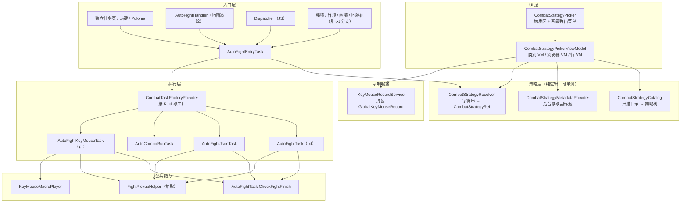
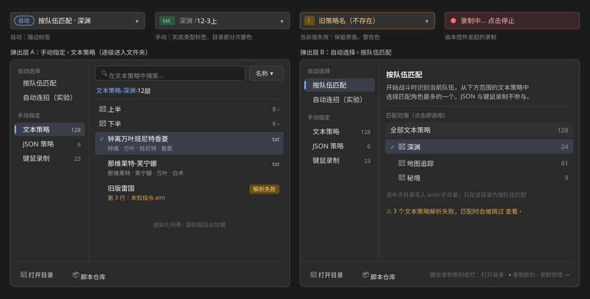
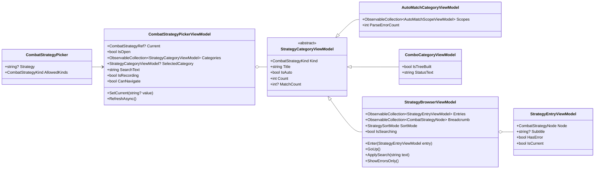
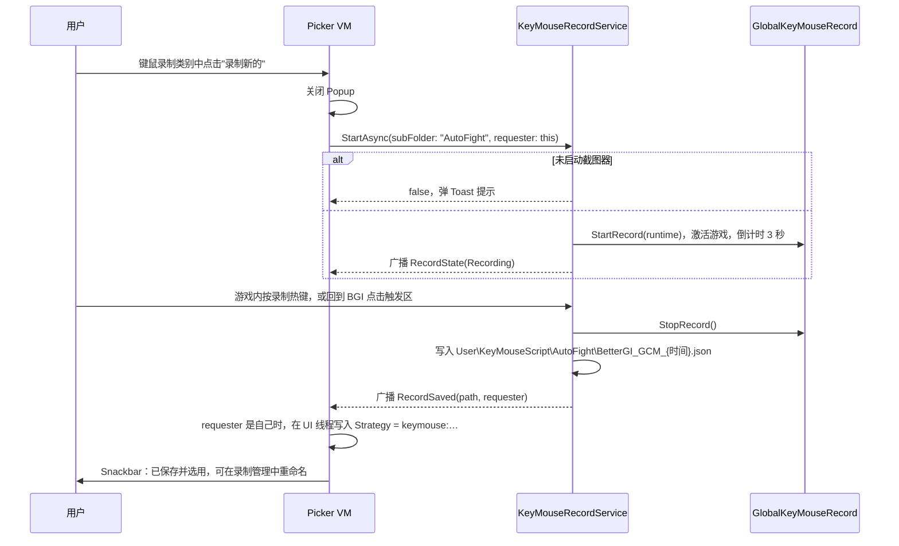

# 自动战斗策略统一：策略模型、键鼠录制实现与策略选择控件

状态：第 3 版（2026-10-23），评审问题已全部确认（第 12 节），可以开始实施。

版本记录：

- 第 1 版：选择控件是单层分组列表，加类型筛选。
- 第 2 版按评审意见修改：
  - 选择控件改为两级菜单。第一级区分"自动选择"和"手动指定"，第二级按类别定制内容。
  - 不复用 `CascadeSelector`，新建专用控件，UI 层允许复杂一些。第 8 节整节重写。
  - 策略目录改为树形，补充元数据的后台加载（5.5 节）。
  - 按队伍匹配新增"限定子目录"（5.2 节）。
- 第 3 版（本版）：第 12 节的 7 个问题全部确认，正文按结论定稿；界面示意图存入 `images/` 并在 8.3 节引用。

## 1. 结论

- **策略仍然只用一个字符串表示**。配置、调度器、Pulonia 参数、JS 都不改字段，只统一字符串的解析：
  - 新增 `CombatStrategyKind` 和 `CombatStrategyResolver.Parse(string) → CombatStrategyRef`，替代现有 6 份名称/路径换算；
  - 键鼠录制用前缀 `keymouse:` 表示。
- **按类型路由，不再按扩展名**。`ICombatTaskFactory.CanHandle(string)` 改为 `Kinds` 属性。键鼠录制也是 `.json`，只有这样才能和 JSON 策略共存。
- **一个入口**。`AutoFightEntryTask` 是唯一的"解析 → 路由 → 运行"入口。地图追踪、JS `dispatcher.runAutoFightTask`、秘境等任务的内嵌战斗都调用它，不再直接 new 具体实现。
- **第四个实现**。新增 `AutoFightKeyMouseTask`：循环回放录制宏，每轮之间做阵亡检测和战斗结束检测，战后拾取复用从 txt/JSON 抽出的公共逻辑。
- **一个专用选择控件**。新增 `CombatStrategyPicker`，点击后在原位弹出两级菜单：
  - 第一级分两组："自动选择"（按队伍匹配、自动连招）和"手动指定"（文本、JSON、键鼠录制），点击切换。按队伍匹配可以限定在某个子目录内（`auto:子目录`）。
  - 第二级：自动类别显示匹配方式说明、匹配范围和状态；手动类别是策略浏览器，支持搜索、文件夹逐级进入、虚拟化列表，每行带副标题（涉及角色、录制时长）。
  - 触发区用"自动"标签或类型标签区分两种模式。
  - 它替换现有 11 处"脚本仓库 + 打开目录 + ComboBox"。
- **录制服务化**。录制保存逻辑从 `KeyMouseRecordPageViewModel` 抽到 `KeyMouseRecordService`，录制页、热键、选择控件共用。从控件发起的录制，停止后自动选中新文件。
- **JS 兼容**。`AutoFightParam` 的构造函数和 `CombatStrategyPath` 属性、`dispatcher.runAutoFightTask`、`keyMouseScript.run/runFile` 签名都不变。变化只有两处：名称解析修正（只有 json 的策略名不再被拼成 `.txt`），以及新增 `keymouse:` 前缀。

## 2. 现状与问题

现有骨架：

```
AutoFightEntryTask（auto_fight）
  → CombatTaskFactoryProvider
      → Combo / Json / Txt 工厂
          → AutoComboRunTask / AutoFightJsonTask / AutoFightTask
```

三个实现都实现 `ISoloTask<AutoFightParam, NoData>`。方向是对的，问题在于没有收口：

| # | 问题 | 位置 |
| --- | --- | --- |
| P1 | 按扩展名路由，所有 `.json` 都交给 JSON 策略。键鼠录制也是 `.json`，无法接入 | `JsonCombatTaskFactory.CanHandle` |
| P2 | 名称到路径的换算有 6 份，规则不一致 | 见下表 |
| P3 | 地图追踪和 JS 不经过 `CombatStrategyResolver`，直接 `GetFactory(path)` | `AutoFightHandler.StartFight`、`Dispatcher.RunAutoFightTask` |
| P4 | 秘境、首领、幽境、地脉花各自用 `EndsWith(".json")` 分流，直接 new 实现 | `AutoDomainTask` 约 258 行、`AutoBossTask` 约 253 行、`AutoStygianOnslaughtTask` 约 175 行、`AutoLeyLineOutcropTask` 约 1297 行 |
| P5 | 策略列表有两套：一套递归读 txt+json，同名时出现两个分不清的项；另一套只读顶层 txt | `AutoFightViewModel.LoadCustomScript`、`PuloniaOneDragonSettingChoices.GetStrategies` |
| P6 | 下拉框平铺所有策略，策略多了很难找；看不出类型，也分不清自动和手动；每处都重复"脚本仓库 + 打开目录 + ComboBox + DropDownOpened 刷新" | 11 处，见 8.11 节 |
| P7 | 录制保存写在页面 VM 里（固定根目录、固定文件名），别处无法复用，也拿不到"保存完成"的结果 | `KeyMouseRecordPageViewModel.OnStopRecord` |
| P8 | 回放做视角修正时原地改写 `e.MouseX`。同一份事件列表回放多次，偏差会累积 | `KeyMouseMacroPlayer.PlayMacro` 的 MouseMoveBy 分支 |

P2 明细：

| 位置 | 普通名称怎么处理 | 文件不存在时 |
| --- | --- | --- |
| `AutoFightParam.SetCombatStrategyPath`（构造函数调用，JS 走这里） | 固定拼 `.txt` | 不检查 |
| `AutoDomainParam.SetCombatStrategyPath` | 固定拼 `.txt` | 不检查 |
| `AutoFightParam.ResolveStrategyPath` | 先找 `.json`，再找 `.txt` | 不检查 |
| `CombatStrategyResolver.TryResolve` | 同上；绝对路径直接用 | 返回 false |
| `TaskSettingsPageViewModel.GetFightStrategy` | 同上 | 弹 Toast，返回 true 表示失败 |
| `AutoFightHandler.GetFightStrategy` | 同上 | 抛异常 |

六处对"根据队伍自动选择"（返回目录）和连招名（原样返回）的处理一致。

后果：JS 里写 `new AutoFightParam("某个只有 json 的策略")`，得到的是 `...\某个.txt`，运行时报"战斗脚本文件不存在"。

## 3. 目标与非目标

目标：

1. 策略的引用、解析、路由统一。以后新增一种实现，只需加一个 Kind 和一个工厂。
2. 键鼠录制成为第四种战斗实现，独立自动战斗、地图追踪、调度器、JS 都能用。
3. 一个可复用的选择控件：区分自动和手动，策略多时依然好找，自带录制入口和录制页跳转。
4. JS 现有的调用方式全部可用。

非目标（本期不做）：

- 不改 txt、JSON、连招的战斗算法。
- 不迁移秘境、幽境自带的 txt 战斗循环（`StartFight`、`FindCombatScriptAndSwitchAvatar`），只把它们的分流改成按 Kind。
- "根据队伍自动选择"仍然只匹配 txt；JSON 和键鼠不参与按队伍匹配。
- 不改键鼠录制的文件格式。
- 控件不做拼音首字母搜索、不预览或编辑策略内容、不预测当前队伍会匹配到哪个策略（需要运行环境识别队伍）。
- JS 不按脚本工作目录解析录制文件的相对路径，只接受 `keymouse:` 相对路径（相对 `User\KeyMouseScript`）或绝对路径。
- 不处理战斗静态共享状态在多实例下的问题，例如 `FightStatusFlag`、`AutoFightSeek.RotationCount`、`KeyMouseMacroPlayer.WorkingArea`。这些另行设计。

## 4. 分层



| 层 | 职责 | 不做的事 |
| --- | --- | --- |
| UI 层 | 展示、浏览、选择、发起录制和跳转，结果写回绑定的字符串 | 不直接读目录、不解析文件，不直接调用 `GlobalKeyMouseRecord` |
| 策略层 | 把字符串解析成类型和路径；扫描目录得到策略树；读取元数据；生成要保存的规范值 | 不依赖 UI，也不依赖 `GameRuntime` |
| 录制服务 | 开始/停止录制，保存文件，广播状态和保存结果 | 不关心谁在用录制结果 |
| 入口层 | 构造 `AutoFightParam`，调用 `AutoFightEntryTask` | 不按扩展名分流，不直接 new 具体实现 |
| 执行层 | 按 Kind 创建实现并运行战斗 | 不认识策略名，只接收已解析的路径 |

新增文件（UI 层的文件见 8.7 节）：

| 文件 | 层 |
| --- | --- |
| `GameTask/AutoFight/Strategy/CombatStrategyKind.cs` | 策略层 |
| `GameTask/AutoFight/Strategy/CombatStrategyRef.cs` | 策略层 |
| `GameTask/AutoFight/Strategy/CombatStrategyResolver.cs`（由现有同名文件迁入并改写） | 策略层 |
| `GameTask/AutoFight/Strategy/CombatStrategyNode.cs` | 策略层 |
| `GameTask/AutoFight/Strategy/CombatStrategyCatalog.cs`（含 `CombatStrategyCatalogSnapshot`） | 策略层 |
| `GameTask/AutoFight/Strategy/CombatStrategyMetadataProvider.cs`（含 `CombatStrategyMetadata`） | 策略层 |
| `GameTask/AutoFight/AutoFightKeyMouseTask.cs` | 执行层 |
| `GameTask/AutoFight/Factory/KeyMouseCombatTaskFactory.cs` | 执行层 |
| `GameTask/AutoFight/FightPickupHelper.cs` | 公共能力 |
| `Core/Recorder/KeyMouseRecordService.cs`、`ViewModel/Message/KeyMouseRecordMessages.cs` | 录制服务 |

## 5. 策略模型

### 5.1 类型

`CombatStrategyKind` 是位标志枚举：单个值表示一种类型，组合值表示"允许哪些类型"，在 XAML 里可以直接写 `AllowedKinds="Txt, Json"`。

```csharp
/// <summary>战斗策略类型，决定由哪个战斗实现执行；可按位组合表示允许的类型集合</summary>
[Flags]
public enum CombatStrategyKind
{
    /// <summary>无</summary>
    None = 0,
    /// <summary>根据队伍自动选择：按队伍匹配目录下的全部 txt</summary>
    AutoSelect = 1,
    /// <summary>txt 文本策略</summary>
    Txt = 2,
    /// <summary>JSON 条件策略</summary>
    Json = 4,
    /// <summary>自动连招（LLM 行为树），不对应文件</summary>
    Combo = 8,
    /// <summary>键鼠录制宏</summary>
    KeyMouse = 16,
    /// <summary>全部类型</summary>
    All = AutoSelect | Txt | Json | Combo | KeyMouse,
    /// <summary>不含连招：首领、幽境、地脉花使用</summary>
    WithoutCombo = All & ~Combo,
}
```

AutoSelect 和 Combo 属于"自动选择"，Txt、Json、KeyMouse 属于"手动指定"。控件第一级的分组就按这个划分。

### 5.2 引用字符串

| 写法 | 解析为 | 执行用路径 | 说明 |
| --- | --- | --- | --- |
| 空、`根据队伍自动选择` | AutoSelect | `User\AutoFight\` | 现有 |
| `auto:子目录` | AutoSelect | `User\AutoFight\子目录\` | 新增。只在该子目录（含下级目录）内按队伍匹配 |
| `自动连招（实验）` | Combo | 原样 | 现有 |
| `名称`、`子目录\名称` | Json 或 Txt | 先找 `.json`，再找 `.txt` | 现有，优先级不变 |
| `名称.txt`、`名称.json` | Txt / Json | 对应文件 | 新增，同名并存时用来指定 txt |
| `keymouse:相对路径` | KeyMouse | `User\KeyMouseScript\相对路径`，`.json` 可省略 | 新增 |
| 绝对路径：目录 | AutoSelect | 原样 | 现有，JS 在用 |
| 绝对路径：`.txt` | Txt | 原样 | 现有 |
| 绝对路径：`.json` | KeyMouse 或 Json | 原样 | 见下方规则 |

`auto:子目录` 的执行端几乎不用改：`TxtCombatTaskFactory` 本来就接受目录，`CombatScriptParser.ReadAndParse` 对目录递归读取 txt。

绝对 `.json` 路径按以下规则判定：

1. 位于 `User\KeyMouseScript\` 下，判为 KeyMouse。
2. 位于 `User\AutoFight\` 下，判为 Json。
3. 都不是时，流式读取顶层属性名，有 `macroEvents` 的判为 KeyMouse，否则判为 Json。这是给 JS 传脚本目录里的文件用的。

`keymouse:` 和 `auto:` 都不会和策略名冲突，原因有两个：Windows 文件名不能包含 `:`；`Path.IsPathRooted("keymouse:...")` 为 false，不会被误当成盘符路径。相对路径经 `Path.GetFullPath` 归一化后必须仍位于对应根目录下，含 `..` 越界的视为不存在。

**规范值**是解析器能唯一还原到某个文件的最短写法。控件选中某项后写回的就是规范值：

| 选中项 | 写入 | 原因 |
| --- | --- | --- |
| 按队伍匹配·全部 | `根据队伍自动选择` | 与现在一致 |
| 按队伍匹配·子目录 | `auto:深渊` | 多级子目录写作 `auto:深渊\12层` |
| txt 或 json，且没有同名的另一种 | `名称` | 与现在一致，旧版本也能读 |
| txt，存在同名 json | `名称.txt` | 不带扩展名时会解析到 json |
| json，存在同名 txt | `名称` | json 本来就优先；若写 `名称.json`，旧版本会拼成 `名称.json.json` |
| 键鼠 | `keymouse:AutoFight\BetterGI_GCM_…`（去掉 `.json`） | |

`auto:`、`keymouse:` 和 `名称.txt` 是新写法，旧版本读不了，会报策略不存在。这只影响降级使用，不影响升级。

**幂等**：`Parse(Parse(v).Path)` 与 `Parse(v)` 的 Kind 和 Path 相同。入口会把解析结果写回 `param.CombatStrategyPath`，Dispatcher 和 Handler 可能再解析一次，结果不能变。

### 5.3 CombatStrategyRef

```csharp
/// <summary>解析后的战斗策略引用</summary>
/// <param name="Kind">策略类型（单一值）</param>
/// <param name="Path">执行用路径：文件或目录的绝对路径；连招为固定名称</param>
/// <param name="Value">规范值，界面选中后写回配置的字符串</param>
/// <param name="DisplayName">界面显示名，例如"按队伍匹配"、"深渊 / 12-3上"</param>
/// <param name="Exists">策略文件或目录是否存在；连招恒为 true</param>
public sealed record CombatStrategyRef(
    CombatStrategyKind Kind, string Path, string Value, string DisplayName, bool Exists);
```

### 5.4 CombatStrategyResolver

```csharp
/// <summary>把战斗策略引用字符串解析为类型与路径，全仓唯一的解析实现</summary>
public static class CombatStrategyResolver
{
    /// <summary>根据队伍自动选择的固定名称</summary>
    public const string AutoSelectName = "根据队伍自动选择";

    /// <summary>按队伍匹配限定子目录的前缀</summary>
    public const string AutoScopePrefix = "auto:";

    /// <summary>键鼠录制策略前缀</summary>
    public const string KeyMousePrefix = "keymouse:";

    /// <summary>解析引用字符串，不抛异常；不存在时 Exists 为 false，Path 仍按规则给出</summary>
    public static CombatStrategyRef Parse(string? value);

    /// <summary>解析并要求存在，不存在时抛出 FileNotFoundException</summary>
    public static CombatStrategyRef Resolve(string? value);
}
```

现有换算全部改为调用 `Parse` 或 `Resolve`：

| 现有 | 处理 |
| --- | --- |
| `AutoFightParam.SetCombatStrategyPath` | 方法签名不变，内部改为 `CombatStrategyPath = Parse(name).Path`。修复 P2 中"只有 json 的策略名被拼成 `.txt`"的问题 |
| `AutoDomainParam.SetCombatStrategyPath` | 同上 |
| `AutoFightParam.ResolveStrategyPath` | JS 能访问，保留为转发方法。返回的 type 取值多一个 `"keymouse"` |
| `CombatStrategyResolver.TryResolve` | 删除，调用方改用 `Parse(...).Exists` |
| `TaskSettingsPageViewModel.GetFightStrategy` | 保留 Toast 提示，内部改为 `Parse` |
| `AutoFightHandler.GetFightStrategy` | 删除，改走统一入口（6.3 节） |
| `SoloTaskSettingsViewModel.ToStrategyName` | 改为 `Parse(v).Value` |

### 5.5 策略目录与元数据

**策略树**。控件的第二级要按文件夹浏览，目录扫描的结果因此是树，不是平铺列表。

```csharp
/// <summary>策略目录树中的一个节点：文件夹或策略文件；构建后不再修改，可跨线程传递</summary>
public sealed class CombatStrategyNode
{
    /// <summary>显示名：文件夹名，或不含扩展名的文件名</summary>
    public required string Name { get; init; }

    /// <summary>相对所属根目录的路径，用于搜索、显示和重新定位</summary>
    public required string RelativePath { get; init; }

    /// <summary>是否为文件夹</summary>
    public bool IsFolder { get; init; }

    /// <summary>策略引用；文件夹为 null</summary>
    public CombatStrategyRef? Strategy { get; init; }

    /// <summary>创建时间（UTC），键鼠录制按它倒序排列</summary>
    public DateTime CreationTimeUtc { get; init; }

    /// <summary>最后修改时间（UTC），用于"最近修改"排序和元数据缓存失效</summary>
    public DateTime LastWriteTimeUtc { get; init; }

    /// <summary>子节点，文件夹在前；文件为空列表</summary>
    public IReadOnlyList<CombatStrategyNode> Children { get; init; } = [];

    /// <summary>子树中的策略文件总数；文件为 1</summary>
    public int FileCount { get; init; }
}
```

```csharp
/// <summary>一次目录扫描的结果，不可变</summary>
/// <param name="Roots">手动类别的根节点，键为 Txt / Json / KeyMouse 中被允许的类型</param>
/// <param name="AutoMatchScopes">按队伍匹配可选的范围：根目录，以及含 txt 的各级子目录</param>
public sealed record CombatStrategyCatalogSnapshot(
    IReadOnlyDictionary<CombatStrategyKind, CombatStrategyNode> Roots,
    IReadOnlyList<CombatStrategyNode> AutoMatchScopes);

/// <summary>扫描战斗策略目录，供选择控件和 Pulonia 参数编辑使用</summary>
public static class CombatStrategyCatalog
{
    /// <summary>在线程池扫描目录，只读文件名和时间，不读内容；目录不存在时返回空树，不创建目录</summary>
    public static Task<CombatStrategyCatalogSnapshot> LoadAsync(CombatStrategyKind allowedKinds, CancellationToken ct);

    /// <summary>按深度优先平铺子树中的策略文件</summary>
    public static IEnumerable<CombatStrategyNode> Flatten(CombatStrategyNode root);
}
```

- txt 和 json 来自 `User\AutoFight`，键鼠录制来自 `User\KeyMouseScript`，都递归子目录。
- 用 `Directory.EnumerateFileSystemEntries` 配合 `EnumerationOptions { RecurseSubdirectories = true, IgnoreInaccessible = true }`。
- 没有任何策略文件的子目录不出现在树里。
- 替代 `AutoFightViewModel.LoadCustomScript`（战斗部分）和 `PuloniaOneDragonSettingChoices.GetStrategies`，也就修掉了 P5。

**元数据**。列表每行的副标题需要读取文件内容，单独放在后台加载，不阻塞列表显示。

```csharp
/// <summary>策略文件的附加信息，用于列表副标题和提示</summary>
/// <param name="Summary">副标题：txt/json 为涉及角色，键鼠为时长与事件数</param>
/// <param name="Error">解析失败原因；成功时为 null</param>
public sealed record CombatStrategyMetadata(string Summary, string? Error);

/// <summary>在后台读取策略元数据；进程内按路径和最后修改时间缓存</summary>
public static class CombatStrategyMetadataProvider
{
    /// <summary>读取一批文件的元数据，单次最多 200 个，并行度 2；已缓存且未修改的直接返回</summary>
    public static Task<IReadOnlyDictionary<string, CombatStrategyMetadata>> GetAsync(
        IReadOnlyList<CombatStrategyNode> files, CancellationToken ct);
}
```

| 类型 | 副标题 | 读取方式 |
| --- | --- | --- |
| txt | 涉及角色，如"钟离 · 万叶 · 班尼特 · 香菱" | `CombatScriptParser.Parse(path).AvatarNames`；失败时 `Error` 为异常信息 |
| json | 作者和涉及角色，如"作者 某某 · 那维莱特 · 芙宁娜" | `JsonCombatStrategyParser.ParseFile(path)` 的 `Info.Author` 和 `GetCharacterNames()` |
| 键鼠 | "时长 1:23 · 412 个事件" | `Utf8JsonReader` 流式读取 `macroEvents`，取最后一个 `time`；文件超过 5 MB 只显示文件大小 |

并行度限制为 2，是因为打开控件时游戏可能正在运行，不宜占满 CPU。txt 解析失败在现在的"根据队伍自动选择"里只会打一条警告日志，用户很难发现；副标题直接显示错误，问题能提前暴露。

## 6. 统一执行接口

### 6.1 合同不变

所有实现继续实现 `ISoloTask<AutoFightParam, NoData>`，结果约定沿用现状：

- 正常结束返回 `Unverified`；
- 队伍与策略不匹配时返回 `Skipped`；
- 策略不存在时，由入口返回 `Failed(StrategyNotFound)`；
- 取消时抛 `OperationCanceledException`；
- `RetryException` 原样上抛，由 PathExecutor 重跑当前路径段。

### 6.2 工厂

```csharp
/// <summary>战斗策略工厂接口</summary>
public interface ICombatTaskFactory
{
    /// <summary>本工厂处理的策略类型，可按位组合</summary>
    CombatStrategyKind Kinds { get; }

    /// <summary>创建对应策略类型的战斗任务；战斗参数在调用 RunAsync 时传入</summary>
    ISoloTask<AutoFightParam, NoData> CreateTask(GameRuntime runtime, AllConfig config);
}
```

| 工厂 | Kinds | 实现 |
| --- | --- | --- |
| `TxtCombatTaskFactory` | `AutoSelect \| Txt` | `AutoFightTask` |
| `JsonCombatTaskFactory` | `Json` | `AutoFightJsonTask` |
| `ComboCombatTaskFactory` | `Combo` | `AutoComboRunTask` |
| `KeyMouseCombatTaskFactory`（新） | `KeyMouse` | `AutoFightKeyMouseTask` |

`CombatTaskFactoryProvider` 的变化：

- 改为 `GetFactory(CombatStrategyKind kind)`，注册顺序不再影响结果。
- 删除公开的 `RegisterFactory`。仓内没有外部调用，而且底层的 `List` 不是线程安全的；改为在静态构造里固定注册。

### 6.3 统一入口

`AutoFightEntryTask.RunAsync` 的流程：

1. `var s = CombatStrategyResolver.Parse(param.CombatStrategyPath)`；`!s.Exists` 时返回 `Failed(StrategyNotFound)`。
2. `param.CombatStrategyPath = s.Path`。
3. `CombatTaskFactoryProvider.GetFactory(s.Kind).CreateTask(_runtime, _config).RunAsync(param, ct)`。

调用方改造：

| 调用方 | 现在 | 改为 |
| --- | --- | --- |
| 独立任务页、热键、Pulonia | `AutoFightEntryTask` | 不变 |
| `AutoFightHandler.StartFight`（地图追踪 fight） | 自己解析路径，再 `GetFactory(path)` | 调用 `new AutoFightEntryTask(...).RunAsync`。结果为 `Failed` 时抛异常，保持"策略不存在就抛异常"的原语义 |
| `Dispatcher.RunAutoFightTask`（JS） | `GetFactory(path)` | 同上；`StrategyNotFound` 抛异常，其他失败记日志（`LogIfFailed`） |
| 秘境、首领、幽境、地脉花 | `EndsWith(".json")` 分流 | 改为按 `Parse(...).Kind` 分流：Txt 和 AutoSelect 保持原逻辑；其余类型走 `AutoFightEntryTask`，参数沿用现有 JSON 分支（关闭自带结束检测和拾取，由外部取消结束战斗）。秘境的连招分支不变 |

### 6.4 各入口可用的类型

| 入口 | 自动选择 | txt | JSON | 连招 | 键鼠 |
| --- | --- | --- | --- | --- | --- |
| 独立自动战斗、地图追踪、调度器、JS | ✓ | ✓ | ✓ | ✓ | ✓（新） |
| 自动秘境 | ✓ | ✓ | ✓ | ✓ | ✓（新） |
| 首领、幽境、地脉花 | ✓ | ✓ | ✓ | ✗ | ✓（新） |

选择控件的 `AllowedKinds` 按这张表设置。

## 7. 键鼠录制战斗实现

### 7.1 文件

- 格式不变，仍是 `KeyMouseScript`。这个模型已经用 System.Text.Json 序列化过，读写继续用 STJ 和 `KeyMouseRecorder.JsonOptions`。
- 整个 `User\KeyMouseScript\` 目录下的录制都可以选。
- 从控件发起的录制保存到 `User\KeyMouseScript\AutoFight\`，文件命名规则不变。保存后的引用值形如 `keymouse:AutoFight\BetterGI_GCM_202610231530001234`。

### 7.2 执行流程

```
AutoFightKeyMouseTask.RunAsync(param, ct)
 1. 读文件并用 STJ 反序列化，按当前截图区域和 DPI 做一次 Adapt
    事件为空时返回 Skipped("empty_macro")
 2. 建立令牌：
    fightCts 关联 ct，按 param.Timeout 设置 CancelAfter
    finally 中 Cancel 并 Dispose
 3. 准备战斗状态：
    FightStartTime = Now；ResetSkipCheckCounter()
    SetCurrentAutoFightParam(param)
    FightStatusFlag = true（游泳检测依赖它）
    按需启动 ExperienceDetector，与 txt 相同
 4. 循环：
    a. PlayMacro(runtime, events, fightCts.Token)
    b. InputHub.ReleaseAll()                      宏可能停在按键按下的状态
    c. 外部 ct 已取消时抛 OperationCanceledException
       只有 fightCts 被取消，说明超时，结束循环
    d. 等待 100ms 再截图，然后 Avatar.ThrowWhenDefeated(...)
       阵亡或游泳时抛 RetryException，原样上抛
    e. 开启结束检测时调用 CheckFightFinish(DelayTime, DetectDelayTime)
       返回 true 时结束循环；没开结束检测就继续下一轮
 5. finally：
    ReleaseAll；FightStatusFlag = false
    停止经验检测；ClearCurrentAutoFightParam()
 6. 战后拾取：FightPickupHelper
    需要队伍时才调用 GetCombatScenesWithRetry，用完释放
 7. 返回 Unverified("战斗结束")
```

- 第 4d 步满足 AGENTS 的要求：键鼠操作之后、识图之前必须延时。
- 超时用 `CancelAfter` 实现，长宏回放到一半也能停下。
- 外部取消和超时的区分方法：外部 `ct` 是否已经取消。

### 7.3 参数适用

| `AutoFightParam` 字段 | 键鼠实现中的处理 |
| --- | --- |
| `Timeout` | 生效，作为总时长上限 |
| `FightFinishDetectEnabled`、`FinishDetectConfig` | 生效，每轮回放后检测一次。快速检测参数（`FastCheck*`、`CheckAfterSwitchAvatar`）依赖"换人"，不适用 |
| `FinishDetectConfig.RotateFindEnemyEnabled` | 强制关闭。旋转寻敌会改变视角，录制宏只能修正 ±8° 以内的偏差 |
| `EnableCombatTargeting` | 强制关闭。索敌循环会并发点击鼠标中键，和录制的输入冲突 |
| 万叶/琴拾取、`ExpBasedPickupEnabled`、`PickDropsAfterFight*` | 生效，走 `FightPickupHelper` |
| `BattleThresholdForLoot` | 不适用（没有"战斗人次"），视为已满足 |
| `ActionSchedulerByCd`、`Guardian*`、`BurstEnabled`、`CheckBeforeBurst`、`IsFirstCheck` | 不适用，忽略 |

`FightFinishDetectEnabled` 为 false 时一直循环，直到超时或外部取消。这和 txt 的行为一致，秘境等由外部结束战斗的入口也依赖这个语义。只想单次回放，可以用调度器的键鼠脚本项或 `keyMouseScript.run`。

### 7.4 对现有代码的修改

- `KeyMouseMacroPlayer.PlayMacro`：视角修正改用局部变量，不再写回 `e.MouseX`（修 P8）。
- `FightPickupHelper`：txt（`AutoFightTask` 约 628-870 行）和 JSON（`AutoFightJsonTask.PostFightPickup`）的战后拾取基本相同，逐行比对后合并成一份，三种实现共用。这一步只抽取、不改行为，可以单独提交。

### 7.5 风险

- 录制宏依赖起始站位和视角，而地图追踪战斗点的朝向不固定，效果取决于录制质量。界面提示"适合站位固定的场景，例如秘境、首领"。
- 只在两轮之间检测阵亡。界面提示单段宏建议不超过 20 秒。
- 多实例并发回放时，`KeyMouseMacroPlayer.WorkingArea` 是共享的静态状态。这属于非目标，这里只记录。

## 8. 策略选择控件 CombatStrategyPicker

### 8.1 选型

| 方案 | 结论 | 原因 |
| --- | --- | --- |
| 分组 ComboBox | 否 | 仍是单层平铺，策略多时列表很长；放不下搜索框和操作按钮 |
| 复用 `CascadeSelector` | 否 | 见下 |
| **新建专用控件：原位弹出的两级菜单** | 采用 | 第一级区分自动/手动和类型，第二级按类别定制内容；关闭时占位和 ComboBox 一样 |
| 模态选择窗口 | 否 | 太重；调度器配置组、Pulonia 设置本身就是模态窗口，会再套一层 |

不复用 `CascadeSelector` 的原因（读过 `View/Controls/CascadeSelector.xaml(.cs)`）：

- 数据是 `Dictionary<string, List<string>>`，条目只能是字符串，放不下类型标签、副标题、警告状态。
- 固定两列，第二级没有文件夹层级，也没有搜索、排序、空状态和底栏操作。
- 选择逻辑写在 `SelectionChanged` 事件里，选中即关闭；第一级没法承载"自动方式的说明和范围"。
- 两个列表都设置了 `ScrollViewer.CanContentScroll="False"`，这会关掉虚拟化，条目多时会卡。
- Pulonia 的两个参数模板在用它，大改会影响它们。

可以沿用的部分：Popup（`StaysOpen=False`）加圆角边框和阴影的视觉样式；Popup 打开期间拦截窗口滚轮、防止滚动穿透的做法。滚轮拦截改写成 Behavior。

### 8.2 两级结构

```
第一级：类别                 第二级：内容
── 自动选择 ──
  按队伍匹配           →  说明 + 匹配范围（全部文本策略 / 子目录）
  自动连招（实验）     →  说明 + 建树状态
── 手动指定 ──
  文本策略     128     →  策略浏览器：搜索、面包屑、文件夹、策略
  JSON 策略      6     →  策略浏览器
  键鼠录制      23     →  策略浏览器，底栏带录制入口
```

规则：

1. **第一级只切换，不选择**。选择只发生在第二级。这样自动和手动的边界清楚，切换类别也不会误改配置。
2. **点击切换，不做悬停切换**。第二级里有搜索框和滚动列表，鼠标斜着移过去时，悬停切换很容易误触。
3. 只显示 `AllowedKinds` 包含的类别。类别为空也显示（计数 0），第二级给出引导。
4. 同名的 txt 和 json 分属不同类别，自然就分开了，不需要在一个列表里靠标签区分。
5. 第二级可以逐级进入文件夹，当前位置用面包屑表示。菜单本身始终只有两级，弹出层尺寸固定，不会随层级变宽。
6. 界面上叫"按队伍匹配"。存储值仍是 `根据队伍自动选择`，不改。

### 8.3 外观



**触发区**：宽 240、高 32，与现有 ComboBox 对齐。左侧标签区分模式：

| 状态 | 显示 |
| --- | --- |
| 按队伍匹配，全部 | `[自动] 按队伍匹配` |
| 按队伍匹配，子目录 | `[自动] 按队伍匹配 · 深渊` |
| 自动连招 | `[自动] 自动连招（实验）`。未建树时右侧加警告图标，提示文字说明原因 |
| 手动 | `[txt] 深渊 / 12-3上`。类型标签为实底；目录部分用次要文字色，名称过长时从中间省略 |
| 当前值失效 | `[!] 旧策略名（不存在）`，警告色，保留原值 |
| 录制中（本控件发起） | `[●] 录制中… 点击停止` |

"自动"标签是描边样式，类型标签是实底样式，两者同时有文字，不只靠颜色区分。悬停提示显示规范值、完整路径和副标题。

**弹出层**：600 × 460，左栏 160，右栏 440。默认显示在触发区下方，空间不够时由 Popup 自动翻到上方；最大高度不超过所在屏幕的工作区。

```
┌──────────────┬──────────────────────────────────────────┐
│ 自动选择      │ 🔍 在文本策略中搜索…            [名称 ▾] │
│  按队伍匹配   │ 文本策略 › 深渊 › 12层                    │
│  自动连招     ├──────────────────────────────────────────┤
│ 手动指定      │ 📁 上半                             8  › │
│▌文本策略  128 │ 📁 下半                             6  › │
│  JSON 策略  6 │ ✓ 钟离万叶班尼特香菱                 txt │
│  键鼠录制  23 │   钟离 · 万叶 · 班尼特 · 香菱            │
│               │   那维莱特-芙宁娜                    txt │
│               │   那维莱特 · 芙宁娜 · 万叶 · 白术        │
│               │   旧版雷国                    [解析失败] │
│               │   第 3 行：未知指令 aim                  │
├──────────────┴──────────────────────────────────────────┤
│ 📁 打开目录    📦 脚本仓库                               │
└─────────────────────────────────────────────────────────┘
```

### 8.4 第二级：策略浏览器（手动类别）

**顶部**：搜索框和排序切换。

- 排序有"名称"和"最近修改"两种。txt、json 默认按名称；键鼠录制默认按创建时间倒序，与录制页一致。

**面包屑**：`文本策略 › 深渊 › 12层`，每一段都可点击。

**列表**：

- 文件夹在前。每行显示文件夹名、子树策略数和 `›`，点击进入。
- 策略在后，两行：名称加类型标签，副标题来自元数据。解析失败的行显示"解析失败"标签，副标题是错误原因，但仍然可以选（与现在的行为一致，运行时报错）。
- 当前选中的策略打 ✓ 并高亮。
- 使用 `ListBox` 加 `VirtualizingStackPanel`（`VirtualizationMode=Recycling`），并设置 `ScrollViewer.CanContentScroll="True"`。这个属性为 False 会让虚拟化失效。

**打开时定位**：根据当前值进入它所在的文件夹，选中该项并滚动到可见区域。当前值失效时停在根目录，顶部固定一行警告"当前值不存在：xxx"。

**搜索**：

- 输入后 150ms 防抖。在当前类别的整棵子树里按名称和相对路径不区分大小写匹配，结果平铺显示，副标题换成相对路径。
- 搜索期间面包屑换成"搜索结果 · N 项"；清空后回到搜索前的文件夹。
- 第一级各类别的计数同步变成匹配数。当前类别没有结果时，显示"在 JSON 策略中找到 2 项"，点击直接跳过去。
- 搜索在内存快照上做，不访问磁盘。
- 另有"只看解析失败"过滤，从按队伍匹配页的警告进入（8.5 节），结果显示方式与搜索相同，清空后退出。

**空状态**：

- 文本/JSON：显示"还没有策略。把文件放进目录，或从脚本仓库订阅"，以及两个按钮。
- 键鼠录制：显示"还没有录制"，以及录制按钮。

**底栏**：

| 类别 | 按钮 |
| --- | --- |
| 文本、JSON | 打开目录（打开当前浏览的文件夹）、脚本仓库 |
| 键鼠录制 | 打开目录、⏺ 录制新的、录制管理 → |

"录制管理"跳转到 `KeyMouseRecordPage`。宿主窗口不是主窗口时（调度器配置组、Pulonia 设置都是模态窗口，主窗口这时无法操作）隐藏这个按钮，录制按钮保留。

### 8.5 第二级：自动类别

**按队伍匹配**：

- 说明：开始战斗时识别当前队伍，从下方范围内的文本策略中，选匹配角色最多的一个；JSON 策略和键鼠录制不参与。
- 匹配范围列表，点击一行即选中并关闭：
  - `全部文本策略 · 128`
  - 各个含 txt 的子目录，例如 `📁 深渊 · 24`，选中后写入 `auto:深渊`。多级子目录按树形缩进展示，数量是该子树内的 txt 总数
- 范围内有解析失败的文件时，显示"3 个文本策略解析失败，匹配时会被跳过"，点击跳到文本策略类别并打开"只看解析失败"过滤。
- 这一页会触发范围内 txt 的元数据加载，单次上限 200 个，超出部分的解析失败数不统计并注明。

**自动连招（实验）**：

- 说明：使用 LLM 行为树自动出招，需要先运行一次"自动连招建树"。
- 状态读取 `AutoComboRuntime.Session`：已建树时显示队伍成员；未建树时显示警告。
- "使用自动连招"按钮。未建树也允许选，运行时由 `ComboCombatTaskFactory` 提示，与现在的行为一致。

### 8.6 键盘、焦点与无障碍

| 按键 | 行为 |
| --- | --- |
| 触发区 Enter / Space / Alt+↓ | 打开 |
| ↑ ↓ | 在当前栏内移动 |
| → | 左栏：焦点移到右栏。右栏文件夹：进入 |
| ← / Backspace | 右栏：返回上一级；已在根目录时焦点回到左栏 |
| Enter | 右栏：文件夹进入，策略或范围行选中并关闭 |
| 在列表上直接输入字符 | 焦点跳到搜索框并带上这个字符 |
| Esc | 搜索框非空时清空，否则关闭 |
| Tab | 左栏 → 搜索框 → 列表 → 底栏，循环 |

- 打开时，手动类别的焦点在搜索框，自动类别的焦点在第一行。
- 关闭后焦点回到触发区。
- `AutomationProperties.Name`：
  - 触发区："战斗策略：{模式} {名称}"；
  - 左栏："策略类别"；右栏列表："{类别}，{当前文件夹}"。
- 类型标签、"自动"标签、警告都有文字，不只依赖颜色。

### 8.7 组件结构



文件（View 放在 `View/Controls/CombatStrategy/`，ViewModel 放在新目录 `ViewModel/Controls/CombatStrategy/`）：

| 文件 | 职责 |
| --- | --- |
| `CombatStrategyPicker.xaml(.cs)` | 触发区和 Popup 宿主；依赖属性 `Strategy`（默认双向绑定）、`AllowedKinds`（默认 `All`） |
| `CombatStrategyPickerPanel.xaml(.cs)` | 弹出层：左栏按 `IsAuto` 分组的类别列表，右栏 `ContentControl` 和底栏 |
| `StrategyBrowserView.xaml(.cs)` | 右栏：策略浏览器 |
| `AutoMatchView.xaml(.cs)`、`ComboView.xaml(.cs)` | 右栏：两个自动类别 |
| `CombatStrategyPickerResources.xaml` | 行模板、类型标签和"自动"标签样式、按类别 VM 类型匹配的隐式 DataTemplate |
| `PopupScrollIsolationBehavior.cs` | Popup 打开期间拦截窗口滚轮，只滚动鼠标下方的列表 |
| `TypeToSearchBehavior.cs` | 列表上输入字符时，把焦点和字符转给搜索框 |
| `CombatStrategyPickerViewModel.cs` | 根 VM：当前值、开关、类别集合、搜索词、录制状态、跳转 |
| `StrategyCategoryViewModel.cs` | 类别基类 |
| `AutoMatchCategoryViewModel.cs`（含小类 `AutoMatchScopeViewModel`） | 按队伍匹配 |
| `ComboCategoryViewModel.cs` | 自动连招 |
| `StrategyBrowserViewModel.cs`（含枚举 `StrategySortMode`） | 浏览器：当前文件夹、面包屑、排序、搜索、元数据请求 |
| `StrategyEntryViewModel.cs` | 浏览器中的一行 |

约定：

- 右栏按 `SelectedCategory` 的运行时类型选择 DataTemplate，加一种类别只需要加一个 VM 和一个 View。
- 类别 VM 不直接修改当前值。构造时传入一个回调，选中后由根 VM 统一设置 `Current`、写回依赖属性、关闭 Popup。
- 代码后置只做两件事：依赖属性和 VM 之间的同步（`Strategy` 变化时调用 `SetCurrent`，VM 选中后写回 `Strategy`）；在 `Loaded`/`Unloaded` 中通知 VM 挂接和释放。
- 其他交互都用 Behaviors 和绑定实现：
  - Popup 的 `Opened`/`Closed` 通过 `EventTrigger` + `InvokeCommandAction` 调用 VM 命令；
  - 按键用 `KeyBinding`；
  - ToggleButton 的 `IsChecked` 与 `IsOpen` 双向绑定。
- 控件写在 XAML 里，需要无参构造。VM 由控件自己创建，每个实例一个，不注册为 DI 单例。`KeyMouseRecordService` 和 `INavigationService` 通过 `App.GetService` 获取。

### 8.8 数据加载与线程

1. **打开**：
   - 根 VM 取消上一次加载（Cancel 后 Dispose 旧的 CTS），新建 CTS，然后调用 `CombatStrategyCatalog.LoadAsync`。
   - 已有上次的快照时先直接显示，加载完成后再替换；第一次打开时右栏显示加载中。
2. **应用快照**：在 UI 线程更新类别计数；浏览器按之前的 `RelativePath` 重新定位文件夹，文件夹已不存在时退回根目录。
3. **元数据**：
   - 浏览器的条目变化后（进入文件夹、搜索、排序），为其中的策略文件请求元数据，单次最多 200 个，回到 UI 线程后按路径填入副标题。
   - 每次请求使用独立的 CTS，下一次请求或 Popup 关闭时取消上一次。
4. **关闭**：取消所有未完成的加载，保留快照供下次打开时立即显示。
5. **卸载**：控件 `Unloaded` 时取消并释放所有 CTS，注销消息订阅。设置页里的控件可能随 CardExpander 或页面切换反复 Loaded/Unloaded，订阅必须成对挂接和释放。
6. **异常**：后台加载失败时记 Warning 日志，右栏显示"读取目录失败：原因"和重试按钮，不抛到 UI 线程。

规模估计：扫描几千个文件名在百毫秒以内；搜索在内存上做线性匹配，有防抖；列表虚拟化；元数据分批、限并发并缓存。策略很多时，主要成本是元数据，而它只针对当前看到的那一批文件。

### 8.9 录制流程



- 停止后不弹出命名对话框，避免模态窗口盖在游戏上抢焦点。
- 再次打开弹出层时，自动停在"键鼠录制 › AutoFight"，新文件高亮。
- 发起录制的控件已卸载（例如配置窗口已关闭）时，文件照常保存，但不会被自动选中。
- 录制进行中，所有控件的录制按钮都禁用。
- 没有配置录制热键时，录制按钮旁提示"可在热键设置中配置键鼠录制热键"。

### 8.10 KeyMouseRecordService

```csharp
/// <summary>键鼠录制服务：录制页、热键、策略选择控件共用，DI 单例</summary>
public sealed class KeyMouseRecordService
{
    /// <summary>是否正在录制</summary>
    public bool IsRecording { get; }

    /// <summary>开始录制；没有运行环境时提示并返回 false</summary>
    /// <param name="subFolder">保存子目录（相对 User\KeyMouseScript），为空时保存到根目录</param>
    /// <param name="requester">发起方，保存完成的消息里原样带回</param>
    public Task<bool> StartAsync(string? subFolder = null, object? requester = null);

    /// <summary>停止录制并保存，返回保存路径；不在录制中时返回 null</summary>
    public string? Stop();
}
```

- 内部封装 `GlobalKeyMouseRecord.Instance` 和 `GameRuntimeService`，文件命名规则不变。
- 通过 `WeakReferenceMessenger` 广播两种消息：`KeyMouseRecordStateChangedMessage(bool IsRecording)` 和 `KeyMouseRecordSavedMessage(string Path, object? Requester)`。服务是单例，用弱引用消息是为了不让它持有控件实例，避免泄漏。
- 热键回调可能不在 UI 线程上，服务统一通过 `UIDispatcherHelper.Invoke` 发送消息。
- `KeyMouseRecordPageViewModel` 和 `HotKeyPageViewModel` 的录制热键改为调用服务，页面通过消息刷新列表和 `IsRecording`。

### 8.11 替换清单

| # | 位置 | 绑定 | AllowedKinds |
| --- | --- | --- | --- |
| 1 | `TaskSettingsPage.xaml` 自动战斗（约 446 行） | `Config.AutoFightConfig.StrategyName` | `All` |
| 2 | `TaskSettingsPage.xaml` 自动秘境（约 1409 行） | `Config.AutoFightConfig.StrategyName` | `All` |
| 3 | `TaskSettingsPage.xaml` 首领讨伐（约 1879 行） | `Config.AutoBossConfig.StrategyName` | `WithoutCombo` |
| 4 | `TaskSettingsPage.xaml` 幽境危战（约 2211 行） | `Config.AutoStygianOnslaughtConfig.StrategyName` | `WithoutCombo` |
| 5 | `TaskSettingsPage.xaml` 地脉花（约 2835 行） | `Config.AutoLeyLineOutcropConfig.FightConfig.StrategyName` | `WithoutCombo` |
| 6 | `ScriptGroupConfigView.xaml`（约 978 行） | `PathingConfig.AutoFightConfig.StrategyName` | `All` |
| 7 | `OneDragonFlowPage.xaml`（约 1203 行） | `SelectedConfig.AutoBossStrategyName` | `WithoutCombo` |
| 8 | `AutoDomainSettingsView.xaml` | `StrategyName` | `All` |
| 9 | `AutoBossSettingsView.xaml` | `StrategyName` | `WithoutCombo` |
| 10 | `AutoStygianOnslaughtSettingsView.xaml` | `StrategyName` | `WithoutCombo` |
| 11 | Pulonia 参数字段 `strategy_name` / `combat_strategy_path` | 字段值 | 秘境和自动战斗为 `All`，其余 `WithoutCombo` |

第 11 项涉及两处编辑器，都改为新增一种"战斗策略"字段形态，不再走通用下拉：

- 任务参数编辑：`PuloniaTaskParameterFieldViewModel` 的 `PuloniaTaskParameterEditorKind` 新增 `CombatStrategy`，与现有的 `Choice` 并列。
- 一条龙参数字段：`PuloniaOneDragonParameterResources.xaml` 约 57 行的 `IsChoice` 模板旁，新增一个 `IsCombatStrategy` 形态。

替换后删除：

- `AutoFightViewModel` 中的 `CombatStrategyList`、`CombatStrategyListWithoutCombo`、`BuildCombatStrategyList*`，以及 `OnStrategyDropDownOpened` 的 `"Combat"` 分支。七圣召唤的 `StrategyList` 保留。
- 这些行上的"脚本仓库""打开目录"按钮，它们已经在弹出层底栏里。
- `PuloniaOneDragonSettingChoices.GetStrategies`，以及它对 `strategy_name`、`combat_strategy_path` 的选项映射。

### 8.12 风险

- **Popup 内的中文输入**：`StaysOpen=False` 的 Popup 不是激活窗口，里面的 TextBox 在部分输入法下可能无法输入中文。实现第一步就要验证。不行就把宿主从 Popup 换成无边框的从属窗口（`WindowStyle=None`、`ShowActivated=True`、`Deactivated` 时关闭），面板和 VM 不用改。这也是面板单独做成 `CombatStrategyPickerPanel` 的原因之一。
- **跳转录制页**：`KeyMouseRecordPage` 是嵌套的子菜单项，`INavigationService.Navigate(typeof(KeyMouseRecordPage))` 能否命中尚未验证；命中不了就改用 `INavigationWindow.Navigate`。
- **页面上的实例数**：独立任务页有 5 个控件。它们只在打开弹出层时加载目录，关闭状态下只做一次 `Parse`（检查单个文件是否存在），开销可以忽略。

## 9. JS 兼容

| JS 用法 | 现在 | 之后 |
| --- | --- | --- |
| `new AutoFightParam()` | 用全局策略 | 不变 |
| `new AutoFightParam("名称")` | 固定拼 `.txt`，只有 json 时失败 | 先找 json 再找 txt（修复） |
| `new AutoFightParam("名称.txt")` | 拼成 `名称.txt.txt`，失败 | 支持 |
| `new AutoFightParam("keymouse:xxx")` | 不支持 | 新增 |
| `new AutoFightParam("auto:子目录")` | 不支持 | 新增 |
| `new AutoFightParam(绝对路径, config)` | 按扩展名路由 | 按 Kind 路由；键鼠文件可以直接传绝对路径，通过内容判定 |
| `param.CombatStrategyPath = "..."` | 直接作为路径使用 | 运行时由入口解析，5.2 节的写法都接受 |
| `AutoFightParam.ResolveStrategyPath(name)` | 返回 `(path, "json"/"txt"/"combo")` | 保留为转发，type 多一个 `"keymouse"` |
| `dispatcher.runAutoFightTask(param)` | 策略不存在时抛异常 | 仍抛异常；其他失败记日志 |
| `dispatcher.runCombatScript(...)` | | 不变 |
| `keyMouseScript.run(json)` / `runFile(path)` | 单次回放 | 不变 |

示例：

```js
// 用录制的键鼠宏打一场，开启战斗结束检测
const param = new AutoFightParam("keymouse:AutoFight\\BetterGI_GCM_202610231530001234");
param.FightFinishDetectEnabled = true;
await dispatcher.runAutoFightTask(param);
```

## 10. 实施步骤

每一步都能单独编译、单独提交。

| 步骤 | 内容 | 主要文件 | 行为变化 |
| --- | --- | --- | --- |
| 1. 策略解析 | 新增 Kind、Ref、Resolver；`AutoFightParam`、`AutoDomainParam`、`GetFightStrategy`、`ToStrategyName` 改用 Resolver | `GameTask/AutoFight/Strategy/*`、`AutoFightParam.cs`、`AutoDomainParam.cs`、`TaskSettingsPageViewModel.cs`、`SoloTaskSettingsViewModel.cs` | 修复 json 策略名解析；支持显式扩展名 |
| 2. 路由收口 | 工厂改为 `Kinds`；Provider 按 Kind 取工厂；Handler 和 Dispatcher 走入口；秘境等四个任务按 Kind 分流 | `Factory/*`、`AutoFightEntryTask.cs`、`AutoFightHandler.cs`、`Dispatcher.cs`、四个任务类 | 无 |
| 3. 拾取抽取 | 新增 `FightPickupHelper`，txt 和 JSON 改为调用它 | `AutoFightTask.cs`、`AutoFightJsonTask.cs`、`FightPickupHelper.cs` | 无 |
| 4. 键鼠实现 | `AutoFightKeyMouseTask`、`KeyMouseCombatTaskFactory`；修复 `PlayMacro` 改写事件的问题 | 见第 7 节 | 新功能 |
| 5. 录制服务 | `KeyMouseRecordService` 和消息；录制页、热键改用服务 | `Core/Recorder/*`、`KeyMouseRecordPageViewModel.cs`、`HotKeyPageViewModel.cs`、`App.xaml.cs` | 无 |
| 6. 策略目录 | `CombatStrategyNode`、`CombatStrategyCatalog`、`CombatStrategyMetadataProvider` | `GameTask/AutoFight/Strategy/*` | 无 |
| 7. 选择控件 | 第 8.7 节的 View、VM、Behavior；先在独立任务页的自动战斗一处接入，验证中文输入、键盘操作和录制流程 | `View/Controls/CombatStrategy/*`、`ViewModel/Controls/CombatStrategy/*` | 新界面（一处） |
| 8. 全面替换 | 替换其余 10 处；Pulonia 新增战斗策略字段形态；删除旧列表代码 | 第 8.11 节所列文件 | 新界面 |

## 11. 验证

- 单元测试（`Test/BetterGenshinImpact.UnitTest/GameTaskTests/AutoFightTests/`）：
  - `CombatStrategyResolverTests`：覆盖 5.2 节表格的每一行，以及幂等、`..` 越界、同名优先级、内容判定。
  - `CombatStrategyCatalogTests`：在临时目录下验证树结构、空目录剪除、规范值、计数和排序。
  - `CombatStrategyMetadataProviderTests`：txt/json 角色提取、解析失败、键鼠时长、缓存按修改时间失效。
  - 浏览器 VM 的搜索、进入、返回、重新定位不依赖 WPF，也写成单测。
- 编译：`dotnet build BetterGenshinImpact.sln -c Debug`。
- 手动验证：
  - 控件：在临时目录造 1000 个 txt（5 层子目录）和 300 个键鼠录制，检查打开速度、滚动、搜索、元数据加载；第 8.6 节的全部按键；中文输入法搜索；模态窗口中隐藏"录制管理"；当前值失效的显示。
  - 11 处控件的选择和保存，保存值符合 5.2 节的规范值。
  - 从控件录制后自动选中。
  - 键鼠战斗在开启和关闭结束检测时的表现；地图追踪中使用键鼠战斗。
  - 第 9 节的 JS 示例。

## 12. 决策记录

| # | 问题 | 结论 | 正文位置 |
| --- | --- | --- | --- |
| 1 | 键鼠战斗关闭结束检测时怎么结束 | 循环回放直到超时或外部取消，与 txt 一致 | 7.3 节 |
| 2 | 键鼠录制类别展示范围 | 展示整个 `User\KeyMouseScript`，递归子目录 | 7.1 节、5.5 节 |
| 3 | 键鼠录制前缀 | `keymouse:` | 5.2 节 |
| 4 | 首领、幽境、地脉花是否开放键鼠 | 全部开放，由各任务的外部取消结束战斗。连招仍不开放，这三个任务没有接入连招 | 6.4 节 |
| 5 | JS 是否按脚本工作目录解析录制文件 | 不需要。JS 传 `keymouse:` 相对路径或绝对路径 | 第 9 节 |
| 6 | 按队伍匹配是否支持限定子目录 | 支持，写作 `auto:子目录`，可多级 | 5.2 节、8.5 节 |
| 7 | 第一级切换方式 | 点击切换，不做悬停切换 | 8.2 节 |
