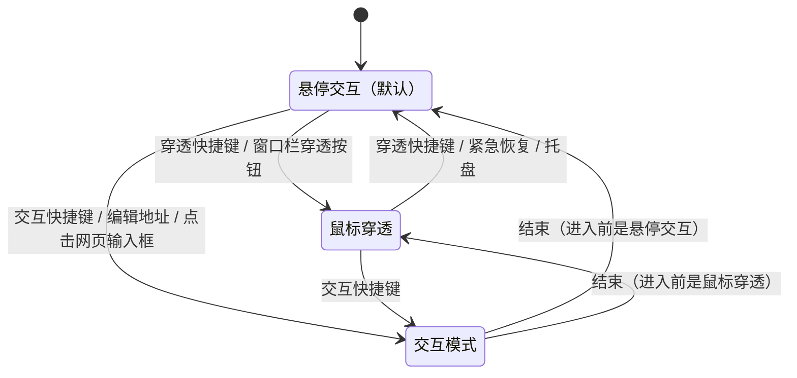
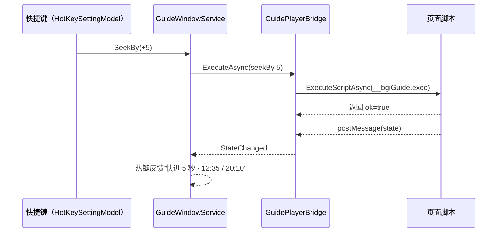
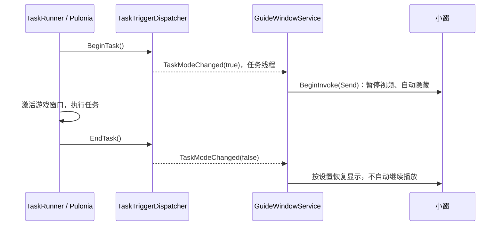
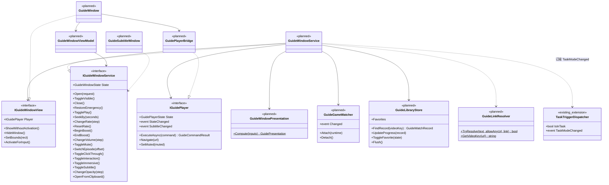

# 悬浮小窗（攻略小窗）设计

状态：实施中（第 2 版，2026-10-29）。首版代码已完成并通过编译和视图加载检查，待游戏内验证（第 15 节验收场景、17.3 实测项）。第 2 版的变更见 17.4。  
相关文档：[基础设施统一（WebView2 见第 8 节）](infrastructure-foundation.md) · [遮罩窗口](mask-window.md) · [实时触发器](realtime-trigger.md) · [独立任务合同](task-contract.md) · [配置持久化](config-persistence.md) · [GameRuntime](game-runtime.md) · [实例能力边界](instance-capability-boundaries.md)  
参考项目：[随引 GuideMate](https://github.com/vibub/GuideMate)（MIT 许可，Windows 攻略视频跟随工具）。本文参考它的交互和已经验证过的技术路线，不复用代码。

## 1. 目标

在 BetterGI 内提供一个独立置顶的网页小窗，让玩家在原神里边玩边看攻略视频（以 B 站为主）。大部分操作通过快捷键完成，不需要切换窗口，不抢游戏焦点，也不干扰 BetterGI 的自动化。

| 术语 | 含义 |
| --- | --- |
| 小窗 | 本功能的置顶网页窗口 `GuideWindow`，界面名称“悬浮小窗” |
| 窗口栏 | 小窗顶部的自定义标题栏，高 24 DIP，只在鼠标悬停或交互模式时显示 |
| 悬停交互 | 未开启鼠标穿透时的默认状态：鼠标在小窗上时显示窗口栏、不透明度 100%，可以直接点击网页 |
| 鼠标穿透 | 小窗不接收鼠标，点击落到下方的游戏 |
| 交互模式 | 临时用键盘鼠标完整操作网页的状态：取消穿透、允许小窗获得焦点；结束后恢复原状态，并把焦点还给游戏 |
| 沉浸模式 | 触发 B 站网页全屏，小窗里只剩视频画面 |
| 播放桥 | 注入页面的脚本（`guide-bridge.js`）与宿主侧的 `GuidePlayerBridge`，负责上报播放状态、执行播放命令 |
| 字幕浮窗 | 独立的透明置顶窗口，显示当前视频的字幕 |
| 视频记录 | 按视频标识保存的观看位置、时长和倍速 |
| 游戏窗口 | 当前 `GameRuntime` 绑定的原神窗口。截图器未启动时没有游戏窗口 |

## 2. 范围

需求与设计章节对照：

| 需求 | 设计位置 |
| --- | --- |
| 一.1 悬浮小窗 | 6.1、6.2 |
| 一.2 网页浏览、B 站适配 | 6.3、第 7 节 |
| 一.3 播放、暂停、快进快退、倍速、音量、切集 | 第 7、8 节 |
| 一.4 拖动、缩放、透明度、始终置顶 | 6.3、6.4 |
| 一.5 鼠标穿透 | 6.1、6.5 |
| 一.6 交互模式 | 6.1 |
| 一.7 不抢游戏焦点 | 6.5 |
| 一.8 快捷键控制 | 第 8 节 |
| 一.9 临时加速 | 8.3 |
| 一.10 沉浸模式 | 6.6、7.3 |
| 未穿透时：悬停显示窗口栏、不透明度 100%；离开后隐藏窗口栏、恢复设置的不透明度 | 6.2、6.3 |
| 二.1 自动显示隐藏 | 9.1 |
| 二.2 记住窗口状态 | 6.4、12.2 |
| 二.3 视频进度记忆 | 第 10 节 |
| 二.4 收藏 | 第 10 节、6.3 |
| 二.5 复制 B 站链接后快捷打开 | 9.4 |
| 二.6 自动隐藏控制栏 | 6.2 |
| 二.7 智能透明 | 5.6 |
| 二.8 多显示器、跟随游戏窗口 | 6.4 |
| 三 遮罩地图联动 | 9.3 |
| 三 任务状态联动 | 9.2 |
| 三 独立字幕 | 第 11 节 |
| 四 统一设置入口；小窗窗口栏上的设置、收藏入口 | 第 12 节、6.3 |
| 第二个独立 WebView2，纳入现有 WebView2 管理 | 5.2 |

不包含：

- 导航辅助（用 SIFT 匹配小地图位置）。按需求本期不设计、不实现。
- 参考项目中的本地视频播放、导入字幕文件、B 站弹幕搬到桌面、鼠标 X 光透明孔、攻略画面箭头识别、Chrome 登录同步。
- 多标签页、下载视频、绕过网站的登录和会员限制。
- 云原神网页版实例、桌面分身等子实例中使用（Q3）。
- 游戏独占全屏时显示。与现有遮罩相同，置顶窗口无法盖在独占全屏画面上。

## 3. 参考项目对照

随引与本需求高度重合。逐项对照如下：

| 随引的做法 | 本设计 | 原因 |
| --- | --- | --- |
| 用 `WebView2CompositionControl` 承载网页，WPF 元素可以叠在网页上 | 采用（5.1） | 窗口栏叠加、整窗透明度、悬停检测都依赖它 |
| 默认热键为 `Ctrl+Alt+…` 组合 | 作为“推荐方案”一键填入，默认不绑定（8.1） | BetterGI 现有快捷键默认都为空，升级后不应占用用户已有的组合键 |
| 按住临时倍速，可与一个普通操作共用一个键，按 400 ms 区分长短按 | 独立的按住键，复用现有的“按住”快捷键（8.3） | 现有键鼠监听已有按下、松开事件；长短按共用会增加状态和误触，首版不做 |
| 支持鼠标侧键 | 沿用现有快捷键对侧键的支持 | 已有 |
| 固定的紧急恢复键，不能删除 | 紧急恢复快捷键、托盘菜单、设置页按钮三条路径（6.1） | 开启鼠标穿透后必须有不依赖鼠标的恢复方式；托盘和设置页保证没绑定快捷键时也能恢复 |
| 沉浸模式用自己的 CSS 把视频铺满 | B 站直接触发网页全屏，其他网站回退为 CSS 聚焦（6.6） | 需求指定使用 B 站网页全屏，播放器控件和弹幕行为与网站保持一致 |
| 从收藏或历史打开时恢复进度，直接打开网页时沿用网站自己的进度 | 采用（10.3） | 避免和 B 站的“上次看到”互相覆盖 |
| 自动开启中文字幕，字幕同步到独立浮窗 | 采用（第 11 节） | 对应“独立字幕” |
| 底边 3 DIP 进度线；热键操作后短暂提示 | 采用（6.7） | 窗口栏隐藏时仍能看到进度，热键操作有反馈 |
| 自定义拖动，拖到屏幕边缘不触发 Windows 贴靠 | 采用：关闭系统缩放框，自定义八向缩放（6.4） | 同左 |
| 沉浸时按视频比例缩放 | 采用（6.4） | 避免黑边 |
| 小窗不出现在 Alt+Tab 中 | 采用（`WS_EX_TOOLWINDOW`） | 不干扰切换窗口 |
| 字幕中出现战斗词时自动暂停或淡化 | 不采用，改为按鼠标指针的智能透明（5.6） | 原神只在需要点击界面时显示指针，按指针淡化不需要识图，比字幕关键词可靠 |
| 独立资料目录、更新器、托盘 | 不适用；托盘复用 BetterGI 的 | 小窗是 BetterGI 的一项功能 |

## 4. 现状：可以复用的部分

| 能力 | 现有实现 | 小窗的用法 |
| --- | --- | --- |
| WebView2 统一管理 | `WebViewEnvironments`、`WebViewProfiles`、`WebViewSetup.InitializeAsync`；`WebViewEnvironmentProvider.GetAreas` 按 Profile 自动登记存储区域 | 新增环境和 Profile，存储空间窗口自动出现对应条目（5.2） |
| 快捷键 | `HotKeyConfig` 每项是“快捷键 + 类型”两个字符串；`HotKeySettingModel` 统一注册并检查跨类型冲突。全局热键（`RegisterHotKey`）支持组合键，但没有松开事件；键鼠监听只支持单键和鼠标侧键，`isHold` 时有按下、松开事件（一键战斗宏即如此）。`HotKeyPageViewModel` 是单例，首页构造时注册全部热键 | 新增“悬浮小窗”分组（第 8 节） |
| 聊天时屏蔽热键 | `ChatUiHotkeyGuard`：游戏聊天框打开时屏蔽全局热键 | 自动生效 |
| 游戏窗口 | `GameRuntimeService.Started/Stopped/Current`；`IGameWindow.IsForeground/IsMinimized/ViewportChanged`。前台和最小化没有事件，只在调度器 Tick 中轮询 | 小窗自己监听系统前台与最小化事件（5.4） |
| 遮罩宿主 | `IMaskWindowHost.StateChanged`；游戏回到前台或移动时会 `BringWindowToTop` 遮罩 | 遮罩置顶后，小窗重新置顶一次（6.5） |
| 置顶穿透窗口 | `HtmlMaskWindow`（`AllowsTransparency` + WebView2）；`MusicGuidedWindow`（`WS_EX_TRANSPARENT \| WS_EX_LAYERED \| WS_EX_TOOLWINDOW \| WS_EX_NOACTIVATE`）；`WindowClickThroughBehavior` | 参考与复用 |
| 窗口位置 | `WindowResizeBehavior`：按物理像素保存，用 `SetWindowPos(SWP_NOACTIVATE)` 恢复，`EnsureVisiblePosition` 夹回可见工作区 | 复用位置修正规则 |
| DPI | 进程级 Per-Monitor 感知，窗口调用 `InitializeDpiAwareness()`；`DpiHelper.GetScale(hwnd)` | 小窗和字幕浮窗不调用 `InitializeDpiAwareness()`：位置和尺寸按物理像素保存、用 `SetWindowPos` 设置，界面单位换算取窗口的 `TransformToDevice.M11`（6.4） |
| 任务模式 | `TaskRunner.Init/End` 和 Pulonia 协调器都调用 `TaskTriggerDispatcher.BeginTask/EndTask`，但没有事件 | 增加事件（9.2） |
| 地图点位详情 | `MaskMapPointInfoPopupViewModel.UrlList` 与 `OpenUrl`（用系统浏览器打开） | 增加“小窗播放”（9.3） |
| 剪贴板 | `MainWindowViewModel.OnActivated`：主窗口激活时读取剪贴板，交给脚本导入和兑换码 | 增加第三个处理器（9.4） |
| 用户数据 | `User/` 由业务模块管理；`AtomicFile.WriteAllText` 原子写入；`MusicStateStore` 是按目录存储的参考 | 收藏、历史放在 `User/GuideWindow/`（10.2） |
| 配置 | `AllConfig` 的子配置自动订阅变更，500 ms 防抖保存，每次全量序列化 | 只放偏好和窗口几何，不放播放进度 |
| 托盘菜单 | `MainWindow.xaml` 中的托盘 `ContextMenu`，部分项按 `IsPrimaryInstance` 显示 | 增加“悬浮小窗”子菜单 |

画中画（`PictureInPictureWindow`）是另一项功能：游戏在后台时显示游戏画面。它与小窗互不影响，界面上用“悬浮小窗”区分。

## 5. 方案选择

### 5.1 网页控件

| 维度 | A. `WebView2CompositionControl`（采用） | B. 现有 `WebView2`（基于 HwndHost） |
| --- | --- | --- |
| 窗口栏叠在网页上方 | 可以，是普通 WPF 元素 | 不行（airspace 问题）。窗口栏只能放在网页区域外，或另开一个跟随的窗口 |
| 整窗透明度 | `AllowsTransparency` + `Window.Opacity` | 需要 `WS_EX_LAYERED` + `SetLayeredWindowAttributes`，对浏览器进程的子窗口是否生效未验证 |
| 悬停检测 | WPF 的 `MouseEnter/MouseLeave` | 网页区域收不到 WPF 鼠标事件，只能轮询光标 |
| 帧率与占用 | 官方说明可能低于 HwndHost（内部用 GraphicsCapture 取帧） | 原生 |
| DRM 视频 | 不能播放 | 可以 |
| SDK | 需要从 1.0.2592.51 升级（实施时用 1.0.4258.31） | 不变 |
| 参考项目 | 在相同场景中使用 | 无 |

采用 A。B 站普通视频不使用 DRM。窗口栏叠加、悬停显示、整窗透明度在 A 中都是普通 WPF 能力，界面可以按 MVVM 写在一个窗口里。帧率和占用作为第 0 步技术验证的通过条件（17.3）。不达标时回退 B：窗口栏改为跟随小窗的独立窗口，透明度改用分层窗口属性。

配套改动：

- `Microsoft.Web.WebView2` 升级到 1.0.4258.31（与参考项目相同的稳定版，不低于 1.0.2957.106）。运行时会自动更新，过旧时沿用现有的初始化失败提示。
- BetterGI 的目标框架已经是 `net10.0-windows10.0.22621.0`，包含该控件依赖的 Windows SDK 投影，不需要再改。
- `WebViewSetup.InitializeAsync` 的参数类型从 `WebView2` 改为两种控件都实现的 `IWebView2`，现有调用方不用改。
- 升级后回归软件内网页、脚本 HTML 遮罩和云原神宿主窗口（后者直接使用 `CoreWebView2Controller`）。

### 5.2 独立的 WebView2 环境

| 维度 | A. 新增环境 `Guide`（采用） | B. 在 `App` 环境中新增 Profile |
| --- | --- | --- |
| 浏览器进程 | 独立，视频解码或崩溃不影响更新日志、脚本遮罩等页面 | 与 `App` 共用 |
| 浏览器参数 | 可以设置本功能需要的常量参数 | 只能沿用 `App` 的空参数 |
| 数据目录 | `Data/WebView2/Guide/` | `Data/WebView2/App/EBWebView/WV2Profile_guide` |
| 占用 | 多一组浏览器进程，只在小窗打开时存在 | 更少 |
| 纳入管理 | 自动登记为存储区域，与现有网页数据同组 | 同左 |

采用 A，对应需求中的“第二个独立的 WebView2”。定义如下：

```csharp
// WebViewEnvironmentDefinition.cs 的 WebViewEnvironments 中
/// <summary>
/// 悬浮小窗：独立浏览器进程。允许没有用户手势的媒体播放，快捷键播放、切集后续播不会被自动播放策略拦截
/// </summary>
public static readonly WebViewEnvironmentDefinition Guide = new("Guide", "悬浮小窗")
{
    BrowserArguments = "--autoplay-policy=no-user-gesture-required",
};

// WebViewProfile.cs 的 WebViewProfiles 中
/// <summary>
/// 悬浮小窗网页：清理时只清缓存，保留 B 站等网站的登录
/// </summary>
public static readonly WebViewProfile Guide = new(WebViewEnvironments.Guide, WebViewProfile.DefaultProfileName, "悬浮小窗 · 网页缓存")
{
    Description = "悬浮小窗中网页的缓存，保留 B 站等网站的登录和网页设置",
};
```

- 两项分别加入 `WebViewEnvironments.All` 和 `WebViewProfiles.All`。启动校验、每个进程只创建一次环境、创建日志、存储区域“悬浮小窗 · 网页缓存”（下次启动时清理、参与一键清理）都由现有机制完成，不需要新的存储区域提供者。
- 浏览器参数是常量，满足“同一数据目录的所有进程参数一致”的约束。
- 首版不提供“清除登录”。需要退出登录时在 B 站页面内操作（Q6）。
- 初始化走 `WebViewSetup`：开发者工具只在 Debug 下开启、拒绝下载、渲染进程首次崩溃自动重新加载、再次崩溃时在小窗内显示说明和“重新加载”按钮。

### 5.3 状态集中在一个协调服务

小窗的显示与输入状态受快捷键、窗口栏、游戏前台、任务、鼠标悬停等多方影响。所有输入都交给 `GuideWindowService`，由纯函数 `GuideWindowPresentation.Compute` 按固定优先级算出最终状态（6.2），窗口只负责呈现。这与遮罩宿主“业务只上报事实，由宿主决定”的做法一致，避免多处代码各自显示、隐藏小窗。

### 5.4 游戏窗口状态的来源

| 方案 | 说明 | 结论 |
| --- | --- | --- |
| 订阅 `IMaskWindowHost.StateChanged` | 宿主在游戏最小化、前台为 BetterGI 时“保持不变”，语义与小窗需要的不同；只在截图器运行时有数据 | 不采用，只用它在遮罩置顶后重新置顶小窗 |
| 在调度器 Tick 中增加事件 | 要改每 50 ms 运行一次的核心循环；暂停、推理测速期间 Tick 不上报 | 不采用 |
| 小窗服务自己监听系统事件（采用） | `SetWinEventHook` 监听 `EVENT_SYSTEM_FOREGROUND`（全部进程）和游戏进程的 `EVENT_SYSTEM_MINIMIZESTART/END`；位置变化沿用 `IGameWindow.ViewportChanged` | 事件驱动，与 Tick 解耦 |

监听随 `GameRuntimeService.Started/Stopped` 挂接和解除，回调在界面线程。没有运行环境时（截图器未启动）不做自动显示隐藏和跟随，小窗按普通置顶窗口工作。云原神网页版运行环境不挂接。

### 5.5 按住临时加速

| 方案 | 能否用组合键 | 实现 |
| --- | --- | --- |
| A. 复用键鼠监听的“按住”快捷键（采用） | 不能，只能用单键或鼠标侧键 | 与一键战斗宏相同：`isHold: true`，使用 `OnKeyDownAction`、`OnKeyUpAction` |
| B. 全局热键 + 轮询 `GetAsyncKeyState` 判断松开 | 能 | 需要扩展 `HotKeySettingModel`；前台游戏以管理员运行时 `GetAsyncKeyState` 可能失真 |

采用 A。键鼠监听不拦截按键，按键会同时发给游戏，所以推荐鼠标侧键或游戏中没用到的键。现有的“与原神键位冲突”提醒会自动生效。组合键支持见 Q5。

### 5.6 智能透明

第 1 版提议的游戏界面场景触发器（`GameUiSceneTrigger`，按对话、大地图自动隐藏或淡化小窗）不采用：它要占用调度器的识别，规则也难以覆盖所有界面。改为只看鼠标指针：

- 只在鼠标穿透时生效。穿透时小窗收不到鼠标事件，由 `CursorInsideWindowBehavior` 每 80 ms 用 `GetCursorInfo` 检查指针。指针可见（`CURSOR_SHOWING`）且位于小窗上时，小窗淡化到“淡化后的不透明度”（默认 25%），露出下方的游戏按钮；指针离开或被游戏隐藏（战斗、跑图视角）时恢复。
- 原神在需要点击界面（对话、地图、菜单）时才显示指针，所以这条规则自然覆盖了第 1 版想处理的场景，且不需要识图。
- 设置页和 ⚙ 菜单都可以开关，默认开启。
- 不采用参考项目的“字幕战斗词”方式。

### 5.7 收藏、历史与进度的存储

播放进度每 10 秒更新一次。放进 `AllConfig` 会让整份配置频繁全量序列化，并且多实例共用 `User/config.json`。因此 `GuideWindowConfig` 只放偏好和窗口几何；收藏和历史放在 `User/GuideWindow/` 下的独立 JSON 文件中，用 Newtonsoft 读写、`AtomicFile` 原子写入（10.2）。

### 5.8 剪贴板

| 方式 | 采用 | 说明 |
| --- | --- | --- |
| 快捷键“用小窗打开剪贴板链接” | 是 | 在游戏中复制链接后直接按键，不用切窗口 |
| 主窗口激活时识别 | 是 | 沿用现有的剪贴板读取时机，只提示，不自动打开 |
| 窗口栏地址框粘贴 | 是 | 普通浏览器的习惯 |
| 系统剪贴板监听（`AddClipboardFormatListener`） | 否 | 会在后台读取用户的每一次复制，隐私顾虑大；上面三种已覆盖常见场景 |

## 6. 交互设计

原则：常用操作一键完成，所有按钮的提示里写出对应快捷键；状态变化都有可见反馈；任何状态下都能用快捷键、托盘或设置页恢复到可操作的小窗。

### 6.1 状态

小窗的状态分四个维度，互相独立：

| 维度 | 取值 | 改变方式 |
| --- | --- | --- |
| 打开 | 关闭 / 打开 | 关闭会释放网页（停止播放、回收内存）；打开时恢复上次的页面 |
| 显示 | 显示 / 隐藏 | 用户隐藏，或被游戏切后台、任务自动隐藏。隐藏不释放网页 |
| 输入 | 悬停交互 / 鼠标穿透 / 交互模式 | 见下图 |
| 形态 | 普通 / 沉浸 | 沉浸快捷键或窗口栏按钮 |



交互模式在满足任一条件时结束：再次按交互快捷键；点窗口栏的“完成”；地址框回车或 Esc；鼠标离开小窗超过 2 秒（可设置，0 表示不自动结束）；游戏窗口重新成为前台（用户点了游戏）。结束时，如果进入前游戏在前台，就把焦点还给游戏（`SystemControl.FocusWindow`）。

紧急恢复：显示小窗，退出交互模式和沉浸模式，关闭鼠标穿透，不透明度恢复 100%，把小窗移回可见工作区并重新置顶。入口有三处：紧急恢复快捷键、托盘菜单“悬浮小窗 → 恢复小窗”、设置页顶部的“恢复小窗”按钮。即使没有绑定快捷键，开启鼠标穿透后也不会无法操作小窗。

### 6.2 显示规则

`GuideWindowPresentation.Compute` 从上到下判断，命中一行即用该行的结果：

| 优先级 | 条件 | 显示 | 鼠标穿透 | 可获得焦点 | 不透明度 | 窗口栏 |
| --- | --- | --- | --- | --- | --- | --- |
| 1 | 用户隐藏；任务运行中且用户未临时显示（9.2）；游戏最小化或切到后台（9.1） | 否 | — | — | — | — |
| 2 | 交互模式 | 是 | 否 | 是 | 100% | 显示 |
| 3 | 任务运行中被用户临时显示 | 是 | 是 | 否 | 设置值 | 隐藏 |
| 4 | 开启了鼠标穿透 | 是 | 是 | 否 | 设置值；智能透明开启且可见指针在小窗上时为 min(设置值, 淡化值)（5.6） | 隐藏 |
| 5 | 鼠标悬停在小窗上 | 是 | 否 | 否 | 100% | 显示；鼠标静止 2.5 秒后隐藏，移动时重新显示 |
| 6 | 其他 | 是 | 否 | 否 | 设置值 | 隐藏 |

- 不透明度设置值范围 20%–100%，默认 85%，步长 10%。下限 20%，避免窗口几乎看不见却仍挡住点击。
- 悬停时，进入 120 ms 后才显示窗口栏，避免鼠标划过时闪烁；离开 600 ms 后隐藏。窗口栏上的菜单展开期间保持显示。
- 第 1 行中“用户隐藏”以外的原因统称“自动隐藏”，原因消失后自动恢复显示；用户隐藏只能由用户恢复。
- 任务运行中，用户主动按显示快捷键可以临时显示小窗，但强制鼠标穿透，避免挡住任务的点击。

### 6.3 窗口栏

窗口栏叠在网页顶部，高 28 DIP，图标 15 px，按钮 26×24 DIP，字号 12。背景用主题的应用背景色（94% 不透明），跟随 BetterGI 的深浅主题。

```text
┌────────────────────────────────────────────────────────────────────────────┐
│ ⠿ 【5.2】枫丹水下全宝箱 P3 ▾ │ ◀ ⟳ │ ⏯ 1.25x 🔊 CC ⛶ │ ★ ☰ │ ⌨ ◎ ⚙ ⋯ │ — ✕ │
└────────────────────────────────────────────────────────────────────────────┘
```

| 区 | 元素 | 说明 |
| --- | --- | --- |
| 拖动与标题 | ⠿、标题、▾ | 按住 ⠿ 或空白处拖动小窗。标题显示网页标题（去掉“_哔哩哔哩_bilibili”后缀），分 P 视频附“P3”。点击标题变成地址框，可输入网址、BV 号或搜索词（不是网址时按 B 站搜索），回车打开、Esc 取消；在标题上按下后移动超过 4 像素视为拖动。▾ 菜单：粘贴并打开、复制当前链接、在浏览器中打开 |
| 网页 | ◀、⟳ | 后退、刷新 |
| 播放 | ⏯、倍速、🔊、CC、⛶ | 播放暂停；倍速点击弹出 0.5x–3x 列表，在其上滚动鼠标逐级调整；🔊 点击静音，滚动鼠标调音量；CC 开关字幕浮窗；⛶ 沉浸模式 |
| 收藏 | ★、☰ | ★ 收藏或取消收藏当前视频（实心表示已收藏）；☰ 菜单列出最近 10 条收藏、最近 10 条观看记录（带进度）和“管理收藏…” |
| 窗口 | ⌨、◎、⚙、⋯ | ⌨ 交互模式（进入后显示为 ✓）；◎ 鼠标穿透；⚙ 设置菜单（含始终置顶）；⋯ 只在有按钮被收起时出现，列出被收起的按钮 |
| 关闭 | —、✕ | — 隐藏（保留网页）；✕ 关闭（释放网页） |

- 每个按钮的提示写出对应快捷键，例如“鼠标穿透（Ctrl+Alt+P）”；没绑定时不写。
- 在窗口栏空白处滚动鼠标调整不透明度。
- 宽度不够时按优先级把按钮收进 ⋯ 菜单，每一档都给标题留出至少约 60 DIP：小于 640 收“网页”区，小于 560 收 ⌨ ◎，小于 500 收“收藏”区，小于 430 收倍速、🔊、CC、⛶。⏯、⚙、⋯、—、✕ 始终保留，最小宽度 320 DIP 时也能放下。默认宽度 480 DIP 时显示播放区全部按钮。
- 编辑地址时收起标题以外的全部按钮，地址框占满整条窗口栏。
- “始终置顶”不放在窗口栏上（很少切换），在 ⚙ 菜单中。

⚙ 设置菜单（快速设置，不需要打开主界面）：

```text
不透明度        [────●────] 85%
☐ 鼠标穿透
☑ 始终置顶
位置            ● 跟随游戏  ○ 自由
停靠            右上 / 右下 / 左上 / 左下
移到显示器      1（游戏所在）/ 2
☐ 字幕浮窗      调整字幕位置…
☑ 智能透明
网页缩放        80% / 90% / 100% / 110%
弹幕            开 / 关（仅 B 站）
────────────────
全部设置…       打开 BetterGI 主界面的“悬浮小窗”页
```

### 6.4 拖动、缩放与位置

- 窗口设置为 `WindowStyle=None`、`ResizeMode=NoResize`、`AllowsTransparency=True`。没有系统缩放框，拖到屏幕边缘不会触发 Windows 贴靠和分屏。
- 拖动：在窗口栏的 ⠿ 或空白处按住，调用 `DragMove`。
- 缩放：四边 6 DIP、四角 12 DIP 的透明缩放区，只在悬停或交互模式下可用。默认 480×270 DIP，最小 320×180 DIP。沉浸模式下按视频宽高比缩放（比例来自播放桥上报的 `videoWidth`、`videoHeight`，没有时用 16:9）。
- 默认位置：游戏窗口右上角，边距 16 DIP。没有游戏窗口时放在主显示器工作区的右上角。

位置模式：

| 模式 | 保存的内容 | 游戏窗口移动或缩放时 |
| --- | --- | --- |
| 跟随游戏（默认） | 停靠角（拖动结束时取离小窗最近的游戏客户区角）和相对这个角的偏移，单位为物理像素 | 按停靠角和偏移重新计算；游戏窗口变小放不下时，夹在游戏客户区内 |
| 自由 | 屏幕绝对位置，单位为物理像素 | 不动 |

- 两种模式都保存尺寸，单位也是物理像素（未保存时按所在显示器的 DPI 换算默认值）。位置和尺寸用 `SetWindowPos(SWP_NOACTIVATE | SWP_NOZORDER)` 按物理像素应用，与 `WindowResizeBehavior` 一致，避开混合 DPI 下 DIP 换算的问题。缩放时按光标的物理像素位移计算新矩形。
- 恢复时沿用 `EnsureVisiblePosition` 的规则：窗口栏区域至少有 120×24 像素落在某个工作区内，否则夹到最近的工作区。拔掉显示器后小窗不会跑到屏幕外。
- 多显示器：自由模式下可以拖到任意显示器，也可以用 ⚙ → “移到显示器”。小窗与游戏不在同一显示器时，默认不随游戏切后台而隐藏（9.1）。
- 拖动、缩放结束时保存一次，过程中不保存。

### 6.5 不抢焦点

小窗被激活后，原神就失去前台：游戏不再接收键盘输入，BetterGI 的前台触发器也会停下。因此小窗默认不获得焦点：

- `ShowActivated=false`，扩展样式加 `WS_EX_NOACTIVATE | WS_EX_TOOLWINDOW`；显示用 `SW_SHOWNOACTIVATE`，移动和置顶都带 `SWP_NOACTIVATE`。
- `WS_EX_NOACTIVATE` 只阻止激活，鼠标点击仍会送达小窗。悬停状态下可以直接点击播放器、拖动进度条，游戏保持前台。
- 需要键盘输入时进入交互模式：移除 `WS_EX_NOACTIVATE` 并激活小窗；结束时恢复样式，把焦点还给游戏。点击网页中的输入框（B 站搜索框、评论框）时，播放桥上报 `editFocus`，自动进入交互模式。
- 兜底：不在交互模式时，如果小窗意外成为前台（例如网页内部抢了焦点），鼠标松开后把焦点还给游戏。
- 显示、隐藏、置顶、切换穿透、快捷键控制都不调用 `Activate`。
- 在原神中需要按住 Alt（默认的“呼出鼠标”键）才能把鼠标移到小窗上。第一次打开小窗时用热键反馈提示这一点，只提示一次（`AltHintShown`）。

置顶：遮罩宿主在游戏回到前台或移动时会把遮罩 `BringWindowToTop`。小窗订阅 `IMaskWindowHost.StateChanged` 和游戏前台事件，之后用 `SetWindowPos(HWND_TOPMOST, SWP_NOMOVE | SWP_NOSIZE | SWP_NOACTIVATE)` 重新置顶，保证小窗在遮罩之上、字幕浮窗在小窗之上。关闭“始终置顶”后小窗是普通窗口，适合放在副屏。

### 6.6 沉浸模式

- B 站：触发播放器的“网页全屏”，播放器铺满网页视口，网页其他内容和顶栏都被盖住；播放器控件按 B 站自己的规则，在鼠标静止后隐藏。小窗的窗口栏照常只在悬停时显示。
- 其他网站：注入样式，把面积最大的可见视频固定铺满视口并隐藏其他元素；退出时移除样式。
- 沉浸状态下在同一窗口内切换视频（B 站页内跳转、切集）后，自动重新进入网页全屏。
- 沉浸状态会记住，下次打开视频时沿用（可在设置中关闭）。

### 6.7 热键反馈与进度线

- 热键反馈：快捷键改变播放或窗口状态时，在小窗左上角显示 1.2 秒的提示，例如“快进 5 秒 · 12:35 / 20:10”“倍速 1.5x”“音量 60%”“鼠标穿透：开（Ctrl+Alt+P 关闭）”“没有下一集”。小窗隐藏时不显示。
- 底部进度线：窗口栏隐藏时，在小窗底边显示 3 DIP 高的进度线，已播放部分用主题强调色。只显示，不响应点击。直播或时长未知时不显示。可在设置中关闭。

### 6.8 打开入口

| 入口 | 行为 |
| --- | --- |
| 快捷键“显示/隐藏小窗” | 未打开时打开，恢复上次的页面；没有上次页面时打开主页（默认 B 站首页） |
| 设置页“打开小窗”按钮 | 同上 |
| 托盘菜单“悬浮小窗” | 显示/隐藏、恢复小窗、打开剪贴板链接、设置 |
| 地图点位详情的“小窗”按钮 | 在小窗中打开该视频（9.3） |
| 快捷键“打开剪贴板链接”、主窗口激活时的提示 | 在小窗中打开剪贴板里的链接（9.4） |
| 进入游戏 | 按设置自动打开（9.1） |

## 7. 播放控制与 B 站适配

### 7.1 播放桥

页面侧脚本通过 `AddScriptToExecuteOnDocumentCreatedAsync` 注入，分两部分：通用部分 `guide-bridge.js` 和站点适配 `guide-site-bilibili.js`，作为嵌入资源打包（与 `ys-input-inject.js` 相同）。B 站改版时只需改适配文件。

消息协议为 JSON，宿主只接受下列类型：

| 方向 | 类型 | 内容 |
| --- | --- | --- |
| 页面 → 宿主 | `state` | `href`、`title`、`site`、`videoKey`（10.1）、`hasVideo`、`paused`、`currentTime`、`duration`、`playbackRate`、`volume`、`videoWidth`、`videoHeight`、`immersive`、`episode`（`index`、`count`、`hasPrev`、`hasNext`）、`subtitleAvailable` |
| 页面 → 宿主 | `subtitle` | 当前字幕文本（可以为空）、来源（`dom` 或 `track`） |
| 页面 → 宿主 | `event` | `videoChanged`、`ended`、`playRejected`、`editFocus`、`editBlur` |
| 宿主 → 页面 | 命令 | `play`、`pause`、`toggle`、`seekBy`、`seekTo`、`setRate`、`setVolume`、`prevEpisode`、`nextEpisode`、`setImmersive`、`enableSubtitle`、`setPageSubtitleHidden`、`setDanmaku`、`suppressAutoplayOnce`；返回 `{ ok, reason }` |

- 上报时机：媒体事件（`play`、`pause`、`ratechange`、`seeked`、`volumechange`、`loadedmetadata`、`ended`）立即上报，播放中每秒补报一次；合并后每秒最多 4 条。宿主在两次上报之间按倍速插值，用于进度线和热键反馈。
- 命令由宿主调用 `window.__bgiGuide.exec(...)`，参数先做 JSON 序列化，不把任何字符串直接拼进脚本。
- 首版只处理顶层文档（B 站播放器在顶层）。跨域 iframe 中的视频不控制，执行命令时返回“当前页面不支持该操作”。
- 静音用 `CoreWebView2.IsMuted`，对整个网页生效，不依赖站点。
- 页内跳转（`pushState`）同时由页面脚本和 `CoreWebView2.SourceChanged` 发现，之后清除字幕、结束临时加速、按 10.3 判断是否续播。



### 7.2 通用控制

通用部分选择页面中显示面积最大的可见视频元素（包括 B 站部分视频使用的 `bwp-video` 自定义元素），用 `play()`、`pause()`、`currentTime`、`playbackRate`、`volume` 控制。`play()` 被拒绝时回传 `playRejected`，宿主提示“网页拒绝播放，请点击一次视频”。

| 命令 | 规则 |
| --- | --- |
| 快进、快退 | 默认 5 秒（1–60 秒可设），夹在 0 与时长之间 |
| 倍速 | 步长 0.25，范围 0.25–4.0；“重置倍速”回到 1.0 |
| 音量 | 步长 10%，范围 0%–100% |
| 上一集、下一集 | 由站点适配实现；其他网站使用页面中的 `rel=prev/next` 链接，没有时提示“没有上一集/下一集” |

### 7.3 B 站适配

| 能力 | 做法 | 失败时 |
| --- | --- | --- |
| 识别视频 | 从页面的 `__INITIAL_STATE__` 读取 `bvid`、分 P 和标题；番剧读取 `ep` 号 | 回退到解析网址 |
| 播放控制 | 页面暴露了播放器对象时优先调用它的接口，否则操作视频元素 | 通用控制 |
| 沉浸模式 | 点击播放器的“网页全屏”按钮，用播放器容器的屏幕模式属性判断是否已经进入，重复调用结果一致 | 通用 CSS 聚焦 |
| 切集 | 分 P：在当前网址中设置相邻的 `p` 参数后导航，保留来源参数、移除 `t`。合集与番剧：点击选集列表中当前项的相邻项，或播放器的“下一个”按钮。首尾不循环 | 提示“没有上一集/下一集” |
| 字幕 | 新视频或新一集加载后自动开启中文字幕（普通中文优先，其次 AI 中文）；本集内用户手动关闭或改了语言，就不再干预。读取播放器字幕层的文本上报 | 不上报字幕 |
| 弹幕 | 操作播放器的弹幕开关 | 菜单项不可用 |
| 进度协调 | 页面加载后 `currentTime` 已经超过 3 秒，视为 B 站已按自己的历史续播，小窗不再跳转 | — |
| 链接识别 | `bilibili.com/video/BV…`、`/video/av…`、`b23.tv/…`、`/bangumi/play/ep…`、`/bangumi/play/ss…`、纯文本 BV 号；`m.bilibili.com` 改为桌面站地址 | 当作普通网址 |
| 外部协议 | 网页尝试打开 `bilibili://` 等客户端协议时取消 | — |
| 登录 | 在小窗中扫码登录，登录状态保存在 `Guide` 环境中 | — |

具体的选择器和播放器接口以实施时的 B 站页面为准，全部写在 `guide-site-bilibili.js` 中并注明核对日期。适配失败只影响对应的能力，回退到通用控制，不影响页面本身。

### 7.4 网页安全策略

小窗打开的是第三方网页，按不可信内容处理：

- 不注册 HostObject，不映射虚拟主机，不开放任何本地文件。
- 宿主只接受 7.1 中的消息类型，数值做范围校验，不执行网页传来的脚本或指令。
- 新窗口请求只允许 http、https，在小窗内打开（B 站的搜索结果、推荐视频默认在新标签页打开）。`WebViewOptions` 新增 `NewWindowPolicy`（`OpenInBrowser` 为默认值，另有 `Reject`、`NavigateInPlace`），替代现有的 `OpenNewWindowInBrowser` 布尔值。`HtmlMaskWindow` 改为 `Reject`，其他调用方不变。
- 导航只允许 http、https；`file:` 和其他协议一律取消。
- 权限请求（通知、摄像头、麦克风、读取剪贴板、地理位置）一律拒绝。
- 下载一律拒绝（不设置下载目录）。

## 8. 快捷键

### 8.1 列表与推荐方案

快捷键页新增一级分组“悬浮小窗”。所有项默认不绑定，设置页提供“一键填入推荐快捷键”。

| 功能 | 配置属性 | 推荐方案 | 类型 |
| --- | --- | --- | --- |
| 显示/隐藏小窗 | `GuideToggleHotkey` | Ctrl+Alt+H | 全局热键 |
| 播放/暂停 | `GuidePlayPauseHotkey` | Ctrl+Alt+Space | 全局热键 |
| 快退 | `GuideSeekBackwardHotkey` | Ctrl+Alt+Left | 全局热键 |
| 快进 | `GuideSeekForwardHotkey` | Ctrl+Alt+Right | 全局热键 |
| 倍速增加 | `GuideSpeedUpHotkey` | Ctrl+Alt+Up | 全局热键 |
| 倍速降低 | `GuideSpeedDownHotkey` | Ctrl+Alt+Down | 全局热键 |
| 倍速重置为 1x | `GuideSpeedResetHotkey` | Ctrl+Alt+0 | 全局热键 |
| 按住临时加速 | `GuideBoostHotkey` | 鼠标侧键（前进键） | 键鼠监听（按住） |
| 音量增加 | `GuideVolumeUpHotkey` | Ctrl+Alt+PageUp | 全局热键 |
| 音量降低 | `GuideVolumeDownHotkey` | Ctrl+Alt+PageDown | 全局热键 |
| 静音 | `GuideMuteHotkey` | Ctrl+Alt+M | 全局热键 |
| 上一集 | `GuidePrevEpisodeHotkey` | Ctrl+Alt+[ | 全局热键 |
| 下一集 | `GuideNextEpisodeHotkey` | Ctrl+Alt+] | 全局热键 |
| 不透明度增加 | `GuideOpacityUpHotkey` | Ctrl+Alt+Shift+Up | 全局热键 |
| 不透明度降低 | `GuideOpacityDownHotkey` | Ctrl+Alt+Shift+Down | 全局热键 |
| 鼠标穿透开关 | `GuideClickThroughHotkey` | Ctrl+Alt+P | 全局热键 |
| 交互模式 | `GuideInteractHotkey` | Ctrl+Alt+I | 全局热键 |
| 沉浸模式 | `GuideImmersiveHotkey` | Ctrl+Alt+F | 全局热键 |
| 字幕浮窗开关 | `GuideSubtitleHotkey` | Ctrl+Alt+C | 全局热键 |
| 用小窗打开剪贴板链接 | `GuideOpenClipboardHotkey` | Ctrl+Alt+V | 全局热键 |
| 紧急恢复 | `GuideRestoreHotkey` | Ctrl+Alt+F10 | 全局热键 |

- 按 `HotKeyConfig` 的约定，每项是两个属性：`XxxHotkey` 默认 `""`；`XxxHotkeyType` 默认 `GlobalRegister`，按住临时加速为 `KeyboardMonitor`。
- 推荐方案不用 `=`、`-`：全局热键按 WinForms `Keys` 的名称解析按键，WPF 的 `OemPlus` 在 `Keys` 中叫 `Oemplus`，无法注册。音量改用 PageUp/PageDown，上一集、下一集改用 `[`、`]`。
- 推荐方案使用 Ctrl+Alt 组合，原神默认键位不使用这些组合。部分 Intel 显卡驱动用 Ctrl+Alt+方向键旋转屏幕，遇到时在驱动设置中关闭该功能，或改用其他组合。设置页在推荐方案旁写明这一点。
- 一键填入只填当前为空的项，并跳过已被其他功能占用的组合（用 `HotKeySettingModel.AreConflicting` 与全部已注册项比较）。原因：快捷键页发现新值与其他项相同时会清空其他项（`RemoveDuplicateHotKey`），直接填入可能清掉用户已有的绑定。被其他程序占用而注册失败的项，在对应行显示 `RegistrationError`。完成后提示“已填入 N 项，M 项因冲突跳过”。

### 8.2 行为

- 快捷键回调直接调用 `IGuideWindowService`，服务内部切换到界面线程。
- 小窗未打开时，只有“显示/隐藏小窗”和“打开剪贴板链接”会打开小窗，其他快捷键不做任何事。
- 小窗已打开但隐藏时，播放类快捷键仍然生效，可以只听声音。
- 游戏聊天框打开时，全局热键由 `ChatUiHotkeyGuard` 屏蔽，与其他功能一致。
- 云原神网页版实例不注册任何热键（现有规则）。首版小窗只在主实例可用，子实例中这组快捷键的回调直接返回（Q3）。

### 8.3 按住临时加速

- 按下：记住当前倍速，改为临时倍速（默认 2.0x，范围 1.25–4.0），热键反馈显示“临时 2.0x”。
- 松开：恢复记住的倍速。
- 以下情况提前结束并恢复倍速：切换视频或页面导航、小窗隐藏或关闭、任务开始、紧急恢复。按住期间用户手动改了倍速时，松开后不再覆盖用户的新倍速。
- 临时倍速不写入视频记录和收藏。
- 系统按键自动重复产生的多次按下只处理第一次。

### 8.4 设置页中的快捷键

`HotKeyPageViewModel` 是单例，把“悬浮小窗”分组公开为 `GuideHotKeyDirectory`。设置页 ViewModel 注入它，直接绑定其中的 `HotKeySettingModel` 实例。快捷键页和设置页编辑的是同一组对象，注册只发生一次。设置页的列表模板放在设置页自己的资源中，不依赖快捷键页的资源。

## 9. 联动

### 9.1 自动显示隐藏

| 设置 | 默认 | 说明 |
| --- | --- | --- |
| 进入游戏时 | 恢复上次状态 | 不自动打开 / 恢复上次状态（上次退出 BetterGI 时小窗是打开的才打开）/ 总是打开。时机为 `GameRuntimeService.Started` |
| 游戏最小化或切到后台时隐藏 | 开 | 前台变为游戏和 BetterGI 以外的程序时自动隐藏，回到游戏时恢复 |
| 小窗在其他显示器时不自动隐藏 | 开 | 小窗与游戏窗口不在同一显示器时，只在游戏最小化时隐藏 |
| 隐藏时暂停视频 | 关 | 对用户隐藏和自动隐藏都生效；任务导致的隐藏另有设置（9.2） |

- 前台属于 BetterGI 自身（主窗口、交互模式下的小窗）时保持不变，用户在主界面调整小窗设置时能直接看到效果。
- 自动打开时不自动播放：网页加载后的第一次自动播放会被暂停一次（`suppressAutoplayOnce`），避免进入游戏时突然出声。从收藏、历史、地图点位、剪贴板打开时照常播放。

### 9.2 任务状态联动

`TaskTriggerDispatcher` 新增事件：

```csharp
/// <summary>
/// 进入或退出任务模式时触发，参数为是否在任务中。
/// 在调用 BeginTask / EndTask 的线程上触发，订阅方自行切换线程
/// </summary>
public event EventHandler<bool>? TaskModeChanged;
```

`BeginTask`、`EndTask` 只在状态实际变化时、于锁外触发。`TaskRunner` 和 Pulonia 协调器都经过这两个方法，所以独立任务、调度器、一条龙、任务计划都能覆盖。



| 设置 | 默认 |
| --- | --- |
| 执行任务时隐藏小窗 | 开 |
| 任务开始时暂停视频 | 开 |
| 任务结束后恢复小窗 | 开 |

- 需求原文是“自动关闭”。本设计实现为“隐藏并暂停”，保留页面和进度，任务结束后可以接着看（Q9）。
- 隐藏请求以 `DispatcherPriority.Send` 投递，在任务的第一次点击之前完成。
- 直接持有任务锁、不经过 `BeginTask` 的自动寻路类任务不在覆盖范围内。[独立任务合同](task-contract.md) 6.3 节的统一会话租约实施后会自然覆盖。

### 9.3 遮罩地图点位

地图点位详情中，每个链接是一个胶囊按钮，右侧附一个“换一种方式打开”的小图标（只在主实例显示）：

```text
┌ 宝箱 · 枫丹廷 ──────────────────── [隐藏] ✕ ┐
│ 位于水下洞穴入口……                            │
│ ( 视频攻略 │ ⧉ )  ( 图文攻略 │ ⧉ )           │
└─────────────────────────────────────────────┘
```

- 设置“地图点位视频默认用小窗打开”默认开：点击链接本身时，能识别为视频页（`GuideLinkResolver.IsVideoUrl`）的链接用小窗打开，其他链接用浏览器打开；右侧图标为“在浏览器打开”。关闭该设置时，点击链接用浏览器打开，右侧图标为“在悬浮小窗打开”。
- `MaskMapPointInfoPopupViewModel` 新增 `IsGuideWindowAvailable`、`IsGuideWindowPreferred`（每次打开详情时读取设置）和 `OpenUrlAlternateCommand`；`OpenUrl` 按上面的规则选择打开方式，调用 `IGuideWindowService.Open(new GuideOpenRequest(url, GuideOpenSource.MapPoint))`。

### 9.4 剪贴板快捷打开

识别规则（`GuideLinkResolver`）：文本长度不超过 1000，取第一个匹配。B 站视频、番剧、短链接和纯文本 BV 号按 7.3 识别；快捷键和地址框粘贴另外接受任意 http、https 网址。

- 快捷键：在界面线程读取剪贴板（失败时忽略），识别成功就在小窗中打开。识别失败时在小窗中提示“剪贴板中没有可打开的链接”；小窗未打开时用 Toast 提示。
- 主窗口激活：在 `MainWindowViewModel.OnActivated` 的脚本导入、兑换码之后增加第三个处理器。只识别 B 站链接；与上次询问过的链接或小窗当前的视频相同时不询问。询问使用 `ThemedMessageBox.QuestionAsync`（“是”在小窗打开，“否”不处理），与兑换码识别的交互一致；提示中说明可以在设置页关闭。设置“识别剪贴板中的 B 站链接”默认开。

### 9.5 智能透明

按鼠标指针淡化，见 5.6 和 6.2 第 4 行。第 1 版的场景规则（对话、大地图）不采用。

## 10. 收藏、历史与进度记忆

### 10.1 视频标识

| 网站 | 标识 | 例 |
| --- | --- | --- |
| B 站视频 | `bilibili:{bvid}:p{分P}` | `bilibili:BV1xx411c7mD:p3` |
| B 站番剧 | `bilibili:ep{id}` | `bilibili:ep123456` |
| 其他 | 规范化网址：去掉 `#` 片段，去掉 `spm_id_from`、`vd_source`、`from`、`share_*`、`utm_*`、`t` 等参数，其余参数排序 | — |

页面加载后以播放桥上报的 `videoKey` 为准，所以用 av 号、短链接打开后也能得到 BV 号。导航之前只能从网址解析时，用解析结果查找记录。

### 10.2 数据与文件

```text
User/GuideWindow/
  favorites.json    收藏，只在增删改时写入
  history.json      观看记录与上次的页面，节流写入
```

```csharp
/// <summary>
/// 一条收藏
/// </summary>
public sealed class GuideFavorite
{
    /// <summary>收藏 Id（GUID）</summary>
    public string Id { get; set; } = "";

    /// <summary>视频标识，见 10.1</summary>
    public string VideoKey { get; set; } = "";

    /// <summary>标题，用户可以重命名</summary>
    public string Title { get; set; } = "";

    /// <summary>打开用的网址</summary>
    public string Url { get; set; } = "";

    /// <summary>收藏时间</summary>
    public DateTimeOffset AddedAt { get; set; }

    /// <summary>最近一次从收藏打开的时间</summary>
    public DateTimeOffset? LastOpenedAt { get; set; }
}

/// <summary>
/// 一条观看记录
/// </summary>
public sealed class GuideWatchRecord
{
    /// <summary>视频标识，见 10.1</summary>
    public string VideoKey { get; set; } = "";

    /// <summary>标题</summary>
    public string Title { get; set; } = "";

    /// <summary>打开用的网址</summary>
    public string Url { get; set; } = "";

    /// <summary>观看位置（秒）</summary>
    public double Position { get; set; }

    /// <summary>时长（秒），未知为 0</summary>
    public double Duration { get; set; }

    /// <summary>倍速，不含临时加速</summary>
    public double PlaybackRate { get; set; } = 1;

    /// <summary>是否已看完</summary>
    public bool Finished { get; set; }

    /// <summary>更新时间</summary>
    public DateTimeOffset UpdatedAt { get; set; }
}
```

- 历史最多 200 条，按 `UpdatedAt` 淘汰。`history.json` 同时保存上次的页面网址，用于恢复打开。
- 读写用 Newtonsoft（UTF-8 无 BOM），写入用 `AtomicFile.WriteAllText`。读取失败时把原文件改名为 `.invalid-{时间}` 保留，再使用空数据，不覆盖用户的收藏。
- `GuideLibraryStore` 是单例，在内存中持有数据，修改时加锁，保存在线程池执行。
- 首版小窗只在主实例可用，没有多个进程同时写入。

### 10.3 保存与恢复

保存：

- 播放中每 10 秒保存一次；暂停、播放结束、切换视频、页面导航、小窗隐藏或关闭、BetterGI 退出时也保存。
- 位置小于 10 秒时不记录。距结尾不到 15 秒或收到 `ended` 时记为看完（`Finished=true`，位置归零）。
- 临时加速期间记录的是加速前的倍速。

恢复由设置“续播”决定，默认“从收藏或历史打开时”：

| 设置值 | 何时跳到上次的位置 |
| --- | --- |
| 从收藏或历史打开时（默认） | 只在从 ☰ 菜单、设置页收藏列表打开时 |
| 所有视频 | 用任何方式打开有记录的视频时 |
| 关闭 | 从不 |

- 跳转条件：有记录、没看完，并且网页加载后 `currentTime` 不超过 3 秒（网站没有自己续播）。跳转后提示“已从 12:34 继续”。
- 设置“恢复倍速”默认开，同时恢复记录中的倍速。

## 11. 字幕浮窗

```text
              ┌────────────────────────────────────────┐
              │  从这里潜入水下，沿着右侧岩壁一直向前     │
              └────────────────────────────────────────┘
```

- 独立窗口 `GuideSubtitleWindow`：透明、置顶，扩展样式 `WS_EX_TRANSPARENT | WS_EX_NOACTIVATE | WS_EX_TOOLWINDOW`，默认鼠标穿透，不出现在 Alt+Tab 中。
- 外观：白字加深色描边，半透明圆角背景；最多两行，放不下时先把字号缩小到下限，再截断。默认字号 22（12–48），背景不透明度 40%（0%–80%），宽度不超过游戏画面的 60%。
- 位置：默认跟随游戏，在游戏画面水平居中、距底部 22% 处（原神对话字幕的上方）。与小窗一样有“跟随游戏”和“自由”两种模式。
- 调整：小窗 ⚙ → “调整字幕位置…”，或设置页的按钮，进入调整模式：取消穿透，显示虚线边框和“完成”按钮；拖动移动位置，拖右下角调整宽度，Ctrl+滚轮调整字号；点“完成”或按 Esc 结束并保存。
- 字幕来源：播放桥上报的文本。B 站读取播放器字幕层，其他网站读取处于显示状态的 HTML5 字幕轨道的当前字幕。没有字幕时浮窗隐藏。
- 开启浮窗时默认隐藏网页内的字幕（设置“开启字幕浮窗时隐藏网页内字幕”）。隐藏只改可见性，播放桥仍能读到文本。
- 显示条件：开关已开、小窗已打开、当前有字幕文本、没有被任务或游戏切后台自动隐藏。设置“小窗隐藏时继续显示字幕”（默认开）用于“只听声音、看字幕”，它依赖隐藏状态下网页仍更新字幕，需要实测（17.3）。

## 12. 设置

### 12.1 设置页

主界面导航在“自动演奏”和“快捷键”之间新增“悬浮小窗”（`GuideWindowSettingsPage`）。小窗 ⚙ → “全部设置…”会显示 BetterGI 主窗口并导航到这一页。

```text
悬浮小窗
边玩边看攻略视频的置顶小窗。                    [打开小窗] [隐藏] [恢复小窗]

主页                                        [https://www.bilibili.com/      ]

▸ 外观与窗口        不透明度 85% · 始终置顶 · 跟随游戏
    不透明度                                      [──────●──] 85%
    始终置顶                                                     [开]
    位置                                          [跟随游戏 ▾]
    沉浸模式下按视频比例缩放                                     [开]
    显示底部进度线                                               [开]
▸ 鼠标穿透与交互
    鼠标穿透                                                     [关]
    智能透明（穿透时指针经过自动淡化）                           [开]
    淡化后的不透明度（开启智能透明时显示）        [──●──────] 25%
    交互模式自动结束                             [离开小窗 2 秒后 ▾]
▸ 自动显示隐藏      进入游戏时恢复上次状态 · 任务时隐藏
    （9.1、9.2 中的各项）
▸ 播放习惯          快进 5 秒 · 临时加速 2.0x · 从收藏或历史打开时续播
    快进/快退步长、倍速步长、临时加速倍率、音量步长、续播、恢复倍速、
    自动开启中文字幕、记住沉浸模式
▸ 字幕浮窗          关
    开关、字号、背景不透明度、隐藏网页内字幕、小窗隐藏时继续显示、[调整字幕位置…]
▸ 快捷键            已绑定 12 / 21                    [一键填入推荐快捷键]
    （“悬浮小窗”分组的快捷键列表；冲突和注册失败直接显示在对应行）
    ⓘ 推荐方案使用 Ctrl+Alt 组合；部分 Intel 显卡驱动会用 Ctrl+Alt+方向键旋转屏幕。
      按住临时加速只能用单键或鼠标侧键，按键会同时传给游戏。
▸ 收藏与历史        收藏 18 · 历史 76
    收藏列表：标题、网站、上次进度  [打开] [重命名] [删除]
    [清空观看记录]
▸ 网页数据与链接
    小窗使用独立的网页环境，B 站登录只保存在小窗中。缓存可以在
    “设置 → 存储空间”中清理，清理不会退出登录。         [打开存储空间]
    地图点位视频默认用小窗打开                                   [开]
    主界面激活时识别剪贴板中的 B 站链接                          [开]
```

- 使用 `ui:CardExpander`，标题下方是该组的说明；“小窗”卡片显示当前状态（正在显示、已隐藏及原因），快捷键和收藏两组显示实时摘要，折叠时也能看到。“外观与窗口”默认展开，其余折叠。
- 只读的摘要文本绑定写 `Mode=OneWay`。
- 子实例中页面顶部显示“悬浮小窗只能在主实例中使用”，其余控件禁用（Q3）。

### 12.2 配置模型

`AllConfig` 新增 `public GuideWindowConfig GuideWindowConfig { get; set; } = new();`。`GuideWindowConfig` 为 `[Serializable] public partial class GuideWindowConfig : ObservableObject`，字段用 `[ObservableProperty]`。

| 字段 | 类型 | 默认 | 说明 |
| --- | --- | --- | --- |
| `HomeUrl` | string | `https://www.bilibili.com/` | 主页 |
| `WasOpen` | bool | false | 小窗是否打开，供“恢复上次状态”使用。在打开、关闭小窗时写入，不在退出时写入（退出时配置先于宿主服务保存） |
| `AutoOpenOnGameStart` | `GuideAutoOpenMode` | `RestoreLast` | `Never` / `RestoreLast` / `Always` |
| `HideWhenGameInactive` | bool | true | 9.1 |
| `KeepVisibleOnOtherMonitor` | bool | true | 9.1 |
| `PauseWhenHidden` | bool | false | 9.1 |
| `HideDuringTask`、`PauseDuringTask`、`RestoreAfterTask` | bool | true | 9.2 |
| `Opacity` | double | 0.85 | 0.2–1.0 |
| `IsClickThrough` | bool | false | 鼠标穿透 |
| `InteractionAutoExitSeconds` | int | 2 | 0 表示不自动结束 |
| `Topmost` | bool | true | 始终置顶 |
| `PositionMode` | `GuidePositionMode` | `FollowGame` | `FollowGame` / `Free` |
| `FollowAnchor` | `GuideAnchor` | `TopRight` | 跟随模式的停靠角 |
| `FollowOffsetX`、`FollowOffsetY` | int? | null | 相对停靠角的距离，物理像素；为空时按游戏所在显示器的 DPI 把 16 DIP 换算后使用 |
| `FreeLeft`、`FreeTop` | int? | null | 自由模式的位置，物理像素 |
| `WindowWidth`、`WindowHeight` | int? | null | 物理像素；为空时按所在显示器的 DPI 把 480×270 DIP 换算后使用，最小 320×180 DIP |
| `Immersive`、`RememberImmersive` | bool | false、true | 沉浸状态与是否记住 |
| `LockAspectInImmersive` | bool | true | 6.4 |
| `ShowProgressLine` | bool | true | 6.7 |
| `ZoomFactor` | double | 1.0 | 网页缩放 |
| `SeekSeconds` | int | 5 | 1–60 |
| `RateStep` | double | 0.25 | |
| `BoostRate` | double | 2.0 | 1.25–4.0 |
| `VolumeStep` | double | 0.1 | |
| `ResumeMode` | `GuideResumeMode` | `FromLibrary` | `FromLibrary` / `Always` / `Never` |
| `RestorePlaybackRate` | bool | true | 10.3 |
| `AutoEnableChineseSubtitle` | bool | true | 7.3 |
| `SubtitleWindowEnabled` | bool | false | 第 11 节 |
| `SubtitleFontSize` | double | 22 | 12–48 |
| `SubtitleBackgroundOpacity` | double | 0.4 | 0–0.8 |
| `HidePageSubtitle` | bool | true | 第 11 节 |
| `ShowSubtitleWhenHidden` | bool | true | 待实测 |
| `SubtitleCenterXRatio`、`SubtitleBottomRatio`、`SubtitleWidthRatio` | double | 0.5、0.22、0.6 | 字幕浮窗在游戏画面中的水平中心、距底部、最大宽度，均为比例，换分辨率后仍在相同位置 |
| `SmartFadeEnabled` | bool | true | 5.6 |
| `SmartFadeOpacity` | double | 0.25 | 0.1–0.8 |
| `OpenMapVideoInWindow` | bool | true | 9.3 |
| `ClipboardPromptEnabled` | bool | true | 9.4 |
| `AltHintShown` | bool | false | 第一次打开小窗时提示“按住 Alt 把鼠标移到小窗上即可操作”，只提示一次 |

- 窗口几何只在拖动、缩放结束时写入；配置保存链路有 500 ms 防抖，不会频繁写盘。
- 数值在读取时夹到合法范围，非法枚举值回退默认值。
- 枚举用途单一，与 `GuideWindowConfig` 放在同一文件中，序列化为字符串（`JsonStringEnumConverter<T>`）。

## 13. 分层与类设计

```text
View           GuideWindow：透明置顶窗口、WebView2CompositionControl、窗口栏、缩放区、热键反馈、进度线
               GuidePlayerBridge：注入脚本、收发消息、执行命令，实现 IGuidePlayer
               GuideSubtitleWindow：字幕浮窗
               GuideWindowSettingsPage：设置页
               WindowInputStyleBehavior：切换 WS_EX_TRANSPARENT、WS_EX_NOACTIVATE、WS_EX_TOOLWINDOW
               CursorInsideWindowBehavior：穿透时轮询可见指针是否在窗口上（智能透明）
               ButtonContextMenuBehavior、MenuOptionsBehavior：按钮左键打开菜单；按选项列表生成菜单项
               MaskWindow.xaml：点位链接增加“换一种方式打开”按钮
ViewModel      GuideWindowViewModel、GuideSubtitleWindowViewModel、GuideWindowSettingsPageViewModel
               接入点：MaskMapPointInfoPopupViewModel、MainWindowViewModel、HotKeyPageViewModel、NotifyIconViewModel
Service        GuideWindowService（IGuideWindowService）：唯一的状态协调者；打开关闭、显示规则、命令、联动
               GuideWindowState：供窗口绑定的状态
               GuideWindowPresentation：显示规则纯函数
               GuideGameWatcher：游戏前台、最小化、位置事件
               GuideLibraryStore：收藏、历史、进度
               GuideLinkResolver：链接识别、规范化、视频标识
               IGuidePlayer、GuidePlayerState、GuidePlayerCommand：播放器抽象
               IGuideWindowView、IGuideSubtitleView：窗口抽象，服务通过 Func 工厂创建，不引用 View 类型
GameTask       TaskTriggerDispatcher.TaskModeChanged、IsInTask
Core/Config    GuideWindowConfig；HotKeyConfig 新增 21 组属性；AllConfig 新增配置节
Infrastructure WebViewEnvironments.Guide、WebViewProfiles.Guide；WebViewSetup 支持 IWebView2；WebViewOptions.NewWindowPolicy
Resources      JavaScript/guide-bridge.js、JavaScript/guide-site-bilibili.js（嵌入资源）
```

依赖方向：View → ViewModel → Service → GameTask / Core / Infrastructure。`IGuidePlayer`、`IGuideWindowView`、`IGuideSubtitleView` 定义在 Service 层，View 层的 `GuidePlayerBridge`、`GuideWindow`、`GuideSubtitleWindow` 实现它们；服务通过 `Func<IGuideWindowView>` 创建窗口，不引用 WebView2 控件和窗口类型。GameTask 只发布事件，不引用小窗服务。命名空间为 `BetterGenshinImpact.Service.Guide` 和 `BetterGenshinImpact.View.Controls.Guide`（不用 `GuideWindow`，避免与类名冲突）。



`GuideWindowService` 的职责：

- 持有小窗：通过 `Func<IGuideWindowView>` 创建，关闭时释放，同一时刻只有一个小窗；字幕浮窗也由它通过 `Func<IGuideSubtitleView>` 创建和关闭。
- 汇总输入：配置中的用户偏好、窗口 ViewModel 上报的悬停、指针与交互状态、`GuideGameWatcher`、`TaskModeChanged`。任一输入变化就调用 `GuideWindowPresentation.Compute`，结果写入 `GuideWindowState`（`ObservableObject`），窗口绑定它。
- 命令：快捷键、窗口栏、地图、剪贴板、托盘都调用同一组方法。需要播放器时通过 `IGuidePlayer`；小窗未打开时直接返回。
- 生命周期：实现 `IHostedService`，启动时订阅 `GameRuntimeService.Started/Stopped`、`TaskModeChanged` 和遮罩宿主的 `StateChanged`；停止时保存视频记录、写入收藏与历史文件。子实例中不订阅（`IsAvailable` 为 false）。
- 线程：公开方法可以在任意线程调用，内部用 `BeginInvoke` 切到界面线程，不使用 `Dispatcher.Invoke`。

新增与修改的文件：

| 文件 | 层 | 内容 |
| --- | --- | --- |
| `Infrastructure/WebView/WebViewEnvironmentDefinition.cs` | Infrastructure | `Guide` 环境，加入 `All` |
| `Infrastructure/WebView/WebViewProfile.cs` | Infrastructure | `Guide` Profile，加入 `All` |
| `Infrastructure/WebView/WebViewOptions.cs` | Infrastructure | `NewWindowPolicy` 枚举和属性，替代 `OpenNewWindowInBrowser` |
| `Infrastructure/WebView/WebViewSetup.cs` | Infrastructure | 参数改为 `IWebView2`；实现 `NavigateInPlace` |
| `BetterGenshinImpact.csproj` | — | 升级 `Microsoft.Web.WebView2`；两个脚本作为嵌入资源 |
| `Core/Config/GuideWindowConfig.cs` | Core | 配置与枚举 |
| `Core/Config/AllConfig.cs` | Core | 新增 `GuideWindowConfig` |
| `Core/Config/HotKeyConfig.cs` | Core | 21 组快捷键属性 |
| `GameTask/TaskTriggerDispatcher.cs` | GameTask | `TaskModeChanged`、`IsInTask` |
| `Service/Guide/IGuideWindowService.cs` | Service | 接口、`GuideOpenRequest`、`GuideOpenSource` |
| `Service/Guide/IGuideWindowView.cs` | Service | 小窗与字幕浮窗的窗口接口 |
| `Service/Guide/GuideWindowService.cs` | Service | 协调服务 |
| `Service/Guide/GuideWindowState.cs` | Service | 供窗口绑定的状态 |
| `Service/Guide/GuideWindowPresentation.cs` | Service | 显示规则 |
| `Service/Guide/GuideGameWatcher.cs` | Service | 系统事件监听 |
| `Service/Guide/GuideLibraryStore.cs` | Service | 收藏与历史的存储 |
| `Service/Guide/GuideLibraryModels.cs` | Service | `GuideFavorite`、`GuideWatchRecord` |
| `Service/Guide/GuideLinkResolver.cs` | Service | 链接识别 |
| `Service/Guide/IGuidePlayer.cs` | Service | 播放器接口、`GuidePlayerState`、`GuidePlayerCommand`、`GuideCommandResult` |
| `Resources/JavaScript/guide-bridge.js` | Resources | 通用播放桥 |
| `Resources/JavaScript/guide-site-bilibili.js` | Resources | B 站适配 |
| `View/Windows/GuideWindow.xaml(.cs)` | View | 小窗 |
| `View/Windows/GuideSubtitleWindow.xaml(.cs)` | View | 字幕浮窗 |
| `View/Controls/Guide/GuidePlayerBridge.cs` | View | 播放桥的宿主侧 |
| `View/Behavior/WindowInputStyleBehavior.cs` | View | 穿透、不激活、不出现在 Alt+Tab |
| `View/Behavior/CursorInsideWindowBehavior.cs` | View | 智能透明的指针检测 |
| `View/Behavior/ButtonContextMenuBehavior.cs` | View | 按钮左键打开菜单，打开前、关闭后执行命令 |
| `View/Behavior/MenuOptionsBehavior.cs` | View | 按 `GuideMenuOption` 列表生成菜单项 |
| `View/Pages/GuideWindowSettingsPage.xaml(.cs)` | View | 设置页 |
| `ViewModel/Windows/GuideWindowViewModel.cs` | ViewModel | 小窗；`GuideMenuOption` |
| `ViewModel/Windows/GuideSubtitleWindowViewModel.cs` | ViewModel | 字幕浮窗 |
| `ViewModel/Pages/GuideWindowSettingsPageViewModel.cs` | ViewModel | 设置页 |
| `ViewModel/Pages/GuideLibraryItemViewModels.cs` | ViewModel | 设置页的收藏、观看记录列表项与下拉选项 |
| 已有文件 | 各层 | `HotKeyPageViewModel`（分组与 `GuideHotKeyDirectory`）、`MaskMapPointInfoPopupViewModel`、`MaskWindow.xaml`、`MainWindowViewModel`、`MainWindow.xaml`（导航与托盘菜单）、`NotifyIconViewModel`、`HtmlMaskWindow.xaml.cs`（改为 `NewWindowPolicy.Reject`）、`App.xaml.cs` |

依赖注册（`App.xaml.cs`）：

```csharp
// 悬浮小窗：服务只依赖窗口接口，窗口按需创建
services.AddSingleton<GuideLibraryStore>();
services.AddTransient<GuideWindowViewModel>();
services.AddTransient<GuideWindow>();
services.AddSingleton<Func<IGuideWindowView>>(sp => () => sp.GetRequiredService<GuideWindow>());
services.AddTransient<GuideSubtitleWindowViewModel>();
services.AddTransient<GuideSubtitleWindow>();
services.AddSingleton<Func<IGuideSubtitleView>>(sp => () => sp.GetRequiredService<GuideSubtitleWindow>());
services.AddSingleton<GuideWindowService>();
services.AddSingleton<IGuideWindowService>(sp => sp.GetRequiredService<GuideWindowService>());
services.AddHostedService(sp => sp.GetRequiredService<GuideWindowService>());
services.AddView<GuideWindowSettingsPage, GuideWindowSettingsPageViewModel>();
```

## 14. 实现约束

| 约定（AGENTS.md） | 本功能的做法 |
| --- | --- |
| 新增窗口启用主题背景 | 小窗和字幕浮窗是透明叠加窗口，与 MaskWindow、HtmlMaskWindow、画中画相同，不能使用 Mica/Acrylic（与 `AllowsTransparency` 冲突）。窗口栏、菜单、提示用 WPF-UI 主题资源跟随深浅主题。这是对约定的例外，见 D8 |
| 对话框 | 用 `ThemedMessageBox`；轻提示用 Toast 或小窗内的热键反馈 |
| MVVM | ViewModel 继承 `ObservableObject`，用 `[ObservableProperty]`、`[RelayCommand]`；悬停、拖动、穿透、不激活用 Behaviors；WebView2 初始化与消息处理属于控件交互，放在 `GuidePlayerBridge` 和窗口代码后置 |
| 绑定方向 | 只读、计算、展示文本绑定写 `Mode=OneWay`；检查所有 `Run.Text` |
| 资源解析 | 设置页的快捷键模板放在本页资源中；局部样式用 `BasedOn` 继承 WPF-UI 默认样式；承载子视图的 `ContentControl` 明确内容拉伸 |
| JSON | 收藏和历史用 Newtonsoft；`AllConfig` 沿用 System.Text.Json |
| 资源 | 图标用 `ui:SymbolIcon`，不新增 `Assets` 目录 |
| 键鼠时序 | 快捷键只操作网页，不向游戏发送输入；交互模式结束后把焦点还给游戏，如果之后有识图，至少等待 60 ms |
| 代码规范 | 新增类、属性、方法写注释；一个文件一个主要类；可空类型标 `?`；私有字段 `_camelCase` |
| 编译验证 | 只用 AGENTS.md 的编译命令验证，不启动主程序；界面与游戏内验收由人工完成 |

## 15. 分步交付与验收

| 步骤 | 交付 | 验收重点 |
| --- | --- | --- |
| 0 技术验证 | 最小原型：透明置顶窗口 + `WebView2CompositionControl` + B 站视频 | 17.3 的每一项；决定 5.1 采用 A 还是回退 B |
| 1 基础设施与小窗骨架 | SDK 升级、`Guide` 环境与 Profile、`WebViewSetup` 与 `NewWindowPolicy`；小窗（窗口栏、拖动、缩放、透明度、置顶、穿透、悬停、交互模式、不激活、紧急恢复）、位置保存、设置页骨架、托盘入口 | 存储空间窗口出现“悬浮小窗 · 网页缓存”；6.2 每一行；游戏前台时点击小窗，游戏仍在前台 |
| 2 播放桥与快捷键 | 两个脚本、`IGuidePlayer`、全部快捷键、推荐方案、热键反馈、临时加速、沉浸模式 | 8.1 每一项；推荐方案不清除已有绑定；B 站分 P、合集、番剧切集 |
| 3 联动 | `GuideGameWatcher`、自动显示隐藏、跟随游戏、多显示器、`TaskModeChanged`、地图点位、剪贴板 | 9.1–9.4 |
| 4 收藏与进度 | `GuideLibraryStore`、☰ 菜单、设置页收藏管理 | 10.3 的续播规则；损坏的文件被保留 |
| 5 字幕浮窗 | `GuideSubtitleWindow`、字幕读取、自动开启中文字幕 | 第 11 节 |
| 6 智能透明 | `CursorInsideWindowBehavior`、显示规则第 4 行 | 穿透时可见指针经过小窗会淡化，指针离开或被游戏隐藏时恢复 |
| 7 文档 | 第 18 节 | — |

验收场景：

1. 截图器未启动时打开小窗并播放 B 站视频：小窗是普通置顶窗口，不会自动隐藏。
2. 原神窗口化运行，按住 Alt 把鼠标移到小窗：窗口栏出现，不透明度 100%；移开 600 ms 后窗口栏隐藏，不透明度回到设置值。
3. 悬停时点击播放器暂停：原神仍在前台，松开 Alt 后可以立即移动角色。
4. 开启鼠标穿透后点击小窗所在位置：游戏收到点击，窗口栏不出现。
5. 穿透中按交互快捷键：可以在 B 站搜索框中输入；鼠标离开 2 秒后恢复穿透，游戏回到前台。
6. 没有绑定任何快捷键时开启穿透：可以通过托盘菜单“恢复小窗”恢复。
7. 游戏在前台时逐个按播放类快捷键：每次都有热键反馈，游戏不失去焦点。
8. 按住临时加速：倍速变为 2x，松开后恢复；按住期间切到下一集，倍速恢复且不覆盖。
9. 沉浸模式：B 站进入网页全屏；切到下一 P 后仍是网页全屏；缩放时保持视频比例。
10. Alt+Tab 到浏览器：小窗隐藏；回到游戏：小窗恢复。小窗放在副屏时不隐藏；游戏最小化时隐藏。
11. 拖动游戏窗口：跟随模式下小窗同步移动；自由模式下不动。
12. 拔掉副屏后重启：小窗出现在可见区域内。
13. 启动一条龙：小窗暂停并隐藏，任务的点击不受影响；任务结束后小窗恢复，视频保持暂停。
14. 在地图点位详情点击视频链接（默认设置）：视频在小窗中打开；点链接右侧的图标：用浏览器打开。
15. 复制 B 站链接后在游戏中按“打开剪贴板链接”：小窗打开该视频。复制另一个链接后切到主窗口：弹出确认框，选“是”才在小窗打开；同一链接不再询问。
16. 收藏一个视频，看到 12:34 后关闭小窗；从 ☰ 打开：从 12:34 继续，倍速恢复。在地址框直接打开同一视频：沿用 B 站自己的进度。
17. 手动改坏 `history.json` 后启动：收藏不受影响，坏文件被保留。
18. 字幕浮窗：B 站视频自动开启中文字幕，浮窗显示字幕，网页内字幕隐藏；调整位置后重启，浮窗仍在原处。
19. 开启鼠标穿透和智能透明，在对话界面把指针移到小窗上：小窗淡化到 25%，可以点到下方的对话选项；移开指针或回到跑图（指针隐藏）后恢复。
20. 一键填入推荐快捷键：已被其他功能使用的组合被跳过，原有绑定不变。
21. 在存储空间窗口清理“悬浮小窗 · 网页缓存”后重启：B 站仍是登录状态。
22. SDK 升级后，软件内网页、脚本 HTML 遮罩、云原神网页版都正常工作。
23. 在子实例中：设置页提示只能在主实例使用，这组快捷键不响应。

## 16. 风险

| 风险 | 影响 | 应对 |
| --- | --- | --- |
| `WebView2CompositionControl` 的帧率或占用不达标 | 视频卡顿、游戏帧率下降 | 第 0 步验证；不达标回退 HwndHost 方案（5.1） |
| B 站页面或播放器改版 | 沉浸、切集、字幕失效 | 适配集中在一个文件，失败时回退通用控制并提示 |
| 键鼠监听的按住键会同时传给游戏 | 游戏也执行该键的动作 | 推荐鼠标侧键；现有冲突提醒 |
| Ctrl+Alt+方向键被显卡驱动占用 | 屏幕旋转 | 设置页提示；可以改键 |
| 未穿透时小窗挡住 BetterGI 的点击 | 实时触发器点错位置 | 任务期间隐藏；建议把小窗放在画面边角，需要时开启鼠标穿透 |
| 网页进程占用 200–400 MB 内存 | 低内存机器卡顿 | 隐藏保留网页，关闭释放；设置页说明 |
| 网页内容不可信 | 安全 | 7.4 |
| B 站未登录时的登录弹窗、清晰度限制 | 体验 | 提示在小窗内扫码登录 |
| 游戏独占全屏 | 小窗不可见 | 与遮罩相同，提示使用窗口化或无边框 |

识图不受小窗影响：BetterGI 按游戏窗口截图，现有的遮罩窗口同样盖在游戏上而不会进入截图。第 0 步对每种截图方式各确认一次。

## 17. 决策记录与确认

### 17.1 决策

| 编号 | 决策 | 理由 | 代价 |
| --- | --- | --- | --- |
| D1 | 网页控件用 `WebView2CompositionControl` | 窗口栏叠加、整窗透明、悬停检测都是普通 WPF 能力；参考项目已在相同场景验证 | 升级 SDK；帧率可能下降；不能播放 DRM 视频 |
| D2 | 新增独立的 WebView2 环境 `Guide` | 独立的浏览器进程和数据目录，可以设置自动播放参数，自动纳入存储管理 | 多一组浏览器进程 |
| D3 | 状态集中在 `GuideWindowService`，显示规则用纯函数计算 | 输入来源多，集中后行为可预测，规则可以单独检查 | 服务体量较大 |
| D4 | 游戏前台和最小化由小窗服务自己监听系统事件 | 与调度器 Tick 解耦；遮罩宿主的语义不同 | 多一个系统事件钩子 |
| D5 | 快捷键默认不绑定，提供推荐方案一键填入 | 与现有约定一致，升级不占用用户的组合键 | 第一次使用多一步 |
| D6 | 按住加速复用键鼠监听的按住键，不支持组合键 | 已有按下、松开事件，改动最小 | 按键会传给游戏 |
| D7 | 任务开始时隐藏并暂停，而不是关闭 | 保留页面和进度，任务结束后接着看 | 任务期间网页进程仍占内存 |
| D8 | 小窗与字幕浮窗不启用 Mica/Acrylic，窗口栏用主题资源 | 透明叠加窗口与系统背景冲突，与现有遮罩类窗口一致 | 偏离“新增窗口启用主题背景”的约定（已确认） |
| D9 | 收藏和历史放在 `User/GuideWindow/`，不放进 `AllConfig` | 进度频繁变化，避免整份配置反复序列化 | 多两个文件 |
| D10 | 不做系统剪贴板监听 | 隐私；快捷键和主窗口激活提示已覆盖常见场景 | 需要用户按键或切到主界面 |
| D11 | 智能透明只看鼠标指针（第 2 版，替代第 1 版的场景触发器） | 不占用调度器和识图；原神只在需要点击界面时显示指针 | 只在鼠标穿透时生效 |
| D12 | 只有从收藏或历史打开时才续播 | 不与 B 站自己的进度冲突 | 直接打开网页时依赖网站的进度 |

### 17.2 已确认的问题

以下问题于 2026-10-29 确认，全部按“本设计的做法”一列实施。

| 编号 | 问题 | 本设计的做法 |
| --- | --- | --- |
| Q1 | 默认是否开启鼠标穿透 | 关闭，使用悬停交互 |
| Q2 | 默认不透明度 | 85% |
| Q3 | 是否只在主实例提供。子实例与主实例共用配置，若都提供，进入游戏时可能两边同时自动打开 | 首版只在主实例提供 |
| Q4 | 导航菜单中的位置和名称 | “自动演奏”之后，名称“悬浮小窗” |
| Q5 | 按住加速是否需要支持组合键 | 首版不支持，5.5 方案 B 作为后续 |
| Q6 | 是否提供“清除小窗登录数据” | 首版不提供 |
| Q7 | 智能透明是否默认开启 | 开启；第 2 版改为按鼠标指针淡化（5.6），只在鼠标穿透时生效 |
| Q8 | 小窗隐藏时是否暂停 | 不暂停（任务导致的隐藏除外） |
| Q9 | 需求中“执行任务时自动关闭小窗”是否接受改为“隐藏并暂停” | 隐藏并暂停（D7） |
| Q10 | 推荐快捷键方案是否合适；是否还需要“收藏当前视频”“始终置顶”等快捷键 | 按 8.1，不增加 |

### 17.3 需要实测的技术点

第 0 步技术验证的内容，结论决定 5.1 的选择：

- `WebView2CompositionControl` 在 `AllowsTransparency` 窗口中正常绘制，`Window.Opacity` 对网页生效；改变尺寸、进入沉浸模式时没有白屏（参考项目遇到过，做法是切换前临时隐藏控件，布局完成后再显示）。
- 帧率与占用：小窗 480×270 与 960×540 两种尺寸播放 B 站 1080P 60 帧视频，记录小窗帧率、CPU、GPU 以及原神帧率的变化。建议的通过条件：小窗稳定在 30 帧以上，原神帧率下降不超过 5%。
- 小窗不使用 `DpiAwarenessController`：150% 缩放、跨不同 DPI 的显示器移动时，网页清晰度、鼠标坐标、拖动缩放的物理像素换算是否正确。
- `WS_EX_TRANSPARENT` 下整窗（包括网页区域）都能穿透。
- `WS_EX_NOACTIVATE` 下点击网页、拖动 B 站进度条时原神保持前台；窗口栏的菜单（Popup、ContextMenu）能正常打开和点击。
- 交互模式下键盘能输入到网页；结束后 `GuideGameWatcher.FocusGame` 能把焦点还给以管理员身份运行的原神（不使用 `SystemControl.FocusWindow`，它含有忙等循环）。
- 智能透明：`GetCursorInfo` 在原神隐藏指针（跑图、战斗）时返回不可见，在对话、地图、菜单中返回可见。
- 小窗隐藏后视频继续播放，播放桥的媒体事件和字幕文本是否继续上报。结论决定 `ShowSubtitleWhenHidden` 的默认值。
- 置顶层级：小窗在 MaskWindow 之上；原神窗口化、无边框、全屏三种模式下的表现。
- `--autoplay-policy=no-user-gesture-required` 下，快捷键触发的 `play()` 不被拒绝。
- SDK 升级后，云原神宿主窗口、软件内网页、脚本 HTML 遮罩的回归。
- 小窗不出现在 BetterGI 的识图截图中（每种截图方式各确认一次）。
- 窗口 `ResizeMode=NoResize` 时，拖到屏幕边缘不会触发贴靠。

实施时已在开发机上用独立的验证程序（不启动主程序）加载小窗、字幕浮窗、设置页和地图点位链接模板，确认资源能解析、绑定没有错误、各宽度下窗口栏的按钮布局正确、图标名称有效。上面的各项仍需在游戏中实测。

### 17.4 第 2 版变更

- 不采用 `GameUiSceneTrigger` 和场景规则，智能透明改为按鼠标指针淡化（5.6、6.2、9.5、D11）。
- 17.2 的问题全部按默认做法确认。
- 推荐快捷键：音量改为 Ctrl+Alt+PageUp/PageDown，上一集、下一集改为 Ctrl+Alt+[ / ]（8.1）。
- 窗口栏：始终置顶移到 ⚙ 菜单；按宽度分四档收起按钮；编辑地址时地址框占满窗口栏（6.3）。
- 窗口几何改为物理像素，小窗与字幕浮窗不调用 `InitializeDpiAwareness()`（第 4 节、12.2）。
- 服务通过 `IGuideWindowView`、`IGuideSubtitleView` 使用窗口；命名空间为 `Service.Guide`、`View.Controls.Guide`（第 13 节）。
- 剪贴板识别改为确认框（9.4）；地图点位链接改为“链接 + 换一种方式打开”的胶囊按钮（9.3）。

## 18. 文档维护

- 实施后更新 [infrastructure-foundation.md](infrastructure-foundation.md)：8.1、8.2 的普通环境列表加入 `Guide`；8.3 中 `WebViewSetup` 支持 `IWebView2`、`NewWindowPolicy` 替代 `OpenNewWindowInBrowser`；3.3 目录表加入 `Data/WebView2/Guide/`。
- 更新 [mask-window.md](mask-window.md)：点位详情增加小窗入口。
- 实现状态写在 [设计文档索引](README.md) 的条目上，本文只描述设计。
