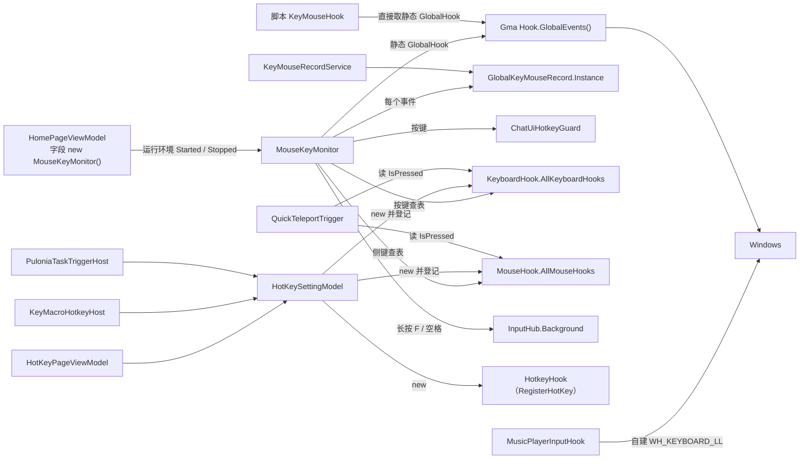
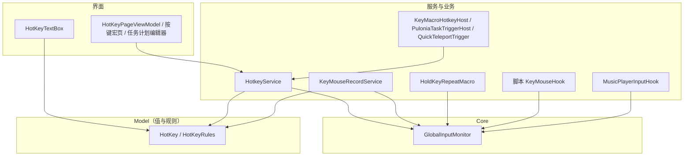

# 键鼠监听与热键重构

> 状态：第 1 版，待确认 · 2026-11-04 · 关联：[InputHub 设计](input-hub.md)、[移除 TaskContext](task-context-removal.md)、[按键宏](key-macro.md)、[悬浮小窗](guide-window.md)

## 1. 结论

- **钩子只有一个所有者。** 新增 `GlobalInputMonitor`（DI 单例），它是进程里唯一安装键盘、鼠标低级钩子的地方。它按订阅计数安装和卸载钩子，在专用线程上运行，输出统一的 `InputEvent`，事件里带注入标记、自动重复标记和物理修饰键。
- **热键只有一个注册入口。** 新增 `HotkeyService`（DI 单例），全局热键和键鼠监听两种类型都由它注册、查冲突、做门控（游戏前台、聊天界面）、派发动作。`HotKeySettingModel` 只保留快捷键页的展示职责。
- **键位规则只有一份。** 新增 `HotKeyRules`，输入控件、热键服务、按键宏、任务计划都用它判断某个键位能否用于某种热键类型。
- **业务模块各自订阅。** 录制、长按 F/空格连发、JS `KeyMouseHook`、自动演奏跟弹在需要时订阅 `GlobalInputMonitor`，用完退订。`MouseKeyMonitor`、`KeyboardHook`、`MouseHook`、`GlobalKeyMouseRecord` 删除。
- **键鼠监听支持组合键。** 支持 `Ctrl / Shift / Alt / Win + 键盘键`，以及 `修饰键 + 鼠标侧键`。修饰键状态以钩子记录的物理按键为准。
- **`HotKeyTextBox` 改造。** 控件按 `HotKeyTypeEnum` 而不是中文名决定规则；以 handledEventsToo 方式接收预览事件；解包 `ImeProcessed` 等包装键并关闭输入法；不合规的按键显示原因；PageUp、PageDown 按规范名显示和保存。

## 2. 现状

### 2.1 调用关系



### 2.2 各组件的实际职责

| 类 | 位置 | 创建与生命周期 | 实际职责 |
| --- | --- | --- | --- |
| `MouseKeyMonitor` | `Core/Monitor/MouseKeyMonitor.cs`、`Wine/MouseKeyMonitor.Wine.cs` | `HomePageViewModel` 的字段 `new()`。运行环境 Started 时 `Subscribe`（网页版除外），Stopped 时 `Unsubscribe` 并 Dispose 静态钩子 | ① 持有进程唯一的 Gma 钩子（静态 `GlobalHook`）② 把所有事件转给录制 ③ 聊天键预判 ④ 按键查表分发给热键 ⑤ 长按 F/空格连发 ⑥ Wine 下轮询 F/空格 |
| `KeyboardHook` / `MouseHook` | `Model/` | `HotKeySettingModel` 注册时 new，登记到 `public static Dictionary`，每个键只能有一个所有者 | 匹配单键、判断游戏前台（`App.GetService`）、聊天门控、`IsHold` 循环、`IsPressed` 状态 |
| `HotKeySettingModel` | `Model/` | 快捷键页、按键宏宿主、任务计划宿主都 new 它来注册热键 | 页面展示（名称、分组、筛选、i18n）、注册两类钩子、静态冲突表、聊天门控、一键宏松开特例 |
| `HotkeyHook` | `Fischless.HotkeyCapture` | 每个全局热键一个 `NativeWindow` | `RegisterHotKey` |
| `GlobalKeyMouseRecord` | `Core/Recorder` | `Singleton<T>` | 录制状态机、排除录制热键、暂停实时任务、错误弹窗。由 `MouseKeyMonitor` 逐事件调用，不在录制时也在跑 |
| `KeyMouseRecordService` | `Core/Recorder` | DI 单例 | 录制入口：防重入、保存文件、广播状态，内部调用 `GlobalKeyMouseRecord.Instance` |
| `KeyMouseHook` | `Core/Script/Dependence` | 脚本 `new KeyMouseHook()` | 直接订阅 `MouseKeyMonitor.GlobalHook` |
| `MusicPlayerInputHook` | `GameTask/Music/Service` | 跟弹功能 | 自建 `WH_KEYBOARD_LL`，过滤注入事件和自动重复 |
| `ChatUiHotkeyGuard` | `GameTask` | 静态类 | 聊天界面打开期间屏蔽热键 |

### 2.3 问题

**职责与耦合**

1. `MouseKeyMonitor` 一个类做六件事（见 2.2）。每增加一种监听用途都要改它。录制模块不是自己订阅，而是被它逐事件调用。
2. 钩子实例存在静态字段里，生命周期却由首页 ViewModel 控制：`Unsubscribe` 会 Dispose 静态钩子并置空。脚本 `KeyMouseHook` 绕过这套生命周期直接读 `MouseKeyMonitor.GlobalHook`：在"禁用键鼠监听"开启或网页版实例上，脚本会自己装上钩子，之后没有人卸载。Gma 在第一次订阅事件的线程上安装钩子，这时就是脚本线程；低级钩子要求安装线程处理消息，否则每次系统输入都要等待超时（`LowLevelHooksTimeout`）。这一情形未实测。
3. 服务依赖 UI 模型：`KeyMacroHotkeyHost`、`PuloniaTaskTriggerHost` 是服务，却 new `HotKeySettingModel`（`ObservableObject`，还订阅 i18n）来注册热键。`HotKeySettingModel.ResetBlockedKeyUpState` 里写死了 `OneKeyFightTask.Instance.KeyUp()`。
4. 按键状态通过公开可写的静态字典暴露。`QuickTeleportTrigger.IsHotkeyPressed` 直接查 `KeyboardHook.AllKeyboardHooks`，并用 WinForms `Keys` 区分大小写地解析 WPF 键名。WPF 键名里有 25 个无法这样解析，例如 `OemPlus`（WinForms 为 `Oemplus`）、`OemComma`，绑定这些键时触发器里会抛 `ArgumentException`（已用 .NET 10 的两套枚举逐个对照）。
5. 一个键只能有一个监听者，所以自动演奏跟弹另写了一套 `WH_KEYBOARD_LL`（见 `MusicPlayerInputHook` 的类注释），进程里同时存在两套键盘低级钩子。
6. 类型泄漏：Gma 的 `MouseEventExtArgs` 出现在 `Model/MouseHook` 和录制器里；键鼠监听借用全局热键库的 `KeyPressedEventArgs` 作为事件参数。

**行为缺陷**

7. 自动重复：按住键盘键时系统持续发送按下消息，`KeyboardHook.KeyDown` 每次都触发。键鼠监听类型的开关类热键（如自动拾取开关）按住会来回切换；`IsHold` 热键每次重复都 `Task.Run` 一个循环，在 `lock (this)` 上排队。
8. 侧键空转：`MouseHook.MouseDown` 在 `IsHold` 时无条件启动 `RunAction`，循环体在 `MousePressed` 为 null 时什么也不做，也不休眠。一键战斗宏、一键领取奖励、悬浮小窗按住加速都是 `IsHold` 且没有按压动作，绑定到侧键后按住期间会占满一个 CPU 核心。键盘一侧有 `KeyPressedEvent != null` 的判断，没有这个问题。
9. 不区分注入输入：Gma 的事件参数没有注入标记（已核对 `KeyEventArgsExt`、`MouseEventExtArgs` 的公开属性）。BetterGI 自己经 SendInput 发出的按键会触发键鼠监听热键，也会被录进录制。
10. 热键动作在钩子回调里同步执行：Gma 钩子装在 UI 线程，非 `IsHold` 热键的动作直接在低级钩子回调里运行，动作耗时会拖慢整个系统的输入。
11. 组合键处理不一致：键鼠监听模式下输入控件接受 `Ctrl + X`；快捷键页注册时 `HotKeySettingModel.RegisterHotKey` 发现修饰键就把 `HotKey` 置空并返回，不给原因，值直接消失；按键宏页用 Toast 拒绝；任务计划校验抛 `FormatException`。
12. 录制排除录制热键靠 `e.KeyCode.ToString() == KeyMouseMacroRecordHotkey` 的字符串比较。组合键、鼠标侧键、Enter（WPF 存为 `Return`，WinForms 名为 `Enter`）都排除不掉。`GlobalHookKeyUp` 一侧比较的是 `Test1Hotkey`，是复制错误。
13. 开启"禁用键鼠监听"后录制仍能开始，但只能录到相对鼠标移动，因为键盘和鼠标按键事件来自 `MouseKeyMonitor`，此时它没有订阅。
14. 录制器的 `MacroEvents` 是普通 `List`：按键事件在 UI 线程写入，相对鼠标移动在 DirectInput / RawInput 线程写入，两路可能并发写同一个列表。
15. 松开不保证送达：`KeyUp` 只在游戏前台且未被聊天门控时交付。按住期间切出游戏再松开，按住类功能停不下来，`HotKeySettingModel` 为此给一键宏单独补了特例。

**输入控件**

16. `HotKeyTextBox` 把 `HotKeyTypeName` 和中文名"全局热键"比较来决定规则。同一套规则在 `HotKeySettingModel`、`KeyMacroHotkeyHost`、`KeyMacroItemViewModel`、`PuloniaTaskHotkeyValidator` 里各写了一遍，而且互相不一致：例如快捷键页允许无修饰键的 PageUp 作为全局热键，任务计划不允许。
17. 控件重写 `OnPreviewKeyDown`，只能收到祖先没有标记 Handled 的预览事件。探针证实 `NavigationViewContentPresenter` 在预览阶段吃掉 F5，所以所有页面都设置不了 F5。
18. 控件不解包 `Key.ImeProcessed` 和 `Key.DeadCharProcessed`（`KeyCaptureBox` 解包了）。中文输入法处于中文模式时，按键可能以 `ImeProcessed` 送达，控件会把它当成按键保存，对应 VK 229，注册后永远匹配不到。
19. 显示直接用枚举名：PageDown 显示为 `Next`，Enter 显示为 `Return`。
20. 全局热键模式下按侧键会清空已有值，而不是提示不支持。

### 2.4 PageUp / PageDown 排查

以下检查基于 .NET 10.0.12，以及项目使用的 WPF-UI 4.3.0、WPF-UI.Violeta 4.3.0.15。

| 检查 | 结果 |
| --- | --- |
| WPF `Key` 枚举 | `PageUp` 与 `Prior` 同值（19），`PageDown` 与 `Next` 同值（20）。`ToString()` 分别得到 `PageUp`、`Next` |
| 虚拟键 | `KeyInterop.VirtualKeyFromKey` 得到 33、34，与钩子收到的 `Keys.PageUp`、`Keys.Next` 一致 |
| 保存与读取 | `Next` 经 `HotKey.FromString` 能还原为 PageDown |
| 路由探针 | 用真实控件搭出与快捷键页相同的祖先：Violeta `NavigationView` → `NavigationViewContentPresenter` → `ScrollViewer` → Violeta `TreeListView`，再投递 `PreviewKeyDown`。PageUp、PageDown 都到达输入框；F5 被 `NavigationViewContentPresenter` 标记 Handled |
| 库代码 | 反射加 IL 扫描两个 UI 库：重写 `OnPreviewKeyDown` 或挂接 `PreviewKeyDown` 的控件都不在快捷键页的祖先链上 |
| 应用代码 | 快捷键页和主窗口都没有 PageUp / PageDown 的 InputBinding |

结论：按现有代码静态推演和隔离探针，PageUp、PageDown 应能被捕获（PageDown 会显示为 `Next`）并按单键注册。项目约定禁止启动主程序，我没能在真实程序里复现"无法设置"。尚未排除的原因：

1. 输入法接管了按键，控件把 `ImeProcessed` 当成按键保存（问题 18）。
2. PageDown 显示为 `Next`，看起来像没有设上（问题 19）。
3. 真实视觉树中有探针没有覆盖到的元素。

确认方法：在快捷键页点击一个键鼠监听类型的输入框，分别按 PageUp、PageDown，看框里显示什么（不变 / `PageUp`、`Next` / `ImeProcessed` / 其他），即可判断是哪一种。4.5 节的控件改造对三种情况都有效。

## 3. 目标与非目标

目标：

1. 全局键鼠钩子只有一个所有者，按需安装；业务模块通过订阅使用，订阅的生命周期就是监听的生命周期。
2. 热键注册只有一个服务入口，UI 模型不再负责注册。
3. 键鼠监听支持组合键（键盘键、鼠标侧键都可以搭配修饰键），输入控件同步支持。
4. 输入控件能设置 PageUp、PageDown、F5 等所有非保留键，不合规的按键给出原因。
5. 配置文件、录制文件、JS API 保持兼容。

非目标：

- 不改变全局热键的实现方式：仍用 `RegisterHotKey`，仍是每个热键一个 `HotkeyHook`。
- 不改变键鼠监听热键的三条现有行为：截图器启动后才生效、只在游戏位于前台时响应、不拦截按键（按键照常传给游戏，组合键也一样）。
- 不改 RawInput / DirectInput 相对鼠标捕获，它已经是 DI 工厂（`IRelativeMouseInputMonitorFactory`）。
- 不调整 `HotKeyPageViewModel` 的热键清单和动作内容；应用热键仍在该 ViewModel 构造时注册。
- 不支持鼠标左、右、中键作为热键，不支持只按修饰键（如单按 Ctrl）的热键。

## 4. 设计

### 4.1 分层与依赖方向



依赖规则：

- `GlobalInputMonitor` 只依赖 Win32 和 `AllConfig.DisableInputMonitor`，不知道热键、录制、游戏状态。
- 只有 `HotkeyService` 知道"游戏前台""聊天界面"这些热键门控。
- 业务模块之间不互相转发事件，各自订阅。
- `HotKey`、`HotKeyRules` 不依赖任何服务，控件和单元测试可以直接使用。

### 4.2 GlobalInputMonitor

文件：`Core/Monitor/GlobalInputMonitor.cs`；`InputEvent`、`InputEventKind`、`InputSubscriptionOptions` 是小类型，合并放在 `Core/Monitor/InputEvent.cs`。

```csharp
/// <summary>一次全局键鼠事件</summary>
public readonly record struct InputEvent(
    InputEventKind Kind,
    User32.VK Key,            // 键盘事件的虚拟键，鼠标事件为 0
    MouseButton Button,       // 鼠标按键事件的按键（System.Windows.Input.MouseButton）
    int X,                    // 屏幕坐标，鼠标事件有效
    int Y,
    int WheelDelta,           // 滚轮增量，120 的倍数
    ModifierKeys Modifiers,   // 事件发生时按住的物理修饰键（不含注入）
    bool IsInjected,          // 由 SendInput 等注入
    bool IsRepeat,            // 键盘自动重复
    DateTime UtcTime);        // 在钩子回调里取的时间，录制用它计算时间轴

/// <summary>事件类型</summary>
public enum InputEventKind { KeyDown, KeyUp, MouseDown, MouseUp, MouseMove, MouseWheel }

/// <summary>订阅选项</summary>
/// <param name="IncludeMouseMove">是否接收鼠标移动（高频，只有录制和脚本需要）</param>
/// <param name="IncludeInjected">是否接收注入事件</param>
public sealed record InputSubscriptionOptions(bool IncludeMouseMove = false, bool IncludeInjected = false);

/// <summary>进程唯一的全局键鼠钩子</summary>
public sealed class GlobalInputMonitor : IDisposable
{
    public GlobalInputMonitor(AllConfig config, ILogger<GlobalInputMonitor> logger);

    /// <summary>监听是否可用。禁用键鼠监听或运行在 Wine 上时为 false，此时 Subscribe 返回空订阅</summary>
    public bool IsAvailable { get; }

    /// <summary>当前按住的物理修饰键</summary>
    public ModifierKeys PhysicalModifiers { get; }

    /// <summary>订阅事件。第一个订阅安装钩子，最后一个退订时卸载。handler 在事件线程上调用，不能阻塞</summary>
    public IDisposable Subscribe(Action<InputEvent> handler, InputSubscriptionOptions? options = null);
}
```

**实现**

- 自己声明 `SetWindowsHookEx(WH_KEYBOARD_LL / WH_MOUSE_LL)`，写法参考 `MusicPlayerInputHook`。注入标记取 `KBDLLHOOKSTRUCT.flags & LLKHF_INJECTED` 和 `MSLLHOOKSTRUCT.flags & LLMHF_INJECTED`；侧键从 `mouseData` 高位字区分 XButton1 / XButton2；`WM_SYSKEYDOWN`、`WM_SYSKEYUP` 按普通按键处理。
- 钩子永远是旁观者：回调最后总是 `CallNextHookEx`，不返回非零，不吞键。
- 自动重复：维护已按下的 VK 集合，已在集合里的按下标记 `IsRepeat`。
- 物理修饰键：只用非注入的左右 Ctrl / Shift / Alt / Win 事件更新，左右键合并为同一个修饰键。BetterGI 注入的修饰键（例如游戏里冲刺用的 LShift）不影响组合键判断。
- 鼠标移动：只有存在 `IncludeMouseMove` 的订阅时才入队。

**线程**

- 钩子装在专用后台线程上，线程运行 `GetMessage` 消息循环；卸载时向它投递 `WM_QUIT`。
- 回调只读取结构体、更新状态、取时间，然后写入无界 Channel。
- 一个分发任务从 Channel 读取事件，按订阅顺序调用 handler。单个 handler 抛异常只记日志，不影响其他订阅和钩子。分发耗时超过 50 ms 记一次警告，便于发现阻塞的订阅者。

**禁用与平台**

- `DisableInputMonitor` 开启或运行在 Wine 上时不安装钩子，`IsAvailable` 为 false，`Subscribe` 返回空订阅并记一次日志。Wine 上原有的 F/空格轮询随长按连发一起迁移（4.7 节）。
- 是否为网页版实例由各订阅者自己决定，监听本身不关心。

### 4.3 HotKey 与 HotKeyRules

**HotKey**（`Model/HotKey.cs`）字段不变，仍是 `Key`、`Modifiers`、`MouseButton`。改动：

- 侧键可以带修饰键，格式化为 `Ctrl + XButton1`。旧配置里的侧键不带修饰键，读取不受影响。
- 格式化时使用规范名：`Next` 写作 `PageDown`，`Return` 写作 `Enter`，`Capital` 写作 `CapsLock`，`Snapshot` 写作 `PrintScreen`。其余键沿用枚举名。
- 解析不变。`Enum.Parse(typeof(Key), ...)` 本来就同时接受别名和规范名，所以旧配置照常读取，旧版本也能读取新写出的值。

**HotKeyRules**（`Model/HotKeyRules.cs`，静态类）

```csharp
/// <summary>热键键位规则，输入控件、热键服务、按键宏、任务计划共用</summary>
public static class HotKeyRules
{
    /// <summary>键位能否用于该类型。可以时返回 null，否则返回给用户看的原因</summary>
    public static string? Validate(HotKey hotKey, HotKeyTypeEnum type);

    /// <summary>两个注册是否冲突，按 HotkeyService 的实际匹配规则判断</summary>
    public static bool AreConflicting(HotKey first, HotKeyTypeEnum firstType, HotKey second, HotKeyTypeEnum secondType);

    /// <summary>按键事件是否属于这个热键（主键、侧键或其修饰键），录制排除录制热键时使用</summary>
    public static bool IsPartOf(InputEvent inputEvent, HotKey hotKey);
}
```

`IsPartOf` 依赖 `InputEvent`。如果不希望 Model 引用 Core，可以把它放进 `KeyMouseRecordService` 作为私有方法，规则本身不受影响。

键位规则：

| 键位 | 全局热键 | 键鼠监听 |
| --- | --- | --- |
| 键盘单键 | F1~F24（F12 除外）和不产生字符的键（PageUp、Home、方向键等） | 任意非修饰键 |
| 字母、数字、符号、Space | 需要搭配 Ctrl / Alt / Win，只加 Shift 不够 | 可以单独使用 |
| 修饰键 + 键盘键 | 支持 | **新增**支持 |
| 鼠标侧键 XButton1 / XButton2 | 不支持 | 支持 |
| 修饰键 + 鼠标侧键 | 不支持 | **新增**支持 |
| 只按修饰键、鼠标左 / 右 / 中键 | 不支持 | 不支持 |
| 无修饰的 Enter、Tab | 不支持（沿用现状） | 不支持（沿用现状） |
| 无修饰的 Delete、Backspace、Esc | 输入控件用来清空 | 同左 |

全局热键一列以快捷键页现在的规则为准，F12 的限制来自任务计划校验（F12 由系统保留给调试器）。

冲突规则（沿用现规则，推广到组合键）：主键或侧键相同时，满足以下任一条件即冲突：

- 修饰键完全相同；
- 任一方是**无修饰键的键鼠监听**（它不检查修饰键，按下组合键时也会触发）。

因此 `F`（监听）与 `Ctrl + F`（任一类型）冲突；`Ctrl + F`（监听）与 `Alt + F`（全局）不冲突。在这条规则下，每次按键最多命中一个注册。

### 4.4 HotkeyService

文件：`Service/Hotkey/HotkeyService.cs`；`HotkeyRequest` 和 `HotkeyRegistration` 是小类，合并放在 `Service/Hotkey/HotkeyRegistration.cs`。

```csharp
/// <summary>热键注册请求</summary>
/// <param name="Owner">注册方标识：应用热键用配置属性名，按键宏用 "KeyMacro/宏名"</param>
public sealed record HotkeyRequest(string Owner, HotKey HotKey, HotKeyTypeEnum Type)
{
    /// <summary>按下。全局热键在收到 WM_HOTKEY 时调用</summary>
    public Action? Pressed { get; init; }

    /// <summary>松开。只有键鼠监听有；交付过 Pressed 才会交付</summary>
    public Action? Released { get; init; }

    /// <summary>按住期间反复调用 Pressed（原 IsHold），只用于键鼠监听</summary>
    public bool RepeatWhileHeld { get; init; }

    /// <summary>全局热键加 MOD_NOREPEAT</summary>
    public bool SuppressRepeat { get; init; }
}

/// <summary>一次注册的句柄，Dispose 即注销</summary>
public sealed class HotkeyRegistration : IDisposable
{
    public string Owner { get; }
    public bool IsActive { get; }     // 注册成功且仍有效
    public string? Error { get; }     // 失败原因，成功时为 null
    public bool IsPressed { get; }    // 当前是否按住，只用于键鼠监听
    public void Dispose();            // 可重复调用
}

/// <summary>全局热键与键鼠监听热键的唯一注册入口</summary>
public sealed class HotkeyService : IDisposable
{
    public HotkeyService(GlobalInputMonitor monitor, GameRuntimeService runtimeService, AllConfig config, ILogger<HotkeyService> logger);

    /// <summary>注册热键，须在 UI 线程调用。失败时返回的句柄 IsActive 为 false，Error 为原因</summary>
    public HotkeyRegistration Register(HotkeyRequest request);

    /// <summary>按注册方查询是否按住，快速传送的 tick 热键使用</summary>
    public bool IsPressed(string owner);

    /// <summary>与应用快捷键配置预先比对冲突（原 HotKeySettingModel.ConflictsWithHotKeyConfig）</summary>
    public bool ConflictsWithHotKeyConfig(HotKey hotKey, HotKeyTypeEnum type);
}
```

**注册流程**

1. 网页版实例（`InstanceBootstrap.Current.Context.IsWebView`）返回错误"云原神网页版实例不响应快捷键"。目前这个判断分散在 `HotKeyPageViewModel.IsHotKeyEnabled` 和 `KeyMacroHotkeyHost.IsHotkeyAvailable`。
2. 空热键返回未激活的句柄，没有错误。
3. `HotKeyRules.Validate` 不通过时返回其原因。
4. 与已激活的注册冲突时返回"此快捷键已由其他功能、任务计划或按键宏使用"。
5. 全局热键：new `HotkeyHook` 并调用 `RegisterHotKey`，系统层面冲突时返回其错误。
6. 键鼠监听：加入匹配表。匹配表用写时复制的快照，事件线程只读快照，不加锁。

`Register` 和 `Dispose` 须在 UI 线程调用，因为 `HotkeyHook` 的窗口有线程亲和性。这与现在 `HotKeySettingModel` 的要求相同。

**键鼠监听的匹配**

订阅选项为 `IncludeInjected = false`，并跳过 `IsRepeat` 事件。

- 按下主键或侧键时：
  1. 先找主键相同、修饰键与当前物理修饰键完全相同的注册；
  2. 找不到时，再找主键相同、没有修饰键的注册。单键热键因此仍然忽略修饰键，玩家按住 Shift 或 Alt 时照样触发，与现在一致。
- 修饰键本身按下不触发任何热键。
- 松开主键或侧键时，对按下时命中的注册交付 `Released`，与修饰键的松开顺序无关。
- 游戏位于前台时，每次按键先调用 `ChatUiHotkeyGuard.PrimeFromChatKey`，与 `MouseKeyMonitor` 现在的做法相同。

**门控与配对**

- 键鼠监听在按下时判断两项：游戏位于前台（`SystemControl.IsGameForeground(runtimeService.Current?.Window)`），且 `ChatUiHotkeyGuard.ShouldBlockHotkey(owner)` 为 false。不满足时不交付，也不记为按住。
- 全局热键只判断聊天门控，与现在相同。
- 配对规则：交付过 `Pressed` 后，松开一定交付 `Released`，不再检查前台和聊天界面。注销或运行环境停止时，对仍按住的注册补发 `Released`。这条规则替代 `HotKeySettingModel` 里的一键宏特例。

**按住连发（RepeatWhileHeld）**

- 交付 `Pressed` 后启动一个循环，按住期间反复调用 `Pressed`；松开或注销时结束。被聊天界面屏蔽期间每 10 ms 检查一次，与现在一致。
- 每次按下只启动一个循环；`Pressed` 为 null 时不启动（修复问题 8）。
- 现在使用这个选项的有：长按旋转视角、快速强化圣遗物、快速购买、快速传送 tick 热键等。一键战斗宏、一键领取奖励、悬浮小窗按住加速只用 `Released`，不需要它。

**线程**

- `Pressed` / `Released` 用 `Dispatcher.BeginInvoke` 投递到 UI 线程执行。现在的动作也都在 UI 线程执行（Gma 钩子和 `WM_HOTKEY` 都在 UI 线程上），区别是改为异步，不再阻塞钩子回调。
- 按住连发的循环在线程池上运行，与现在的 `Task.Run` 相同。
- `IsPressed` 在事件线程上随事件更新，不等动作执行，`QuickTeleportTrigger` 读到的是真实状态。

**生命周期**

`HotkeyService` 自己订阅 `GameRuntimeService.Started` / `Stopped`：运行环境启动且不是网页版时订阅 `GlobalInputMonitor`，停止时退订并补发 `Released`。注册本身不随运行环境变化，截图器重启后热键自动恢复，与现在 `KeyboardHook` 字典常驻的效果相同。

### 4.5 HotKeyTextBox

**属性**

- `Hotkey`（`HotKey`，默认双向）不变。
- 新增 `HotKeyType`（`HotKeyTypeEnum`），替代 `HotKeyTypeName`。四处 XAML 改为 `HotKeyType="{Binding …, Mode=OneWay}"`：
  - `HotkeyPage.xaml`、`GuideWindowSettingsPage.xaml` 绑定 `HotKeySettingModel.HotKeyType`（已有）；
  - `KeyMacroPage.xaml` 绑定 `KeyMacroItemViewModel` 新增的 `HotKeyType`（返回 `Definition.EffectiveHotkeyType`，在现有通知 `HotKeyTypeName` 的位置一并通知）；
  - `PuloniaTaskTriggerView.xaml` 绑定 `PuloniaTaskTriggerEditorViewModel.HotkeyType`（已有）。
- 各 ViewModel 上只供控件使用的 `HotKeyTypeName` / `HotkeyTypeName` 随之删除。

**按键捕获**

1. 构造函数里用 `AddHandler(PreviewKeyDownEvent, …, handledEventsToo: true)` 接收按键，祖先在预览阶段标记 Handled 也能收到（解决 F5）。鼠标同理用 `PreviewMouseDownEvent`。
2. 构造函数里 `InputMethod.SetIsInputMethodEnabled(this, false)`，并解包 `Key.System`、`Key.ImeProcessed`、`Key.DeadCharProcessed`，写法与 `KeyCaptureBox` 相同。
3. 按住修饰键时预览显示 `Ctrl + Shift + …`；修饰键全部松开且没有按主键时恢复原显示（需要处理 `PreviewKeyUp`）。
4. 无修饰的 Delete / Backspace / Esc 清空。
5. 其他按键组成 `new HotKey(key, Keyboard.Modifiers)`，交给 `HotKeyRules.Validate`：
   - 通过：写入 `Hotkey`；
   - 不通过：保留原值，框内显示原因，例如"全局热键需要搭配 Ctrl / Alt / Win"，失去焦点后恢复显示原值。
6. 侧键：组成 `new HotKey(Key.None, Keyboard.Modifiers, button)`，同样校验；全局热键模式下显示"全局热键不支持鼠标侧键"，不再清空原值。处理后标记 `e.Handled = true`，避免侧键触发页面后退。
7. 获得焦点时显示"请按下快捷键…"，失去焦点时显示 `Hotkey.ToString()`。

**文案**

- 快捷键页说明文字的"键鼠监听：支持任意键盘单键、鼠标侧键"改为包含组合键。该文字是 `{i18n:T …}` 的键，改动后需要同步更新翻译。
- 按键宏页、任务计划编辑器上"键鼠监听不支持组合键"的提示和 ToolTip 一并更新。

**随之删除的重复规则**

- `HotKeySettingModel.RegisterHotKey` 里的组合键判断；
- `KeyMacroItemViewModel.HotKey` setter 里的 Toast 拒绝；
- `KeyMacroHotkeyHost` 里"不支持组合键 / 不支持侧键"的判断（改由 `HotkeyService` 返回错误）；
- `PuloniaTaskHotkeyValidator` 中两种类型的键位分支改为调用 `HotKeyRules.Validate`，仍抛 `FormatException` 并带上原因。

### 4.6 录制

`KeyMouseRecordService` 合并 `GlobalKeyMouseRecord`，删除后者的单例。

- **开始**：现有检查之外，`GlobalInputMonitor.IsAvailable` 为 false 时提示"已禁用键鼠监听，无法录制"并返回 false（修复问题 13）。倒计时、暂停实时任务、相对鼠标订阅、主界面检测定时器、错误弹窗都原样迁入。
- **订阅**：倒计时结束后订阅 `GlobalInputMonitor`，选项为 `IncludeMouseMove = true`、`IncludeInjected = false`；停止时退订。录制不再依赖首页是否订阅了监听。
- **去重**：用 `InputEvent.IsRepeat` 代替 `_keyDownState`。
- **排除录制热键**：从配置读取 `KeyMouseMacroRecordHotkey` 及其类型，用 `HotKeyRules.IsPartOf` 排除它的主键和侧键的按下与松开。全局热键类型同样有效，因为 `RegisterHotKey` 不影响低级钩子看到按键。停止时删除录制末尾没有对应松开的修饰键按下事件，避免回放时修饰键一直按住。`Test1Hotkey` 的比较错误随之消失。
- **并发**：按键事件（监听的事件线程）和相对鼠标移动（DirectInput / RawInput 线程）都经过同一把锁写入 `KeyMouseRecorder`（修复问题 14）。
- **录制器**：`KeyMouseRecorder` 的方法改为接收 `InputEvent`。输出字段与取值不变：`KeyCode` 是虚拟键整数；`MouseButton` 用 `Button.ToString()`，WPF `MouseButton` 的名称（Left、Right、Middle、XButton1、XButton2）与原来的 WinForms `MouseButtons` 名称相同；滚轮仍是 120 的倍数。
- 热键里"开始前等待 300 ms，防止录进快捷键"的逻辑保留。

### 4.7 长按 F / 空格连发

从 `MouseKeyMonitor` 拆出 `HoldKeyRepeatMacro`（`GameTask/Macro/HoldKeyRepeatMacro.cs`，DI 单例），逻辑原样迁移，包括 Wine 下的轮询（原 `MouseKeyMonitor.Wine.cs`）。

- `HomePageViewModel` 在原来调用 `_mouseKeyMonitor.Subscribe` / `Unsubscribe` 的位置改为调用它的 `Start()` / `Stop()`，接线方式不变。
- 订阅选项 `IncludeInjected = false`。连发本身经 `InputHub.Background`（PostMessage）发送，不经过低级钩子，不会自我触发。

### 4.8 脚本 KeyMouseHook

- `ScriptHostTypeFactory.CreateKeyMouseHook` 从容器取 `GlobalInputMonitor` 传给构造函数，脚本里仍写 `new KeyMouseHook()`。
- 订阅选项 `IncludeMouseMove = true`、`IncludeInjected = true`。Gma 不过滤注入事件，保留注入事件与现在一致（见 D2）。
- 回调参数字符串不变：KeyCode 回调传 `((Keys)vk).ToString()`；KeyData 回调传 `((Keys)vk | 修饰键标志).ToString()`，修饰键标志由钩子记录的状态计算；鼠标按键名称同 4.6 节；坐标换算不变。
- 内部的事件队列和后台处理器保留。
- 监听不可用时脚本收不到事件，构造时记一条警告（见 D1）。

### 4.9 自动演奏跟弹

`MusicPlayerInputHook` 改为订阅 `GlobalInputMonitor`（`IncludeInjected = false`，跳过 `IsRepeat`），对外保留 `KeyPressed` / `KeyReleased(Keys)` 事件和 `Start` / `Stop` / `IsRunning`。原来事件在 UI 线程触发，现在在类内部用 `Dispatcher.BeginInvoke` 转回 UI 线程，调用方不用改。`Start()` 在监听不可用时返回 false，与现在钩子安装失败的返回值一致。

### 4.10 调用方式对照

| 场景 | 现在 | 改造后 |
| --- | --- | --- |
| 应用快捷键 | `new HotKeySettingModel(...)`，`model.RegisterHotKey()` | 模型只存展示数据和动作；`HotKeyPageViewModel` 调用 `_hotkeyService.Register(model.CreateRequest())`，把句柄存在模型的 `Registration` 上；失败时清空并 Toast 显示 `Error` |
| 按键宏、任务计划热键 | 同上 | 直接 `_hotkeyService.Register(new HotkeyRequest(...))`，失败读 `Error` |
| 查询是否按住 | `KeyboardHook.AllKeyboardHooks[(Keys)Enum.Parse(...)].IsPressed` | `_hotkeyService.IsPressed(nameof(HotKeyConfig.QuickTeleportTickHotkey))` |
| 录制 | `MouseKeyMonitor` 逐事件调用 `GlobalKeyMouseRecord.Instance` | `KeyMouseRecordService` 录制期间自己订阅 |
| 脚本监听 | `MouseKeyMonitor.GlobalHook.KeyDown += ...` | `_monitor.Subscribe(...)` |
| 新增一种监听用途 | 修改 `MouseKeyMonitor` | 注入 `GlobalInputMonitor`，`Subscribe`，用完 `Dispose` |

`QuickTeleportTrigger` 是否能直接注入 `HotkeyService`，取决于触发器的创建方式（见 [实时触发器生命周期](realtime-trigger.md)）；不能注入时由创建方传入。

## 5. 兼容性

**配置**

- `HotKeyConfig` 的"快捷键字符串 + Type 字符串"格式不变，`HotKeyTypeEnum` 的两个值不变。
- 新写出的规范名：`PageDown`（原 `Next`）、`Enter`（原 `Return`）、`CapsLock`（原 `Capital`）、`PrintScreen`（原 `Snapshot`）。新旧名称都是 WPF `Key` 的已定义名称，新旧版本可以互相读取。
- 键鼠监听的组合键是新值。退回旧版本时，旧代码发现修饰键会清空该热键并保存空值。

**按键宏与任务计划文件**：热键字段同样是 `HotKey` 字符串，规则同上。

**录制文件**：字段和取值不变（4.6 节）。

**JS API**：方法、参数和回调字符串不变（4.8 节）。

**行为变化**

| 变化 | 影响 |
| --- | --- |
| 键鼠监听热键按住时不再因自动重复反复触发 | 开关类功能按住只切换一次；按住类功能的按下只交付一次。`KeyMacroRunner.OnKeyDown` 已有 `_keyHeld` 判断，`OneKeyFightTask.KeyDown` 已有 `_cts` 判断，重复调用本来就被忽略 |
| BetterGI 经 SendInput 发出的按键不再触发热键，也不再被录制 | 热键、录制、长按连发、跟弹；脚本 `KeyMouseHook` 不变 |
| 热键动作改为投递到 UI 线程执行，不在钩子回调里同步执行 | 仍在 UI 线程；与键盘事件的先后顺序可能相差一个消息周期 |
| 按下交付后松开一定交付 | 切出游戏后松开也能停止按住类功能；删除一键宏特例 |
| 侧键按住不再空转 | 修复问题 8 |
| 禁用键鼠监听后，录制提示无法开始；脚本 `KeyMouseHook`、跟弹收不到事件 | 见 D1 |
| 任务计划的全局热键规则放宽到与快捷键页一致，例如允许无修饰的 PageUp | 见 D3 |
| 可以设置 F5 | 修复问题 17 |
| 改造期间（第 2、3 步之间）进程里会同时存在新旧两套钩子 | 第 3 步删除 `MouseKeyMonitor` 后恢复为一套 |

## 6. 实施步骤

每一步编译通过后再进行下一步，编译命令见 `AGENTS.md`。

1. **规则与控件**（不依赖后续步骤）：`HotKey` 规范名、`HotKeyRules`（此步键鼠监听仍禁止组合键）、`HotKeyTextBox` 改造与四处 XAML 绑定、按键宏和任务计划的校验改用 `HotKeyRules`。这一步解决 PageUp / PageDown 显示和输入法问题，以及 F5 无法设置。
2. **监听与热键服务**：新增 `GlobalInputMonitor`、`HotkeyService`；迁移 `HotKeyPageViewModel`、`KeyMacroHotkeyHost`、`PuloniaTaskTriggerHost`、`QuickTeleportTrigger`；删除 `KeyboardHook`、`MouseHook` 和 `HotKeySettingModel` 的注册部分；`MouseKeyMonitor` 去掉热键分发和聊天预判；`HotKeyRules` 放开键鼠监听组合键。同步修改 `PuloniaTaskHotkeyTests` 中引用 `KeyboardHook` / `MouseHook` / `HotKeySettingModel.RegisterHotKey` 的用例。
3. **录制与连发**：`KeyMouseRecordService` 合并 `GlobalKeyMouseRecord`，`KeyMouseRecorder` 改用 `InputEvent`；拆出 `HoldKeyRepeatMacro`；删除 `MouseKeyMonitor` 及其 Wine 分部类。
4. **脚本与跟弹**：迁移 `KeyMouseHook`、`MusicPlayerInputHook`；删除 `MouseKeyHook` 包引用和未使用的 `HotkeyHolder`。

## 7. 验证

自动：每一步执行 `AGENTS.md` 中的编译命令；第 2 步后运行单元测试项目。

手动（需要用户在真实环境执行）：

| # | 场景 | 预期 |
| --- | --- | --- |
| 1 | 快捷键页、悬浮小窗设置页、按键宏页、任务计划热键：键鼠监听模式下按 PageUp、PageDown | 显示 `PageUp`、`PageDown`；游戏前台按下时触发 |
| 2 | 键鼠监听设置 `Ctrl + PageUp`、`Alt + F`、`Ctrl + XButton1` | 只在修饰键一致时触发；单按 PageUp 不触发 `Ctrl + PageUp` |
| 3 | 键鼠监听单键 `F`，按住 Shift 再按 F | 仍触发 |
| 4 | 已有 `F`（监听）时再设置 `Ctrl + F`（任一类型） | 提示冲突 |
| 5 | 全局热键模式下按 A、按侧键、单按 F12 | 不接受，框内显示原因，原值保留 |
| 6 | 输入法中文模式下设置字母键 | 得到字母键而不是 `ImeProcessed` |
| 7 | 设置 F5 | 可以设置 |
| 8 | 键鼠监听类型的"自动拾取开关"按住 2 秒 | 只切换一次 |
| 9 | 一键战斗宏、一键领取奖励、悬浮小窗按住加速，分别绑定键盘键和侧键；按住时切出游戏再松开 | 松开后停止；按住侧键期间 CPU 无明显占用 |
| 10 | 快速传送 tick 热键绑定 `OemPlus` | 按住时快速传送生效，日志里没有异常 |
| 11 | 打开游戏聊天界面后按热键 | 被屏蔽；"启动停止 BetterGI"不受影响 |
| 12 | 录制热键分别为单键、组合键、侧键、Enter 时录制一段 | 录制文件里没有录制热键的按键，末尾没有未松开的修饰键 |
| 13 | 录制期间运行一个前台按键宏 | 宏发出的按键不进入录制 |
| 14 | 开启"禁用键鼠监听"后开始录制 | 提示无法开始 |
| 15 | JS 脚本使用 `KeyMouseHook` 的全部回调 | 回调字符串和坐标与改造前一致 |
| 16 | 长按 F / 空格连发；Wine 下同样测试 | 与改造前一致 |
| 17 | 自动演奏跟弹 | 与改造前一致 |
| 18 | 停止截图器再启动 | 键鼠监听热键恢复 |
| 19 | 云原神网页版实例 | 不响应快捷键 |

## 8. 决策记录

| 议题 | 决定 | 原因 |
| --- | --- | --- |
| 钩子实现 | 自己声明 `WH_KEYBOARD_LL` / `WH_MOUSE_LL`，最终移除 MouseKeyHook 包 | 需要注入标记，Gma 的事件参数没有；Gma 在第一次订阅事件的线程上安装钩子，线程不可控。备选 SharpHook 需要引入原生库，收益不足 |
| 钩子线程 | 专用线程加消息循环，回调只入队 | 不受 UI 线程繁忙影响。备选"仍装在 UI 线程"改动更小，但 UI 卡顿时整个系统的输入都会延迟 |
| 动作执行线程 | 投递到 UI 线程 | 现有动作都在 UI 线程执行，保持一致，动作代码不用改 |
| 单键监听与修饰键 | 单键忽略修饰键，组合键要求修饰键完全一致 | 游戏中常按住 Shift / Alt 操作，单键改为精确匹配会让现有热键失灵 |
| 冲突规则 | 沿用现规则并推广到组合键 | 保证每次按键最多命中一个注册，匹配不需要优先级 |
| 修饰键来源 | 只看物理按键 | BetterGI 注入的 LShift 等不应改变组合键判断 |
| 全局热键实现 | 不变 | 非目标，现有实现可用 |
| 存储格式 | 字符串格式不变，只换别名 | 新旧版本可以互相读取 |
| `HotKeySettingModel` | 保留为展示模型，删除注册职责 | 快捷键页和悬浮小窗设置页都绑定它，整体替换收益小 |

## 9. 待确认

| # | 问题 | 建议 |
| --- | --- | --- |
| D1 | "禁用键鼠监听"是否同时让脚本 `KeyMouseHook` 和跟弹收不到事件 | 是。开启这个开关通常是为了让进程里不装低级钩子，现在脚本和跟弹会绕过它 |
| D2 | 脚本 `KeyMouseHook` 是否继续收到 BetterGI 自己的注入事件 | 继续收到，保持 JS 行为不变；以后可加可选参数 |
| D3 | 任务计划的全局热键规则是否放宽到与快捷键页一致 | 是，规则只保留一份 |
| D4 | 键鼠监听热键是否仍只在截图器启动后生效 | 保持现状 |
| D5 | PageUp / PageDown 在真实程序里的现象 | 请按 2.4 节的方法告知输入框显示的内容 |
