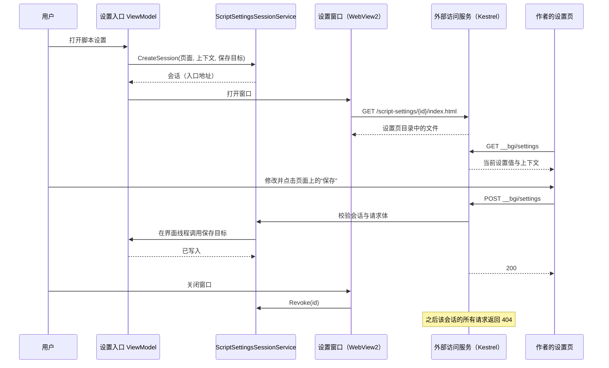
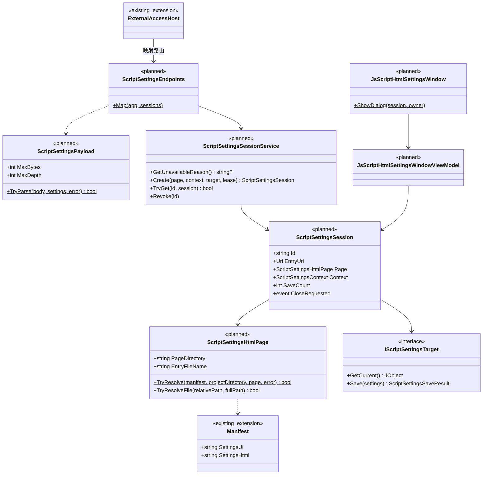

# JS 脚本自定义 HTML 设置页设计

状态：提案，未实现（第 2 版，2026-10-29）。  
相关文档：[外部访问服务](external-access.md) · [基础设施统一（WebView2 见第 8 节）](infrastructure-foundation.md) · [脚本仓库与任务资源](pulonia/repository-resources.md) · [Pulonia 界面](pulonia/user-interface.md) · [实例能力边界](instance-capability-boundaries.md)

## 1. 目标

脚本作者自己实现完整的 HTML 设置界面，包括布局、控件、校验和“保存”按钮。BetterGI 只做三件事：

1. 在 WebView2 窗口中展示这个页面；
2. 通过本机 HTTP 服务（外部访问服务）提供读取和保存设置的接口；
3. 收到页面 POST 的设置后，写入脚本原有的设置存储。

页面与 `settings_ui` 无关：不读取 `settings.json`，不按它校验，也不由 BetterGI 生成任何控件或按钮。旧的 `settings_ui` 基础表单完整保留。

| 术语 | 含义 |
| --- | --- |
| 基础表单 | 按 `settings_ui` 生成的现有 WPF 表单 |
| HTML 设置页 | 脚本通过 `settings_html` 声明、由作者自己实现的页面 |
| 设置页目录 | `settings_html` 入口文件所在的目录，只有这个目录中的文件会提供给页面 |
| 设置值 | 脚本运行时读取的 `settings` 对象。调度器存于 `JsScriptSettingsObject`，Pulonia 存于节点参数 `settings` |
| 设置会话 | 打开一次设置窗口时创建的临时授权，窗口关闭即失效 |
| 会话根路径 | `/script-settings/{会话 ID}/`，页面和接口都在这个路径下 |
| 设置接口 | 会话根路径下的 `__bgi/settings`，`GET` 读取、`POST` 保存 |

## 2. 范围

包含：

- `manifest.json` 新字段 `settings_html`；
- 外部访问服务新增“脚本设置页”能力：提供页面文件、设置接口与关闭接口；
- 设置会话的创建、校验与失效；
- WebView2 设置窗口；
- 接入调度器、Pulonia 节点编辑、任务计划添加任务、新一条龙添加弹窗；
- 仓库资源打开设置页时提取设置页目录，确认添加时校验。

不包含：

- 修改 `settings_ui` 或基础表单；
- 用 `settings_ui` 校验 HTML 页提交的值；
- BetterGI 注入页面脚本或提供 JS SDK，页面只通过 HTTP 与 BetterGI 交互；
- 设置页访问外网，或调用 `/api`、`/mcp`、`/ws` 下的现有接口；
- 子实例（桌面分身、云原神实例）中打开 HTML 设置页，见 [11.6](#116-子实例)；
- 在外部浏览器中编辑设置。

## 3. 兼容性约定（保留旧设置）

| 项 | 约定 |
| --- | --- |
| `settings_ui` 与基础表单 | 不变。`SettingItem`、`ScriptProject.LoadSettingUi`、`PuloniaJsScriptSettingsDialog` 都不改 |
| 只声明 `settings_ui` 的脚本 | 所有入口与现在完全相同 |
| 设置值的存储 | 调度器仍写 `User/ScriptGroup/{配置组}.json` 的 `jsScriptSettingsObject`；Pulonia 仍写节点 `parameters.settings`。不新增文件 |
| 脚本读取设置 | 仍由 `ScriptProject.ExecuteAsync` 注入全局 `settings`，`main.js` 写法不变 |
| 旧版本 BetterGI | `Manifest.FromJson` 忽略未知字段，旧版本只看到 `settings_ui` |
| 两者都声明 | 打开 HTML 设置页；HTML 设置页不可用时打开基础表单。两者读写同一份设置值，键和值类型的一致性由作者负责 |

## 4. 现状

### 4.1 设置入口与存储

| 入口 | 代码 | 值的存储 | 保存方式 |
| --- | --- | --- | --- |
| 调度器右键“修改JS脚本自定义配置” | `ScriptControlViewModel.OnEditJsScriptSettings` | `ScriptGroupProject.JsScriptSettingsObject`（`ExpandoObject`） | 控件直接改对象，弹窗关闭后写配置组文件 |
| Pulonia 节点“脚本自定义设置” | `PuloniaTaskNodeAdvancedSettingsViewModel.EditScriptSettingsAsync` | 节点 `parameters["settings"]`（`JObject`） | `Document.ApplyJavaScriptSettings`，可撤销 |
| 任务计划添加 JS 任务 | `PuloniaTaskPlanViewModel.AddTask` | 新任务 `Parameters["settings"]` | 弹窗确认后插入任务树，取消则不添加 |
| 新一条龙添加弹窗 | `PuloniaTaskCreationDialogViewModel.JavaScriptSettingFields` | 同上 | 弹窗确认时 `BuildJavaScriptSettings` |

调度器的配置组文件由 `ScriptGroup.FromJson` 用 Newtonsoft 读取；Pulonia 执行器用 `parameters["settings"].ToObject<ExpandoObject>()` 转换。两者最终都在 `ScriptProject.ExecuteAsync` 中注入为 `settings`。

仓库资源的项目文件不在用户目录中。`ScriptRepositoryStore.PreparePreviewAsync` 只把 `manifest.json`、`settings_ui` 文件和 `README.md` 提取到一次性目录 `Previews/pv_…`。

### 4.2 外部访问服务

- `ExternalAccessHost` 在主进程内托管 Kestrel minimal API，`ListenLocalhost(port)`，默认端口 30648。
- 只在 Primary 实例启动。HTTP API、WebSocket 日志、MCP 三个开关默认关闭，全部关闭时不监听；开关和端口在重启后生效。
- 中间件顺序：Host 校验（只接受 `localhost` 和 loopback IP）→ 路由 → CORS → Bearer 鉴权（只针对 `/api`、`/mcp`）→ 端点。
- 日志 WebSocket `/ws/v1/logs` 按产品约定不鉴权、允许任意 Origin。
- 设计约定：不向 WebView2 页面自动注入访问令牌。

## 5. 方案选择

### 5.1 保存接口放在哪里

| 维度 | A. 外部访问服务 + 会话路径（采用） | B. 外部访问服务 `/api` + 全局令牌 | C. WebView2 拦截虚拟地址 |
| --- | --- | --- | --- |
| 做法 | 页面与接口都在 `/script-settings/{会话 ID}/` 下，会话 ID 就是授权 | 接口放在 `/api/v1/scripts/settings`，把 Bearer 令牌交给页面 | 页面 POST 到 `https://xxx.bettergi.local/...`，由 `WebResourceRequested` 在进程内处理 |
| 使用现有 HTTP 服务 | 是 | 是 | 否 |
| 第三方页面拿到的权限 | 只能读写本次打开的这个脚本的设置 | 全局令牌，可调用全部 HTTP API 和 MCP，以后加入任务控制后风险更大 | 只有本页设置 |
| 权限何时失效 | 窗口关闭时 | 用户重新生成令牌时 | 窗口关闭时 |
| 跨域与本地网络限制 | 页面与接口同源，不需要 CORS | 页面若不同源，需要 CORS 和本地网络访问预检 | 不涉及 |
| 默认可用 | 需要服务在运行（见 5.2） | 需要用户开启 HTTP API | 是 |
| 子实例 | 不可用 | 不可用 | 可用 |

采用方案 A。它使用现有 HTTP 服务，又不把全局令牌交给第三方页面。方案 C 不依赖服务，作为子实例支持的备选（Q2）。

### 5.2 服务开关

新增配置项 `ExternalAccessConfig.ScriptSettingsPageEnabled`，界面名称“脚本 HTML 设置页”，与现有三个开关并列：

- **默认开启**（待确认，Q1）。如果默认关闭，绝大多数用户打开 HTML 设置页时都会先遇到“请开启并重启”，功能基本不可用。
- 开启后，Primary 实例启动时会监听 `127.0.0.1:{端口}`，即使其他三个开关都关闭。这改变了外部访问服务“默认不监听”的现状，需要同步修改 [外部访问服务设计](external-access.md)。
- 只开启本项时，只映射 `/script-settings` 路由，`/api`、`/ws`、`/mcp` 仍不存在（404），也不生成访问令牌。
- 与其他开关一样，修改后重启生效。端口被占用等启动失败只影响本功能，不影响主程序。

## 6. 清单格式

```json
{
  "manifest_version": 1,
  "name": "自动采集示例",
  "version": "1.3.0",
  "main": "main.js",
  "settings_ui": "settings.json",
  "settings_html": "settings/index.html"
}
```

`settings_html` 的规则：

- 可选字符串，项目根目录下的相对路径，指向入口 HTML 文件。`Manifest` 新增属性 `SettingsHtml`（默认空字符串），由现有 `SnakeCaseLower` 命名策略对应到 `settings_html`。
- 入口必须位于子目录中，例如 `settings/index.html`。入口所在目录就是设置页目录，不开放项目根目录，`main.js` 和其他脚本文件不会提供给页面。
- 不能是绝对路径，不能含 `..` 段，扩展名必须是 `.html` 或 `.htm`，路径上不能有重解析点。分隔符可以是 `/` 或 `\`。
- 设置页目录中名为 `__bgi` 的子目录被接口路径占用，其中的文件不会提供给页面。
- 设置页目录上限（暂定，Q6）：最多 500 个文件，总大小 20 MB，单个文件 10 MB。
- 校验只在打开设置和仓库确认添加时进行，不放进 `Manifest.Validate`。`Manifest.Validate` 在 `ScriptProject` 构造时执行，在那里失败会导致脚本无法运行。

| `settings_ui` | `settings_html` | 打开设置时 |
| --- | --- | --- |
| 无 | 无 | 提示“此脚本未提供自定义配置”（不变） |
| 有 | 无 | 基础表单（不变） |
| 无 | 有 | HTML 设置页；不可用时提示原因 |
| 有 | 有 | HTML 设置页；不可用时提示原因，然后打开基础表单 |

HTML 设置页不可用的原因：当前是子实例；“脚本 HTML 设置页”开关关闭；外部访问服务未运行（附带服务状态说明，如端口被占用）；未安装 WebView2 运行时；`settings_html` 路径不合法或超出上限。

## 7. 流程



- 每次 POST 成功都立即写入存储，窗口可以多次保存。
- BetterGI 不知道页面是否有未保存的修改，关闭窗口时不提示。作者应在页面上明确显示保存状态（见第 13 节）。
- 页面可以调用 `POST __bgi/close` 请求关闭窗口，用于实现“保存并关闭”。

## 8. 接口

接口地址都相对会话根路径。入口页面位于会话根路径下，所以页面中直接写相对地址 `__bgi/settings` 即可；设置页目录子目录中的页面写 `../__bgi/settings`。

| 方法与路径 | 用途 |
| --- | --- |
| `GET /script-settings/{id}/` | 重定向到入口文件 |
| `GET /script-settings/{id}/{文件路径}` | 设置页目录中的文件 |
| `GET /script-settings/{id}/__bgi/settings` | 读取当前设置值与上下文 |
| `POST /script-settings/{id}/__bgi/settings` | 保存设置值 |
| `POST /script-settings/{id}/__bgi/close` | 请求关闭设置窗口 |

### 8.1 读取

```http
GET /script-settings/{id}/__bgi/settings HTTP/1.1
Host: 127.0.0.1:30648
```

```json
{
  "apiVersion": 1,
  "settings": { "rounds": 3, "skipBoss": false },
  "context": {
    "mode": "edit",
    "host": "scheduler",
    "script": { "name": "自动采集示例", "version": "1.3.0" },
    "bgi": { "version": "0.67.0" },
    "theme": "dark",
    "language": "zh-Hans"
  }
}
```

| 字段 | 含义 |
| --- | --- |
| `settings` | 当前已保存的设置值，从未保存时为 `{}`。每次请求读取最新值，保存后刷新页面能看到新值 |
| `context.mode` | `create`：Pulonia 添加任务时；其余为 `edit` |
| `context.host` | `scheduler` 或 `pulonia` |
| `context.theme` | 打开窗口时 BetterGI 的主题，`light` 或 `dark` |
| `context.language` | 界面语言 |

默认值由页面自己处理。BetterGI 不读取 `settings_ui` 中的 `default`。

### 8.2 保存

```http
POST /script-settings/{id}/__bgi/settings HTTP/1.1
Host: 127.0.0.1:30648
Content-Type: application/json

{ "settings": { "rounds": 5, "skipBoss": true } }
```

规则：

- `settings` 整体替换已保存的设置值，请求中没有的键会被删除。页面通常应以读取到的 `settings` 为基础修改后提交。
- `settings` 必须是 JSON 对象，请求体不超过 1 MiB，嵌套深度不超过 32。键和值不做其他校验，也不按 `settings_ui` 校验。
- 同一会话的保存按到达顺序串行执行。

响应：

| 状态码 | 情况 | 响应体 |
| --- | --- | --- |
| 200 | 已写入 | `{ "saved": true }` |
| 400 | 不是合法 JSON、缺少 `settings`、`settings` 不是对象、嵌套过深 | `{ "error": "原因" }` |
| 403 | `Origin` 请求头存在且不是本服务地址 | `{ "error": "原因" }` |
| 404 | 会话不存在或窗口已关闭 | 无 |
| 409 | 保存目标拒绝写入，例如调度器中的条目已删除、Pulonia 节点校验失败 | `{ "error": "原因" }` |
| 413 | 请求体超过 1 MiB | 无 |
| 415 | `Content-Type` 不是 `application/json` | 无 |
| 500 | 写入时发生其他异常 | `{ "error": "保存失败，详见 BetterGI 日志" }` |

`error` 是给用户看的中文说明，页面可以直接显示。

### 8.3 关闭窗口

`POST __bgi/close` 返回 202，窗口随后在界面线程关闭。会话失效后，该页面的所有请求返回 404。

### 8.4 序列化

设置值最终写入 `JObject`（Pulonia）或由 Newtonsoft 转换的 `ExpandoObject`（调度器），因此请求体用 Newtonsoft 解析（`MaxDepth = 32`），`GET` 的响应也用 Newtonsoft 输出，设置值的键原样保留。外部访问服务现有的 `/api` 仍使用 System.Text.Json，互不影响。

## 9. 设置值写入

| 入口 | 每次 POST 成功时 | 窗口关闭后 |
| --- | --- | --- |
| 调度器 | 把 `settings` 用 Newtonsoft 默认设置转成 `ExpandoObject`，替换 `JsScriptSettingsObject`，再保存配置组文件 | 无额外操作 |
| Pulonia 节点编辑 | `Document.ApplyJavaScriptSettings(node, settings)`，每次保存是一次可撤销编辑，随后自动保存 | 无额外操作 |
| 任务计划添加任务 | 写入添加流程的草稿 | 保存过：用最后一次保存的值添加任务。从未保存：询问“设置尚未保存，仍然添加任务吗？”，选择“不添加”时与现在取消一样不留节点（Q4） |
| 新一条龙添加弹窗 | 写入弹窗 ViewModel 的草稿，卡片显示“已保存 N 项设置” | 弹窗确认时使用草稿 |

调度器转换方式与 `ScriptGroup.FromJson` 读取文件时相同，所以保存后不重启和重启后重新读文件，脚本拿到的值类型一致。替换对象后，正在运行的脚本继续使用旧对象，下次运行读到新值。

保存目标都是界面对象（`ScriptGroupProject`、Pulonia 文档、弹窗 ViewModel），而 Kestrel 在线程池上处理请求。会话在创建时记录界面线程的 `SynchronizationContext`，保存回调统一投递到界面线程执行，HTTP 层不直接操作界面对象。设置窗口是模态的，模态消息循环会处理这些回调。

脚本中的值类型：Newtonsoft 转换后，嵌套对象是 `ExpandoObject`，数组是 `List<object>`，在 V8 中都是 .NET 宿主对象，`length`、`JSON.stringify` 等 JS 写法不可用。建议设置值只用字符串、数字、布尔，复杂结构存成 JSON 字符串，在脚本中 `JSON.parse(settings.xxx)`。

## 10. 安全

设置页是第三方代码。会话 ID 相当于本次打开窗口的临时密码，页面只能用它读写这一个脚本的设置。

| 风险 | 措施 |
| --- | --- |
| 其他程序或网页猜测会话 | 会话 ID 为 32 字节随机数的 Base64Url；窗口关闭即失效；不写入日志 |
| 其他网站跨域调用设置接口 | 接口不挂 CORS 策略；`POST` 要求 `Content-Type: application/json`，跨域时会先触发预检并被拒绝；`Origin` 存在且不是本服务地址时返回 403 |
| DNS rebinding | 沿用现有 Host 校验 |
| 读取设置页目录以外的文件 | 路由解码后规范化，必须位于设置页目录内；拒绝 `..`、绝对路径、重解析点；只提供扩展名白名单内的文件；不列目录 |
| 页面把设置值发到外网 | 响应头 CSP `connect-src 'self'`；窗口的 `WebResourceRequested` 拦截会话根路径以外的全部请求，返回 403 |
| 页面调用同源的 `/api`、`/mcp` | 页面没有令牌，返回 401；窗口同时拦截会话根路径以外的请求 |
| 页面连接同源的日志 WebSocket | `ExternalLogWebSocketHandler` 拒绝 `Origin` 为本服务自身地址的握手（返回 403）。本服务提供的网页只有脚本设置页，外部程序和其他来源的网页不受影响 |
| 页面跳转到外部网站 | `NavigationStarting` 只放行会话根路径；`target=_blank` 的 http(s) 链接按 `WebViewSetup` 默认交给系统浏览器 |
| 下载文件 | `WebViewOptions.DownloadFolder` 为空，下载被取消 |
| 读取其他网页的存储 | 使用新 Profile `ScriptSettings`，与脚本仓库、HTML 遮罩隔离 |
| 超大请求 | 请求体上限 1 MiB，深度上限 32 |
| 日志泄露设置内容 | 日志只记录脚本名、状态码和错误原因，不记录会话 ID 和设置值 |

页面文件的响应头：

```text
Content-Type: 按扩展名白名单
Cache-Control: no-store
X-Content-Type-Options: nosniff
Referrer-Policy: no-referrer
Content-Security-Policy: default-src 'self'; script-src 'self' 'unsafe-inline' 'unsafe-eval'; style-src 'self' 'unsafe-inline'; img-src 'self' data: blob:; font-src 'self' data:; media-src 'self' data: blob:; connect-src 'self'; worker-src 'self' blob:; frame-src 'none'; frame-ancestors 'none'; object-src 'none'; base-uri 'self'; form-action 'none'
```

允许 `'unsafe-inline'` 和 `'unsafe-eval'`，是因为作者常写内联脚本，部分前端框架在运行时编译模板。限制页面能访问的范围比限制执行方式更有效。`form-action 'none'` 禁止表单提交，保存只能用 `fetch`。

扩展名白名单：`.html`、`.htm`、`.js`、`.mjs`、`.css`、`.json`、`.map`、`.txt`、`.svg`、`.png`、`.jpg`、`.jpeg`、`.gif`、`.webp`、`.ico`、`.woff`、`.woff2`、`.ttf`、`.otf`、`.wasm`、`.mp3`、`.ogg`、`.wav`、`.mp4`、`.webm`。文本类型带 `charset=utf-8`，其他扩展名返回 404。

所有脚本的设置页同源（`http://127.0.0.1:{端口}`），因此 `localStorage` 等网页存储在脚本之间共享。设置值必须通过接口保存，作者不应在网页存储中放敏感数据。是否改为每个脚本独立来源见 Q7。

## 11. 接入点

### 11.1 调度器

`ScriptControlViewModel.OnEditJsScriptSettings` 改为返回 `Task` 的异步命令：

1. 沿用现有的 `BuildScriptProjectRelation` 与类型判断。
2. 声明了 `settings_html` 时，解析设置页并检查是否可用。可用则创建会话（保存目标见第 9 节）并打开窗口。
3. 不可用时提示原因；声明了 `settings_ui` 则接着走现有基础表单流程。
4. 只声明 `settings_ui` 时，现有流程不变。

### 11.2 Pulonia 节点编辑

`PuloniaTaskNodeAdvancedSettingsViewModel.EditScriptSettingsAsync`：

- `PuloniaTaskResourcePreview` 增加 `SettingsHtml`，只表示清单是否声明了设置页，不提取页面文件。
- 声明了设置页时，经 `PuloniaJavaScriptSettingsPageLoader`（11.5）准备设置页目录，会话失效时释放。
- `IPuloniaTaskSettingsDialogs` 增加 `ShowJavaScriptHtmlSettings(...)`，由 `PuloniaTaskSettingsDialogs` 创建窗口；文档 ViewModel 不创建窗口。
- “此脚本未提供自定义设置”的条件改为既没有 `settings_ui` 也没有 `settings_html`。

### 11.3 任务计划添加任务

`PuloniaTaskPlanViewModel.AddTask`：`PuloniaTaskCreationResult` 增加是否声明了设置页，以及项目定位（仓库资源引用或本地项目路径）。声明了设置页时，在添加后打开 HTML 设置窗口（`mode` 为 `create`），关闭后按第 9 节决定是否添加。

### 11.4 新一条龙添加弹窗

`PuloniaOneDragonCreationDialog` 的脚本设置卡片：声明了设置页时隐藏内嵌字段，显示“打开脚本设置页面…”按钮和“已保存 N 项设置”。HTML 设置页不可用且声明了 `settings_ui` 时，显示原有内嵌字段。

### 11.5 仓库资源

- 新增 `ScriptRepositoryStore.PrepareSettingsPageAsync(reference, ct)`：把 `manifest.json` 和整个设置页目录提取到 `Previews/pv_…`，用 `snapshot.EnumerateFiles` 列出文件并按第 6 节上限校验，返回 `ScriptPreviewLease`。现有 `PreparePreviewAsync` 不变，切换资源选择时不会提取页面文件。
- 新增 `PuloniaJavaScriptSettingsPageLoader`：仓库资源调用上面的方法；本地资源直接使用项目目录，释放时不做任何事。
- 确认添加时（`ScriptRepositoryStore.Resources.cs` 的清单校验），声明了 `settings_html` 就校验路径规则、入口存在和目录上限，失败则拒绝确认，与现有 `settings_ui` 的校验一致。
- 资源指纹仍只计算 `manifest.json` 和 `main.js`（[Pulonia 界面](pulonia/user-interface.md)中的待定项 D11 不受影响）。

### 11.6 子实例

外部访问服务只在 Primary 实例运行，设置值又保存在打开窗口的那个进程的内存对象中，所以首版子实例不支持 HTML 设置页：提示“HTML 设置页只能在主实例中打开”，声明了 `settings_ui` 时接着打开基础表单。后续支持方式见 Q2。

### 11.7 脚本列表页

`JsListViewModel` 中“此脚本存在配置…建议添加至【调度器】”的提示，条件改为声明了 `settings_ui` 或 `settings_html`。

## 12. 分层与类设计

```text
View           JsScriptHtmlSettingsWindow：FluentWindow、WebView2、导航与请求拦截、错误提示
ViewModel      JsScriptHtmlSettingsWindowViewModel：标题、加载状态、错误提示、关闭请求
               各入口 ViewModel：判断可用性、创建会话、提供保存目标
Service        ScriptSettingsSessionService：会话登记、可用性判断、界面线程投递
               ScriptSettingsEndpoints：在外部访问服务中映射路由
               ExternalAccessHost、ExternalLogWebSocketHandler：开关与 Origin 拒绝
Core/Script    Manifest.SettingsHtml、ScriptSettingsHtmlPage（路径规则与文件解析）、ScriptSettingsPayload（请求体解析与上限）
               ScriptRepositoryStore.PrepareSettingsPageAsync
Infrastructure WebViewProfiles.ScriptSettings
```

依赖方向：View → ViewModel → Service → Core。HTTP 端点只调用会话服务，不引用 ViewModel；入口 ViewModel 通过 `IScriptSettingsTarget` 把保存逻辑交给会话。



新增与修改的文件：

| 文件 | 层 | 内容 |
| --- | --- | --- |
| `Core/Script/Project/Manifest.cs` | Core | 新增 `SettingsHtml` |
| `Core/Script/Settings/ScriptSettingsHtmlPage.cs` | Core | 路径规则、设置页目录、文件解析 |
| `Core/Script/Settings/ScriptSettingsPayload.cs` | Core | 请求体解析与上限 |
| `Core/Script/Repositories/ScriptRepositoryStore.Archives.cs` | Core | `PrepareSettingsPageAsync` |
| `Core/Script/Repositories/ScriptRepositoryStore.Resources.cs` | Core | 确认添加时校验 `settings_html` |
| `Core/Config/ExternalAccessConfig.cs` | Core | `ScriptSettingsPageEnabled`，默认 `true` |
| `Pulonia/Services/PuloniaJavaScriptSettingsPageLoader.cs` | Core | 按仓库或本地来源准备设置页 |
| `Service/ExternalAccess/ScriptSettings/IScriptSettingsTarget.cs` | Service | 保存目标接口、保存结果，以及委托实现 `DelegateScriptSettingsTarget`（用途单一，合并存放） |
| `Service/ExternalAccess/ScriptSettings/ScriptSettingsContext.cs` | Service | 上下文模型与 `mode`、`host` 枚举 |
| `Service/ExternalAccess/ScriptSettings/ScriptSettingsSession.cs` | Service | 单个会话 |
| `Service/ExternalAccess/ScriptSettings/ScriptSettingsSessionService.cs` | Service | 会话登记与可用性判断，单例 |
| `Service/ExternalAccess/ScriptSettings/ScriptSettingsEndpoints.cs` | Service | 路由、静态文件、MIME 白名单、响应头 |
| `Service/ExternalAccess/ExternalAccessHost.cs` | Service | 启动条件加入新开关；映射路由；把会话服务注册进子容器 |
| `Service/ExternalAccess/ExternalAccessState.cs` | Service | 运行时的服务基地址，未运行时为空 |
| `Service/ExternalAccess/ExternalLogWebSocketHandler.cs` | Service | 拒绝 `Origin` 为本服务地址的握手 |
| `Infrastructure/WebView/WebViewProfile.cs` | Infrastructure | `ScriptSettings` Profile，加入 `All` |
| `ViewModel/Windows/JsScriptHtmlSettingsWindowViewModel.cs` | ViewModel | 窗口状态 |
| `View/Windows/JsScriptHtmlSettingsWindow.xaml(.cs)` | View | 窗口 |
| `View/Pages/CommonSettingsPage.xaml` 与 ViewModel | View | “本机外部访问服务”卡片增加开关 |
| `App.xaml.cs` | 启动 | `services.AddSingleton<ScriptSettingsSessionService>()` |
| 其他已有文件 | 各层 | `ScriptControlViewModel`、`PuloniaTaskNodeAdvancedSettingsViewModel`、`PuloniaTaskPlanViewModel`、`PuloniaTaskCreationDialogViewModel`、`PuloniaOneDragonCreationDialog.xaml`、`IPuloniaTaskSettingsDialogs`、`PuloniaTaskSettingsDialogs`、`PuloniaTaskResourcePreview`、`PuloniaTaskResourcePreviewLoader`、`PuloniaTaskCreationResult`、`JsListViewModel` |

会话服务：

- 会话保存在内存字典中，同时最多 4 个。窗口关闭、外部访问服务停止或程序退出时全部失效。
- `Create` 必须在界面线程调用，会记录 `SynchronizationContext` 用于保存回调。
- 仓库资源的预览租约交给会话持有，会话失效时释放，`Previews/pv_…` 随之删除。
- `GetUnavailableReason` 依次检查：是否 Primary 实例、开关是否开启、服务是否在运行。WebView2 运行时由窗口打开前检查。

新 Profile：

```csharp
/// <summary>
/// 脚本 HTML 设置页，与其他网页隔离
/// </summary>
public static readonly WebViewProfile ScriptSettings = new(WebViewEnvironments.App, "ScriptSettings", "软件内网页 · 脚本设置页数据")
{
    Description = "脚本 HTML 设置页的缓存和网页数据，不含脚本设置值",
    ClearsAllData = true,
};
```

存储空间窗口按 `WebViewProfiles.All` 自动登记这一项，清理不影响设置值。

## 13. 界面

```text
┌ 脚本设置：自动采集示例 1.3.0（页面由脚本作者提供） ────── □ × ┐
│                                                            │
│                                                            │
│                作者实现的 HTML 设置页（整个区域）             │
│                                                            │
│                                                            │
└────────────────────────────────────────────────────────────┘
```

- `FluentWindow`，启用主题背景，模态，Owner 为打开它的窗口。默认 760×640，最小 480×360，可调整大小。
- 窗口内只有 WebView2，没有 BetterGI 自己的按钮。关闭用标题栏的关闭按钮，或由页面调用 `__bgi/close`。
- 加载时显示“正在加载设置页…”。导航失败、服务停止或网页进程反复崩溃时，替换显示原因和“重新加载”按钮。
- `CoreWebView2.Profile.PreferredColorScheme` 按 BetterGI 主题设置，页面的 `prefers-color-scheme` 可以直接用；`DefaultBackgroundColor` 设为窗口背景色，避免加载时白屏闪烁。
- MVVM：窗口状态与关闭请求在 ViewModel；WebView2 初始化、导航放行和请求拦截属于控件交互，放在窗口代码后置；只读绑定写 `Mode=OneWay`；提示框使用 `ThemedMessageBox`。

“本机外部访问服务”设置卡片增加一项：

```text
脚本 HTML 设置页                                         [开]
为脚本作者提供的设置页面提供保存接口。关闭后，这类脚本只能使用基础表单
（如果脚本提供了）。修改后重启生效。
```

## 14. 脚本作者示例

目录结构：

```text
MyScript/
├─ manifest.json          "settings_html": "settings/index.html"
├─ main.js
├─ settings.json          可选：旧版本 BetterGI 和 HTML 设置页不可用时使用的基础表单
└─ settings/
   ├─ index.html
   ├─ app.js
   └─ style.css
```

`settings/index.html`：

```html
<!doctype html>
<html lang="zh-CN">
<head>
  <meta charset="utf-8">
  <title>自动采集示例设置</title>
  <link rel="stylesheet" href="style.css">
</head>
<body>
  <label>采集轮数 <input id="rounds" type="number" min="1" max="99"></label>
  <label><input id="skipBoss" type="checkbox"> 跳过首领</label>
  <button id="save">保存</button>
  <button id="saveAndClose">保存并关闭</button>
  <span id="status"></span>
  <script src="app.js"></script>
</body>
</html>
```

`settings/app.js`：

```js
const SETTINGS_API = "__bgi/settings";
const CLOSE_API = "__bgi/close";

const rounds = document.getElementById("rounds");
const skipBoss = document.getElementById("skipBoss");
const status = document.getElementById("status");
let saved = {};

async function load() {
  const res = await fetch(SETTINGS_API);
  if (!res.ok) throw new Error("读取设置失败：" + res.status);
  const { settings, context } = await res.json();
  saved = settings;
  document.documentElement.dataset.theme = context.theme;
  // 默认值由页面自己处理
  rounds.value = settings.rounds ?? 3;
  skipBoss.checked = settings.skipBoss ?? false;
}

async function save() {
  const n = Number(rounds.value);
  if (!Number.isInteger(n) || n < 1 || n > 99) {
    status.textContent = "采集轮数必须是 1 到 99 的整数";
    return false;
  }
  // 整体替换：以已保存的值为基础修改，避免删除页面没有展示的键
  const next = { ...saved, rounds: n, skipBoss: skipBoss.checked };
  const res = await fetch(SETTINGS_API, {
    method: "POST",
    headers: { "Content-Type": "application/json" },
    body: JSON.stringify({ settings: next }),
  });
  if (!res.ok) {
    const body = await res.json().catch(() => ({}));
    status.textContent = "保存失败：" + (body.error ?? res.status);
    return false;
  }
  saved = next;
  status.textContent = "已保存";
  return true;
}

document.getElementById("save").addEventListener("click", save);
document.getElementById("saveAndClose").addEventListener("click", async () => {
  if (await save()) await fetch(CLOSE_API, { method: "POST" });
});

load().catch(e => status.textContent = e.message);
```

`main.js` 读取方式不变：`const rounds = Number(settings.rounds ?? 3);`。

作者须知：

- 页面的所有资源放在设置页目录内，不能引用 CDN 或在线字体。打包后的前端框架可以使用。
- 页面不能访问外网，只能请求会话根路径下的地址。
- 提交的 `settings` 整体替换已保存的值。
- 设置值建议只用字符串、数字、布尔，复杂结构存成 JSON 字符串（第 9 节）。
- 同时声明 `settings_ui` 时，两边使用的键和值类型要一致，否则基础表单可能显示不正确。
- 关闭窗口不会提示未保存的修改，页面应显示保存状态，或在修改后自动保存。
- 在普通浏览器中单独打开页面时没有设置接口，需要自己模拟 `__bgi/settings` 的响应。

## 15. 分步交付与验收

| 步骤 | 交付 | 验收重点 |
| --- | --- | --- |
| 1 核心模型 | `Manifest.SettingsHtml`、`ScriptSettingsHtmlPage`、`ScriptSettingsPayload` | 第 6 节每条路径规则的拒绝场景；请求体上限 |
| 2 服务端 | 配置开关、会话服务、路由、Origin 拒绝、设置卡片 | 只开新开关时 `/api`、`/ws`、`/mcp` 返回 404；第 8 节每个状态码 |
| 3 窗口与调度器 | `ScriptSettings` Profile、设置窗口、调度器接入 | 多次保存；保存后不重启和重启后脚本读到的值一致；不可用时回退基础表单 |
| 4 Pulonia | `PrepareSettingsPageAsync`、确认校验、节点编辑、任务计划添加、新一条龙弹窗 | 每次保存可撤销；未保存时的添加询问；仓库与本地资源；预览目录在窗口关闭后删除 |
| 5 文档与示例 | 更新外部访问服务设计、作者文档、示例脚本 | 示例脚本在旧版本 BetterGI 中仍能用基础表单 |

验收场景：

1. 只声明 `settings_ui` 的脚本，四个入口的表现与改动前一致。
2. 只声明 `settings_html`：页面读取到 `{}`，保存后运行脚本，脚本读到新值；再次打开页面读到已保存的值。
3. 页面提交 `settings` 为数组、字符串或缺失：返回 400，存储不变。
4. 用 `text/plain` 提交返回 415；请求体超过 1 MiB 返回 413。
5. 窗口关闭后，用同一会话地址读取或保存返回 404。
6. 在系统浏览器中打开一个本地网页，向会话地址发 `fetch` POST：被浏览器预检拦截，或返回 403。
7. 外部访问服务四个开关全部开启时，设置页中 `fetch("https://example.com")`、`fetch("/api/v1/health")`、`new WebSocket("ws://127.0.0.1:30648/ws/v1/logs")` 都失败；外部程序连接日志 WebSocket 不受影响。
8. 请求 `../manifest.json`、`%2e%2e/main.js`、`__bgi/` 下的文件，都拿不到内容。
9. 关闭“脚本 HTML 设置页”开关并重启：声明了 `settings_ui` 的脚本提示后打开基础表单，没有声明的提示原因。
10. 端口被占用导致服务启动失败：提示中包含服务状态说明。
11. 子实例中打开：提示只能在主实例中打开，并按第 6 节回退。
12. Pulonia 节点编辑中保存两次，撤销两次后恢复原值。
13. 任务计划添加任务时从未保存就关闭：询问是否仍添加，选“不添加”后任务树不变。
14. 页面调用 `__bgi/close`：窗口关闭，会话失效。
15. 仓库中的 `settings_html` 指向不存在的文件、根目录文件或超限目录：确认添加被拒绝并写明原因。
16. 旧版本 BetterGI 打开同一脚本：只显示基础表单，不报错。

编译按 AGENTS.md 的编译验证命令执行；界面与游戏相关的验收由人工完成，不启动主程序。

## 16. 决策记录与待确认

### 16.1 决策

| 编号 | 决策 | 理由 | 代价 |
| --- | --- | --- | --- |
| H1 | 页面完全由作者实现，BetterGI 只展示，保存由页面 POST | 作者可以自由实现任何界面；BetterGI 不需要维护控件和 SDK | 作者要自己处理默认值、校验和保存状态 |
| H2 | 新增清单字段 `settings_html`，与 `settings_ui` 互不依赖 | 旧版本忽略未知清单字段；HTML 页不受基础表单格式限制 | 两者都声明时，键和类型一致性由作者负责 |
| H3 | 接口放在外部访问服务的会话路径下，会话 ID 即授权 | 使用现有 HTTP 服务，又不把全局令牌交给第三方页面；窗口关闭即失效 | 依赖服务在运行；子实例首版不可用 |
| H4 | 每次 POST 立即写入 | 与“页面自己负责保存”一致，页面可以实现自动保存 | Pulonia 节点编辑中多次保存会产生多条撤销记录 |
| H5 | 只开放设置页目录 | 最小权限；仓库资源只需提取这个目录 | 页面不能直接引用项目根目录的文件 |
| H6 | 首版禁止设置页联网 | 运行时 HTTP 权限由用户按脚本确认，设置页可能在确认之前打开 | 需要在线数据的设置页暂时无法实现 |
| H7 | 不注入页面脚本 | 页面只通过 HTTP 交互，作者可以用任何前端技术，也便于在浏览器中模拟调试 | 主题切换不会实时通知页面，只在加载时提供 |

### 16.2 待确认

| 编号 | 问题 | 本设计的默认做法 |
| --- | --- | --- |
| Q1 | “脚本 HTML 设置页”开关是否默认开启。开启意味着 BetterGI 默认监听本机端口 | 默认开启（5.2） |
| Q2 | 子实例是否需要支持。可选做法：子实例各自用随机端口启动只含设置页路由的服务，或子实例改用 WebView2 拦截虚拟地址（5.1 方案 C） | 首版不支持，回退基础表单 |
| Q3 | 两者都声明时，是否另外提供打开基础表单的入口 | 不提供，只在 HTML 页不可用时回退 |
| Q4 | 任务计划添加任务时从未保存就关闭窗口的处理 | 询问是否仍添加 |
| Q5 | 是否允许设置页按 `http_allowed_urls` 访问外网 | 不允许 |
| Q6 | 设置页目录上限 | 500 个文件、20 MB、单文件 10 MB |
| Q7 | 是否让每个脚本使用独立来源，以隔离网页存储（例如 `ss-{key}.localhost`，需要放宽 Host 校验） | 不隔离，所有脚本同源 |
| Q8 | 发布版是否允许作者打开开发者工具调试设置页 | 不允许，沿用 `WebViewSetup` |

### 16.3 需要实测的技术点

- WebSocket 连接是否触发 `WebResourceRequested`。日志 WebSocket 的 Origin 拒绝作为兜底，需要确认 WebView2 发起的握手带有页面的 `Origin`。
- WebView2 跟随系统代理时，访问 `127.0.0.1` 是否按 Chromium 默认规则绕过代理。
- minimal API 中按端点设置请求体上限的方式，以及超过上限时的状态码。
- 模态窗口打开期间，从 Kestrel 线程投递到界面线程的保存回调能否及时执行。

## 17. 文档维护

- 实施后更新 [外部访问服务设计](external-access.md)：新增能力与默认开启、`/script-settings` 路由、日志 WebSocket 的 Origin 拒绝、“全部关闭时不监听”改为四项全部关闭时不监听。
- 同步更新 [infrastructure-foundation.md](infrastructure-foundation.md) 8.2 节的 Profile 列表、[pulonia/repository-resources.md](pulonia/repository-resources.md) 中预览与确认校验的描述、[pulonia/user-interface.md](pulonia/user-interface.md) 的节点配置与新增任务两节。
- 接口（第 8 节）同步到脚本仓库的开发文档，供脚本作者查阅。接口有不兼容的变化时提高 `apiVersion`。
- 实现状态写在 [设计文档索引](README.md) 的条目上，本文只描述设计。
