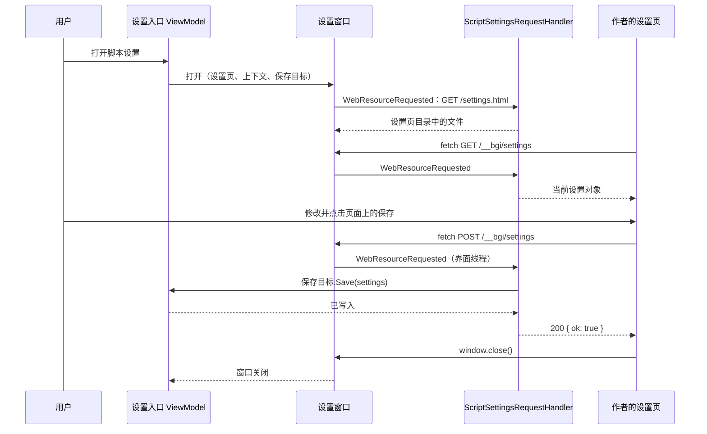
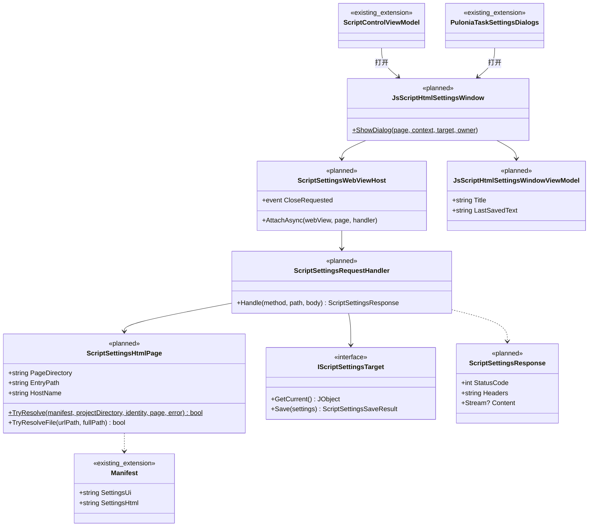

# JS 脚本自定义 HTML 设置页设计

状态：提案，未实现（第 3 版，2026-10-29）。  
相关文档：[基础设施统一（WebView2 见第 8 节）](infrastructure-foundation.md) · [外部访问服务](external-access.md) · [脚本仓库与任务资源](pulonia/repository-resources.md) · [Pulonia 界面](pulonia/user-interface.md)

版本说明：第 1 版由 BetterGI 注入 JS 接口并提供确定按钮；第 2 版把保存接口放在外部访问服务（Kestrel）上。第 3 版改为页面完全由作者实现，保存接口由 WebView2 在进程内提供，不监听端口。各方案的对比见[第 5 节](#5-方案对比为什么不经过-http-服务器)。

## 1. 目标

脚本作者自己实现完整的 HTML 设置界面，BetterGI 只负责展示页面，并接收页面提交的设置值。作者只需要知道三件事：

1. 在 `manifest.json` 中写 `"settings_html": "settings.html"`；
2. `GET /__bgi/settings` 读取设置，`POST /__bgi/settings` 保存设置，请求体就是设置对象；
3. 想关闭窗口时调用 `window.close()`。

不需要引入 SDK、配置令牌、处理跨域，也不需要了解 `settings_ui`。普通的 `fetch` 就够用，最小示例见[第 7 节](#7-示例与调试)。

旧的 `settings_ui` 基础表单完整保留。

| 术语 | 含义 |
| --- | --- |
| 基础表单 | 按 `settings_ui` 生成的现有 WPF 表单 |
| HTML 设置页 | 脚本通过 `settings_html` 声明、由作者自己实现的页面 |
| 设置页目录 | `settings_html` 入口文件所在的目录，是页面网站的根目录 |
| 设置值 | 脚本运行时读取的 `settings` 对象。调度器存于 `JsScriptSettingsObject`，Pulonia 存于节点参数 `settings` |
| 保留地址 | 以 `/__bgi/` 开头的地址，由 BetterGI 处理，不对应设置页目录中的文件 |

## 2. 范围

包含：

- `manifest.json` 新字段 `settings_html`；
- 设置窗口：在 WebView2 中展示页面，在进程内处理页面的文件请求和保留地址；
- 设置值写回调度器和 Pulonia 原有的存储；
- 接入调度器、Pulonia 节点编辑、任务计划添加任务、新一条龙添加弹窗；
- 仓库资源打开设置页时提取设置页目录，确认添加时校验；
- 新的 WebView2 Profile。

不包含：

- 修改 `settings_ui` 或基础表单，以及用 `settings_ui` 校验页面提交的值；
- 外部访问服务的任何改动，设置页也不能访问它；
- 设置页访问外网；
- 在外部浏览器中编辑设置。

## 3. 兼容性约定（保留旧设置）

| 项 | 约定 |
| --- | --- |
| `settings_ui` 与基础表单 | 不变。`SettingItem`、`ScriptProject.LoadSettingUi`、`PuloniaJsScriptSettingsDialog` 都不改 |
| 只声明 `settings_ui` 的脚本 | 所有入口与现在完全相同 |
| 设置值的存储 | 调度器仍写 `User/ScriptGroup/{配置组}.json` 的 `jsScriptSettingsObject`；Pulonia 仍写节点 `parameters.settings`。不新增文件 |
| 脚本读取设置 | 仍由 `ScriptProject.ExecuteAsync` 注入全局 `settings`，`main.js` 写法不变 |
| 旧版本 BetterGI | `Manifest.FromJson` 忽略未知字段，旧版本只看到 `settings_ui` |
| 两者都声明 | 打开 HTML 设置页；HTML 设置页不可用时打开基础表单。两边使用的键和值类型由作者保持一致 |

## 4. 现状

| 入口 | 代码 | 值的存储 | 保存方式 |
| --- | --- | --- | --- |
| 调度器右键“修改JS脚本自定义配置” | `ScriptControlViewModel.OnEditJsScriptSettings` | `ScriptGroupProject.JsScriptSettingsObject`（`ExpandoObject`） | 控件直接改对象，弹窗关闭后写配置组文件 |
| Pulonia 节点“脚本自定义设置” | `PuloniaTaskNodeAdvancedSettingsViewModel.EditScriptSettingsAsync` | 节点 `parameters["settings"]`（`JObject`） | `Document.ApplyJavaScriptSettings`，可撤销 |
| 任务计划添加 JS 任务 | `PuloniaTaskPlanViewModel.AddTask` | 新任务 `Parameters["settings"]` | 弹窗确认后插入任务树，取消则不添加 |
| 新一条龙添加弹窗 | `PuloniaTaskCreationDialogViewModel.JavaScriptSettingFields` | 同上 | 弹窗确认时 `BuildJavaScriptSettings` |

- 调度器的配置组文件由 `ScriptGroup.FromJson` 用 Newtonsoft 读取；Pulonia 执行器用 `parameters["settings"].ToObject<ExpandoObject>()` 转换。两者最终都注入为 `settings`。
- 仓库资源的项目文件不在用户目录中。`ScriptRepositoryStore.PreparePreviewAsync` 只把 `manifest.json`、`settings_ui` 文件和 `README.md` 提取到一次性目录 `Previews/pv_…`。
- `HtmlMaskWindow` 已经用 `WebResourceRequested` 在进程内拦截页面请求，每个脚本使用独立的虚拟主机 `hm-{key}.bettergi.local`。本设计沿用这套做法。

## 5. 方案对比：为什么不经过 HTTP 服务器

| 维度 | A. WebView2 进程内处理（采用） | B. 外部访问服务（第 2 版） | C. 注入 JS 接口 + WebMessage（第 1 版） | D. 自定义协议 | E. HostObject |
| --- | --- | --- | --- | --- | --- |
| 作者的写法 | `fetch("/__bgi/settings")`，标准 Web 写法 | `fetch("__bgi/settings")`，相对会话路径 | `await bgi.settings...`，BetterGI 专用接口 | 与 A 相同，地址换成自定义协议 | `chrome.webview.hostObjects...` |
| 是否监听端口 | 否 | 是，`127.0.0.1:30648` | 否 | 否 | 否 |
| 其他程序或浏览器能否访问 | 不能，接口只存在于这个窗口的 WebView 中 | 能连上端口，靠会话 ID 和 Origin 校验拒绝 | 不能 | 不能 | 不能 |
| 需要用户开启或重启 | 否 | 需要开关，修改后重启 | 否 | 否 | 否 |
| 子实例（桌面分身等） | 可用 | 不可用，服务只在主实例运行 | 可用 | 可用 | 可用 |
| 保存在哪个线程执行 | 界面线程（WebView2 事件本身在界面线程） | Kestrel 线程池，需要投递到界面线程 | 界面线程 | 界面线程 | COM 调用线程 |
| 额外风险 | 依赖 WebView2 拦截 POST 请求体，需实测（15.3） | 默认监听端口；同源的日志 WebSocket 要额外拒绝；与 `/api` 共用服务 | 无 | 要修改共享的 `App` 环境参数，所有进程必须一致，否则环境创建失败（[基础设施 8.1](infrastructure-foundation.md)） | 每个方法都暴露给页面，参数校验分散 |

采用方案 A：

- **更安全**：没有端口，本机其他程序和浏览器网页根本接触不到接口；接口随窗口出现、随窗口消失，不需要令牌或会话 ID；不碰外部访问服务。
- **更友好**：默认可用，不需要开关和重启；所有实例都能打开；作者用最常见的 `fetch` 和 `window.close()`。
- **实现更简单**：WebView2 事件在界面线程触发，保存时可以直接操作界面对象，不需要跨线程投递。

方案 C 同样安全，但作者要学一套 BetterGI 专用接口，在普通浏览器中调试时也要模拟它。方案 A 的接口形式是 HTTP，作者可以用任何静态服务器加一个 JSON 文件模拟读取（见 7.3）。

## 6. 作者接口

### 6.1 清单

```json
{
  "manifest_version": 1,
  "name": "自动采集示例",
  "version": "1.3.0",
  "main": "main.js",
  "settings_ui": "settings.json",
  "settings_html": "settings.html"
}
```

`settings_html` 的规则：

- 可选字符串，项目根目录下的相对路径，指向入口 HTML 文件，例如 `settings.html` 或 `settings/index.html`。`Manifest` 新增属性 `SettingsHtml`（默认空字符串），由现有 `SnakeCaseLower` 命名策略对应到 `settings_html`。
- 入口所在目录就是设置页目录，也是页面网站的根目录：页面中的 `/style.css` 对应设置页目录下的 `style.css`。
- 不能是绝对路径，不能含 `..` 段，扩展名必须是 `.html` 或 `.htm`，路径上不能有重解析点。分隔符可以是 `/` 或 `\`。
- 设置页目录中的 `__bgi` 子目录被保留地址占用，其中的文件不会提供给页面。
- 设置页目录上限（暂定，Q4）：最多 500 个文件，总大小 20 MB，单个文件 10 MB。项目根目录很大（例如带大量识别素材）时，把设置页放进子目录即可。
- 校验只在打开设置和仓库确认添加时进行，不放进 `Manifest.Validate`。`Manifest.Validate` 在 `ScriptProject` 构造时执行，在那里失败会导致脚本无法运行。

| `settings_ui` | `settings_html` | 打开设置时 |
| --- | --- | --- |
| 无 | 无 | 提示“此脚本未提供自定义配置”（不变） |
| 有 | 无 | 基础表单（不变） |
| 无 | 有 | HTML 设置页；不可用时提示原因 |
| 有 | 有 | HTML 设置页；不可用时提示原因，然后打开基础表单 |

HTML 设置页不可用只有两种情况：未安装 WebView2 运行时；`settings_html` 路径不合法或设置页目录超出上限。

### 6.2 读取设置

```http
GET /__bgi/settings
```

返回当前已保存的设置对象，从未保存时返回 `{}`。每次请求都读最新值，保存后刷新页面能看到新值。默认值由页面自己处理。

### 6.3 保存设置

```http
POST /__bgi/settings

{ "rounds": 5, "skipBoss": true }
```

- 请求体就是完整的设置对象，整体替换已保存的值，请求中没有的键会被删除。页面通常以读取到的对象为基础修改后提交。
- 每次保存成功都立即写入，窗口可以保存多次。
- 不检查 `Content-Type`，直接把请求体按 UTF-8 JSON 解析。`fetch(url, { method: "POST", body: JSON.stringify(obj) })` 即可，不用写请求头。
- 只校验三点：根是 JSON 对象；请求体不超过 1 MiB；嵌套深度不超过 32。不按 `settings_ui` 校验。

| 状态码 | 情况 | 响应体 |
| --- | --- | --- |
| 200 | 已保存 | `{ "ok": true }` |
| 400 | 不是合法 JSON、根不是对象、嵌套过深 | `{ "ok": false, "error": "原因" }` |
| 409 | 保存目标拒绝写入，例如调度器中的条目已被删除、Pulonia 节点校验失败 | `{ "ok": false, "error": "原因" }` |
| 413 | 请求体超过 1 MiB | `{ "ok": false, "error": "原因" }` |
| 500 | 写入时发生其他异常 | `{ "ok": false, "error": "保存失败，详见 BetterGI 日志" }` |

`error` 是给用户看的中文说明，页面可以直接显示。

### 6.4 其他

| 能力 | 用法 |
| --- | --- |
| 关闭窗口 | `window.close()`。用户也可以点标题栏的关闭按钮 |
| 深色、浅色主题 | 直接写 CSS `@media (prefers-color-scheme: dark)`。BetterGI 按当前主题设置 WebView2 的首选配色 |
| 上下文（可选） | `GET /__bgi/context`，见下表 |
| 弹窗 | `alert`、`confirm` 可以使用 |

`GET /__bgi/context` 的返回：

```json
{
  "apiVersion": 1,
  "mode": "edit",
  "host": "scheduler",
  "script": { "name": "自动采集示例", "version": "1.3.0" },
  "bgi": { "version": "0.67.0" },
  "theme": "dark",
  "language": "zh-Hans"
}
```

| 字段 | 含义 |
| --- | --- |
| `mode` | `create`：Pulonia 添加任务时；其余为 `edit` |
| `host` | `scheduler` 或 `pulonia` |
| `theme` | 打开窗口时 BetterGI 的主题，`light` 或 `dark` |
| `language` | BetterGI 界面语言 |

其他 `/__bgi/` 地址返回 404，方法不对返回 405。接口有不兼容的变化时提高 `apiVersion`。

## 7. 示例与调试

### 7.1 最小示例

整个设置页只有一个文件 `settings.html`：

```html
<!doctype html>
<meta charset="utf-8">
<title>自动采集示例设置</title>

<label>采集轮数 <input id="rounds" type="number" min="1" max="99"></label>
<label><input id="skipBoss" type="checkbox"> 跳过首领</label>
<button id="save">保存并关闭</button>

<script>
  const api = "/__bgi/settings";
  let settings = {};

  // 读取已保存的设置，默认值由页面自己决定
  fetch(api).then(r => r.json()).then(s => {
    settings = s;
    rounds.value = s.rounds ?? 3;
    skipBoss.checked = s.skipBoss ?? false;
  });

  save.onclick = async () => {
    settings.rounds = Number(rounds.value);
    settings.skipBoss = skipBoss.checked;
    const res = await fetch(api, { method: "POST", body: JSON.stringify(settings) });
    if (res.ok) window.close();
    else alert((await res.json()).error);
  };
</script>
```

`main.js` 的读取方式不变：`const rounds = Number(settings.rounds ?? 3);`。

页面可以拆成多个文件，也可以使用打包后的 Vue、React 等前端框架，只要所有文件都在设置页目录内。

### 7.2 作者须知

- 所有资源放在设置页目录内，不能引用 CDN 或在线字体，页面不能访问外网。
- 保存是整体替换，提交前以读取到的对象为基础修改，避免删掉页面没有展示的键。
- 设置值建议只用字符串、数字、布尔，复杂结构存成 JSON 字符串，在脚本中 `JSON.parse(settings.xxx)`（原因见第 9 节）。
- 同时声明 `settings_ui` 时，两边的键和值类型要一致，否则基础表单可能显示不正确。
- BetterGI 不知道页面是否有未保存的修改，关闭窗口时不提示。页面可以在修改后自动保存，或者提供“保存并关闭”按钮。

### 7.3 调试

- **改完按 F5**：调度器中的本地脚本直接从 `User/JsScript/{目录}` 读文件，响应禁止缓存，修改 HTML 后在设置窗口中按 F5 就能看到效果。
- **F12 开发者工具**：设置窗口允许打开开发者工具（Q1），可以查看控制台和网络请求。
- **在普通浏览器中调试**：用任意静态服务器打开设置页目录，在目录中放一个 `__bgi/settings` 文件（内容为一个 JSON 对象）就能模拟读取。BetterGI 不会把这个文件提供给页面，不影响实际使用。

## 8. 流程



所有请求都在 WebView2 内部被拦截，不经过网络，也不打开任何端口。读取请求体时使用 `e.GetDeferral()`，响应由 `CoreWebView2.Environment.CreateWebResourceResponse` 生成。

## 9. 设置值写入

| 入口 | 每次保存成功时 | 窗口关闭后 |
| --- | --- | --- |
| 调度器 | 把设置对象用 Newtonsoft 默认设置转成 `ExpandoObject`，替换 `JsScriptSettingsObject`，再保存配置组文件 | 无额外操作 |
| Pulonia 节点编辑 | `Document.ApplyJavaScriptSettings(node, settings)`，每次保存是一次可撤销编辑，随后自动保存 | 无额外操作 |
| 任务计划添加任务 | 写入添加流程的草稿 | 保存过：用最后一次保存的值添加任务。从未保存：询问“设置尚未保存，仍然添加任务吗？”，选择“不添加”时与现在取消一样不留节点（Q3） |
| 新一条龙添加弹窗 | 写入弹窗 ViewModel 的草稿，卡片显示“已保存 N 项设置” | 弹窗确认时使用草稿 |

- 调度器的转换方式与 `ScriptGroup.FromJson` 读取文件时相同，保存后不重启和重启后重新读文件，脚本拿到的值类型一致。
- 替换对象后，正在运行的脚本继续使用旧对象，下次运行读到新值。
- Newtonsoft 转换后，嵌套对象是 `ExpandoObject`，数组是 `List<object>`，在 V8 中都是 .NET 宿主对象，`length`、`JSON.stringify` 等 JS 写法不可用。这就是 7.2 建议复杂结构存成 JSON 字符串的原因。

## 10. 安全

设置页是第三方代码。它在一个没有网络、只能看到自己目录的 WebView 中运行，唯一能做的有影响的操作是改写本脚本的设置值。

| 风险 | 措施 |
| --- | --- |
| 本机其他程序或浏览器调用保存接口 | 不监听端口。接口只在这个窗口的 WebView 内部由拦截器处理，窗口关闭即不存在 |
| 读取设置页目录以外的文件 | URL 解码并规范化后必须位于设置页目录内；拒绝 `..`、绝对路径、重解析点；只提供扩展名白名单内的文件；不列目录 |
| 把设置值发到外网 | 响应头 CSP `connect-src 'self'`；拦截器对本页主机以外的所有请求返回 403 |
| 访问外部访问服务（包括不鉴权的日志 WebSocket） | 同上，`127.0.0.1`、`localhost` 也属于“其他主机”；CSP 同时限制 WebSocket |
| 读取其他脚本或其他网页的存储 | 新 Profile `ScriptSettings`；每个脚本使用独立主机名，`localStorage` 等按主机隔离 |
| 跳转到外部网站冒充 BetterGI | `NavigationStarting` 只放行本页主机；`target=_blank` 的 http(s) 链接按 `WebViewSetup` 默认交给系统浏览器 |
| 下载文件 | `WebViewOptions.DownloadFolder` 为空，下载被取消 |
| 子框架、其他通信通道 | CSP `frame-src 'none'`；`IsWebMessageEnabled = false`，`AreHostObjectsAllowed = false` |
| 超大请求 | 请求体上限 1 MiB，深度上限 32 |
| 自动填充保存账号密码 | `IsPasswordAutosaveEnabled = false`，`IsGeneralAutofillEnabled = false` |
| 日志泄露设置内容 | 日志只记录脚本名、地址路径、状态码和错误原因，不记录设置值 |

主机名为 `ss-{key}.bettergi.local`，`key` 取“项目身份”的 SHA-256 前 8 字节，写成 16 位小写十六进制：

| 来源 | 项目身份 |
| --- | --- |
| 调度器和 Pulonia 本地路径 | `local:` 加规范化后的项目完整路径（转大写） |
| Pulonia 仓库资源 | `repo:{仓库 ID}:` 加仓库内相对路径（转大写） |

同一脚本每次打开主机名相同，页面保存在 `localStorage` 中的界面状态不会丢失。仓库资源不能用预览目录计算，因为每次的预览目录都不同。

文件响应头：

```text
Content-Type: 按扩展名白名单
Cache-Control: no-store
X-Content-Type-Options: nosniff
Referrer-Policy: no-referrer
Content-Security-Policy: default-src 'self'; script-src 'self' 'unsafe-inline' 'unsafe-eval'; style-src 'self' 'unsafe-inline'; img-src 'self' data: blob:; font-src 'self' data:; media-src 'self' data: blob:; connect-src 'self'; worker-src 'self' blob:; frame-src 'none'; object-src 'none'; base-uri 'self'
```

允许 `'unsafe-inline'` 和 `'unsafe-eval'`，是为了让最小示例那样的内联脚本和运行时编译模板的框架可以直接使用。页面能访问的范围已经被限制，限制执行方式意义不大。

扩展名白名单：`.html`、`.htm`、`.js`、`.mjs`、`.css`、`.json`、`.map`、`.txt`、`.svg`、`.png`、`.jpg`、`.jpeg`、`.gif`、`.webp`、`.ico`、`.woff`、`.woff2`、`.ttf`、`.otf`、`.wasm`、`.mp3`、`.ogg`、`.wav`、`.mp4`、`.webm`。文本类型带 `charset=utf-8`，其他扩展名返回 404。

## 11. 接入点

### 11.1 调度器

`ScriptControlViewModel.OnEditJsScriptSettings` 改为返回 `Task` 的异步命令：

1. 沿用现有的 `BuildScriptProjectRelation` 与类型判断。
2. 声明了 `settings_html` 时解析设置页。可用则打开设置窗口，保存目标见第 9 节。
3. 不可用时提示原因；声明了 `settings_ui` 则接着走现有基础表单流程。
4. 只声明 `settings_ui` 时，现有流程不变。

### 11.2 Pulonia 节点编辑

`PuloniaTaskNodeAdvancedSettingsViewModel.EditScriptSettingsAsync`：

- `PuloniaTaskResourcePreview` 增加 `SettingsHtml`，只表示清单是否声明了设置页，不提取页面文件。
- 声明了设置页时，经 `PuloniaJavaScriptSettingsPageLoader`（11.5）准备设置页目录，窗口关闭后释放。
- `IPuloniaTaskSettingsDialogs` 增加 `ShowJavaScriptHtmlSettings(...)`，由 `PuloniaTaskSettingsDialogs` 创建窗口；文档 ViewModel 不创建窗口。
- “此脚本未提供自定义设置”的条件改为既没有 `settings_ui` 也没有 `settings_html`。

### 11.3 任务计划添加任务

`PuloniaTaskPlanViewModel.AddTask`：`PuloniaTaskCreationResult` 增加是否声明了设置页，以及项目定位（仓库资源引用或本地项目路径）。声明了设置页时，在添加后打开设置窗口（`mode` 为 `create`），关闭后按第 9 节决定是否添加。

### 11.4 新一条龙添加弹窗

`PuloniaOneDragonCreationDialog` 的脚本设置卡片：声明了设置页时隐藏内嵌字段，显示“打开脚本设置页面…”按钮和“已保存 N 项设置”。HTML 设置页不可用且声明了 `settings_ui` 时，显示原有内嵌字段。

### 11.5 仓库资源

- 新增 `ScriptRepositoryStore.PrepareSettingsPageAsync(reference, ct)`：把 `manifest.json` 和整个设置页目录提取到 `Previews/pv_…`，用 `snapshot.EnumerateFiles` 列出文件并按 6.1 的上限校验，返回 `ScriptPreviewLease`。不在窗口打开期间一直持有仓库读取会话，因为 Git 来源的读取会话会占用来源锁。
- 现有 `PreparePreviewAsync` 不变，切换资源选择时不会提取页面文件。
- 新增 `PuloniaJavaScriptSettingsPageLoader`：仓库资源调用上面的方法；本地资源直接使用项目目录，释放时不做任何事。
- 确认添加时（`ScriptRepositoryStore.Resources.cs` 的清单校验），声明了 `settings_html` 就校验路径规则、入口存在和目录上限，失败则拒绝确认，与现有 `settings_ui` 的校验一致。
- 资源指纹仍只计算 `manifest.json` 和 `main.js`（[Pulonia 界面](pulonia/user-interface.md)中的待定项 D11 不受影响）。

### 11.6 脚本列表页

`JsListViewModel` 中“此脚本存在配置…建议添加至【调度器】”的提示，条件改为声明了 `settings_ui` 或 `settings_html`。

## 12. 分层与类设计

```text
View           JsScriptHtmlSettingsWindow：FluentWindow、WebView2
               ScriptSettingsWebViewHost：把 WebView2 的请求、导航、关闭事件转给处理器和 ViewModel
ViewModel      JsScriptHtmlSettingsWindowViewModel：标题、上次保存时间、加载与错误状态、关闭请求
               各入口 ViewModel：判断可用性、提供保存目标
Core/Script    Manifest.SettingsHtml
               ScriptSettingsHtmlPage：路径规则、文件解析、主机名
               ScriptSettingsRequestHandler：保留地址与文件请求的处理，不依赖 WebView2
               IScriptSettingsTarget、ScriptSettingsContext
               ScriptRepositoryStore.PrepareSettingsPageAsync
Infrastructure WebViewProfiles.ScriptSettings
```

依赖方向：View → ViewModel → Core。请求处理器只接收方法、路径和请求体，返回状态码、响应头和内容，不引用 WebView2 和 WPF，可以单独测试。WebView2 相关代码只在 `ScriptSettingsWebViewHost`。



新增与修改的文件：

| 文件 | 层 | 内容 |
| --- | --- | --- |
| `Core/Script/Project/Manifest.cs` | Core | 新增 `SettingsHtml` |
| `Core/Script/Settings/ScriptSettingsHtmlPage.cs` | Core | 路径规则、设置页目录、文件解析、主机名 |
| `Core/Script/Settings/ScriptSettingsRequestHandler.cs` | Core | 保留地址路由、请求体解析与上限、文件响应、MIME 白名单、响应头 |
| `Core/Script/Settings/ScriptSettingsResponse.cs` | Core | 处理结果 |
| `Core/Script/Settings/IScriptSettingsTarget.cs` | Core | 保存目标接口、保存结果，以及委托实现 `DelegateScriptSettingsTarget`（用途单一，合并存放） |
| `Core/Script/Settings/ScriptSettingsContext.cs` | Core | 上下文模型与 `mode`、`host` 枚举 |
| `Core/Script/Repositories/ScriptRepositoryStore.Archives.cs` | Core | `PrepareSettingsPageAsync` |
| `Core/Script/Repositories/ScriptRepositoryStore.Resources.cs` | Core | 确认添加时校验 `settings_html` |
| `Pulonia/Services/PuloniaJavaScriptSettingsPageLoader.cs` | Core | 按仓库或本地来源准备设置页 |
| `Infrastructure/WebView/WebViewProfile.cs` | Infrastructure | `ScriptSettings` Profile，加入 `All` |
| `ViewModel/Windows/JsScriptHtmlSettingsWindowViewModel.cs` | ViewModel | 窗口状态 |
| `View/Controls/Webview/ScriptSettingsWebViewHost.cs` | View | WebView2 设置、请求拦截、导航放行、关闭请求 |
| `View/Windows/JsScriptHtmlSettingsWindow.xaml(.cs)` | View | 窗口 |
| 其他已有文件 | 各层 | `ScriptControlViewModel`、`PuloniaTaskNodeAdvancedSettingsViewModel`、`PuloniaTaskPlanViewModel`、`PuloniaTaskCreationDialogViewModel`、`PuloniaOneDragonCreationDialog.xaml`、`IPuloniaTaskSettingsDialogs`、`PuloniaTaskSettingsDialogs`、`PuloniaTaskResourcePreview`、`PuloniaTaskResourcePreviewLoader`、`PuloniaTaskCreationResult`、`JsListViewModel` |

`ScriptSettingsWebViewHost` 的 WebView2 设置：

| 设置 | 值 | 原因 |
| --- | --- | --- |
| Profile | `WebViewProfiles.ScriptSettings` | 与脚本仓库、HTML 遮罩隔离 |
| `WebViewOptions.OpenNewWindowInBrowser` | `true` | 外链交给系统浏览器 |
| `WebViewOptions.DownloadFolder` | 空 | 禁止下载 |
| `AreDevToolsEnabled` | `true` | 方便作者调试（Q1） |
| `AreBrowserAcceleratorKeysEnabled` | 默认 `true` | F5 重新加载 |
| `IsWebMessageEnabled`、`AreHostObjectsAllowed` | `false` | 不需要其他通信通道 |
| `IsPasswordAutosaveEnabled`、`IsGeneralAutofillEnabled` | `false` | 不保存表单数据 |
| `Profile.PreferredColorScheme` | 按 BetterGI 主题 | `prefers-color-scheme` 生效 |
| `AddWebResourceRequestedFilter` | `"*"`，`All` | 所有请求交给处理器，本页主机以外返回 403 |
| `WindowCloseRequested` | 关闭窗口 | 支持 `window.close()` |

新 Profile：

```csharp
/// <summary>
/// 脚本 HTML 设置页，与其他网页隔离；每个脚本使用独立主机名
/// </summary>
public static readonly WebViewProfile ScriptSettings = new(WebViewEnvironments.App, "ScriptSettings", "软件内网页 · 脚本设置页数据")
{
    Description = "脚本 HTML 设置页的缓存和网页数据，不含脚本设置值",
    ClearsAllData = true,
};
```

存储空间窗口按 `WebViewProfiles.All` 自动登记这一项，清理不影响设置值。

## 13. 界面

```text
┌ 脚本设置：自动采集示例 1.3.0 · 页面由脚本作者提供 · 已保存 14:32 ── □ × ┐
│                                                                    │
│                                                                    │
│                  作者实现的 HTML 设置页（整个区域）                   │
│                                                                    │
│                                                                    │
└────────────────────────────────────────────────────────────────────┘
```

- `FluentWindow`，启用主题背景，模态，Owner 为打开它的窗口。默认 760×640，最小 480×360，可调整大小。
- 窗口内只有 WebView2，BetterGI 不加按钮。WebView2 是原生窗口，WPF 内容不能叠在它上面，所以保存状态写在标题栏：每次保存成功后显示“已保存 HH:mm”，作者没做保存提示时用户也能确认。
- 加载时显示“正在加载设置页…”。入口文件读取失败或网页进程反复崩溃时，替换显示原因和“重新加载”按钮。
- `DefaultBackgroundColor` 设为窗口背景色，避免加载时白屏闪烁。
- MVVM：标题、保存时间、加载与错误状态在 ViewModel，只读绑定写 `Mode=OneWay`；WebView2 的事件处理在 `ScriptSettingsWebViewHost`，窗口代码后置只负责组装；提示框使用 `ThemedMessageBox`。

## 14. 分步交付与验收

| 步骤 | 交付 | 验收重点 |
| --- | --- | --- |
| 1 核心 | `Manifest.SettingsHtml`、`ScriptSettingsHtmlPage`、`ScriptSettingsRequestHandler`、保存目标与上下文 | 6.1 每条路径规则的拒绝场景；6.3 每个状态码；文件越界与白名单 |
| 2 窗口与调度器 | `ScriptSettings` Profile、`ScriptSettingsWebViewHost`、窗口、调度器接入 | 第 7.1 节示例原样可用；多次保存；保存后不重启和重启后脚本读到的值一致；F5、F12；不可用时回退基础表单 |
| 3 Pulonia | `PrepareSettingsPageAsync`、确认校验、节点编辑、任务计划添加、新一条龙弹窗 | 每次保存可撤销；未保存时的添加询问；仓库与本地资源；预览目录在窗口关闭后删除 |
| 4 文档与示例 | 作者文档、示例脚本 | 示例脚本在旧版本 BetterGI 中仍能用基础表单 |

验收场景：

1. 只声明 `settings_ui` 的脚本，四个入口的表现与改动前一致。
2. 把 7.1 节的 `settings.html` 原样放进一个脚本：读取到 `{}`，保存后窗口关闭；运行脚本，脚本读到新值；再次打开页面显示已保存的值。
3. 提交数组、字符串、非法 JSON：返回 400 和中文原因，存储不变。请求体超过 1 MiB：返回 413。
4. 页面中 `fetch("https://example.com")`、`fetch("http://127.0.0.1:30648/api/v1/health")`、`new WebSocket("ws://127.0.0.1:30648/ws/v1/logs")` 都失败，外部访问服务开启与否结果相同。
5. 请求 `/../main.js`、`/%2e%2e/main.js`、`/__bgi/settings` 以外的 `/__bgi/` 地址、设置页目录中 `__bgi` 下的文件，都拿不到文件内容。
6. 两个脚本的 `localStorage` 互相不可见；同一脚本关闭后再打开，`localStorage` 仍在。
7. 在桌面分身中打开 HTML 设置页，功能与主实例相同。
8. 未安装 WebView2 运行时：声明了 `settings_ui` 的脚本提示后打开基础表单，否则提示安装运行时。
9. Pulonia 节点编辑中保存两次，撤销两次后恢复原值。
10. 任务计划添加任务时从未保存就关闭：询问是否仍添加，选“不添加”后任务树不变。
11. 页面多次站内跳转后调用 `window.close()`，窗口仍能关闭。
12. 仓库中的 `settings_html` 指向不存在的文件或超限目录：确认添加被拒绝并写明原因。
13. 旧版本 BetterGI 打开同一脚本：只显示基础表单，不报错。
14. 深色和浅色主题下打开，页面的 `prefers-color-scheme` 与 BetterGI 主题一致。

编译按 AGENTS.md 的编译验证命令执行；界面与游戏相关的验收由人工完成，不启动主程序。

## 15. 决策记录与待确认

### 15.1 决策

| 编号 | 决策 | 理由 | 代价 |
| --- | --- | --- | --- |
| H1 | 页面完全由作者实现，BetterGI 只展示，保存由页面 POST | 作者可以自由实现任何界面；BetterGI 不维护控件 | 作者自己处理默认值、校验和保存提示 |
| H2 | 保存接口由 WebView2 在进程内提供，不经过外部访问服务 | 不监听端口，其他程序无法访问；不需要开关和重启；所有实例可用 | 依赖 WebView2 能读取 POST 请求体（15.3） |
| H3 | 接口用固定的绝对地址 `/__bgi/settings`，请求体就是设置对象，不要求请求头 | 作者写法最短，页面放在任何子目录都不用改地址 | 设置页目录中不能用 `__bgi` 作为目录名 |
| H4 | 每次 POST 立即写入，整体替换 | 与“页面自己负责保存”一致，可以实现自动保存 | Pulonia 节点编辑中多次保存会产生多条撤销记录；页面忘记带上旧值会删除未展示的键 |
| H5 | 入口可以在项目根目录，网站根目录为入口所在目录 | 最简单的设置页只有一个文件 | 入口在根目录时，页面能读到项目中的其他文件；这些文件本来就由同一作者提供，且页面无法外传 |
| H6 | 首版禁止设置页联网 | 运行时 HTTP 权限由用户按脚本确认，设置页可能在确认之前打开 | 需要在线数据的设置页暂时无法实现 |
| H7 | 不注入页面脚本，不提供 JS SDK | 标准 Web 写法，可以用静态服务器模拟调试 | 主题切换不会实时通知页面，打开时生效 |

### 15.2 待确认

| 编号 | 问题 | 本设计的默认做法 |
| --- | --- | --- |
| Q1 | 设置窗口在发布版中是否允许 F12 开发者工具。只影响这个窗口，页面本身没有额外权限 | 允许 |
| Q2 | 两者都声明时，是否另外提供打开基础表单的入口 | 不提供，只在 HTML 设置页不可用时回退 |
| Q3 | 任务计划添加任务时从未保存就关闭窗口的处理 | 询问是否仍添加 |
| Q4 | 设置页目录上限 | 500 个文件、20 MB、单文件 10 MB |
| Q5 | 是否允许设置页按 `http_allowed_urls` 访问外网 | 不允许 |

### 15.3 需要实测的技术点

- `fetch` 发起的 POST 在 `WebResourceRequested` 中能否通过 `Request.Content` 读到完整请求体。若某些情况读不到，备选方案是由 BetterGI 注入一段很短的脚本，把对 `/__bgi/settings` 的 POST 改用 WebMessage 发送，作者写法不变。
- WebSocket 连接是否触发 `WebResourceRequested`；自定义响应中的 CSP 能否阻止页面连接 `ws://127.0.0.1`。
- 站内跳转后 `window.close()` 是否仍会触发 `WindowCloseRequested`。若不会，增加 `POST /__bgi/close` 作为替代。
- 自定义响应中的 CSP 对 ES module 和 Worker 是否生效。
- 设置页目录较大时，首次加载和仓库提取的耗时。

## 16. 文档维护

- 实施后更新 [infrastructure-foundation.md](infrastructure-foundation.md) 8.2 节的 Profile 列表、[pulonia/repository-resources.md](pulonia/repository-resources.md) 中预览与确认校验的描述、[pulonia/user-interface.md](pulonia/user-interface.md) 的节点配置与新增任务两节。
- 第 6、7 节同步到脚本仓库的开发文档，供脚本作者查阅。
- 实现状态写在[设计文档索引](README.md)的条目上，本文只描述设计。
