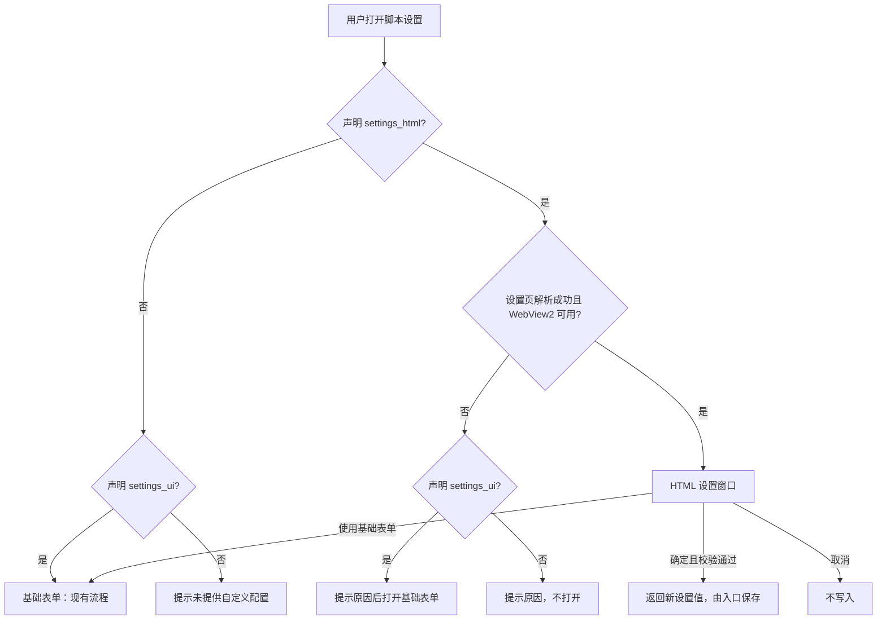
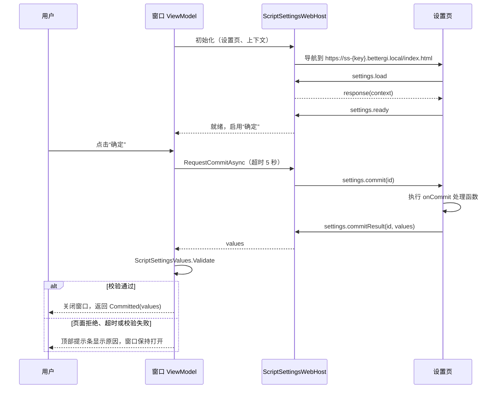
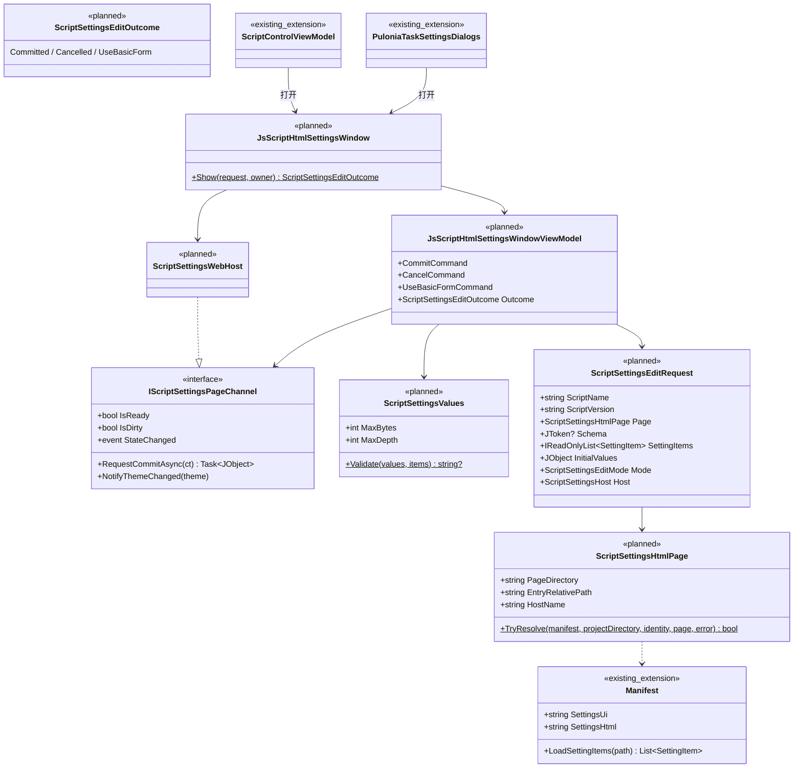

# JS 脚本自定义 HTML 设置页设计

状态：提案，未实现（第 1 版，2026-10-29）。  
相关文档：[外部访问服务](external-access.md) · [基础设施统一（WebView2 见第 8 节）](infrastructure-foundation.md) · [脚本仓库与任务资源](pulonia/repository-resources.md) · [Pulonia 界面](pulonia/user-interface.md)

## 1. 背景与目标

JS 脚本现在通过 `manifest.json` 的 `settings_ui` 指向一个 JSON 数组（惯例为 `settings.json`）。BetterGI 按其中 6 种类型（`separator`、`input-text`、`select`、`checkbox`、`multi-checkbox`、`cascade-select`）生成 WPF 表单，下文称为“基础表单”。设置值保存为一个对象，脚本运行时作为全局变量 `settings` 注入 V8。

基础表单表达不了以下内容：

- 分组、标签页、按条件显示（选了 A 才出现 B 的参数）；
- 数字范围、格式等输入校验，输错只能在脚本运行时发现；
- 列表编辑，例如多组路线或队伍的增删和排序；
- 说明图片、预览和链接。

另外，调度器和 Pulonia 各有一套基础表单实现，新增控件类型要同时改两处 C# 代码。

本设计的目标：

- 脚本作者可以在项目中提供一个 HTML 页面作为设置界面，BetterGI 在 WebView2 窗口中打开它。
- 页面通过 BetterGI 注入的 SDK 读取和提交设置值。值的保存位置、格式和脚本读取方式与基础表单相同，脚本的 `main.js` 不用改。
- 基础表单完整保留，两种设置可以同时声明。没有声明 HTML 设置页的脚本，所有入口的行为不变。
- 设置页按不受信任的第三方代码处理：只能读取自己的页面目录，不能联网，不能访问外部访问服务。

| 术语 | 含义 |
| --- | --- |
| 基础表单 | 按 `settings_ui` 生成的现有 WPF 表单 |
| HTML 设置页 | 脚本通过 `settings_html` 声明的 HTML 页面 |
| 设置页目录 | `settings_html` 入口文件所在的目录，页面只能加载这个目录及其子目录中的文件 |
| 设置值 | 脚本运行时读取的 `settings` 对象。调度器存于 `JsScriptSettingsObject`，Pulonia 存于节点参数 `settings` |
| 页面 SDK | BetterGI 在文档创建时注入页面的 `window.bgi.settings` |
| 设置桥 | 宿主一侧处理页面 SDK 消息的代码 |

## 2. 范围

包含：

- `manifest.json` 新字段 `settings_html`；
- HTML 设置窗口、页面 SDK 与消息协议；
- 设置值校验，以及与两种存储格式的转换；
- 接入调度器、Pulonia 节点编辑、任务计划添加任务、新一条龙添加弹窗；
- 仓库资源打开设置页时提取设置页目录，确认添加时校验；
- 新的 WebView2 Profile，登记到存储空间窗口。

不包含：

- 修改 `settings_ui` 格式或新增基础表单控件类型；
- 设置页访问网络，`http_allowed_urls` 不作用于设置页；
- 设置页访问外部访问服务的 HTTP API、WebSocket 或 MCP；
- 在外部浏览器或其他设备上编辑设置；
- 设置页与运行中的脚本通信（运行时界面仍使用 HTML 遮罩的 `window.htmlMask`）；
- 设置页的多语言框架，页面只能从上下文读到当前界面语言。

## 3. 兼容性约定（保留旧设置）

| 项 | 约定 |
| --- | --- |
| `settings_ui` 格式与 6 种类型 | 不变。`SettingItem.ToControl`、`ScriptProject.LoadSettingUi`、`PuloniaJsScriptSettingsDialog` 的行为不改 |
| 未声明 `settings_html` 的脚本 | 所有入口与现在完全相同，包括调度器基础表单没有“取消”的现状 |
| 设置值的存储 | 调度器仍写 `User/ScriptGroup/{配置组}.json` 的 `jsScriptSettingsObject`；Pulonia 仍写节点 `parameters.settings`。不新增文件 |
| 运行时注入 | 仍由 `ScriptProject.ExecuteAsync` 执行 `engine.AddHostObject("settings", ...)`；调度器运行前的 `CleanInvalidSettingsValues` 不变 |
| 旧版本 BetterGI | `Manifest.FromJson` 使用 System.Text.Json，未知字段会被忽略，旧版本只看到 `settings_ui` |
| 两者都声明 | 默认打开 HTML 设置页，窗口提供“使用基础表单”。两者编辑同一份设置值 |
| WebView2 运行时不可用 | 声明了 `settings_ui` 时提示原因并打开基础表单；没有声明时提示安装运行时 |

## 4. 现状

### 4.1 设置入口与存储

| 入口 | 代码 | 表单 | 值的存储 | 保存方式 |
| --- | --- | --- | --- | --- |
| 调度器右键“修改JS脚本自定义配置” | `ScriptControlViewModel.OnEditJsScriptSettings` | `ScriptProject.LoadSettingUi` 放进 `Wpf.Ui.Controls.MessageBox` | `ScriptGroupProject.JsScriptSettingsObject`（`ExpandoObject`） | 控件直接修改对象，弹窗关闭后写所有配置组，没有取消 |
| Pulonia 节点“脚本自定义设置” | `PuloniaTaskNodeAdvancedSettingsViewModel.EditScriptSettingsAsync` | `PuloniaJsScriptSettingsDialog` | 节点 `parameters["settings"]`（`JObject`） | 确认后 `Document.ApplyJavaScriptSettings`，可撤销 |
| 任务计划添加 JS 任务 | `PuloniaTaskPlanViewModel.AddTask` | 同上，`isCreation: true` | 新任务 `Parameters["settings"]` | 确认后插入任务树，取消则不添加 |
| 新一条龙添加弹窗 | `PuloniaTaskCreationDialogViewModel.JavaScriptSettingFields` | 弹窗内嵌表单 | 同上 | 弹窗确认时 `BuildJavaScriptSettings` |

运行时，调度器经 `ScriptGroupProject.Run` 传入 `JsScriptSettingsObject`；Pulonia 由 `PuloniaJavaScriptTaskExecutor` 把 `parameters["settings"]` 转成 `ExpandoObject`。两者最终都在 `ScriptProject.ExecuteAsync` 中注入为 `settings`。

项目文件来源：

- 调度器：`User/JsScript/{目录}`，直接读用户目录。
- Pulonia 仓库资源：`ScriptRepositoryStore.PreparePreviewAsync` 只把 `manifest.json`、`settings_ui` 文件和 `README.md` 提取到一次性目录 `Previews/pv_…`，用完删除。

### 4.2 WebView2

- 环境与 Profile 集中定义在 `WebViewEnvironments`、`WebViewProfiles`，现有 `Default`（软件内网页）和 `HtmlMask`（脚本遮罩）两个 Profile。普通网页统一经 `WebViewSetup.InitializeAsync` 初始化。
- 与本设计最接近的先例是 `HtmlMaskWindow`：每个脚本一个虚拟主机 `hm-{scriptKey}.bettergi.local`，用 `WebResourceRequested` 拦截白名单以外的请求，注入 `window.htmlMask`，经 WebMessage 收发 JSON。
- 脚本仓库网页使用 `SetVirtualHostNameToFolderMapping` 加 `AddHostObjectToScript("repoWebBridge", ...)`。

### 4.3 外部访问服务

`ExternalAccessHost` 在主进程内托管 Kestrel minimal API，只监听 loopback，默认端口 30648。HTTP API、WebSocket 日志、MCP 三个开关默认关闭，只在 Primary 实例启动，开关和端口重启后生效。`/api` 与 `/mcp` 要求 Bearer 令牌，日志 WebSocket 按产品约定不鉴权。[外部访问服务设计](external-access.md)明确规定不向 WebView2 页面自动注入令牌。

## 5. 方案选择

### 5.1 设置页的加载与通信方式

| 维度 | A. 宿主响应资源 + WebMessage（采用） | B. 外部访问服务托管 | C. 文件夹映射 + HostObject |
| --- | --- | --- | --- |
| 做法 | `WebResourceRequested` 从设置页目录读文件并响应；注入 SDK，经 WebMessage 收发 JSON | Kestrel 增加 `/scripts/{id}/settings/*` 静态文件和 `/api/v1/scripts/{id}/settings` 读写端点，WebView2 打开 `http://127.0.0.1:30648/...` | `SetVirtualHostNameToFolderMapping` 映射目录，`AddHostObjectToScript` 暴露 COM 对象 |
| 默认可用 | 是 | 否：服务默认关闭，开启后要重启 | 是 |
| 桌面分身等子实例 | 可用 | 不可用：只有 Primary 监听端口 | 可用 |
| 第三方页面能拿到的权限 | 只有设置桥 | 与 HTTP API 同源。要么把令牌交给页面（违反“不自动注入令牌”），要么另开免令牌端点 | COM 对象的每个方法都暴露给页面，参数校验分散在各方法里 |
| 能否加 CSP 响应头 | 能，响应由宿主生成 | 能 | 不能，文件夹映射不支持自定义响应头 |
| 仓库预览目录 | 直接读 | 要把预览租约登记到服务 | 直接映射 |
| 实现量 | 中 | 大 | 小 |

采用方案 A。方案 C 的实现量最小，但无法加 CSP，而 CSP 是阻止页面连 loopback 和外网的兜底手段（见第 10 节）。

### 5.2 与外部访问服务的关系

- 设置页不依赖外部访问服务，也拿不到令牌。CSP 的 `connect-src 'self'` 和请求拦截同时阻止页面访问 `127.0.0.1`、`localhost`，包括不鉴权的日志 WebSocket。外部访问服务开启与否不影响设置页。
- 本设计复用的是外部访问服务的分层做法：能力定义与传输无关，HTTP、MCP 只做适配。设置桥是又一个传输适配层，桥里不写业务逻辑。
- 首版上下文中的 BetterGI 版本直接取自 `IBgiExternalCapabilityService.GetVersionAsync`（该服务始终注册，不随开关变化）。以后设置页需要更多 BetterGI 数据（例如已安装的地图追踪目录）时，在能力层增加只读方法，再由设置桥、HTTP、MCP 分别适配。
- 如果以后需要“外部程序读写脚本设置”，应在能力层新增脚本设置服务，再由 HTTP 适配并走 Bearer 鉴权。不在本设计范围（见 Q1）。

## 6. 清单格式

```json
{
  "manifest_version": 1,
  "name": "自动采集示例",
  "version": "1.3.0",
  "bgi_version": "0.67.0",
  "main": "main.js",
  "settings_ui": "settings.json",
  "settings_html": "settings/index.html"
}
```

`settings_html` 的规则：

- 可选字符串，是项目根目录下的相对路径，指向入口 HTML 文件。`Manifest` 新增属性 `SettingsHtml`（默认空字符串），由现有 `SnakeCaseLower` 命名策略对应到 `settings_html`。
- 入口必须位于子目录中，例如 `settings/index.html`，不能是根目录下的文件。入口所在目录就是设置页目录。
- 分隔符可以是 `/` 或 `\`；不能是绝对路径，不能含 `..` 段，扩展名必须是 `.html` 或 `.htm`；路径上的目录和文件不能是重解析点。
- 设置页目录的上限（暂定，见 Q6）：最多 500 个文件，总大小 20 MB，单个文件 10 MB。超限时拒绝打开或拒绝确认添加，并写明是哪一项超限。
- 路径不合法不影响脚本运行，只在打开设置和仓库确认添加时报错。因此校验不放进 `Manifest.Validate`（它在 `ScriptProject` 构造时执行，失败会导致脚本无法运行）。

两种设置的组合：

| `settings_ui` | `settings_html` | 打开设置时 |
| --- | --- | --- |
| 无 | 无 | 提示“此脚本未提供自定义配置”（不变） |
| 有 | 无 | 基础表单（不变） |
| 无 | 有 | HTML 设置页；不可用时写明原因，无法编辑 |
| 有 | 有 | HTML 设置页，可切换到基础表单；`settings_ui` 声明过的键按其类型校验 |

不在 `settings.json` 里增加 `html` 类型：旧版本的 `SettingItem.ToControl` 遇到未知类型会抛出 `Unknown setting type`，整个表单打不开；Pulonia 会把它标为不支持的类型。新增清单字段则会被旧版本忽略。

## 7. 打开流程



HTML 设置窗口返回三种结果之一，由各入口处理：

| 结果 | 含义 | 入口的处理 |
| --- | --- | --- |
| `Committed(values)` | 用户点击“确定”，值已通过校验 | 转换后写入各自的存储 |
| `Cancelled` | 用户取消或关闭窗口 | 不写入 |
| `UseBasicForm` | 用户切换到基础表单 | 丢弃页面中未提交的修改，打开现有基础表单 |

页面有未提交的修改时（见 8.1 `setDirty`），取消、关闭和切换基础表单都先用 `ThemedMessageBox` 确认“放弃修改？”。

## 8. 页面 SDK 与消息协议

### 8.1 JS 接口

页面 SDK 在每个文档创建时注入（`AddScriptToExecuteOnDocumentCreatedAsync`），脚本作者不需要引用任何文件。

```ts
interface BgiSettingsContext {
  apiVersion: 1;
  mode: "create" | "edit";            // create：Pulonia 添加任务时；其他情况为 edit
  host: "scheduler" | "pulonia";      // 打开设置的入口
  script: { name: string; version: string };
  values: Record<string, unknown>;    // 当前已保存的设置值，从未保存时为 {}
  schema: unknown[] | null;           // settings_ui 文件的原始 JSON，未声明时为 null
  theme: "light" | "dark";
  language: string;                   // 界面语言，如 "zh-Hans"
  bgi: { version: string };
}

interface BgiSettingsApi {
  readonly apiVersion: 1;
  /** 读取打开窗口时的上下文快照；页面刷新后读到的仍是同一份。 */
  load(): Promise<BgiSettingsContext>;
  /** 注册提交处理函数：返回完整的设置对象；抛出 Error 时阻止保存并显示 message。只保留最后一次注册。 */
  onCommit(handler: () => Record<string, unknown> | Promise<Record<string, unknown>>): void;
  /** 标记是否有未提交的修改，用于关闭前确认。 */
  setDirty(dirty: boolean): void;
  /** BetterGI 主题变化时调用。 */
  onThemeChanged(handler: (theme: "light" | "dark") => void): void;
}

interface Window { bgi?: { settings: BgiSettingsApi } }
```

约定：

- “确定”和“取消”是窗口的原生按钮，页面不能关闭窗口。页面出错或卡死时，用户仍能取消。
- 页面注册 `onCommit` 之前，“确定”不可用，窗口提示“设置页尚未就绪”。
- 提交结果整体替换已保存的设置值，没有出现在返回值里的键会被删除。页面通常应以 `ctx.values` 为基础修改后返回（见第 14 节示例）。
- 默认值由页面自己处理，需要时可以读取 `ctx.schema` 中的 `default`。基础表单打开时会把默认值写入设置值，HTML 设置页不会。

### 8.2 消息格式

所有消息都是 JSON 对象，带 `v: 1`。页面用 `chrome.webview.postMessage(object)` 发送，宿主读取 `WebMessageAsJson`；宿主用 `PostWebMessageAsJson` 发送。

页面发往宿主：

| `type` | 其他字段 | 用途 |
| --- | --- | --- |
| `settings.load` | `id` | 请求上下文 |
| `settings.ready` | 无 | 已注册 `onCommit` |
| `settings.dirty` | `dirty` | 未提交修改的状态 |
| `settings.commitResult` | `id`、`ok`，以及 `values` 或 `error` | 回应宿主的提交请求 |

宿主发往页面：

| `type` | 其他字段 | 用途 |
| --- | --- | --- |
| `response` | `id`、`ok`，以及 `data` 或 `error` | 回应 `settings.load` |
| `settings.commit` | `id` | 请求页面提交 |
| `theme.changed` | `theme` | 主题变化 |

宿主丢弃以下消息并记 Debug 日志：来源不是本页 origin、超过 1 MiB、`v` 或 `type` 无法识别、`id` 与等待中的请求不匹配。

### 8.3 提交时序



页面导航（包括 F5 刷新和渲染进程崩溃后的自动重新加载）开始时，就绪状态清零，“确定”重新禁用，直到页面再次发送 `settings.ready`。超时提示为“设置页没有响应，可以取消，或使用基础表单”（后半句只在声明了 `settings_ui` 时出现）。

## 9. 设置值合同

所有提交的值都要满足：

- 根是 JSON 对象，序列化后不超过 1 MiB，嵌套深度不超过 32，键不能是空字符串。
- 顶层值为 `null` 的键视为未设置，保存前删除，与 Pulonia 表单“无值不写入”一致。

`settings_ui` 中声明过的键按类型校验，类型不符时拒绝保存并写明键名和期望类型：

| `settings_ui` 类型 | 允许的值 | 说明 |
| --- | --- | --- |
| `input-text` | 字符串 | 数字也要存成字符串，与基础表单一致 |
| `select`、`cascade-select` | 字符串 | 不校验是否在选项中，与基础表单一致 |
| `checkbox` | 布尔 | |
| `multi-checkbox` | 字符串数组 | 调度器运行前仍由 `CleanInvalidSettingsValues` 清除不在 `options` 中的项 |
| `separator` | 不校验 | |

没有声明过的键可以是任意 JSON 值。但对象和嵌套数组到了脚本中是 .NET 宿主对象，不是 JS 对象，而且两个入口的转换方式不同，脚本中的表现不完全一致。建议页面把复杂结构存成 JSON 字符串，脚本中用 `JSON.parse(settings.xxx)` 读取。

与两种存储的转换：

- **调度器**：打开时用 `JObject.FromObject` 把 `JsScriptSettingsObject`（为空时用空对象）转成上下文中的 `values`。确定后，用与 `ScriptGroup.FromJson` 相同的 Newtonsoft 默认设置反序列化为 `ExpandoObject`，替换 `JsScriptSettingsObject`。这样保存后不重启和重启后重新读文件，脚本拿到的类型一致。
- **Pulonia**：直接使用 `JObject`。编辑节点时经 `Document.ApplyJavaScriptSettings` 写入（可撤销）；添加任务时写入 `task.Parameters["settings"]`，结果为空对象时移除该参数，与现有表单相同。

## 10. 安全与隔离

### 10.1 风险与措施

| 风险 | 措施 |
| --- | --- |
| 读取设置页目录以外的文件 | 宿主自己响应资源请求：URL 解码并规范化后必须位于设置页目录内；拒绝重解析点。顶层导航到 `file://` 被取消，CSP 阻止页面加载 `file://` 子资源 |
| 把设置值或本机信息发到外网 | CSP `connect-src 'self'`；`WebResourceRequested` 对本页主机以外的请求一律返回 403 |
| 访问外部访问服务，包括不鉴权的日志 WebSocket | 同上，loopback 地址同样被拦截；不注入令牌 |
| 跳转到外部网站冒充 BetterGI 界面 | `NavigationStarting` 只放行本页 origin；`target=_blank` 的 http(s) 链接按 `WebViewSetup` 默认交给系统浏览器 |
| 下载文件 | `WebViewOptions.DownloadFolder` 为空，下载被取消 |
| 读取其他网页的存储（脚本仓库、遮罩） | 使用新 Profile `ScriptSettings`；每个脚本一个 origin，localStorage 等按 origin 隔离 |
| 伪造消息、子框架发消息 | 只处理顶层文档且来源 origin 等于本页的消息；CSP `frame-src 'none'`；不使用 HostObject（`AreHostObjectsAllowed = false`） |
| 超大消息或深层嵌套 | 消息上限 1 MiB、深度上限 32，超出直接丢弃 |
| 页面卡死 | 提交超时 5 秒；取消按钮是原生按钮 |
| 自动填充保存账号密码 | `IsPasswordAutosaveEnabled = false`，`IsGeneralAutofillEnabled = false` |
| 日志泄露设置内容 | 日志只记录脚本名和错误原因，不记录设置值（设置中可能有账号等信息） |
| 开发者工具 | 沿用 `WebViewSetup`，只在 Debug 构建开启（作者调试见 Q3） |

### 10.2 origin 与资源响应

每个脚本的 origin 为 `https://ss-{key}.bettergi.local`。`key` 取“项目身份”的 SHA-256 前 8 字节，写成 16 位小写十六进制：

| 来源 | 项目身份 |
| --- | --- |
| 调度器和 Pulonia 本地路径 | `local:` 加规范化后的项目完整路径（转大写） |
| Pulonia 仓库资源 | `repo:{仓库 ID}:` 加仓库内相对路径（转大写） |

仓库资源不能用预览目录算 `key`，因为每次打开的预览目录都不同，页面在 localStorage 中保存的界面状态会丢失。

宿主对 `AddWebResourceRequestedFilter("*", CoreWebView2WebResourceContext.All)` 的处理：主机名等于本页主机时读文件响应，其他一律返回 403。响应头：

```text
Content-Type: 按扩展名白名单
Cache-Control: no-store
X-Content-Type-Options: nosniff
Content-Security-Policy: default-src 'self'; script-src 'self' 'unsafe-inline' 'unsafe-eval'; style-src 'self' 'unsafe-inline'; img-src 'self' data: blob:; font-src 'self' data:; media-src 'self' data: blob:; connect-src 'self'; worker-src 'self' blob:; frame-src 'none'; object-src 'none'; base-uri 'self'; form-action 'none'
```

允许 `'unsafe-inline'` 和 `'unsafe-eval'`，是因为作者常写内联脚本，部分前端框架会在运行时编译模板。页面本来就是第三方代码，限制住它能访问的范围比限制执行方式更有效。

扩展名白名单：`.html`、`.htm`、`.js`、`.mjs`、`.css`、`.json`、`.map`、`.txt`、`.svg`、`.png`、`.jpg`、`.jpeg`、`.gif`、`.webp`、`.ico`、`.woff`、`.woff2`、`.ttf`、`.otf`、`.wasm`、`.mp3`、`.ogg`、`.wav`、`.mp4`、`.webm`。文本类型带 `charset=utf-8`，其他扩展名返回 404。

## 11. 接入点

### 11.1 调度器

`ScriptControlViewModel.OnEditJsScriptSettings` 改为返回 `Task` 的异步命令：

1. 沿用现有的 `BuildScriptProjectRelation` 与类型判断。
2. 解析 `settings_html`。可用时打开 HTML 设置窗口，`host` 为 `scheduler`，`mode` 为 `edit`。
3. `Committed`：按第 9 节转换并替换 `JsScriptSettingsObject`，再按现有方式保存配置组。`UseBasicForm`：走现有 `LoadSettingUi` 与 MessageBox 流程。`Cancelled`：不写入。
4. 基础表单流程本身不改。

替换对象后，正在运行的脚本继续使用旧对象，下次运行读到新值。基础表单是原地修改，不受影响。

### 11.2 Pulonia 节点编辑

`PuloniaTaskNodeAdvancedSettingsViewModel.EditScriptSettingsAsync`：

- `PuloniaTaskResourcePreview` 增加 `SettingsHtml`，只表示清单是否声明了设置页，不提取页面文件。
- 声明了设置页时，通过 `PuloniaJavaScriptSettingsPageLoader`（见 11.5）准备设置页目录，窗口关闭后释放。
- `IPuloniaTaskSettingsDialogs` 增加 `EditJavaScriptHtmlSettings(ScriptSettingsEditRequest)`。`Committed` 后调用 `Document.ApplyJavaScriptSettings`；`UseBasicForm` 调用现有 `EditJavaScriptSettings`。
- “此脚本未提供自定义设置”的判断条件改为既没有 `settings_ui` 也没有 `settings_html`。

### 11.3 任务计划添加任务

`PuloniaTaskPlanViewModel.AddTask`：

- `PuloniaTaskCreationResult` 增加是否声明了设置页，以及项目定位信息（仓库资源引用，或本地项目完整路径）。
- 声明了设置页时，按定位信息准备设置页目录，打开 HTML 设置窗口（`mode` 为 `create`）。取消则不添加任务，与现有一致。

### 11.4 新一条龙添加弹窗

`PuloniaOneDragonCreationDialog` 内嵌基础表单：

- 声明了设置页时，卡片隐藏内嵌字段，显示“打开脚本设置页面…”按钮和“已设置 N 项”。
- HTML 窗口的结果保存为弹窗 ViewModel 的草稿 `JavaScriptSettingsDraft`，弹窗确认时使用草稿。
- 窗口返回 `UseBasicForm` 时清除草稿，显示内嵌字段，之后按现有 `BuildJavaScriptSettings` 汇总。

### 11.5 仓库资源

- 新增 `ScriptRepositoryStore.PrepareSettingsPageAsync(reference, ct)`：把 `manifest.json`、`settings_ui` 文件和整个设置页目录提取到 `Previews/pv_…`，用 `snapshot.EnumerateFiles` 列出文件并按第 6 节上限校验，返回 `ScriptPreviewLease`。现有 `PreparePreviewAsync` 不变，切换资源选择时不会额外提取页面文件。
- 新增 `PuloniaJavaScriptSettingsPageLoader`：仓库资源调用上面的方法；本地资源直接使用项目目录，释放时不做任何事。两种情况都返回解析后的 `ScriptSettingsHtmlPage`、`settings_ui` 原文和设置项。
- 确认添加时（`ScriptRepositoryStore.Resources.cs` 的清单校验），声明了 `settings_html` 就校验路径规则、入口存在和目录上限，失败则拒绝确认，与现有 `settings_ui` 校验一致。
- 资源指纹仍只计算 `manifest.json` 和 `main.js`（[Pulonia 界面](pulonia/user-interface.md)中的待定项 D11 不受影响）。修改 `settings_html` 路径会改变清单指纹；只改页面内容不提示更新。

### 11.6 脚本列表页

`JsListViewModel` 中“此脚本存在配置…建议添加至【调度器】”的提示，条件改为声明了 `settings_ui` 或 `settings_html`。

## 12. 分层与类设计

```text
View           JsScriptHtmlSettingsWindow：FluentWindow、WebView2、底栏
               ScriptSettingsWebHost：WebView2 初始化、资源响应、SDK 注入、消息收发
ViewModel      JsScriptHtmlSettingsWindowViewModel：就绪、提交、取消、切换基础表单、调用校验
               各入口 ViewModel：选择编辑器、转换存储格式
Core/Script    Manifest.SettingsHtml、ScriptSettingsHtmlPage、ScriptSettingsValues、请求与结果类型
               ScriptRepositoryStore.PrepareSettingsPageAsync
Infrastructure WebViewProfiles.ScriptSettings
```

依赖方向：View → ViewModel → Core。Core 不引用 WPF 和 WebView2。窗口 ViewModel 通过接口 `IScriptSettingsPageChannel` 与网页宿主交互，不直接接触 `CoreWebView2`。调度器沿用现有写法，在 ViewModel 中直接调用窗口的静态 `Show`；Pulonia 经 `IPuloniaTaskSettingsDialogs` 打开，文档 ViewModel 不创建窗口。



新增与修改的文件：

| 文件 | 层 | 内容 |
| --- | --- | --- |
| `Core/Script/Project/Manifest.cs` | Core | 新增 `SettingsHtml` |
| `Core/Script/Settings/ScriptSettingsHtmlPage.cs` | Core | 路径规则、设置页目录、主机名计算 |
| `Core/Script/Settings/ScriptSettingsValues.cs` | Core | 值校验与上限常量 |
| `Core/Script/Settings/ScriptSettingsEditRequest.cs` | Core | 请求、结果与两个小枚举（用途单一，合并存放） |
| `Core/Script/Repositories/ScriptRepositoryStore.Archives.cs` | Core | `PrepareSettingsPageAsync` |
| `Core/Script/Repositories/ScriptRepositoryStore.Resources.cs` | Core | 确认添加时校验 `settings_html` |
| `Pulonia/Services/PuloniaJavaScriptSettingsPageLoader.cs` | Core | 按仓库或本地来源准备设置页 |
| `Infrastructure/WebView/WebViewProfile.cs` | Infrastructure | `ScriptSettings` Profile，加入 `All` |
| `Resources/JavaScript/script-settings-sdk.js` | 嵌入资源 | 页面 SDK，沿用 `ys-input-inject.js` 的 EmbeddedResource 方式，不新增 `Assets` 目录 |
| `ViewModel/Windows/IScriptSettingsPageChannel.cs` | ViewModel | 网页宿主接口 |
| `ViewModel/Windows/JsScriptHtmlSettingsWindowViewModel.cs` | ViewModel | 窗口状态与命令 |
| `View/Controls/Webview/ScriptSettingsWebHost.cs` | View | 实现 `IScriptSettingsPageChannel` |
| `View/Windows/JsScriptHtmlSettingsWindow.xaml(.cs)` | View | 窗口 |
| 已有文件 | 各层 | `ScriptControlViewModel`、`PuloniaTaskNodeAdvancedSettingsViewModel`、`PuloniaTaskPlanViewModel`、`PuloniaTaskCreationDialogViewModel`、`PuloniaOneDragonCreationDialog.xaml`、`IPuloniaTaskSettingsDialogs`、`PuloniaTaskSettingsDialogs`、`PuloniaTaskResourcePreview`、`PuloniaTaskResourcePreviewLoader`、`PuloniaTaskCreationResult`、`JsListViewModel` |

新 Profile 的定义：

```csharp
/// <summary>
/// 脚本 HTML 设置页，与其他网页隔离；每个脚本使用独立 origin
/// </summary>
public static readonly WebViewProfile ScriptSettings = new(WebViewEnvironments.App, "ScriptSettings", "软件内网页 · 脚本设置页数据")
{
    Description = "脚本 HTML 设置页的缓存和网页数据，不含脚本设置值",
    ClearsAllData = true,
};
```

存储空间窗口按 `WebViewProfiles.All` 自动登记这一项。清理只删除页面自己保存的网页数据，设置值保存在配置组和任务计划中，不受影响。

## 13. 界面

```text
┌ 脚本设置：自动采集示例 1.3.0 ─────────────────────────── □ × ┐
│ [提示条：错误或说明，平时隐藏]                                │
│ ┌────────────────────────────────────────────────────────┐ │
│ │                                                        │ │
│ │                 脚本提供的 HTML 设置页                    │ │
│ │                                                        │ │
│ └────────────────────────────────────────────────────────┘ │
│ 此页面由脚本作者提供          [使用基础表单]  [取消]  [确定]  │
└────────────────────────────────────────────────────────────┘
```

- 窗口为 `FluentWindow`，启用主题背景，模态，Owner 为打开它的窗口。默认 760×640，最小 480×360，可调整大小。
- 页面加载时显示“正在加载设置页…”。导航失败或网页进程反复崩溃时，显示原因和“重新加载”；声明了 `settings_ui` 时同时提示可以使用基础表单。
- “确定”在页面就绪前禁用，提交期间显示进度并防止重复点击。
- “使用基础表单”只在声明了 `settings_ui` 时显示。
- 底栏左侧的“此页面由脚本作者提供”说明页面内容的来源。
- 主题：打开时把 WPF-UI 当前主题映射为 `light` 或 `dark` 写入上下文，同时设置 `CoreWebView2.Profile.PreferredColorScheme`，让页面的 `prefers-color-scheme` 生效。`DefaultBackgroundColor` 设为窗口背景色，避免加载时白屏闪烁。主题切换时推送 `theme.changed`。
- MVVM：按钮绑定 `[RelayCommand]` 生成的命令；只读和展示用的绑定写 `Mode=OneWay`；关闭由 ViewModel 的 `RequestClose` 事件通知窗口；WebView2 相关逻辑放在 `ScriptSettingsWebHost`，窗口代码后置只负责组装和转发关闭确认。对话框使用 `ThemedMessageBox`。

## 14. 脚本作者示例

目录结构：

```text
MyScript/
├─ manifest.json
├─ main.js
├─ settings.json          可选：基础表单，旧版本 BetterGI 也能使用
└─ settings/
   ├─ index.html
   ├─ app.js
   └─ style.css
```

`settings.json` 中声明了 `rounds`（`input-text`）和 `skipBoss`（`checkbox`）。`settings/index.html`：

```html
<!doctype html>
<html lang="zh-CN">
<head>
  <meta charset="utf-8">
  <link rel="stylesheet" href="style.css">
</head>
<body>
  <label>采集轮数 <input id="rounds" type="number" min="1" max="99"></label>
  <label><input id="skipBoss" type="checkbox"> 跳过首领</label>
  <script src="app.js"></script>
</body>
</html>
```

`settings/app.js`：

```js
(async () => {
  const api = window.bgi.settings;
  const ctx = await api.load();
  const rounds = document.getElementById("rounds");
  const skipBoss = document.getElementById("skipBoss");

  document.documentElement.dataset.theme = ctx.theme;
  api.onThemeChanged(theme => document.documentElement.dataset.theme = theme);

  // 默认值由页面处理：基础表单打开时会写入默认值，HTML 设置页不会
  rounds.value = ctx.values.rounds ?? "3";
  skipBoss.checked = ctx.values.skipBoss ?? false;
  for (const el of [rounds, skipBoss]) {
    el.addEventListener("input", () => api.setDirty(true));
  }

  api.onCommit(() => {
    const n = Number(rounds.value);
    if (!Number.isInteger(n) || n < 1 || n > 99) {
      throw new Error("采集轮数必须是 1 到 99 的整数");
    }
    // 以已保存的值为基础修改，避免删除页面没有展示的键
    // rounds 在 settings.json 中是 input-text，必须存成字符串
    return { ...ctx.values, rounds: String(n), skipBoss: skipBoss.checked };
  });
})();
```

`main.js` 的读取方式不变：`const rounds = Number(settings.rounds ?? 3);`。

作者须知：

- 所有资源放在设置页目录内，不能引用 CDN 和在线字体。打包后的前端框架可以使用。
- 页面不能发网络请求，`fetch` 只能读取设置页目录中的文件。
- 返回值整体替换设置值。与 `settings_ui` 同名的键必须符合其类型（第 9 节）。
- 复杂结构建议存成 JSON 字符串。
- 在普通浏览器中单独调试时没有 `window.bgi`，需要自己模拟。
- 同时提供 `settings_ui` 可以兼容旧版本 BetterGI，WebView2 不可用时也能编辑。

## 15. 分步交付与验收

| 步骤 | 交付 | 验收重点 |
| --- | --- | --- |
| 1 核心模型 | `Manifest.SettingsHtml`、`ScriptSettingsHtmlPage`、`ScriptSettingsValues`、请求与结果类型 | 第 6 节每条路径规则的拒绝场景；第 9 节类型校验 |
| 2 网页宿主与窗口 | `ScriptSettings` Profile、`ScriptSettingsWebHost`（资源响应、CSP、SDK、消息）、窗口与 ViewModel | 加载、提交、页面拒绝、超时、刷新后重新就绪、主题；外网与 loopback 被拦截 |
| 3 调度器接入 | `OnEditJsScriptSettings` 改造 | 保存后不重启和重启后脚本读到的值一致；取消不写入；切换基础表单 |
| 4 Pulonia 接入 | `PrepareSettingsPageAsync`、确认校验、节点编辑、任务计划添加、新一条龙弹窗 | 撤销；取消添加不留节点；仓库资源和本地资源；预览目录在窗口关闭后删除 |
| 5 文档与示例 | 作者文档、示例脚本 | 示例脚本在旧版本 BetterGI 中仍能用基础表单 |

验收场景：

1. 只声明 `settings_ui` 的脚本，四个入口的表现与改动前一致。
2. 两者都声明：默认打开 HTML 设置页，确定后运行脚本，脚本读到新值。
3. 两者都声明：在 HTML 设置页保存后切到基础表单，看到相同的值；反过来也一样。
4. 页面把 `checkbox` 键返回为字符串：窗口提示键名和期望类型，不保存。
5. `onCommit` 抛出错误：提示条显示错误信息，窗口不关闭。
6. 页面不注册 `onCommit`：“确定”不可用。处理函数 5 秒不返回：提示超时。
7. 外部访问服务三个开关全部开启时，页面中 `fetch("https://example.com")`、`fetch("http://127.0.0.1:30648/api/v1/health")`、`new WebSocket("ws://127.0.0.1:30648/ws/v1/logs")` 都失败。
8. 页面请求 `../main.js`、`/%2e%2e/main.js` 和设置页目录外的绝对路径，都拿不到内容。
9. WebView2 运行时不可用：声明了 `settings_ui` 时提示原因并打开基础表单，否则提示安装运行时。
10. 两个脚本的 localStorage 互相不可见。存储空间窗口出现“脚本设置页数据”，清理后页面数据清空，设置值不变。
11. Pulonia：编辑后撤销能恢复原值；任务计划添加时在 HTML 窗口取消，不添加任务；窗口关闭后 `Previews/pv_…` 被删除。
12. 仓库中的 `settings_html` 指向不存在的文件、根目录文件或超限目录：确认添加被拒绝并写明原因。
13. 旧版本 BetterGI 打开同一脚本：只显示基础表单，不报错。
14. 深色和浅色主题下打开：页面 `prefers-color-scheme` 与 `ctx.theme` 一致；切换主题后页面收到 `theme.changed`。

编译按 AGENTS.md 的编译验证命令执行；界面与游戏相关的验收由人工完成，不启动主程序。

## 16. 决策记录与待确认

### 16.1 决策

| 编号 | 决策 | 理由 | 代价 |
| --- | --- | --- | --- |
| H1 | 新增清单字段 `settings_html`，不在 `settings.json` 中加新类型 | 旧版本忽略未知清单字段；新类型会让旧版本基础表单抛异常 | 作者要维护两个文件才能兼容旧版本 |
| H2 | 宿主自己响应资源请求（方案 A），不经外部访问服务 | 默认可用、子实例可用、不涉及令牌、能加 CSP | 需要自己处理 MIME 与路径校验 |
| H3 | 设置页必须在子目录中，只开放该目录 | 最小权限；仓库资源只需提取这个目录 | 页面不能直接读取 `settings.json` 和 `main.js`，`settings_ui` 原文改由上下文提供 |
| H4 | 原生“确定 / 取消”按钮，页面通过 `onCommit` 返回值 | 与两个入口的确认、取消语义一致；页面出错时仍能取消 | 页面不能自定义底栏按钮 |
| H5 | 提交结果整体替换设置值 | 页面拿到了完整的值，删除哪些键由页面决定 | 页面若不以 `ctx.values` 为基础，会删掉没有展示的键，示例与文档需要强调 |
| H6 | 首版禁止设置页联网 | 运行时 HTTP 权限由用户按脚本确认，设置页可能在确认之前就打开，不能直接套用 | 需要在线数据的设置页暂时无法实现 |
| H7 | 使用 WebMessage，不使用 HostObject | 消息是纯数据，可以在一个入口统一校验 | 需要自己实现请求与响应的关联 |

### 16.2 待确认

| 编号 | 问题 | 本设计的默认做法 |
| --- | --- | --- |
| Q1 | 设置页是否需要访问外部访问服务的 HTTP API | 不允许（见 5.2）。如有需要，倾向于在设置桥上增加只读能力，而不是放开 loopback |
| Q2 | 两者都声明时默认打开哪一个；是否需要全局“总是使用基础表单”选项 | 默认 HTML，不加全局选项 |
| Q3 | 发布版是否允许脚本作者打开开发者工具调试设置页（例如只在开发者模式下） | 不允许，沿用 `WebViewSetup` |
| Q4 | 是否允许清单声明窗口初始尺寸 | 不允许，用户可以自行调整 |
| Q5 | 新一条龙添加弹窗用按钮打开设置页，还是与任务计划一样在添加后弹出 | 按钮打开（11.4） |
| Q6 | 设置页目录上限 | 500 个文件、20 MB、单文件 10 MB |

### 16.3 需要实测的技术点

- WebSocket 连接是否触发 `WebResourceRequested`。CSP 的 `connect-src` 作为兜底，需要确认在自定义响应头中生效。
- 自定义响应头中的 CSP 对 ES module 和 Worker 是否生效。
- 设置页目录较大时，首个请求的耗时和仓库提取耗时。

## 17. 文档维护

- 实施后更新 [infrastructure-foundation.md](infrastructure-foundation.md) 8.2 节的 Profile 列表，[pulonia/repository-resources.md](pulonia/repository-resources.md) 中预览与确认校验的描述，以及 [pulonia/user-interface.md](pulonia/user-interface.md) 的节点配置与新增任务两节。
- 页面 SDK 的接口（8.1）和设置值合同（第 9 节）同步到脚本仓库的开发文档，供脚本作者查阅。接口变化时提高 `apiVersion`。
- 实现状态写在 [设计文档索引](README.md) 的条目上，本文只描述设计。
