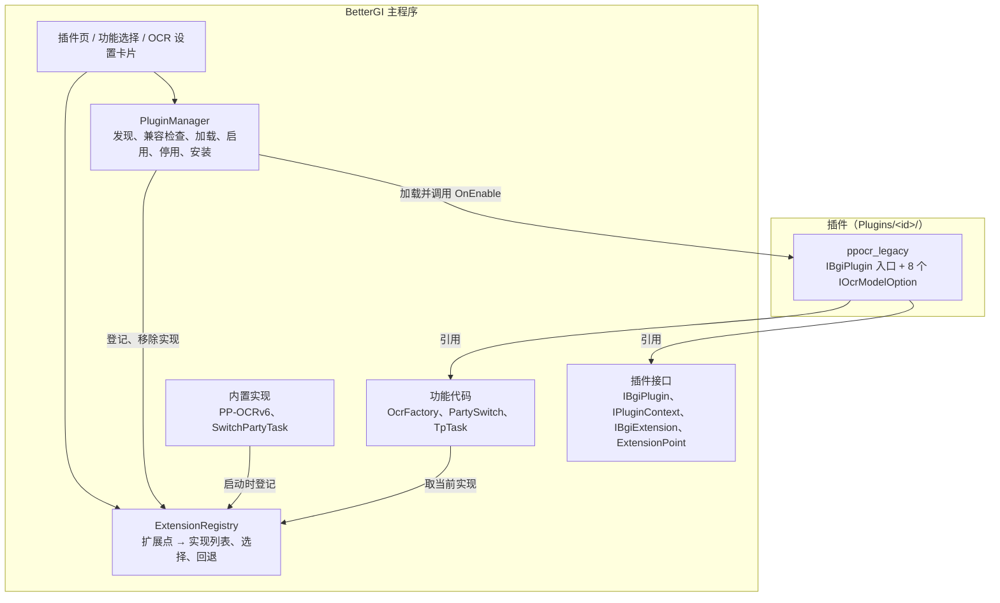

# BetterGI 插件系统设计（含 OCR 模型插件化）

状态：第 1 版，提案，待确认。  
相关文档：[基础设施统一](infrastructure-foundation.md)（下载、临时文件、延迟清理） · [配置持久化](config-persistence.md) · [独立任务合同](task-contract.md)（插件任务标识格式） · [三种实例的能力边界](instance-capability-boundaries.md) · [JS 脚本自定义 HTML 设置页](js-script-html-settings.md)（清单格式）

## 1. 目标

1. 主程序只内置 PP-OCRv6 模型，删除 V4、V5 及多语言模型的代码和模型文件。
2. 新增通用插件系统：
   - 插件是放在 `Plugins/<插件标识>/` 下的 .NET 程序集，直接引用主程序开发；
   - 主程序在启动和进入插件页时扫描目录，发现插件；
   - 启用、停用不需要重启；
   - 插件可以提供自己的设置界面，显示在插件页中。
3. 主程序声明“扩展点”，插件为扩展点提供实现，用户在设置中选择使用哪个实现。第一个扩展点是 OCR 模型，后续用于队伍切换、大地图移动等常见场景。
4. 把 V4、V5 模型迁移到官方插件 `ppocr_legacy`。安装并启用后，设置中的 OCR 模型列表出现 V4、V5 系列选项，识别效果与现在相同。
5. 新增插件页，用于查看、启用、停用、安装、卸载插件，并集中选择各扩展点使用的实现。

## 2. 范围

包含：

- 插件清单、发现、兼容性检查、程序集加载、启用与停用；
- 扩展点注册表、实现选择与回退；
- 插件设置界面与设置存储；
- 插件页，OCR 设置卡片改造；
- 从本地 zip 安装、升级、卸载；
- OCR 扩展点、主程序只保留 V6、旧配置迁移、`ppocr_legacy` 插件；
- 队伍切换、大地图移动两个扩展点的合同与接入方式（分阶段实施，见[第 17 节](#17-实施步骤)）。

不包含：

- 停用时卸载程序集、释放内存（原因见 [7.4](#74-加载方式对比)）；
- 沙箱或权限隔离（见[第 13 节](#13-安全)）；
- 在线插件目录、自动更新插件（列为后续步骤）；
- 插件提供独立任务、JS 接口、导航页面等其他扩展形式；
- 插件界面文本的多语言。

## 3. 术语

| 术语 | 含义 |
| --- | --- |
| 插件 | `Plugins/` 下带 `plugin.json` 的目录，包含一个入口程序集 |
| 插件标识 | 清单中的 `id`，如 `ppocr_legacy` |
| 扩展点 | 主程序声明的一项可替换能力，如 `ocr.model`。每个扩展点有一个合同接口和一个内置默认实现 |
| 实现 | 扩展点合同的一个具体实现，有自己的实现标识。内置实现为 `builtin.<名称>`，插件实现为 `<插件标识>.<名称>` |
| 选择 | 用户为某个扩展点选定的实现标识，保存在对应功能的配置中 |
| 回退 | 选中的实现不可用（插件未安装、未启用、加载失败）时改用内置默认实现，保存的选择不变 |
| 已加载 | 插件程序集已经载入当前进程。停用后程序集仍保持已加载 |

## 4. 现状

### 4.1 OCR

- 调用入口是静态属性 `OcrFactory.Paddle`，经 `App.ServiceProvider` 取 DI 单例 `OcrFactory`，业务代码中约 60 处调用。
- 模型选择是枚举 `PaddleOcrModelConfig`：V5Auto=0、V5=1、V4Auto=2（默认值）、V4En=3、V5Latin=4、V5Eslav=5、V5Korean=6、V4=7、V6=8，保存在 `OtherConfig.OcrConfig.PaddleOcrModelConfig`。`ConfigService` 没有注册字符串枚举转换器，配置文件中保存的是整数。
- `OcrFactory.ResolveModelType` 把枚举映射到 `PaddleOcrService.PaddleOcrModelType` 的静态实例（V4、V4En、V5、V6、V5Latin、V5Eslav、V5Korean）。两个 Auto 档按游戏语言选择模型，V6 不参与自动选择。
- 设置页 `CommonSettingsPage` 的“OCR 配置”卡片用 ComboBox 列出全部枚举值。切换后调用 `OcrFactory.Unload()`，下一次调用 OCR 时按新配置重建。
- `Unload` 立即释放旧的 `PaddleOcrService`。有的调用方把实例保存在局部变量或字段中（如 `RewardResultRecognizer` 的 `ocrService ??= OcrFactory.Paddle`），任务运行中切换模型时，这些调用会抛 `ObjectDisposedException`。
- `MainWindowViewModel` 在 alpha 版本每次升级后把配置强制改为 V6。
- `InferenceModelDiagnostics` 的 OCR 验证和测速读取 `OcrFactory.ActiveModelType`，直接 `new PaddleOcrService`。
- 自动配音 `QuestVoiceSessionFactory` 直接使用 V6 识别模型，不经过 `OcrFactory`。
- 模型文件来自 NuGet 包 `BetterGI.Assets.Model` 1.0.39，复制到输出目录的 `Assets\Model\PaddleOCR\`。V4、V5 相关文件共约 74 MB，V6 约 31 MB。没有 V4、V5 专用的包。
- 硬件加速设置中的 OCR CPU 线程策略按模型名前缀 `PpOcrDet`、`PpOcrRec` 识别 PaddleOCR 模型。

### 4.2 其他可替换能力

| 能力 | 现状 | 调用方 |
| --- | --- | --- |
| 队伍切换 | `SwitchPartyTask.Start(partyName, ct)`，只有一种实现，调用方直接 `new` | JS `genshin.switchParty`、`PathExecutor`（3 处）、`AutoDomainTask`、`FightPickupHelper`（2 处）、`AutoBossTask`、`AutoLeyLineOutcropTask`、`GoToAdventurersGuildTask` |
| 大地图移动 | `TpTask.MoveMapTo` 调用私有的 `MoveMapToCore`，依赖 `TpTask` 内的缩放、拖拽、定位方法 | `TpTask.Tp`、`ClickMapPoint`；JS、地图追踪等经 `TpTask` 间接调用 |
| 地图特征匹配 | `MapManager` 按字符串 `"SIFT"` 或其他值选择 `ISceneMap` 实现 | 传送、地图追踪、小地图定位 |

### 4.3 可以复用的基础

- `Plugins/OnnxRuntime/`：ONNX 运行库的安装目录，已经在程序目录下。它存放原生 DLL，不是本设计中的插件，扫描时跳过。
- `SoloTaskRegistry` 已为插件预留任务标识格式 `{pluginId}.{name}`（正则 `^[a-z][a-z0-9_]*(\.[a-z][a-z0-9_]*)?$`），实现标识沿用这个格式。
- `SoloTaskSettingsTemplates` 按“VM 类型 → 视图类型”注册隐式 DataTemplate，插件设置界面用同样的方式。
- `GameRuntimeService` 从 `IEnumerable<IGameRuntimeProvider>` 中按类型选择实现，是“多个实现、按键选择”的现有写法。
- `PendingCleanupStore`：登记下次启动时删除的路径，用于卸载已加载的插件。
- `ITempFileService`（安装时解压）、`Global.ManifestJsonOptions`（snake_case 清单，JS 脚本清单也用它）、`Global.IsNewVersion`（Semver 比较）。
- `TaskControl.TaskSemaphore.CurrentCount == 1` 表示没有任务在运行，`TaskTriggerDispatcher` 和 `InferenceBenchmarkCoordinator` 都这样判断。

## 5. 总体结构



依赖方向：

- 插件引用主程序 `BetterGI.dll`，主程序不引用任何插件程序集。
- 功能代码只依赖 `ExtensionRegistry` 和扩展点合同，不知道插件是否存在。
- `PluginManager` 只和 `ExtensionRegistry` 交互，不直接调用 `OcrFactory` 等功能代码。
- 界面层通过 ViewModel 使用 `PluginManager` 和 `ExtensionRegistry`。

代码位置：

| 位置 | 内容 |
| --- | --- |
| `BetterGenshinImpact/Plugin/` | 插件接口：`IBgiPlugin`、`IPluginContext`、`IBgiExtension`、`ExtensionPoint<T>`、`IPluginSettingsStore`、`PluginApi`（接口版本号） |
| `BetterGenshinImpact/Plugin/ExtensionPoints.cs` | 全部扩展点的声明 |
| `BetterGenshinImpact/Plugin/Hosting/` | `PluginManager`、`PluginManifest`、`PluginLoadContext`、`PluginInstaller`、`ExtensionRegistry`、`PluginSettingsStore` |
| 各功能目录 | 扩展点合同和内置实现，如 `Core/Recognition/OCR/IOcrModelOption.cs` |
| `View/Pages/PluginsPage.xaml`、`ViewModel/Pages/PluginsPageViewModel.cs` 等 | 插件页 |
| 仓库根目录 `Plugins/BetterGI.Plugin.PpOcrLegacy/` | 官方插件工程，加入解决方案 |

插件接口放在主程序中，不另建抽象项目。插件要用到 `GameRuntime`、`ImageRegion`、`IOcrService`、`BgiOnnxSessionFactory` 等类型，它们都在主程序集里，抽出来的工作量很大；需求也明确插件依赖整个主程序开发。代价是主程序的公开类型变化都可能影响插件，由 [7.2](#72-兼容性检查) 的版本检查和“官方插件随主程序一起编译”来控制。

## 6. 插件包

### 6.1 目录

```text
<程序目录>/
├─ Plugins/
│  ├─ OnnxRuntime/                 现有 ONNX 运行库目录，没有 plugin.json，扫描时跳过
│  ├─ .pending/<插件标识>/          等待下次启动替换的升级文件
│  └─ ppocr_legacy/
│     ├─ plugin.json
│     ├─ BetterGI.Plugin.PpOcrLegacy.dll
│     ├─ BetterGI.Plugin.PpOcrLegacy.deps.json
│     ├─ icon.png
│     └─ Models/PaddleOCR/...
└─ User/
   └─ PluginData/
      └─ ppocr_legacy/
         └─ settings.json         插件设置
```

- 插件文件放在程序目录的 `Plugins/` 下，与 `OnnxRuntime` 并列。插件属于程序扩展，不放进 `User/`，避免用户复制 `User/` 迁移版本时把二进制文件一起带走。
- 插件设置属于用户数据，放在 `User/PluginData/<插件标识>/`。卸载插件时保留，重新安装后设置恢复。
- 以 `.` 开头的子目录、没有 `plugin.json` 的子目录不参与扫描。
- 目录名建议等于插件标识，安装功能总是按标识命名。手动复制的目录名不同也能加载；标识重复时只加载先扫描到的一个，其余显示“标识重复”。

### 6.2 清单 plugin.json

```json
{
  "manifest_version": 1,
  "id": "ppocr_legacy",
  "name": "PaddleOCR V4/V5 模型",
  "version": "1.0.0",
  "authors": ["BetterGI"],
  "description": "提供 PP-OCRv4、PP-OCRv5 及拉丁、斯拉夫、韩文识别模型。",
  "entry": "BetterGI.Plugin.PpOcrLegacy.dll",
  "api_version": 1,
  "min_host_version": "0.67.0",
  "max_host_version": "",
  "icon": "icon.png",
  "homepage": "https://github.com/babalae/better-genshin-impact"
}
```

| 字段 | 必填 | 规则 |
| --- | --- | --- |
| `manifest_version` | 是 | 目前为 1 |
| `id` | 是 | 小写字母开头，只含小写字母、数字、下划线，最长 32 个字符。`builtin`、`bgi`、`onnxruntime` 保留 |
| `name`、`version` | 是 | `version` 为 Semver |
| `authors`、`description`、`icon`、`homepage` | 否 | `icon` 是插件目录内的相对路径 |
| `entry` | 是 | 入口程序集，插件目录内的相对路径，不能含 `..` |
| `api_version` | 是 | 插件编译时的 `PluginApi.Version` |
| `min_host_version` | 是 | 支持的最低 BetterGI 版本 |
| `max_host_version` | 否 | 支持的最高 BetterGI 版本，空字符串表示不限 |

- 清单用 `Global.ManifestJsonOptions` 读取（System.Text.Json，snake_case），与 JS 脚本清单一致，未知字段忽略。
- 清单中不列出插件提供的实现。实现在启用时由代码登记，避免清单与代码不一致。

### 6.3 插件工程

官方插件在解决方案内，直接引用主程序工程：

```xml
<Project Sdk="Microsoft.NET.Sdk">
  <PropertyGroup>
    <TargetFramework>net10.0-windows10.0.22621.0</TargetFramework>
    <UseWPF>true</UseWPF>
    <Nullable>enable</Nullable>
    <!-- 生成 deps.json，供 AssemblyDependencyResolver 解析插件私有依赖 -->
    <EnableDynamicLoading>true</EnableDynamicLoading>
  </PropertyGroup>
  <ItemGroup>
    <!-- 主程序及其依赖由宿主提供，不复制到插件目录 -->
    <ProjectReference Include="..\..\BetterGenshinImpact\BetterGenshinImpact.csproj">
      <Private>false</Private>
      <ExcludeAssets>runtime</ExcludeAssets>
    </ProjectReference>
  </ItemGroup>
</Project>
```

- 第三方插件引用发布版程序目录中的 `BetterGI.dll`（`Private=false`），用到的 OpenCvSharp、WPF-UI、CommunityToolkit.Mvvm 等包以 `ExcludeAssets="runtime"` 引用，版本与主程序一致。
- 运行时这些程序集总是使用主程序的版本（见 [7.3](#73-程序集加载)），插件目录里即使带了也不会被加载。

## 7. 发现与加载

### 7.1 发现

- 时机：启动时、进入插件页时、点击“刷新”时、安装完成后。不使用 `FileSystemWatcher`：复制到一半的目录会被误判，手动刷新已经足够。
- 扫描只读清单，不加载程序集。新发现的插件默认不启用。
- 每个插件得到一个 `PluginEntry`：清单、目录、状态、错误信息、是否已加载、已登记的实现、设置界面。

### 7.2 兼容性检查

启用前依次检查，任一项不满足时状态为“不兼容”，不加载程序集：

1. `manifest_version` 为 1；
2. `api_version` 等于主程序的 `PluginApi.Version`（本设计为 1）。插件接口或扩展点合同做了不兼容的修改时，主程序把版本号加 1；
3. 当前版本不低于 `min_host_version`，填写了 `max_host_version` 时不高于它；
4. 入口程序集存在。

插件依赖整个主程序，以上检查覆盖不了所有情况。主程序删除或修改了插件用到的公开成员时，加载或调用会抛 `TypeLoadException`、`MissingMethodException`、`MissingFieldException`、`FileNotFoundException` 或 `FileLoadException`。这类异常记为“二进制不兼容”：

- 发生在加载或 `OnEnable` 中：状态改为“加载失败”，撤销已登记的实现；
- 发生在调用扩展实现时（JIT 在首次调用方法时才解析成员）：本次调用照常失败，同时停用该插件、记录日志并提示，之后的调用回退到内置实现。

官方插件与主程序在同一个解决方案中编译，主程序的改动让插件编译失败时，CI 能直接发现。

### 7.3 程序集加载

每个插件使用一个独立的、不可回收的 `AssemblyLoadContext`：

```csharp
/// <summary>单个插件的程序集加载上下文。主程序已有的程序集一律交给默认上下文，保证类型一致。</summary>
internal sealed class PluginLoadContext(string pluginId, string entryPath, HostAssemblySet hostAssemblies)
    : AssemblyLoadContext($"plugin:{pluginId}", isCollectible: false)
{
    /// <summary>按插件的 deps.json 解析私有依赖。</summary>
    private readonly AssemblyDependencyResolver _resolver = new(entryPath);

    protected override Assembly? Load(AssemblyName name)
    {
        // 主程序能提供的程序集（BetterGI、OpenCvSharp、WPF-UI 等）返回 null，由默认上下文加载
        if (hostAssemblies.Contains(name)) return null;
        var path = _resolver.ResolveAssemblyToPath(name);
        return path is null ? null : LoadFromAssemblyPath(path);
    }

    protected override IntPtr LoadUnmanagedDll(string name)
    {
        var path = _resolver.ResolveUnmanagedDllToPath(name);
        return path is null ? IntPtr.Zero : LoadUnmanagedDllFromPath(path);
    }
}
```

- “主程序能提供的程序集”指 `AppContext.GetData("TRUSTED_PLATFORM_ASSEMBLIES")` 中的程序集，包括 .NET 运行时和主程序 deps.json 中的全部依赖。插件自带同名程序集时也使用主程序的版本，保证 `IOcrService`、`Mat` 等类型在插件和主程序之间是同一个类型。
- 主程序没有的包从插件目录加载，各插件之间互不影响。
- 使用 `LoadFromAssemblyPath`，调试时能加载 PDB，断点可用。代价是 DLL 在进程退出前一直被占用，升级、卸载已加载的插件需要重启（见[第 12 节](#12-安装升级卸载)）。
- 入口程序集中必须有且只有一个实现 `IBgiPlugin` 的公开类，带无参构造函数。
- 插件的 XAML 视图通过 pack URI `/<程序集名>;component/...` 加载，WPF 在已加载的程序集中按名称查找。第 1 步要用示例插件实际验证视图的实例化和布局；如果有问题，改为方案 C（加载到默认上下文）。

### 7.4 加载方式对比

| 维度 | A. 每个插件独立、不可回收的上下文（采用） | B. 可回收上下文，停用时卸载 | C. 全部加载到默认上下文 | D. 插件运行在独立进程 |
| --- | --- | --- | --- | --- |
| 停用后释放内存 | 否 | 理论上可以，实际很难保证（见下） | 否 | 是 |
| 停用后替换 DLL | 需要重启 | 卸载成功时可以 | 需要重启 | 可以 |
| 插件私有依赖冲突 | 隔离 | 隔离 | 先加载的版本生效 | 隔离 |
| 插件提供 WPF 界面 | 可以，需验证 | 可以，但界面对象会阻止卸载 | 可以 | 不能直接嵌入主窗口 |
| 调用 OCR、键鼠、截图 | 直接调用 | 直接调用 | 直接调用 | 需要跨进程传图像和指令，延迟高 |
| 实现复杂度 | 低 | 高，需要排查所有残留引用 | 最低 | 很高 |

不采用 B：只要插件类型被任何静态缓存引用，上下文就无法卸载，而 WPF 和常用库都有这类缓存。创建过插件中的 WPF 控件后，插件程序集不会被回收（[dotnet/runtime#13226](https://github.com/dotnet/runtime/issues/13226)）；Newtonsoft.Json 序列化插件类型时会写入 `TypeDescriptor` 的静态缓存，同样阻止卸载（[dotnet/runtime#13283](https://github.com/dotnet/runtime/issues/13283)）。依赖属性注册、主程序的静态事件、ONNX Runtime 会话也会持有引用。卸载失败时没有任何报错，只是内存不释放，把它作为功能承诺会误导用户。

因此，本设计中的“热启用、热关闭”指不重启就能让插件的功能生效或失效。停用后程序集仍留在内存中，再次启用时复用。

## 8. 生命周期

### 8.1 状态

| 状态 | 含义 | 插件页显示 |
| --- | --- | --- |
| 未启用 | 已发现，未启用（可能已加载过） | 开关关闭 |
| 已启用 | 实现已登记 | 开关打开 |
| 不兼容 | [7.2](#72-兼容性检查) 的检查未通过 | 显示原因，开关不可用 |
| 加载失败 | 加载或 `OnEnable` 抛出异常，或调用时出现二进制不兼容 | 显示异常信息，可以再次尝试启用 |
| 标识重复 | 与先扫描到的插件标识相同 | 显示冲突的目录，开关不可用 |
| 重启后生效 | 有待替换的升级文件，或已登记卸载 | 显示提示 |

### 8.2 操作

| 操作 | 需要重启 | 过程 |
| --- | --- | --- |
| 启用 | 否 | 兼容性检查 → 加载程序集（首次）→ 创建入口对象（首次）→ `OnEnable` → 写入启用列表 |
| 停用 | 否 | 从注册表移除该插件的全部实现 → 受影响的扩展点回退 → `OnDisable` → 从启用列表移除 |
| 再次启用 | 否 | 复用已加载的程序集和入口对象 |
| 安装新插件 | 否 | 见 [12.1](#121-从文件安装) |
| 升级未加载过的插件 | 否 | 直接替换目录 |
| 升级已加载的插件 | 是 | 新文件放到 `Plugins/.pending/<id>/`，下次启动时替换 |
| 卸载未加载过的插件 | 否 | 直接删除目录 |
| 卸载已加载的插件 | 只推迟删除文件 | 立即停用，目录登记到 `PendingCleanupStore`，下次启动时删除 |
| 切换扩展点的选择 | 否 | 下一次调用生效；OCR 见 [15.3](#153-ocrfactory-改造) |

同一进程内一个插件可能多次启用和停用，入口对象只创建一次。插件要保证 `OnDisable` 之后可以再次 `OnEnable`。

### 8.3 启动顺序

`App.OnStartup` 中，在 `InferenceRuntimeService.InitializeAsync()` 之后、`_host.StartAsync()` 之前调用 `PluginManager.InitializeAsync()`：

1. 主实例应用 `Plugins/.pending/` 中的升级文件，目标目录被占用时保留到下次；
2. 扫描 `Plugins/`；
3. 按 `PluginConfig.EnabledPlugins` 依次启用。单个插件失败只影响它自己。

这一步在界面线程执行，因为插件设置界面的 DataTemplate 要写入 `Application.Resources`。OCR 预热在主窗口加载后才执行，届时插件提供的 OCR 实现已经登记。插件的 `OnEnable` 不能做耗时操作，模型加载等工作推迟到首次使用时。

### 8.4 任务运行期间

任务运行时（`TaskControl.TaskSemaphore.CurrentCount == 0`），插件页的启用开关和卸载按钮不可用，并提示“任务运行中，停止任务后再操作”。正在执行的任务可能持有插件实现创建的对象，中途停用会让任务行为难以预料。

切换扩展点的选择不受这个限制，只影响之后的调用。实时触发器（自动拾取等）不占用任务信号量，它们只通过 `OcrFactory.Paddle` 间接使用插件实现，[15.3](#153-ocrfactory-改造) 的稳定代理保证切换时不出错。

### 8.5 错误隔离

- `OnEnable`、`OnDisable` 和设置 VM 的创建都在 try/catch 中调用。异常记录日志，插件状态改为“加载失败”，不影响主程序启动。
- 扩展实现在业务调用中抛出的普通异常照常向上抛，处理方式与内置实现失败相同。只有 [7.2](#72-兼容性检查) 列出的二进制不兼容异常会停用插件。
- 插件日志的分类名为 `Plugin.<插件标识>`，写入现有日志文件。

## 9. 插件接口

### 9.1 入口

```csharp
/// <summary>插件入口。入口程序集中必须有且只有一个实现此接口的公开类，并带无参构造函数。</summary>
public interface IBgiPlugin
{
    /// <summary>启用插件：登记扩展实现和设置界面。在界面线程调用，不要做耗时操作。</summary>
    void OnEnable(IPluginContext context);

    /// <summary>停用插件：释放插件自己持有的资源。已登记的实现由主程序移除。</summary>
    void OnDisable();
}
```

### 9.2 上下文

```csharp
/// <summary>主程序提供给插件的上下文，每个插件一个。</summary>
public interface IPluginContext
{
    /// <summary>插件清单。</summary>
    PluginManifest Manifest { get; }

    /// <summary>插件安装目录，即 Plugins/&lt;插件标识&gt;。</summary>
    string PluginDirectory { get; }

    /// <summary>插件数据目录，即 User/PluginData/&lt;插件标识&gt;，首次访问时创建。</summary>
    string DataDirectory { get; }

    /// <summary>分类名为 Plugin.&lt;插件标识&gt; 的日志。</summary>
    ILogger Logger { get; }

    /// <summary>主程序的服务容器。内部服务没有兼容性承诺，版本间可能变化。</summary>
    IServiceProvider Services { get; }

    /// <summary>插件设置的读写。</summary>
    IPluginSettingsStore Settings { get; }

    /// <summary>为扩展点登记一个实现。实现标识必须以“插件标识.”开头，且不能重复。</summary>
    void AddExtension<T>(ExtensionPoint<T> point, T implementation) where T : class, IBgiExtension;

    /// <summary>声明插件设置界面，插件页按 VM 类型匹配视图。</summary>
    void SetSettingsView<TView, TViewModel>(Func<TViewModel> createViewModel)
        where TView : FrameworkElement, new()
        where TViewModel : ObservableObject;
}
```

`OnEnable` 返回后再调用 `AddExtension` 或 `SetSettingsView` 会抛异常。这样一次启用就是一次完整的登记，停用时可以全部撤销。

### 9.3 扩展点与实现

```csharp
/// <summary>扩展实现的公共成员。</summary>
public interface IBgiExtension
{
    /// <summary>实现标识：builtin.&lt;名称&gt; 或 &lt;插件标识&gt;.&lt;名称&gt;。</summary>
    string Id { get; }

    /// <summary>在选择列表中显示的名称。</summary>
    string DisplayName { get; }

    /// <summary>选择列表中的说明，可为空。</summary>
    string? Description { get; }
}

/// <summary>主程序声明的扩展点。插件只能为它提供实现，不能新增扩展点。</summary>
public sealed class ExtensionPoint<T> where T : class, IBgiExtension
{
    /// <summary>扩展点标识，如 ocr.model。</summary>
    public string Id { get; }

    /// <summary>显示名称，如“OCR 模型”。</summary>
    public string DisplayName { get; }

    /// <summary>内置默认实现的标识，回退时使用。</summary>
    public string DefaultId { get; }

    /// <summary>从配置读取选择。</summary>
    internal Func<AllConfig, string?> ReadSelection { get; }

    /// <summary>把选择写回配置。</summary>
    internal Action<AllConfig, string> WriteSelection { get; }
}

/// <summary>全部扩展点的声明。</summary>
public static class ExtensionPoints
{
    /// <summary>OCR 模型。</summary>
    public static readonly ExtensionPoint<IOcrModelOption> OcrModel = new(
        "ocr.model", "OCR 模型", "builtin.ppocr_v6",
        c => c.OtherConfig.OcrConfig.ModelId,
        (c, id) => c.OtherConfig.OcrConfig.ModelId = id);

    // 第 6 步新增 PartySwitch，第 7 步新增 BigMapMove
}
```

`ExtensionRegistry` 是 DI 单例，内置实现在 `App.xaml.cs` 注册它时登记：

| 成员 | 说明 |
| --- | --- |
| `GetAll(point)` | 当前可用的实现，内置在前，插件实现按插件名称排序 |
| `GetSelected(point)` | 按配置中的选择返回实现；不可用时返回默认实现 |
| `GetSelection(point)` | 保存的选择、实际使用的实现、是否回退，供界面显示 |
| `Select(point, id)` | 把选择写入配置，由 `ConfigChangeTracker` 自动保存 |
| `Changed` 事件 | 实现增减或选择变化时触发，参数带扩展点标识 |
| 内部：`AddBuiltin`、`AddFromPlugin`、`RemovePlugin`、`ReportIncompatible` | 供主程序和 `PluginManager` 使用 |

注册表内部用锁保护，读取返回快照，任意线程都可以调用。`Changed` 在发起修改的线程上触发，ViewModel 自己切回界面线程。

### 9.4 选择与回退

- 选择以字符串属性保存在对应功能的配置中，不放进一个集中的字典：
  - 与现有配置写法一致，属性改动由 `ConfigChangeTracker` 自动保存；
  - 在配置文件里，选择和该功能的其他设置放在一起，排查问题时容易找到。
- 选中的实现不可用时回退到默认实现，但不改写保存的选择。插件重新启用后，原来的选择自动恢复。
- 保存的实现标识不属于任何已知插件（插件可能已被卸载）时，同样按回退处理。
- 回退时界面显示提示，例如“所选的 ppocr_legacy.v5_auto 来自未启用的插件，当前使用 PP-OCRv6”。

### 9.5 插件设置界面与存储

- 插件用 `SetSettingsView<TView, TViewModel>` 声明设置界面。主程序为它注册以 VM 类型为键的隐式 DataTemplate（与 `SoloTaskSettingsTemplates` 相同）。插件页中的 `ContentControl` 按 VM 类型显示视图。停用后模板保留，不影响使用。
- 视图用无参构造函数创建，`DataContext` 由 `ContentControl` 设置为 VM。
- 插件视图只能使用自己合并的资源字典和应用级资源（WPF-UI 主题等），不能依赖插件页的资源。局部样式通过 `BasedOn` 继承 WPF-UI 默认样式。
- 扩展点的选择不属于插件设置，由主程序界面负责（[第 11 节](#11-界面)）。插件设置界面只放插件自己的参数。

```csharp
/// <summary>插件设置的读写，文件为 User/PluginData/&lt;插件标识&gt;/settings.json。</summary>
public interface IPluginSettingsStore
{
    /// <summary>读取设置。文件不存在时返回新对象；文件损坏时备份为 .bak 并返回新对象。</summary>
    T Load<T>() where T : class, new();

    /// <summary>立即写入设置，使用临时文件加原子替换。</summary>
    void Save<T>(T settings) where T : class;
}
```

序列化使用 `ConfigService.JsonOptions`（System.Text.Json），与主配置一致。插件 VM 自己决定何时保存。

## 10. 配置

`AllConfig` 新增节点：

```csharp
/// <summary>插件配置</summary>
public PluginConfig PluginConfig { get; set; } = new();
```

```csharp
/// <summary>插件配置。只记录启用了哪些插件，插件自己的设置存放在 User/PluginData。</summary>
public partial class PluginConfig : ObservableObject
{
    /// <summary>已启用的插件标识。</summary>
    public ObservableCollection<string> EnabledPlugins { get; set; } = [];
}
```

各扩展点的选择放在对应功能的配置中：OCR 为 `OtherConfig.Ocr.ModelId`（[15.5](#155-配置迁移)），队伍切换为 `OtherConfig.PartySwitchId`，大地图移动为 `TpConfig.BigMapMoverId`。

## 11. 界面

### 11.1 插件页

导航栏底部“设置”上方新增“插件”项，图标暂定 `PuzzlePiece24`，页面为 `PluginsPage`。

```text
插件
[从文件安装]  [打开插件目录]  [刷新]
ⓘ 插件拥有与 BetterGI 相同的系统权限（管理员），请只安装可信来源的插件。
⚠ 任务运行中，插件的启用、停用和卸载暂不可用。          （仅任务运行时显示）

功能选择
  OCR 模型      [ PP-OCRv5（按游戏语言自动） · PaddleOCR V4/V5 模型  ▾ ]
  队伍切换      [ 队伍切换 · 内置                                    ▾ ]   （第 6 步后出现）

已安装插件
  ▸ [图标] PaddleOCR V4/V5 模型   1.0.0 · BetterGI        已启用        [开关]
      提供 PP-OCRv4、PP-OCRv5 及拉丁、斯拉夫、韩文识别模型。
      提供的功能：OCR 模型 × 8
      插件设置：此插件没有设置项
      [打开目录]  [主页]  [卸载]
  ▸ [图标] 示例插件   0.1.0        不兼容：需要 BetterGI 0.68.0 或更高版本   [开关不可用]
```

- 顶部按钮：从文件安装、打开插件目录、刷新。
- 提示条：常驻的权限提示；任务运行时显示操作受限提示。
- 功能选择：为 `ExtensionPoints` 中的每个扩展点生成一行，复用 [11.2](#112-扩展点选择控件) 的选择控件。新增扩展点不需要改页面。
- 已安装插件：每个插件一个 `ui:CardExpander`。
  - 标题：图标、名称、版本、作者、状态文字、启用开关；
  - 展开内容：说明；提供的功能（启用后按扩展点列出实现名称）；插件设置（`ContentControl`，`HorizontalContentAlignment="Stretch"`，插件未声明时显示“此插件没有设置项”）；“打开目录”“主页”“卸载”按钮；
  - 设置 VM 在第一次展开时创建；插件停用后隐藏设置区域。
- 没有插件时显示：“尚未安装插件。可以从文件安装，或把插件文件夹放到 Plugins 目录后点击刷新。”
- 只读展示的绑定显式使用 `Mode=OneWay`。开关绑定 `Mode=TwoWay`，通过命令执行启用和停用，失败时把开关恢复原状并提示原因。
- 主程序提供的界面文本使用 `{i18n:T ...}`；插件提供的名称和说明原样显示。
- 子实例中隐藏安装和卸载按钮（[第 14 节](#14-多实例)）。

| ViewModel | 职责 |
| --- | --- |
| `PluginsPageViewModel` | 插件列表、扩展点选择列表、安装、刷新、打开目录命令、任务运行状态 |
| `PluginItemViewModel` | 单个插件的显示数据、启用开关、设置 VM、卸载命令 |
| `ExtensionSelectorViewModel` | 单个扩展点的选项列表、当前选择、回退提示；订阅 `ExtensionRegistry.Changed` |

### 11.2 扩展点选择控件

`ExtensionSelectorViewModel` 配一个 ComboBox 模板，插件页和功能设置卡片共用：

- 选项文字为“显示名 · 来源”，来源是“内置”或插件名称；选中项的说明显示在 ComboBox 下方。
- 保存的选择当前不可用时，列表中保留一项“<实现标识>（插件未启用）”并选中，下方显示回退提示。用户主动改选之前，原来的选择不会丢失。

### 11.3 OCR 设置卡片

`CommonSettingsPage` 的“OCR 配置”卡片：

- “PaddleOCR模型”改为“OCR 模型”，ComboBox 换成 11.2 的选择控件，`CommonSettingsPageViewModel` 提供 `OcrModelSelector`；
- 说明文字改为“主程序内置 PP-OCRv6。需要 V4、V5 或多语言模型时，请安装 PaddleOCR V4/V5 插件。”，并提供“打开插件页”按钮；
- 删除 `PaddleOcrModelConfigs`、`SelectedPaddleOcrModelConfig` 和 `PaddleOcrModelConfigChangedCommand`。

## 12. 安装、升级、卸载

### 12.1 从文件安装

1. 选择 `.zip` 文件。
2. 检查压缩包：解压后总大小不超过 1 GB；条目路径不能是绝对路径，不能含 `..`，防止解压到目标目录之外；`plugin.json` 位于根目录或唯一的顶层目录中。
3. 读取清单，检查标识规则和 [7.2](#72-兼容性检查) 的兼容性。不兼容时提示原因并结束。
4. 用 `ThemedMessageBox` 确认：显示名称、标识、版本、作者和权限提示。同标识的插件已存在时显示“当前版本 → 新版本”，新版本更低时额外提示降级。
5. 解压到 `ITempFileService` 提供的临时目录，然后：
   - 新插件或未加载过的插件：替换 `Plugins/<id>/` 并重新扫描；
   - 已加载的插件：移动到 `Plugins/.pending/<id>/`，状态改为“重启后生效”。
6. 新插件安装完成后询问是否立即启用。

### 12.2 卸载

确认后先停用插件。未加载过的插件直接删除目录；已加载的插件把目录登记到 `PendingCleanupStore`，下次启动时删除。`User/PluginData/<id>/` 保留，确认框中说明它的位置。

### 12.3 手动安装

把插件目录复制到 `Plugins/` 后点击“刷新”。手动复制的插件同样默认不启用。

### 12.4 后续：在线插件目录

本设计不包含在线插件目录和自动检查插件更新。后续可以在插件页增加“可安装”列表：读取官方索引 JSON，经 `IDownloadService` 下载，用索引中的 SHA256 校验，然后从 12.1 第 3 步继续。

## 13. 安全

插件是普通 .NET 代码，在 BetterGI 进程中以管理员权限运行，能做主程序能做的任何事。.NET 没有可用的进程内沙箱，本设计不尝试隔离，而是让用户清楚自己在运行什么：

- 新发现的插件默认不启用，必须由用户在插件页打开开关；第一次启用时再次显示权限提示。
- 安装时检查压缩包路径，拒绝解压到目标目录之外。
- 不自动下载或更新插件代码。
- 加载时在日志中记录插件标识、版本、入口程序集路径和 SHA256，方便排查问题。
- 官方插件随正式版发布，发布说明中列出插件压缩包的 SHA256。

## 14. 多实例

- 每个实例进程各自扫描和加载插件，启用列表来自该实例使用的配置。
- 安装、升级、卸载只在主实例的插件页提供。其他实例可能正在使用插件文件，因此已加载插件的升级和卸载统一推迟到主实例下次启动；文件仍被占用时保留到再下一次。
- `Plugins/.pending/` 只由主实例在启动时处理。

## 15. OCR 插件化

### 15.1 主程序保留与删除

| 保留 | 删除（移入插件或不再需要） |
| --- | --- |
| `PaddleOcrService`、`Det`、`Rec` | `PaddleOcrModelType.V4`、`V4En`、`V5`、`V5Latin`、`V5Eslav`、`V5Korean` |
| `PaddleOcrModelType` 记录类型和 `V6` 实例 | `FromCultureInfo`、`FromCultureInfoV4` |
| `BgiOnnxModel.PaddleOcrDetV6`、`PaddleOcrRecV6` | `BgiOnnxModel` 中 8 个 V4、V5 模型 |
| `OcrVersionConfig.PpOcrV6` | `OcrVersionConfig.PpOcrV3`、`PpOcrV4`、`PpOcrV5`（插件自己定义，参数与 V6 相同） |
| `TestImagePath`（`test_pp_ocr.png`） | `TestNumberImagePath`（只有 V4En 使用，移入插件） |
| | `PaddleOcrModelConfig` 枚举（迁移见 [15.5](#155-配置迁移)） |
| | `MainWindowViewModel` 中 alpha 版本强制切换 V6 的逻辑。默认值已经是 V6，保留它会在每次升级时覆盖用户选择的插件模型 |

为支持插件，主程序公开以下成员：

- `PaddleOcrService(BgiOnnxSessionFactory, PaddleOcrModelType)` 构造函数由 `internal` 改为 `public`；
- `PaddleOcrModelType.Create` 由 `private` 改为 `public`，插件用它组合模型，并沿用默认的 `inference.yml` 字典读取方式。

`BgiOnnxModel` 的公开构造函数可以直接接收绝对路径：`ModalPath` 使用 `Path.Combine`，第二个参数是绝对路径时直接返回它，插件不需要额外的接口。插件中的模型名要沿用 `PpOcrDet`、`PpOcrRec` 前缀，才能使用硬件加速设置中的 OCR CPU 线程策略。

### 15.2 扩展点 `ocr.model`

```csharp
/// <summary>一个可选的 OCR 模型。实现应当无状态，耗时工作放在 Create 中。</summary>
public interface IOcrModelOption : IBgiExtension
{
    /// <summary>创建 OCR 服务。返回的对象由主程序持有，实现 IDisposable 时由主程序释放。</summary>
    IOcrService Create(OcrModelContext context);
}

/// <summary>创建 OCR 服务所需的环境。</summary>
/// <param name="Sessions">绑定当前推理运行时的会话工厂。</param>
/// <param name="GameCulture">游戏语言，供按语言自动选择模型的实现使用。</param>
public sealed record OcrModelContext(BgiOnnxSessionFactory Sessions, CultureInfo GameCulture);

/// <summary>PaddleOCR 系列模型选项的基类，子类只需按游戏语言给出模型组合。</summary>
public abstract class PaddleOcrModelOption : IOcrModelOption
{
    /// <inheritdoc />
    public abstract string Id { get; }

    /// <inheritdoc />
    public abstract string DisplayName { get; }

    /// <inheritdoc />
    public virtual string? Description => null;

    /// <summary>按游戏语言返回检测与识别模型组合。</summary>
    protected abstract PaddleOcrService.PaddleOcrModelType Resolve(CultureInfo gameCulture);

    /// <summary>创建 PaddleOCR 服务，构造时完成预热。</summary>
    public IOcrService Create(OcrModelContext context)
        => new PaddleOcrService(context.Sessions, Resolve(context.GameCulture));
}
```

内置实现 `PpOcrV6ModelOption`：标识 `builtin.ppocr_v6`，显示名“PP-OCRv6”，`Resolve` 总是返回 `PaddleOcrModelType.V6`。

### 15.3 OcrFactory 改造

`OcrFactory.Paddle` 的名称保持不变，避免改动约 60 处调用。内部改为：

1. `PaddleOcr` 返回一个长期不变的代理 `SwitchableOcrService : IOcrService`。调用方把它保存在字段中，也不会拿到已释放的对象。
2. 代理把 `Ocr`、`OcrResult`、`OcrWithoutDetector` 转发给当前的真实服务。真实服务由 `ExtensionRegistry.GetSelected(ExtensionPoints.OcrModel)` 返回的选项创建。
3. 以下情况把当前服务标记为过期：`ocr.model` 的 `Changed` 事件（选择变化、插件启用或停用）、游戏语言变化、调用 `Unload()`。
4. 标记过期后，在后台创建新服务（加载模型并预热），完成后替换引用，再释放旧服务。创建期间的调用继续使用旧服务。没有旧服务时（首次使用）在调用线程上同步创建。
5. `PaddleOcrService.Dispose` 会先获取推理锁，正在推理的调用完成后才会释放。已经拿到旧引用、还没进入锁的调用会抛 `ObjectDisposedException`；代理只在“引用已被替换”时捕获这个异常并用新服务重试一次，其他情况照常抛出。
6. 插件实现创建服务失败时记录日志并回退到 `builtin.ppocr_v6`；属于二进制不兼容时按 [7.2](#72-兼容性检查) 停用插件。
7. `ActiveModelType` 改为 `ActiveOption`（当前使用的 `IOcrModelOption`），并新增 `CreateWith(BgiOnnxSessionFactory)`：用当前选项和游戏语言创建一个独立的服务，供诊断使用。

### 15.4 推理诊断

`InferenceModelDiagnostics` 的修改：

- OCR 验证改为 `using var service = ocr.CreateWith(factory.ForOcrValidation())`，测速改为 `ocr.CreateWith(factory)`；
- 测试图片统一使用 `PaddleOcrModelType.TestImagePath`；
- 测速结果中的模型描述改为 `ActiveOption.DisplayName`；
- 预热只访问一次 `ocr.PaddleOcr`，服务创建时已经预热。

### 15.5 配置迁移

`OtherConfig.Ocr` 的新字段：

```csharp
/// <summary>OCR 模型的实现标识。内置为 builtin.ppocr_v6，插件为 &lt;插件标识&gt;.&lt;名称&gt;。</summary>
[ObservableProperty] private string _modelId = "builtin.ppocr_v6";

/// <summary>旧版本保存的模型枚举（整数），只用于迁移；迁移后置空，不再写入配置文件。</summary>
[JsonPropertyName("paddleOcrModelConfig")]
[JsonIgnore(Condition = JsonIgnoreCondition.WhenWritingNull)]
public int? LegacyPaddleOcrModelConfig { get; set; }
```

`ConfigService.MigrateLegacyConfig` 调用 `OtherConfig.Ocr.MigrateLegacyConfig()`。`LegacyPaddleOcrModelConfig` 有值时按下表写入 `ModelId`，然后置空：

| 旧值 | 旧枚举 | 新的 `ModelId` |
| --- | --- | --- |
| 8 | V6 | `builtin.ppocr_v6` |
| 2 | V4Auto（旧默认值） | `builtin.ppocr_v6`（见[待确认问题 1](#19-待确认问题)） |
| 0 | V5Auto | `ppocr_legacy.v5_auto` |
| 7 | V4 | `ppocr_legacy.v4` |
| 3 | V4En | `ppocr_legacy.v4_en` |
| 1 | V5 | `ppocr_legacy.v5` |
| 4 | V5Latin | `ppocr_legacy.v5_latin` |
| 5 | V5Eslav | `ppocr_legacy.v5_eslav` |
| 6 | V5Korean | `ppocr_legacy.v5_korean` |
| 其他 | | `builtin.ppocr_v6` |

- 迁移到插件实现的用户，在未安装插件时按 [9.4](#94-选择与回退) 回退到 V6，OCR 设置卡片显示提示；安装并启用插件后自动恢复原来的模型。
- 回退到旧版本 BetterGI 时，旧版本找不到 `paddleOcrModelConfig` 字段，使用旧默认值 V4Auto，不会报错。

### 15.6 插件 `ppocr_legacy`

- 工程：仓库根目录 `Plugins/BetterGI.Plugin.PpOcrLegacy/`，加入解决方案。
- 清单：标识 `ppocr_legacy`，名称“PaddleOCR V4/V5 模型”。
- 内容：从主程序移出的 V4、V5 模型定义、`FromCultureInfo`、`FromCultureInfoV4`、V4 和 V5 的 `OcrVersionConfig` 参数、`test_pp_ocr_number.png`。模型路径改为插件目录下的 `Models/PaddleOCR/...`，模型名不变（`PpOcrDetV4` 等）。
- `OnEnable` 登记 8 个实现：

| 实现标识 | 显示名 | 对应旧选项 | 模型 |
| --- | --- | --- | --- |
| `ppocr_legacy.v4_auto` | PP-OCRv4（按游戏语言自动） | V4Auto | 原 `FromCultureInfoV4`，无法匹配时用 V4 |
| `ppocr_legacy.v5_auto` | PP-OCRv5（按游戏语言自动） | V5Auto | 原 `FromCultureInfo`，无法匹配时用 V5 |
| `ppocr_legacy.v4` | PP-OCRv4 | V4 | Det V4 + Rec V4 |
| `ppocr_legacy.v4_en` | PP-OCRv4 英文数字 | V4En | Det V4 + Rec V4 英文 |
| `ppocr_legacy.v5` | PP-OCRv5 | V5 | Det V5 + Rec V5 |
| `ppocr_legacy.v5_latin` | PP-OCRv5 拉丁语系 | V5Latin | Det V5 + Rec V5 拉丁 |
| `ppocr_legacy.v5_eslav` | PP-OCRv5 斯拉夫语系 | V5Eslav | Det V5 + Rec V5 斯拉夫 |
| `ppocr_legacy.v5_korean` | PP-OCRv5 韩文 | V5Korean | Det V5 + Rec V5 韩文 |

- 这个插件没有设置界面。设置界面机制在第 1 步用临时示例插件验证。
- 单元测试：`PaddleFixture` 和依赖它的用例改为 V6；只针对 V4、V5 的用例删除，需要时再为插件建立测试项目。

### 15.7 模型文件与 NuGet 包

- 插件工程引用 `BetterGI.Assets.Model` 1.0.39，设置 `ExcludeAssets="contentFiles"` 和 `GeneratePathProperty="true"`，只把包内 `PaddleOCR/Det/V4`、`Det/V5`、`Rec/V4`、`Rec/V5` 目录和 `test_pp_ocr_number.png` 作为 Content 复制到插件输出的 `Models/PaddleOCR/`。这样不需要新建资源包。
- 主程序升级到去掉 V4、V5 文件的新版 `BetterGI.Assets.Model`。按仓库约定，资源包由维护者手动修改和发布；新包发布前，主程序输出中仍有这些文件，只是不再使用。
- 新包发布后主程序减小约 74 MB，插件压缩包大小与此相近（ONNX 模型压缩率不高）。
- 模型文件放在插件目录中，不新增 `BetterGenshinImpact/Assets` 目录。

### 15.8 构建与发布

- Debug：插件工程生成后把输出复制到主程序输出目录的 `Plugins/ppocr_legacy/`，便于本地调试。插件仍需要在插件页手动启用。
- Release：`publish.yml` 额外打包 `ppocr_legacy-<版本>.zip`，作为发布附件。完整安装包是否预装见[待确认问题 3](#19-待确认问题)。

### 15.9 改动文件

| 文件 | 改动 |
| --- | --- |
| `Core/Recognition/OCR/OcrFactory.cs` | 按扩展点选择模型、稳定代理、后台切换、`ActiveOption`、`CreateWith` |
| `Core/Recognition/OCR/SwitchableOcrService.cs`（新增） | 稳定代理 |
| `Core/Recognition/OCR/IOcrModelOption.cs`、`OcrModelContext.cs`、`PaddleOcrModelOption.cs`、`PpOcrV6ModelOption.cs`（新增） | 扩展点合同与内置实现 |
| `Core/Recognition/OCR/Paddle/PaddleOcrService.cs` | 删除 V4、V5 实例和语言选择，公开构造函数和 `Create` |
| `Core/Recognition/ONNX/BgiOnnxModel.cs` | 删除 8 个 V4、V5 模型 |
| `Core/Recognition/OCR/Engine/OcrVersionConfig.cs` | 删除 V3、V4、V5 |
| `Core/Recognition/PaddleOcrModelConfig.cs` | 删除 |
| `Core/Config/OtherConfig.cs` | `ModelId`、`LegacyPaddleOcrModelConfig`、迁移方法 |
| `Service/ConfigService.cs` | 调用 OCR 配置迁移 |
| `Core/Recognition/ONNX/InferenceModelDiagnostics.cs` | 使用 `ActiveOption` 和 `CreateWith` |
| `ViewModel/Pages/CommonSettingsPageViewModel.cs`、`View/Pages/CommonSettingsPage.xaml` | OCR 卡片改为扩展点选择控件 |
| `ViewModel/MainWindowViewModel.cs` | 删除 alpha 版本强制切换 V6 |
| `Test/BetterGenshinImpact.UnitTest/.../OCRTests/PaddleFixture.cs` 等 | 改为 V6 |
| `BetterGenshinImpact.csproj` | 新资源包发布后升级 `BetterGI.Assets.Model` |

## 16. 后续扩展点

### 16.1 队伍切换 `party.switch`

```csharp
/// <summary>队伍切换实现。</summary>
public interface IPartySwitcher : IBgiExtension
{
    /// <summary>
    /// 切换到名称与 partyName（正则）匹配的队伍。可以从任意界面开始，结束时回到主界面。
    /// 已经是目标队伍时直接返回 true。无法打开队伍界面时抛出 PartySetupFailedException，
    /// 调用方据此决定是否传送到七天神像后重试。
    /// </summary>
    Task<bool> SwitchAsync(GameRuntime runtime, string partyName, CancellationToken ct);
}
```

- 内置实现 `builtin.party_switch` 包装现有的 `SwitchPartyTask`，行为不变。
- 选择保存在 `OtherConfig.PartySwitchId`，默认 `builtin.party_switch`。
- 7 个文件中的 10 处 `new SwitchPartyTask(runtime).Start(name, ct)` 改为 `PartySwitch.SwitchAsync(runtime, name, ct)`。`PartySwitch` 是静态辅助类，取当前实现，并处理 [7.2](#72-兼容性检查) 的二进制不兼容异常。`AutoBossTask`、`AutoLeyLineOutcropTask` 中缓存的 `_switchPartyTask` 字段一并去掉。
- `RunnerContext.PartyName` 和战斗场景缓存仍由调用方维护，不进入合同。
- 实现内部的键鼠操作与截图之间要按项目约定留出延时（游戏响应约 30～60 ms，30 fps 下输入过快会丢失）。

### 16.2 大地图移动 `map.move`

```csharp
/// <summary>大地图移动请求，字段对应 TpTask.MoveMapToCore 现有的参数。</summary>
public sealed record BigMapMoveRequest(
    double X, double Y, string MapName, double FinalZoomLevel, bool AllowZoom, double RequiredVisibleRadius);

/// <summary>大地图移动实现：在已打开的大地图中，把目标坐标移动到可点击区域。</summary>
public interface IBigMapMover : IBgiExtension
{
    Task MoveToAsync(BigMapContext map, BigMapMoveRequest request, CancellationToken ct);
}
```

- `BigMapContext` 提供大地图的基础操作：识别中心坐标和范围、读取缩放等级、滚轮缩放、拖拽、判断目标是否在可点击区域。这些操作现在是 `TpTask` 的私有方法，需要先从 `TpTask` 中拆出 `BigMapOperator`。内置实现 `builtin.big_map_move` 使用现有 `MoveMapToCore` 的逻辑。
- `TpTask.MoveMapTo`、`ClickMapPoint` 和传送前的地图移动改为调用选中的实现。
- 选择保存在 `TpConfig.BigMapMoverId`。
- `TpTask` 约 3500 行，拆分前另写一份详细设计。

### 16.3 候选

| 候选 | 说明 |
| --- | --- |
| 地图特征匹配 | `MapManager` 现有 SIFT 和模板匹配两种实现，可以改为扩展点。`"SIFT"`、`"TemplateMatch"` 作为内置实现的别名保留，路径文件中单独指定的匹配方式继续有效 |
| 自动拾取文字识别 | 现有 Paddle 和 Yap 两种 |
| 插件提供独立任务 | `SoloTaskRegistry` 需要支持运行时增删，任务标识格式已经预留 |

## 17. 实施步骤

| 步骤 | 内容 | 验收 |
| --- | --- | --- |
| 1. 插件框架 | `Plugin/` 下的接口、`PluginManifest`、`PluginLoadContext`、`PluginManager`（发现、兼容检查、启用、停用、启动流程）、`ExtensionRegistry`、`PluginSettingsStore`、`PluginConfig`。用临时示例插件验证，验证后删除 | 编译通过；示例插件不重启即可启用、停用、再次启用；不兼容、加载失败、标识重复显示正确状态；示例设置界面能实例化，主题样式和布局正常；示例插件自带与主程序同名的程序集时使用主程序的版本 |
| 2. 插件页 | 导航项、`PluginsPage`、功能选择区、从文件安装、卸载、刷新、打开目录、任务运行时禁用操作、`.pending` 升级和延迟删除 | 从 zip 安装后出现在列表中并可启用；压缩包含 `..` 路径时拒绝安装；卸载已加载的插件，重启后目录被删除；升级已加载的插件，重启后生效；任务运行时开关不可用 |
| 3. OCR 扩展点，主程序只保留 V6 | [15.1](#151-主程序保留与删除) 至 [15.5](#155-配置迁移)、[15.9](#159-改动文件) | 旧配置 9 种取值的迁移结果符合 15.5 的表格；未安装插件时 OCR 正常并使用 V6；切换选择后日志显示新模型；实时触发运行中反复切换不出现 `ObjectDisposedException`；硬件加速页的 OCR 验证和测速正常 |
| 4. `ppocr_legacy` 插件 | [15.6](#156-插件-ppocr_legacy) 至 [15.8](#158-构建与发布) | 启用后 OCR 选择列表出现 8 项；分别选择后日志中的模型名正确，识别结果与改造前一致；停用后自动回退 V6 并提示，再次启用后恢复原选择 |
| 5. 资源包 | 维护者发布去掉 V4、V5 的 `BetterGI.Assets.Model`，主程序升级引用 | 主程序输出目录不再有 V4、V5 模型；插件的模型文件仍然完整 |
| 6. 队伍切换扩展点 | [16.1](#161-队伍切换-partyswitch) | 10 处调用全部经过扩展点；内置实现行为与改造前一致 |
| 7. 大地图移动扩展点 | 先写 `TpTask` 拆分设计，再实施 [16.2](#162-大地图移动-mapmove) | 另定 |
| 8. 在线插件目录（可选） | [12.4](#124-后续在线插件目录) | 另定 |

第 1 至 4 步完成本次的 OCR 需求；第 6、7 步把插件系统用到 OCR 以外的场景。

## 18. 风险

| 风险 | 影响 | 应对 |
| --- | --- | --- |
| WPF 在自定义加载上下文中加载插件 XAML 出现问题 | 插件设置界面无法显示 | 第 1 步先验证；不可行时改为加载到默认上下文（[7.4](#74-加载方式对比) 方案 C），只失去私有依赖隔离 |
| 主程序公开成员变化导致插件失效 | 第三方插件在新版本中加载或调用失败 | `api_version` 与版本范围检查；二进制不兼容时停用插件并提示；官方插件随主程序编译 |
| 插件代码以管理员权限运行 | 恶意插件可以控制整台电脑 | 默认不启用、安装和首次启用时提示、不自动下载代码（[第 13 节](#13-安全)） |
| 更新程序是否保留 `Plugins/` 目录 | 升级 BetterGI 后插件丢失 | `Plugins/OnnxRuntime` 已经依赖这一点；实施时核对更新程序的覆盖和清理规则 |
| V6 对韩文、俄文、拉丁语系游戏文本的识别效果 | 这些游戏语言的用户迁移到 V6 后识别率可能下降 | [待确认问题 2](#19-待确认问题) |
| 切换模型时后台创建 OCR 服务占用 CPU | 切换后短时间内其他识别变慢 | 只在切换时发生，可以接受 |

## 19. 待确认问题

1. 旧默认值 V4Auto 迁移为 V6，还是迁移为 `ppocr_legacy.v4_auto`？配置中无法区分“主动选择了 V4Auto”和“从未修改过”。建议迁移为 V6，与 alpha 版本现在的做法一致。
2. V6 能否识别韩文、俄文和拉丁语系的游戏文本？如果不能，游戏语言为这些语言的用户在迁移时是否改为 `ppocr_legacy.v5_auto`，并在 OCR 设置卡片提示安装插件？
3. 完整安装包是否预装 `ppocr_legacy`（默认不启用）？预装就失去减小安装包的效果。建议不预装，作为发布附件单独下载。
4. 插件导航项放在底部“设置”上方，还是放进主菜单？
5. 队伍切换、大地图移动的选择是否也要出现在相关功能的设置卡片中，还是只放在插件页的“功能选择”区？
