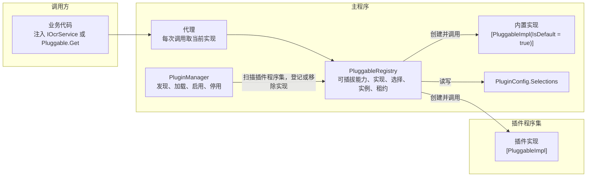

# BetterGI 插件系统设计（含 OCR 模型插件化）

状态：第 2 版，部分实施。可插拔机制、插件宿主、插件页、插件设置界面、OCR 改造和传送改造已实现，OCR 插件和实验传送插件在独立仓库 `bettergi-plugins` 中；已编译并通过临时验证测试，待界面与游戏内验收。实施情况与设计的差异见[第 19 节](#19-实施步骤)。  
相关文档：[基础设施统一](infrastructure-foundation.md)（下载、临时文件、延迟清理） · [配置持久化](config-persistence.md) · [独立任务合同](task-contract.md)（插件任务标识格式） · [三种实例的能力边界](instance-capability-boundaries.md)

版本说明：第 1 版为每个可插拔能力手写声明、配置字段和设置界面，并为 OCR 单独写了切换代理。第 2 版改为通用机制：可插拔能力就是带特性的接口，实现就是带特性的类，发现、选择、热切换、回退全部由主程序统一完成，新增可插拔能力只需要按[第 7 节](#7-可插拔能力改造配方)的步骤抽接口。OCR 不再迁移旧配置，插件改名为 `ppocr`，插件可以通过 NuGet 发布和安装，并按单文件发布调整了加载方式。第 2 版修订：代码命名由 `ExtensionPoint`、`Extension` 改为 `Pluggable`、`PluggableImpl`，中文术语“扩展点”改为“可插拔能力”，原因见[第 4 节](#4-术语)；代码目录合并为 `Core/Plugins/`，按使用者分层，见[第 6 节](#6-总体思路)。第 2 版实施时的调整：插件在独立仓库 `bettergi-plugins` 中开发；OCR 插件改为每个“版本 + 语言”一个，见 [17.4](#174-ocr-插件)。

## 1. 目标

1. 主程序只内置 PP-OCRv6，删除 V4、V5 及多语言模型的代码和模型文件。升级后所有用户都使用 V6。
2. 新增通用插件系统：
   - 插件是 .NET 程序集，依赖主程序开发；
   - 主程序扫描插件目录发现插件，启用、停用、切换实现都不需要重启；
   - 插件可以提供自己的设置界面；
   - 插件可以打包为 zip 或 NuGet 包，支持从本地文件安装，也支持从 NuGet 源下载安装。
3. 提供一套通用的可插拔能力改造方法：把主程序中的某个能力（如 OCR、队伍切换、大地图移动）改成可由插件替换时，只需抽出接口并加特性，不需要为每个可插拔能力写注册、配置和界面代码。
4. 把 V6 以外的 PaddleOCR 模型做成官方插件，每个“版本 + 语言”一个插件（共 6 个）。启用后，插件页的 OCR 选择列表中出现对应的模型。
5. 新增插件页，放在导航栏底部“设置”上方，用于选择各可插拔能力使用的实现，以及安装、启用、停用、卸载插件。

## 2. 已确认的决定

| 问题 | 决定 |
| --- | --- |
| 旧的 OCR 模型配置 | 不迁移。升级后一律使用 V6，旧字段直接忽略。包括原来选择韩文、俄文、拉丁语系模型的用户 |
| 其他版本和语言的模型 | 主程序不再内置，每个“版本 + 语言”一个插件：`ppocr_v4`、`ppocr_v4_en`、`ppocr_v5`、`ppocr_v5_latin`、`ppocr_v5_eslav`、`ppocr_v5_korean`。原来两个按游戏语言自动选择的选项不再提供 |
| 完整安装包是否预装 OCR 插件 | 不预装 |
| 插件页位置 | 导航栏底部，“设置”上方 |
| 可插拔能力的选择界面 | 插件页“功能选择”列出全部可插拔能力。OCR 模型的选择同时保留在原来的位置，即设置页的“OCR 配置”卡片（[13.2](#132-设置页的改动)）；队伍切换、大地图移动等以后的可插拔能力只在插件页提供 |
| 插件分发 | 支持 zip 和 NuGet 包；后续通过 NuGet 发布，用户可在插件页直接下载安装 |
| OCR 插件标识 | `ppocr_<版本>[_<语言>]`，每个插件一个实现，实现标识为 `<插件标识>.model` |
| 插件开发目录 | 独立仓库 `bettergi-plugins`（远程 `babalae/bettergi-plugins`），与主程序仓库放在同一个目录下 |
| 可插拔能力方案 | 不针对队伍切换、大地图移动单独设计，提供通用改造方法，二者只作为示例。本次只改造 OCR，队伍切换和地图模块不改 |
| 发布形式 | 主程序是自包含的单文件发布，发布目录中没有 `BetterGI.dll` |

## 3. 范围

包含：

- 可插拔机制：声明、发现、选择、热切换、回退、启动时校验；
- 通用的可插拔能力改造方法；
- 插件清单、发现、兼容性检查、程序集加载、启用与停用；
- 插件设置界面与设置存储；
- 插件开发包 `BetterGI.PluginSdk` 与插件打包方式；
- 从本地 zip 或 nupkg 安装，从 NuGet 源浏览、安装、检查更新；升级、卸载；
- 插件页；
- OCR 改造为第一个可插拔能力，主程序只保留 V6，其他模型作为 6 个官方插件。

不包含：

- 停用时卸载程序集、释放内存（原因见 [10.4](#104-加载方式对比)）；
- 沙箱或权限隔离（见[第 15 节](#15-安全)）；
- 插件之间的依赖、插件自动更新；
- 插件新增可插拔能力、独立任务、JS 接口、导航页面等其他扩展形式；
- 插件界面文本的多语言；
- 队伍切换、大地图移动等其他可插拔能力的具体改造，它们以后按第 7 节逐个进行。

## 4. 术语

| 术语 | 含义 |
| --- | --- |
| 可插拔能力 | 主程序中一项可替换的能力，用带 `[Pluggable]` 的接口表示，如 OCR 的 `IOcrService` |
| 实现 | 可插拔能力接口的一个实现类，带 `[PluggableImpl]`。主程序中的实现称为内置实现，每个可插拔能力恰好有一个默认实现 |
| 实现标识 | 内置实现为 `builtin.<名称>`，插件实现为 `<插件标识>.<名称>`，前缀由主程序自动加上 |
| 选择 | 用户为某个可插拔能力选定的实现标识 |
| 回退 | 选中的实现不可用（插件未安装、未启用、加载失败）时改用默认实现，保存的选择不变 |
| 代理 | 主程序为每个可插拔能力生成的接口对象。调用方拿到的始终是代理，代理把每次调用转发给当前选中的实现 |
| 插件 | 带 `plugin.json` 的目录，包含一个入口程序集和它的私有依赖、资源 |
| 已加载 | 插件程序集已经载入当前进程。停用后程序集仍保持已加载 |

命名说明：可插拔能力和插件是两个层级。可插拔能力是主程序中可替换的能力，它的实现可以来自主程序（内置实现），也可以来自插件；插件是打包和分发的单位，一个插件可以为多个可插拔能力提供实现。因此代码中用 `Pluggable`（可插拔），不用 `Plugin`，避免把内置的 PP-OCRv6 也说成插件；也不用 `Extension`，避免和 C# 扩展方法类（如 `GameRuntimeExtensions`）混淆。目录和命名空间 `Core/Plugins/` 按子系统命名（即“插件系统”），与特性和类按“它是什么”命名不冲突：内置实现引用 `Core.Plugins` 命名空间，不代表它是插件。

## 5. 现状

### 5.1 OCR

- 业务代码通过静态属性 `OcrFactory.Paddle` 使用 OCR，约 60 处调用。自动配音的 `QuestVoiceOcrEngine` 注入 `OcrFactory`，使用 `PaddleOcr` 和 `ActiveModelType`。
- 模型选择是枚举 `PaddleOcrModelConfig`（9 个值，默认 V4Auto），保存在 `OtherConfig.OcrConfig.PaddleOcrModelConfig`。`OtherConfig.Ocr` 只有这一个字段。
- `OcrFactory.ResolveModelType` 把枚举映射到 `PaddleOcrService.PaddleOcrModelType` 的静态实例。两个 Auto 档按游戏语言选择模型，所以切换游戏语言时设置页会调用 `OcrFactory.Unload()`。
- `Unload` 立即释放旧的 `PaddleOcrService`。有的调用方把实例保存在字段中（如 `RewardResultRecognizer` 的 `ocrService ??= OcrFactory.Paddle`），任务运行中切换模型时会抛 `ObjectDisposedException`。
- `MainWindowViewModel` 在 alpha 版本每次升级后把配置强制改为 V6。
- `InferenceModelDiagnostics` 的 OCR 验证和测速按 `ActiveModelType` 直接 `new PaddleOcrService`。
- 模型文件来自 NuGet 包 `BetterGI.Assets.Model` 1.0.39。V4、V5 相关文件共约 74 MB，其中中文 Det、Rec 的 V4、V5 四个模型约 37 MB；V6 约 31 MB。
- 硬件加速设置中的 OCR CPU 线程策略按模型名前缀 `PpOcrDet`、`PpOcrRec` 识别 PaddleOCR 模型。

### 5.2 能力替换的现有写法

| 能力 | 现有写法 | 问题 |
| --- | --- | --- |
| OCR 模型 | 枚举 + `switch` | 每加一个模型要改枚举、工厂、界面 |
| 地图特征匹配 | 字符串 `"SIFT"` + `if` | 同上 |
| 运行环境 | `IEnumerable<IGameRuntimeProvider>` 按 `Kind` 选择 | 已经是接口加多实现，但选择逻辑写在 `GameRuntimeService` 中，不通用 |
| 队伍切换、大地图移动 | 具体类，调用方直接 `new` | 无法替换 |

### 5.3 发布形式

`FolderProfile.pubxml` 设置 `SelfContained=true`、`PublishSingleFile=true`。发布目录只有 `BetterGI.exe`，主程序集和依赖都打在单文件包中，没有可供插件编译引用的 `BetterGI.dll`。

### 5.4 可以复用的基础

- `Plugins/OnnxRuntime/`：程序目录下已有的 ONNX 运行库安装目录。它存放原生 DLL，不是本设计中的插件，扫描时跳过。
- `SoloTaskRegistry`：启动时扫描程序集中的特性并校验，已为插件预留标识格式 `{pluginId}.{name}`（正则 `^[a-z][a-z0-9_]*(\.[a-z][a-z0-9_]*)?$`）。可插拔机制沿用“扫描特性、启动时校验”的做法和标识格式。
- `SoloTaskSettingsTemplates`：按“VM 类型 → 视图类型”注册隐式 DataTemplate，插件设置界面用同样的方式。
- `IDownloadService`（断点续传、代理、校验）、`ITempFileService`、`PendingCleanupStore`（下次启动时删除）、`Global.ManifestJsonOptions`（snake_case 清单）、`Global.IsNewVersion`（Semver 比较）。
- `ConfigChangeTracker` 跟踪配置对象图中的属性变化和集合变化，改动自动保存。

## 6. 总体思路

整套机制只有四个概念，内置实现和插件实现走完全相同的路径：

| 概念 | 写法 | 主程序自动完成的事 |
| --- | --- | --- |
| 可插拔能力 | 接口加 `[Pluggable("ocr", "OCR 模型")]` | 启动时扫描主程序集；在 DI 中注册该接口；插件页“功能选择”自动出现一行 |
| 实现 | 类实现接口并加 `[PluggableImpl("v5", "PP-OCRv5")]` | 扫描主程序集和已启用插件的程序集；加上标识前缀；出现在选择列表中 |
| 使用 | 注入接口，或调用 `Pluggable.Get<IOcrService>()` | 返回代理，每次调用转发给当前选中的实现 |
| 选择 | 用户在插件页选择 | 保存到配置；切换后下一次调用生效；旧实例在进行中的调用结束后释放；不可用时回退到默认实现 |



依赖方向：

- 插件依赖主程序，主程序不引用任何插件。
- 业务代码只依赖可插拔能力接口，不知道实现来自哪里，也不知道插件是否存在。
- `PluginManager` 只负责插件程序集的发现、加载和启停，把找到的实现交给 `PluggableRegistry`，不直接调用任何业务代码。
- 界面层通过 ViewModel 使用 `PluginManager` 和 `PluggableRegistry`。

代码位置：

主程序中的插件系统集中在 `Core/Plugins/`，与同样运行用户提供代码的 `Core/Script/`（JS 脚本）并列，顶层不新增目录。目录按使用者分为三层：

```text
BetterGenshinImpact/Core/Plugins/   命名空间 BetterGenshinImpact.Core.Plugins：对插件的稳定接口
├─ Pluggable.cs                     静态入口：Get、Reset、CreateDetached
├─ PluggableAttribute.cs、PluggableImplAttribute.cs
├─ IPluginContext.cs、PluginManifest.cs
├─ IPluginSettingsStore.cs、PluginSettingsViewAttribute.cs   插件设置的读写与设置界面声明
│  （以后：IBgiPlugin.cs）
├─ Pluggables/                      可插拔机制内部
│  ├─ PluggableRegistry.cs          注册表
│  ├─ PluggableSlot.cs              槽：选择、回退、实例创建
│  ├─ PluggableInstance.cs          实例与租约
│  ├─ PluggableProxy.cs             DispatchProxy 代理
│  ├─ PluggableScanner.cs           扫描与启动校验
│  ├─ BinaryCompatibility.cs        二进制不兼容判断
│  └─ PluggableModels.cs            描述、选择状态、事件参数
└─ Hosting/                         插件宿主
   ├─ PluginManager.cs              发现、启用、停用、安装、卸载、启动流程
   ├─ PluginEntry.cs、PluginState.cs
   ├─ PluginCompatibility.cs        清单与版本检查
   ├─ PluginLoadContext.cs          加载上下文与 HostAssemblyResolver
   ├─ PluginRuntime.cs              运行时信息、PluginContext、插件服务容器
   ├─ PluginSettingsStore.cs        插件设置文件 settings.json
   ├─ PluginPackage.cs、PluginPackageReader.cs   安装包检查与解压
   （以后：NuGetPluginSource）
```

| 层 | 使用者 | 可见性与兼容性 |
| --- | --- | --- |
| 根命名空间 `Core.Plugins` | 声明可插拔能力的业务代码、插件作者 | public，是对插件的稳定接口。不兼容的修改要提高 `MinSdkVersion`（[10.2](#102-兼容性检查)） |
| `Core.Plugins.Pluggables`、`Core.Plugins.Hosting` | 主程序自身：启动流程、`OcrFactory`、插件页 | 宿主内部，不承诺兼容。代理、槽与租约、启动校验、加载上下文、程序集解析、安装器、NuGet 源、设置存储的实现都是 `internal`，不会出现在开发包的引用程序集中（[9.4](#94-开发包-bettergipluginsdk)）。单元测试项目已有 `InternalsVisibleTo`（`AssemblyInfo.cs`） |

- `PluggableRegistry` 和 `PluginManager` 保持 public：插件页的 ViewModel 是 public 类，public 构造函数注入 internal 类型会编译报错（CS0051）。它们留在子命名空间中，开发包文档写明“宿主内部，插件不要使用”。
- 业务代码和插件需要的操作都在静态入口 `Pluggable` 上（`Get`、`Reset`、`CreateDetached`），不需要接触 `PluggableRegistry`。
- 依赖方向：根命名空间依赖 `Pluggables/`；`Hosting/` 依赖根命名空间和 `Pluggables/`；`Pluggables/` 不引用 `Hosting/`。没有任何插件时，可插拔机制照样工作。
- 免写 using：主程序的 `GlobalUsing.cs` 增加 `global using BetterGenshinImpact.Core.Plugins;`，声明可插拔能力的业务代码不需要写 using。开发包（9.4）以后为插件工程添加同一个隐式 using；目前官方插件在源码中显式写 using。

其他位置：

| 位置 | 内容 |
| --- | --- |
| 各功能目录 | 可插拔能力接口和内置实现，如 OCR 在 `Core/Recognition/OCR/` |
| `Core/Config/PluginConfig.cs` | 插件与可插拔能力配置（[第 12 节](#12-配置)），与其他配置放在一起 |
| `View/Pages/PluginsPage.xaml`、`ViewModel/Pages/Plugins/` | 插件页，按 MVVM 约定放在界面层 |
| 独立仓库 `bettergi-plugins` | 官方插件工程，见 [9.6](#96-插件仓库-bettergi-plugins) |

## 7. 可插拔能力改造配方

把主程序中的某个类方法改成可由插件替换，按以下四步进行。以队伍切换为例，现状是调用方直接写 `new SwitchPartyTask(runtime).Start(partyName, ct)`。

### 7.1 第一步：确定边界

找出调用方真正需要的那个完整动作，确认不同实现之间可以共享同一组输入和结果。队伍切换的边界是“切换到指定名称的队伍并回到主界面”，打开界面、识别队名等内部步骤不暴露。

### 7.2 第二步：抽出接口

在功能目录新建接口，加 `[Pluggable]`，按 [7.5](#75-接口规则) 设计方法：

```csharp
/// <summary>队伍切换。实现无需线程安全，任务中不会并发调用。</summary>
[Pluggable("party_switch", "队伍切换")]
public interface IPartySwitcher
{
    /// <summary>
    /// 切换到名称与 partyName（正则）匹配的队伍。可以从任意界面开始，结束时回到主界面。
    /// 已经是目标队伍时直接返回 true。无法打开队伍界面时抛出 PartySetupFailedException。
    /// </summary>
    Task<bool> SwitchAsync(GameRuntime runtime, string partyName, CancellationToken ct);
}
```

### 7.3 第三步：把现有代码变成默认实现

现有类的构造函数只依赖长期服务时，让它直接实现接口并加特性。构造函数里有调用上下文（`SwitchPartyTask` 需要 `GameRuntime`）时，加一个适配类，现有类保持不变：

```csharp
/// <summary>内置队伍切换：沿用 SwitchPartyTask 的识别与操作流程。</summary>
[PluggableImpl("default", "内置", IsDefault = true)]
internal sealed class BuiltinPartySwitcher : IPartySwitcher
{
    /// <inheritdoc />
    public Task<bool> SwitchAsync(GameRuntime runtime, string partyName, CancellationToken ct)
        => new SwitchPartyTask(runtime).Start(partyName, ct);
}
```

### 7.4 第四步：替换调用点

- DI 创建的类：构造函数注入 `IPartySwitcher`。
- 其他代码（现有任务大多是 `new` 出来的）：`await Pluggable.Get<IPartySwitcher>().SwitchAsync(runtime, partyName, ct)`。
- 全局搜索原来的 `new SwitchPartyTask(`，确认除适配类外没有遗漏。
- 已经有大量调用的静态门面（如 `OcrFactory.Paddle`）保留不动，只把门面内部改为返回 `Pluggable.Get<T>()`。

完成后编译、确认内置实现的行为不变即可。不需要写注册代码、配置字段或界面：插件页“功能选择”自动出现“队伍切换”一行；插件只要提供带 `[PluggableImpl]` 的 `IPartySwitcher` 实现，就会出现在选择列表中。

### 7.5 接口规则

代理需要知道每次调用何时结束，才能在切换后安全释放旧实例。以下规则在启动时校验（[8.6](#86-启动校验)），违反时开发版直接报错：

1. 接口必须是 `public`，只包含方法，不能有属性和事件。
2. 方法返回 `void`、普通值、`Task` 或 `Task<T>`。不能返回 `ValueTask`、`IAsyncEnumerable<T>`。
3. 调用上下文（`GameRuntime`、`CancellationToken`、业务参数）通过方法参数传入。实现的构造函数只注入长期服务（`AllConfig`、`BgiOnnxSessionFactory`、`ILogger<T>`、插件的 `IPluginContext` 等）。
4. 返回值在调用结束后不能依赖实现实例继续工作（例如返回一个需要实现保持存活的会话对象）。
5. 接口的注释写清前置条件、结束状态、异常约定和线程要求。OCR 会被实时触发器和任务同时调用，实现必须线程安全；队伍切换只在任务中调用，不要求线程安全。
6. 粒度宜粗：一个方法对应一个完整动作，不把内部步骤拆成多个方法，否则不同实现很难共享接口。
7. 实现内部的键鼠操作和截图之间按项目约定留出延时（游戏响应约 30～60 ms，30 fps 下输入过快会丢失），这一点在接口注释中提醒插件作者。

### 7.6 特殊情况

| 情况 | 做法 |
| --- | --- |
| 某次调用要使用指定实现（如路径文件中单独指定的地图匹配方式） | `Pluggable.Get<T>("builtin.sift")`，返回绑定到该实现的代理；该实现不可用时回退到默认实现 |
| 配置变化后实现需要重建（例如实现在构造时读取了某项配置） | 调用 `Pluggable.Reset<T>()`，当前实例在进行中的调用结束后释放，下一次调用重新创建 |
| 诊断、测速需要一个不影响全局的独立实例 | `Pluggable.CreateDetached<T>(params object[] args)`，按当前选中的实现创建新实例，`args` 补充构造参数，调用方负责释放 |
| 现有实现是静态方法或静态类 | 新建一个默认实现类，在方法中调用原静态方法 |
| 接口确实需要改动 | 视为不兼容修改，需要提高 `MinSdkVersion`（[10.2](#102-兼容性检查)）。能新增一个可插拔能力解决时，优先新增，不修改已有接口 |

### 7.7 检查清单

- [ ] 接口加了 `[Pluggable]`，标识为小写 snake_case，显示名用中文；
- [ ] 接口满足 7.5 的规则，注释写清了前置条件、结束状态、异常和线程要求；
- [ ] 恰好一个内置实现带 `IsDefault = true`，行为与改造前一致；
- [ ] 原来的直接创建（`new`）全部替换为注入或 `Pluggable.Get<T>()`；
- [ ] 调用方没有把业务状态（如 `RunnerContext.PartyName`）的维护交给实现，状态仍由调用方维护。

## 8. 可插拔机制

### 8.1 特性

```csharp
/// <summary>把接口声明为可插拔能力。只在主程序中使用，插件不能新增可插拔能力。</summary>
[AttributeUsage(AttributeTargets.Interface)]
public sealed class PluggableAttribute(string id, string displayName) : Attribute
{
    /// <summary>可插拔能力标识，小写 snake_case，如 ocr、party_switch。</summary>
    public string Id { get; } = id;

    /// <summary>插件页“功能选择”中显示的名称。</summary>
    public string DisplayName { get; } = displayName;

    /// <summary>显示在名称下方的说明，可为空。</summary>
    public string? Description { get; init; }
}

/// <summary>把类声明为某个可插拔能力的实现。类必须且只能实现一个可插拔能力接口。</summary>
[AttributeUsage(AttributeTargets.Class, Inherited = false)]
public sealed class PluggableImplAttribute(string name, string displayName) : Attribute
{
    /// <summary>实现名称，小写 snake_case。完整标识由主程序加上 builtin. 或 插件标识. 前缀。</summary>
    public string Name { get; } = name;

    /// <summary>选择列表中显示的名称。</summary>
    public string DisplayName { get; } = displayName;

    /// <summary>选择列表中的说明，可为空。</summary>
    public string? Description { get; init; }

    /// <summary>是否为默认实现。只允许主程序中的实现设置，每个可插拔能力恰好一个。</summary>
    public bool IsDefault { get; init; }
}
```

实现名称不带前缀，前缀由来源决定：主程序中的实现为 `builtin.`，插件中的实现为 `<插件标识>.`。插件作者无法写出冒充内置实现或其他插件的标识。

### 8.2 注册表

`PluggableRegistry` 在 `App.xaml.cs` 的 `ConfigureServices` 中创建（与 `SoloTaskRegistry` 相同，构造时传入主程序集）：

```csharp
// 可插拔机制：扫描主程序集中的可插拔能力和内置实现，并把每个可插拔能力接口注册为代理
var pluggables = new PluggableRegistry([typeof(App).Assembly], all.PluginConfig);
services.AddSingleton(pluggables);
pluggables.RegisterProxies(services);
```

`RegisterProxies` 为每个可插拔能力执行 `services.AddSingleton(contractType, _ => pluggables.GetProxy(contractType))`，DI 中的类可以直接注入可插拔能力接口。

| 成员 | 说明 |
| --- | --- |
| `All` | 全部可插拔能力的描述（标识、名称、说明、接口类型） |
| `GetImplementations(pluggableId)` | 当前可用的实现，内置在前，插件实现按插件名称排序 |
| `GetSelection(pluggableId)` | 保存的选择、实际使用的实现、是否回退，供界面显示 |
| `Select(pluggableId, implementationId)` | 保存选择，当前实例在进行中的调用结束后释放 |
| `GetProxy<T>()`、`GetProxy<T>(implementationId)` | 代理，见 8.3 |
| `Reset<T>()`、`CreateDetached<T>(args)` | 见 [7.6](#76-特殊情况) |
| `Changed` 事件 | 实现增减、选择变化、实例重建时触发，参数带可插拔能力标识 |
| 内部：`AddPluginAssembly`、`RemovePluginAsync`、`Incompatible` 事件 | 供 `PluginManager` 使用 |

静态入口 `Pluggable` 提供 `Get<T>()`、`Get<T>(implementationId)`、`Reset<T>()`、`CreateDetached<T>(args)`，内部转发给 `App.GetService<PluggableRegistry>()`。没有经过 DI 创建的业务代码和插件都只通过它操作可插拔能力。静态类 `Pluggable` 与特性类 `PluggableAttribute` 可以并存：C# 解析 `[Pluggable]` 时只选派生自 `Attribute` 的类型，静态类不参与。

### 8.3 代理、实例与租约

调用方拿到的是 `DispatchProxy` 生成的代理对象，它实现可插拔能力接口，每个可插拔能力一个，长期不变。调用方把它保存在字段中也不会过期。

每个可插拔能力有一个“槽”，记录当前实现、当前实例和实例上进行中的调用数（租约）。一次调用的过程：

1. 代理向槽申请租约：槽按选择确定实现；还没有实例时创建实例；租约计数加 1。
2. 代理用反射调用实例上的同名方法。
3. 方法返回普通值时，在 `finally` 中归还租约；返回 `Task` 时，在任务完成后归还租约。
4. 反射包装的 `TargetInvocationException` 被拆开，抛出原始异常，调用方看到的异常与直接调用实现时相同。

切换时（选择变化、插件启用或停用、`Reset<T>()`），槽把当前实例标记为“退役”并清空。新调用会创建新实例；退役实例在租约归零后释放（实现了 `IAsyncDisposable` 或 `IDisposable` 时）。进行中的调用总是在原来的实例上完成，不会遇到已释放的对象。

实例的生命周期因此是：选中后第一次调用时创建，一直复用到被切换，然后在最后一个调用结束后释放。实现可以在构造函数中加载模型等重量级资源。

性能：代理每次调用多一次反射调用和一次计数加减，约为微秒级。OCR 单次识别为毫秒级，队伍切换为秒级，影响可以忽略。不要把每帧调用成千上万次的细粒度方法做成可插拔能力（规则 6）。

### 8.4 实例创建

实例用 `ActivatorUtilities.CreateInstance(provider, type, args)` 创建，构造函数参数从服务容器解析：

- 内置实现使用主程序的服务容器；
- 插件实现使用插件服务容器：先提供该插件的 `IPluginContext`、`IPluginSettingsStore` 和分类名为 `Plugin.<插件标识>` 的日志，其余转到主程序的服务容器。

主程序的内部服务没有兼容性承诺，插件构造函数中注入的主程序类型在版本间可能变化，见 [10.2](#102-兼容性检查)。

注册表在 DI 容器构建前创建，第一次创建实例时才使用服务容器（届时取 `App.ServiceProvider`）。实例在第一次调用的线程上同步创建：OCR 首次使用和每次切换后的第一次识别会等待模型加载，与现在调用 `Unload` 后的行为相同。

### 8.5 选择、回退与配置

选择保存在 `PluginConfig.Selections` 中（[第 12 节](#12-配置)），每个可插拔能力一项，没有保存的可插拔能力使用默认实现。选择集中保存，新增可插拔能力时不需要新增配置字段；功能自己的设置界面（如设置页的 OCR 配置）显示选择时，也读写同一份记录，各处保持一致。

- 选中的实现不可用时回退到默认实现，但不改写保存的选择。插件重新启用后，原来的选择自动恢复。
- 保存的实现标识不属于任何已知插件（插件可能已被卸载）时，同样按回退处理。
- 回退时插件页显示提示，例如“所选实现来自未启用的插件，当前使用 PP-OCRv6。”，下拉框中保留一项“ppocr_v5.model（插件未启用）”。
- 插件实现创建实例失败时记录日志，该可插拔能力暂时回退到默认实现，直到用户重新选择或重新启用该插件。默认实现创建失败时照常抛出异常，与改造前相同。

### 8.6 启动校验

`PluggableRegistry` 构造时校验主程序集，插件程序集在启用时校验。参照 `SoloTaskRegistry`，主程序集校验失败直接抛出异常，开发时第一次启动就能发现；插件校验失败只让该插件进入“加载失败”状态。

| 校验项 | 适用 |
| --- | --- |
| 可插拔能力标识、实现名称符合小写 snake_case，完整实现标识符合 `^[a-z][a-z0-9_]*\.[a-z][a-z0-9_]*$` | 全部 |
| 可插拔能力标识不重复；同一可插拔能力下实现标识不重复 | 全部 |
| 接口满足 [7.5](#75-接口规则) 的规则 1、2 | 主程序 |
| 每个可插拔能力恰好一个 `IsDefault` 实现 | 主程序 |
| 带 `[PluggableImpl]` 的类是非抽象类，且恰好实现一个可插拔能力接口 | 全部 |
| 插件实现不能设置 `IsDefault` | 插件 |

### 8.7 二进制不兼容

插件依赖整个主程序。主程序删除或修改了插件用到的公开成员时，加载、创建实例或调用时会抛 `TypeLoadException`、`MissingMethodException`、`MissingFieldException`、`MissingMemberException`、`FileNotFoundException` 或 `FileLoadException`。JIT 在首次调用方法时才解析成员，所以这类异常可能在调用时才出现。

代理统一处理：调用插件实现时出现这类异常，本次调用照常抛出，同时触发 `Incompatible` 事件。`PluginManager` 收到后停用该插件，状态改为“加载失败：与当前版本不兼容”，并弹出提示。之后的调用回退到默认实现。

## 9. 插件包

### 9.1 目录

```text
<程序目录>/
├─ BetterGI.exe
├─ Plugins/
│  ├─ OnnxRuntime/                 现有 ONNX 运行库目录，没有 plugin.json，扫描时跳过
│  ├─ .pending/<插件标识>/          等待下次启动替换的升级文件
│  └─ ppocr_v5/
│     ├─ plugin.json
│     ├─ BetterGI.Plugin.PpOcrV5.dll
│     ├─ BetterGI.Plugin.PpOcrV5.deps.json
│     ├─ BetterGI.Plugin.PpOcrV5.pdb
│     └─ Models/PaddleOCR/...
└─ User/
   └─ PluginData/
      └─ ppocr_v5/
         └─ settings.json         插件设置，见 11.5
```

- 插件文件放在程序目录的 `Plugins/` 下，与 `OnnxRuntime` 并列。插件属于程序扩展，不放进 `User/`，避免用户复制 `User/` 迁移版本时把二进制文件一起带走。
- 插件设置属于用户数据，放在 `User/PluginData/<插件标识>/`。卸载插件时保留，重新安装后设置恢复。
- 以 `.` 开头的子目录、没有 `plugin.json` 的子目录不参与扫描。
- 安装功能总是以插件标识作为目录名。手动复制的目录名不同也能加载；标识重复时只加载先扫描到的一个，其余显示“标识重复”。

### 9.2 清单 plugin.json

清单在构建时生成（官方插件由 `bettergi-plugins` 的 `Directory.Build.targets` 生成，以后由开发包 9.4 生成），插件作者不需要手写。`ppocr_v5` 实际生成的清单：

```json
{
  "manifest_version": 1,
  "id": "ppocr_v5",
  "name": "PaddleOCR V5 中文",
  "version": "1.0.0",
  "authors": ["BetterGI"],
  "description": "PP-OCRv5 检测与中文识别模型，也能识别英文和日文。",
  "entry": "BetterGI.Plugin.PpOcrV5.dll",
  "sdk_version": "0.66.3-alpha.1",
  "max_host_version": "",
  "package_id": "BetterGI.Plugin.PpOcrV5",
  "homepage": "https://github.com/babalae/bettergi-plugins"
}
```

| 字段 | 必填 | 规则 |
| --- | --- | --- |
| `manifest_version` | 是 | 目前为 1 |
| `id` | 是 | 小写字母开头，只含小写字母、数字、下划线，最长 32 个字符。`builtin`、`bgi`、`onnxruntime` 保留 |
| `name`、`version` | 是 | `version` 为 Semver |
| `entry` | 是 | 入口程序集，插件目录内的相对路径，不能含 `..` |
| `sdk_version` | 是 | 编译时使用的开发包版本，即对应的 BetterGI 版本，同时是插件支持的最低 BetterGI 版本 |
| `max_host_version` | 否 | 支持的最高 BetterGI 版本，空字符串表示不限 |
| `package_id` | 否 | 对应的 NuGet 包标识，用于检查更新 |
| `authors`、`description`、`homepage` | 否 | `homepage` 只接受 http、https 地址 |
| `icon` | 否 | 插件目录内的相对路径。目前插件页不显示图标，读取时忽略 |

清单用 `Global.ManifestJsonOptions` 读取（System.Text.Json，snake_case），与 JS 脚本清单一致，未知字段忽略。清单中不列出插件提供的实现，实现由扫描程序集得到。

### 9.3 安装包格式

zip 和 nupkg 都是 zip 压缩包，内容约定如下：

| 格式 | 插件文件的位置 | 用途 |
| --- | --- | --- |
| `.zip` | 根目录或唯一的顶层目录中有 `plugin.json` | 发布附件、手动分发 |
| `.nupkg` | 包内 `plugin/` 目录，其中有 `plugin.json` | 发布到 NuGet 源 |

nupkg 的元数据：

- 包类型 `BetterGIPlugin`（nuspec 的 `packageTypes`），用于在 NuGet 源中筛选插件；
- 不声明任何依赖。BetterGI 不做 NuGet 依赖解析，插件的私有依赖必须放在 `plugin/` 中；
- 官方插件的包标识以 `BetterGI.Plugin.` 开头。

### 9.4 开发包 BetterGI.PluginSdk

主程序是单文件发布，发布目录中没有 `BetterGI.dll`，第三方插件无法直接引用。因此每次发布 BetterGI 时同时发布 NuGet 包 `BetterGI.PluginSdk`，版本号与 BetterGI 相同：

| 内容 | 说明 |
| --- | --- |
| `ref/net10.0-windows10.0.22621.0/BetterGI.dll` 等 | 主程序及 `Fischless.*` 的引用程序集（`ProduceReferenceAssembly` 生成，只含公开成员的签名），只用于编译 |
| 依赖 | 主程序使用的 NuGet 包（OpenCvSharp、WPF-UI、CommunityToolkit.Mvvm、Microsoft.Extensions.* 等），声明为 `exclude="Runtime,Native,ContentFiles"`，插件编译时可用，但不会复制到插件输出 |
| `build/BetterGI.PluginSdk.targets` | 见下 |

`BetterGI.PluginSdk.targets` 的作用：

1. 设置 `EnableDynamicLoading=true`，生成供插件加载上下文解析私有依赖的 deps.json；
2. 构建时按工程属性生成 `plugin.json`：`BgiPluginId` → `id`，`BgiPluginName` → `name`，`Version`、`Authors`、`Description`、`PackageId` 对应同名字段，`sdk_version` 取开发包版本；
3. `dotnet pack` 时把整个输出目录打进 `plugin/`，设置包类型 `BetterGIPlugin`，不输出依赖（`IncludeBuildOutput=false`、`SuppressDependenciesWhenPacking=true`）；
4. 添加隐式 using `<Using Include="BetterGenshinImpact.Core.Plugins" />`，插件作者不需要为 `[PluggableImpl]`、`IPluginContext` 等写 using。

引用程序集只包含公开成员，正好就是插件可以使用的范围：插件依赖整个主程序，但只能用到 `public` 的部分。可插拔机制和插件宿主的内部类型是 `internal`（[第 6 节](#6-总体思路)），不在引用程序集中，插件无法依赖它们。

### 9.5 插件工程示例

第三方插件的工程文件：

```xml
<Project Sdk="Microsoft.NET.Sdk">
  <PropertyGroup>
    <TargetFramework>net10.0-windows10.0.22621.0</TargetFramework>
    <UseWPF>true</UseWPF>
    <Nullable>enable</Nullable>
    <BgiPluginId>my_party_switch</BgiPluginId>
    <BgiPluginName>示例队伍切换</BgiPluginName>
    <Version>1.0.0</Version>
    <PackageId>MyName.BetterGI.PartySwitch</PackageId>
  </PropertyGroup>
  <ItemGroup>
    <PackageReference Include="BetterGI.PluginSdk" Version="0.67.0" />
  </ItemGroup>
</Project>
```

只提供实现的插件不需要入口类，写实现即可。`PluggableImpl`、`IPluginContext` 来自开发包添加的隐式 using，`IPartySwitcher`、`GameRuntime` 等主程序类型按各自的命名空间引用：

```csharp
/// <summary>示例：先尝试快捷切换，失败时使用内置流程。</summary>
[PluggableImpl("fast", "快速切换")]
public sealed class FastPartySwitcher(IPluginContext plugin) : IPartySwitcher
{
    /// <inheritdoc />
    public async Task<bool> SwitchAsync(GameRuntime runtime, string partyName, CancellationToken ct)
    {
        plugin.Logger.LogInformation("快速切换至 {Name}", partyName);
        // ...
    }
}
```

`dotnet build` 生成可直接复制到 `Plugins/` 的目录，`dotnet pack` 生成可发布到 NuGet 的包。完整实现标识为 `my_party_switch.fast`。

开发包尚未实现（[第 19 节](#19-实施步骤)）。实现时工程放在主程序仓库 `Build/BetterGI.PluginSdk/`：引用主程序工程，打包引用程序集和 `BetterGI.PluginSdk.targets`，由 CI 在发布时执行。`bettergi-plugins` 的 `Directory.Build.targets` 中的清单生成和打包步骤可以直接移入这个 targets。

### 9.6 插件仓库 bettergi-plugins

官方插件在独立仓库 `bettergi-plugins` 中开发，与主程序仓库放在同一个目录下：

```text
MainProject/
├─ better-genshin-impact/              主程序仓库
└─ bettergi-plugins/                   插件仓库（远程 babalae/bettergi-plugins）
   ├─ Directory.Build.props            目标框架、主程序仓库位置（BetterGIRepoDir）、资源包版本
   ├─ Directory.Build.targets          公共构建步骤，见下
   ├─ bettergi-plugins.sln             插件工程，以及用于编译和调试的主程序工程
   └─ src/
      ├─ Shared/PpOcrModels.cs         OCR 插件共用的模型组合代码，以链接方式编入 OCR 插件
      ├─ BetterGI.Plugin.PpOcr*/       每个 OCR 插件一个工程：工程文件 + 一个实现类
      └─ BetterGI.Plugin.ExperimentalTeleport/   实验传送插件（第 18 节），带素材和设置界面
```

`Directory.Build.targets` 为设置了 `BgiPluginId` 的工程完成：

1. 以 `ProjectReference` 引用主程序工程（`Private=false`，按 x64 编译），主程序及其依赖不进入插件目录；`src/Shared` 的源码默认编入，`BgiIncludeSharedSource=false` 时跳过；
2. 引用 `BetterGI.Assets.Model`（`ExcludeAssets=all`、`GeneratePathProperty=true`），只取工程用 `BgiPaddleOcrModel`、`BgiPaddleOcrFile` 声明的模型目录和文件；工程用 `BgiPluginContent` 声明的自带资源（路径相对工程目录）按相同的相对路径放进插件目录；
3. 构建后生成插件目录 `artifacts/plugins/<插件标识>/`（入口程序集、pdb、deps.json、模型与资源、`plugin.json`）和安装包 `artifacts/<插件标识>-<版本>.zip`。`sdk_version` 取主程序工程的 `Version`；
4. Debug 构建时把插件目录复制到主程序 Debug 输出的 `Plugins/` 下，便于本地调试，插件仍需要在插件页手动启用；`-p:BgiCopyToHost=false` 关闭；
5. `dotnet pack` 把插件目录放进包内 `plugin/`，包类型 `BetterGIPlugin`，不声明依赖，输出到 `artifacts/`。

主程序的改动让插件编译失败时，在插件仓库中能直接发现。构建插件时会同时编译主程序，主程序正在运行时其输出目录被占用，需要先退出。

## 10. 发现与加载

### 10.1 发现

- 时机：启动时、进入插件页时、点击“刷新”时、安装完成后。不使用 `FileSystemWatcher`：复制到一半的目录会被误判，手动刷新已经足够。
- 扫描只读清单，不加载程序集。新发现的插件默认不启用。
- 每个插件得到一个 `PluginEntry`：清单、目录、状态、错误信息、是否已加载、提供的实现、设置界面。
- 启用时加载入口程序集，扫描其中带 `[PluggableImpl]` 的类（以后还有带 `[PluginSettingsView]` 的类），经 8.6 校验后交给 `PluggableRegistry`。

### 10.2 兼容性检查

启用前依次检查，任一项不满足时状态为“不兼容”，不加载程序集：

1. `manifest_version` 为 1；
2. `sdk_version` 不高于当前 BetterGI 版本（插件需要的功能可能还不存在）；
3. `sdk_version` 不低于主程序常量 `PluginCompatibility.MinSdkVersion`。主程序对公开类型做了不兼容的修改时，把这个常量提高到当前版本，用旧开发包编译的插件统一显示“需要更新插件”；
4. 填写了 `max_host_version` 时，当前版本不高于它；
5. 入口程序集存在。

以上检查覆盖不了所有情况，运行时的二进制不兼容由 [8.7](#87-二进制不兼容) 处理。

### 10.3 程序集加载

每个插件使用一个独立的、不可回收的 `AssemblyLoadContext`：

```csharp
/// <summary>单个插件的程序集加载上下文。主程序能提供的程序集一律交给默认上下文，保证类型一致。</summary>
internal sealed class PluginLoadContext(string pluginId, string entryPath, HostAssemblyResolver host)
    : AssemblyLoadContext($"plugin:{pluginId}", isCollectible: false)
{
    /// <summary>按插件的 deps.json 解析私有依赖。</summary>
    private readonly AssemblyDependencyResolver _resolver = new(entryPath);

    protected override Assembly? Load(AssemblyName name)
    {
        // BetterGI、OpenCvSharp、WPF-UI 等返回 null，由默认上下文从单文件包中加载
        if (host.CanResolve(name)) return null;
        var path = _resolver.ResolveAssemblyToPath(name);
        return path is null ? null : LoadFromAssemblyPath(path);
    }

    protected override IntPtr LoadUnmanagedDll(string name)
    {
        var path = _resolver.ResolveUnmanagedDllToPath(name);
        return path is null ? IntPtr.Zero : LoadUnmanagedDllFromPath(path);
    }
}
```

- 单文件发布时，主程序集和依赖在单文件包中，没有对应的磁盘文件。`HostAssemblyResolver.CanResolve` 不依赖文件路径：先查 `AssemblyLoadContext.Default.Assemblies` 中是否已有同名程序集，再尝试 `AssemblyLoadContext.Default.LoadFromAssemblyName`，结果按程序集名称缓存。
- 主程序能提供的程序集总是使用主程序的版本，保证 `IOcrService`、`Mat`、`ObservableObject` 等类型在插件和主程序之间是同一个类型。插件目录里即使带了同名程序集也不会被加载。
- 主程序没有的包从插件目录加载，各插件之间互不影响。
- 主程序是自包含发布，插件使用主程序自带的 .NET 运行时，目标框架必须与主程序一致。
- 使用 `LoadFromAssemblyPath`，调试时能加载 PDB。代价是 DLL 在进程退出前一直被占用，升级、卸载已加载的插件需要重启（[第 14 节](#14-安装升级卸载)）。
- 插件的 XAML 视图通过 pack URI `/<程序集名>;component/...` 加载，WPF 在已加载的程序集中按名称查找。需要在单文件发布版中实际验证视图的实例化和布局；不可行时改为方案 C。

### 10.4 加载方式对比

| 维度 | A. 每个插件独立、不可回收的上下文（采用） | B. 可回收上下文，停用时卸载 | C. 全部加载到默认上下文 | D. 插件运行在独立进程 |
| --- | --- | --- | --- | --- |
| 停用后释放内存 | 否 | 理论上可以，实际很难保证（见下） | 否 | 是 |
| 停用后替换 DLL | 需要重启 | 卸载成功时可以 | 需要重启 | 可以 |
| 插件私有依赖冲突 | 隔离 | 隔离 | 先加载的版本生效 | 隔离 |
| 插件提供 WPF 界面 | 可以，需验证 | 可以，但界面对象会阻止卸载 | 可以 | 不能直接嵌入主窗口 |
| 调用 OCR、键鼠、截图 | 直接调用 | 直接调用 | 直接调用 | 需要跨进程传图像和指令，延迟高 |
| 实现复杂度 | 低 | 高，需要排查所有残留引用 | 最低 | 很高 |

不采用 B：只要插件类型被任何静态缓存引用，上下文就无法卸载，而 WPF 和常用库都有这类缓存。创建过插件中的 WPF 控件后，插件程序集不会被回收（[dotnet/runtime#13226](https://github.com/dotnet/runtime/issues/13226)）；Newtonsoft.Json 序列化插件类型时会写入 `TypeDescriptor` 的静态缓存，同样阻止卸载（[dotnet/runtime#13283](https://github.com/dotnet/runtime/issues/13283)）。依赖属性注册、主程序的静态事件、ONNX Runtime 会话也会持有引用。卸载失败时没有任何报错，只是内存不释放，把它作为功能承诺会误导用户。

因此，本设计中的“热启用、热关闭”指不重启就能让插件的功能生效或失效。停用后程序集仍留在内存中，再次启用时复用。

## 11. 插件生命周期

### 11.1 状态

| 状态 | 含义 | 插件页显示 |
| --- | --- | --- |
| 未启用 | 已发现，未启用（可能已加载过） | 开关关闭 |
| 已启用 | 实现已交给注册表 | 开关打开 |
| 停用中 | 等待该插件实现上进行中的调用结束 | 开关不可用，显示“正在等待进行中的调用结束” |
| 不兼容 | [10.2](#102-兼容性检查) 的检查未通过 | 显示原因，开关不可用 |
| 加载失败 | 加载、校验、`OnEnable` 失败，或运行时二进制不兼容 | 显示异常信息，可以再次尝试启用 |
| 标识重复 | 与先扫描到的插件标识相同 | 显示冲突的目录，开关不可用 |
| 重启后生效 | 有待替换的升级文件，或已登记卸载 | 显示提示 |

### 11.2 操作

| 操作 | 需要重启 | 过程 |
| --- | --- | --- |
| 启用 | 否 | 兼容性检查 → 加载程序集并校验（首次）→ `OnEnable`（有入口类时）→ 实现交给注册表 → 写入启用列表。保存的选择指向该插件时，下一次调用即切换过去 |
| 停用 | 否 | 注册表移除该插件的实现 → 受影响的可插拔能力回退 → 等待该插件实例上的调用全部结束并释放实例 → `OnDisable` → 从启用列表移除 |
| 再次启用 | 否 | 复用已加载的程序集 |
| 安装新插件 | 否 | 见 [14.1](#141-从本地文件安装) |
| 升级未加载过的插件 | 否 | 直接替换目录 |
| 升级已加载的插件 | 是 | 新文件放到 `Plugins/.pending/<id>/`，下次启动时替换 |
| 卸载未加载过的插件 | 否 | 直接删除目录 |
| 卸载已加载的插件 | 只推迟删除文件 | 立即停用，目录登记到 `PendingCleanupStore`，下次启动时删除 |
| 切换可插拔能力的选择 | 否 | 下一次调用生效，旧实例在进行中的调用结束后释放 |

租约机制保证任何时候启用、停用、切换都是安全的，因此任务运行期间也不限制这些操作。停用时如果某个调用耗时较长，插件状态会停在“停用中”直到调用结束。

### 11.3 启动顺序

`App.OnStartup` 中，在 `InferenceRuntimeService.InitializeAsync()` 之后、`_host.StartAsync()` 之前调用 `PluginManager.Initialize()`（同步方法）：

1. 主实例应用 `Plugins/.pending/` 中的升级文件，目标目录被占用时保留到下次，并清理残留的 `Plugins/.staging/`；
2. 扫描 `Plugins/`；
3. 按 `PluginConfig.EnabledPlugins` 依次启用。单个插件失败只影响它自己；启用列表中找不到的插件跳过，记录保留，插件放回后自动恢复。

这一步在界面线程执行，插件设置界面的 DataTemplate 要写入 `Application.Resources`。推迟到本次启动的删除（`PendingCleanupStore`，用于卸载已加载的插件）在更早的 `TryExecutePendingCleanup` 中执行。OCR 预热在主窗口加载后才执行，届时插件提供的 OCR 实现已经可用。实例按需创建，启用插件本身不加载模型。

### 11.4 可选的入口类

尚未实现，OCR 插件不需要。

只提供实现的插件不需要入口类。需要在启用、停用时做额外工作（例如启动后台服务）的插件，可以提供一个实现 `IBgiPlugin` 的类，入口程序集中最多一个：

```csharp
/// <summary>可选的插件入口，用于启用、停用时的额外工作。</summary>
public interface IBgiPlugin
{
    /// <summary>插件启用时调用，在界面线程执行，不要做耗时操作。</summary>
    void OnEnable(IPluginContext context);

    /// <summary>插件停用时调用，此时该插件的实现实例已全部释放。</summary>
    void OnDisable();
}
```

同一进程内一个插件可能多次启用和停用，入口对象只创建一次，插件要保证 `OnDisable` 之后可以再次 `OnEnable`。

### 11.5 插件上下文与设置

`IPluginContext` 的 `Manifest`、`PluginDirectory`、`DataDirectory`、`Logger`、`Settings` 和插件设置界面都已实现，插件实现、设置 VM 可以在构造函数中注入 `IPluginContext`（插件服务容器也直接提供 `IPluginSettingsStore`）。`Settings` 是在 OCR 插件之后加上的，不影响已有插件：插件只使用、不实现这个接口。第一个使用设置界面的是实验传送插件（[第 18 节](#18-传送改造)）。

```csharp
/// <summary>主程序提供给插件的上下文，每个插件一个，可注入实现、设置 VM 和入口类的构造函数。</summary>
public interface IPluginContext
{
    /// <summary>插件清单。</summary>
    PluginManifest Manifest { get; }

    /// <summary>插件安装目录，即 Plugins/&lt;插件标识&gt;，插件资源（如模型）从这里读取。</summary>
    string PluginDirectory { get; }

    /// <summary>插件数据目录，即 User/PluginData/&lt;插件标识&gt;，首次访问时创建。</summary>
    string DataDirectory { get; }

    /// <summary>分类名为 Plugin.&lt;插件标识&gt; 的日志。</summary>
    ILogger Logger { get; }

    /// <summary>插件设置的读写。</summary>
    IPluginSettingsStore Settings { get; }
}

/// <summary>插件设置的读写，文件为 User/PluginData/&lt;插件标识&gt;/settings.json。</summary>
public interface IPluginSettingsStore
{
    /// <summary>读取设置。文件不存在时返回新对象；文件损坏时备份为 .bak 并返回新对象。</summary>
    T Load<T>() where T : class, new();

    /// <summary>立即写入设置，使用临时文件加原子替换。</summary>
    void Save<T>(T settings) where T : class;
}
```

插件设置界面用特性声明，标在设置 VM 上，每个插件最多一个：

```csharp
/// <summary>示例：插件设置 VM，设置弹窗按 VM 类型匹配 MySettingsView。</summary>
[PluginSettingsView(typeof(MySettingsView))]
public partial class MySettingsViewModel(IPluginContext plugin) : ObservableObject
{
    // 属性变化时调用 plugin.Settings.Save(...) 保存
}
```

- 主程序为它注册以 VM 类型为键的隐式 DataTemplate（与 `SoloTaskSettingsTemplates` 相同）。插件页为声明了设置界面的插件显示“设置”按钮，点击后用插件服务容器新建 VM，在单独的模态窗口 `PluginSettingsWindow` 中显示；视图用无参构造函数创建，`DataContext` 由窗口中的 `ContentControl` 设为 VM。停用后模板保留，不影响使用。
- 实现：`PluginManager` 第一次加载插件程序集时扫描 `[PluginSettingsView]`，在 `Application.Resources` 中注册模板，VM 类型记在 `PluginRuntime.SettingsViewModelType` 中。声明多个设置界面、VM 是抽象类、视图不是有无参构造函数的 `FrameworkElement` 时插件加载失败。
- 弹窗：`InstalledPluginItemViewModel.OpenSettingsCommand` 每次新建 VM（`ActivatorUtilities`），读到的总是已保存的设置；创建失败时用 `ThemedMessageBox` 提示原因，不影响插件本身。窗口由视图层的 `IPluginSettingsDialogs`（实现 `PluginSettingsDialogs`，单例注册）创建，ViewModel 不引用窗口类型。窗口启用主题背景，宽 640，高度随内容（最高 800，超出时滚动），底部只有“关闭”按钮：设置在修改时即保存，没有确定、取消。窗口关闭后释放实现了 `IDisposable` 的 VM。
- “设置”按钮在插件程序集加载后（第一次启用之后）才显示：未加载的插件无法知道是否有设置界面。插件停用后仍可打开设置，已卸载（等待重启删除）的插件不显示。
- `PluginSettingsStore`：读取时文件不存在返回新对象；`JsonException` 时把文件复制为 `settings.json.bak` 并返回新对象；写入时先写带进程号和 GUID 的临时文件，再 `File.Move(..., overwrite: true)` 替换，UTF-8 无 BOM。同一插件的读写串行。
- 插件视图只能使用自己合并的资源字典和应用级资源（WPF-UI 主题等），不能依赖插件页的资源。局部样式通过 `BasedOn` 继承 WPF-UI 默认样式。
- 设置序列化使用 `ConfigService.JsonOptions`（System.Text.Json），与主配置一致。
- 可插拔能力的选择不属于插件设置，由插件页“功能选择”负责。插件设置界面只放插件自己的参数。
- 实现读取插件设置的时机由插件决定；设置变化后需要重建实例时，插件调用 `Pluggable.Reset<T>()`。

## 12. 配置

`AllConfig` 新增节点：

```csharp
/// <summary>插件与可插拔能力配置</summary>
public PluginConfig PluginConfig { get; set; } = new();
```

```csharp
/// <summary>插件与可插拔能力配置。插件自己的设置存放在 User/PluginData。</summary>
public partial class PluginConfig : ObservableObject
{
    /// <summary>已启用的插件标识。</summary>
    public ObservableCollection<string> EnabledPlugins { get; set; } = [];

    /// <summary>各可插拔能力选中的实现，没有记录的可插拔能力使用默认实现。</summary>
    public ObservableCollection<PluggableSelection> Selections { get; set; } = [];

    // 以下两项随 NuGet 浏览（14.2）一起加入，目前未实现

    /// <summary>NuGet 源的服务索引地址，按顺序查询。</summary>
    public ObservableCollection<string> PackageSources { get; set; } = ["https://api.nuget.org/v3/index.json"];

    /// <summary>浏览和检查更新时是否包含预发布版本。</summary>
    [ObservableProperty] private bool _includePrerelease;
}

/// <summary>一个可插拔能力的选择。</summary>
public partial class PluggableSelection : ObservableObject
{
    /// <summary>可插拔能力标识，如 ocr。</summary>
    [ObservableProperty] private string _pluggableId = string.Empty;

    /// <summary>实现标识，如 ppocr_v5.model。</summary>
    [ObservableProperty] private string _implementationId = string.Empty;
}
```

选择用集合加可观察对象保存，`ConfigChangeTracker` 能跟踪增删和修改，不需要手动触发保存。

## 13. 界面

### 13.1 插件页

导航栏底部“设置”上方新增“插件”项，图标 `PuzzlePiece24`，页面为 `PluginsPage`。

已实现的页面没有标签，从上到下是：标题与“从文件安装”“打开插件目录”“刷新”按钮、权限提示、功能选择、已安装插件。插件设置通过卡片标题中的“设置”按钮在单独的弹窗中打开（11.5）；卡片不显示插件目录，需要时点“打开目录”。“浏览”、来源标记、检查更新随 NuGet 浏览一起实现。已实现部分的样子：

```text
插件                                       [从文件安装] [打开插件目录] [刷新]
插件可以替换 BetterGI 的部分功能，例如 OCR 模型。启用、停用和切换都不需要重启。
ⓘ 插件拥有与 BetterGI 相同的系统权限（管理员），请只安装可信来源的插件。

功能选择
  OCR 模型                       [ PP-OCRv5 中文 · PaddleOCR V5 中文  ▾ ]
    识别游戏界面文字使用的模型。
    所选实现来自未启用的插件，当前使用 PP-OCRv6。              （回退时显示）
  传送                           [ 实验传送 · 实验传送                 ▾ ]
    大地图传送，以及打开大地图、切换区域、移动和缩放地图等大地图操作。

已安装插件
  ▾ 实验传送
    1.0.0 · BetterGI
    已启用                                              [⚙ 设置]   [开关]
      来自 PR #3697 的实验性传送：……
      提供的功能：传送（实验传送）
      标识：experimental_teleport
      [打开目录]  [主页]  [卸载]

点击“设置”后弹出：
  ┌ ⚙ 实验传送 设置 ─────────────────────────────── ✕ ┐
  │ （插件提供的视图：高级参数开关、参数输入框……）      │
  │ 修改后自动保存。                          [关闭]   │
  └────────────────────────────────────────────────────┘
```

完整设计分三个标签：

```text
插件                                       [从文件安装] [打开插件目录] [刷新]
ⓘ 插件拥有与 BetterGI 相同的系统权限（管理员），请只安装可信来源的插件。

[ 功能选择 ]  [ 已安装 ]  [ 浏览 ]

功能选择
  OCR 模型              [ PP-OCRv5 中文 · PaddleOCR V5 中文         ▾ ]
    识别游戏界面文字使用的模型。
  队伍切换              [ 内置                                       ▾ ]   （改造后自动出现）

已安装
  ▸ [图标] PaddleOCR V5 中文   1.0.0 · BetterGI · 官方      已启用      [开关]
      PP-OCRv5 检测与中文识别模型，也能识别英文和日文。
      提供的功能：OCR 模型（PP-OCRv5 中文）
      [检查更新]  [打开目录]  [主页]  [卸载]
  ▸ [图标] 实验传送            1.0.0 · BetterGI · 官方      已启用  [⚙ 设置]  [开关]

浏览
  [搜索框]                                         [ ] 包含预发布版本
  PaddleOCR V5 中文  BetterGI.Plugin.PpOcrV5  1.0.0  官方  下载 1.2 万   [安装]
  按包标识安装：[                         ]                             [安装]
```

- **功能选择**：为 `PluggableRegistry.All` 中的每个可插拔能力生成一行：名称、说明、选择框。新增可插拔能力不需要改页面。
  - 选项文字为“显示名 · 来源”，来源为“内置”或插件名称；选中项的说明显示在选择框下方。
  - 保存的选择当前不可用时，列表中保留一项“<实现标识>（插件未启用）”并选中，下方显示回退提示。用户主动改选之前，原来的选择不会丢失。
  - 选中的实现来自有设置界面的插件时，旁边显示“插件设置”按钮，打开该插件的设置弹窗。
- **已安装**：每个插件一个 `ui:CardExpander`。
  - 标题：图标、名称、版本、作者、来源标记（官方或第三方，见 14.2）、状态文字、“设置”按钮（插件声明了设置界面时显示，打开设置弹窗，见 11.5）、启用开关；
  - 展开内容：说明；提供的功能（按可插拔能力列出实现名称）；标识；“检查更新”“打开目录”“主页”“卸载”按钮。不显示插件目录的路径；
  - 没有插件时显示：“尚未安装插件。可以在“浏览”中安装，或从文件安装。”
- **浏览**：从 NuGet 源搜索插件并安装，见 [14.2](#142-从-nuget-安装)。
- 只读展示的绑定显式使用 `Mode=OneWay`。开关和选择框使用 `Mode=TwoWay`，通过命令执行，失败时恢复原状并提示原因。
- 主程序提供的界面文本使用 `{i18n:T ...}`；插件提供的名称和说明原样显示。
- 子实例中隐藏安装、更新、卸载按钮和“浏览”标签（[第 16 节](#16-多实例)）。

| ViewModel | 职责 |
| --- | --- |
| `PluginsPageViewModel` | 功能选择和已安装插件两个列表，从文件安装、卸载、刷新、打开目录命令；进入页面时重新扫描 |
| `PluggableItemViewModel` | 单个可插拔能力的选项、当前选择、回退提示；自己订阅 `PluggableRegistry.Changed`，切回界面线程刷新。设置页的 OCR 配置也使用它（13.2） |
| `InstalledPluginItemViewModel` | 单个已安装插件的显示数据、状态、启用开关（失败时提示并恢复）；`HasSettings` 与 `OpenSettingsCommand`：新建插件设置 VM，交给 `IPluginSettingsDialogs` 弹窗显示；以后加检查更新 |
| `PackageSearchViewModel` | NuGet 搜索、按包标识安装、安装进度（以后实现） |

### 13.2 设置页的改动

OCR 模型的选择保留在原来的位置：`CommonSettingsPage` 的“OCR 配置”卡片。

- 卡片标题和说明不变。原来的“PaddleOCR模型”一项改为“OCR 模型”，说明改为“主程序内置 PP-OCRv6。需要其他版本或语言的模型时，请在插件页安装并启用对应的 OCR 插件。”
- 下拉框换成可插拔能力的选择控件：`CommonSettingsPageViewModel.OcrModel` 是一个 `PluggableItemViewModel`（与插件页“功能选择”的每一行相同），选项为“显示名 · 来源”，回退时下方显示提示。旁边的“管理插件”按钮打开插件页。
- 两处显示的是同一个选择：选择保存在 `PluginConfig.Selections` 中，`PluggableItemViewModel` 订阅注册表的 `Changed` 事件，任一处改选或插件启用、停用后，另一处自动刷新；进入设置页时也刷新一次。
- 删除 `CommonSettingsPageViewModel` 中的 `PaddleOcrModelConfigs`、`SelectedPaddleOcrModelConfig`、`PaddleOcrModelConfigChangedCommand`。
- 删除游戏语言选择框上的 `GameLangSelectionChangedCommand`。它只用于在切换语言时重建 OCR，现在 OCR 模型与游戏语言无关。

其他可插拔能力按[第 2 节](#2-已确认的决定)的决定只在插件页提供。以后某个可插拔能力也要在自己的设置卡片中显示选择时，用 `PluggableRegistry.GetDescriptor<T>()` 创建一个 `PluggableItemViewModel` 即可，写法与 OCR 相同。

## 14. 安装、升级、卸载

### 14.1 从本地文件安装

1. 选择 `.zip` 或 `.nupkg` 文件。
2. 检查压缩包：解压后总大小不超过 1 GB；条目路径不能是绝对路径，不能含 `..`，防止解压到目标目录之外；按 [9.3](#93-安装包格式) 找到 `plugin.json`。
3. 读取清单，检查标识规则和 [10.2](#102-兼容性检查) 的兼容性。不兼容时提示原因并结束。
4. 用 `ThemedMessageBox` 确认：显示名称、标识、版本、作者、来源和权限提示。同标识的插件已存在时显示“当前版本 → 新版本”，新版本更低时额外提示降级。
5. 解压到 `Plugins/.staging/<随机名>/`（与插件目录在同一个磁盘上，可以直接移动；启动时清理残留），然后：
   - 新插件或未加载过的插件：替换 `Plugins/<id>/` 并重新扫描；
   - 已加载的插件：移动到 `Plugins/.pending/<id>/`，状态改为“重启后生效”。
6. 新插件安装完成后询问是否立即启用。

### 14.2 从 NuGet 安装

尚未实现。目前 `.nupkg` 可以下载后从文件安装（14.1）。

使用 NuGet v3 协议，按 `PluginConfig.PackageSources` 的顺序访问各源：

| 步骤 | 请求 | 说明 |
| --- | --- | --- |
| 读取服务索引 | `GET {源地址}` | 取 `SearchQueryService` 和 `PackageBaseAddress/3.0.0` 两项资源地址，结果在本次运行中缓存 |
| 搜索 | `GET {SearchQueryService}?q=…&packageType=BetterGIPlugin&prerelease=…&semVerLevel=2.0.0` | 只返回包类型为 `BetterGIPlugin` 的包 |
| 列出版本 | `GET {PackageBaseAddress}/{包标识小写}/index.json` | 所有 v3 源都支持 |
| 下载 | `GET {PackageBaseAddress}/{包标识小写}/{版本小写}/{包标识小写}.{版本小写}.nupkg` | 经 `IDownloadService` 下载，支持断点续传和代理，下载中心中可见 |

- 默认安装最新版本（`IncludePrerelease` 关闭时只看正式版）。下载后从 14.1 第 2 步继续。最新版本不兼容时提示原因，并让用户从版本列表中选择其他版本。
- 没有搜索服务的源（部分私有源）只能“按包标识安装”。
- 来源标记：nuget.org 对已保留前缀的包返回 `verified: true`。包标识以 `BetterGI.Plugin.` 开头且已验证的显示“官方”，其余显示“第三方”。需要维护者在 nuget.org 为 `BetterGI.` 申请前缀保留（[待确认问题 2](#21-待确认问题)）。
- BetterGI 不读取 nupkg 中的依赖，也不安装依赖包（[9.3](#93-安装包格式)）。
- JSON 请求使用 `HttpClientNames.Default` 客户端，跟随“网络与代理”设置。

### 14.3 检查更新

尚未实现，随 NuGet 浏览一起实现。

“已安装”中的“检查更新”按清单中的 `package_id` 查询版本列表，有更高的兼容版本时显示“更新到 x.y.z”。没有 `package_id` 的插件（例如从 zip 安装的第三方插件）不显示这个按钮。不做自动更新。

### 14.4 卸载

确认后先停用插件。未加载过的插件直接删除目录；已加载的插件把目录登记到 `PendingCleanupStore`，下次启动时删除。`User/PluginData/<id>/` 保留，确认框中说明它的位置。

### 14.5 手动安装

把插件目录复制到 `Plugins/` 后点击“刷新”。手动复制的插件同样默认不启用。

## 15. 安全

插件是普通 .NET 代码，在 BetterGI 进程中以管理员权限运行，能做主程序能做的任何事。.NET 没有可用的进程内沙箱，本设计不尝试隔离，而是让用户清楚自己在运行什么：

- 新发现、新安装的插件默认不启用，必须由用户打开开关。插件页常驻权限提示，安装确认框中也有权限提示。原设计中“第一次启用时再次显示权限提示”暂未实现。
- 安装时检查压缩包路径，拒绝解压到目标目录之外；解压时再次校验。
- 插件页区分“官方”和“第三方”（14.2），第三方插件在安装确认框中额外提示“此插件不是 BetterGI 官方发布”。随 NuGet 浏览一起实现。
- 不自动下载或更新插件代码，安装和更新都需要用户点击并确认。
- 加载时在日志中记录插件标识、版本、入口程序集路径和 SHA256，方便排查问题。

## 16. 多实例

- 每个实例进程各自扫描和加载插件，启用列表和选择来自该实例使用的配置。
- 安装、更新、卸载只在主实例的插件页提供。其他实例可能正在使用插件文件，因此已加载插件的升级和卸载统一推迟到主实例下次启动；文件仍被占用时保留到再下一次。
- `Plugins/.pending/` 只由主实例在启动时处理。

## 17. OCR 改造

OCR 是第一个按[第 7 节](#7-可插拔能力改造配方)改造的可插拔能力。

### 17.1 可插拔能力与默认实现

`IOcrService` 已经是接口，所有方法都返回普通值，满足 7.5 的规则，直接加特性：

```csharp
/// <summary>OCR 服务。实时触发器和任务会同时调用，实现必须线程安全。</summary>
[Pluggable("ocr", "OCR 模型", Description = "识别游戏界面文字使用的模型。")]
public interface IOcrService
{
    // 现有的 Ocr、OcrWithoutDetector、OcrResult 不变
}
```

```csharp
/// <summary>内置的 PP-OCRv6 模型，是 OCR 可插拔能力的默认实现。</summary>
[PluggableImpl("ppocr_v6", "PP-OCRv6", IsDefault = true, Description = "主程序内置的模型。")]
public sealed class PpOcrV6Service(BgiOnnxSessionFactory sessions)
    : PaddleOcrService(sessions, PaddleOcrService.PaddleOcrModelType.V6);
```

为此：

- `PaddleOcrService(BgiOnnxSessionFactory, PaddleOcrModelType)` 构造函数由 `internal` 改为 `public`，`PaddleOcrModelType.Create` 由 `private` 改为 `public`，插件用它们组合自己的模型；
- `App.xaml.cs` 注册 `services.AddTransient(sp => sp.GetRequiredService<BgiOnnxFactory>().ForCurrentRuntime())`，实现可以直接注入绑定当前推理运行时的 `BgiOnnxSessionFactory`。

### 17.2 OcrFactory

`OcrFactory` 保留为 DI 单例和静态门面，约 60 处 `OcrFactory.Paddle` 调用不用改：

| 成员 | 改造后 |
| --- | --- |
| `static Paddle` | `Pluggable.Get<IOcrService>()` |
| `PaddleOcr` | 构造函数注入的 `IOcrService` 代理，与 `Pluggable.Get<IOcrService>()` 是同一个对象 |
| `ActiveModelType` | 改为 `ActiveModelName`，即当前实际使用的实现的显示名 |
| 新增 `CreateDetached(BgiOnnxSessionFactory)` | `PluggableRegistry.CreateDetached<IOcrService>([sessions])`，供诊断创建独立实例。`OcrFactory` 本来就要注入注册表读取 `ActiveModelName`，这里直接用它，不经静态入口 |
| `Unload`、`ResolveModelType`、游戏语言读取、`Dispose` 与终结器 | 删除。实例由注册表创建和释放 |

调用方保存的 OCR 对象现在是代理，切换模型时不会再拿到已释放的实例（[8.3](#83-代理实例与租约)）。

使用方的改动：

- `InferenceModelDiagnostics`：验证改为 `ocr.CreateDetached(factory.ForOcrValidation())`，测速改为 `ocr.CreateDetached(factory)`，测试图片统一使用 `PaddleOcrModelType.TestImagePath`，测速描述使用 `ActiveModelName`；
- `QuestVoiceOcrEngine.Describe`：模型名改用 `ActiveModelName`，类注释中“跟随设置 → OCR 配置 → PaddleOCR模型和游戏语言”改为“跟随设置 → OCR 配置 → OCR 模型”。

### 17.3 删除

| 删除 | 说明 |
| --- | --- |
| `PaddleOcrModelType.V4`、`V4En`、`V5`、`V5Latin`、`V5Eslav`、`V5Korean`、`FromCultureInfo`、`FromCultureInfoV4`、`TestNumberImagePath` | 各模型移入对应插件；按游戏语言自动选择不再提供 |
| `BgiOnnxModel` 中 8 个 V4、V5 模型 | 同上 |
| `OcrVersionConfig.PpOcrV3`、`PpOcrV4`、`PpOcrV5` | 插件自己定义，参数与 V6 相同 |
| `PaddleOcrModelConfig` 枚举、`OtherConfig.Ocr` 类、`OtherConfig.OcrConfig` 属性 | 不迁移。配置文件中旧的 `ocrConfig` 字段读取时被忽略，下次保存时消失；所有用户使用 V6 |
| `MainWindowViewModel` 中 alpha 版本强制切换 V6 的逻辑 | 默认已是 V6 |
| 设置页 OCR 卡片中按枚举列出的模型下拉框、游戏语言切换命令 | 卡片保留，下拉框换成可插拔能力的选择控件，见 [13.2](#132-设置页的改动) |

单元测试中的 `PaddleFixture` 改为总是返回 V6，`Get` 的两个参数保留只为兼容现有用例；没有删除用例。

### 17.4 OCR 插件

每个“版本 + 语言”一个插件，在 `bettergi-plugins` 仓库中（[9.6](#96-插件仓库-bettergi-plugins)）。每个插件只有一个实现，实现名称统一为 `model`，没有入口类和设置界面：

| 插件标识 | 工程 | 名称 | 检测模型 | 识别模型 | 预热图 | 安装包大小 |
| --- | --- | --- | --- | --- | --- | --- |
| `ppocr_v4` | `BetterGI.Plugin.PpOcrV4` | PaddleOCR V4 中文 | `Det/V4/PP-OCRv4_mobile_det_infer` | `Rec/V4/PP-OCRv4_mobile_rec_infer` | 主程序自带 | 14.4 MB |
| `ppocr_v4_en` | `BetterGI.Plugin.PpOcrV4En` | PaddleOCR V4 英文 | 同上 | `Rec/V4/en_PP-OCRv4_mobile_rec_infer` | 插件自带 `test_pp_ocr_number.png` | 11.5 MB |
| `ppocr_v5` | `BetterGI.Plugin.PpOcrV5` | PaddleOCR V5 中文 | `Det/V5/PP-OCRv5_mobile_det_infer` | `Rec/V5/PP-OCRv5_mobile_rec_infer` | 主程序自带 | 18.7 MB |
| `ppocr_v5_latin` | `BetterGI.Plugin.PpOcrV5Latin` | PaddleOCR V5 拉丁语系 | 同上 | `Rec/V5/latin_PP-OCRv5_mobile_rec_infer` | 主程序自带 | 11.8 MB |
| `ppocr_v5_eslav` | `BetterGI.Plugin.PpOcrV5Eslav` | PaddleOCR V5 斯拉夫语系 | 同上 | `Rec/V5/eslav_PP-OCRv5_mobile_rec_infer` | 主程序自带 | 11.9 MB |
| `ppocr_v5_korean` | `BetterGI.Plugin.PpOcrV5Korean` | PaddleOCR V5 韩文 | 同上 | `Rec/V5/korean_PP-OCRv5_mobile_rec_infer` | 主程序自带 | 12.9 MB |

模型和预热图与改造前的 `PaddleOcrModelType.V4`、`V4En`、`V5`、`V5Latin`、`V5Eslav`、`V5Korean` 一一对应。

实现写法（以韩文为例）：

```csharp
/// <summary>PP-OCRv5 检测与韩文识别模型。实现标识为 ppocr_v5_korean.model。</summary>
[PluggableImpl("model", "PP-OCRv5 韩文", Description = "PP-OCRv5 检测与韩文识别模型。")]
public sealed class PpOcrV5KoreanService(BgiOnnxSessionFactory sessions, IPluginContext plugin)
    : PaddleOcrService(sessions, PpOcrModels.Create(plugin, "PP-OCRv5",
        "PpOcrDetV5", @"Det\V5\PP-OCRv5_mobile_det_infer",
        "PpOcrRecV5Korean", @"Rec\V5\korean_PP-OCRv5_mobile_rec_infer"));
```

- `PpOcrModels`（`src/Shared/PpOcrModels.cs`）用 `PaddleOcrModelType.Create` 组合插件目录 `Models/PaddleOCR/` 下的检测和识别模型，并定义 V4、V5 的版本参数（与 V6 相同）。`BgiOnnxModel` 的公开构造函数可以直接接收绝对路径（`ModalPath` 使用 `Path.Combine`，第二个参数是绝对路径时直接返回它）。
- 模型名沿用 `PpOcrDetV4`、`PpOcrRecV4En`、`PpOcrRecV5Korean` 等，才能使用硬件加速设置中的 OCR CPU 线程策略（按 `PpOcrDet`、`PpOcrRec` 前缀识别）。
- 工程文件用 `BgiPaddleOcrModel` 声明需要的模型目录，用 `BgiPaddleOcrFile` 声明单个文件，`Directory.Build.targets` 从 `BetterGI.Assets.Model` 1.0.39 包中复制。C# 中的模型目录要与工程文件一致。不需要新建资源包，也不新增 `BetterGenshinImpact/Assets` 目录。

### 17.5 资源包与发布

- 主程序升级到去掉全部 V4、V5 文件的新版 `BetterGI.Assets.Model`，主程序减小约 74 MB。按仓库约定，资源包由维护者手动修改和发布；新包发布前，主程序输出中仍有这些文件，只是不再使用。
- 插件在 `bettergi-plugins` 仓库中构建和发布，版本独立，只在插件有改动时提高。插件仓库的 CI 尚未配置，以后发布时：
  1. 构建全部插件，把 `artifacts/*.zip` 作为发布附件；
  2. `dotnet pack` 并推送 `BetterGI.Plugin.PpOcr*` 到 NuGet。
- 主程序的 `publish.yml` 以后打包并推送 `BetterGI.PluginSdk`（版本与 BetterGI 相同），本次不改。
- 完整安装包不预装插件。

### 17.6 改动文件

| 文件 | 改动 |
| --- | --- |
| `Core/Recognition/OCR/IOcrService.cs` | 加 `[Pluggable]`，注释写明线程要求 |
| `Core/Recognition/OCR/PpOcrV6Service.cs`（新增） | 默认实现 |
| `Core/Recognition/OCR/OcrFactory.cs` | 改为门面（17.2） |
| `Core/Recognition/OCR/Paddle/PaddleOcrService.cs` | 删除 V4、V5 与语言选择，公开构造函数和 `Create` |
| `Core/Recognition/ONNX/BgiOnnxModel.cs`、`Core/Recognition/OCR/Engine/OcrVersionConfig.cs` | 删除 V3、V4、V5 |
| `Core/Recognition/PaddleOcrModelConfig.cs` | 删除 |
| `Core/Config/OtherConfig.cs` | 删除 `Ocr` 类和 `OcrConfig` 属性 |
| `Core/Config/AllConfig.cs`、`Core/Config/PluginConfig.cs`（新增） | 插件配置节点 |
| `Core/Recognition/ONNX/InferenceModelDiagnostics.cs`、`GameTask/QuestVoice/Features/Ocr/QuestVoiceOcrEngine.cs` | 见 17.2 |
| `View/Pages/CommonSettingsPage.xaml`、`ViewModel/Pages/CommonSettingsPageViewModel.cs` | 见 13.2 |
| `ViewModel/MainWindowViewModel.cs` | 删除 alpha 版本强制切换 V6 |
| `App.xaml.cs` | 创建注册表并注册代理、`PluginManager`、插件页、`BgiOnnxSessionFactory`；启动时调用 `PluginManager.Initialize()` |
| `View/MainWindow.xaml` | “设置”上方加“插件”导航项 |
| `GlobalUsing.cs` | `global using BetterGenshinImpact.Core.Plugins;` |
| `Test/BetterGenshinImpact.UnitTest/.../OCRTests/PaddleFixture.cs` | 改为 V6 |
| `BetterGenshinImpact.csproj` | 以后：开启 `ProduceReferenceAssembly`（开发包需要）；新资源包发布后升级 `BetterGI.Assets.Model` |

## 18. 传送改造

传送是 OCR 之后的第二个可插拔能力，用于把 [PR #3697](https://github.com/babalae/better-genshin-impact/pull/3697) 的实验性传送做成插件。做法是整体替换：`TpTask` 的全部公开方法放进接口 `ITpTask`，插件复制整个 `TpTask.cs` 改写成自己的实现。

### 18.1 接口

| 类型 | 位置 | 作用 |
| --- | --- | --- |
| `ITpTask`（普通接口，不是可插拔能力） | `GameTask/AutoTrackPath/ITpTask.cs` | `TpTask` 的全部公开方法：`Tp`、`TpToStatueOfTheSeven`、`OpenBigMapUi`、`CheckInBigMapUi`、`MoveMapTo`、`ClickMapPoint`、`MouseClickAndMove`、`AdjustMapZoomLevel`、`GetPositionFromBigMap`、`GetPositionFromBigMapNullable`、`GetBigMapRect`、`GetBigMapCenterPoint`、`GetNearestNTpPoints`、`SwitchRecentlyCountryMap`、`SwitchArea`、`GetBigMapZoomLevel`。已标为过时的 `AdjustMapZoomLevel(int)` 留在 `TpTask` 中，不放进接口 |
| `ITpTaskFactory`（可插拔能力，标识 `teleport`，显示名“传送”） | `GameTask/AutoTrackPath/ITpTaskFactory.cs` | `ITpTask Create(GameRuntime runtime, AllConfig config, CancellationToken ct)` |
| `BuiltinTpTaskFactory`（`builtin.standard`，“内置传送”，默认） | `GameTask/AutoTrackPath/BuiltinTpTaskFactory.cs` | 返回 `new TpTask(runtime, config, ct)` |

可插拔能力是工厂而不是 `ITpTask` 本身：`TpTask` 有实例状态（绑定的运行环境和取消令牌、切换区域后记住的国家中心、缩放校准），调用方会持有实例连续调用（地脉花把它存在字段中，路径追踪把它传给下一步）。可插拔能力的代理长期存在，调用上下文要经方法参数传入（7.5 规则 3），把 `ITpTask` 直接做成可插拔能力就要给每个方法加上运行环境和取消令牌，实例状态也无处保存。

与第 7 节配方的关系：

- 规则 4：`Create` 返回的实例只依赖传入的参数，不依赖工厂实例。插件程序集不卸载（10.4），插件停用后已经创建的实例仍可用到所在任务结束，之后新创建的实例改用默认实现。
- 规则 6（粒度宜粗）：`ITpTask` 的方法很细，但它不是可插拔能力，一个任务中的全部调用都落在同一个实现上，不会出现内置与插件混用的组合。
- `ITpTask` 的调用不经过代理，没有租约，调用中出现的二进制不兼容异常也不会触发 `Incompatible`（8.7）。`ITpTask` 新增方法而插件没有实现时，第一次 `Create` 加载插件类型就会抛 `TypeLoadException`，这一步经过代理，插件按不兼容停用。

不采用的方案：在 `TpTask` 中开放可替换的步骤（打开地图、切换区域、拖动、缩放、确认传送等），插件只重写步骤、复用原有流程。插件改动少，但 `TpTask` 要为插件开放大量内部能力，PR 中改动的计时、缓存、点击校正也无法完整迁移。整体替换让主程序的 `TpTask` 几乎不变，代价是插件中的副本需要手动同步。

### 18.2 TpTask 与调用点

- `TpTask` 只改了三处：实现 `ITpTask`；构造函数改为 `internal`，主程序内一律经工厂创建；`SwitchArea` 由 `internal` 改为 `public`（接口方法）。内置传送的行为与改造前相同。
- 调用点：12 个文件中的 29 处 `new TpTask(runtime, config, ct)` 改为 `Pluggable.Get<ITpTaskFactory>().Create(runtime, config, ct)`；保存实例的字段和参数改为 `ITpTask` 类型（`AutoLeyLineOutcropTask._tpTask`、`PathExecutor.TryGetExpeditionRewardsDispatch` 的参数）。涉及脚本的 `Genshin`、路径追踪 `PathExecutor`、`AutoTrackPathTask`、自动秘境、BOSS、地脉花、尘歌壶、领取奖励、体力计划、切换角色、`Avatar` 回血和快捷键页。
- `TpTask.Tp` 内部为超时新建的 `TpTask` 不经工厂，仍是内置实现。

### 18.3 实验传送插件

插件在 `bettergi-plugins` 仓库的 `src/BetterGI.Plugin.ExperimentalTeleport/`，插件标识 `experimental_teleport`，实现 `experimental_teleport.state_machine`（“实验传送”）。

- `ExperimentalTpTaskFactory`：每次 `Create` 读取插件设置，按设置和主程序“传送操作速度”计算参数，加载插件素材，返回新的 `ExperimentalTpTask`。
- `ExperimentalTpTask`：PR 中 `TpTask.cs` 的完整副本，改为主程序当前的运行环境写法，去掉实验模式开关，固定使用实验模式，删除只在非实验模式下使用的代码。其他任务直接调用的 `OpenBigMapUi`、`SwitchArea`、`AdjustMapZoomLevel` 等也使用实验行为。PR 中 `ExperimentalTeleportTask` 的超时估算和“不可传送”重试合并进 `Tp`。
- 页面状态机、拖动与缩放滑块分别在 `ExperimentalTeleportUiStateMachine`、`MapDragger` 中，复制自 PR 的同名类和 `ExperimentalTeleportDrag`。
- 设置界面 `ExperimentalTeleportSettingsView`：高级参数开关、10 个参数、详细日志、恢复默认；不启用高级参数时显示按操作速度自动计算出的值。
- 素材（传送不可用提示、区域列表模板）来自 PR，放在插件目录 `Assets/1920x1080/`。构建时用 `BgiPluginContent` 复制（9.6）。

迁移了哪些能力、哪些没有迁移、与 PR 的行为差异，见插件目录中的 `README.md`。

### 18.4 改动文件

| 文件 | 改动 |
| --- | --- |
| `GameTask/AutoTrackPath/ITpTask.cs`、`ITpTaskFactory.cs`、`BuiltinTpTaskFactory.cs`（新增） | 传送任务接口、可插拔能力与内置实现 |
| `GameTask/AutoTrackPath/TpTask.cs` | 实现 `ITpTask`，构造函数改为 `internal`，`SwitchArea` 改为 `public` |
| `Core/Script/Dependence/Genshin.cs`、`GameTask/AutoPathing/PathExecutor.cs`、`GameTask/AutoTrackPath/AutoTrackPathTask.cs`、`GameTask/AutoDomain/AutoDomainTask.cs`、`GameTask/AutoBoss/AutoBossTask.cs`、`GameTask/AutoLeyLineOutcrop/AutoLeyLineOutcropTask.cs`、`GameTask/AutoFight/Model/Avatar.cs`、`GameTask/Common/Job/CheckRewardsTask.cs`、`GoToSereniteaPotTask.cs`、`SwitchCharacterStateMachineTask.cs`、`GameTask/ResinPlan/ResinPlanTask.cs`、`ViewModel/Pages/HotKeyPageViewModel.cs` | 经 `ITpTaskFactory` 创建传送任务（18.2） |
| `Core/Plugins/IPluginContext.cs`、`IPluginSettingsStore.cs`、`PluginSettingsViewAttribute.cs` | 插件设置 |
| `Core/Plugins/Hosting/PluginRuntime.cs`、`PluginSettingsStore.cs`、`PluginManager.cs` | 设置存储、设置界面注册（11.5） |
| `ViewModel/Pages/Plugins/InstalledPluginItemViewModel.cs`、`PluginsPageViewModel.cs`、`IPluginSettingsDialogs.cs`（新增）、`View/Pages/PluginsPage.xaml` | 卡片标题中的“设置”按钮，不再显示插件目录（13.1） |
| `View/Windows/PluginSettingsWindow.xaml`、`PluginSettingsDialogs.cs`（新增）、`App.xaml.cs` | 插件设置弹窗及其注册（11.5） |

## 19. 实施步骤

| 步骤 | 内容 | 验收 | 状态 |
| --- | --- | --- | --- |
| 1. 可插拔机制与 OCR 改造 | `Core/Plugins/` 根命名空间的 `Pluggable` 和两个特性，`Core/Plugins/Pluggables/` 下的注册表、代理与租约、启动校验，`PluginConfig`，`GlobalUsing.cs`；按第 17 节改造 OCR，主程序只保留 V6 | 编译通过；临时测试覆盖启动校验的各项规则、租约归零后才释放、`Task` 方法完成后才归还租约、回退与恢复，验证后删除；OCR 正常并使用 V6；旧配置文件正常读取；实时触发运行中反复 `Reset<IOcrService>()` 不出现 `ObjectDisposedException`；硬件加速页的 OCR 验证和测速正常 | 已实现，待程序内验收 |
| 2. 插件加载 | `Core/Plugins/` 根命名空间的插件接口，`Core/Plugins/Hosting/` 下的 `PluginManager`、`PluginLoadContext`、插件服务容器、设置界面注册、可选入口类、启动流程。用临时示例插件验证，验证后删除 | 示例插件不重启即可启用、停用、再次启用；不兼容、加载失败、标识重复显示正确状态；示例设置界面能实例化，主题样式和布局正常；自带与主程序同名的程序集时使用主程序的版本；以上在单文件发布版中人工验证一次 | 部分实现：入口类未实现；设置界面、设置存储已实现（由实验传送插件验证） |
| 3. 插件页 | 导航项、三个标签、从文件安装（zip、nupkg）、卸载、刷新、打开目录、`.pending` 升级和延迟删除 | 安装后出现在列表中并可启用；压缩包含 `..` 路径时拒绝；卸载已加载的插件，重启后目录被删除；升级已加载的插件，重启后生效；新增一个临时可插拔能力后“功能选择”自动出现对应一行 | 部分实现：没有标签和“浏览”，其余已实现 |
| 4. 开发包与 OCR 插件 | `BetterGI.PluginSdk` 工程与 targets；`bettergi-plugins` 仓库中的 6 个 OCR 插件 | 分别选择 6 个插件的实现后日志中的模型名正确，识别结果与改造前对应模型一致；停用插件后回退 V6 并提示，再次启用后恢复原选择；`dotnet pack` 生成的 nupkg 可从文件安装；只引用开发包 nupkg 的示例工程能编译并被加载 | OCR 插件已实现；开发包未实现 |
| 5. NuGet 安装 | 浏览、按包标识安装、检查更新；CI 推送开发包和插件、附加插件安装包 | 能从 nuget.org 搜索、安装、更新 OCR 插件；下载中断后续传；不兼容版本有提示并能选择其他版本 | 未实现 |
| 6. 资源包 | 维护者发布去掉 V4、V5 的 `BetterGI.Assets.Model`，主程序升级引用 | 主程序输出不再有 V4、V5 模型；插件模型文件完整 | 待维护者发布新资源包 |
| 7. 后续可插拔能力 | 按第 7 节逐个改造，每个可插拔能力单独提交。传送已改造（第 18 节），脚本的大地图移动（`moveMapTo`、`clickMapPoint`）经 `ITpTask` 一并替换。其余候选：队伍切换（7 个文件中 10 处调用）、地图特征匹配（`"SIFT"`、`"TemplateMatch"` 改为内置实现）、自动拾取文字识别（Paddle、Yap） | 内置实现行为与改造前一致；插件页自动出现对应可插拔能力 | 传送已实现，待游戏内验收；其余不做 |

第 1 至 6 步完成 OCR 需求和插件系统，第 7 步按需要持续进行。

### 19.1 实施记录

第一次实现了 OCR 插件化需要的部分，第二次实现了插件设置界面和传送改造（第 18 节）。与上文设计的差异：

| 项 | 实现情况 |
| --- | --- |
| 插件开发位置 | 独立仓库 `bettergi-plugins`，不在主程序仓库的 `Plugins/` 下（9.6） |
| OCR 插件 | 6 个，每个“版本 + 语言”一个，取代原设计的单个 `ppocr` 插件（17.4） |
| 插件设置界面、`IPluginSettingsStore` | 第二次实施时实现（11.5），插件卡片标题中的“设置”按钮打开单独的弹窗；“功能选择”中的“插件设置”按钮未实现 |
| 插件目录 | 已安装插件卡片不显示目录路径，保留“打开目录”按钮（13.1） |
| `IBgiPlugin` 入口类 | 未实现，现有插件不需要（11.4） |
| 传送可插拔能力 | 可插拔能力为工厂 `ITpTaskFactory`，`ITpTask` 包含 `TpTask` 的全部公开方法；实验传送插件复制整个 `TpTask.cs` 改写（第 18 节），在 `bettergi-plugins` 中 |
| 插件自带的资源文件 | 插件仓库新增构建项 `BgiPluginContent`；`BgiIncludeSharedSource` 让不需要 OCR 共享源码的插件跳过它；没有声明模型的插件不再引用模型批处理的空条目（9.6） |
| 开发包 `BetterGI.PluginSdk`、NuGet 浏览、检查更新、来源标记 | 未实现（9.4、14.2、14.3）；`PluginConfig` 中暂不加 `PackageSources`、`IncludePrerelease` |
| 插件页 | 没有标签，功能选择和已安装插件上下排列（13.1）；不显示插件图标 |
| OCR 模型的选择 | 保留在设置页原来的“OCR 配置”卡片中，插件页“功能选择”显示同一个选择（13.2） |
| 第一次启用时的权限提示 | 未实现，靠常驻提示和安装确认框（第 15 节） |
| 安装时的临时目录 | 用 `Plugins/.staging/`，不用 `ITempFileService`：与插件目录在同一个磁盘上，可以直接移动 |
| 测试用的替换点 | `PluggableRegistry.Logger`、`PluggableRegistry.Services` 为 internal 可写属性，默认取主程序的日志和服务容器，测试中替换后无需启动主程序 |
| `OcrFactory.CreateDetached` | 直接调用注入的 `PluggableRegistry`，不经静态入口（17.2） |

验证情况：

- 主程序解决方案编译通过，插件仓库 6 个插件编译通过，生成插件目录、zip 安装包，`dotnet pack` 生成的 nupkg 结构正确。运行中的 BetterGI 占用了主程序 Debug 输出目录，验证时把输出放到临时目录。
- 临时验证测试（运行后已删除）通过：
  - 切换实现后，进行中的异步调用在旧实例上完成，完成后旧实例才释放；选择写入 `PluginConfig.Selections`；
  - 6 个插件分别从 zip 读取并通过兼容性检查，解压后经独立加载上下文加载，实现登记为 `<插件标识>.model`，选中后经代理完成 OCR；停用后回退且保存的选择不变，重新登记后恢复；
  - 插件页实际实例化并布局：功能选择出现 OCR 一行，已安装插件出现插件名称和开关。
- 使用 OCR 夹具的现有用例中，`PaddleOcrServiceTests` 改用 V6 后 43 个全部通过（含法语、意大利语、繁体中文、英文用例）。`ResinStatusTests`、`GridScreenTests`、`BehavioursTests` 用相对路径 `..\..\..\Assets` 读取测试图片，输出放在临时目录时读到空图像而失败，需要在正常输出目录下重跑；其中 `ResinStatusTests` 有标为 V4 的用例，原本验证 V4 模型，改用 V6 后的结果要在重跑时确认。`AutoArtifactSalvageTaskTests` 原本就标为跳过。
- 第二次实施的临时验证测试（运行后已删除）通过：
  - 主程序注册表中出现“传送”，接口为 `ITpTaskFactory`，唯一的内置实现为默认的 `builtin.standard`，创建出 `BuiltinTpTaskFactory`；`TpTask` 自己实现了 `ITpTask` 的全部方法；
  - 实验传送插件经独立加载上下文加载，登记为 `experimental_teleport.state_machine`，选中后创建出 `ExperimentalTpTaskFactory`；`ExperimentalTpTask` 自己实现了 `ITpTask` 的全部方法；调用 `Create` 时插件设置、参数和插件素材加载成功。单元测试中没有主程序的服务容器，`TpTask` 与 `ExperimentalTpTask` 的构造都停在 `TpTaskParam` 取本地化器处，状态机与拖动对象的构造没有在测试中执行；
  - 参数计算与 PR 一致：默认速度下为 3、50、100、500、5000、2000、25、150 ms，操作速度 40 ms 时翻倍，2 ms 时取下限；高级参数中的非正数回到默认值；
  - 拖动几何只做计算不移动鼠标：一次拖动可达判断、安全点击区、左上角菜单与至冬底部按钮的危险区；
  - 设置存储：读写往返、UTF-8 无 BOM、无残留临时文件、损坏文件备份为 `.bak`；
  - 插件页实际实例化并布局：插件的 XAML 视图从插件加载上下文中实例化，DataContext 为设置 VM，内容横向拉伸；打开高级参数后显示 10 个数字输入框，修改立即保存，重新创建 VM 读到保存的值，“恢复默认参数”生效。
  - 改为弹窗后：卡片标题中出现“设置”按钮，展开内容中有标识、没有目录，也不再嵌入设置视图；点击“设置”每次新建 VM 交给弹窗；停用后仍可打开、卸载后隐藏；`PluginSettingsWindow` 实例化后插件视图在窗口中按 640 宽横向拉伸，标题、关闭按钮正常，打开高级参数后内容变高。窗口的显示（主题背景、随内容调整高度）依赖主程序的配置，测试中只做了内容布局，没有实际弹出。
- 传送只验证了编译和上述离线逻辑，没有在游戏中运行；内置传送只改了 `TpTask` 的声明和两处可见性，调用点改为经工厂创建，需要在游戏中回归一次。
- 没有启动主程序：插件页的交互、启用和停用、从文件安装和卸载、重启后的升级与删除、硬件加速页的 OCR 验证和测速、单文件发布版中的插件加载（含插件 XAML）、实验传送的游戏内表现，都需要人工验收。

## 20. 风险

| 风险 | 影响 | 应对 |
| --- | --- | --- |
| WPF 在单文件发布、自定义加载上下文中加载插件 XAML 出现问题 | 插件设置界面无法显示 | 第 2 步在发布版中验证；不可行时改为加载到默认上下文（[10.4](#104-加载方式对比) 方案 C），只失去私有依赖隔离 |
| 单文件包中的程序集无法被插件上下文正确解析 | 插件加载失败或类型不一致 | `HostAssemblyResolver` 不依赖文件路径（10.3），第 2 步在发布版中验证 |
| 主程序公开成员变化导致插件失效 | 第三方插件在新版本中加载或调用失败 | 引用程序集限定插件只能用公开成员；`MinSdkVersion` 检查；运行时不兼容自动停用并提示；官方插件随主程序编译 |
| `DispatchProxy` 依赖运行时代码生成 | 启用裁剪或 AOT 后代理不可用 | 主程序目前未启用裁剪和 AOT；以后启用时需要改为源生成器生成代理 |
| 插件代码以管理员权限运行 | 恶意插件可以控制整台电脑 | 默认不启用、常驻提示和安装时提示、以后区分官方与第三方、不自动更新（第 15 节） |
| 更新程序是否保留 `Plugins/` 目录 | 升级 BetterGI 后插件丢失 | `Plugins/OnnxRuntime` 已经依赖这一点；实施时核对更新程序的覆盖和清理规则 |
| 部分用户访问 nuget.org 较慢 | 在线安装失败 | 下载服务支持续传和代理；可以添加其他源；插件 nupkg 同时作为发布附件 |
| 原来选择 V4、V5 及语言模型的用户升级后变为 V6 | 识别效果变化 | 已确认的决定；在发布说明中提示安装对应的 OCR 插件 |
| 构建插件会同时编译主程序 | 主程序运行时输出目录被占用，插件构建失败 | 先退出主程序；以后有了开发包，插件改为引用开发包，不再编译主程序 |

## 21. 待确认问题

1. NuGet 源默认只有 nuget.org，是否需要再加一个国内可访问的备用源（例如 CNB 的制品库）？
2. 是否在 nuget.org 为 `BetterGI.` 申请前缀保留，用于标记官方插件？开发包和官方插件用哪个账号发布？
3. alpha 版本是否也发布 `BetterGI.PluginSdk`（版本号带 alpha 后缀）？发布的话，第三方插件可以提前适配，但用 alpha 开发包编译的插件只能在该 alpha 及更高版本上运行。
