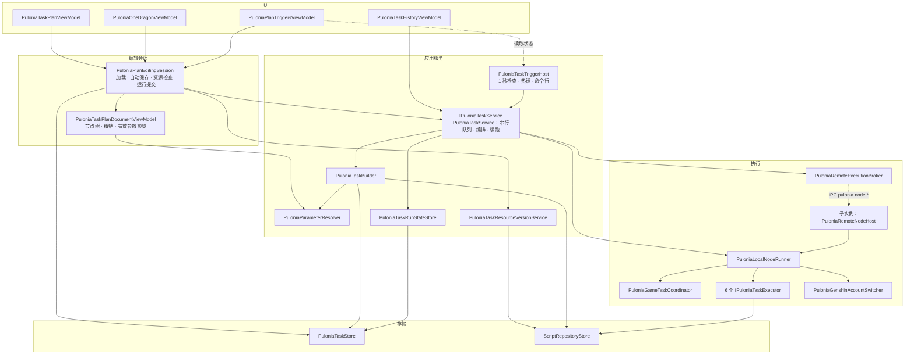

# Pulonia 任务系统架构总览

状态：设计基线，按 2026-10-24 工作区代码核对。进度与验收结论只维护在[路线图](roadmap.md)。

Pulonia 是 BetterGI 新的任务计划系统，命名空间 `BetterGenshinImpact.Pulonia`。普通玩家用“新一条龙”配置日常；高级玩家在“任务计划”里用任务树组合路线、JS、键鼠录制、独立任务、Shell 和 C#；开发者通过 `IPuloniaTaskService` 从代码提交与查询。两个页面共用同一计划模型、存储和执行语义，最终替代配置组、旧一条龙等旧入口。

## 分层

依赖方向自上而下：UI → 编辑会话 → 应用服务 → 执行 → 存储。下层原则上不引用上层，服务层不产出供逻辑判断的界面文案；现存例外列在[已知偏差](#已知偏差)。

| 层 | 主要类型 | 职责 |
| --- | --- | --- |
| UI | `PuloniaTaskPlanViewModel`（任务计划页）、`PuloniaOneDragonViewModel`（新一条龙页）、`PuloniaPlanTriggersViewModel`（两页共用的触发设置）、`PuloniaTaskHistoryViewModel`（执行记录）、`PuloniaTaskNodeAdvancedSettingsViewModel`；视图层窗口工厂 `PuloniaTaskSettingsDialogs`（实现 `IPuloniaTaskSettingsDialogs`） | 选择、菜单、弹窗输入和展示。页面 VM 不直接读写文件 |
| 编辑会话 | `PuloniaPlanEditingSession`（DI 单例）、`PuloniaTaskPlanDocumentViewModel`（一份计划）、`PuloniaTaskNodeViewModel` | 两个页面共用的文档集合、首次加载、自动保存、计划增删与导入、资源检查和运行提交；文档负责节点树、30 步撤销和有效参数预览 |
| 应用服务 | `IPuloniaTaskService` / `PuloniaTaskService`、`PuloniaTaskTriggerHost`、`PuloniaTaskBuilder`、`PuloniaParameterResolver`、`PuloniaTaskRunStateStore`、`PuloniaTaskCreationService`、`PuloniaTaskResourceVersionService`、`PuloniaTaskLegacyImporter` | 提交与串行队列、快照准备、唯一的有效参数解析、state.json 唯一写入、触发调度、新增任务构建、资源版本检查、旧数据导入 |
| 执行 | `PuloniaLocalNodeRunner`、`IPuloniaTaskExecutor` 的 6 个实现、`PuloniaGameTaskCoordinator` / `PuloniaGameTaskLease`、`PuloniaGenshinAccountSwitcher`、`PuloniaRemoteExecutionBroker` / `PuloniaRemoteNodeHost` | 每次节点尝试取游戏租约、核验 UID、调用执行器；账号切换；向子实例派发节点 |
| 存储 | `PuloniaTaskStore`、`ScriptRepositoryStore` | `User/Pulonia` 下的计划、设置方案、账号、状态、历史；脚本仓库注册、保留归档和 JS 工作目录 |

六个执行器及任务类型：`PuloniaPathingTaskExecutor`（`pathing`）、`PuloniaJavaScriptTaskExecutor`（`javascript`）、`PuloniaKeyMouseTaskExecutor`（`keymouse`）、`PuloniaSoloTaskExecutor`（`solo.<TaskId>`，独立任务）、`PuloniaShellTaskExecutor`（`shell`）、`PuloniaCSharpTaskExecutor`（`csharp`，目前只有 `sample.sum` 样例，去留待定 R2）。`group` 由服务编排，不对应执行器。

## 核心对象

| 对象 | 类型 | 说明 | 保存位置 |
| --- | --- | --- | --- |
| 计划 | `PuloniaTaskPlan` | 一棵任务树（`RootTask`）加触发器和账号绑定；`Purpose` 区分普通计划与一条龙 | `plans/<planId>.json` |
| 节点 | `PuloniaTask` | 分组或叶子任务；嵌套 `Source`（计划/目录引用）、`Policy`（超时与重试）；`Settings`（共享设置，向下传播）与 `ProfileId`（所挂方案）、`Parameters`（任务参数，只属于本任务） | 计划内 |
| 设置方案 | `PuloniaSettingsProfile` | 命名的共享设置集合，可挂在任意计划的任意节点上复用；设置项由代码中的 `PuloniaSettingCatalog` 定义 | `profiles/<profileId>.json` |
| 触发器 | `PuloniaTaskTrigger` | 定时或热键，嵌入计划 | 计划内 |
| 账号资料 | `PuloniaGenshinAccountProfile` | 游戏账号身份、UID 与登录方式；`default` 表示当前登录账号 | `accounts.json` |
| 请求 | `PuloniaTaskRequest` | 一次提交：计划、范围、账号、触发信息、执行实例 | 运行记录内 |
| 快照 | `PuloniaTaskSnapshot`（含 `PuloniaTaskPreparedTask` 树） | 提交时固定的展开树、有效参数、策略、资源版本和计划原文 | 运行记录内 |
| 运行记录 | `PuloniaTaskRunRecord` | 一次运行的状态、节点结果、确认事实；界面通过只读包装 `PuloniaTaskRunView` 读取 | state.json 或 `history/` |
| 节点结果 | `PuloniaTaskNodeResult` | 某个节点地址的一次尝试 | 运行记录内 |
| 运行状态 | `PuloniaTaskState` | 排队请求、唯一活动运行、待归档运行、账本、定时触发游标 | `state.json` |
| 账本条目 | `PuloniaTaskLedgerEntry` | 文件级路线 CD 的最新成功事实，每个（作用域，文件）一条，可由用户清除 | state.json 内 |

字段与配置解析规则见[模型与配置](model.md)。

## 主流程

页面、定时、热键、命令行 `--pulonia-run` 或 C# 调用都经 `IPuloniaTaskService.EnqueueAsync` 提交请求。服务读取已保存的计划，由 `PuloniaTaskBuilder` 展开分组轮次、计划引用和目录引用，用 `PuloniaParameterResolver` 解析每个叶子的有效参数，固定资源指纹，生成不可变快照；请求与快照经 `PuloniaTaskRunStateStore` 写入 state.json 后才进入唯一的串行队列，主实例与子实例上的运行共用这一队列。出队时复核触发配置和截止时间，按需切换账号并核验 UID，然后深度优先执行快照树：每个叶子先判定文件级路线 CD，再由 `PuloniaLocalNodeRunner` 取游戏租约、核验 UID、调用执行器（指定子实例时经 `pulonia.node.*` 派发），节点结果与路线 CD 记录在同一次状态替换中落盘。提交前可用 `PreviewAsync` 按同一份快照规则预测哪些节点会因 CD 跳过。全部节点结束后由 `ResolveFinalStatus` 判定最终状态，运行先进入 `pending_archives`，写入不可变历史后移出。

## 关键约束

1. **一份 `PuloniaTaskPlan`，两种界面。** 一条龙配置是 `Purpose=OneDragon` 的计划，界面沿用旧 `OneDragonFlowPage` 左右布局；执行器没有用途分支。
2. **快照不可变。** 运行只读提交时固定的快照，编辑、设置方案或资源变化不影响已排队和正在运行的请求；续跑沿用原快照。
3. **串行、只派发不并行。** 所有执行实例共用一个队列和唯一 `active_run`；子实例只执行叶子节点和账号准备，快照、CD、结果和历史都在主实例落盘。
4. **state.json 单写者。** 只有主实例的 `PuloniaTaskRunStateStore` 写入；配置类文件（计划、设置方案、账号、偏好、仓库注册）只需原子替换加后写者胜。
5. **唯一参数解析。** 运行准备与界面预览共用 `PuloniaParameterResolver`，规则只写在[模型与配置](model.md#有效参数解析规则)。
6. **唯一 CD 规则。** 文件级路线 CD 是当前唯一的执行前资源限制，状态只由 `PuloniaCollectionCooldown.GetStatus` 判定；通用额度框架已于 2026-10-24 删除。
7. **不引入 Quartz、SQLite、ORM 或工作流框架。** 调度用 .NET 定时循环，存储用 JSON 文件。

## 文档地图

| 文档 | 内容 |
| --- | --- |
| [用户故事与边界](requirements.md) | 12 条故事、范围约束、边界分级、复杂规则来源追踪 |
| [模型与配置](model.md) | 计划、节点、共享设置与设置方案、触发器、账号绑定的字段；任务树语义；唯一的有效参数解析规则 |
| [执行、恢复与 API](execution.md) | 串行队列、节点执行顺序、游戏租约、跨实例派发、取消、最终状态、续跑、C# 接口 |
| [触发与热键](scheduling.md) | 定时、补触发、忙碌策略、热键、命令行入口 |
| [多账号](accounts.md) | 默认账号、切号与 UID 核验、凭据与图片、路线 CD 作用域 |
| [结果、CD 与存储](results-and-storage.md) | 完成合同、文件级路线 CD（规则、状态、清除、运行预览）、账本、state.json、历史与文件布局 |
| [脚本仓库与任务资源](repository-resources.md) | 仓库注册、同步与更新任务资源、保留归档、锁、资源指纹 |
| [标识与磁盘路径](identifiers-and-paths.md) | 短 ID 规则、资源目录布局、路径长度预算 |
| [界面](user-interface.md) | 任务计划页、新一条龙页、触发设置、新增任务与目录添加 |
| [重构与迁移](migration.md) | 旧代码解耦、旧配置导入 |
| [调研依据](research.md) | 社区 issues、JS 脚本、本体与 d-v3 代码依据 |
| [路线图](roadmap.md) | 步骤状态、验收规则、待决定事项、2026-10-24 改造摘要 |

后续能力（提案，未实现）：[体力计划](proposals/resin-plan.md)、[目标托管](proposals/managed-hosting.md)。已实现的专题设计：[共享设置与设置方案](proposals/shared-settings.md)（独立任务绑定未做）、[路线 CD：识别、可见性与简化](proposals/cooldown-visibility.md)（一条龙清单不改）。过程记录与被替换的旧文原文见[归档](archive/README.md)。

## 已知偏差

以下与上述分层不一致，代码中仍存在，尚未排期：

- `PuloniaOneDragonViewModel.ImportLegacyAsync` 仍读取全局 `ConfigService.Config`。
- `PuloniaTaskPlanViewModel.EditNodeConfiguration` 直接创建 `PuloniaTaskNodeSettingsDialog`。
- `PuloniaGameTaskCoordinator` 与 `TaskRunner` 的会话代码仍各有一份，合并为 `GameTaskLease` 见 [task-contract.md](../task-contract.md) 步骤 D。
- 服务与执行层的宿主依赖：`PuloniaTaskTriggerHost` 用 WPF `Dispatcher` 在 UI 线程注册热键，`PuloniaTaskHotkeyValidator` 引用 `System.Windows.Input`；`PuloniaGameTaskCoordinator` 引用 `BetterGenshinImpact.View`（任务模式的遮罩）；`PuloniaPathingTaskExecutor` 读取 `MapPathingViewModel.PathJsonPath` 作为路线逻辑路径的根。

## 维护方式

新增需求先更新[用户故事](requirements.md)并在“复杂规则 → 用户故事”表登记来源，再修改所属专题；涉及步骤范围变化时同步[路线图](roadmap.md)。基线文档只写当前事实与规则，过程记录放进 `archive/`，未实现的设计放进 `proposals/`。调研依据的代码版本见[调研依据](research.md)。
