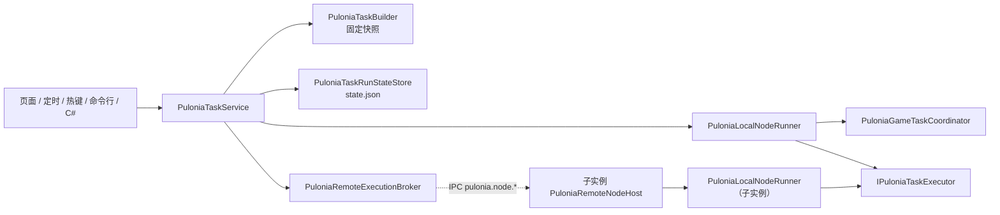

# Pulonia：执行、恢复与 API

[返回总览](README.md) · [用户故事](requirements.md) · [路线图](roadmap.md)

说明一次运行如何排队、执行、取消、判定结果和续跑，以及如何从 C# 接入。路线 CD 和落盘语义见[结果、CD 与存储](results-and-storage.md)。2026-10-24 按当前代码核对。

## 执行结构与资源生命周期



| 部分 | 职责 |
| --- | --- |
| `PuloniaTaskService` | 统一入口（实现 `IPuloniaTaskService`）、唯一串行队列、准入复核、账号准备、快照树编排、路线 CD 判定与清除、运行预览、重试、最终状态、归档、续跑、触发调度。由 `.Accounts`、`.CollectionCooldown`、`.Remote`、`.RunState`、`.Scheduling` 等 partial 组成；`RunState` 是其内部的可变运行状态 |
| `PuloniaTaskRunStateStore` | state.json 的内存副本与唯一写入入口，写入失败时熔断，见[存储](results-and-storage.md#statejson) |
| `PuloniaLocalNodeRunner` | 本进程执行一次节点尝试或一次账号准备；主实例与子实例各持一个实例，代码相同 |
| `PuloniaGameTaskCoordinator` | 发放游戏任务租约 `PuloniaGameTaskLease` |
| `IPuloniaTaskExecutor` | 6 个具体执行器，按 `Definitions` 声明的任务类型注册，类型重复注册时启动报错 |
| `PuloniaTaskTriggerHost` | 后台托管服务：每秒调用调度检查、注册热键、处理命令行 `--pulonia-run`，见[触发与热键](scheduling.md) |

能力是否需要游戏由 `PuloniaTaskDefinition.RequiresGameSession` 声明：路线、JS、键鼠和独立任务需要，Shell 与 C# 不需要。不需要游戏的节点不取租约，也不启动截图器。

### 游戏任务租约

`PuloniaGameTaskCoordinator.AcquireAsync` 的顺序：

1. 当前已在任务会话中（`GameTaskSessionScope.IsActive`）时直接报错“当前已在任务会话中，不能再次获取游戏任务租约”，嵌套获取不会死锁。
2. 等待全局任务锁 `TaskControl.TaskSemaphore`，与独立任务、旧配置组互斥。
3. `GameRuntimeService.StartAsync` 按需准备运行环境；环境为空或正在停止时报错。
4. 等待订阅脚本自动更新结束，最长 10 分钟，超时报错且本节点不执行。
5. 进入任务模式（触发器调度、遮罩、窗口激活）并返回租约。

释放租约时释放 `InputHub` 全部按键、清理遮罩并归还任务锁，游戏会话保留供下一个节点复用。任一步失败都会先清理再归还锁。`PuloniaGameTaskCoordinator` 与 `TaskRunner` 仍各有一份会话代码，合并为统一的 `GameTaskLease` 见 [task-contract.md](../task-contract.md) 步骤 D，尚未实施。

## 队列与执行顺序

所有执行实例共用一个串行队列，一次只执行一个运行。消费循环由 `SemaphoreSlim` 信号唤醒，每次挑选“停止当前”策略触发的请求优先，其余按提交时间先后。

一次运行的顺序：

1. **准入复核**（仅触发器请求）：重新读取计划，触发器已删除、停用或配置版本变化时记为“已取消”；超过截止时间记为“已过期”；读不出计划记为“待处理”。
2. **账号准备**（一条龙计划且含启用的游戏节点）：默认账号不切号，只读取并记录当前登录 UID；指定账号切号后核验 UID。核验结果与“切换账号”节点结果一起落盘后才执行业务节点；失败则整次运行进入待处理，见[多账号](accounts.md)。普通计划没有账号准备，也不核验 UID。
3. **深度优先遍历快照树**，对每个叶子：
   1. 禁用、或续跑时已确认完成的节点记为跳过；
   2. 地图追踪节点判定文件级路线 CD，仍在 CD 内或一次性已完成则跳过（原因码 `pathing.cooldown_active` / `pathing.cooldown_completed`，并更新当前节点消息）并继续后续节点；
   3. 每次尝试：需要游戏时由 `PuloniaLocalNodeRunner` 取游戏租约，核验本次运行的 UID，再调用执行器；指定子实例时改为派发；
   4. 节点结果（地图追踪成功时连同路线 CD 记录）在同一次 state.json 替换中落盘，之后触发 `LedgerChanged`；
   5. 失败按 `max_retries` 和 `retry_delay_seconds` 重试，耗尽后按 `failure_behavior` 编排。
4. **最终状态**：执行器全部退出后由 `ResolveFinalStatus` 一次判定。
5. **归档**：运行先进入 `pending_archives`，写入不可变历史后移出。

取租约在每次尝试内完成，不跨重试持有：运行环境停止后，下一次尝试会重新准备。取租约失败按普通节点失败进入重试。CD 判定在取租约之前，CD 内的节点不会占用游戏。做过账号准备的运行，每个需要游戏的节点尝试在取得输入后都会再次核验 UID（是否改为只在准备和恢复后核验待定 D7）；核验失败抛 `PuloniaGenshinAccountException`，不进入节点重试，整次运行转为待处理。

当前执行节点的地址只在内存中更新，不为它单独写盘；续跑和中断恢复只依赖快照与已落盘的节点结果。

### 运行状态与最终判定

运行状态 `PuloniaTaskRunStatus`：Queued、Running、Cancelling、Succeeded、Failed、Cancelled、TimedOut、Interrupted、NeedsAttention、Expired。节点状态 `PuloniaTaskNodeStatus`：Skipped、Succeeded、Failed、Cancelled、TimedOut、NeedsAttention。执行器返回的完成程度 `PuloniaTaskOutcomeKind`：Succeeded、ExecutedUnverified、PartiallySucceeded、Failed、Cancelled、Skipped、NeedsAttention（两套节点枚举的合并待定）。

`ResolveFinalStatus` 的判定顺序：

1. 运行令牌已取消且流程以取消结束：总时限到期且没有显式停止时为 TimedOut，否则为 Cancelled。
2. 账号准备或核验失败：NeedsAttention。
3. 其他异常：关键状态写入已熔断时为 NeedsAttention，否则为 Failed（执行基础设施失败）。
4. 计划走完：有节点在重试耗尽后失败时为 Failed，否则为 Succeeded。

判定只看执行结果和异常，不比较进度文字。

## 跨实例派发

新一条龙可以选择子实例（桌面分身或云原神网页版实例）作为执行实例，请求的 `ExecutionTarget` 记录目标。规则：

- **只派发、不并行。** 子实例上的运行与主实例本地运行一样占用唯一的 `active_run`；快照、CD 判定、节点结果和历史都在主实例完成和落盘。
- 主实例通过 `PuloniaRemoteExecutionBroker` 发送 `pulonia.node.start`（叶子节点或账号准备），子实例的 `PuloniaRemoteNodeHost` 确认后在后台用自己的 `PuloniaLocalNodeRunner` 执行，结束时发送一次 `pulonia.node.finished`，**不重试**。主实例取消节点时发送 `pulonia.node.cancel`，并最多等待 60 秒确认执行器退出。
- 结果类型 `PuloniaRemoteNodeResultKind`：Completed、AccountFailed、Failed、Cancelled、CancelledByTarget。`Cancelled` 表示子实例按主实例的取消请求或断开而退出，此时主实例节点已在走取消流程；`CancelledByTarget` 表示子实例本地停止（停止热键、截图器停止、应用关闭），主实例据此**停止整次运行**，不重试该节点。
- 子实例断开时，主实例让该实例上等待中的节点以“结果未知”失败；子实例与主实例断开时取消正在执行的节点。
- 主实例的停止热键只作用于本地运行；子实例上的运行用页面停止，或在子实例本地停止。
- 派发负载上限约 900 KB（低于实例通信 1 MiB 的单帧限制），快照过大时拒绝派发并提示拆分计划。
- 触发器请求不能指定执行实例。
- `pulonia.node.report`、执行通道和 `remote_active_runs` 已删除；版本 3 的 state.json 中遗留的 `remote_active_runs` 在读取时转为“已中断”的待归档运行，可续跑。

协议细节见[多实例命名管道协议](../multi-instance-ipc.md)。子实例是否会写 `User/Pulonia`（影响 Store 跨进程写锁能否删除）待定 D15。

## 取消、时限与线程

- 每次运行有独立的 `CancellationTokenSource`，与总时限、应用关闭关联；节点超时另建关联令牌。本地运行开始时向 `TaskStopService` 注册取消回调，结束时注销。
- 取消请求不等于停止完成：状态先变为 Cancelling，等执行器退出、释放按键与资源后才判定 Cancelled 并放行下一项。
- 请求的 `TimeoutSeconds` 为 null（默认）时不建立总时限；页面和触发器不提供总时限输入。请求的 `DeadlineUtc` 只控制能否开始，与运行总时限分开。
- “停止当前”忙碌策略只对触发器请求生效：入队写盘成功后调用 `TaskStopService.StopAll`，会停止所有已注册的本地运行，而不只是同一计划（限定范围或删除该策略待定 D8）。
- Shell 异步读取输出并记录退出码；超时或取消时结束本次拥有的进程树并确认退出。
- WPF 窗口、钩子和依赖消息循环的对象在 UI 线程建立与释放；执行、扫描、索引在后台，服务层不依赖 `Dispatcher`。

## 异常恢复

路线图步骤 8（有界恢复）暂缓，以下是设计方向，**尚未实现**。当前实现中，账号准备与核验失败、关键状态写入失败会进入待处理；其余异常按节点失败处理。

| 场景 | 建议行为 |
| --- | --- |
| 加载中、短暂网络波动 | 在超时预算内等待目标状态，有限次重试，避免连续点击 |
| 已知日切月卡、已知奖励弹窗 | 由专用处理器处理，确认界面稳定后继续 |
| 进入已知剧情/菜单 | 按明确识别结果退出；任务重新准备起始状态 |
| 被顶号、需要验证码、UID 不符 | 停止该账号自动执行，进入待处理，不无限重登抢号 |
| 游戏退出、截图失效 | 按配置重建会话，重新核验 UID 和游戏状态 |
| 背包空间不足、任务所需资源不足 | 返回明确原因并退出该能力，不自动销毁物品 |
| 版本更新或未知界面 | 保存诊断截图及步骤；有限恢复仍未知则待处理 |

恢复动作不能与业务动作同时发送输入；任务内部重试与公共恢复共享总时长和总次数预算。游戏输入后必须等待响应再识别，不能用旧帧判断成功。不承诺“未知界面都能自动恢复”，只在明确预算内尝试并给出可续跑的位置。

## 续跑

`ResumeAsync(runId, startTaskAddress?, allowUncertainReplay)` 沿用历史运行的原快照建立新运行，新运行的 `resumed_from_run_id` 指向原运行：

- **继续上次**：跳过原运行中已确认成功（节点 Succeeded 且完成程度 Succeeded）的节点地址，执行其余节点；“已执行、未核验”的节点不算完成。
- **从此节点开始**：显式起点之前的节点视为已完成，起点及之后的节点重新执行（已确认成功的也可能重复，界面会要求确认）。
- 原运行处于待处理，或任一节点最后一次结果不确定（NeedsAttention 或 ExecutedUnverified）时，必须传 `allowUncertainReplay=true`；界面在用户确认后才传。
- 续跑前复核快照中的资源：仓库资源从原已确认版本的保留归档重新计算指纹，本地资源重新计算文件或 JS 指纹；不一致或已不可用时拒绝续跑，提示按新版本重新运行。
- 账号续跑仍核验历史中的实际 UID，使用账号的当前凭据。

只支持节点级续跑，不要求任意 JS、Shell 或 C# 从某一行恢复。

## C# 接口

进程内接口，DI 中只注册 `IPuloniaTaskService` 一份。外部进程客户端（命名管道或 HTTP）不在当前范围。

```csharp
namespace BetterGenshinImpact.Pulonia.Services;

public interface IPuloniaTaskService
{
    IReadOnlyList<PuloniaTaskDefinition> Definitions { get; }
    string? RecoveryNotice { get; }                       // 启动恢复提示：备份回退、中断运行、跳过的坏历史等
    event EventHandler<PuloniaTaskRunChangedEventArgs>? RunChanged;

    Task<string> EnqueueAsync(PuloniaTaskRequest request, CancellationToken ct = default);   // 返回运行 ID
    Task<PuloniaTaskRunView> GetRunAsync(string runId, CancellationToken ct = default);
    Task<IReadOnlyList<PuloniaTaskRunView>> ListRunsAsync(CancellationToken ct = default);
    Task<PuloniaTaskRunView> WaitForCompletionAsync(string runId, CancellationToken ct = default);
    Task CancelAsync(string runId, CancellationToken ct = default);
    Task<string> ResumeAsync(string runId, string? startTaskAddress = null,
        bool allowUncertainReplay = false, CancellationToken ct = default);
    Task<IReadOnlyList<PuloniaTaskLedgerEntry>> ListLedgerAsync(CancellationToken ct = default);
    event EventHandler? LedgerChanged;
    Task<PuloniaTaskRunPreview> PreviewAsync(PuloniaTaskRequest request, CancellationToken ct = default);
    Task<int> ClearCollectionCooldownAsync(IReadOnlyCollection<PuloniaCollectionCooldownKey> keys,
        CancellationToken ct = default);

    Task CheckTriggersAsync(IReadOnlyList<PuloniaTaskPlan> plans,
        IReadOnlyCollection<string>? unreadablePlanIds = null, CancellationToken ct = default);
    Task FireHotkeyAsync(string planId, string triggerId, CancellationToken ct = default);
    IReadOnlyList<PuloniaTaskTriggerStatus> GetTriggerStatuses();
}
```

```csharp
namespace BetterGenshinImpact.Pulonia.Executors;

public interface IPuloniaTaskExecutor
{
    IReadOnlyList<PuloniaTaskDefinition> Definitions { get; }

    Task<PuloniaTaskOutcome> ExecuteAsync(PuloniaTaskPreparedTask task,
        PuloniaTaskExecutionContext context, CancellationToken ct);
}
```

调用示意：

```csharp
// 返回运行 ID（run_yyyyMMdd-HHmmss-xxxx）；排队时不要求游戏或截图器已启动。
var runId = await puloniaTasks.EnqueueAsync(new PuloniaTaskRequest { PlanId = planId }, ct);
var view = await puloniaTasks.WaitForCompletionAsync(runId, ct);
```

- 请求 ID 与运行 ID 合一。调用方的 `ct` 只控制提交或等待本身，不取消已提交的运行；取消必须调用 `CancelAsync`。
- 入队时服务覆盖服务端字段：`ServerUtcOffsetMinutes` 由 `PuloniaServerTime` 统一填写（未初始化按 UTC+8），续跑沿用原请求。一条龙计划的账号必须与配置绑定一致。
- `PuloniaTaskExecutionContext` 向执行器提供 `RunId`、`Snapshot`、`Attempt`、`TaskAddress` 和本次租约的 `Runtime`；执行器用 `TryGetRuntime` 取运行环境，为空或已停止时节点失败。
- 结果只通过返回的 `PuloniaTaskOutcome` 表达（`Kind`、`Message`、`Data`、`Evidence`、`ReasonCode`）。通用完成事件报告已随额度框架删除。
- C# 能力由编译后 DI 注册的执行器或 `PuloniaCSharpTaskRegistry` 中的显式委托提供，不做程序集扫描或反射猜测方法；导入旧 `MethodPath` 时报告不支持。
- 尚未实现的方向：同一运行内的子调用入口（继承取消、输入所有权和记账，不再入全局队列），以及 JS 桥接的结构化结果。
