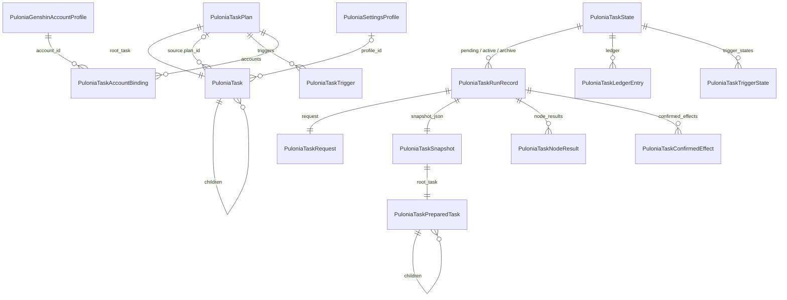

# Pulonia：模型与配置

[返回总览](README.md) · [用户故事](requirements.md) · [路线图](roadmap.md)

本文是计划、节点、共享设置与设置方案、运行准备的模型基线，也是**有效参数解析规则唯一的维护位置**，其他文档只链接到[有效参数解析规则](#有效参数解析规则)。2026-10-24 由原 `task-model.md` 改写，按当前代码核对；原文与步骤 1 的类型清单见[归档](archive/task-model.md)。

## 配置模型

所有 Pulonia 文件都由 `PuloniaTaskJson` 用 Newtonsoft.Json 读写：属性名 snake_case，UTF-8 无 BOM，拒绝重复键、未知属性（`MissingMemberHandling.Error`）和超过 256 层的 JSON。开发期不兼容旧格式：删除字段后，带该字段的旧文件读取失败，需要删除或手工修正。

### 计划 `PuloniaTaskPlan`

| 字段 | 说明 |
| --- | --- |
| `id` | `pln_` 加 16 位短 ID，同时是文件名 `plans/<id>.json` |
| `schema_version` | 计划格式版本，当前为 3（2026-10-27 引入共享设置）；其他版本拒绝读取，schema 2 的计划不做转换 |
| `revision` | 保存修订号，新建为 0；保存旧修订会报冲突 |
| `name`、`description` | 展示用，重命名不影响引用和历史 |
| `purpose` | `PuloniaTaskPlanPurpose`：General=0（任务计划页）、OneDragon=1（新一条龙页）；只决定界面归属，执行器没有用途分支 |
| `root_task` | 根节点，固定为 `group`；界面不显示根节点，直接展示其子项 |
| `triggers` | `List<PuloniaTaskTrigger>`，见[触发与热键](scheduling.md) |
| `accounts` | `List<PuloniaTaskAccountBinding>`；一条龙只允许一个启用的绑定（单值化待定 D5），见[多账号](accounts.md) |

计划列表顺序保存在 `plan-order.json`，节点折叠状态保存在 `plan-view-state.json`（`schema_version` 1，`collapsed_task_ids` 为“计划 ID → 已折叠节点 ID 列表”）。两者都是编辑器元数据，不进入计划修订、快照和历史；`plan-view-state.json` 不存在时全部展开。

### 节点 `PuloniaTask`

| 字段 | 说明 |
| --- | --- |
| `id` | `tsk_` 加 16 位；目录展开生成的节点为 `res_` 加由小写相对路径派生的 16 位 |
| `name` | 展示名称 |
| `task_type` | `group` 或能力类型，见[任务树语义](#任务树语义) |
| `is_enabled` | 本节点开关；有效启用是祖先与本节点开关的逻辑与 |
| `path` | 本地资源路径（未接入仓库的旧资源） |
| `resource` | 仓库资源引用 `{repository_id, relative_path, approved_revision}`，见[脚本仓库与任务资源](repository-resources.md)；与 `path` 二选一 |
| `resource_version` | 确认时的资源指纹；运行准备重新计算，不一致时拒绝运行 |
| `parameters` | 叶子的任务参数（JSON 对象），只属于本任务、不向下传播；分组保持空对象。不能写共享设置绑定的参数 |
| `settings` | 共享设置覆盖：设置项 ID → 值的稀疏对象，任意节点可写，向下传播；空对象表示全部继承 |
| `profile_id` | 所挂的设置方案；在设置链中先于本节点的 `settings` 生效 |
| `policy` | `{timeout_seconds, failure_behavior, max_retries, retry_delay_seconds}`，按字段继承 |
| `source` | 只配置在分组上：计划引用 `{kind: "plan", plan_id}`，或目录引用 `{kind: "directory", path 或 resource, task_type, recursive, version}` |
| `repeat_count` | 非根分组的执行次数 1—10000，缺省为 1 |
| `children` | 子节点；引用分组不保存可编辑子项 |

### 设置目录、设置方案与能力说明

**设置目录** `PuloniaSettingCatalog` 在代码中定义全部共享设置项，不持久化。设置项 ID 为 `<类别>.<名称>`，例如 `party.party_name`、`fight.strategy_name`；每项有显示名、值 Schema、默认值、编辑方式和可选的显示条件。类别：`party`、`fight`、`fight_end`、`fight_vision`、`pickup`、`travel`、`hurry`、`eat`、`collection`、`keymouse`、`shell`。设置项的值是原子单位，对象值（如路线 CD）整体替换。设计与界面见[共享设置与设置方案](proposals/shared-settings.md)。

**设置方案** `PuloniaSettingsProfile`（`prf_` 加 16 位，`profiles/<id>.json`）保存 `id`、`name`、`description`、`revision` 和稀疏的 `settings`。方案只复用设置，不包含结构、顺序或引用，可挂在任意计划的任意节点上；仍被已保存计划引用的方案不能删除。

`PuloniaTaskDefinition` 是执行器在代码中注册的能力说明，不持久化：`TaskType`、可选 `ResourceId`、`SchemaVersion`、`DefaultParameters`、`ParameterSchema`、`SettingBindings`（设置项 ID → 参数路径）、`RequiresGameSession`、`ResourceBaseDirectory`，以及菜单元数据 `DisplayName`、`Description`、`Group`、`Order`、`OneDragonOrder`、`IsSoloTask`。绑定的参数路径上的默认值必须等于设置项默认值，由 `PuloniaTaskValidator.ValidateSettingBindings` 检查。当前绑定：地图追踪为宿主类别加路线 CD，JS 为宿主类别（队伍、战斗、战斗结束、战斗识别、拾取、行走、赶路、吃药），Shell 为 `shell`，录制回放为 `keymouse`；独立任务暂无绑定。

`PuloniaTaskAccountBinding` 保存 `account_id` 和 `enabled`。原先的按账号替换预设 `preset_selections` 已随共享设置删除，是否按账号区分设置随 D5 决定。

## 任务树语义

| 类型 | 执行方式 |
| --- | --- |
| `group` | 由 `PuloniaTaskService` 按 `children` 顺序深度优先执行；`repeat_count` 大于 1 时完整重复全部子项；设置 `source` 时子项由引用提供 |
| `pathing` | 地图追踪路线，`PuloniaPathingTaskExecutor`；唯一接入文件级路线 CD 的类型 |
| `javascript` | JS 项目，`PuloniaJavaScriptTaskExecutor` |
| `keymouse` | 键鼠录制回放，`PuloniaKeyMouseTaskExecutor` |
| `solo.<TaskId>` | 独立任务（秘境、首领、地脉花等），`PuloniaSoloTaskExecutor`，例如 `solo.auto_domain` |
| `shell` | 子进程命令，`PuloniaShellTaskExecutor` |
| `csharp` | 显式注册的进程内委托，`PuloniaCSharpTaskExecutor`；当前只有 `sample.sum` 样例 |
| `legacy.unsupported` | 旧数据导入时无法映射的节点，保留为禁用 |

计划引用和目录引用都是带 `source` 的分组，固定次数是分组的 `repeat_count`，三者都不是任务类型。

格式示意（省略空字段，ID 已缩写）：

```json
{
  "id": "pln_7k2m9q4x8c1v5b3n",
  "schema_version": 3,
  "revision": 3,
  "name": "每日计划",
  "purpose": 0,
  "root_task": {
    "id": "tsk_…",
    "name": "每日计划",
    "task_type": "group",
    "is_enabled": true,
    "parameters": {},
    "settings": { "party.party_name": "采集队" },
    "profile_id": "prf_…",
    "children": [
      {
        "id": "tsk_…",
        "name": "风车菊-01",
        "task_type": "pathing",
        "resource": {
          "repository_id": "official",
          "relative_path": "pathing/地方特产/蒙德/风车菊/风车菊-01.json",
          "approved_revision": "<40 位 Git 提交>"
        },
        "resource_version": "<资源指纹>",
        "is_enabled": true,
        "parameters": {},
        "settings": { "collection.cooldown": { "mode": "disabled" } },
        "children": []
      }
    ]
  },
  "triggers": [],
  "accounts": []
}
```

### 地址、开关与失败行为

- **节点地址**：准备树中每个节点的地址由计划 ID 和节点 ID 逐级拼接；分组多轮执行时追加 `/#<轮次>`，进入计划引用时追加 `/@<被引用计划 ID>`。节点结果、续跑起点和路线 CD 事件键都使用地址，不使用名称或数组下标。
- **开关**：父级关闭时整棵子树跳过，但不改写子节点自己的开关；重新开启后保留原选择。“启用全部子任务”是独立命令。
- **失败行为**：`failure_behavior` 为 `stop_plan`（缺省）、`skip_group` 或 `continue`；`max_retries` 次重试耗尽后才按它编排。分组多轮执行不是重试，每一轮都重新判定路线 CD。
- **限制**：最大深度 64、最多 10000 个准备节点；禁止计划自引用和间接循环；目录展开超过上限时整体拒绝。

## 有效参数解析规则

这是唯一的配置解析规则。运行准备（`PuloniaTaskBuilder`）和界面预览（`PuloniaTaskPlanDocumentViewModel`）都调用 `PuloniaParameterResolver.Resolve`，没有第二套实现。

### 层级

由低到高依次应用，后应用的覆盖先应用的：

1. **能力默认值**：`PuloniaTaskDefinition.DefaultParameters`。
2. **共享设置**：沿[设置链](#设置链)解析出每个设置项的有效值，再按能力的 `SettingBindings` 写入参数路径。能力没有绑定的设置项对它不生效。
3. **任务参数**：节点自身的 `parameters`。
4. **本次调用覆盖**：`PuloniaTaskRequest.ParameterOverrides`，以节点地址为键；指向不存在或未启用叶子的覆盖会被拒绝。

第 3、4 层不能写共享设置绑定的顶层参数（例如 `party_name`、`auto_fight_config`、`collection_cd`），运行准备报错并提示改用共享设置。叶子自身的 `settings` 中有能力不使用的设置项时同样报错；分组和计划根上的这类设置项只是不生效。

### 设置链

设置链是从计划根到叶子的节点序列。每个节点贡献两层：先是所挂方案的 `settings`，再是节点自身的 `settings`；同一设置项后写的生效，整条链都没有写时取设置目录的默认值。

**计划引用不再是边界。** 引用节点 R 指向计划 P 时，设置链为：外部祖先 → P 的根 → R → P 内部节点 → 叶子。外部设置继续传入，P 自己的设置优先于外部，R 上的设置又优先于 P 的根。目录引用是普通分组。策略仍以引用为边界：被引用计划的内部树只从引用节点自身的 `policy` 开始继承。

### 合并语义

- **任务参数顶层字段整体替换。** 第 3、4 层按字段名覆盖，嵌套对象和数组不做深合并；`resin_usage` 等对象参数整体参与覆盖。
- **共享设置按路径深写入。** 每个设置项只写其绑定路径的末端，例如 `auto_fight_config.FinishDetectConfig.FastCheckEnabled`，因此同一对象参数的不同子项可以来自不同层。设置项自身的值是原子单位，对象值（如路线 CD）整体替换。
- 显式写入的 `null`、`false`、`0` 和空集合都是有效值，与“未填写”不同。
- 每个参数记录最后一次赋值的来源层，快照中保存为来源文本：`default/<类型>`、`settings`、节点地址、`call/<地址>`。每个绑定的设置项另记来源 `setting_sources`：`default`、`node/<地址>` 或 `profile/<方案 ID>@<地址>`。
- 结果按能力 `ParameterSchema` 校验后进入快照。

**执行期不再改写参数。** 独立任务的每周安排（`weekday_overrides`、`weekday_overrides_enabled`）已于 2026-10-26 删除，执行器按快照中的有效参数运行，不按星期覆盖或跳过。按验收规则 5 不做旧格式剔除：仍带这两个字段的节点参数在编辑或准备运行时报“不允许未声明的参数”，需要在高级参数中手工删除；已生成的快照照常执行，这两个字段被忽略。

**旧总开关已删除。** `pathing_enabled`、`auto_fight_enabled`、`shell_config_enabled`、`js_script_use_enabled`、`solo_task_use_fight_enabled` 不再是参数，执行器按开启处理。条件选队改为设置项 `party.source`（`fixed` 或 `condition`）。

**界面编辑对象字段时**，编辑器以该字段当前的有效值为底，只改写用户实际修改的子字段，再把整个对象写成本节点的显式值；只用于输入提示的 Schema 默认值不会被固化。写入后这个字段由节点自身提供，不再跟随上层变化，需要时用撤销或“恢复继承”。这只是界面构造显式值的方式，任务参数的解析本身仍是顶层整体替换。

### 预览与运行的差别

| 情况 | 运行准备 | 界面预览 |
| --- | --- | --- |
| 被引用计划内的任务 | 按完整设置链解析 | 不展开被引用计划；设置页把引用按全部设置项计入 |
| 调用覆盖 | 应用 | 不应用 |
| 设置方案缺失 | 报错并说明缺失的方案，请求不入队 | 跳过该层，树标记和设置页提示 |
| 任务参数或调用覆盖写了共享设置绑定的参数 | 报错 | 不适用 |
| 叶子设置了能力不使用的设置项 | 报错 | 不适用 |

### 执行策略

`Policy` 不经过参数解析器，由 `PuloniaTaskBuilder` 按字段向下继承：`timeout_seconds`、`failure_behavior`、`max_retries`、`retry_delay_seconds` 各自取最近一个显式值，`0` 不视为未填写；缺省时失败行为为 `stop_plan`，重试 0 次、间隔 0 秒，节点不限时。计划总时限是请求的 `TimeoutSeconds`，默认不限时。

### 配置归属

| 配置 | 归属 | 是否参与上述解析 |
| --- | --- | --- |
| 截图后端、窗口、日志等设备配置 | 程序全局配置 | 否 |
| UID、登录方式、凭据 | 账号资料 | 否，作为运行上下文 |
| 队伍、战斗、拾取、行走、吃药、路线 CD、Shell 运行方式 | 共享设置（节点 `settings` 与设置方案） | 是，向下传播 |
| 秘境名、JS 脚本 `settings`、Shell 命令等任务专属值 | 任务参数 `parameters` | 是，只属于本任务 |
| 超时、重试、失败行为 | 节点 `policy` | 按字段继承 |
| 定时、热键、截止窗口、忙碌策略 | 触发器 | 否 |

## 运行准备与快照

`PuloniaTaskBuilder.BuildAsync(plan, options, ct)` 是唯一的准备入口。它先复制计划和选项，再在后台完成：校验所选账号已绑定且启用 → 加载并检查计划引用图 → 递归展开分组轮次、计划引用和目录引用 → 对每个启用叶子解析有效参数并按 Schema 校验 → 计算资源指纹并与 `resource_version` 比对 → 输出 `PuloniaTaskSnapshot`。能力说明的合法性由 `PuloniaTaskValidator.ValidateDefinitions` 和单元测试保证，Builder 不再每次复验。

定向运行（触发器或请求的 `TargetTaskId`）会把目标子树之外的兄弟节点设为禁用后再准备，快照留档的是这份改写后的计划。

| 类型 | 内容 |
| --- | --- |
| `PuloniaTaskSnapshot` | `plan_id`、`revision`、`prepared_at`、`account_id`、`genshin_account_json`（运行账号资料）、`root_task`、`plan_json_by_id`、`profile_json_by_id`（本次用到的设置方案原文）、`preset_json_by_id`（只为旧快照保留，新快照为空） |
| `PuloniaTaskPreparedTask` | `task_address`、`task_id`、`source_task_id`（目录展开时指向原引用分组）、`task_type`、`is_enabled`、`path`（仓库资源为空）、`resource`、`resource_version`、`parameters`、`parameter_sources`、`setting_sources`、`policy`、`collection_cooldown`、`children` |

`PuloniaTaskPreparedTask` 在构造时保存参数与策略的冻结副本，读取时返回新副本，修改编辑模型或取出的值都不会改写快照。方案原文固定在快照中，修改方案不影响已排队和正在运行的请求，续跑沿用原快照。`profile_json_by_id` 和 `setting_sources` 为空时不写出，旧快照往返不变。快照 JSON 的形状不变：`plan_json_by_id`、`profile_json_by_id` 和运行账号仍是嵌套的 JSON 字符串，整个快照又以 `snapshot_json` 字符串存进运行记录，因此计划原文被二次转义。改为内嵌对象需要迁移旧历史，尚未排期。

## 对象关系



`PuloniaTaskConfirmedEffect` 是一次运行确认的采集成功事实，内含完整的账本条目；账本只保留每个（作用域，文件）的最新一条，明细留在运行历史中。

## 校验

`PuloniaTaskValidator` 在保存、读取和准备时检查：

- **ID**：`^[a-z0-9][a-z0-9_-]{0,31}$`，并拒绝 Windows 保留名（`con`、`nul`、`com1` 等）。计划 ID 会拼成文件名，命令行 `--pulonia-run` 也接受任意输入，所以保留这项检查。
- **树**：根为 `group`，节点 ID 在计划内唯一（同一对象挂在多处也会因 ID 重复被拒绝，因此不再单独做对象环检测），引用不成环，深度和数量在上限内。
- **参数 Schema 子集**：`type`、`properties`、`required`、`additionalProperties`、`items`、`enum`、`minimum`；其他关键字拒绝。
- **共享设置**：节点和方案的 `settings` 只能含设置目录中的设置项，值符合设置项的值 Schema；方案名称不能为空。叶子能否使用某个设置项取决于能力绑定，在运行准备时检查。
- **策略**：超时有限且大于 0，重试间隔不小于 0，失败行为只能是三种取值之一。
- **触发器**：ID 不重复，日程可解析，目标节点和账号存在；热键键位只在保存前和注册前检查，见[触发与热键](scheduling.md#热键)。

## 待定

- D5：`accounts` 改为单个 `account_id`，普通计划是否保留账号资料标签。
- 快照嵌套 JSON 字符串迁移为内嵌对象。
- `PuloniaTaskNodeStatus` 与 `PuloniaTaskOutcomeKind` 合并为一个枚举。
- R2：`csharp` 类型与 `sample.sum` 样例的去留。
- 能力参数元数据表单（[task-contract.md](../task-contract.md) 步骤 E）。

托管阶段的拟新增实体（玩家状态快照、培养目标）见[目标托管提案](proposals/managed-hosting.md#托管阶段的拟新增实体)；体力计划是独立任务，不是实体，见[体力计划提案](proposals/resin-plan.md)。
