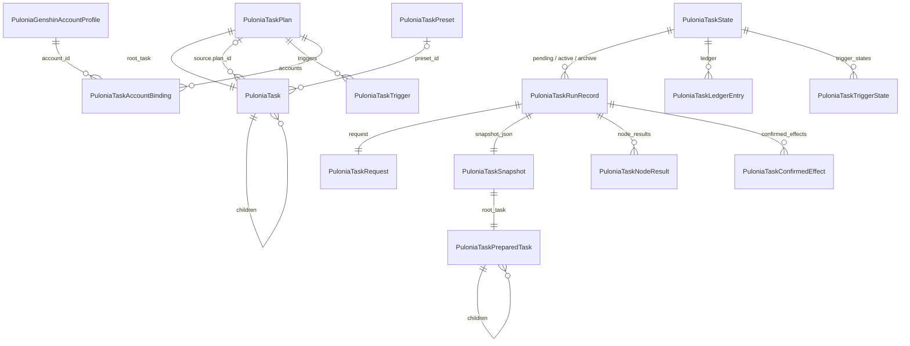

# Pulonia：模型与配置

[返回总览](README.md) · [用户故事](requirements.md) · [路线图](roadmap.md)

本文是计划、节点、预设和运行准备的模型基线，也是**有效参数解析规则唯一的维护位置**，其他文档只链接到[有效参数解析规则](#有效参数解析规则)。2026-10-24 由原 `task-model.md` 改写，按当前代码核对；原文与步骤 1 的类型清单见[归档](archive/task-model.md)。

## 配置模型

所有 Pulonia 文件都由 `PuloniaTaskJson` 用 Newtonsoft.Json 读写：属性名 snake_case，UTF-8 无 BOM，拒绝重复键、未知属性（`MissingMemberHandling.Error`）和超过 256 层的 JSON。开发期不兼容旧格式：删除字段后，带该字段的旧文件读取失败，需要删除或手工修正。

### 计划 `PuloniaTaskPlan`

| 字段 | 说明 |
| --- | --- |
| `id` | `pln_` 加 16 位短 ID，同时是文件名 `plans/<id>.json` |
| `schema_version` | 计划格式版本，当前为 2；未知版本拒绝读取 |
| `revision` | 保存修订号，新建为 0；保存旧修订会报冲突 |
| `name`、`description` | 展示用，重命名不影响引用和历史 |
| `purpose` | `PuloniaTaskPlanPurpose`：General=0（任务计划页）、OneDragon=1（新一条龙页）；只决定界面归属，执行器没有用途分支 |
| `root_task` | 根节点，固定为 `group`；界面不显示根节点，直接展示其子项 |
| `triggers` | `List<PuloniaTaskTrigger>`，见[触发与热键](scheduling.md) |
| `accounts` | `List<PuloniaTaskAccountBinding>`；一条龙只允许一个启用的绑定（单值化待定 D5），见[多账号](accounts.md) |

计划列表顺序保存在 `plan-order.json`，节点折叠状态保存在 `plan-view-state.json`（`schema_version` 1，`collapsed_task_ids` 为“计划 ID → 已折叠节点 ID 列表”）。两者都是编辑器元数据，不进入计划修订、快照和历史；`plan-view-state.json` 不存在时全部展开。

### 节点 `PuloniaTask`

| 字段 | 说明 |
| --- | --- |
| `id` | `tsk_` 加 16 位；目录展开生成的节点为 `res_` 加由小写相对路径派生的 16 位 |
| `name` | 展示名称 |
| `task_type` | `group` 或能力类型，见[任务树语义](#任务树语义) |
| `is_enabled` | 本节点开关；有效启用是祖先与本节点开关的逻辑与 |
| `path` | 本地资源路径（未接入仓库的旧资源） |
| `resource` | 仓库资源引用 `{repository_id, relative_path, approved_revision}`，见[脚本仓库与任务资源](repository-resources.md)；与 `path` 二选一 |
| `resource_version` | 确认时的资源指纹；运行准备重新计算，不一致时拒绝运行 |
| `parameters` | 叶子的显式参数（JSON 对象）；分组保持空对象 |
| `parameter_overrides` | 分组公共参数：`{task_type, resource_id?, schema_version, values}` 列表 |
| `preset_id` | 选用的共享预设 |
| `policy` | `{timeout_seconds, failure_behavior, max_retries, retry_delay_seconds}`，按字段继承 |
| `source` | 只配置在分组上：计划引用 `{kind: "plan", plan_id}`，或目录引用 `{kind: "directory", path 或 resource, task_type, recursive, version}` |
| `repeat_count` | 非根分组的执行次数 1—10000，缺省为 1 |
| `children` | 子节点；引用分组不保存可编辑子项 |

### 预设与能力说明

`PuloniaTaskPreset`（`pre_` 加 16 位，`presets/<id>.json`）保存 `task_type`、可选 `resource_id`、`schema_version` 和 `values`。预设只复用参数，不包含结构、顺序或引用；类型、资源和参数版本都匹配时才生效。界面能选择已有预设，新建入口尚未提供。

`PuloniaTaskDefinition` 是执行器在代码中注册的能力说明，不持久化：`TaskType`、可选 `ResourceId`、`SchemaVersion`、`DefaultParameters`、`ParameterSchema`、`PublicParameters`（允许跨计划引用覆盖的字段）、`RequiresGameSession`、`ResourceBaseDirectory`，以及菜单元数据 `DisplayName`、`Description`、`Group`、`Order`、`OneDragonOrder`、`IsSoloTask`。

`PuloniaTaskAccountBinding` 保存 `account_id`、`enabled` 和 `preset_selections`（节点 ID → 替换预设 ID）。`preset_selections` 目前没有界面入口。

## 任务树语义

| 类型 | 执行方式 |
| --- | --- |
| `group` | 由 `PuloniaTaskService` 按 `children` 顺序深度优先执行；`repeat_count` 大于 1 时完整重复全部子项；设置 `source` 时子项由引用提供 |
| `pathing` | 地图追踪路线，`PuloniaPathingTaskExecutor`；唯一接入文件级采集 CD 的类型 |
| `javascript` | JS 项目，`PuloniaJavaScriptTaskExecutor` |
| `keymouse` | 键鼠录制回放，`PuloniaKeyMouseTaskExecutor` |
| `solo.<TaskId>` | 独立任务（秘境、首领、地脉花等），`PuloniaSoloTaskExecutor`，例如 `solo.auto_domain` |
| `shell` | 子进程命令，`PuloniaShellTaskExecutor` |
| `csharp` | 显式注册的进程内委托，`PuloniaCSharpTaskExecutor`；当前只有 `sample.sum` 样例 |
| `legacy.unsupported` | 旧数据导入时无法映射的节点，保留为禁用 |

计划引用和目录引用都是带 `source` 的分组，固定次数是分组的 `repeat_count`，三者都不是任务类型。

格式示意（省略空字段，ID 已缩写）：

```json
{
  "id": "pln_7k2m9q4x8c1v5b3n",
  "schema_version": 2,
  "revision": 3,
  "name": "每日计划",
  "purpose": 0,
  "root_task": {
    "id": "tsk_…",
    "name": "每日计划",
    "task_type": "group",
    "is_enabled": true,
    "parameters": {},
    "children": [
      {
        "id": "tsk_…",
        "name": "风车菊-01",
        "task_type": "pathing",
        "resource": {
          "repository_id": "official",
          "relative_path": "pathing/地方特产/蒙德/风车菊/风车菊-01.json",
          "approved_revision": "<40 位 Git 提交>"
        },
        "resource_version": "<资源指纹>",
        "is_enabled": true,
        "parameters": { "collection_cd": { "mode": "auto" } },
        "children": []
      }
    ]
  },
  "triggers": [],
  "accounts": []
}
```

### 地址、开关与失败行为

- **节点地址**：准备树中每个节点的地址由计划 ID 和节点 ID 逐级拼接；分组多轮执行时追加 `/#<轮次>`，进入计划引用时追加 `/@<被引用计划 ID>`。节点结果、续跑起点和采集 CD 事件键都使用地址，不使用名称或数组下标。
- **开关**：父级关闭时整棵子树跳过，但不改写子节点自己的开关；重新开启后保留原选择。“启用全部子任务”是独立命令。
- **失败行为**：`failure_behavior` 为 `stop_plan`（缺省）、`skip_group` 或 `continue`；`max_retries` 次重试耗尽后才按它编排。分组多轮执行不是重试，每一轮都重新判定采集 CD。
- **限制**：最大深度 64、最多 10000 个准备节点；禁止计划自引用和间接循环；目录展开超过上限时整体拒绝。

## 有效参数解析规则

这是唯一的配置解析规则。运行准备（`PuloniaTaskBuilder`）和界面预览（`PuloniaTaskPlanDocumentViewModel`）都调用 `PuloniaParameterResolver.Resolve`，没有第二套实现。

### 层级

由低到高依次应用，后应用的覆盖先应用的：

1. **能力默认值**：`PuloniaTaskDefinition.DefaultParameters`。
2. **预设**：节点的 `preset_id`。运行时若所选账号在计划中启用，且绑定的 `preset_selections` 为该节点指定了替换预设，则改用替换预设。
3. **祖先分组公共参数**：当前计划内由外到内逐个祖先分组的 `parameter_overrides`；同一分组内通用项（无 `resource_id`）先于资源专用项。
4. **节点参数**：节点自身的 `parameters`。
5. **计划引用公共参数**：最近一层计划引用节点的 `parameter_overrides`。一项中只要有一个字段不在能力的 `PublicParameters` 中，整项不生效，运行准备报错。
6. **本次调用覆盖**：`PuloniaTaskRequest.ParameterOverrides`，以节点地址为键；指向不存在或未启用叶子的覆盖会被拒绝。

预设和公共参数项只在作用域匹配时生效：`task_type` 相同、`schema_version` 等于能力说明的参数版本，且未绑定资源或资源与节点一致。不同 JS 的同名参数因此不会互相污染。

**计划引用是边界。** 进入被引用计划时，外部祖先的公共参数（第 3 层）清空，内部从被引用计划的根重新累积；外部只能通过第 5 层传入声明为公共的字段。策略同理：被引用计划的内部树只从引用节点自身的 `policy` 开始继承。

### 合并语义

- **顶层字段整体替换。** 每层按字段名覆盖，嵌套对象和数组不做深合并；`collection_cd`、`resin_usage` 等对象参数整体参与各层覆盖。
- 显式写入的 `null`、`false`、`0` 和空集合都是有效值，与“未填写”不同。
- 每个字段记录最后一次赋值的来源层，快照中保存为来源文本：`default/<类型>`、`preset/<预设 ID>`、分组位置、节点地址、`…/public`（引用公共参数）、`call/<地址>`。
- 结果按能力 `ParameterSchema` 校验后进入快照。

**执行期不再改写参数。** 独立任务的每周安排（`weekday_overrides`、`weekday_overrides_enabled`）已于 2026-10-26 删除，执行器按快照中的有效参数运行，不按星期覆盖或跳过。按验收规则 5 不做旧格式剔除：仍带这两个字段的计划节点、分组公共参数或预设在编辑或准备运行时报“不允许未声明的参数”，需要恢复继承或在高级参数中手工删除；已生成的快照照常执行，这两个字段被忽略。

**界面编辑对象字段时**，编辑器以该字段当前的有效值为底，只改写用户实际修改的子字段，再把整个对象写成本节点的显式值；只用于输入提示的 Schema 默认值不会被固化。写入后这个字段由节点自身提供，不再跟随上层变化，需要时用撤销或“恢复继承”。这只是界面构造显式值的方式，解析本身仍是顶层整体替换。

### 预览与运行的差别

| 情况 | 运行准备 | 界面预览 |
| --- | --- | --- |
| 账号替换预设 | 应用 | 不应用，使用节点自身的 `preset_id` |
| 计划引用公共参数、调用覆盖 | 应用 | 不应用 |
| 预设缺失或不兼容 | 报错，请求不入队 | 跳过该层并提示 |
| 引用覆盖了未声明的公共字段 | 报错 | 不适用 |

### 执行策略

`Policy` 不经过参数解析器，由 `PuloniaTaskBuilder` 按字段向下继承：`timeout_seconds`、`failure_behavior`、`max_retries`、`retry_delay_seconds` 各自取最近一个显式值，`0` 不视为未填写；缺省时失败行为为 `stop_plan`，重试 0 次、间隔 0 秒，节点不限时。计划总时限是请求的 `TimeoutSeconds`，默认不限时。

### 配置归属

| 配置 | 归属 | 是否参与上述解析 |
| --- | --- | --- |
| 截图后端、窗口、日志等设备配置 | 程序全局配置 | 否 |
| UID、登录方式、凭据 | 账号资料 | 否，作为运行上下文 |
| 队伍、路线策略、JS 设置、Shell 命令、采集 CD 规则 | 节点参数 | 是 |
| 超时、重试、失败行为 | 节点 `policy` | 按字段继承 |
| 定时、热键、截止窗口、忙碌策略 | 触发器 | 否 |

## 运行准备与快照

`PuloniaTaskBuilder.BuildAsync(plan, options, ct)` 是唯一的准备入口。它先复制计划和选项，再在后台完成：校验所选账号已绑定且启用 → 加载并检查计划引用图 → 递归展开分组轮次、计划引用和目录引用 → 对每个启用叶子解析有效参数并按 Schema 校验 → 计算资源指纹并与 `resource_version` 比对 → 输出 `PuloniaTaskSnapshot`。能力说明的合法性由 `PuloniaTaskValidator.ValidateDefinitions` 和单元测试保证，Builder 不再每次复验。

定向运行（触发器或请求的 `TargetTaskId`）会把目标子树之外的兄弟节点设为禁用后再准备，快照留档的是这份改写后的计划。

| 类型 | 内容 |
| --- | --- |
| `PuloniaTaskSnapshot` | `plan_id`、`revision`、`prepared_at`、`account_id`、`genshin_account_json`（运行账号资料）、`root_task`、`plan_json_by_id`、`preset_json_by_id` |
| `PuloniaTaskPreparedTask` | `task_address`、`task_id`、`source_task_id`（目录展开时指向原引用分组）、`task_type`、`is_enabled`、`path`（仓库资源为空）、`resource`、`resource_version`、`parameters`、`parameter_sources`、`policy`、`collection_cooldown`、`children` |

`PuloniaTaskPreparedTask` 在构造时保存参数与策略的冻结副本，读取时返回新副本，修改编辑模型或取出的值都不会改写快照。快照 JSON 的形状不变：`plan_json_by_id`、`preset_json_by_id` 和运行账号仍是嵌套的 JSON 字符串，整个快照又以 `snapshot_json` 字符串存进运行记录，因此计划原文被二次转义。改为内嵌对象需要迁移旧历史，尚未排期。

## 对象关系



`PuloniaTaskConfirmedEffect` 是一次运行确认的采集成功事实，内含完整的账本条目；账本只保留每个（作用域，文件）的最新一条，明细留在运行历史中。

## 校验

`PuloniaTaskValidator` 在保存、读取和准备时检查：

- **ID**：`^[a-z0-9][a-z0-9_-]{0,31}$`，并拒绝 Windows 保留名（`con`、`nul`、`com1` 等）。计划 ID 会拼成文件名，命令行 `--pulonia-run` 也接受任意输入，所以保留这项检查。
- **树**：根为 `group`，节点 ID 在计划内唯一（同一对象挂在多处也会因 ID 重复被拒绝，因此不再单独做对象环检测），引用不成环，深度和数量在上限内。
- **参数 Schema 子集**：`type`、`properties`、`required`、`additionalProperties`、`items`、`enum`、`minimum`；其他关键字拒绝。
- **策略**：超时有限且大于 0，重试间隔不小于 0，失败行为只能是三种取值之一。
- **触发器**：ID 不重复，日程可解析，目标节点和账号存在；热键键位只在保存前和注册前检查，见[触发与热键](scheduling.md#热键)。

## 待定

- D5：`accounts` 改为单个 `account_id`，普通计划是否保留账号资料标签。
- 快照嵌套 JSON 字符串迁移为内嵌对象。
- `PuloniaTaskNodeStatus` 与 `PuloniaTaskOutcomeKind` 合并为一个枚举。
- R2：`csharp` 类型与 `sample.sum` 样例的去留。
- 能力参数元数据表单（[task-contract.md](../task-contract.md) 步骤 E）。

托管阶段的拟新增实体（玩家状态快照、培养目标）见[目标托管提案](proposals/managed-hosting.md#托管阶段的拟新增实体)；体力计划是独立任务，不是实体，见[体力计划提案](proposals/resin-plan.md)。
