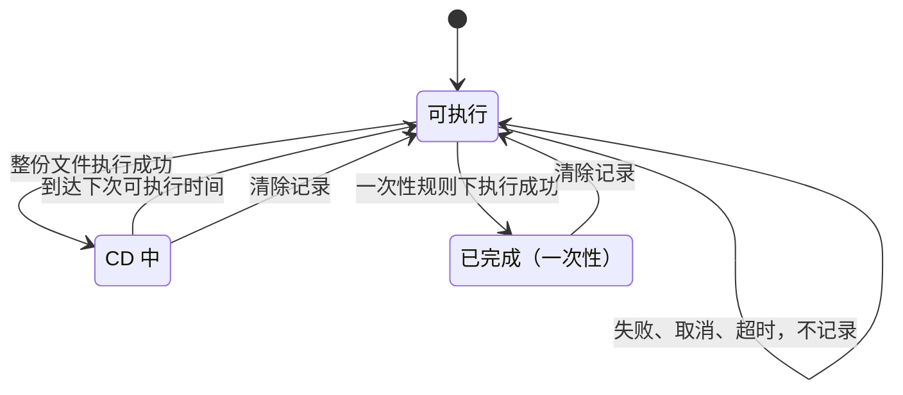

# Pulonia 路线 CD：识别、可见性与简化

状态：已实现，待用户验收（2026-10-28）；D16—D19 按建议决定，与本文的差异见[第 9 节](#9-实施记录)。现行规则已写入[结果、CD 与存储](../results-and-storage.md#文件级路线-cd)和[界面](../user-interface.md#路线-cd)。需求来源 US-03（显示完成依据、剩余 CD、下次可运行时间）、US-09（有效值与来源可见）、US-11（账号之间不串 CD）。现行规则见[结果、CD 与存储](../results-and-storage.md#文件级采集-cd)，本文只写改动。  
[返回总览](../README.md) · [结果、CD 与存储](../results-and-storage.md) · [界面](../user-interface.md) · [路线图](../roadmap.md)

## 1. 现状问题

按 2026-10-28 工作区代码核对。

### 1.1 魔物路线几乎没有 CD

规则表按目录名精确匹配材料（`PuloniaCollectionCooldown.CreateRules`），没有匹配的路线不限制。用官方脚本仓库 [bettergi-scripts-list](https://github.com/babalae/bettergi-scripts-list/tree/d775a4b8b7911ef0dd6d41e1350ca2ae41f59b62/repo/pathing)（`main`，提交 `d775a4b`）的全部 5315 个路线文件，按当前规则表统计：

| 顶层目录 | 文件 | 识别 | 未识别 | 未识别的主要原因 |
| --- | --- | --- | --- | --- |
| 地方特产 | 743 | 743 | 0 | — |
| 食材与炼金 | 2373 | 987 | 1386 | 松茸、鸟蛋、鳗肉、金鱼草、堇瓜等不在规则表，[刷新文档](../../../technical/genshin-collectable-respawn.md)也没有数据；`提瓦特食材一条龙` 是混合合集 |
| 矿物 | 671 | 501 | 170 | 仓库目录叫 `魔晶矿`（146 个），规则表只有 `魔晶块`；`莉奈娅一条龙` 是合集 |
| 敌人与魔物 | 1018 | 13 | 1005 | 目录是 `敌人与魔物/<怪物名>/<作者>`，规则表里的“魔物、怪物、精英怪”不出现在路径中，只有 `盗宝团` 恰好同名 |
| 锄地专区 | 417 | 0 | 417 | 目录是作者路线组，如 `精英400@汐/1-精英` |
| 其他 | 93 | 0 | 93 | `提瓦特钓鱼指南` 不匹配“钓鱼”，`木材伐木点` 不匹配“木材”，`成就` 没有规则 |
| 合计 | 5315 | 2244（42%） | 3071（58%） | |

魔物与锄地路线共 1435 个，只识别了 13 个（0.9%）。用户以为魔物路线有 CD，实际同一天会重复执行。刷新文档第十章写明普通怪、精英怪、盗宝团都按每日 04:00 重置，所以这些路线当天重复执行只是白跑。

### 1.2 用户看不到 CD 的流转

| 时刻 | 现在用户能看到什么 |
| --- | --- |
| 添加任务 | 不显示识别结果，添加弹窗也不填写 CD |
| 编辑 | 任务树和一条龙清单不显示 CD；共享设置行对 CD 一律显示“已自定义”（`PuloniaSharedSettingText`）；CD 表单只显示材料和规则，没有上次成功时间和剩余时间 |
| 开始前 | 没有任何预测；判定方法 `Evaluate` 是 `internal`，只在执行节点时调用 |
| 运行中 | CD 跳过只追加一条 Skipped 结果，不更新“当前节点”消息 |
| 运行后 | CD 跳过与禁用、续跑已完成、执行器自行跳过都记为 Skipped，没有原因码；一条龙状态点显示“已跳过或停止”；运行汇总只有“跳过 N” |
| “当前 CD”页签 | 显示原始键（`pathing.file:repository:…`、`cn/world/default`）；包含已过期条目；显示记录时存下的 `next_eligible_at`，改过规则后与实际判定不同；不随计划筛选；不能清除或校正；列表没有虚拟化 |

时间显示也不统一：跳过消息用本机时间，结果字段是 UTC ISO 字符串并标“（UTC）”，规则说明按服务器时间。

### 1.3 代码结构

- `PuloniaCollectionCooldown` 一个静态类同时承担规则表、Schema、校验、解析、时间计算、判定、账本修改和展示文本。`mode` 是 7 个字符串常量，散落在 Schema、规则对象、表单 VM、时间计算和判定中；规则来源 `Source` 存的是中文，`Description` 靠字符串比较分支。
- auto 模式下匹配到“不限制”档（圣遗物、木材）也记为“未匹配规则”，表单因此显示“采集物：圣遗物 / 规则：未自动设置 CD”，前后矛盾。auto 模式的 `reset_hour` 固定为字面量 4，`reset_weekday` 却读取用户值。
- Schema 有两份（`PuloniaPathingTaskExecutor` 与 `PuloniaSettingCatalog.CreateHostSchema`）。成功后 `GetNextEligibleAt` 与 `Describe` 在服务主流程和 `CommitCollectionSuccessAsync` 中各算一遍。
- 已删除的额度框架留有残留：账本条目的 `window_key`、`units`，`PuloniaTaskLedgerItemViewModel` 的“周期 · 已用”分支，页面文字“CD 与额度账本”，`PuloniaTaskLedgerEntry` 的注释。
- 死代码：`PuloniaTaskPlanDocumentViewModel.ApplyCollectionCooldown` 只被测试调用；`PuloniaTaskCreationDialogViewModel.CollectionCooldown` 没有任何绑定。

## 2. 目标与不做

目标：

1. 官方仓库的魔物与锄地路线默认按每日 04:00 记 CD；仍未识别的路线在添加和编辑时就能看出来。
2. 用户在编辑时、开始前、运行中和运行后都能回答三个问题：这条路线这次跑不跑、为什么、什么时候能再跑。
3. 运行判定、运行预览、节点标记和 CD 总览调用同一个状态函数，不出现两套口径。
4. 能清除某条成功记录，让路线下次照常执行。

不做：

- 不实现跨文件额度：每日 400 只击杀上限、圣遗物调查点每日 100 次、木材每日上限。`SuccessFightCount` 是成功战斗次数，不是击杀数，不能据此扣减；等步骤 12 有可靠的击杀或拾取事件再议。
- 不按实际拾取判定成功，仍是“整份文件执行成功估算采集完成”。
- 不接入 JS 内部的路线调用和旧配置组；锄地一条龙等 JS 脚本继续自行管理。
- 不在运行中等待 CD 结束，也不在开始前弹确认框。日常运行和定时运行都不该被额外的确认打断。
- 不改作用域键、文件身份和“同一（作用域，文件）只保留最新一条”的账本规则。
- 不新增全局材料规则文件，理由见 [4.3](#43-规则覆盖放在哪里)。

## 3. CD 状态与流转

### 3.1 统一状态

每个地图追踪文件在某个账号下只处于以下一种状态，所有界面使用同一组名称：

| 状态 | 条件 | 本次运行 | 标记 |
| --- | --- | --- | --- |
| 可执行 | 没有成功记录，或已过下次可执行时间 | 执行 | 不显示 |
| CD 中 | 有成功记录，未到下次可执行时间 | 跳过 | `CD 中 · 剩 5 小时`；跨日显示 `CD 中 · 明天 04:00` |
| 已完成 | 一次性规则且有成功记录 | 跳过 | `已完成` |
| 未识别 | 自动识别没有匹配，因此不限制 | 执行 | `未识别 CD`（提示色，不是错误色） |
| 不检查 | 用户关闭限制，或识别为混合类别 | 执行 | 不显示，悬停可见 |

“未识别”单独作为一种状态，是为了让 1.1 这类问题在界面上能被看到。“不检查”是用户的明确选择或已知的混合类别，不需要提醒。



修改规则后，下一次判定从原成功时间按新规则重算，文件可能在“CD 中”和“可执行”之间直接切换（现行规则，不变）。

**时间显示。** 界面一律用本机时间。24 小时内显示相对时间（“剩 5 小时 12 分”），更远显示“明天 04:00”“10-30 04:00”；悬停显示绝对时间、规则和上次成功所在的运行。结果数据中的时间字段仍存 UTC ISO 字符串，只在展示时转换。

### 3.2 各时刻用户看到什么

| 时刻 | 位置 | 内容 |
| --- | --- | --- |
| 添加任务 | 地图追踪添加弹窗的详情区 | 文件：“刷新规则：落落莓 · 成功后 46 小时”或“未识别刷新规则，成功后不会跳过”；目录：“识别 120 · 未识别 8” |
| 编辑 | 任务树叶子行尾、一条龙清单行 | 3.1 的标记 |
| 编辑 | 分组、计划引用 | 汇总“5/20 CD 中”，悬停列出最早可执行时间和未识别数 |
| 编辑 | 目录引用 | “N 项 CD 中”。只按账本中该目录下的记录计数，不展开目录，所以没有总数 |
| 编辑 | 共享设置行、CD 卡片 | 有效规则摘要（“自动识别”“每日 04:00”“不检查”），替代恒定的“已自定义”；叶子的卡片顶部显示本账号状态、上次成功时间与运行、“清除记录”按钮 |
| 开始前 | 一条龙开始按钮下方、任务计划页“任务”页签顶部 | 一行摘要“CD 中 8 项 · 未识别 3 项 · 预览本次执行 ›”，点击打开运行预览（3.4）；目录引用只计入 CD 中的数量 |
| 运行中 | 运行条目的当前消息与计数 | “跳过『落落莓-01』：CD 中，明天 04:00 后可执行”；计数“CD 跳过 8” |
| 运行后 | 一条龙状态点、运行汇总、节点结果 | 状态点新增“CD 中”（3.3）；汇总把 CD 跳过与其他跳过分开；节点结果显示原因码、规则和下次可执行时间 |
| 任意时刻 | CD 总览（3.5） | 按账号、计划、材料查看与清除 |

**标记按哪个账号算。** 普通计划和一条龙默认账号用 `default`（当前登录账号）；一条龙绑定了账号时用账号资料中的 UID。运行时仍以核验后的 UID 为准。两者不一致时，运行在账号核验阶段就会失败，不会按错误的 CD 执行。

### 3.3 一条龙状态点

`PuloniaTaskSubtreeStatus` 新增 `CoolingDown`，文字“CD 中”，颜色用 `TextFillColorSecondaryBrush`：

- 子树内的结果全部是 CD 跳过：`CoolingDown`，悬停显示最早可执行时间。
- 成功与 CD 跳过混合：`Completed`（“已完成”），CD 跳过视为本周期已经完成。
- 其他归类规则不变。CD 跳过按原因码识别，不解析消息文本。

### 3.4 运行预览

“预览本次执行”按计划当前配置逐项预测：

- 按执行顺序列出每个叶子及其预测结果：执行、CD 中（剩余时间）、已完成、禁用、“与第 N 项是同一文件，前一项成功后跳过”。目录引用按固定版本展开，分组轮次和计划引用都已展开。
- 顶部汇总“预计执行 N · CD 跳过 M · 未识别 K”，列表可按材料分组折叠。
- 可以在列表中选中条目“清除记录”，然后直接“开始执行”。
- 底部固定说明：“按当前时间预测；运行到每个节点时会重新判定，失败和取消不记录 CD。”
- 资源需要确认更新等准备错误直接显示在预览中，与提交运行时的报错相同。

预览只读：不写 state.json、不入队、不保留新的仓库归档。

### 3.5 CD 总览

替代执行记录页和一条龙执行记录窗口中的“当前 CD”页签：

- **筛选**：账号（`default` 显示为“当前登录账号”，UID 显示账号资料名）；计划（只看该计划用到的文件）；状态（默认只看 CD 中和已完成，可切换为同时显示已可执行的记录）；搜索路线名或材料。
- **列**：路线（文件名与所在目录，不显示原始键）、材料、规则、上次成功、下次可执行（相对与绝对时间）、来源运行（可跳到该运行）。
- **分组**：按材料折叠，组头显示“落落莓 12 条 · 8 条 CD 中 · 最早明天 04:00”。
- **操作**：清除记录，支持单条、多选、整组或整个账号。确认框说明：“清除后下次运行会执行这些路线；运行历史中的成功记录不受影响；此操作不能撤销。”
- **口径**：总览没有计划上下文，剩余时间按上次成功时的规则计算，即账本中存的 `next_eligible_at`。列头说明“计划中的节点按当前规则判定，以节点标记为准”。只有改过规则的文件两者才会不同。
- 列表虚拟化；账本变化时才刷新（见 5.3）。

### 3.6 CD 设置表单

- 模式从 7 选 1 改为 3 选 1：**按材料自动识别（推荐）**、**不检查 CD**、**自定义周期**。选择自定义后，再选“每隔 N 小时”“每日 HH:00”“每周 X HH:00”“每隔 N 天的 00:00”“只执行一次”。存储格式不变，仍是 `mode` 加字段。
- 自动识别时显示识别过程，例如“目录 `敌人与魔物` → 魔物 · 每日 04:00 重置”。未识别时说明“路径中没有已知材料或类别名，成功后不会跳过”，并直接给出自定义入口。
- 分组节点显示下属路线的识别分布，例如“落落莓 12 · 未识别 8”；目录引用说明“展开后逐个文件识别”。
- 叶子节点顶部显示本账号的状态和“清除记录”（见 3.2）；同一文件在其他计划使用不同规则时提示（打开卡片时才计算）。

## 4. 规则与识别

### 4.1 识别覆盖

从文件所在目录向上逐级匹配、最近一级命中即停止的规则不变。规则表新增**类别级规则**，与材料写在同一张表中。类别目录位于材料目录之上，所以材料级规则仍然优先：

| 新增 | 规则 | 依据（刷新文档章节） |
| --- | --- | --- |
| `敌人与魔物`、`锄地专区` | 每日 04:00 | 第十章：普通怪、精英怪、盗宝团均为每日 04:00 重置 |
| `魔晶矿` | 作为 `魔晶块` 的别名，日期加 3 天 | 第四章 |
| `提瓦特钓鱼指南` | 作为 `钓鱼` 的别名，滚动 72 小时 | 第六章 |
| `木材伐木点` | 作为 `木材` 的别名，混合类别，不检查 | 第七章 |

按上表补充后对同一提交重新统计：识别 3875 个（73%），未识别 1440 个，其中 1386 个在 `食材与炼金`。这部分要先补刷新数据，不按猜测填写。

规则表从 `PuloniaCollectionCooldown` 拆到单独的 `PuloniaCollectionCooldownRules`（纯数据），便于对照仓库目录维护。用一份固定的真实目录样本做单元测试（不访问网络），防止规则表回退。

### 4.2 规则来源与模式

`Source` 改为枚举，区分四种来源，界面文字只在一处生成：

| 值 | 含义 | 显示 |
| --- | --- | --- |
| `Directory` | 自动识别命中有 CD 的材料或类别 | “自动识别：落落莓” |
| `Mixed` | 自动识别命中混合类别（圣遗物、木材、摩拉盒） | “自动识别：圣遗物（混合类别，不检查）” |
| `Unmatched` | 自动识别没有命中 | “未识别” |
| `Manual` | 用户选择了不检查或自定义周期 | “手动设置” |

`mode` 改为枚举 `PuloniaCollectionCooldownMode`，JSON 仍写原字符串（`auto`、`disabled` 等），存储格式不变。auto 模式忽略 `reset_hour` 与 `reset_weekday`；每日边界引用 `PuloniaServerTime.DayResetHour`，不再写字面量 4。

### 4.3 规则覆盖放在哪里

刷新周期是游戏事实，按理属于材料；但覆盖目前写在节点的共享设置中，同一文件在两个计划里可以用不同规则。三种做法的比较：

| 方案 | 做法 | 优点 | 代价 |
| --- | --- | --- | --- |
| A 现状 | 节点共享设置，向下继承 | 不加存储；在目录引用分组上设置一次即覆盖整个目录 | 同一文件跨计划可能规则不同，且用户看不到 |
| B 全局材料规则 | 新增 `cooldown-rules.json`（材料 → 规则），节点只保留“检查 / 不检查” | 概念最清楚，同一文件只有一个规则 | 新增存储、编辑器和导入；现有节点覆盖需要迁移 |
| C 现状加界面收敛 | 保留 A；表单改为 3 选 1；CD 卡片提示“该文件在其他计划使用不同规则” | 改动小，覆盖常见需求 | 跨计划不一致仍可能出现，但能看到 |

采用 C。跨计划给同一文件设置不同规则的情况少；未识别目录的覆盖本来就按目录写在分组上。如果用户反馈跨计划不一致造成困扰，再考虑 B。

## 5. 架构调整

### 5.1 一个状态函数

```csharp
// 纯函数：不读时钟、不读文件、不生成界面文字
PuloniaCollectionCooldownStatus GetStatus(PuloniaCollectionCooldownPolicy policy, string scopeKey,
    PuloniaCollectionCooldownIndex ledger, DateTimeOffset now, int serverUtcOffsetMinutes);
```

- 返回 3.1 中的状态、上次成功时间、下次可执行时间和对应的账本条目。
- 取代 `internal` 的 `Evaluate` 与 `PuloniaCollectionCooldownDecision`。运行判定、运行预览、节点标记、CD 总览和 CD 卡片都调用它。
- `PuloniaCollectionCooldownIndex` 是账本按（作用域，文件）建立的只读字典，由一份已提交状态构建一次，供多次查询。目录引用按文件身份前缀计数；非递归目录排除更深层的文件。
- 节点结果消息和界面文字由同一个格式化方法生成；`Describe` 保留为机器可读数据。

### 5.2 服务接口

`IPuloniaTaskService` 新增：

| 成员 | 说明 |
| --- | --- |
| `long LedgerRevision` | 账本每次变化时递增，只在内存中。编辑会话据此判断是否重建索引，不必在每次 `RunChanged` 时重建最多 10 万条的字典 |
| `Task<PuloniaTaskRunPreview> PreviewAsync(PuloniaTaskRequest request, CancellationToken ct)` | 用与 `EnqueueAsync` 相同的 `PuloniaTaskBuilder` 准备快照，但不写 state.json、不入队；按执行顺序对每个叶子调用 `GetStatus`，并模拟“同一文件在本次前面成功后跳过” |
| `Task ClearCollectionCooldownAsync(IReadOnlyCollection<PuloniaCollectionCooldownKey> keys, CancellationToken ct)` | 经 `PuloniaTaskRunStateStore.MutateAsync` 删除指定（作用域，文件）的账本条目；只在主实例执行；运行历史中的确认事件不变；记录日志 |

`ListLedgerAsync` 保留。Builder 准备快照时如果有写入副作用（例如保留仓库归档），预览必须走只读分支，实施时逐项核对。

### 5.3 编辑会话

- `PuloniaPlanEditingSession` 持有一份账本索引，`LedgerRevision` 变化时重建。
- 节点标记的计算分两层：文档变化（结构、共享设置、所挂方案）时重新解析每个地图追踪叶子的规则，做法与资源检查相同，防抖后批量计算；时间流逝只重算状态，页面可见期间每分钟一次，离开页面停止。
- 节点 VM 只暴露标记文字、语义分类和悬停说明，颜色由视图按主题资源决定，与资源更新标签一致。

### 5.4 运行时

- CD 跳过的节点结果写原因码：`pathing.cooldown_active`（CD 中）、`pathing.cooldown_completed`（一次性已完成）；数据字段不变。
- 跳过时同样更新当前节点和消息（只在内存中，不落盘）。
- 成功后的下次可执行时间与说明只算一次，`CommitCollectionSuccessAsync` 复用主流程的结果。

### 5.5 清理

- Schema 只保留 `PuloniaCollectionCooldown.CreateSchema` 一份并缓存，执行器和设置目录都引用它。
- 删除 `ApplyCollectionCooldown`、创建弹窗 VM 的 `CollectionCooldown`、`PuloniaTaskLedgerItemViewModel` 的额度分支和“CD 与额度账本”等文字；更正 `PuloniaTaskLedgerEntry` 的注释。
- CD 表单和账本相关 XAML 中的只读绑定显式写 `Mode=OneWay`。

### 5.6 存储

本提案不改 state.json 格式，仍为版本 4。账本条目的 `next_eligible_at` 由 CD 总览使用（按记录时规则）；`window_key`、`units` 已不参与任何逻辑，界面不再读取。是否删除这两个字段放到下一次 state.json 格式变更时一起处理（D19）：按开发期规则，格式变更需要用户删除 state.json，会丢失现有 CD 记录和排队请求，不值得为两个字段单独做一次。

## 6. 命名

| 概念 | 界面 | 代码与存储（不变） |
| --- | --- | --- |
| 按路线文件计的刷新限制 | 路线 CD | `collection_cd`、`collection.cooldown`、`PuloniaCollectionCooldown*` |
| 账本 | CD 记录 | `ledger`、`PuloniaTaskLedgerEntry` |
| 规则模式 | 自动识别 / 不检查 / 自定义周期 | `auto` / `disabled` / 其余五种 |
| 文件状态 | 可执行 / CD 中 / 已完成 / 未识别 / 不检查 | `PuloniaCollectionCooldownState` |

“采集 CD”这个名字会让锄地用户以为与魔物无关，界面改称“路线 CD”，设置说明写明“适用于采集、魔物、宝箱等地图追踪路线”（D16）。代码与存储键不改名，避免一次格式变更。

## 7. 实施步骤

每步单独验收，通过后再开始下一步。

| 步骤 | 内容 | 用户可验收的结果 |
| --- | --- | --- |
| 1 识别与清理 | 4.1 的类别与别名；4.2 的来源与模式枚举；5.5 清理；共享设置行显示规则摘要 | 官方仓库的魔物路线在 CD 表单中显示“每日 04:00”，同一天第二次运行时跳过 |
| 2 状态函数与运行反馈 | 5.1、5.4；一条龙“CD 中”状态点；运行汇总分开计数；时间统一按本机时间显示 | 运行中能看到跳过原因；运行后状态点和汇总能区分 CD 跳过 |
| 3 编辑时可见 | 5.2 的 `LedgerRevision`、5.3；节点标记与汇总；CD 卡片状态区；表单 3 选 1；添加弹窗的规则提示 | 不运行就能在任务树和一条龙清单上看到哪些路线 CD 中、哪些未识别 |
| 4 CD 总览与清除 | 3.5；`ClearCollectionCooldownAsync` | 能按账号、计划、材料查看并清除记录 |
| 5 运行预览 | 3.4；`PreviewAsync`；开始按钮旁的摘要 | 开始前能看到本次每一项会执行还是跳过 |

步骤 1 成本最低，并且直接修复魔物路线没有 CD 的问题，应先做。

## 8. 待决定

用户 2026-10-28 决定“按建议来”：

| ID | 问题 | 决定 |
| --- | --- | --- |
| D16 | 界面名称改为“路线 CD”，还是保留“采集 CD” | 改为“路线 CD”；代码与存储键不改名 |
| D17 | 是否接受 `敌人与魔物`、`锄地专区` 的类别级每日规则。接受后，此前每次都会执行的魔物路线改为每天只执行一次 | 接受 |
| D18 | 除“清除记录”外，是否提供“标记为已采集”（游戏外已经跑过） | 只做清除记录 |
| D19 | 下一次 state.json 格式变更时，是否删除账本条目的 `window_key`、`units` | 删除；本次不改格式 |

## 9. 实施记录

2026-10-28 一次实施第 7 节的全部 5 步（用户要求直接执行改造），与上文的差异：

- **一条龙清单不改。** 用户认为路线 CD 主要影响任务计划的展示。3.3 的“CD 中”状态点、一条龙清单行的标记和开始按钮旁的摘要都没有做；一条龙只在执行记录窗口把“当前 CD”页签换成路线 CD 总览，状态点仍显示“已跳过或停止”。
- **用事件代替 `LedgerRevision`。** 5.2 的 `LedgerRevision` 改为 `IPuloniaTaskService.LedgerChanged` 事件：新成功记录落盘或清除记录后触发，编辑会话切到 UI 线程重新读取账本并重建索引。
- **计划引用的汇总**沿用被引用计划自身的规则，不叠加引用节点外层的共享设置；逐项结果以运行预览为准。
- **任务计划页的“路线 CD”页签**默认只看当前计划用到的路线（含目录引用与计划引用），切换计划时跟随；全局执行记录页默认看全部计划。
- **运行预览**的“开始执行”与计划卡片的运行按钮走同一提交流程；预览前先完成未保存修改的自动保存。
- **规则来源**在快照中继续写中文取值，新增“混合类别”；旧快照里匹配到混合类别的规则仍是“未匹配规则”，读取不受影响。
- **删除的代码**：`PuloniaCollectionCooldown.Evaluate` 与 `PuloniaCollectionCooldownDecision`（由 `GetStatus` 取代）、`PuloniaTaskLedgerItemViewModel`、文档 VM 的 `ApplyCollectionCooldown`、创建弹窗 VM 的 `CollectionCooldown`，以及执行记录视图中的“当前 CD”页签和额度残留文字。

开发自查：全解决方案 Debug 编译通过（运行中的程序锁定默认输出目录，使用独立输出目录编译）；Pulonia 单元测试 390 项全部通过，其中新增官方仓库目录样本识别、状态判定、运行预览与清除记录的用例。另用临时的 STA 冒烟测试（加载 WPF-UI 主题，离屏打开任务计划页、执行记录页、路线 CD 表单、一条龙执行记录视图和运行预览内容）确认这些视图能实例化、布局和绑定，新增绑定没有路径错误，验证后已删除该测试。没有启动程序或游戏，界面与真实运行效果待用户验收。
