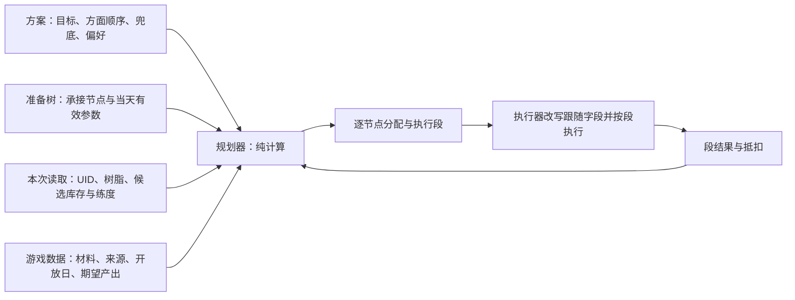
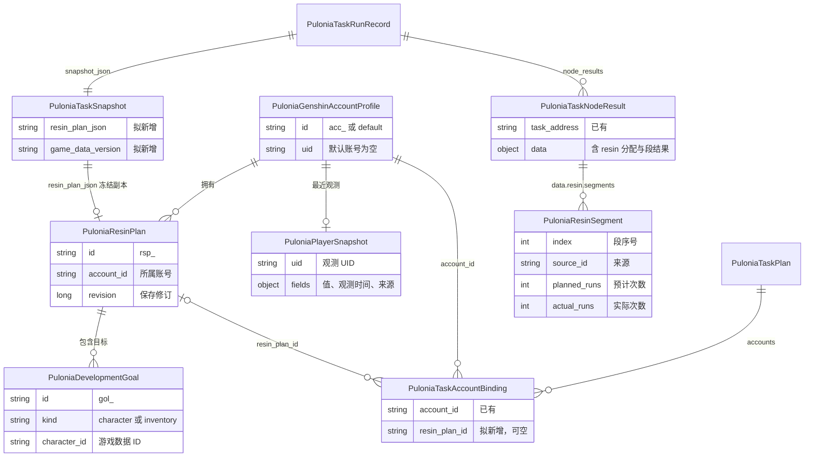
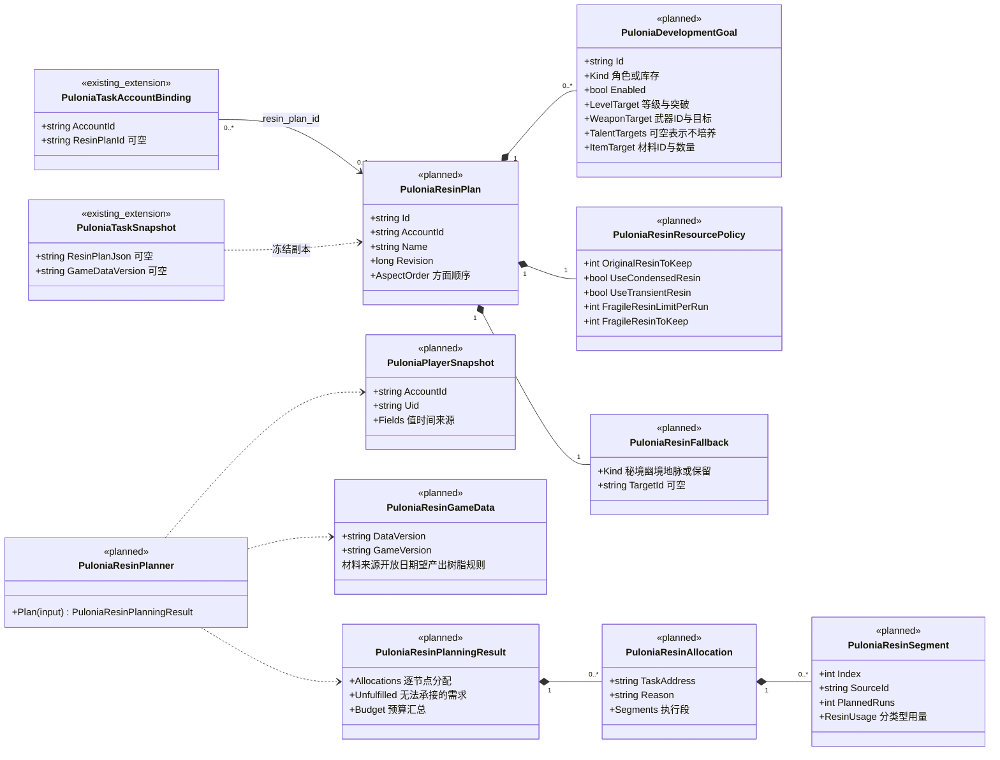
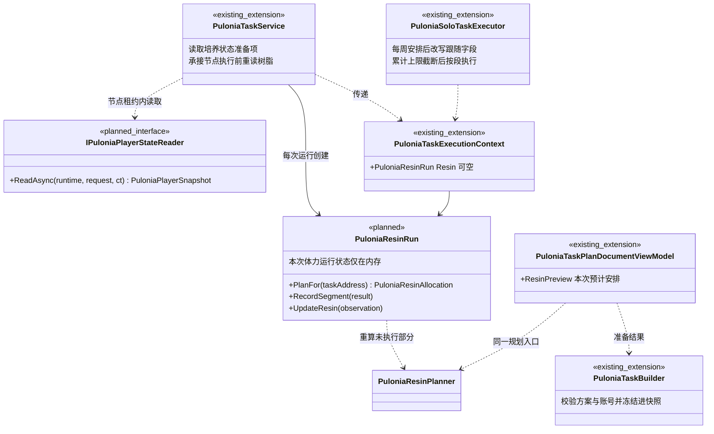

# Pulonia 体力计划设计

状态：提案，未实现（[路线图](../roadmap.md)步骤 11.1—11.4）。需求来源 [#3396](https://github.com/babalae/better-genshin-impact/issues/3396)、[#3716](https://github.com/babalae/better-genshin-impact/issues/3716)，调研见[调研依据](../research.md)。  
[返回总览](../README.md) · [模型与配置](../model.md) · [多账号](../accounts.md) · [界面设计](../user-interface.md) · [目标托管提案](managed-hosting.md)

## 1. 术语

| 术语 | 含义 |
| --- | --- |
| **树脂** | 原粹、浓缩、须臾、脆弱四类，各自计数与计算；折合点数只用于汇总展示。 |
| **体力计划（方案）** | 属于某个账号的具名培养方案：培养目标、培养方面顺序、最终兜底、资源偏好。一个账号可以保存多套。 |
| **培养目标** | 角色等级与突破、武器、天赋的目标值，或某种材料的库存目标。首期只负责备齐材料，提升由用户完成。 |
| **培养方面** | 等级与突破、武器、天赋、物品数量四类。方面顺序决定预算分配顺序，不表达角色排名。 |
| **跟随字段** | 节点上来源选为“体力计划”的字段组。对象来源（刷哪里）与树脂来源（刷几次、用哪种树脂）分别选择。 |
| **承接节点** | 本次运行中当天有效启用、且能力支持跟随字段的已有节点。体力计划只在承接节点中安排内容。 |
| **执行段** | 一个承接节点内连续执行的一批同来源领奖，例如先刷武器秘境 2 次，再刷天赋秘境 2 次。段属于原节点，不是任务树节点。 |
| **玩家快照** | 按账号保存的最近观测值（练度、库存、树脂、冒险等级），每项带观测时间和来源（识别 / 手动）。用于预览展示；执行决策使用本次读取值。 |
| **无状态规划** | 每次运行按本次读取的实际状态重算缺口，不保存“刷到哪个角色”“累计刷了多少次”等跨次培养进度。 |
| **本次体力运行状态** | 一次运行在内存中的规划上下文：冻结的方案、本次观测、已执行段的抵扣。不落盘，运行结束即丢弃。 |
| **无法承接** | 有缺口，但当天没有来源、超出范围或没有承接节点的需求，附原因展示。 |

## 2. 需求与范围

### 2.1 设计约束

1. 用户只表达培养目标、方面顺序和最终兜底，不需要理解树脂分配算法。
2. 方案选择属于“计划 × 运行账号”。一条龙和普通计划使用同一规则，默认不选择方案。
3. 计划引用使用发起运行的方案；连续运行批次的每个成员是独立运行，各用自己绑定的方案。
4. 角色默认同级。方面有顺序，默认等级与突破 → 武器 → 天赋 → 物品数量；最终兜底固定在最后，不参与排序。
5. 同一方面内，当天开放的轮换材料优先；实际全开时不套用星期限制。
6. 同一来源的需求集中为一段，减少秘境切换。
7. 不持久化培养进度。用户手动刷取、提升或消耗材料后，下次运行按真实状态重算。
8. 节点可以独立自定义。自定义的有限用量优先预留，体力计划只使用剩余预算；自定义节点明确开启的补充道具按节点配置执行。
9. 只改写跟随字段：不新增节点、不启用关闭的节点、不改变顺序。
10. 预计安排必须展示，并与实际运行的有效配置一致。
11. 对外配置简单，结果可解释。

### 2.2 首期范围

包含：方案管理、方案绑定、跟随字段、状态读取、规划、预览，以及执行接入（先秘境，再首领、地脉、合成浓缩、幽境兜底）。分步见[第 6 节](#6-分步交付与验收)。

不包含：自动生成任务计划；自动升级、突破与合成培养材料；推荐培养模板；圣遗物评分；周本；原石补充；按到期时间挑选须臾；跨运行或跨批次成员的预算预留；“本周期新增 N”口径（属于[目标托管提案](managed-hosting.md)的采集目标）；旧配置组。

## 3. 概要设计

### 3.1 职责划分

**任务计划决定能做什么、何时轮到；体力计划只决定跟随字段的内容。**



- 规划器是纯计算：不操作游戏，不读取历史进度；预览和执行调用同一入口。
- 状态读取由任务服务在节点租约内完成；修改配置不触发读取。
- 执行器只接收本节点的分配；多段结果通过原节点报告。
- 界面只展示规划结果、来源和修正入口，不另写预算算法。

### 3.2 方案绑定与账号

- 方案引用放在计划的账号绑定上：`PuloniaTaskAccountBinding.resin_plan_id`（可空）。同一计划的不同账号绑定可以选择不同方案。D5 把 `accounts` 单值化后，`resin_plan_id` 随 `account_id` 一起放在计划上。
- 运行准备校验所选方案存在且 `方案.account_id == 运行账号`，否则报错，请求不入队。
- 本次运行的方案冻结进快照（`PuloniaTaskSnapshot.resin_plan_json`），并记录游戏数据版本；运行中编辑方案只影响后续运行。
- 计划引用内的跟随节点使用发起运行的方案，被引用计划自身的绑定不参与。快照中存在跟随节点但本次没有方案时，运行准备报错，不退回自定义值。
- UID 核验：读取培养状态（[3.6](#36-状态读取)）先读当前 UID。指定账号与账号资料的 UID 比对；默认账号与玩家快照中记录的 UID 比对，首次读取时记录。不一致时本次全部跟随节点跳过并提示，自定义节点照常执行。默认账号登录了其他账号时，用户在预览中确认“改为当前账号”后才清空快照。
- 普通计划不切号，但经过同样的 UID 核验，因此可以绑定方案。

### 3.3 跟随字段

`target_source` 与 `resin_source` 是编排参数，取值 `custom`（缺省）或 `resin_plan`，只为支持的能力加入参数 Schema。它们与每周安排一样在 `DeserializeParam` 之前剥离，不进入独立任务的参数类（这些类同时是 JS 宿主合同）。

| 能力 | 对象来源改写 | 树脂来源改写 | 子步骤 |
| --- | --- | --- | --- |
| `solo.auto_domain` | `domain_name`、`sunday_selected_value` | 整体改写 `resin_usage`（按树脂分别指定各类次数） | 11.1 |
| `solo.auto_boss` | `boss_name` | 整体改写 `resin_usage`（指定领奖次数，补充树脂写入 `allowed`） | 11.4 |
| `solo.auto_ley_line_outcrop` | 地脉类型与地区 | 整体改写 `resin_usage` | 11.4 |
| `solo.craft_condensed_resin` | — | `min_resin_to_keep` | 11.4 |
| `solo.auto_stygian_onslaught` | —（只承接兜底） | 整体改写 `resin_usage` | 11.4 |

`resin_usage` 的结构与各任务支持的方式见[树脂使用设置统一](../../resin-usage-settings.md)第 5 节。

| 对象来源 | 树脂来源 | 规则 |
| --- | --- | --- |
| 自定义 | 自定义 | 原样执行；有限用量优先预留 |
| 体力计划 | 自定义 | 方案选择兼容对象，用量按节点配置并参与预留；没有可选对象时跳过并说明 |
| 自定义 | 体力计划 | 保持固定对象，按该对象能满足的需求或兜底计算用量；不匹配时不分配 |
| 体力计划 | 体力计划 | 在该能力范围内决定对象、次数和树脂类型 |

队伍、战斗策略、超时与恢复设置继续使用节点配置。跟随时被忽略的手工值保留，切回自定义后恢复使用。

执行器对参数的处理顺序固定：

1. 快照中的有效参数，[有效参数解析规则](../model.md#有效参数解析规则)不变。
2. 每周安排：当天 `enabled=false` 时节点跳过，体力计划不给它分配；当天字段按顶层字段覆盖，因此可以按星期切换来源，例如周日跟随、平日自定义。
3. 体力计划：来源为 `resin_plan` 的字段按本节点分配改写；分配为空时节点跳过并给出原因。
4. 首领累计上限 `total_run_count_limit` 作为硬上限截断次数。它是节点配置约束，不属于方案的培养进度；规划时读取同一计数作为该节点的承接上限。
5. 剥离编排参数，转换为强类型参数执行。有执行段时，每段用第 3 步的分段值构造参数，第 4 步按累计剩余次数截断。

每周安排的应用提取为执行器与规划器共用的函数，保证预览与执行看到同一份当天参数。

### 3.4 承接与预算

- 承接节点按树顺序承接：前面的节点先取它能承接的需求，后面的节点承接剩余部分。需要用不同队伍刷不同对象时，把节点的对象来源设为自定义并固定对象，树脂来源保持跟随。
- 关闭的节点或父分组不获得预算。计划引用和重复分组展开出的每个地址都是独立承接节点，共同需求只分配一次。
- 预算按树脂类型分别计算：可用量 = 最近一次读取值 − 方案保留量 − 尚未执行的自定义预留。偏好不允许或数量未知的类型不可用。
- 自定义预留：
  - 有限用量的自定义节点（指定次数或指定树脂用量）按游戏数据单价预留，排在跟随节点之前或之后都预留；执行完成后不再计入预留。
  - “刷至耗尽”的自定义节点（`resin_usage.mode` 为 `Exhaust`）不预留。排在它之前的跟随节点正常分配，排在它之后的预计为 0，预览显示“前序任务刷至耗尽”。
  - JS、键鼠、路线等用量未知的节点不预留。其后的承接节点执行前重读树脂，预览标为“取决于前序未知用量”。
- 预留只覆盖本次运行。连续运行批次中，前一成员看不到后一成员的自定义用量，批次界面在这种组合下提示；需要共用预算的计划，用计划引用放进同一个计划。

### 3.5 规划规则

输入：承接节点与当天参数、方案、本次观测、游戏数据、本次运行已执行段的抵扣。输出：逐节点分配（对象、次数、树脂类型、原因）、执行段、无法承接的需求、预算汇总。相同输入得到相同输出。

1. **缺口。** 对每个启用目标的每个方面，用游戏数据从当前状态算到目标所需材料。等级与突破状态分开计算（80/80 与 80/90 不同）；天赋按基础等级计算，不含命座加成。汇总同一材料后扣除库存：同一份库存只用一次，低级可按合成比例向上折算，高级不向下折算。最后扣除本次运行已执行段的抵扣。
2. **来源。** 缺口映射到当天可用的来源。日历按服务器游戏日（`PuloniaServerTime.GetGameDate`，4 点日切）判断；本次已观测到秘境全开时视为全部开放。非树脂来源（特产、怪物掉落）和范围外来源（周本）列入无法承接。
3. **承接。** 来源必须有承接节点：能力匹配，且对象来源为跟随，或固定对象正是该来源。否则列入无法承接，并说明缺少哪类节点。
4. **分配顺序。** 按方面顺序逐层分配。同层内的候选来源依次比较：
   1. 窗口紧迫度：距离下一次常规开放的天数，远者优先；常开来源记为 1。周日或全开时，平日开放日越远的材料越先刷。
   2. 本次预算内能备齐的目标数，多者优先。
   3. 预计领奖次数，少者优先。
   4. 来源稳定 ID。

   跨方面不提前：下层的当天材料不越过上层需求，想先刷当天材料时调整方面顺序。上层没有可承接需求时，预算自然留给下层。
5. **合并。** 选定来源后，同层所有可由它满足的缺口合并为一段；下层轮到同一来源时追加到已有段，不另开一段。
6. **次数。** 按游戏数据的单次期望产出计算并向上取整，受剩余预算和节点上限截断。期望产出按冒险等级对应的难度取值，冒险等级未知时按最高难度计算并标为估计。不加保守系数，不足部分由下次运行重算补齐。接近目标时优先较小的领奖单位，避免明显过量。
7. **树脂类型。** 次数确定后按段顺序统一指派：只接受原粹的段（首领）先取原粹；其余段优先浓缩，再原粹大单位，最后小单位；须臾、脆弱只在偏好允许且有额度时使用。入口与树脂类型的组合限制（例如浓缩非零时不能直接用须臾、脆弱领奖）来自游戏数据。
8. **合成浓缩。** 跟随的合成节点先保留其后全部只接受原粹的分配和自定义预留，剩余原粹按合成单价折算份数，不超过持有上限，结果写为 `min_resin_to_keep`。自定义合成按自身配置执行，造成后续预算不足时在预览中说明。
9. **兜底。** 有限目标分配完后，剩余预算给兜底；兜底同样需要承接节点。兜底为“保留”或没有承接节点时，剩余树脂保留。

规则示例（数字为示意，游戏数值以游戏数据为准）：周一，方面顺序为等级与突破 → 武器 → 天赋。计划中有“自动秘境”（对象、树脂均跟随）和“自动首领”（自定义 2 次）。读取到原粹 160、浓缩 2；保留量 0；不允许须臾和脆弱。

| 步骤 | 结果 |
| --- | --- |
| 预留 | 首领 2 次 × 原粹 40 = 80；剩余原粹 80、浓缩 2 |
| 等级与突破 | 角色 A 缺首领材料，首领节点固定为其他首领 → 无法承接 |
| 武器 | 角色 A 缺周一开放的武器材料，预计 2 次 → 段 1，浓缩 2 |
| 天赋 | 角色 B 缺周一开放的天赋书，剩余原粹 80 → 段 2，原粹 40 × 2；仍有缺口，列为预算不足 |
| 兜底 | 预算已用完 |

规划规则、参数处理顺序与抵扣计算由单元测试覆盖，属于开发自查；验收使用用户真实数据（[路线图验收规则](../roadmap.md#验收规则) 2）。

### 3.6 状态读取

读取由任务服务完成，不是任务树节点。它以“读取培养状态”准备项记录在运行结果中，展示方式与“切换账号”准备项相同；可以取消，失败不影响自定义节点。

| 时机 | 读取内容 |
| --- | --- |
| 第一个承接节点取得租约、核验 UID 之后 | 当前 UID；原粹、浓缩与上限（`ResinRecognition`）；偏好允许时的须臾、脆弱数量；当天候选来源对应材料的库存（`CountInventoryItem`）；需求涉及当天候选来源的角色练度（`CharacterDevelopmentTask`） |
| 之后每个承接节点执行前（含重试） | 树脂 |
| 不读取 | 当天没有可承接来源的目标；本次运行已读取过的库存与练度，改用已执行段的抵扣 |

- 读取范围按“当天可承接”裁剪，避免逐个进出全部角色界面。
- 未知不等于 0：树脂未知时本次跟随节点全部跳过；某目标的练度或库存未知时只跳过该目标，并说明原因。
- 手动补充：字段当前无法识别（能力不支持或读取失败）时，用户可以在方案窗口手动填写，界面标为“手动填写于 …”；执行时手动值替代该字段的读取值。识别成功后以识别值为准，替换手动值。冒险等级首期手动填写。
- 读取结果写回玩家快照，供下次预览展示。
- 运行跨过 4 点日切时，后续承接节点按新的游戏日重算来源。

### 3.7 执行段与实测

- 执行段由 `PuloniaSoloTaskExecutor` 循环调用现有的单对象任务：每段一份参数（对象、次数、树脂类型），独立任务本身不改为多对象。
- 段内次数固定，独立任务以指定次数模式执行。任务自身的次数与树脂上限就是消费约束，不另设逐次授权。
- 段之间不重读树脂。段失败时结束本节点剩余段，按节点失败策略处理；重试前重新规划本节点。
- 实测来源：
  - 奖励识别开启并识别到产出时，按识别数量更新该目标的剩余缺口，只减少后续段的次数，不增加；
  - 未开启或未识别时按预计产出抵扣，标为“按预计执行”；
  - 库存与练度的真实结果以下次运行的读取为准。
- 秘境任务识别到“限时全开”时在结果中报告（结果数据新增字段，只增不改），本次体力运行状态据此重算尚未执行的段和节点。
- 节点结果的 `Data.resin` 记录分配原因、开始前树脂、各段对象、预计与实际次数、树脂用量、识别产出和段结果。节点结果按各段汇总：全部成功时沿用原任务结果，部分成功为 `PartiallySucceeded`。
- 跳过使用机器可读原因：`resin_plan_no_budget`、`resin_plan_no_target`、`resin_plan_state_unknown`、`resin_plan_uid_mismatch`。

### 3.8 中断与续跑

- 不持久化预留和分配。崩溃、取消或中断后，“继续上次”创建新运行，重新读取状态并重算，已备齐的目标自然不再分配。
- 防止重复领奖由各独立任务的领奖流程负责，体力计划不增加账本。
- 已确认完成的节点按现有续跑规则跳过；未完成的承接节点重新执行时按最新状态规划。

### 3.9 游戏数据

规划依赖一份带版本的只读数据 `PuloniaResinGameData`：

| 内容 | 用途 |
| --- | --- |
| 角色（稳定 ID，旅行者按元素区分）的突破与天赋材料表 | 计算等级与天赋缺口 |
| 武器（稳定 ID）的突破材料表 | 计算武器缺口 |
| 材料系列（各级 ID、合成比例） | 库存扣除与向上折算 |
| 秘境（ID、任务使用的名称、开放日、周日 / 全开奖励序号）、首领、地脉、幽境 | 映射来源与承接字段 |
| 各来源各难度的单次期望产出 | 计算次数 |
| 树脂规则：各入口可用的树脂类型与单位、合成单价、持有上限、组合限制 | 预算与树脂类型指派 |

- 数据随 `BetterGI.Assets.*` 资源包发布，不新增 `BetterGenshinImpact\Assets`。格式独立于程序，每份数据记录数据版本、适用游戏版本和来源。
- 原粹上限使用识别到的 `Max`，不使用数据常量。
- 数据中不存在的角色、武器或材料，对应目标标为“不可规划（游戏数据未包含）”，其他目标不受影响。

### 3.10 预览

- 预览以 `PuloniaTaskBuilder` 的准备结果为输入（含账号替换预设和计划引用公共参数），再应用当天的每周安排，与运行准备一致；准备失败时预览显示同一错误。不使用界面编辑器的简化解析结果。
- 观测值来自玩家快照并标明观测时间；没有快照时只展示配置关系和待读取项。
- 配置或方案草稿修改后在后台重算；异步结果按配置版本提交，旧结果不覆盖新结果。
- 预览不操作游戏。显式“刷新游戏状态”作为普通请求排队，走同一个读取准备项。

## 4. 数据模型

### 4.1 存储

```text
User/Pulonia/
├─ resin-plans/<方案ID>.json        体力方案；ID 前缀 rsp_，目标 ID 前缀 gol_
└─ player-snapshots/<账号ID>.json   玩家快照：uid、各字段的值、观测时间与来源
```

- 方案文件含 `schema_version` 与 `revision`（保存旧修订时报冲突），由 `PuloniaTaskJson` 读写。
- 仍被计划绑定引用的方案不能删除。删除账号时一并删除其方案和玩家快照；账号仍被计划绑定时本来就不能删除。
- 规划结果不单独存储：初始规划写入“读取培养状态”准备项的结果数据，节点分配与段结果写入节点结果 `Data.resin`，随运行历史归档。

方案示意（省略部分字段）：

```json
{
  "id": "rsp_7k2m9q4x8c1v5b3n",
  "schema_version": 1,
  "revision": 0,
  "account_id": "acc_4x9c1v5b3n7k2m8q",
  "name": "近期队伍培养",
  "aspect_order": ["level", "weapon", "talent", "item"],
  "goals": [
    {
      "id": "gol_…",
      "kind": "character",
      "enabled": true,
      "character_id": "<游戏数据角色 ID>",
      "element": null,
      "level": { "level": 80, "ascension": 6 },
      "weapon": { "weapon_id": "<游戏数据武器 ID>", "level": 90, "ascension": 6 },
      "talents": { "normal_attack": null, "skill": 8, "burst": 8 }
    },
    { "id": "gol_…", "kind": "inventory", "enabled": true, "item_id": "<材料 ID>", "count": 30 }
  ],
  "fallback": { "kind": "domain", "target_id": "<秘境 ID>" },
  "resources": {
    "original_resin_to_keep": 0,
    "use_condensed_resin": true,
    "use_transient_resin": true,
    "fragile_resin_limit_per_run": 0,
    "fragile_resin_to_keep": 0
  }
}
```

`talents` 中的 `null` 表示该天赋不培养；`fallback.kind` 取 `domain`、`stygian`、`ley_line_mora`、`ley_line_exp` 或 `keep`。节点参数示意：

```json
"parameters": { "target_source": "resin_plan", "resin_source": "resin_plan", "party_name": "日常队伍" }
```

### 4.2 ER 图

文件存储，不表示数据库表。`PuloniaGenshinAccountProfile`、`PuloniaTaskPlan`、`PuloniaTaskAccountBinding`、`PuloniaTaskRunRecord`、`PuloniaTaskSnapshot`、`PuloniaTaskNodeResult` 是已有类型，其余为拟新增。



关系约束：

- 一个方案属于一个账号；引用它的绑定必须属于同一账号。
- 一个绑定最多选择一个方案；一个方案可以被多个计划的绑定引用。
- 玩家快照每个账号一份，UID 不符时视为不存在。
- 段只出现在节点结果中，不进入 `PuloniaTask.Children`；不存在跨运行的培养进度对象。

### 4.3 类图

`existing` 为已有类型，`existing_extension` 为拟扩展的已有类型，`planned` 为拟新增类型。





职责约束：

- 规划器只有一个具体实现，不设接口；状态读取涉及游戏操作，设接口以便替换与测试。
- 不设消费控制器，不持久化预留：跟随字段改写为指定次数参数后，独立任务自身的上限就是消费约束。
- `PuloniaResinRun` 由任务服务按运行创建，只在内存中，不写 `state.json`；没有方案的运行为 null。
- ViewModel 只展示结果、来源和修正入口，不实现预算算法。

## 5. UI / UX 设计

### 5.1 对外简化原则

普通用户只做三个决定：**培养谁、先培养哪方面、剩余树脂做什么。**

材料来源、合成换算、入口限制、重复需求和预留由内部处理。文案使用“本次预计”“为后续任务保留”“材料已备齐”等直接说法，不暴露内部模型、参数合并链或公式。

### 5.2 入口

一条龙配置区的“运行账号”旁增加一行：

```text
运行账号：大号    体力计划：近期队伍培养 ▼    [编辑方案]
```

- 下拉框只列出运行账号的方案，首项为“不指定”。切换运行账号时，方案选择跟随该账号的绑定，不沿用其他账号的方案。
- 普通计划在计划设置中按运行账号提供同样的选择器，复用方案编辑窗口。
- 选择方案后显示接入摘要：

```text
2 个任务由方案安排树脂，1 个任务使用自定义用量。    [查看本次安排]
```

尚无节点跟随时显示“已选择方案，当前任务仍使用自定义配置。”选择方案不改动任何节点字段。

### 5.3 方案窗口

左侧方案列表，右侧编辑内容。窗口使用独立草稿，“保存方案”后生效；显示引用该方案的计划数量；运行中的方案版本不随编辑变化。

**近期培养目标**

```text
角色 A   已启用
等级与突破   当前 70/80 → 目标 80/90
武器         某武器 80/80 → 目标 90/90
天赋         普攻不培养 · 战技 8 · 爆发 8
状态         仍缺材料
[修改目标]  [暂停培养]
```

- 角色列表不显示编号、排名或拖拽顺序。
- 目标值由用户明确选择，天赋不默认拉满。新建目标时武器默认填入快照中的当前装备武器；运行时装备武器与目标不一致，武器方面显示“装备已变化，待确认”且不分配。
- 状态区分“待读取”“仍缺材料”“材料已备齐，等待提升”“已达标”“不可规划（游戏数据未包含）”。
- 无法识别的字段提供“手动填写”，并显示填写时间。
- 物品数量目标：选择材料和目标库存。

**培养方面顺序**

可拖动的短列表：等级与突破、武器、天赋、物品数量。旁注：

> 同一方面内，今天开放的轮换材料优先；剩余树脂最后用于兜底。

**最终兜底**

圣遗物秘境、幽境危战、摩拉地脉、经验地脉或保留剩余树脂。只显示所选项需要的字段，不要求填写圣遗物评分等完成条件。

**补充道具与保留量**

默认折叠。默认允许浓缩与须臾；脆弱每次额度为 0；原粹与脆弱保留量为 0。

### 5.4 节点设置

在原有控件中加入来源选项：

```text
秘境选择：体力计划 ▼
树脂使用：体力计划 ▼
队伍：日常队伍 ▼
```

- 跟随时隐藏不生效的手工字段，避免同时出现两组矛盾的次数；切回自定义后原值恢复。
- 每周安排的每一天都可以单独选择来源。
- 控件下方显示本节点的预计结果：

```text
本次预计：段 1 武器材料秘境 2 次（浓缩 2）；段 2 天赋秘境 2 次（原粹 40 × 2）。
用途：角色 A 武器突破；角色 B 天赋。
[展开详细安排]
```

- 本次运行没有方案时，在控件旁提示：“请选择体力计划，或切回自定义。”

### 5.5 本次预计安排

预计算结果直接出现在主页面，以已有任务为顺序和分组依据。顶部保持紧凑：

```text
原粹 160/200 · 浓缩 2 · 须臾 1 · 脆弱 50      数据读取于 10:32    [刷新游戏状态]
本次预计：原粹 160＋浓缩 2      预计保留：须臾 1 · 脆弱 50（允许使用 0 枚）
```

| 已有任务 | 本次安排 | 树脂用法 | 原因 |
| --- | --- | --- | --- |
| 自动秘境 | 段 1 武器材料秘境 2 次；段 2 天赋秘境 2 次 | 浓缩 2；原粹 80 | 今日开放，按培养方面顺序 |
| 自动首领 | 指定首领 2 次 | 原粹 80 | 自定义用量，已优先保留 |

无法承接的需求单独列出，可以定位到相关节点设置，系统不代替用户启用或添加节点：

> 角色 A 还缺首领材料：当前计划的首领任务固定为其他首领。  
> 角色 B 天赋书仍有缺口：本次预算不足。

表内数字为示意。汇总与逐节点用量必须一致。

### 5.6 预览与运行状态

| 状态 | 展示与行为 |
| --- | --- |
| 尚未读取 | 展示配置关系与待读取项，不承诺用量 |
| 预览可用 | 标明快照观测时间，次数标为“预计” |
| 配置已修改 | 后台重算，标明使用的是草稿还是已保存配置 |
| 正在刷新 | 保留旧结果并标为旧数据 |
| 运行中 | “读取培养状态”作为准备项显示；节点显示已领取次数、已用树脂、剩余需求与后续预留 |
| 材料已备齐 | 显示“材料已备齐，等待提升” |
| 跳过 | 显示原因：预算为 0、无可选对象、状态未知、账号不一致 |

状态不只靠颜色表达；关键原因直接显示，详情可以展开；键盘操作与现有控件一致。

## 6. 分步交付与验收

每个子步骤分别提交、分别等待用户验收。

| 子步骤 | 交付 | 验收重点 |
| --- | --- | --- |
| 11.1 方案与规划 | 方案与玩家快照存储、账号绑定、`solo.auto_domain` 跟随字段、秘境相关游戏数据、规划器、预览（基于玩家快照与手动填写） | 选择方案不改动节点；方案与运行账号不一致时拒绝运行；预览符合规划规则；未知与无法承接都有原因 |
| 11.2 状态读取 | “读取培养状态”准备项、UID 核验、按当天可承接裁剪的读取、快照回写 | 只读取必要字段；默认账号换号后停止跟随；读取失败只跳过相关目标 |
| 11.3 秘境执行 | 执行器改写跟随字段、执行段循环、承接节点前重读树脂、全开识别回报、节点结果 `Data.resin` | 实际次数与预览一致；手动培养后下次重算；中断续跑不重复刷已备齐的目标 |
| 11.4 其他承接 | 首领、地脉、合成浓缩、幽境兜底，每类分别验收 | 首领累计上限仍生效；合成为后续只接受原粹的节点保留原粹；兜底不阻塞有限目标 |

验收场景（用户使用真实数据，按当前子步骤选取）：

1. 一条龙与普通计划使用相同的绑定和跟随规则；方案与运行账号不一致时拒绝运行。
2. 四种来源组合正确生效，未跟随字段保持原值；每周安排当天跳过的节点不分配，按星期切换来源生效。
3. 选择方案不改变节点类型、位置、启用状态或数量。
4. 没有承接节点、固定对象不匹配、没有兜底入口时说明原因，不自动补节点。
5. 自定义有限用量优先预留；“刷至耗尽”之后的跟随节点预计为 0；首领累计上限仍截断次数。
6. 计划引用、重复分组中的共同需求只分配一次；批次成员各用自己的方案。
7. 用户手动培养或刷取后，下次运行按最新状态重算；未读取的目标不分配。
8. 同来源合并为一段；方面顺序与窗口紧迫度符合规则；兜底在有限目标之后。
9. 突破状态、天赋加成、低级向上折算与共享库存计算正确。
10. 合成浓缩为后续只接受原粹的节点保留原粹，合成与领奖不重复计费。
11. 预览与开始运行后的有效配置一致。
12. 默认账号登录了其他账号时，跟随节点跳过并提示。
13. 中断后续跑重新读取并重算，不重复刷已备齐的目标。

实现遵循项目 MVVM、中文注释及 UTF-8 无 BOM 规范，编译验证按 AGENTS.md 执行。

## 7. 文档维护

本文是提案，术语只维护在第 1 节；功能实现后再把稳定术语同步到 [CONTEXT.md](../../../../CONTEXT.md)。基线文档（[模型](../model.md)、[界面](../user-interface.md)）只链接本文；实现状态与验收结论只维护在[路线图](../roadmap.md)。
