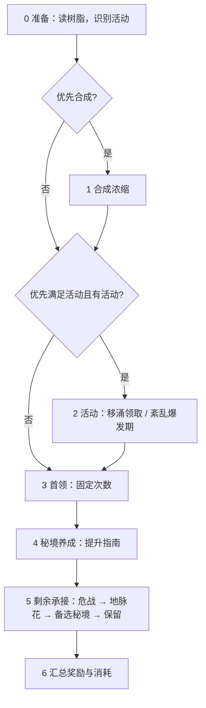
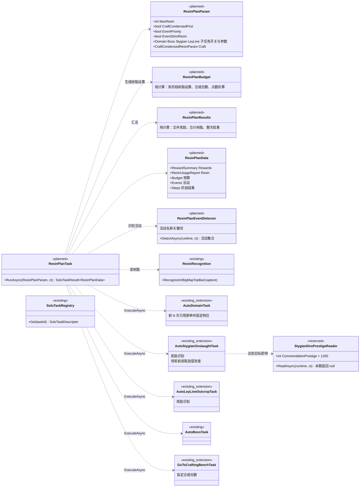

# Pulonia 体力计划设计

状态：提案，未实现（[路线图](../roadmap.md)步骤 11.1—11.3）。需求来源 [#3396](https://github.com/babalae/better-genshin-impact/issues/3396)、[#3716](https://github.com/babalae/better-genshin-impact/issues/3716)。  
[返回总览](../README.md) · [模型与配置](../model.md) · [多账号](../accounts.md) · [目标托管提案](managed-hosting.md)

## 1. 定位

体力计划是独立任务 `resin_plan`（任务计划类型 `solo.resin_plan`），放进一条龙中运行。它在一次运行里调度五个已有的独立任务：合成浓缩树脂、自动秘境、自动首领讨伐、自动幽境危战、自动地脉花。每个子任务刷什么、刷几次、用哪种树脂，都由体力计划根据预算决定。任务返回本次消耗树脂得到的全部奖励。

- **账号**：由一条龙负责切号与 UID 核验（见[多账号](../accounts.md)）。体力计划只在当前登录的账号上执行，不保存任何账号数据。
- **培养目标**：以游戏内养成计划为准，体力计划不另设角色选择。秘境需求通过提升指南读取。
- **无状态**：每次运行都重新读取树脂、活动和提升指南，不保存跨运行的培养进度。参数只保存在节点上。
- **子任务是内部步骤**：不写入 `PuloniaTask.Children`，也不新增任务计划节点。

| 术语 | 含义 |
| --- | --- |
| 预算 | 本次允许消耗的树脂点数。原粹按实际点数计，浓缩每枚计 60 |
| 阶段 | 体力计划内部按固定顺序执行的步骤，每个阶段调用一个子任务 |
| 移涌活动 | 地脉移涌、盛材移涌、祝圣移涌。活动期间每天有 3 次双倍奖励 |
| 紊乱爆发期 | 幽境危战的奖励阶段，只有在这个阶段才能在危战中消耗树脂 |
| 提升指南 | 冒险之证中的“秘境 → 提升指南”，按游戏内养成计划列出可刷的材料秘境 |
| 剩余承接 | 养成结束后剩下的预算，由第一个开启且可用的子任务全部用掉 |

## 2. 范围

包含：

- 设置：体力用量上限、优先合成浓缩、参与任务开关、活动优先、活动严格用量；
- 五个子任务的调度；
- 秘境养成沿用提升指南方案；
- 识别并优先处理移涌活动和紊乱爆发期；
- 汇总全部奖励。

不包含：

- 须臾树脂、脆弱树脂和原石；
- 周本；
- 按角色选择秘境或首领；
- 自动升级、突破和材料合成；
- 圣遗物评分；
- 跨运行或跨账号共享预算；
- 自动生成任务计划；
- 危战勋望进度识别：本期只预留执行类，见 [7.4](#74-危战勋望进度识别预留)。

## 3. 参数

| 参数 | 字段 | 默认 | 说明 |
| --- | --- | --- | --- |
| 体力用量 | `max_resin` | `0`（全部） | `0`：用完当前全部原粹和浓缩；大于 0：本次最多消耗这么多点 |
| 优先合成浓缩树脂 | `craft_condensed_first` | 否 | 是：刷取前先把可用原粹合成浓缩，见 [5.3](#53-合成浓缩) |
| 参与任务 | `domain.enabled`、`boss.enabled`、`stygian.enabled`、`ley_line.enabled` | 秘境开、首领关、危战开、地脉花开 | 首领战斗不稳定，默认不开启 |
| 优先满足活动 | `event_priority` | 是 | 移涌活动和紊乱爆发期优先使用树脂，见[第 7 节](#7-活动优先)（11.2 加入） |
| 严格使用 60 树脂 | `event_strict_resin` | 否 | 只在移涌活动中生效。关闭：40 档领取 2 次，消耗 80 原粹；开启：20 档领取 3 次，正好 60 原粹（11.2 加入） |

每个子任务的设置沿用它现有的参数类，嵌套在节点参数中（`ResinPlanSubTask<TParam>`：`enabled` 与 `param`）。下表中的字段在运行时由体力计划改写，因此在子任务设置里隐藏。其余字段照常生效，例如队伍、战斗策略、国家、提升指南选项、备选秘境、超时。

| 子任务 | 由体力计划决定的字段 |
| --- | --- |
| `domain`（`AutoDomainParam`） | `resin_usage`、`domain_name`、`sunday_selected_value`、`training_guide_calculate_runs_enabled`、`reward_recognition_enabled`、`target_items`、`training_targets_json`，以及[第 6 节](#6-秘境养成沿用提升指南)新增的两个属性 |
| `boss`（`AutoBossParam`） | `reward_recognition_enabled`、`target_items`；`combat_strategy_path` 隐藏，修改战斗策略时与 `strategy_name` 同时写入。`resin_usage` 保留，只取其中的次数（见下文） |
| `stygian`（`AutoStygianOnslaughtParam`） | `resin_usage`，以及 [7.4](#74-危战勋望进度识别预留) 新增的 `dire_prestige_target`；`combat_script_bag_path` 隐藏，修改战斗策略时清空 |
| `ley_line`（`AutoLeyLineOutcropParam`） | `resin_usage`、`target_items` |
| `craft`（`CraftCondensedResinParam`） | `min_resin_to_keep`，以及新增的 `craft_count`（合成浓缩树脂的设置页也不显示它） |

战斗策略的联动方式与该任务专属设置页一致，避免任务优先读取的隐藏字段让修改不生效。

备选秘境 `training_guide_fallback_domain_name` 保留在秘境设置中，由用户选择，用于两处：

- 阶段 5 的剩余承接；
- 祝圣移涌期间刷取的圣遗物秘境。

参数示意（子任务字段省略）：

```json
{
  "max_resin": 0,
  "craft_condensed_first": false,
  "event_priority": true,
  "event_strict_resin": false,
  "domain": { "enabled": true, "param": { "party_name": "养成队", "training_guide_fallback_domain_name": "" } },
  "boss": { "enabled": false, "param": { "boss_name": "", "resin_usage": { "mode": "RunCount", "run_count": 1 } } },
  "stygian": { "enabled": true, "param": { "boss_num": 1 } },
  "ley_line": { "enabled": true, "param": { "country": "蒙德", "ley_line_outcrop_type": "启示之花" } },
  "craft": { "country": "枫丹" }
}
```

首领的讨伐次数沿用首领自己的树脂使用设置，不另设参数：

- 指定次数：每次运行最多讨伐该次数；
- 刷至耗尽：不设次数上限，只受体力用量与原粹限制；
- 体力计划只使用原粹，首领设置中的须臾、脆弱补充不生效。首领设置弹窗中的树脂编辑器不提供这两项（能力 `ResinPlanBudget.BossCapability`）；
- 体力计划内的首领默认“指定次数 1 次”，避免开启后在养成之前用光树脂。

体力计划不使用节点编排参数 `total_run_count_limit`。

## 4. 执行流程



| 阶段 | 执行条件 | 内容 |
| --- | --- | --- |
| 0 准备 | 总是 | 1. 回到主界面，在大地图顶栏读取原粹当前值、上限和浓缩数量（`ResinRecognition.RecognizeInBigMapTopBar`），计算预算。原粹读不到时任务失败（`resin_unknown`），不消耗树脂。<br>2. 开启“优先满足活动”时，打开活动页识别活动，见 [7.2](#72-识别方式) |
| 1 合成浓缩 | 开启优先合成，且读到了浓缩数量 | 按 [5.3](#53-合成浓缩) 算出份数后合成，完成后重新读取顶栏 |
| 2 活动 | 开启“优先满足活动”，且识别到活动 | 按 [7.3](#73-各活动的执行方式) 执行。紊乱爆发期会暂停阶段 3、4 |
| 3 首领 | 首领开启，且未被紊乱爆发期暂停 | 按首领自己的树脂使用设置讨伐（指定次数或刷至耗尽），只用原粹 |
| 4 秘境养成 | 秘境开启，且未被紊乱爆发期暂停 | 按[第 6 节](#6-秘境养成沿用提升指南)执行。提升指南的全部候选需求满足，或预算用尽时结束 |
| 5 剩余承接 | 预算仍有剩余 | 依次检查危战（仅爆发期，且阶段 2 未执行）、地脉花、备选秘境，由第一个开启且可用的任务用掉全部剩余预算；都不可用时保留剩余树脂。11.1 没有活动识别，危战总会尝试，爆发期结束时由危战任务返回 `Skipped(event_ended)`，剩余树脂继续交给地脉花 |
| 6 汇总 | 总是 | 合并各步骤的奖励与消耗，见[第 8 节](#8-返回结果) |

- 子任务执行后，持有量标记为已变化；下一个需要树脂的阶段开始前重新读取顶栏树脂。没有执行子任务的阶段不重复读取。
- 剩余预算按子任务报告中 `ResinUsageReport.Consumed` 折算的点数扣减（原粹按点数，浓缩及战前补充每个 60 点）。
- 预算不足一次领取时，后续阶段跳过，原因为 `budget_reached`；预算足够但持有量不足时，原因为 `resin_exhausted`；读不到树脂时只跳过当前阶段，原因为 `resin_unknown`。
- 子任务在体力计划内直接创建并通过 `ExecuteAsync` 调用（与“领取每日奖励”组合子任务的方式相同），共用体力计划的 `GameRuntime` 和取消令牌。参数先按 `SoloTaskJson` 复制一份再改写，节点参数不受影响。

## 5. 预算与树脂

### 5.1 点数口径

- 只使用原粹和浓缩。子任务允许的树脂种类会被改写为这两种，首领的战前补充（须臾、脆弱）强制关闭。
- 原粹按实际花费的点数计（20、40）。浓缩每枚计 60 点，一次领取可得 3 份奖励。
- 全部模式：不设点数上限，每个阶段只受当时读取的持有量限制；运行期间自然恢复的原粹由后续“刷至耗尽”的阶段顺带用掉。
- 限定模式：预算 B = `max_resin`，每个阶段同时受剩余预算和当时的持有量限制。只计领奖花掉的点数；合成浓缩是转换，不计入。
- 浓缩图标已显示但数量识别失败时，视为“至少有 1 个”：全部模式照常刷至耗尽，限定模式不安排浓缩次数，也不合成。

### 5.2 各阶段的树脂设置

R 为本阶段开始时的剩余预算，O、C 为当前估算的原粹和浓缩数量。

| 情况 | 子任务的 `resin_usage` |
| --- | --- |
| 移涌领取，严格关闭 | `PerType`：原粹 2 次，档位 `Prefer40`，不允许浓缩。共 80 原粹 |
| 移涌领取，严格开启 | `PerType`：原粹 3 次，档位 `Only20`，不允许浓缩。共 60 原粹 |
| 移涌领取，预算不足以完成上面两种 | `PerType`：原粹 `min(3, ⌊R/20⌋)` 次，档位 `Only20` |
| 首领 | `RunCount = min(首领设置的次数, ⌊min(R, O)/40⌋)`；首领为刷至耗尽时取 `⌊min(R, O)/40⌋`。只允许原粹 |
| 限定模式下的其他阶段 | `PerType`：浓缩 `c = min(C, ⌊R/60⌋)`，原粹 `min(⌊O/20⌋, ⌊(R − 60c)/20⌋)`，档位 `Only20` |
| 全部模式下的秘境养成、紊乱爆发期、剩余承接 | `Exhaust`，允许原粹和浓缩，档位按任务默认 |

次数算出为 0 时跳过该阶段，原因为 `budget_reached`。

### 5.3 合成浓缩

开启“优先合成浓缩树脂”时，在刷取之前合成：

```text
可合成原粹 X = 全部模式：O；限定模式：min(O, B − 60 × C)
X = X − 活动预留 − 首领预留
份数 k = min(5 − C, ⌊X / 60⌋)
```

- 限定模式下已有的浓缩先占用预算，避免合成本次用不上的浓缩。
- 活动预留：本次会执行的每个移涌活动，严格关闭时预留 80 原粹，开启时预留 60。双倍只对原粹生效，所以要先留出来（11.2 加入）。
- 首领预留：首领开启、且未被紊乱爆发期暂停时，预留 40 × 首领设置的次数；首领为刷至耗尽时保留全部原粹，不合成。
- 浓缩数量未识别时不合成。
- k 大于 0 时，调用合成任务并传入新增的 `craft_count = k`。指定份数后，合成任务按份数合成，忽略 `min_resin_to_keep`。
- 关闭“优先合成”时不合成，已有的浓缩照常使用。

## 6. 秘境养成：沿用提升指南

秘境调度直接使用自动秘境现有的“根据提升指南选择秘境”方案（#3729），行为不做限制：

- 需求来自游戏内养成计划。提升指南列出当天可刷的材料秘境，入口浮窗给出“培养需求 X/Y”。
- 一个秘境的需求满足后，继续刷提升指南中的下一个候选秘境，直到全部满足或预算用尽。
- 次数计算、合成收益预留、按识别到的奖励更新库存、识别失败时按固定预算继续、低冒险等阶适配、诊断记录，这些设置都留在 `domain` 子设置中。
- 只规划天赋书和武器突破材料。圣遗物秘境不在养成范围内。

体力计划运行这一阶段时，改写以下字段：

- `domain_name` 设为提升指南选项，`training_guide_calculate_runs_enabled = true`，`reward_recognition_enabled = true`；
- 本次调用中清空 `training_guide_fallback_domain_name`，备选秘境改到阶段 5 执行，保证剩余承接的顺序固定。用户保存的值不变。

盛材移涌期间，同样在这一阶段消耗双倍次数，不暂停养成。为此在 `AutoDomainParam` 新增两个属性，JS 宿主合同只增不改：

| 属性 | 含义 |
| --- | --- |
| `TrainingGuideEventClaims` | 本次运行的前 N 次领奖只使用原粹；0 表示不限制 |
| `TrainingGuideEventOriginalTier` | 这 N 次领奖使用的原粹档位 |

- 严格关闭时，体力计划传入 N=2、`Prefer40`；严格开启时，传入 N=3、`Only20`。
- 计数覆盖整次运行。一个秘境满足后转到下一个候选秘境时，剩余的双倍次数继续在新秘境中使用。
- 两种树脂选择路径都遵守这两个属性：提升指南自己选档位的路径（`UseTrainingGuideResin`）和 `PerType` 路径。

## 7. 活动优先

### 7.1 活动与规则

| 活动 | 适用内容 | 双倍奖励 |
| --- | --- | --- |
| 地脉移涌 | 地脉之花 | 摩拉、角色经验书 |
| 盛材移涌（旧名精通移涌） | 精通秘境、炼武秘境 | 天赋培养素材、武器突破素材。天赋和武器合并在同一个活动中 |
| 祝圣移涌 | 祝圣秘境 | 圣遗物。有幽境危战后大概率不再开放，仍保留支持 |
| 幽境危战·紊乱爆发期 | 幽境危战 | 不是固定双倍。爆发期内满足条件后，可以消耗树脂领取圣遗物，并累计「危战勋望」以获得额外圣遗物奖励 |

移涌活动的通用规则：

- 每天合计 3 次双倍，按服务器游戏日（凌晨 4 点）重置。
- 只有使用原粹时生效，浓缩不享受双倍。
- 40 档可以直接使用，一次 40 档领取消耗 2 次双倍。
- 用法：
  - 严格关闭（默认）：40 档领取 2 次，共 80 原粹；第 2 次只有一半享受双倍，多花的 20 原粹按普通奖励结算。
  - 严格开启：20 档领取 3 次，正好 60 原粹，用满 3 次双倍。
- 当天剩余的双倍次数读不到，一律按完整 3 次安排。当天已经用过的话，多出的领取按普通奖励结算，树脂不会浪费。

### 7.2 识别方式

阶段 0 打开活动页（F5，`GIActions.OpenTheEventsMenu`），用 OCR 逐页读取活动列表直到列表底部，再按以下关键词判断：

| 判定结果 | 关键词 |
| --- | --- |
| 地脉移涌 | 「地脉移涌」 |
| 盛材移涌 | 「盛材移涌」或旧名「精通移涌」 |
| 祝圣移涌 | 「祝圣移涌」 |
| 紊乱爆发期 | 活动页上同时出现「幽境危战」和「紊乱爆发期」 |

- 关键词集中定义在 `ResinPlanEventDetector` 中。只支持简体中文界面，与提升指南一致；其他语言识别不到活动，按“没有活动”处理。
- 识别失败时也按“没有活动”处理，不暂停养成。
- 危战任务现有的“紊乱爆发期已结束”识别继续生效。活动页误判时，危战返回 `Skipped(event_ended)`，体力计划随后恢复阶段 3、4。

### 7.3 各活动的执行方式

| 活动 | 前提 | 体力计划的行为 |
| --- | --- | --- |
| 地脉移涌 | 地脉花开启 | 阶段 2 按地脉花子设置的类型和国家，以 [5.2](#52-各阶段的树脂设置) 的移涌用法领取 |
| 盛材移涌 | 秘境开启 | 不单独安排，也不暂停养成；阶段 4 通过 `TrainingGuideEventClaims` 消耗双倍次数 |
| 祝圣移涌 | 秘境开启，且备选秘境是祝圣秘境 | 阶段 2 在备选秘境中以移涌用法领取。备选秘境为空或不是祝圣秘境时跳过，原因为 `event_domain_missing` |
| 紊乱爆发期 | 危战开启 | 其他移涌领取完成后，危战用掉全部剩余预算，暂停首领和秘境养成。达到勋望目标即停止的方案见 [7.4](#74-危战勋望进度识别预留)，本期读不到进度，因此用完全部预算 |

关闭“优先满足活动”时：

- 移涌活动不单独安排，盛材移涌也不限制树脂种类；
- 危战在爆发期作为剩余承接的第一项。

### 7.4 危战勋望进度识别（预留）

最终方案：紊乱爆发期内，危战累计到 1200 危战勋望即视为活动需求已满足，剩余预算回到阶段 3—5 继续分配。

本期只预留执行类和调用点，识别留空，待用户提供截图后单独实现：

- 新增 `GameTask/AutoStygianOnslaught/StygianDirePrestigeReader.cs`：
  - 方法 `Task<StygianDirePrestigeProgress?> ReadAsync(GameRuntime runtime, CancellationToken ct)`，本期固定返回 `null`；
  - `StygianDirePrestigeProgress` 包含 `Current` 和 `Target`；
  - 类注释写明：识别位置为危战界面的勋望进度，预期在领奖前调用，返回 `null` 表示未识别，调用方必须当作“未知”而不是 0，需要的截图由用户提供。
- `AutoStygianOnslaughtParam` 新增 `DirePrestigeTarget`（`dire_prestige_target`，0 表示不限制）。紊乱爆发期优先时，体力计划传入 1200（常量 `StygianDirePrestigeReader.CommendationPrestige`）。
- 危战任务每次领奖前调用 `ReadAsync`：
  - 读到 `Current ≥ DirePrestigeTarget` 时停止，结束原因为 `TargetReached`；
  - 返回 `null` 时继续，与本期“用完全部预算”的行为一致。
- 识别实现完成后只替换 `ReadAsync` 的内部逻辑，参数、调用点和体力计划都不需要再改。

## 8. 返回结果

任务返回 `SoloTaskResult<ResinPlanData>`。在 Pulonia 中，它作为节点结果的 `Data`，随运行历史保存。

| 字段 | 内容 |
| --- | --- |
| `rewards` | 全部步骤识别到的奖励，按名称合并为一个 `RewardSummary` |
| `resin` | 各阶段合计的 `ResinUsageReport`（领奖次数、各类领奖次数与消耗），执行记录与单个子任务一样显示为“树脂使用” |
| `budget` | 体力用量、开始时的原粹与浓缩、领奖消耗的合计点数、合成的浓缩份数 |
| `events` | 识别到的活动及处理结果（执行、跳过及原因）（11.2 加入） |
| `steps` | 每个阶段一项：阶段、名称、子任务 ID、对象（秘境、首领、地脉类型）、是否执行、结果类型、原因码、消息、`ResinUsageReport`、本步奖励、奖励是否已识别、合成份数 |

执行记录中，`budget` 显示为一行“体力预算”，`steps` 每个阶段显示一行“第 N 步 · 名称：结果（对象）：说明；奖励：…”，不展示原始 JSON。

各子任务的奖励识别：

| 子任务 | 奖励识别 |
| --- | --- |
| 自动秘境、自动首领 | 已有，体力计划强制开启 |
| 自动幽境危战、自动地脉花 | 新增：在领奖结果页调用 `RewardResultRecognizer.RecognizeMultiPage`，写入 `ResinClaimData.Rewards` |
| 合成浓缩 | 不产生奖励，只记录合成份数 |

奖励结果页的识别目前只支持 1920×1080。其他分辨率下，这些步骤标记为“奖励未识别”，领奖次数和树脂消耗照常返回。

结果类型的判定：

| 结果 | 条件 |
| --- | --- |
| `Failed` | 准备失败；或有步骤失败，且本次没有任何领奖 |
| `Partial` | 有步骤失败，但已有领奖 |
| `Skipped(resin_exhausted)` | 没有领奖，且有阶段因预算或树脂不足而跳过 |
| `Skipped(nothing_claimed)` | 没有领奖，但树脂仍有剩余，例如养成计划没有需求且其余任务都未开启 |
| `Unverified` | 没有失败步骤，但存在 `Unverified` 步骤 |
| `Success` | 其余情况 |

## 9. 一条龙接入

- 任务声明为 `[SoloTaskInfo("resin_plan", "体力计划", Group = "树脂与战斗", Order = 200, Scopes = SoloTaskScopes.Plan, OneDragonOrder = 2)]`。
  - 只出现在任务计划与一条龙中。独立任务页的参数来自全局配置，体力计划没有对应配置，因此不在独立任务页提供。
- 新建一条龙时，默认清单改为：领取邮件 → 体力计划 → 领取每日奖励 → 尘歌壶。
  - 五个子任务的 `OneDragonOrder` 改为 0，仍可单独添加。
  - 已有的一条龙配置不会被自动修改。
- 同一计划同时启用体力计划和任一子任务时，一条龙清单的配置摘要中提示共用树脂（体力计划一行显示“⚠ 计划中另有消耗树脂的任务，会与体力计划共用树脂”，子任务一行显示“⚠ 与体力计划共用树脂”），不阻止运行。
- 一条龙清单中体力计划的配置摘要显示体力用量、是否优先合成和参与的任务。

## 10. 失败、取消与续跑

- 子任务返回 `Failed` 或抛出业务异常（例如提升指南识别失败）时，该步骤记为失败。体力计划返回主界面，重新读取树脂，然后继续后面的阶段。
- 取消和运行环境停止直接向外抛出，与其他独立任务一致。此时本次结果不返回，已领取的奖励只记录在日志中。
- 续跑会重新执行整个体力计划。因为无状态，会按当前的树脂、活动和提升指南重新计算，已满足的需求不会重复刷。
- 防止重复领奖由各子任务自己的领奖流程负责，体力计划不增加账本。

## 11. 类图

`existing` 为已有类型，`existing_extension` 为需要扩展的已有类型，`planned` 为新增类型，`reserved` 为本期只预留、留空实现的类型。



体力计划没有持久化实体，不需要 ER 图：参数保存在节点上，结果保存在运行历史中。

## 12. 界面

体力计划的设置视图（`SoloTaskSettings` 下的 View 与 ViewModel）：

```text
限定体力用量      [关]      展开：最多消耗 [ 180 ] 点
优先合成浓缩      [关]      展开：合成台所在地区 枫丹 ▼
参与的任务
  自动首领讨伐    摘要（含讨伐次数）  [设置] [ ]
  自动秘境        摘要  [设置] [✔]
  自动幽境危战    摘要  [设置] [✔]
  自动地脉花      摘要  [设置] [✔]
优先满足活动      [开]      （11.2）
  严格使用 60 树脂 [关]    关闭时，移涌活动用 40 档刷两次，共消耗 80 树脂
执行顺序          读取树脂 → 合成 → 活动 → 首领 → 秘境养成 → 剩余：危战 → 地脉花 → 备选秘境
```

- 秘境需求来自游戏内养成计划。界面提示用户先在游戏内把要培养的角色加入养成计划；祝圣移涌和剩余承接都使用秘境设置中的备选秘境。
- 子任务卡片的摘要列出已填写的关键设置（队伍、备选秘境、首领、国家等）；首领卡片同时显示树脂使用，例如“领奖 1 次 · 原粹”。
- 子任务的“设置”打开体力计划的子任务设置窗口：按该任务参数 Schema 生成与一条龙通用卡片相同的设置项，第 3 节表中由体力计划决定的字段不显示，窗口顶部说明这些字段由体力计划决定。确定时按 Schema 校验，取消丢弃草稿。
  - 不复用各任务的专属设置页，因为专属页会编辑树脂使用和秘境选择，这些在体力计划中不生效或不支持。
  - 提升指南相关字段（刷取偏好、合成收益预留、奖励识别、低冒险等阶适配、备选秘境等）补充了中文名、说明与选项，普通自动秘境节点的通用卡片同样受益。
- 执行记录按阶段显示：对象、领奖次数、树脂用量、奖励，以及跳过原因。
- 修改设置不会操作游戏。新页面沿用项目的 MVVM、Behaviors 和 `ThemedMessageBox` 规范。

## 13. 依据

游戏规则以游戏内公告为准：

- 活动名称、适用内容，以及紊乱爆发期的奖励机制：由用户整理确认（2026-10-25）。
- 40 档消耗 2 次双倍：由用户确认（2026-10-25）。
- 移涌活动每天 3 次、只对原粹生效、浓缩不享受双倍：[Game8 盛材移涌](https://game8.jp/genshin/661211)、[Game8 祝圣移涌](https://game8.jp/genshin/676971)、[Fandom 地脉移涌](https://genshin.fandom.com/wiki/Ley_Line_Overflow)。用户已确认。
- 浓缩每枚由 60 原粹合成，一次领取得 3 份奖励：[GameWith](https://gamewith.jp/genshin/article/show/236811)。
- 紊乱爆发期累计 1200 勋望的奖励：[Game8](https://game8.co/games/Genshin-Impact/archives/532636)。用户已确认可以读取。

外部资料的内容经过改写整理。

## 14. 分步交付与验收

每个子步骤分别提交、分别等待用户验收。危战勋望进度识别不在 11.1—11.3 之内，用户提供截图后单独排期。

| 子步骤 | 交付 | 验收重点 |
| --- | --- | --- |
| 11.1 骨架 | 参数与设置视图、读取树脂、预算、合成浓缩（含 `craft_count`）、首领、秘境养成（提升指南）、剩余承接、结果汇总、一条龙默认清单 | 预算上限生效；首领默认不执行；提升指南可以刷多个秘境；剩余树脂按顺序承接；结果包含全部步骤的奖励和消耗 |
| 11.2 活动优先 | `ResinPlanEventDetector`、地脉移涌与祝圣移涌领取、盛材移涌（`TrainingGuideEventClaims` 与档位）、严格 60 选项、紊乱爆发期，以及 `StygianDirePrestigeReader` 的预留类与调用点 | 关闭严格时用 40 档刷两次共 80 原粹，开启时用 20 档刷三次共 60 原粹；不用浓缩领取双倍；合成前先为活动预留原粹；爆发期暂停养成；识别不到活动时正常养成 |
| 11.3 奖励识别补齐 | 危战与地脉花的奖励识别 | 四个子任务的奖励都出现在结果中；分辨率不支持时有明确标记 |

验收场景（用户使用真实数据，按当前子步骤选取）：

1. 全部模式下树脂用完；限定为 120 点时，实际消耗不超过 120 点。
2. 开启优先合成时，合成份数为后续首领和移涌活动留出了原粹；关闭时不合成。
3. 提升指南的第一个秘境满足后，继续刷下一个候选秘境；全部满足后，剩余预算进入地脉花或备选秘境。
4. 首领默认不执行；开启后按首领自己的树脂使用设置讨伐（指定次数或刷至耗尽），不使用须臾或脆弱。
5. 地脉移涌期间，严格关闭时领取 2 次 40 档，开启时领取 3 次 20 档；没有活动时不受影响。
6. 盛材移涌期间，养成秘境的前几次领奖按上一条的规则只用原粹，之后恢复正常选择。
7. 活动页同时出现「幽境危战」和「紊乱爆发期」时，危战先用树脂，并暂停首领与秘境养成；爆发期结束后自动恢复养成。
8. 某个子任务失败后，后续阶段继续执行，结果为 `Partial`，并附带失败原因。
9. 一条龙切换账号后，体力计划按新账号的提升指南重新计算。
10. 同一计划同时启用了体力计划和单独的自动秘境时，有共用树脂的提示。

实现遵循项目 MVVM、中文注释及 UTF-8 无 BOM 规范，编译验证按 AGENTS.md 执行。新增参数类属性只增不改，保持 JS 宿主合同兼容。

## 15. 文档维护

本文是提案，术语只维护在第 1 节；功能实现后再把稳定术语同步到 [CONTEXT.md](../../../../CONTEXT.md)。实现状态与验收结论只维护在[路线图](../roadmap.md)。
