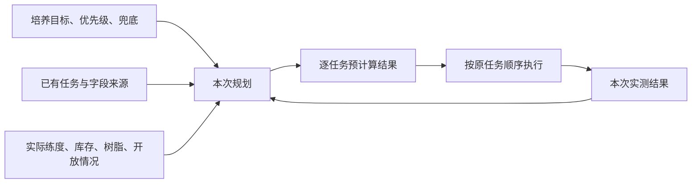
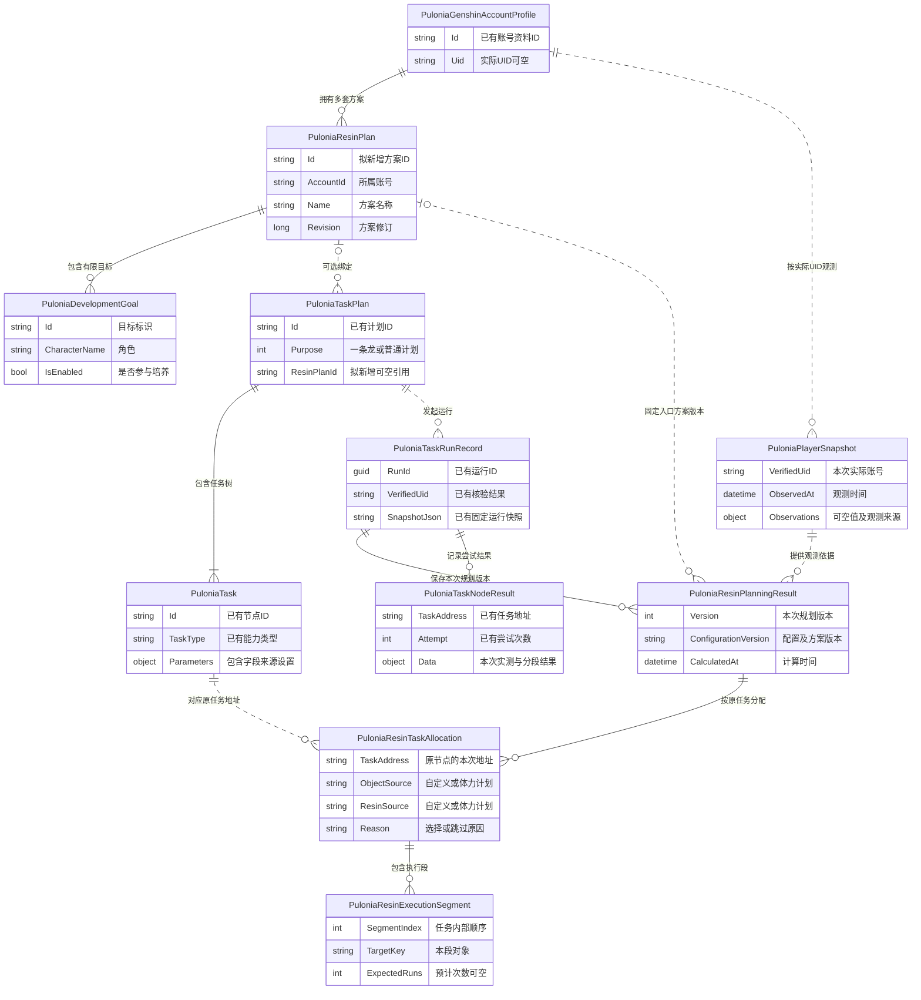
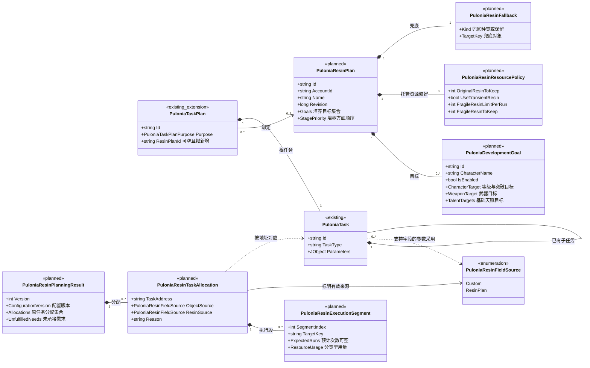
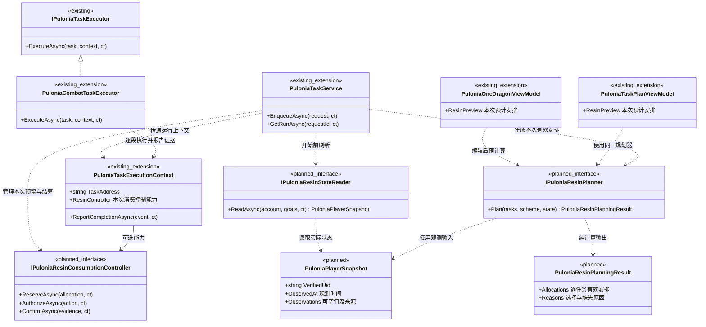

# Pulonia 体力计划设计文档

状态：设计基线，功能待实现；实现与验收进度统一维护在[开发计划](development-plan.md)。  
日期：2026-10-12。  
[返回总览](../automation-system.md) · [任务模型](task-model.md) · [界面设计](user-interface.md)

## 1. 术语定义

| 术语 | 含义 |
| --- | --- |
| **体力／树脂** | 本文指原神用于领取奖励的树脂资源，包括原粹、浓缩及相关补充道具。 |
| **任务计划** | 用户配置的任务树，定义执行哪些任务、任务参数、启用状态、顺序、分组和引用关系。 |
| **一条龙** | 通过专用界面编辑和执行的一类任务计划，与普通任务计划共用模型和执行规则。 |
| **体力计划** | 属于某个账号的具名培养方案，包含近期培养目标、培养方面优先级、最终兜底和资源偏好。一个账号可以保存多套方案。 |
| **培养目标** | 用户希望为角色、武器或天赋达到指定程度而准备的材料需求。首期负责备齐材料，提升操作由用户完成。 |
| **培养方面优先级** | 等级突破、武器、关键天赋等方面的预算分配顺序。默认不表达角色之间的排名。 |
| **绑定方案** | 任务计划引用一份体力计划。绑定后，只影响明确选择“体力计划”的字段。 |
| **字段来源** | 某项配置由用户自定义，或由体力计划计算。例如“秘境选择”和“树脂使用”分别选择来源。 |
| **有效配置** | 结合任务设置、方案和当前游戏状态后，本次实际执行的配置。 |
| **执行段** | 一个已有任务内部连续执行的一批操作，例如先连续刷取武器秘境，再刷取天赋秘境。执行段属于原任务，不成为新增的任务计划节点。 |
| **树脂预算** | 本次可以使用及已经预留的各类资源。内部按资源类型计算，折合点数仅用于汇总展示。 |
| **最终兜底** | 有限培养需求安排完成后，使用剩余资源执行的内容，例如指定圣遗物秘境、地脉，或保留树脂。 |
| **预计算** | 根据方案、任务配置和已观测状态，计算本次预计执行对象、次数、资源消耗与原因。 |
| **无状态规划** | 每次根据实际练度和库存重新计算需求，不根据历史刷取次数、完成标记或角色轮转游标推算培养进度。 |
| **运行记录** | 一次执行的配置、观测依据、预计安排和实际结果，供查看与诊断，不作为下次规划的库存依据。 |

## 2. 需求与调研依据

### 2.1 用户已确认的需求

1. 体力计划是智能托管的组成部分。用户主要表达培养目标、近期计划和最终兜底，不需要先理解树脂分配算法。
2. 一个账号可以保存多套方案；任务计划可以绑定其中一份，默认不绑定。通常从一条龙使用，但执行机制不区分一条龙与普通计划。
3. 多个任务计划连续或嵌套执行时，以执行输入方选择的方案为准。
4. 角色培养默认同级，界面不强调角色培养顺序。
5. 培养方面可以设置优先级，默认先基础培养，再关键天赋，最后长期圣遗物投入。
6. 今日受轮换限制的天赋、武器材料应优先考虑；实际全部开放时，不能机械套用星期限制。
7. 同一次执行尽量集中刷取一个来源、备齐一个有限目标，减少秘境切换。
8. 不持久化角色刷取进度。用户手动刷取、提升和消耗材料后，下次必须按真实状态重算。
9. 具体任务可以独立自定义。自定义用量优先，智能托管使用剩余资源；明确开启的补充道具也按任务配置执行。
10. 秘境选择与树脂使用分别增加“体力计划”选项，只有选择跟随的内容可以改变。
11. 绑定方案后，执行内容必须受已有任务计划约束，不能新增任务、启用关闭任务或改变任务顺序。
12. 体力计划未来可以自动生成任务计划，本期暂不提供。
13. 方案与任务配置结合后的预计算结果必须展示出来。
14. 内部允许复杂计算，对外配置应简单、易懂，并能解释结果。
15. 设计文档提供 ER 图与类图，说明对象关系及职责边界，并区分现有类型和拟新增类型。

### 2.2 玩家调研归纳

以下是玩家讨论和规划工具反馈中反复出现的问题，用于补充用户需求；具体游戏数值采用现行规则，不照搬旧帖子。

| 玩家问题 | 对设计的影响 |
| --- | --- |
| 记不住材料副本和开放日，多角色各差一点时需要频繁改配置。[BetterGI #3396](https://github.com/babalae/better-genshin-impact/issues/3396) | 用户选择角色，系统维护材料来源并给出今日安排。 |
| 希望按需求素材数量计算次数，而不是逐个秘境手填。[BetterGI #3716](https://github.com/babalae/better-genshin-impact/issues/3716) | 次数由实际缺口推导，同时保留明确的自定义方式。 |
| 外部工具需要手动维护库存，忘记更新后计划失真。[玩家规划讨论](https://www.reddit.com/r/GenshinImpact/comments/19889kw/) | 每次重新读取必要状态，减少手工记账。 |
| 希望看到阶段目标、汇总成本和可合成数量。[SEELIE 玩家反馈](https://www.reddit.com/r/Genshin_Impact/comments/l1luq5/)、[工具介绍](https://seelie.me/) | 展示当前值、目标值、共同材料需求和合成后的缺口。 |
| 圣遗物没有明确终点，确定收益的培养项目容易被挤占。[玩家讨论](https://www.reddit.com/r/GenshinImpactTips/comments/u1qry0/) | 有限目标与长期兜底分开，兜底不阻塞其他角色。 |
| 相同等级但突破状态不同，可能重复计算突破材料。[计算器反馈](https://www.reddit.com/r/GenshinImpactTips/comments/rhibc9/) | 等级与突破状态分别读取，明确展示 80/80 与 80/90。 |
| 合成浓缩后才发现需要刷首领。[玩家反馈](https://www.reddit.com/r/Genshin_Memepact/comments/164u1ng/) | 合成前考虑全部任务，保留必须使用原粹的额度。 |

培养建议也需要角色差异。普通攻击型角色与反应角色的等级、武器和天赋收益不同，三个天赋不应统一拉满。[KQM 新手指南](https://keqingmains.com/misc/newbie-guide/)、[万叶培养指南](https://keqingmains.com/kazuha/)

### 2.3 首期范围

包含方案管理、绑定、字段来源选择、必要状态读取、预计算、预算分配及已有任务接入。

暂不包含自动生成任务计划、自动升级与突破、完整圣遗物评分、周本自动战斗和原石自动补充。旧配置组保持原行为。

## 3. 概要设计

### 3.1 职责划分

**任务计划决定能做什么、何时轮到该任务；体力计划决定跟随字段的具体内容。**



规划仅在本次执行范围内的已有、有效启用任务中寻找承接入口：

- 秘境任务可以在其内部承接多个秘境执行段。
- 秘境任务不能承接首领能力。
- 被关闭的任务及父分组不能获得预算。
- 缺少对应能力时解释缺失条件，不自动添加或启用任务。
- 重复入口保留各自身份，共同需求只分配一次。
- 减少切换的优化受任务顺序和有效配置约束，不跨越用户设置的边界重排任务。

### 3.2 字段组合与配置优先级

| 对象来源 | 树脂来源 | 执行规则 |
| --- | --- | --- |
| 自定义 | 自定义 | 对象、次数及道具按任务配置，优先预留资源。 |
| 体力计划 | 自定义 | 方案选择兼容对象，用量按任务配置；没有可选目标时说明并跳过。 |
| 自定义 | 体力计划 | 保持指定对象，根据匹配需求计算用量；不匹配培养目标或兜底时不分配资源。 |
| 体力计划 | 体力计划 | 在该任务能力范围内推导对象、次数及树脂方式。 |

队伍、战斗策略、超时与恢复设置继续采用任务配置。未生效的自定义值保留，切回自定义后可以继续使用。

新字段默认自定义，绑定方案不会自动改变任务设置。选择跟随但没有有效方案时，标记配置不完整，不静默退回其他值。

### 3.3 方案作用范围

单独执行使用该任务计划绑定的方案。引用或连续执行使用发起方选定的方案，子计划不能自行替换。

发起方未指定方案时，不自动采用子计划方案。跨账号由输入方分别选择方案，状态按核验 UID 隔离。

配置与方案版本在本次执行开始时固定；用户编辑影响后续运行。实测状态变化可以重新计算尚未执行部分，但不改写已经发生的结果。

### 3.4 需求计算与集中刷取

每次执行读取目标角色的必要练度、突破状态、基础天赋等级，以及相关库存和树脂。

计算顺序：

1. 从实际状态计算有限目标所需材料。
2. 汇总共同需求，扣除共享库存及合法合成产物；同一份库存只能使用一次，高级材料不能向下折算为可用低级材料。
3. 优先预留自定义用量，再分配托管预算。
4. 按培养方面分层，优先考虑今日真正受开放窗口限制的目标材料。
5. 合并相同副本、奖励选项、难度和兼容执行配置的需求，连续刷取。
6. 同层优先延续当前副本；否则优先选择能集中备齐一个有限目标的来源，再比较预计挑战次数，以稳定标识处理最终并列。
7. 有限目标安排完成后，才分配最终兜底。

材料备齐即停止为该目标继续刷取。运行中根据本次实际掉落或刷新库存调整剩余需求，不能只按预计次数宣布完成。

不会保存“昨天刷到哪个角色”或“累计刷了多少次”来影响下次选择。无状态规划仍保存用户目标和方案，并保留单次运行记录；中断后需要重新核验实际资源，不能用旧记录直接推算现有库存。

### 3.5 树脂与资源转换

各类资源分别计算：

| 资源 | 规划约束 |
| --- | --- |
| 原粹 | 自然恢复上限 200，每 8 分钟恢复 1 点；补充后可能暂时超过自然上限。 |
| 浓缩 | 每枚合成需要 60 原粹，持有上限 5；用于兼容的三份奖励入口，不能替代首领所需原粹。 |
| 须臾 | 每枚补充 60 原粹或在支持的入口直接领奖；按实际到期批次选择。 |
| 脆弱 | 每枚补充 60 原粹或在支持的入口直接领奖；托管默认本次额度为 0。 |

原粹支持的领奖入口有 20、40 点选项；浓缩非零时，直接使用须臾、脆弱的奖励选项不能被规划为可用。[官方树脂说明](https://support.hoyoverse.com/hc/en-us/articles/50333934832537-Effective-Resin-Management)、[官方更新说明](https://genshin.hoyoverse.com/en/news/detail/159349)

须臾数量与到期时间需要实际识别，不能从购买次数推算；到期规则参见[须臾树脂资料](https://genshin-impact.fandom.com/wiki/Transient_Resin)。游戏规则与培养建议均记录来源及适用版本，界面不可用或规则无法核验时不凭旧攻略继续消费。

合成、兑换和领奖分别记录。合成浓缩只是资源转换，不能和随后领奖重复计算消费。

跟随方案的合成任务先保留后续首领及自定义任务额度，再决定合成量。自定义合成保持自身配置，其造成的后续预算不足需要在预览中说明。

接近有限目标时优先考虑较小的合法领奖单位，避免明显过量刷取；随机掉落和不可拆分的道具仍可能产生额外材料。

### 3.6 ER 图：保存配置、状态观测与单次运行

本图表示业务对象关系；项目使用文件存储，不表示新增数据库表。`PuloniaGenshinAccountProfile`、`PuloniaTaskPlan`、`PuloniaTask`、`PuloniaTaskRunRecord` 和 `PuloniaTaskNodeResult` 是已有类型，其余是拟新增或既有设计中尚未实现的类型。字段仅列出关联所需的关键内容，不是完整序列化格式。

实线表示配置或记录的归属，虚线表示引用、观测输入或历史追溯。运行记录使用固定副本，不能因原方案修改或删除而改变历史。



关系约束：

- 一份任务计划最多绑定一份体力计划，一份体力计划可以被多份任务计划引用；实际执行仍以输入方方案为准。
- 培养目标属于方案，观测状态属于实际账号；共享库存不复制到每个目标里。
- 默认账号别名不替代实际 UID，不能把不同登录账号的观测混在一起。
- 分配和执行段定位到原任务地址；任务地址继续包含引用路径和重复轮次。
- 编辑预览可以独立存在，开始执行后才归档到运行记录。本次重算可以保留多个版本，但这些版本不是跨次培养进度。
- 尚未读取的数据保持未知；未绑定方案的纯自定义任务也可以参加用量预览。

### 3.7 类图：模型与职责

图中的 `existing` 表示已有类型，`existing_extension` 表示拟扩展的已有类型，`planned` 表示拟新增类型。仅说明必要职责，不要求为每个概念新增独立服务或存储文件。

#### 配置与规划结果



对象来源和树脂来源进入各任务支持字段的参数合同，继续使用现有预设、祖先与节点参数解析；不在所有任务上强加秘境专用属性。培养目标内的具体目标是嵌套值对象，执行段也不进入 `PuloniaTask.Children`。

#### 预览、识别与执行



职责约束：

- 规划器不点击游戏，不读取历史刷取进度；预览与执行采用同一计算入口。
- 状态读取由任务服务协调游戏输入所有权，修改配置不调用状态读取。
- 消费控制负责本次预留、操作许可和证据结算，遵守自定义优先规则，不为账号保存培养轮转进度。
- 执行器接收本次有效配置；多个执行段仍通过同一个原任务报告结果。
- ViewModel 展示结果、来源和修正入口，不实现另一套预算算法。
- 本图中的新增属性与方法仅为设计职责，尚未加入代码；现有账号、计划、运行记录及执行合同继续复用。

## 4. UI / UX 设计

### 4.1 对外简化原则

普通用户主要完成三个决定：

**培养谁、优先培养哪方面、剩余资源做什么。**

材料来源、合成换算、树脂入口限制、重复需求和预算预留由内部处理。主界面展示结果和原因；字段来源、道具额度等在需要时展开。

使用“本次预计”“为后续任务保留”“材料已备齐”等直接文案，不向用户暴露内部模型、参数合并链或计算公式。

### 4.2 任务计划中的入口

一条龙保留现有左右布局，在配置选择区域下增加一行：

```text
配置：日常一条龙
体力计划：近期队伍培养 ▼    [编辑方案]
```

普通任务计划在计划设置中提供同样的选择器，复用方案编辑窗口。

下拉框首先提供“不指定”。本期不展示“自动生成任务计划”按钮。

选择方案后，展示引用情况和接入摘要：

```text
2 个任务由方案安排树脂，1 个任务使用自定义用量。
[查看本次安排]  [调整任务设置]
```

绑定不会悄悄更改字段。尚无任务跟随时，显示：

> 已绑定方案，当前任务仍使用自定义配置。

### 4.3 培养方案窗口

采用“左侧方案列表，右侧编辑内容”的窗口，不增加一套任务树。

右侧按以下顺序组织：

**近期培养目标**

```text
角色 A   已启用
等级与突破   当前 70/80 → 目标 80/90
武器         当前装备武器 → 目标 90
天赋         普攻不培养 · 战技 8 · 爆发 8
[修改目标]  [暂停培养]
```

- 角色列表不展示编号、排名或拖拽优先级。
- 推荐模板可快速填入目标，用户可以修改。
- 未读取状态显示“待读取”，不显示为 0。
- 未知或缺少推荐模板时，要求明确选择目标，不自动把三个天赋设满。
- 状态区分“仍缺材料”“材料已备齐，等待提升”“实际已达标”。

**培养方面优先级**

提供可拖动的短列表，默认等级与突破、武器、关键天赋、最终兜底。

旁边用一句话解释：

> 同一方面集中准备材料；今天受轮换限制的目标材料优先考虑。

**最终兜底**

选择指定圣遗物秘境、幽境、摩拉、经验书或保留剩余树脂。只显示当前选择需要的字段。

不要求用户填写圣遗物双暴、评分等完成条件。

**补充道具与保留量**

默认折叠。托管允许原粹、浓缩和须臾；脆弱本次额度默认 0，原粹保留量默认 0。用户展开后可以调整本次额度和库存保留量。

窗口使用独立草稿，“保存方案”后生效。编辑共享方案时显示引用它的计划数量；运行中的方案版本不随编辑变化。

### 4.4 具体任务设置

在原有控件中加入选项，不额外创建一组复杂开关：

```text
秘境选择：体力计划 ▼
树脂使用：体力计划 ▼
队伍：日常队伍 ▼
```

选择跟随后，下方显示当前计算结果：

```text
本次预计：先连续刷取武器材料秘境。
用途：为角色 A 准备武器突破材料。
用量：预计 3 次，浓缩 2 枚＋原粹 20。
[展开详细安排]
```

仍可切回指定对象或自定义用量。跟随时隐藏不生效的手工参数，避免用户同时看到两组相互矛盾的次数。

计划未绑定有效方案时，在对应控件旁给出修正入口：

> 请选择体力计划，或切回自定义。

### 4.5 本次预计安排

预计算结果直接出现在主页面，以已有任务为顺序和分组依据。

顶部保持紧凑：

```text
原粹 180/200 · 浓缩 2 · 须臾 1 · 脆弱 50
本次预计：原粹 140＋浓缩 2
预计保留：原粹 40 · 须臾 1 · 脆弱 50
脆弱允许使用：0 枚
数据读取于 10:32    [刷新游戏状态]
```

任务行显示对象、预计次数、树脂用法和必要原因。展开后查看角色材料缺口及执行段。

| 已有任务 | 本次安排 | 树脂用法 | 原因 |
| --- | --- | --- | --- |
| 自动秘境 | 武器材料秘境，预计 3 次 | 浓缩 2＋原粹 20 | 今日开放，集中准备武器材料 |
| 自动首领 | 指定首领，2 次 | 原粹 80 | 自定义用量，已优先保留 |
| 自动地脉 | 预计 1 次 | 原粹 40 | 培养经验仍有缺口 |
| 自动幽境 | 本次不执行 | — | 未配置匹配的培养目标或兜底 |

表内数字为界面示意；本例没有其他可承接的目标或兜底，因此保留剩余原粹与须臾。实际预览由所选方案、任务和观测状态产生，汇总与逐任务用量必须一致。

必须展示无法承接的需求，例如：

> 角色 B 还缺首领材料；当前任务计划未启用首领任务。

用户可以定位到相关任务设置，系统不代替用户启用任务。

### 4.6 预览与运行状态

| 状态 | 展示与行为 |
| --- | --- |
| 尚未读取 | 展示配置关系与待读取项，不承诺精确用量。 |
| 预览可用 | 标明数据观测时间，随机产出对应次数标为“预计”。 |
| 配置已修改 | 自动重新计算，并标明采用的是编辑草稿还是已保存配置。 |
| 正在刷新 | 保留原结果但标为旧数据，显示读取中的字段。 |
| 开始执行 | 重新核验实际状态，更新本次安排，不增加常规确认弹窗。 |
| 正在执行 | 显示已领取次数、已用资源、剩余需求和后续预留。 |
| 材料备齐 | 显示“材料已备齐，等待提升”。 |
| 无法核验消费 | 停止相关自动推进，显示原因及需要处理的事项。 |

配置变化本身不自动操作游戏。显式刷新和开始执行才进入游戏读取流程，且复用输入所有权管理。

异步预计算必须检查配置版本，旧结果不能覆盖新结果。预计与实际变化统一在原任务下展示，不生成第二份任务清单。

状态不能只靠颜色表达；关键原因直接显示，详细原因可展开，键盘操作与现有控件保持一致。

## 5. 接入、验证与文档维护

### 5.1 最小接口变化

- 新增按账号保存的体力计划，包含稳定标识、培养目标、方面优先级、兜底和资源偏好。
- 任务计划增加可空方案引用。
- 支持的配置字段增加“自定义／体力计划”来源选择。
- 规划器输出对应原任务的有效配置、执行段、资源分配和解释，同时供预览与执行使用。
- 运行记录保存本次方案版本、观测依据、预计安排与实测结果，不承担跨次培养进度计算。

现有指定角色识别、物品计数、地图树脂识别与任务执行器继续复用，补齐必要字段。识别不到不能当成没有。

内置任务及脚本中的内置调用传递同一消费控制上下文；自行点击领奖的脚本标为用量未知，预览说明覆盖范围并在执行后刷新。

### 5.2 验收场景

1. 一条龙与普通任务计划采用相同绑定和字段规则。
2. 四种对象／树脂来源组合正确生效，未选择跟随的字段保持原配置。
3. 绑定方案不会改变任务类型、位置、启用状态或节点数量。
4. 缺少能力、固定对象不匹配、没有兜底入口时解释清楚，不自动补任务。
5. 自定义用量优先预留，托管不能占用其额度。
6. 分组重复、引用和连续执行不会重复分配共同材料需求。
7. 用户手动培养或刷取后，下次按最新状态重算。
8. 同副本集中执行；长期圣遗物兜底不阻塞其他有限培养目标。
9. 突破状态、天赋加成、材料合成及共享库存计算正确。
10. 合成与兑换不重复计费，首领所需原粹不会被跟随合成任务挤占。
11. 修改配置后预览及时更新，开始后的有效配置与界面一致。
12. 未知、估算、实测和配置来源清晰可辨，消费不确定时不会重复点击。
13. ER 图与类图不引入跨次培养进度对象；执行段不被写成任务树节点；运行历史不随当前方案编辑变化。

实现遵循项目 MVVM、中文注释及 UTF-8 无 BOM 规范，完成相关计算与接入测试及编译验证，无需实际运行游戏。

### 5.3 文档归档与同步

本文作为独立专题文档归档并加入 [Pulonia 总览](../automation-system.md)。稳定术语同步到 [CONTEXT.md](../../../CONTEXT.md)，其中只保留术语定义。

[托管专题](scheduling-and-managed.md)中自动生成任务计划的描述标明为后续能力，当前绑定模式以本文为准；[任务模型](task-model.md)与[界面设计](user-interface.md)引用本文的模型图和 UI / UX 设计。

实现状态和验收结论继续统一维护在[开发计划](development-plan.md)中，设计文档不声称功能已经交付。
