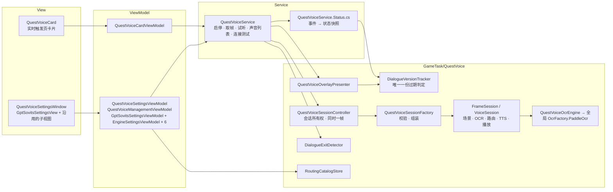

# 自动配音优化设计

> 状态：第 4 版，已实施，待游戏内验收 · 2026-10-30  
> 关联：[实时触发器生命周期](realtime-trigger.md) · [TaskTriggerDispatcher 依赖注入](task-trigger-dispatcher-di.md) · [配置持久化](config-persistence.md) · [插件系统与 OCR 模型插件化](plugin-system.md) · 用户文档 [questvoice.md](../technical/questvoice.md)

第 4 版变更：

- OCR 从“自建一个 PP-OCRv6 识别组件”改为“直接调用全局 OCR 服务 `OcrFactory.PaddleOcr`”。模型跟随“设置 → OCR 配置 → PaddleOCR模型”和游戏语言，设备跟随“硬件加速”，与 BetterGI 其他功能完全一致（第 6 节）。
- `IOcrService` 新增 `OcrResultWithoutDetector(Mat)`：不经过检测识别一张已裁剪的单行图像，返回文字和置信度。命名与已有的 `Ocr` / `OcrResult` / `OcrWithoutDetector` 对应。

第 3 版变更：

- 第 8 节按确认结果更新：流式合成保留，并记为可能的后续优化点；场景识别不改，OCR 直接使用 BetterGI 内置 OCR；新旧句接替不改；7 个引擎全部保留。
- 第 6 节的方案从“自带会话改由 `BgiOnnxFactory` 创建”改为“直接调用内置识别组件 `Rec`”。自带的 ONNX 会话、CTC 解码以及“OCR 模型路径”“DirectML 设备序号”两项设置一并删除。
- 第 3～5 节按实际实现更新。5.3 节逐项记录实施结果；第 9 项（配置两种存法合并）本次未做，移到第 9 节。
- 新增 7.4 节：实施结果与验证。

第 2 版撤回了第 1 版中删除功能的方案，启停周期改为与实时触发器一致，并删除了 UI 测试和只测死代码的测试（7.1 节）。

## 0. 结论

| 问题 | 结论 | 实施结果 | 章节 |
| --- | --- | --- | --- |
| 1. 菜单太多，界面是否友好 | 不够友好：一次配置要跨 3 个页面，“默认引擎”和“正在编辑的引擎”分在两页，同一概念有多个名字 | 导航“自动配音”及 4 个子页面合并为实时触发页的一张卡片和一个设置窗口（引擎与声线、角色、识别、高级）。设置项和运行信息都保留，只调整组织方式和文字 | 第 3 节 |
| 2. 能否放进实时任务 | 可以，启停周期与实时触发器一致 | 开关在卡片上；截图器启动时开始，独立任务和脚本期间停止、结束后恢复，截图器停止时停止，设置窗口打开期间暂停。实现上订阅调度器已有的任务模式事件，不注册为 `ITaskTrigger` | 第 4 节 |
| 3. 逻辑能否精简，是否符合分层标准 | 不完全符合：有死代码、未绑定的 VM 成员、重复的过期判定、跨层调用 | 清理死代码和未绑定成员、合并重复逻辑、修正跨层调用，不删功能。生产代码从 11,821 行降到 10,873 行（减少 948 行，约 8%） | 第 5 节 |
| 4. OCR 为什么强制 DML | 用的是 ONNX Runtime，和主程序同一个运行库；只是会话没走主程序的工厂，自己写死了 DirectML | 改为直接调用 BetterGI 全局 OCR 服务。模型跟随全局“OCR 配置”和游戏语言，设备跟随“硬件加速”；用户不再需要准备模型，配音也不再有自己的 OCR 设置 | 第 6 节 |

## 1. 优化前的状态

本节记录优化前的状态，作为对照保留。

### 1.1 规模

功能由提交 `ac117193a`（#3871）一次合入，尚未进入发行版本：没有 tag 包含该提交，ReleaseNotes 中也没有记录。配置结构调整时不需要兼容旧版本。

| 区域 | 优化前 | 优化后 | 内容 |
| --- | ---: | ---: | --- |
| `GameTask/QuestVoice/Features/Continuous` | 1,765 | 1,745 | 帧会话、配音会话两个状态机 |
| `GameTask/QuestVoice/Features/Tts` | 1,607 | 1,607 | 7 个引擎、流式协议、路由分派 |
| `GameTask/QuestVoice/Features/Ocr` | 1,418 | 945 | 6 种布局的像素场景识别、预处理；优化前还有自带的 OCR 会话和 CTC 解码 |
| `GameTask/QuestVoice` 其余（Core、Routing、Diagnostics、Audio、根目录） | 2,685 | 2,657 | 契约、路由目录、指标、悬浮摘要、会话包装 |
| `Service/QuestVoiceService*.cs` | 983 | 1,080 | 启停、采样、状态投影、试听；优化后多了按触发器周期自动启停 |
| `ViewModel/Pages`（19 个文件） | 2,016 | 1,680 | 设置窗口和卡片的 VM、路由草稿编辑器、7 个引擎 VM |
| `View/Pages`、`View/Windows`（优化前 30 个文件，优化后 28 个） | 1,251 | 1,051 | 优化前 4 个页面；优化后为卡片、设置窗口和引擎子视图 |
| `Core/Config` | 96 | 108 | |
| **合计** | **11,821** | **10,873** | 单元测试原有 49 个文件、7,723 行；第 2 版删除后 44 个文件、6,256 行；本次实施后 43 个文件、6,079 行 |

行数统计口径：`.cs` 和 `.xaml` 文件的全部行，含注释和空行。

### 1.2 界面问题

1. **一次配置要跨 3 个页面。** 配置与映射页的说明就是“先在引擎页面准备声音，再绑定旅行者、未知 NPC 和旁白”（`QuestVoiceSettingsPage.xaml:9`）。实际顺序是：引擎页填连接、选声音、加入通用声线库 → 配置与映射页绑定 → 运行页点启动。
2. **“默认引擎”和“正在编辑的引擎”分在两页。** 其他引擎页写着“下拉仅选择编辑对象。默认配音引擎请在配置与映射页选择”（`QuestVoiceOtherEnginesPage.xaml:20`）。GPT-SoVITS 页没有“设为默认”的入口。
3. **同一个东西有多个名字。** 声音、音色、声线、通用声线、通用声线库、此引擎的通用声线、Profile、VoiceId、Style ID、复合声音 ID。
4. **技术术语直接暴露。** 路由、Fallback / Fail、Names / Aliases / Corrections、实例 `""` / `local` / `remote`、“带 18708 字 character 字典的 PP-OCRv6 Rec ONNX 模型”、“cut5 … Ready/EOF 与安全排空”。
5. **按钮和状态行过多。** 高级卡片平铺 6 个文件操作按钮；GPT 页同时显示 3～4 行保存状态；引擎页叠加 4 行状态。
6. **操作步骤多。** 要先去启动页启动截图器，再到运行页点“启动”；运行中所有编辑被锁定；试听前要先停止配音。
7. **有功能没有入口。** `ConfirmBackendRestartedCommand` 没有绑定到任何按钮，后端状态未知后用户只能重启 BetterGI。
8. **细节。** 3 个超时输入框没有各自的标签；角色列表显示内部 ID；各页标题和卡片样式不统一；导航文本没有走 `i18n:T`。

### 1.3 实现问题

| 问题 | 证据 |
| --- | --- |
| 死代码 | 显式模板 OCR 路径：`ImageOcrService.RecognizeAsync(ImageOcrRequest)`、`ImageOcrService.Processing.cs`、`SceneProfileLoader`、`dialogue-one-line.xml` 在生产代码中没有调用方；`ContinuousSettingsLoader.Parse`、`VoiceErrors.Owner`、`ConfigurationLoadResult` 没有调用方；`OcrConfigurationError` 等 3 个字段从不赋值 |
| 未绑定的 VM 成员 | `QuestVoicePageViewModel` 的 `TestSpeechCommand`、`ProbeBackendCommand`、`OpenConfigurationCommand`、`OpenRoutingCommand`、`BrowseGptWeightsCommand` 等 3 个浏览命令、`Active*` 资源代理、`Supports*` 能力投影；`QuestVoiceManagementViewModel` 的 `SaveCommand`、`AddProfileCommand`、`TravelerChoices`、`VoiceIds`、`DraftNotice`、`PresetVoices` 整条链 |
| VM 之间逻辑重复 | 声音列表枚举 3 份、试听入口 3 个、新增声线 3 种方式、删除声线 2 条路径、URL 校验 2 份、文件选择 2 份、保存状态文本 2 套、`EnsureLoadedAsync` 3 个触发点 |
| 过期判定写了 3 遍 | 核心用 epoch、revision、semanticGeneration 判定过期；`QuestVoiceService`（`IsStale`、`AdvanceVersion`，约 400 行的事件投影）和 `QuestVoiceOverlayPresenter`（`Advance`）各自又实现了一遍 |
| 启停防护重复 | Service 的 `_operations` 与 Controller 的 `_lifecycle`、`_stopVersion` 都在防止启动越过停止；Service 的 `_encoding`、Controller 的 `_observing` 和 FrameSession 的 `_observing` 三层都在限制“同一时刻一帧” |
| 帧多余复制 | `Mat.Clone` → BMP 编码 → Controller `ToArray` → Snapshot 再 `ToArray` → 场景检查和 OCR 每次读 `Bytes` 都整块克隆。2560×1440 的 BMP 约 11 MB，每 150 ms 一次 |
| 路由每句读盘 | `VoiceRoutingService` 每句读 `routing.json`、算 SHA256、完整校验；`MatchesCurrentDialogueAsync` 每次 OCR 还要再解析 1～2 次。用户文档的语义是“修改在下次启动配音时生效”，读一次就够 |
| 跨层 | Service 做“离开对话”的图像识别（`HasConfirmedExitEvidence`）；VM 直接读写文件、算 SHA256、发 HTTP（`GetVoicesAsync`、`ProbeAsync`），并直接 `new RoutingCatalogStore()`；`QuestVoiceSessionFactory.ExtraConfig` 这个读方法会改写配置 |
| 配置两种存法 | GPT-SoVITS 和火山翻译的参数在 `QuestVoiceConfig` 顶层，其余 5 个引擎在 `ExtraProviders` 字典里；工厂因此到处是“字典有就用字典，否则用顶层字段”的分支，`CreateTtsSettings` 和 `CreateProviderSettings` 两个重载几乎相同 |
| 单实现接口 | 18 个只有一个实现的接口中，`ISceneSelector`、`ISceneProfileLoader`、`ISpeakerRouter`、`IReferenceAudioSelector`、`IImageOcrService`、`IImageProcessingService` 没有测试替身；其余 12 个在测试中用作替身 |

## 2. 原则与范围

原则：

- **保留全部现有功能。** 第 5.1 节逐项列出。设置项只删除“OCR 模型路径”和“DirectML 设备序号”两项：OCR 直接使用全局 OCR，模型和设备都跟随全局设置（第 6 节）。其余设置全部保留。
- 第 8 节的 4 项按确认结果处理：流式合成、现有场景识别、旧句接替方式、7 个引擎都不改。
- 只删除三类代码：生产中没有调用方的死代码、没有绑定的 VM 成员、重复实现的同一逻辑。
- 依赖方向为 View → ViewModel → Service → GameTask。

用户可感知的行为变化：

| 变化 | 原来 | 现在 | 章节 |
| --- | --- | --- | --- |
| 启停方式 | 手动点启动 / 停止 | 实时触发页开关，随截图器自动启停 | 4 |
| 独立任务和脚本期间 | 照常配音 | 停止，结束后恢复 | 4 |
| 暂停热键、战斗、传送、选 F 选项期间 | 照常识别 | 不处理帧，会话保留，结束后继续 | 4 |
| 运行中修改设置 | 编辑被锁定 | 打开设置窗口时暂停配音，关闭后按新设置继续 | 3.5 |
| OCR 模型 | 必须自备 `PP-OCRv6_rec_small.onnx` | 跟随全局“PaddleOCR模型”设置（默认 `V4Auto`，简体中文下为 PP-OCRv4；alpha 版默认 V6），“OCR 模型路径”设置删除 | 6 |
| OCR 设备 | 固定 DirectML，单独的设备序号 | 跟随“硬件加速”；“OCR 使用 CPU”默认开启，因此默认在 CPU 上识别 | 6 |
| 运行中修改全局 OCR 模型或游戏语言 | — | 下一次识别使用新模型，不需要重新开关配音 | 6 |
| 硬件加速选 CUDA 或 OpenVINO | 配音拒绝启动 | 可以使用 | 6 |
| 后端状态未知 | 只能重启 BetterGI | 卡片上出现“确认后端已重启”按钮 | 3.2 |

非目标：不改 `TaskTriggerDispatcher` 的调度规则；不新增引擎；不接通旁白路由（第 9 节）。

## 3. 交互设计（问题 1）

### 3.1 术语

只改界面文字，不改数据含义。

| 界面统一用词 | 含义 | 替代的旧说法 |
| --- | --- | --- |
| 引擎 | 合成声音的程序或服务 | TTS 引擎、Provider |
| 默认引擎 | 正式配音使用的引擎 | 默认 TTS 引擎 |
| 默认声音 | 某个引擎在“未启用角色声线”时使用的声音 | 引擎默认声音、VoiceId |
| 声线 | 可以分配给角色的一个声音配置 | 通用声线、通用声线库条目、Profile、GPT 声线 |
| 默认 NPC 声线 | 已启用角色声线、但没有匹配到角色时使用的声线 | Fallback |
| 角色声线 | 识别到某个姓名时使用哪条声线 | 角色声线路由、路由、映射 |
| 服务实例 | 本地或远程服务地址 | 实例 `local` / `remote` |

### 3.2 入口：实时触发页的卡片

放在“自动剧情”之后、“自动邀约”之前。卡片是独立的 UserControl `QuestVoiceCard`，`DataContext` 绑定 `TriggerSettingsPageViewModel.QuestVoice`（注入的 `QuestVoiceCardViewModel`）。标题、说明、开关的结构与其他实时任务卡片相同，文本走 `i18n:T`。卡片的样式都定义在卡片自身的资源中，不依赖父页面资源。

```text
┌──────────────────────────────────────────────────────────────────┐
│ 🔊 自动配音（实验性）                                       [ ● ] │
│    识别剧情对白的人物和台词，用语音朗读；截图器启动后自动开始，         │
│    独立任务运行时暂停                                                │
├──────────────────────────────────────────────────────────────────┤
│ 状态     ● 等待对白                              [确认后端已重启]   │
│          运行中 · 已绑定 · PID 12345              （仅后端状态未知时）│
│          （错误说明、校验结果）                                       │
├──────────────────────────────────────────────────────────────────┤
│ 进度     对话界面 ✓ ─ OCR ✓ ─ 角色 ✓ ─ 声线 ✓ ─ 合成 ● ─ 播放 ○       │
│          当前阶段：正在请求 GPT-SoVITS 合成语音                        │
├──────────────────────────────────────────────────────────────────┤
│ 当前     派蒙 · 声线「派蒙」                                          │
│          “前面好像有人，我们过去看看吧！”                               │
│          对白已稳定 · 合成：合成中 · 播放：等待播放音频                  │
├──────────────────────────────────────────────────────────────────┤
│ 最近事件  12:01:03 识别角色：派蒙                                      │
│          12:01:02 OCR 识别成功                    （最多 8 条）        │
├──────────────────────────────────────────────────────────────────┤
│ [设置…]  [校验配置]  [打开日志]  [打开日志目录]                         │
└──────────────────────────────────────────────────────────────────┘
```

- 标题行只放开关；展开后显示状态、6 节点进度、当前处理内容、最近事件和操作按钮，内容与原运行页一致。
- 未运行时状态行说明原因：“已关闭”“等待启动截图器”“独立任务运行中，已暂停”“设置窗口打开中，已暂停”。
- 后端状态未知时显示“确认后端已重启”按钮，绑定 `ConfirmBackendRestartedCommand`。会话运行中按钮不可用，需要先关闭开关；确认后按开关自动恢复。

### 3.3 设置窗口

`QuestVoiceSettingsWindow`：`ui:FluentWindow`，Mica 背景，`SourceInitialized` 中调用 `WindowHelper.TryApplySystemBackdrop`，`Owner` 为主窗口，`ShowDialog` 打开（与 `MusicSettingsWindow` 相同）。窗口分 4 页，底部固定一行状态。

**引擎与声线**：左侧列出 7 个引擎，★ 标记默认引擎；右侧是所选引擎的全部设置，上方有“设为默认引擎”按钮。默认引擎和正在编辑的引擎在同一页可见，解决 1.2 第 2 条。

```text
┌ [引擎与声线]  角色  识别  高级 ─────────────────────────────────────────┐
│ ┌────────────────────┐ │ ★ 为正式配音使用的默认引擎……       [设为默认引擎]  │
│ │★ GPT-SoVITS         │ │ GPT-SoVITS                                     │
│ │  火山翻译            │ │ ── 服务 ───────────────────────────────────── │
│ │  Windows 系统语音    │ │ [ ] 使用远程实例（本地与远程地址分别保留）         │
│ │  VOICEVOX           │ │ 服务地址 [http://127.0.0.1:9880/          ]     │
│ │  vits-simple-api    │ │ [测试连接] 尚未检测连接                          │
│ │  OpenAI 兼容语音     │ │ [ ] 按句流式合成与增量播放（实验性）               │
│ │  Google 翻译语音     │ │ ── 声线 ───────────────────────────────────── │
│ └────────────────────┘ │ [派蒙                ▼] [+ 新增] [删除]         │
│                        │ 名称 [派蒙]   服务实例 [跟随当前实例 ▼]            │
│                        │ GPT 权重     [D:\gsv\paimon.ckpt ] [浏览]       │
│                        │ SoVITS 权重  [D:\gsv\paimon.pth  ] [浏览]       │
│                        │ 参考音频     [D:\gsv\ref.wav     ] [浏览]       │
│                        │ 参考台词     [前面好像有人……              ]       │
│                        │ ── 试听 ───────────────────────────────────── │
│                        │ [你好，旅行者。     ] [试听选中声线] [停止试听]     │
└──────────────────────────────────────────────────────────────────────┘
```

- GPT-SoVITS 的设置改为一个新的子视图 `GptSovitsSettingsView`；地址输入框按“使用远程实例”切换本地或远程地址，两者分别保存。
- 其他 6 个引擎沿用现有子视图（`EngineConnectionView`、`EngineVoiceListView`、`EnginePreviewView` 及各引擎参数视图）。
- “加入通用声线库”改名为“添加为声线”；“此引擎的通用声线”改名为“本引擎的声线”。

**角色**：

```text
[✓] 启用角色声线      关闭时所有台词使用默认引擎的默认声音
默认 NPC 声线  [系统语音 ▼]   有姓名但没有匹配到角色时使用
旁白声线      [未设置   ▼]   旁白识别尚未接通：设置会保存，但暂不生效
旅行者        游戏内昵称 [我的昵称          ]  声线 [派蒙 ▼]  一行一个
角色          [搜索名称、别名或识别纠错…   ]          [+ 添加角色] [删除]
┌──────────────┬────────────────────────────────────────────────────┐
│ 派蒙          │ 正式名称  [派蒙                    ]                  │
│ 钟离          │ 别名      [应急食品                ]                  │
│ 旅行者（空）   │ 识别纠错  [派萌                    ]  OCR 常见误识别   │
│              │ 声线      [派蒙                  ▼]                  │
│              │ 角色 ID   [paimon] （旅行者等规则引用它，一般不用改）     │
└──────────────┴────────────────────────────────────────────────────┘
```

- 列表显示正式名称（`QuestVoiceManagementSpeaker.DisplayName`），不再显示内部 ID；角色 ID 留在详情里。
- 角色、旅行者、默认 NPC、旁白都使用同一个声线选择控件 `QuestVoiceVoiceSelector`。

**识别**：说明文字“直接使用 BetterGI 全局 OCR：模型跟随‘设置 → OCR 配置 → PaddleOCR模型’（自动选项按游戏语言选择），推理设备跟随‘设置 → 硬件加速’”；采样间隔（毫秒，50～500）。原“OCR 模型路径”和“DirectML 设备序号”删除，配音不设自己的 OCR 选项（第 6 节）。

**高级**：

- 网络超时：连接（1～120 秒）、请求（1～600 秒）、合成（1～600 秒）三项，各自带标签，注明对所有引擎生效。
- 找不到角色声线时：改用默认 NPC 声线 / 报错（原 Fallback / Fail）。
- 角色目录文件：路径与“浏览”；下方一行 5 个操作：重新加载、校验、导入…、导出…、新建空目录。“加载配置”和“放弃草稿并重新加载”合并为“重新加载”，有未保存修改时先确认放弃。

### 3.4 原有内容去向

| 原位置 | 内容 | 新位置 |
| --- | --- | --- |
| 运行与日志 | 启动、停止 | 卡片开关 |
| 运行与日志 | 校验配置、当前状态、6 节点进度、当前处理内容、最近事件、打开日志、打开日志目录 | 卡片展开内容 |
| 配置与映射 | 默认 TTS 引擎 | 设置窗口 · 引擎与声线（★ 设为默认引擎） |
| 配置与映射 | 启用角色声线路由、旅行者、未知 NPC 与旁白、角色管理 | 设置窗口 · 角色 |
| 配置与映射 | 缺失声线策略、6 个文件操作按钮、路由文件路径 | 设置窗口 · 高级（文件操作合并为 5 个） |
| 配置与映射 | 采样间隔 | 设置窗口 · 识别 |
| 配置与映射 | OCR 模型路径 | 删除，跟随全局“PaddleOCR模型”（第 6 节） |
| 配置与映射 | DirectML 设备序号 | 删除，跟随全局“硬件加速”（第 6 节） |
| GPT-SoVITS 配置 | 服务连接、测试连接、流式开关、声线库与试听 | 设置窗口 · 引擎与声线 · GPT-SoVITS |
| GPT-SoVITS 配置 | 三项超时 | 设置窗口 · 高级（这三项本来就对所有引擎生效） |
| 其他引擎设置 | 6 个引擎的连接、声音、参数、加入声线、本引擎声线、试听 | 设置窗口 · 引擎与声线 |
| 未绑定 | 确认后端已重启 | 卡片状态行（后端状态未知时） |

删除的界面只有导航“自动配音”及 4 个子页面：`QuestVoicePage`、`QuestVoiceSettingsPage`、`QuestVoiceGptSettingsPage`、`QuestVoiceOtherEnginesPage`。`QuestVoiceManagementView`、`QuestVoiceVoiceSelector` 和 `View/Pages/QuestVoiceSettings/*` 移入窗口继续使用。

### 3.5 保存与生效

- 保存方式不变：普通设置由 `AllConfig` 自动保存；角色目录仍是 `routing.json`，保留“校验通过才保存”、文件冲突检测、`.bak` 备份和退出前保存（`QuestVoiceSettingsExitGuard`）。
- 设置窗口打开时暂停配音（`QuestVoiceService.BeginSettingsEdit()`，停止会话，开关保持打开）。窗口关闭后先保存角色目录草稿（`FlushSettingsAsync`），再按新设置重新启动；草稿保存失败时卡片显示原因。试听不再要求先停止配音。
- `IsConfigEditable` 保留：试听或停止排空期间仍暂时冻结受保护的编辑。
- `QuestVoiceSettingsViewModel` 保持单例：关闭窗口不丢弃未保存的草稿，退出守卫也通过它排空草稿。
- 窗口底部固定显示角色目录的保存状态（`SaveStatus` · `EditStatus`）、命令错误，以及“修改自动保存，窗口打开期间配音暂停”的说明。试听结果和连接测试结果仍显示在各自按钮旁边。

## 4. 放入实时任务（问题 2）

### 4.1 生命周期与触发器对齐

| 时机 | 实时触发器 | 自动配音 |
| --- | --- | --- |
| 截图器启动 | 新建实例，按开关启用 | 开关打开时启动会话 |
| 开关打开 / 关闭 | 下一帧启用 / 停用 | 立即启动 / 停止会话 |
| 独立任务或脚本开始 | 用户开启的触发器全部停用 | 停止会话 |
| 独立任务或脚本结束 | 按开关恢复 | 开关打开时重新启动会话 |
| 暂停（暂停热键、战斗、传送、选 F 选项） | 不调用 `OnCapture`，状态保留 | 丢弃帧，会话保留 |
| 截图器停止 | 丢弃实例 | 停止会话 |
| 游戏不在前台 | 只运行可后台运行的触发器 | 跟随调度器：调度器截图时照常处理，与优化前一致 |
| 设置窗口打开 | — | 停止会话，关闭后恢复 |
| 应用退出 | — | 中止采样和后端请求，不再启动新会话 |

### 4.2 实现方式

| | A. 注册为 `ITaskTrigger` | B. 订阅调度器状态（采用） |
| --- | --- | --- |
| 生命周期 | 由调度器决定 | 与 A 相同，见 4.1 |
| 取帧 | `OnCapture` | `TaskTriggerDispatcher.FrameCaptured` 旁路，与优化前相同 |
| 异步启停 | `OnEnabled` / `OnDisabled` 在 Tick 中同步执行，不能等待；校验、加载模型、排空 GPT 请求都要另起任务 | Service 中一个串行方法统一处理 |
| 长对话中的帧 | 受“UI 变化后 30 秒内才全部执行”规则限制：声明 `Talk` 时完全依赖 `DisabledUiButton` 模板命中，6 种布局是否都有这个按钮未核实 | 不受影响 |
| 依赖注入 | `GameTaskManager.CreateTriggers(runtime, config)` 拿不到 `QuestVoiceService`，要改签名或用服务定位 | 不需要 |
| 截图器停止 | `Dispatcher.Stop` 不回调 `OnDisabled`（realtime-trigger.md 4.4 规则 6），仍要订阅 `GameRuntimeService.Stopped` | 订阅 `Stopped` |
| 改动调度器 | 需要 | 不需要，`TaskModeChanged` 和 `IsInTask` 已公开，`GuideWindowService` 已经这样用 |

采用 B：生命周期与触发器一致，同时避开 A 的 30 秒规则和异步问题，比原来的手动启停更简单。

### 4.3 启停规则

```text
应运行 = 应用未退出
      && Config.Enabled
      && GameRuntimeService.Current 存在且未停止
      && !TaskTriggerDispatcher.IsInTask
      && 没有打开的设置窗口
```

触发检查的事件：`QuestVoiceConfig.Enabled` 变化、`GameRuntimeService.Started` / `Stopped`、`TaskTriggerDispatcher.TaskModeChanged`、设置窗口打开或关闭、确认后端已重启。应用退出时调用 `StopAsync(applicationExit: true)`。暂停计数 `RunnerContext.Instance.AutoPickTriggerStopCount > 0` 时，取帧回调直接返回。

```csharp
/// <summary>按期望状态串行启停会话；等待期间状态再次变化则继续处理。</summary>
private async Task ApplyDesiredStateAsync()
{
    try
    {
        await _operations.WaitAsync().ConfigureAwait(false);
        try
        {
            while (ShouldRun != _controller.IsRunning)
            {
                if (_controller.IsRunning)
                {
                    await FinishStopAsync(BeginStop(applicationExit: false)).ConfigureAwait(false);
                }
                else if (!await TryStartCoreAsync().ConfigureAwait(false))
                {
                    // 启动失败只显示错误，等下一次事件再试，避免反复重试。
                    break;
                }
            }
            UpdateIdleStatus();
        }
        finally { _operations.Release(); }
    }
    catch (Exception exception) { _logger.LogError(exception, "QuestVoice 启停处理失败"); }
}
```

- 原 `StartAsync` / `StopAsync` 的主体（冻结配置、创建会话、订阅取帧、排空 GPT、更新状态）保留，拆为私有的 `TryStartCoreAsync`、`BeginStop`、`FinishStopAsync`。`BeginStop` 在拿到 `_operations` 之前就拒绝新帧并取消启动和试听。
- `RequestApply()` 在不应运行时先取消正在进行的启动，再排入 `ApplyDesiredStateAsync()`。
- 删除：启动和停止按钮及命令、“请先启动截图”前置检查。
- 新增：`QuestVoiceConfig.Enabled`；上面的方法和事件订阅；`BeginSettingsEdit()` 暂停租约；`UpdateIdleStatus()` 未运行原因；卡片 XAML。
- `QuestVoiceService` 在 `App.xaml.cs` 中于 `ServerTimeHelper.Initialize` 之后通过 `GetRequiredService` 创建，保证开关已打开时截图器一启动就能开始。

## 5. 结构优化（问题 3）

### 5.1 保留的功能

- 场景识别：6 种对白布局的像素识别、墨迹签名稳定判定、姓名金色墨迹隔离。
- 识别预处理（裁剪、墨迹隔离、按行切分）；识别本身改用全局 OCR（第 6 节）。
- 对白跟踪：定向复核、正文清空判定话轮、同一句不重复朗读、离开对话停止播放、新句音频准备好后再接替旧句。
- 7 个引擎，本地 / 远程两套地址；不同角色可用不同引擎（`RoutedTtsProvider`）。
- GPT-SoVITS：串行切换权重、已发出的请求排空、后端状态未知保护、流式合成与增量播放。
- 角色目录：v1 / v2 格式、旅行者、默认 NPC、旁白字段、缺失策略、别名、识别纠错、草稿校验后自动保存、SHA 冲突检测、文件锁、`.bak` 备份、导入导出、退出前保存。
- 运行信息：6 节点进度、当前处理内容、最近事件、悬浮摘要、日志分流、Debug 指标。
- 试听：引擎默认声音、声线草稿。

### 5.2 分层



约束：

- GameTask 不依赖 Service 和 ViewModel。
- Service 不做图像识别：`HasConfirmedExitEvidence` 移到 `GameTask/QuestVoice/DialogueExitDetector`。
- ViewModel 不直接发 HTTP：声音列表、连接测试、试听都通过 `QuestVoiceService`（`GetVoicesAsync`、`ProbeAsync`、`TestVoiceAsync`）。
- ViewModel 不直接读写角色目录文件：`RoutingCatalogStore` 由 DI 注入，文件存在检查和 SHA 计算移进 Store（`Exists`、`ReadSha256Async`）。

### 5.3 优化清单与实施结果

| # | 项目 | 优化 | 结果 |
| --- | --- | --- | --- |
| 1 | 死代码 | 删除显式模板 OCR 路径（`ImageOcrService.Processing.cs`、`SceneProfileLoader`、`Core/Ocr/ImageProcessingContracts.cs`、`dialogue-one-line.xml` 及其部署）、`ContinuousSettingsLoader.Parse`、`VoiceErrors.cs`（含 `Owner` 与 `VoiceErrorOwner`）、`ConfigurationLoadResult`、`WindowSettings`、3 个从不赋值的 `*ConfigurationError` 字段及其读取分支 | 已完成 |
| 2 | 未绑定的 VM 成员 | 删除 1.3 第 2 行所列成员；`ConfirmBackendRestartedCommand` 绑定到卡片 | 已完成，恢复了一个缺失的入口 |
| 3 | VM 重复逻辑 | URL 校验只保留 `EngineSettingsViewModel.IsValidUrl`；文件选择只保留 `QuestVoiceSettingsViewModel.PickFile`；声音列表和试听都经 Service；删除 `PresetVoices` 整条链和 `OtherEnginesSettingsViewModel`；`EnsureLoadedAsync` 在打开窗口时调用一次（进入 GPT-SoVITS 时的调用是幂等的） | 已完成。保存状态合并到窗口底部；试听和连接状态仍在各自按钮旁 |
| 4 | 过期判定写了 3 遍 | 抽出 `DialogueVersionTracker`，状态投影和悬浮摘要共用；状态投影移到 partial 文件 `QuestVoiceService.Status.cs` | 已完成。没有另建 `QuestVoiceStatusProjector` 类：投影与 Service 的状态和锁紧密相关，拆成独立类要多传一套状态，partial 文件已能分开职责 |
| 5 | 启停防护重复 | 启停只由 Service 的 `_operations` 串行（4.3），删除 Controller 的 `_stopVersion` | 部分完成。Service 的 `_encoding` 保留：它限制的是 Service 后台任务中的克隆、BMP 编码和离开对话检测这一段，Controller 的 `_observing` 只覆盖 `TryObserve` 之后。把这一段移进 Controller 收益小，本次不做 |
| 6 | 帧多余复制 | 编码结果直接交给 Controller，`TryObserve(byte[] owned, …)` 不再复制；`ContinuousFrameSnapshot.Bytes` 不再克隆 | 已完成，每帧少 3～4 次整帧复制（每次约 11 MB） |
| 7 | 路由每句读盘 | `VoiceRoutingService.LoadOnceAsync` 在同一会话内只读取并校验一次目录；读取失败或取消不缓存。`MatchesCurrentDialogueAsync` 走同一缓存 | 已完成。运行中外部修改 `routing.json` 改为下次启动生效，与用户文档一致 |
| 8 | 跨层 | 按 5.2 的约束移动；`ExtraConfig` 改为只读，引擎字典的缺省值由 `QuestVoiceConfig.OnExtraProvidersChanged` 在加载后补齐 | 已完成 |
| 9 | 配置两种存法 | GPT-SoVITS 和火山翻译的参数并入引擎字典；合并 `CreateTtsSettings` / `CreateProviderSettings` | **未实施**，移到第 9 节。它改动持久化字段，并牵涉 4 个测试文件，收益约 60 行，本次不做 |
| 10 | 单实现接口 | 删除 `ISceneSelector`、`ISceneProfileLoader`、`ISpeakerRouter`、`IReferenceAudioSelector`、`IImageOcrService`、`IImageProcessingService`；其余 12 个保留作测试替身 | 已完成 |
| 11 | OCR | 改用全局 OCR 服务（第 6 节）；删除 `DirectMlOcrEngine`、`DirectMlOcrSession`、`IDirectMlOcrSession`、`OcrExecutionProfile`、`CtcDecoder`、`ImageSnapshot`、`ImageOcrService.Frames.cs`（连续帧识别并入 `ImageOcrService` 和 `ContinuousFrameRecognizer`）、工厂中的运行库 DML 检查；删除 `OcrModelPath`、`DeviceId` 两项配置 | 已完成 |
| 12 | 界面 | 卡片 + 设置窗口，子视图复用；删除 4 个页面和导航项 | 已完成 |

主体算法、并发模型（两个会话的泵、版本号、观察租约）和 7 个 Provider 没有改动。

保留并在设计中注明的两处：

- 两个会话的 `CompleteAsync` 在生产中没有调用方，但 11 个测试文件用它排空会话，保留作为测试用的排空入口。
- `ContinuousVoiceSession.Snapshot` 只被测试读取，保留。

## 6. OCR（问题 4）

### 6.1 优化前用的是什么

配音的 OCR 用的就是 ONNX Runtime（ORT），和 BetterGI 其他模型是同一个运行库。区别只在会话怎么创建、模型从哪来。

| | 自动配音 OCR（优化前） | BetterGI 全局 OCR（`OcrFactory.PaddleOcr`） |
| --- | --- | --- |
| 运行库 | ONNX Runtime 1.21.0（NuGet `Microsoft.ML.OnnxRuntime.DirectML`，自带 CPU 和 DirectML 两种执行方式），进程里只有这一份 `onnxruntime.dll` | 同左 |
| 会话创建 | `DirectMlOcrSession` 自己 `new SessionOptions()`，只调用 `AppendExecutionProvider_DML(DeviceId)` | `BgiOnnxFactory` 按“硬件加速”设置选择 CPU / DirectML / CUDA / OpenVINO；“OCR 使用 CPU”开启时 OCR 固定走 CPU |
| 模型 | PP-OCRv6 small 识别模型（ONNX），默认路径 `User/QuestVoice/ocr/PP-OCRv6_rec_small.onnx`。仓库和发行包都不带，用户要自己放 | 内置 PP-OCR V4 / V5 / V6 及多语言变体，由“设置 → OCR 配置 → PaddleOCR模型”选择（默认 `V4Auto`，自动选项按游戏语言选择）。V6 识别模型为 `Assets/Model/PaddleOCR/Rec/V6/PP-OCRv6_small_rec_infer/slim.onnx`（约 21 MB） |
| 字典 | 18,708 字，写在模型文件元数据 `character` 里 | 同一套 18,708 字，放在模型同目录的 `inference.yml` |
| 文字检测 | 不用检测模型。6 种布局的场景识别已经算出姓名和每行正文的位置，逐行送进识别模型 | 检测模型加识别模型 |
| 解码 | 自带 CTC 解码；置信度为每个输出字符最大概率的平均值 | `Rec` 内置 CTC 解码，置信度算法相同 |

### 6.2 为什么说“强制 DML”

- `DirectMlOcrSession` 只加了 DirectML 执行方式，初始化失败直接报错，错误文本写明“没有 CPU 回退”。
- 首次推理后读取 ORT 的 profiling 记录，如果没有任何算子跑在 DirectML 上就报错（`OcrExecutionProfile`：“拒绝将全 CPU 执行报告为 DirectML”）。
- `QuestVoiceSessionFactory` 检查进程里的运行库是否带 `DmlExecutionProvider`，没有就拒绝启动。

代码、测试和用户文档都没有给出必须用 DirectML 的理由。文件头注明移植自外部 QuestVoice 项目，原项目大概率是独立程序，自己决定用哪种设备。

进程只能加载一个 `onnxruntime.dll` 是真实限制：`OnnxRuntimeLoader` 按“硬件加速”设置加载一次，之后不能更换。用户选 CUDA 或 OpenVINO 时加载的运行库不含 DirectML，所以配音只能报错。这条限制说明“不能为配音另换运行库”，并不要求“配音必须用 DirectML”。

优化前的两个问题：

- 选 CPU 的用户，内置运行库仍带 DirectML，检查能通过，配音会绕过用户的选择用 GPU。
- 选 CUDA 或 OpenVINO 的用户完全不能用配音。

### 6.3 实施方案

场景识别和预处理保留，识别本身直接调用 BetterGI 全局 OCR 服务，配音不再有自己的 OCR 模型、设备或会话：

1. `IOcrService` 新增 `OcrResultWithoutDetector(Mat mat)`，返回 `OcrRecognizerResult`（文字和置信度）。原有的 `OcrWithoutDetector` 只返回文字，不能满足配音按置信度接受结果的需要。命名补齐原接口的组合：带检测的 `Ocr` → 文字、`OcrResult` → 带置信度的结果；不带检测的 `OcrWithoutDetector` → 文字、`OcrResultWithoutDetector` → 带置信度的结果。`PaddleOcrService` 的实现在全局推理锁内调用 `Rec.Run(Mat)`，`OcrWithoutDetector` 改为取它的 `Text`，与 `Ocr` 取 `OcrResult(mat).Text` 的写法一致。
   配音每帧的 2～4 行逐行调用，不做批量推理。逐行时每行单独占用锁，其他功能可以在行间插入；也不会像批量推理那样把短行补齐到最长行的宽度，与其他功能调用 `OcrWithoutDetector` 的方式一致。
2. `QuestVoiceOcrEngine` 注入 `OcrFactory` 和 `InferenceRuntimeService`。每次识别都通过 `OcrFactory.PaddleOcr` 取当前实例，所以模型跟随“PaddleOCR模型”设置和游戏语言，设备跟随“硬件加速”和“OCR 使用 CPU”。识别结果附带的 `OcrModelInfo` 记录 `ActiveModelType.RecognitionModel.Name` 和 `Runtime.OcrDescription`，目前界面不显示。
3. 切换模型或游戏语言时，设置页调用 `OcrFactory.Unload()` 卸载旧实例。识别时遇到旧实例已释放（`ObjectDisposedException`），换用新实例重试一次。下一次识别即使用新模型，不需要重新开关配音。
4. `QuestVoiceOcrEngine` 不拥有全局实例，释放时只等待本轮在途识别结束。全局实例首次使用时由 `OcrFactory` 加载并预热；加载失败转换为 `OcrException(ModelInitialization)`，推理失败转换为 `OcrException(Inference)`。
5. `ImagePreprocessor` 输出 BGR `Mat` 行图，由 `Rec` 统一缩放到模型输入高度。`IOcrEngine.RecognizeAsync` 的入参为 `IReadOnlyList<Mat>`。
6. 删除“OCR 模型路径”和“DirectML 设备序号”两项设置、工厂中的运行库检查、profiling 校验、自带 CTC 解码和张量路径。指标中的“识别组件初始化”一项随之删除；`NativeRun` 现在包含等待全局推理锁的时间。
7. `OcrSettings` 只保留姓名 0.9、正文 0.8 两个置信度阈值。阈值属于配音自己的接受规则，不是 OCR 配置。

与“每轮自建一个识别组件”相比，直接使用全局服务的取舍：

| | 每轮自建识别组件（第 3 版） | 直接使用全局 OCR 服务（采用） |
| --- | --- | --- |
| 模型选择 | 固定 PP-OCRv6，与全局设置无关 | 与全局设置一致；插件系统等后续调整也会自动生效 |
| 内存 | 多一份识别模型和推理会话 | 不额外加载 |
| 推理锁 | 独占，不与其他功能排队 | 与自动拾取等功能共用一把锁，可能排队 |
| 运行中切换模型 | 下次开启配音才生效 | 下一次识别生效 |

### 6.4 风险

- **默认模型变为 PP-OCRv4**：全局默认 `V4Auto`，简体中文下解析为 PP-OCRv4（alpha 版升级时会改成 V6）。V4 中文字典约 6,600 字，比 V6 的 18,708 字少，生僻的人名用字可能识别不出。需要更好效果的用户可以在全局设置中选 V6，这会同时影响其他功能。
- **置信度阈值**：姓名 0.9、正文 0.8 是按 PP-OCRv6 标定的。V4、V5 及多语言模型的置信度分布不同，可能出现更多“低置信度”拒绝，需在游戏内确认。全局内置 `slim.onnx` 与原先使用的 `PP-OCRv6_rec_small.onnx` 是否为同一份权重也未核实。
- **推理锁排队**：全局 OCR 由多个功能共用一把锁。对话中如有其他功能同时识别，配音会排队等待；`NativeRun` 指标包含排队时间，可据此判断。
- **逐行推理耗时**：每帧 2～4 次单行推理，替代原来的 1 次批量推理。行图很小，预计差别不大，需在 CPU 上实测。
- **同一帧跨模型**：运行中切换全局模型时，同一帧的姓名和正文可能分别由新旧模型识别。只影响切换瞬间的一帧，不做处理。
- **CPU 耗时**：“OCR 使用 CPU”默认开启，配音 OCR 默认从 GPU 改到 CPU。每个稳定画面识别 2～4 行，另有每 2 秒一次复查，需要实测单次耗时；如偏慢，提示用户关闭“OCR 使用 CPU”。
- **OpenVINO**：宽度可变的输入是否触发重编译、性能如何，未验证。CPU、DirectML、CUDA 没有问题。

## 7. 实施与验收

### 7.1 已删除的测试（第 2 版执行）

UI（View / ViewModel）测试不持久化；只测试生产中无调用方的死代码的用例没有价值。共删除 5 个文件和另外 4 个用例，1,467 行。

| 文件或用例 | 原因 |
| --- | --- |
| `VoiceManagementViewModelTests.cs`（11 个用例） | ViewModel 测试 |
| `Phase8SettingsTests.cs`（14 个用例） | ViewModel 测试；其中唯一的工厂用例与 `QuestVoiceConfigurationTests` 的相对路径用例重复 |
| `ExtraTtsViewModelTests.cs`（7 个用例） | ViewModel 测试 |
| `TtsDiagnosticLifecycleTests.cs`（1 个用例） | 通过 `QuestVoicePageViewModel` 驱动。它覆盖的“退出时中止试听请求、普通停止等待排空”改由 7.3 验收 |
| `AutoSceneProcessingTests.cs`（8 个用例） | 全部只测 `ProcessAsync` 和显式模板路径，生产无调用方 |
| `SpeakerInkPreprocessingTests.AutomaticAndContinuousShareSelectedPolicyWhileExplicitTemplatesKeepOriginalPixels` | 主要测 `ProcessAsync` 和显式模板路径；墨迹隔离本身由同文件另外两个用例覆盖 |
| `ContinuousFrameGateTests.StrictSettingsRejectMalformed`、`StrictSettingsAcceptCompleteInputAndRejectExtraOrDuplicateFields` | 只测 `ContinuousSettingsLoader.Parse`，生产无调用方；`Validate` 的用例保留 |
| `WavAndReferenceTests.Every_error_code_requires_an_explicit_owner` | 只测 `VoiceErrors.Owner`，生产无调用方 |

规则：

- 界面改动用编译、窗口和卡片实例化检查、人工验收验证，不写持久化的 UI 测试。
- 删除死代码时同步删除只测它的用例；行为不变的重构只调整测试中的构造方式。

### 7.2 实施步骤

| 步骤 | 内容 | 状态 |
| --- | --- | --- |
| 1 | 5.3 第 1、2、10 项：死代码、未绑定成员、无替身的单实现接口 | 已完成 |
| 2 | 第 6 节：OCR 改用全局 OCR 服务（第 3 版为自建 `Rec`，第 4 版改为全局服务） | 已完成 |
| 3 | 第 4 节与 5.3 第 4、5、6 项：启停周期、状态投影、启停与帧路径去重 | 已完成（第 5 项部分完成） |
| 4 | 5.3 第 3、7、8 项：VM 去重、路由加载一次、跨层修正 | 已完成；第 9 项未实施 |
| 5 | 第 3 节：卡片、设置窗口，删除 4 个页面和导航项 | 已完成 |
| 6 | 更新 `Docs/technical/questvoice.md` | 已完成 |
| 7 | 7.3 游戏内验收 | 待维护者执行 |

### 7.3 游戏内验收

| 场景 | 预期 |
| --- | --- |
| 截图器启动且开关打开 | 自动开始，卡片显示运行中 |
| 运行一条龙或 JS 脚本 | 任务开始时停止，结束后自动恢复 |
| 暂停热键、战斗、传送期间 | 不识别，结束后继续 |
| 截图器停止、游戏退出 | 卡片显示“等待启动截图器”，没有残留播放 |
| 打开设置窗口 | 暂停，可以试听；关闭后按新设置继续 |
| 设置窗口中留下无效的角色目录草稿后关闭 | 卡片提示角色目录有未保存的修改 |
| 退出 BetterGI 时正在试听 GPT-SoVITS | 试听请求被中止，程序正常退出 |
| 普通停止时 GPT-SoVITS 正在合成 | 等待已发出的请求结束再停止 |
| 后端状态未知后关闭开关、重启后端、点击“确认后端已重启”、打开开关 | 正常恢复配音，不需要重启 BetterGI |
| 硬件加速为 CPU、DirectML、CUDA、OpenVINO | 都能识别；选 CPU 或开启“OCR 使用 CPU”时不占用 GPU |
| 不放置任何 OCR 模型 | 使用全局 OCR 正常识别 |
| 全局“PaddleOCR模型”为 `V4Auto`（默认）和 `V6` | 都能识别姓名和台词 |
| 配音运行中切换全局“PaddleOCR模型”或游戏语言 | 下一次识别使用新模型，配音不中断 |
| 姓名、正文的识别置信度 | 在 V4 和 V6 下，阈值 0.9 / 0.8 都不出现明显漏识别或误识别 |
| 对话中同时开启自动拾取、自动剧情等使用 OCR 的功能 | 配音识别延迟可接受，其他功能不受明显影响 |
| 现有对白场景（单行、多行、称号、注音、快速连点、选项） | 与优化前行为一致 |
| 设置窗口各页、深浅色主题、窗口缩小到最小尺寸 | 内容不挤缩，控件状态颜色正常 |

### 7.4 实施结果与验证

- 编译：`dotnet msbuild BetterGenshinImpact.sln -restore -p:Configuration=Debug -nologo -tl:off -clp:ErrorsOnly` 退出码 0。
- 单元测试：`QuestVoiceTests` 共 442 个用例全部通过。第 2 版后为 452 个；本次删除 `DirectMlOcrEngineTests.cs`（只测已删除的自带会话）和 `OcrAlgorithmTests` 中 2 个自带 CTC 解码用例，路由配置错误的用例收缩为 `No_routing_uses_configured_voice`（对应的 `*ConfigurationError` 字段已删除）。
- 代码规模见 1.1 节：生产代码减少 948 行，比第 2 版估计的约 1,600 行少。原因是第 9 项未实施、新增的卡片、设置窗口和 GPT-SoVITS 子视图（含 VM）共 765 行、状态投影保留在 Service 的 partial 文件中。
- 未运行主程序，界面和游戏内行为待 7.3 验收。
- 第 4 版（OCR 改用全局服务，接口方法为 `OcrResultWithoutDetector`）：解决方案编译退出码 0，`QuestVoiceTests` 442 个用例全部通过。测试只通过 `IOcrEngine` 替身接入 OCR，全局 OCR 的实际识别待 7.3 验收。

## 8. 已确认事项

1. **流式合成**：保留，不移除。记为可能的后续优化点（第 9 节）。
2. **识别方式**：不改，保留现有 6 种布局的场景识别和识别预处理；OCR 直接使用 BetterGI 全局 OCR，配置也完全跟随全局 OCR 配置（第 6 节）。
3. **新旧句接替**：不改，原方式合理：旧句继续播放，直到新句音频准备好再接替。
4. **引擎**：7 个引擎全部保留，不移除。

## 9. 不在本次范围与后续优化点

不在本次范围：

- 接通旁白路由：旁白声线可以设置，但实时链路从未传入旁白上下文。本次保留设置并在界面注明，接通需要单独设计。
- 判断台词是否已有官方配音、自动关闭游戏原声。
- 云原神网页版等子实例。

可能的后续优化点：

- **流式合成**：按句流式与增量播放的状态机（Ready / EOF、缺料、安全排空）是 TTS 部分最复杂的代码，只对 GPT-SoVITS 生效且默认关闭。积累使用反馈后，再评估是否简化或移除。
- **配置两种存法合并**（原 5.3 第 9 项）：GPT-SoVITS 和火山翻译的参数并入引擎字典，合并 `CreateTtsSettings` / `CreateProviderSettings`。需要同步调整持久化字段和 4 个测试文件。
- **`_encoding` 去重**（原 5.3 第 5 项的剩余部分）：把克隆、编码和离开对话检测移进 Controller，由 `_observing` 统一限制同时一帧。
