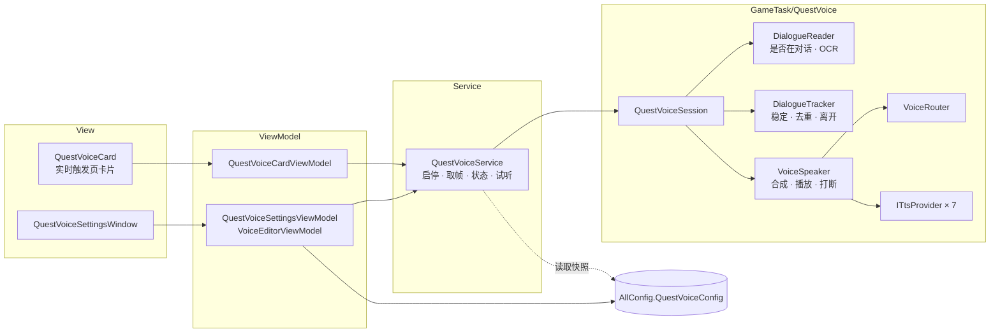

# 自动配音精简与优化设计

> 状态：提案（第 1 版）· 2026-10-30 · 待确认（第 8 节）  
> 关联：[实时触发器生命周期](realtime-trigger.md) · [TaskTriggerDispatcher 依赖注入](task-trigger-dispatcher-di.md) · [配置持久化](config-persistence.md) · 用户文档 [questvoice.md](../technical/questvoice.md)

## 0. 结论

| 问题 | 结论 | 方案摘要 | 章节 |
| --- | --- | --- | --- |
| 1. 菜单太多，界面是否友好 | 不够友好：一次配置要跨 3 个页面，同一概念有多个名字，草稿机制直接暴露给用户 | 删除导航“自动配音”及 4 个子页面；入口改为实时触发页的一张卡片；声线、角色、高级设置放进一个设置窗口；默认用系统语音，开箱即用 | 第 3 节 |
| 2. 能否放进实时任务 | 入口和开关语义可以放；实现上不做成 `ITaskTrigger` | 做成触发器会让复杂度上升。保留现有的取帧旁路，只把“手动启动/停止”改为“开关 + 随截图器自动启停” | 第 4 节 |
| 3. 逻辑能否精简，是否符合分层标准 | 不符合。约 1.18 万行，大部分是移植来的并发状态机、像素布局识别和自带 OCR | 一条识别管线、一条配音管线、一份配置模型，目标约 3,800 行 | 第 5 节 |
| 4. OCR 为什么强制 DML | 没有技术必要，是移植时的实现选择 | 改用内置 PP-OCRv6 模型，由 `BgiOnnxFactory` 创建会话，跟随“硬件加速”设置；删除模型路径和 DirectML 设备序号 | 第 6 节 |

## 1. 现状

### 1.1 规模

功能由提交 `ac117193a`（#3871）一次合入，尚未进入发行版本：没有 tag 包含该提交，ReleaseNotes 中也没有记录。本次调整**不做旧配置迁移**，旧的 `User/QuestVoice` 目录不再读取，也不自动删除。

| 区域 | 行数 | 内容 |
| --- | ---: | --- |
| `GameTask/QuestVoice/Features/Continuous` | 1,765 | 帧会话、配音会话两个状态机 |
| `GameTask/QuestVoice/Features/Tts` | 1,607 | 7 个引擎、流式协议、路由分派 |
| `GameTask/QuestVoice/Features/Ocr` | 1,418 | 自带 DirectML OCR，6 种布局的像素场景识别 |
| `GameTask/QuestVoice` 其余（Core、Routing、Diagnostics、Audio、根目录） | 2,685 | 契约、路由目录、指标、悬浮摘要、会话包装 |
| `Service/QuestVoiceService*.cs` | 983 | 启停、采样、状态投影、试听 |
| `ViewModel/Pages`（19 个文件） | 2,016 | 4 个页面的 VM、路由草稿编辑器、6 个引擎 VM |
| `View/Pages`（30 个文件，含代码后置） | 1,251 | 4 个页面、9 个引擎子视图 |
| `Core/Config` | 96 | |
| **合计** | **11,821** | 另有单元测试 49 个文件，7,723 行 |

### 1.2 界面问题

1. **一次配置要跨 3 个页面。** 配置与映射页的说明就是“先在引擎页面准备声音，再绑定旅行者、未知 NPC 和旁白”（`QuestVoiceSettingsPage.xaml:9`）。实际顺序是：引擎页填连接、选声音、加入通用声线库 → 配置与映射页绑定 → 运行页点启动。
2. **“默认引擎”和“正在编辑的引擎”分在两页。** 其他引擎页写着“下拉仅选择编辑对象。默认配音引擎请在配置与映射页选择”（`QuestVoiceOtherEnginesPage.xaml:20`）。GPT-SoVITS 页没有“设为默认”的入口。
3. **同一个东西有多个名字。** 声音、音色、声线、通用声线、通用声线库、此引擎的通用声线、Profile、VoiceId、Style ID、复合声音 ID。
4. **“默认声音”有两层。** 关闭路由时用引擎的默认声音，开启路由时用“默认 NPC 声线”；而默认 NPC 声线下拉的第一项又是“使用默认配音规则”。
5. **技术术语直接暴露。** 路由、Fallback / Fail、Names / Aliases / Corrections、实例 `""` / `local` / `remote`、“带 18708 字 character 字典的 PP-OCRv6 Rec ONNX 模型”、“DirectML 设备序号”、“cut5 … Ready/EOF 与安全排空”。
6. **草稿机制暴露给用户。** 高级卡片有 6 个按钮：加载配置、新建空目录、校验草稿、导入配置、导出草稿、放弃草稿并重新加载。GPT 页同时显示 3～4 行保存状态。草稿无效时还会拦截退出。
7. **操作步骤多。** 要先去启动页启动截图器，再到运行页点“启动”；运行中所有编辑被锁定；试听前要先停止配音。
8. **有设置但不生效。** “旁白声线”可以设置，但实时链路从未传入旁白上下文，用户文档自己也写明尚未接通。
9. **细节。** 3 个超时输入框没有各自的标签；角色列表显示内部 ID；各页标题和卡片样式不统一；导航文本没有走 `i18n:T`。

### 1.3 实现问题

| 问题 | 证据 |
| --- | --- |
| 启停链 5 层，每层自带锁、信号量和取消源 | Service（`_operations`、`_captureGate`、`_statusGate`）→ Controller（`_lifecycle`、`_stopVersion`）→ QuestVoiceSession → ContinuousFrameSession（2 把锁、2 个信号量、5 个 TaskCompletionSource、6 个计数器）→ ContinuousVoiceSession（布尔状态 6 个、观察租约、重入事件队列） |
| 同一句对白用 4 个版本号区分 | epoch、revision、semanticGeneration、dialogueOccurrence；Service（`IsStale`、`AdvanceVersion`）和悬浮摘要（`QuestVoiceOverlayPresenter.Advance`）各自再镜像一遍过期判定 |
| 单实现接口 18 个，另有仅转发的包装 | `IQuestVoiceSession`、`IOcrEngine`、`ISceneSelector`、`IVoiceRoutingService` 等；`QuestVoiceSession`、`QuestVoiceSessionController`、`ContinuousFrameRecognizer` |
| 一帧复制和编解码 5 次 | `Mat.Clone` → BMP 编码 → Controller `ToArray` → Snapshot `ToArray` 并计算 SHA256 → SkiaSharp 解码。2560×1440 的 BMP 约 11 MB，每 150 ms 一次 |
| 配置有三套表示 | `QuestVoiceConfig`（GPT 和火山在顶层，其余 5 个引擎在字典里）→ `AppSettings` 加 8 个子 record → `VoiceSettings` / `VoiceBinding` / `RoutingVoice`；工厂为冻结配置做 JSON 深拷贝 |
| 路由每句读盘 | `VoiceRoutingService` 每句读 `routing.json`、算 SHA256、完整校验；存储层有 `.lock`、SHA 乐观锁、`.bak`、二次解析；VM 再加一层草稿、750 ms 防抖和退出拦截 |
| 跨层 | Service 做“离开对话”的图像识别（`HasConfirmedExitEvidence`）；VM 直接读写文件、发 HTTP、调用 GameTask 组合根；`QuestVoiceSessionFactory.ExtraConfig` 这个读方法会改写配置 |
| 死代码与未接通功能 | 显式模板 OCR 路径（`ImageOcrService.Processing.cs` 无调用方）、`ContinuousSettingsLoader.Parse`、两个会话的 `CompleteAsync`、旁白路由、3 个 `*ConfigurationError`、`ConfigurationLoadResult`、多个未绑定的 VM 命令 |
| 实验功能占比高 | 流式合成默认关闭，约 500 行；`QuestVoiceMetrics` 只输出 Debug 日志，81 行加多处埋点 |

## 2. 目标与非目标

目标：

- 只有一个入口。首次使用不需要下载模型或部署服务，打开开关就能听到朗读。
- 用户只接触 3 个概念：声线、角色、默认声线。
- 依赖方向为 View → ViewModel → Service → GameTask。识别、路由、合成播放各由一个类负责。
- OCR 和其他功能一样遵循“硬件加速”设置。

非目标：

- 不改 `TaskTriggerDispatcher` 的调度规则。
- 不新增 TTS 引擎，不改各引擎的 HTTP 协议细节（流式除外，见第 8 节）。
- 不做“判断台词是否已有官方配音”“自动关闭游戏原声”“旁白单独声线”。
- 不做旧配置迁移。

## 3. 交互设计（问题 1）

### 3.1 术语

| 术语 | 含义 | 替代的旧说法 |
| --- | --- | --- |
| 引擎 | 合成声音的程序或服务，例如 Windows 系统语音、GPT-SoVITS | TTS 引擎、Provider、实例 |
| 声线 | 一个可选的声音：引擎加上该引擎里的具体声音。GPT-SoVITS 的声线是权重加参考音频 | 声音、音色、通用声线、Profile、VoiceId |
| 角色 | 识别到某个姓名时使用哪条声线 | Speaker、路由、映射 |
| 默认声线 | 没有匹配到任何角色时使用的声线 | 默认 NPC 声线、引擎默认声音、Fallback |

### 3.2 入口：实时触发页的卡片

放在“自动剧情”卡片之后，结构与其他实时任务卡片相同（`CardExpander`、标题加说明、右侧开关），文本走 `i18n:T`。卡片作为独立 UserControl `QuestVoiceCard`，`DataContext` 绑定 `TriggerSettingsPageViewModel.QuestVoice`（注入的 `QuestVoiceCardViewModel`）。

```text
┌────────────────────────────────────────────────────────────────┐
│ 🔊 自动配音（实验性）                                     [ ● ] │
│    识别剧情对白的人物和台词，用语音朗读                            │
├────────────────────────────────────────────────────────────────┤
│ 状态        运行中 · 派蒙 · 声线「派蒙」 · 正在播放                  │
│             “前面好像有人，我们过去看看吧！”                         │
├────────────────────────────────────────────────────────────────┤
│ 声线与角色   默认声线：系统语音 · 已设置 3 个角色        [设置…]    │
├────────────────────────────────────────────────────────────────┤
│ 日志        启动、停止、错误和每句识别结果                [打开日志] │
└────────────────────────────────────────────────────────────────┘
```

状态行：

| 情况 | 显示 |
| --- | --- |
| 开关关闭 | 已关闭 |
| 开关打开，截图器未启动 | 等待启动截图器 |
| 正在创建会话 | 正在准备 |
| 运行中，不在对话 | 运行中 · 等待剧情对白 |
| 运行中，正在处理一句 | 运行中 · {角色} · 声线「{声线}」 · 正在识别 / 合成 / 播放，第二行显示台词 |
| 设置窗口打开 | 已暂停（设置窗口打开中） |
| 启动失败 | 红字“启动失败：{原因}”。修正设置后关闭设置窗口会自动重试，重新打开开关或重启截图器也会重试 |

删除的运行页内容：6 节点流程图、“当前处理内容”6 行、“最近事件”、“启动 / 停止 / 校验配置”3 个按钮。最近事件由日志承担；“测试连接”移到设置窗口的引擎设置里。

### 3.3 设置窗口

`QuestVoiceSettingsWindow`：`ui:FluentWindow`，Mica 背景，`SourceInitialized` 中调用 `WindowHelper.TryApplySystemBackdrop`，`Owner` 为主窗口，`ShowDialog` 打开（与 `MusicSettingsWindow` 相同）。窗口分 3 页。

**声线页**

```text
┌ [声线]  角色   高级 ─────────────────────────────────────────────┐
│ [+ 添加] [删除]          │ 名称      [派蒙                      ]  │
│ ┌──────────────────────┐ │ 引擎      [GPT-SoVITS             ▼]   │
│ │★ 系统语音   系统语音   │ │ GPT 权重     [D:\...\paimon.ckpt ][浏览]│
│ │  派蒙       GPT-SoVITS│ │ SoVITS 权重  [D:\...\paimon.pth  ][浏览]│
│ │  男声旁白   火山翻译   │ │ 参考音频     [D:\...\ref.wav     ][浏览]│
│ └──────────────────────┘ │ 参考台词     [前面好像有人……          ]  │
│                          │ ▸ 引擎设置（所有 GPT-SoVITS 声线共用）    │
│                          │     服务地址 [http://127.0.0.1:9880/]    │
│                          │     [ ] 服务在其他电脑上     [测试连接]   │
│                          │ 试听 [你好，旅行者。      ] [试听] [停止]  │
│                          │ [设为默认声线]                           │
└──────────────────────────────────────────────────────────────────┘
```

- 左侧列表显示“名称 + 引擎”，★ 标记默认声线。
- 右侧按引擎切换模板（`DataTemplate`，7 个）。模板只包含两块：“声音”（选择系统声音、预设音色、Style ID 或 GPT 资源）和折叠的“引擎设置”（服务地址、API Key、模型、语速等，该引擎的所有声线共用）。
- 输入不合法时在字段下方就地提示，例如“文件不存在”“地址格式不正确”，不阻止保存。
- 删除被角色引用的声线时确认一次，引用它的角色改用默认声线。不能删除默认声线。

**角色页**

```text
默认声线  [系统语音 ▼]   未匹配到角色时使用
旅行者    昵称 [我的昵称        ]  声线 [派蒙 ▼]    多个昵称用逗号分隔
角色      [搜索…                         ]               [+ 添加角色]
┌───────────┬─────────────────────────────┬──────────────┬───┐
│ 姓名       │ 别名（含常见误识别，逗号分隔）   │ 声线          │   │
│ 派蒙       │ 应急食品                      │ 派蒙        ▼ │ ✕ │
│ 钟离       │                              │ 默认声线    ▼ │ ✕ │
└───────────┴─────────────────────────────┴──────────────┴───┘
[导入…] [导出…]   导出声线与角色，便于分享
```

**高级页**：采样间隔（毫秒，50～500）；网络超时的连接、请求、合成三项，各自带标签；“打开配置目录”。

窗口底部固定一行提示：“修改自动保存。设置窗口打开期间自动配音暂停，关闭后按新设置继续。”

### 3.4 首次使用

默认配置自带一条声线“系统语音”（Windows SAPI，声音留空表示系统默认声音），并设为默认声线。OCR 使用内置模型（第 6 节）。因此首次使用只需要：

1. 在启动页启动截图器。
2. 在实时触发页打开“自动配音”。
3. 进入剧情对白，即可听到朗读。

需要给角色换声音时，再点“设置…”。实施时需修改 `WindowsSapiTtsProvider.Validate`：声音为空时使用系统默认声音，不再报错。

### 3.5 保存与生效

- 所有设置存放在 `AllConfig.QuestVoiceConfig`，由 `ConfigChangeTracker` 自动保存（已支持嵌套的 `ObservableCollection`）。不再有 `routing.json`、草稿、校验通过才保存、文件冲突检测、`.bak` 和退出拦截。
- 输入不合法时照样保存，界面就地提示。会话启动时统一校验：没有默认声线或默认声线不可用时，卡片显示启动失败；某个角色的声线不可用时，这一句改用默认声线并写一条警告日志。
- 设置窗口打开时暂停配音（停止会话，开关保持打开）；关闭后按新设置重新启动。这样试听不会和正式配音争用后端，也不需要“运行中锁定编辑”，改完立即生效。
- 导入 / 导出：把声线、角色、旅行者和默认声线写成一个 JSON 文件，使用与 `AllConfig` 相同的 System.Text.Json 选项。导入前确认是否覆盖当前列表。

### 3.6 删除的界面与设置项

- 导航“自动配音”及 4 个子页面：`QuestVoicePage`、`QuestVoiceSettingsPage`、`QuestVoiceGptSettingsPage`、`QuestVoiceOtherEnginesPage`，以及 `QuestVoiceManagementView`、`QuestVoiceVoiceSelector` 和 `View/Pages/QuestVoiceSettings/*`。
- `MainWindowViewModel` 中的关闭守卫，`QuestVoiceSettingsExitGuard`。
- 设置项：默认 TTS 引擎、启用角色声线路由、旁白声线、缺失声线策略、OCR 模型路径、DirectML 设备序号、路由文件路径、声线的实例选择、引擎的本地 / 远程两套地址、流式开关、角色 ID。OCR 纠错名并入别名。

## 4. 放入实时任务（问题 2）

### 4.1 方案比较

| | A. 实现为 `ITaskTrigger` | B. 开关放在实时触发页，继续使用取帧旁路（推荐） | C. 保持现状 |
| --- | --- | --- | --- |
| 取帧 | 调度器每帧调用 `OnCapture` | `TaskTriggerDispatcher.FrameCaptured` 旁路，与现在相同 | 同 B |
| 启停 | `OnEnabled` / `OnDisabled` 在 Tick 中同步执行，不能等待。校验和模型加载要另起任务；启动失败后开关仍是开的，需要额外设计失败与重试状态 | Service 按“开关打开、截图器运行、设置窗口未打开”自动启停，由一个串行方法统一处理 | 用户手动启动，且要先去启动页启动截图器 |
| 长对话中能否持续收到帧 | 受“UI 变化后 30 秒内才全部执行”规则限制：声明 `Unknown` 时，同一界面超过 30 秒就收不到帧；声明 `Talk` 时，完全依赖 `DisabledUiButton` 模板 | 不受影响 | 不受影响 |
| 独立任务或脚本运行期间 | 任务开始即停用，结束后重建会话，要重新校验、重新加载模型 | 照常运行，与现在一致 | 同 B |
| 暂停拾取（战斗、传送、选 F 选项） | 所有触发器停帧，打断识别 | 不受影响 | 同 B |
| 停止截图器 | `Dispatcher.Stop` 不回调 `OnDisabled`（realtime-trigger.md 4.4 规则 6），仍要订阅 `GameRuntimeService.Stopped` | 订阅 `Stopped` 后统一处理 | 订阅 `Stopped` |
| 是否要改调度器 | 要解决上面两项，就要改 UI 类别规则和任务规则 | 不需要 | 不需要 |
| 复杂度 | 高于现状 | 低于现状 | 基准 |

### 4.2 决策

采用 B，满足“复杂度比当前简单”的前提：

- 删除：启动、停止、校验 3 个按钮及命令，未绑定的探测、确认后端命令；“请先启动截图”前置检查；`RefreshGame` / `OnRuntimeStarted`；独立运行页（505 行 XAML）。
- 新增：`QuestVoiceConfig.Enabled`；一个启停方法（约 40 行）；卡片 XAML（约 80 行，结构照搬自动剧情卡片）。
- 不改 `TaskTriggerDispatcher`。

### 4.3 启停规则

```text
应运行 = Config.Enabled && GameRuntimeService.Current 存在且未停止 && 设置窗口未打开
```

以下事件触发一次检查：`Enabled` 变化、`GameRuntimeService.Started` / `Stopped`、设置窗口打开或关闭、应用退出。

```csharp
/// <summary>按期望状态串行启停会话；等待期间状态再次变化则继续处理。</summary>
private async Task ApplyDesiredStateAsync()
{
    await _gate.WaitAsync();
    try
    {
        while (ShouldRun != (_session is not null))
        {
            if (_session is not null)
            {
                await StopSessionAsync();
            }
            else if (!await TryStartSessionAsync())
            {
                // 启动失败只显示错误，等下一次事件再试，避免反复重试
                break;
            }
        }
    }
    finally
    {
        _gate.Release();
    }
}
```

### 4.4 与其他实时任务的差异

卡片说明里写明：

- 独立任务和脚本运行期间不暂停，自动剧情类脚本也能配音。
- 不支持后台运行：游戏不在前台时没有帧，与现在一致。
- 开关打开但截图器未启动时，只显示“等待启动截图器”，不报错。

## 5. 架构精简（问题 3）

### 5.1 目标分层



约束：

- GameTask 不依赖 Service 和 ViewModel；Service 不做图像识别；ViewModel 不读写文件、不直接发 HTTP。刷新声音列表、测试连接、试听都通过 Service。
- 会话启动时把配置拍成不可变快照 `QuestVoiceRunSettings`（record），会话内只读快照。删除 `AppSettings` 及其 8 个子 record、JSON 深拷贝冻结和 `QuestVoiceSessionFactory`。
- 除 `ITtsProvider` 外不保留单实现接口。

### 5.2 识别管线：从帧到一句对白

```text
FrameCaptured(Mat)                             Tick 线程，只做判断和复制
  └ Service：距上次采样不足间隔或上一帧未处理完 → 丢弃；否则 Clone 后 Task.Run
      └ Session.Observe(frame)                  同一时刻最多一帧
          ├ DialogueReader.IsInTalk(region)      复用 Bv.IsInTalkUi
          ├ DialogueTracker.Update(...)          正文区缩略图差分，判断是否稳定
          ├ 稳定且该画面未识别过 → DialogueReader.Read(region) → (姓名, 正文)
          └ 新的一句 → VoiceSpeaker.Say(line)；离开对话 → VoiceSpeaker.Interrupt()
```

- **DialogueReader**：按 BetterGI 惯例使用 1080P 基准的固定区域，由 `auto-scene.json` 的 2560 基准换算，实施时按截图微调：
  - 姓名区约 `Rect(562, 851, 795, 39)`，正文区约 `Rect(300, 904, 1320, 138)`。
  - 两个区域各调用一次 `PaddleOcrService.OcrResult`（检测加识别），结果 `OcrResultRegion` 带置信度，沿用姓名 0.9、正文 0.8 的接受阈值。
  - 正文的识别框按 y 坐标排序后拼接；高度明显小于正文行的框（NPC 称号、注音）丢弃。
- **DialogueTracker**：
  - 正文区缩小为灰度缩略图，连续 3 次采样且持续 350 ms 差异低于阈值，视为文字已稳定（打字机效果结束）。这两个数值沿用现有 `ContinuousDefaults`。
  - 同一画面只识别一次，不再每 2 秒复查。正文与上一句等价（复用现有的 `DialogueTextComparison`）时不重复朗读。
  - 连续 1,500 ms 不在对话界面，视为离开对话。现在用“看到主界面”作为正向证据，阈值 600 ms；改为“对话界面消失”这种反向证据后阈值放长，实施时实测调整。
- **帧直接以 `Mat` 传递**，不再 BMP 编码、计算 SHA256、用 SkiaSharp 解码。
- 被替代的组件：`GenshinSceneSelector`、`SceneCatalog`、`ScenePixelAnalysis`、`SceneInkIntervalIndex`、`SceneProfileLoader`、`auto-scene.json`、`dialogue-one-line.xml`、`ContinuousFrameInspector`、`DialogueFrameGate`、`ContinuousFrameSession`（3 个文件）、`ImageOcrService`（3 个文件）、`ImagePreprocessor`、`OcrResultAssembler`，以及 Service 中的 `HasConfirmedExitEvidence`。

### 5.3 配音管线：从一句对白到声音

- **VoiceRouter**：会话启动时从快照建立索引。匹配顺序为旅行者昵称 → 角色姓名 → 别名 → 默认声线。规范化沿用现有规则（去首尾空白、NFC、忽略大小写），只做精确匹配。约 60 行，替代 `Features/Routing` 的 8 个文件和 `Core/Routing`。
- **VoiceSpeaker**：一个容量为 1、只保留最新一句的 `Channel`，加一个循环：取出一句 → 路由 → 合成 → 播放。新的一句到达或离开对话时，取消当前这句：停止播放，丢弃尚未完成的合成结果。这与游戏内官方配音“点下一句即停止旧语音”的行为一致。
- “当前这句”用一个 `CancellationTokenSource` 表示，替代 4 个版本号、观察租约，以及 pending / synthesizing / ready / playing 四个槽位。
- **GPT-SoVITS 的特殊处理留在 `GptSovitsEngine` 内部**：
  - 同一服务地址的请求在进程内串行（静态的按地址分组的信号量）。已发出的请求总是读完响应，取消只丢弃结果。会话停止和试听都不需要知道这一点，后来的请求自动排在后面。
  - 请求失败或超时后，清除“当前已加载权重”的记录，下一句重新切换权重。
  - 删除 `BackendUnknown` 状态、“确认后端已重启”和“重启 BetterGI”的恢复流程。
- **停止**：取消当前这句，等待循环退出，不等待 GPT 请求排空。应用退出时同样不等待。

### 5.4 配置模型

```csharp
/// <summary>自动配音设置，由 AllConfig 统一持久化。</summary>
public partial class QuestVoiceConfig : ObservableObject
{
    /// <summary>实时触发页的开关。</summary>
    [ObservableProperty] private bool _enabled;
    /// <summary>未匹配到角色时使用的声线 ID。</summary>
    [ObservableProperty] private string _defaultVoiceId = QuestVoiceVoice.SystemVoiceId;
    /// <summary>旅行者的游戏内昵称，逗号或换行分隔。</summary>
    [ObservableProperty] private string _travelerNames = "";
    /// <summary>旅行者使用的声线 ID，空表示默认声线。</summary>
    [ObservableProperty] private string _travelerVoiceId = "";
    /// <summary>全部声线，默认带一条系统语音。</summary>
    public ObservableCollection<QuestVoiceVoice> Voices { get; set; } = [QuestVoiceVoice.CreateSystemVoice()];
    /// <summary>角色与声线的对应关系。</summary>
    public ObservableCollection<QuestVoiceSpeaker> Speakers { get; set; } = [];
    /// <summary>每个引擎一份连接设置，键为引擎 ID。</summary>
    public Dictionary<string, QuestVoiceEngineConfig> Engines { get; set; } = QuestVoiceEngineConfig.Defaults();
    /// <summary>从已有截图中取样的间隔，毫秒。</summary>
    [ObservableProperty] private int _sampleIntervalMilliseconds = 150;
    /// <summary>连接超时，秒。</summary>
    [ObservableProperty] private int _connectTimeoutSeconds = 10;
    /// <summary>探测、切换权重等普通请求的超时，秒。</summary>
    [ObservableProperty] private int _requestTimeoutSeconds = 30;
    /// <summary>单句合成超时，秒。</summary>
    [ObservableProperty] private int _synthesisTimeoutSeconds = 180;
}
```

| 类 | 字段 |
| --- | --- |
| `QuestVoiceVoice`（声线） | `Id`（自动生成，不显示）、`Name`、`ProviderId`、`VoiceId`、`GptWeightsPath`、`SovitsWeightsPath`、`ReferenceAudioPath`、`PromptText` |
| `QuestVoiceSpeaker`（角色） | `Name`、`Aliases`、`VoiceId`（空表示默认声线） |
| `QuestVoiceEngineConfig`（引擎设置） | `Url`、`PathsOnServer`（仅 GPT-SoVITS）、`ApiKey`、`Model`、`Format`、`Language`、`Rate`、`Pitch` |

- GPT-SoVITS 和火山翻译不再使用顶层字段，与其他引擎一样放进 `Engines` 和 `Voices`。
- 每个引擎只有一个服务地址。GPT-SoVITS 用 `PathsOnServer` 表示“权重和参考音频是服务器上的路径”：不检查本机文件，禁用“浏览”。
- 语速、音高等参数与现在一样按引擎共用。
- 删除的字段：`ProviderId`、`UseRemoteService`、`RemoteServiceUrl`、`Remote*Path`、`RemotePromptText`、`HuoshanVoiceId`、`ServiceUrl`、`StreamingEnabled`、`OcrModelPath`、`DeviceId`、`VoiceName`、`GptWeightsPath` 等 4 个顶层资源字段、`RoutingEnabled`、`RoutingCatalogPath`、`ExtraProviders`。

### 5.5 TTS 层

- 保留 `ITtsProvider`、`TtsProviderRegistry` 和 7 个 Provider。Provider 的输入从 `AppSettings` 改为“引擎设置快照 + 声线快照 + 超时”。
- 删除 `RoutedTtsProvider`：会话按引擎 ID 缓存 Provider 实例即可。
- 删除流式实现（见第 8 节）：`GptSovitsEngine.Streaming`、`StreamingWaveProtocol`、`StreamingPcmAudio`、`IStreamingTtsEngine`、`IStreamingAudioPlayer`，以及会话、播放器中的流式分支。
- 删除 `AudioArtifactStore`：不再把每句 WAV 写入 `cache` 目录。
- `VoiceException`、`VoiceErrors`、`OcrException` 合并为一个 `QuestVoiceException`，只带消息。界面只用到消息文本。
- `TtsProviderCapabilities` 的 11 个布尔值只保留界面需要的 3 个：是否需要服务地址、是否能列出声音、是否使用 GPT 资源。其余参数由各引擎模板自己决定显示什么。

### 5.6 状态与日志

- 会话只向 Service 报告“当前这句”的进度：`QuestVoiceProgress(Stage, Speaker, Voice, Text, Error)`，`Stage` 为等待对白、识别中、合成中、播放中。Service 据此生成卡片状态（3.2 节表格）。
- 日志使用标准 `ILogger`：Information 记录启动、停止、错误，以及每句“角色：台词（声线）”；其余用 Debug。
- 删除：`QuestVoiceLog` 独立日志器及 `App.xaml.cs` 中的两处过滤、`QuestVoiceOverlayPresenter`、`QuestVoiceMetrics`、6 阶段状态枚举、`RecentEvents` / `Diagnostics`。

### 5.7 并发模型对比

| | 现在 | 目标 |
| --- | --- | --- |
| 启停 | Service `_operations`、Controller `_lifecycle` 和 `_stopVersion`、两个会话各自的 TaskCompletionSource | Service 一个 `SemaphoreSlim`，见 4.3 |
| 帧在途 | Service `_encoding`、Controller `_observing`、FrameSession `_observing`、观察租约 | Service 一个 `Interlocked` 标志 |
| 对白身份 | epoch、revision、semanticGeneration、dialogueOccurrence、sequence | Tracker 保存上一句文本；Speaker 一个“当前这句”取消源 |
| 合成与播放 | 合成泵、播放泵、四个槽位、重入事件队列 | 一个 `Channel`，一个循环 |
| GPT 排空 | 会话停止时等待，最长 180 秒；失败后进入 BackendUnknown，需要人工确认 | Provider 内按服务地址串行，停止不等待；失败后下一句重新切换权重 |

### 5.8 文件去留与规模

| 处理 | 范围 | 行数变化 |
| --- | --- | ---: |
| 删除 | `Features/Continuous`（保留 `DialogueTextComparison`） | -1,610 |
| 删除 | `Features/Ocr` | -1,418 |
| 删除 | `Features/Routing`、`Core/Routing` | -704 |
| 删除 | `Core/Configuration`、`Core/Continuous`、`Core/Ocr` | -456 |
| 删除 | `Features/Diagnostics` | -372 |
| 删除 | 根目录 6 个文件（`QuestVoiceSession` 重写） | -663 |
| 删除 | 流式、`RoutedTtsProvider`、`AudioArtifactStore` | 约 -520 |
| 重写 | `QuestVoiceService`：983 → 约 250 | 约 -730 |
| 重写 | ViewModel：2,016 → 约 600 | 约 -1,400 |
| 重写 | View：1,251 → 约 550（卡片、窗口、7 个引擎模板） | 约 -700 |
| 新增 | `QuestVoiceSession`、`DialogueReader`、`DialogueTracker`、`VoiceRouter`、`VoiceSpeaker`、配置类 | 约 +650 |
| 保留并调整 | 7 个 Provider、`HttpSpeechProvider`、`TtsAudioDecoder`、`WavProcessor`、`WasapiAudioPlayer`、`DialogueTextComparison` | 约 1,500 |

合计约 3,800 行，减少约 68%。剩余部分主要是 7 个引擎的 Provider。

单元测试：删除组件的测试一并删除；保留并调整 Provider 相关测试（`HttpSpeechProviderTests`、`HuoshanTtsProviderTests`、`WindowsSapiTtsProviderTests`、`TtsTransportTests`、`WavAndReferenceTests`、`DialogueTextComparisonTests`、`AudioPlayerTests`）。`DialogueTracker` 和 `VoiceRouter` 是纯逻辑，实施时确认是否补充测试。

## 6. OCR（问题 4）

### 6.1 为什么现在强制 DirectML

- `DirectMlOcrSession` 只追加 DML 执行提供程序，初始化失败直接报错，错误文本写明“没有 CPU 回退”。
- 首次推理后读取 ONNX profiling 结果，没有任何节点运行在 DML 上就报错（`OcrExecutionProfile`：“拒绝将全 CPU 执行报告为 DirectML”）。
- `QuestVoiceSessionFactory.cs:263` 检查进程内运行库是否带 `DmlExecutionProvider`，没有就拒绝启动。
- 代码、测试、用户文档都没有给出必须使用 DML 的理由，没有提到性能、动态宽度或并发。文件头注明移植自外部 QuestVoice 项目；测试注释提到的“独立组件基准”不在仓库中。
- 唯一真实的约束是进程只能加载一个 `onnxruntime.dll`：`OnnxRuntimeLoader` 用 `SetDllImportResolver` 全局绑定，并且永不释放。用户选择 CUDA 或 OpenVINO 时，进程里没有 DML，所以只能报错，不能另换运行库。这条约束说明“不能替换运行库”，并不说明“必须使用 DML”。
- 由此产生两个问题：选 CPU 的用户，内置运行库仍带 DML，检查能通过，配音会绕过用户的选择使用 GPU；选 CUDA 或 OpenVINO 的用户完全无法使用。

### 6.2 方案

会话启动时创建一个配音专用的 OCR 实例，会话结束时释放：

```csharp
// 内置 PP-OCRv6 检测与识别模型，会话由 BgiOnnxFactory 按当前硬件加速设置创建
_ocr = new PaddleOcrService(bgiOnnxFactory, PaddleOcrService.PaddleOcrModelType.V6);
```

- 模型使用内置的 `BgiOnnxModel.PaddleOcrDetV6` 和 `PaddleOcrRecV6`，字典取自同目录 `inference.yml`，共 18,708 字，与现在要求的字典一致。用户不再需要准备模型。
- 推理设备跟随“硬件加速”设置；“OCR 强制使用 CPU”（`CpuOcr`，默认开启）同样生效。
- 专用实例有自己的推理锁，不与自动剧情、自动拾取共用 `OcrFactory.Paddle` 的锁，避免拖慢实时触发器的 Tick。也不受用户切换全局 OCR 模型（`OcrFactory.Unload`）影响。
- 删除：`DirectMlOcrEngine`、`DirectMlOcrSession`、`IDirectMlOcrSession`、`OcrExecutionProfile`、`CtcDecoder`、配置项 `OcrModelPath` 和 `DeviceId`、运行库 DML 检查，以及用户文档中对应的段落和排障条目。

如果第 8 节第 2 项不被接受（保留现有场景识别），可以只做最小改动：保留 QuestVoice 自己的预处理和解码，`DirectMlOcrSession` 改为通过 `BgiOnnxFactory.CreateInferenceSession(model, ocr: true)` 创建会话，模型改用内置 V6，字典改从 `inference.yml` 读取，并删除 DML 检查和 profiling 校验。约 30 行改动。

### 6.3 风险

- **置信度阈值**：内置的 `slim.onnx` 与现在要求的 `PP-OCRv6_rec_small.onnx` 是否为同一份权重未核实。姓名 0.9、正文 0.8 的阈值需要在游戏内重新确认。
- **CPU 开销**：默认走 CPU。目标管线每句只在画面稳定后识别一次，现在还会每 2 秒复查一次，识别次数少于现在。正文区改为检测加识别，单次耗时会比只识别高，实施后实测。
- **OpenVINO**：动态宽度输入是否触发重编译、性能如何，未验证。CPU、DirectML、CUDA 没有问题。

## 7. 实施步骤

第 1～3 步互相依赖：删除旧核心后，旧的 Service 和 VM 无法编译。在同一分支内连续完成，按步骤分提交便于审查，第 3 步结束时统一编译。

| 步骤 | 内容 | 验证 |
| --- | --- | --- |
| 1 | 新配置模型（5.4）；`QuestVoiceSession`、`DialogueReader`、`DialogueTracker`、`VoiceRouter`、`VoiceSpeaker`；OCR 改用内置 V6（第 6 节）；Provider 改用新输入；删除旧核心、流式、Diagnostics | — |
| 2 | `QuestVoiceService` 重写：启停规则（4.3）、取帧、状态、试听；`App.xaml.cs` 的注册与退出流程 | — |
| 3 | 实时触发页卡片、设置窗口；删除 4 个页面、导航项、关闭守卫 | 按 AGENTS.md 命令编译；确认卡片和窗口能实例化、布局不挤缩；卡片只引用自身或 `App.xaml` 已合并的资源（如 `FaFontIconStyle`）；只读绑定均为 `OneWay` |
| 4 | 删除过时测试，调整保留的测试；重写 `Docs/technical/questvoice.md` | 单元测试通过；文档与界面一致 |
| 5 | 游戏内验收（下表） | 由维护者在游戏内执行 |

游戏内验收：

| 场景 | 预期 |
| --- | --- |
| 单行、双行、三行对白 | 每句朗读一次，不重复 |
| 带称号的 NPC、带注音的文本 | 称号和注音不混入台词 |
| 快速连点下一句 | 旧句立即停止，只朗读最后停留的那句 |
| 出现对话选项 | 已朗读的台词不重复朗读 |
| 对话结束回到主界面 | 约 1.5 秒内停止播放 |
| 旅行者说话 | 使用旅行者声线 |
| 未设置的 NPC | 使用默认声线 |
| 停止截图器、游戏退出 | 卡片显示“等待启动截图器”，没有残留播放 |
| 打开设置窗口 | 暂停；关闭后按新设置继续 |
| 硬件加速为 CPU、DirectML、CUDA、OpenVINO | 都能识别 |
| 1080P、2K、4K（16:9） | 识别区域对齐。非 16:9 分辨率与 BetterGI 其他功能一样不保证 |

## 8. 待确认

1. **移除流式合成。** 建议移除：默认关闭的实验功能，约 500 行，只改善首句延迟。主流程稳定后如有需要，再单独设计。
2. **识别方式改为“固定区域 + 内置 OCR”。** 建议采用：收益最大，删除约 1,400 行像素识别和自带 OCR，并去掉外置模型。代价是需要在游戏内回归称号、注音和多分辨率。若不接受，保留现有场景识别，OCR 只做 6.2 节末尾的最小改动。
3. **新句到达时立即停止旧句。** 现在是旧句继续播放，直到新句音频准备好再接替。建议改为立即停止：与游戏官方配音一致，实现也最简单。
4. **7 个引擎全部保留。** 火山翻译和 Google Translate TTS 使用非公开接口。如果不想承担可用性风险，可以在本次一并移除，各约 110 行加一个界面模板。

## 9. 不在本次范围

- 判断台词是否已有官方配音、自动关闭游戏原声。
- 无姓名栏对白（旁白）的单独声线。
- 云原神网页版等子实例。
- 按声线单独设置语速、音高。
