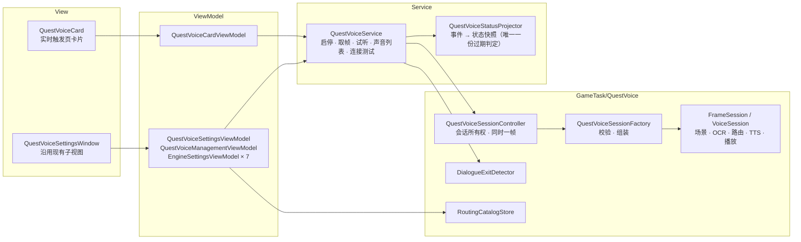

# 自动配音优化设计

> 状态：提案（第 2 版）· 2026-10-30  
> 关联：[实时触发器生命周期](realtime-trigger.md) · [TaskTriggerDispatcher 依赖注入](task-trigger-dispatcher-di.md) · [配置持久化](config-persistence.md) · 用户文档 [questvoice.md](../technical/questvoice.md)

第 2 版变更：

- 原则改为**保留全部现有功能，只做结构和实现上的优化**。第 1 版中删除功能的方案（固定区域识别、移除流式、角色目录改存到 `AllConfig`、去掉草稿与备份、立即打断旧句等）全部撤回。
- 第 8 节的 4 项已确认，全部保持现状。
- 启停周期改为与实时触发器一致：独立任务和脚本运行期间停止配音。
- 第 6 节重写，说明 OCR 实际使用的运行库和模型。
- 新增第 7.1 节：已删除的 UI 测试和只测死代码的测试。

## 0. 结论

| 问题 | 结论 | 方案摘要 | 章节 |
| --- | --- | --- | --- |
| 1. 菜单太多，界面是否友好 | 不够友好：一次配置要跨 3 个页面，“默认引擎”和“正在编辑的引擎”分在两页，同一概念有多个名字 | 4 个子页面合并为实时触发页的一张卡片和一个设置窗口。所有设置项和运行信息都保留，只调整组织方式和文字 | 第 3 节 |
| 2. 能否放进实时任务 | 可以。启停周期与实时触发器一致 | 开关在实时触发页；截图器启动时开始，独立任务开始时停止、结束后恢复，截图器停止时停止。实现上订阅调度器已有的任务模式事件，不注册为 `ITaskTrigger` | 第 4 节 |
| 3. 逻辑能否精简，是否符合分层标准 | 不完全符合：有死代码、未绑定的 VM 成员、重复的过期判定、跨层调用 | 在不删除功能的前提下清理死代码、合并重复逻辑、修正跨层调用。预计减少约 1,600 行（约 14%） | 第 5 节 |
| 4. OCR 为什么强制 DML | 用的是 ONNX Runtime，和主程序同一个运行库；只是会话没走主程序的工厂，自己写死了 DirectML | 会话改由 `BgiOnnxFactory` 创建，跟随“硬件加速”设置；默认改用内置的 PP-OCRv6 识别模型，仍可指定自己的模型 | 第 6 节 |

## 1. 现状

### 1.1 规模

功能由提交 `ac117193a`（#3871）一次合入，尚未进入发行版本：没有 tag 包含该提交，ReleaseNotes 中也没有记录。配置结构调整时不需要兼容旧版本。

| 区域 | 行数 | 内容 |
| --- | ---: | --- |
| `GameTask/QuestVoice/Features/Continuous` | 1,765 | 帧会话、配音会话两个状态机 |
| `GameTask/QuestVoice/Features/Tts` | 1,607 | 7 个引擎、流式协议、路由分派 |
| `GameTask/QuestVoice/Features/Ocr` | 1,418 | 自带 OCR 会话，6 种布局的像素场景识别 |
| `GameTask/QuestVoice` 其余（Core、Routing、Diagnostics、Audio、根目录） | 2,685 | 契约、路由目录、指标、悬浮摘要、会话包装 |
| `Service/QuestVoiceService*.cs` | 983 | 启停、采样、状态投影、试听 |
| `ViewModel/Pages`（19 个文件） | 2,016 | 4 个页面的 VM、路由草稿编辑器、6 个引擎 VM |
| `View/Pages`（30 个文件，含代码后置） | 1,251 | 4 个页面、9 个引擎子视图 |
| `Core/Config` | 96 | |
| **合计** | **11,821** | 单元测试原有 49 个文件、7,723 行；本次删除后剩 44 个文件、6,256 行（第 7.1 节） |

### 1.2 界面问题

1. **一次配置要跨 3 个页面。** 配置与映射页的说明就是“先在引擎页面准备声音，再绑定旅行者、未知 NPC 和旁白”（`QuestVoiceSettingsPage.xaml:9`）。实际顺序是：引擎页填连接、选声音、加入通用声线库 → 配置与映射页绑定 → 运行页点启动。
2. **“默认引擎”和“正在编辑的引擎”分在两页。** 其他引擎页写着“下拉仅选择编辑对象。默认配音引擎请在配置与映射页选择”（`QuestVoiceOtherEnginesPage.xaml:20`）。GPT-SoVITS 页没有“设为默认”的入口。
3. **同一个东西有多个名字。** 声音、音色、声线、通用声线、通用声线库、此引擎的通用声线、Profile、VoiceId、Style ID、复合声音 ID。
4. **技术术语直接暴露。** 路由、Fallback / Fail、Names / Aliases / Corrections、实例 `""` / `local` / `remote`、“带 18708 字 character 字典的 PP-OCRv6 Rec ONNX 模型”、“cut5 … Ready/EOF 与安全排空”。
5. **按钮和状态行过多。** 高级卡片平铺 6 个文件操作按钮；GPT 页同时显示 3～4 行保存状态；引擎页叠加 4 行状态。
6. **操作步骤多。** 要先去启动页启动截图器，再到运行页点“启动”；运行中所有编辑被锁定；试听前要先停止配音。
7. **有功能没有入口。** `ConfirmBackendRestartedCommand` 没有绑定到任何按钮，后端状态未知后用户只能重启 BetterGI。
8. **细节。** 3 个超时输入框没有各自的标签；角色列表显示内部 ID；各页标题和卡片样式不统一；导航文本没有走 `i18n:T`。

### 1.3 实现问题

| 问题 | 证据 |
| --- | --- |
| 死代码 | 显式模板 OCR 路径：`ImageOcrService.RecognizeAsync(ImageOcrRequest)`、`ImageOcrService.Processing.cs`、`SceneProfileLoader`、`dialogue-one-line.xml` 在生产代码中没有调用方；`ContinuousSettingsLoader.Parse`、`VoiceErrors.Owner`、`ConfigurationLoadResult` 没有调用方；`OcrConfigurationError` 等 3 个字段从不赋值 |
| 未绑定的 VM 成员 | `QuestVoicePageViewModel` 的 `TestSpeechCommand`、`ProbeBackendCommand`、`OpenConfigurationCommand`、`OpenRoutingCommand`、`BrowseGptWeightsCommand` 等 3 个浏览命令、`Active*` 资源代理、`Supports*` 能力投影；`QuestVoiceManagementViewModel` 的 `SaveCommand`、`AddProfileCommand`、`TravelerChoices`、`VoiceIds`、`DraftNotice`、`PresetVoices` 整条链 |
| VM 之间逻辑重复 | 声音列表枚举 3 份、试听入口 3 个、新增声线 3 种方式、删除声线 2 条路径、URL 校验 2 份、文件选择 2 份、保存状态文本 2 套、`EnsureLoadedAsync` 3 个触发点 |
| 过期判定写了 3 遍 | 核心用 epoch、revision、semanticGeneration 判定过期；`QuestVoiceService`（`IsStale`、`AdvanceVersion`，约 400 行的事件投影）和 `QuestVoiceOverlayPresenter`（`Advance`）各自又实现了一遍 |
| 启停防护重复 | Service 的 `_operations` 与 Controller 的 `_lifecycle`、`_stopVersion` 都在防止启动越过停止；Service 的 `_encoding`、Controller 的 `_observing` 和 FrameSession 的 `_observing` 三层都在限制“同一时刻一帧” |
| 帧多余复制 | `Mat.Clone` → BMP 编码 → Controller `ToArray` → Snapshot 再 `ToArray` → 场景检查和 OCR 每次读 `Bytes` 都整块克隆。2560×1440 的 BMP 约 11 MB，每 150 ms 一次 |
| 路由每句读盘 | `VoiceRoutingService` 每句读 `routing.json`、算 SHA256、完整校验；`MatchesCurrentDialogueAsync` 每次 OCR 还要再解析 1～2 次。用户文档的语义是“修改在下次启动配音时生效”，读一次就够 |
| 跨层 | Service 做“离开对话”的图像识别（`HasConfirmedExitEvidence`）；VM 直接读写文件、算 SHA256、发 HTTP（`GetVoicesAsync`、`ProbeAsync`），并直接 `new RoutingCatalogStore()`；`QuestVoiceSessionFactory.ExtraConfig` 这个读方法会改写配置 |
| 配置两种存法 | GPT-SoVITS 和火山翻译的参数在 `QuestVoiceConfig` 顶层，其余 5 个引擎在 `ExtraProviders` 字典里；工厂因此到处是“字典有就用字典，否则用顶层字段”的分支，`CreateTtsSettings` 和 `CreateProviderSettings` 两个重载几乎相同 |
| 单实现接口 | 18 个只有一个实现的接口中，`ISceneSelector`、`ISceneProfileLoader`、`ISpeakerRouter`、`IReferenceAudioSelector`、`IImageOcrService`、`IImageProcessingService` 没有测试替身；其余 12 个在测试中用作替身 |

## 2. 原则与范围

原则：

- **保留全部现有功能。** 第 5.1 节逐项列出。设置项只有“DirectML 设备序号”合并到全局“硬件加速”（第 6 节），其余全部保留。
- 第 8 节的 4 项保持现状：流式合成、现有场景识别、旧句接替方式、7 个引擎。
- 只删除三类代码：生产中没有调用方的死代码、没有绑定的 VM 成员、重复实现的同一逻辑。
- 依赖方向为 View → ViewModel → Service → GameTask。

用户可感知的行为变化只有以下几项，均在对应章节说明：

| 变化 | 原来 | 现在 | 章节 |
| --- | --- | --- | --- |
| 启停方式 | 手动点启动 / 停止 | 实时触发页开关，随截图器自动启停 | 4 |
| 独立任务和脚本期间 | 照常配音 | 停止，结束后恢复 | 4 |
| 运行中修改设置 | 编辑被锁定 | 打开设置窗口时暂停配音，关闭后按新设置继续 | 3.5 |
| OCR 设备 | 固定 DirectML，单独的设备序号 | 跟随“硬件加速”设置 | 6 |
| OCR 模型 | 必须自备 `PP-OCRv6_rec_small.onnx` | 默认用内置模型，仍可指定 | 6 |
| 后端状态未知 | 只能重启 BetterGI | 卡片上出现“确认后端已重启”按钮 | 3.2 |

非目标：不改 `TaskTriggerDispatcher` 的调度规则；不新增引擎；不接通旁白路由（第 9 节）。

## 3. 交互设计（问题 1）

### 3.1 术语

只改界面文字，不改数据含义。

| 界面统一用词 | 含义 | 替代的旧说法 |
| --- | --- | --- |
| 引擎 | 合成声音的程序或服务 | TTS 引擎、Provider |
| 默认引擎 | 正式配音使用的引擎 | 默认 TTS 引擎 |
| 默认声音 | 某个引擎在“未启用角色声线”时使用的声音 | 引擎默认声音、VoiceId |
| 声线 | 可以分配给角色的一个声音配置 | 通用声线、通用声线库条目、Profile、GPT 声线 |
| 默认 NPC 声线 | 已启用角色声线、但没有匹配到角色时使用的声线 | Fallback |
| 角色声线 | 识别到某个姓名时使用哪条声线 | 角色声线路由、路由、映射 |
| 服务实例 | 本地或远程服务地址 | 实例 `local` / `remote` |

### 3.2 入口：实时触发页的卡片

放在“自动剧情”卡片之后。卡片作为独立 UserControl `QuestVoiceCard`，`DataContext` 绑定 `TriggerSettingsPageViewModel.QuestVoice`（注入的 `QuestVoiceCardViewModel`）。标题、说明、开关的结构与其他实时任务卡片相同，文本走 `i18n:T`。

```text
┌──────────────────────────────────────────────────────────────────┐
│ 🔊 自动配音（实验性）                                       [ ● ] │
│    识别剧情对白的人物和台词，用语音朗读；独立任务运行时暂停             │
├──────────────────────────────────────────────────────────────────┤
│ 状态     ● 运行中 · 默认引擎 GPT-SoVITS · 角色声线已启用               │
│          （后端状态未知时：红字说明 + [确认后端已重启]）                 │
├──────────────────────────────────────────────────────────────────┤
│ 进度     对话界面 ✓ ─ OCR ✓ ─ 角色 ✓ ─ 声线 ✓ ─ 合成 ● ─ 播放 ○       │
├──────────────────────────────────────────────────────────────────┤
│ 当前     派蒙 · 声线「派蒙」 · 合成中                                  │
│          “前面好像有人，我们过去看看吧！”                               │
├──────────────────────────────────────────────────────────────────┤
│ 最近事件  12:01:03 识别角色：派蒙                                      │
│          12:01:02 OCR 识别成功                    （最多 8 条）        │
├──────────────────────────────────────────────────────────────────┤
│ [设置…]  [校验配置]  [打开日志]  [打开日志目录]                         │
└──────────────────────────────────────────────────────────────────┘
```

- 卡片标题行只放开关；展开后显示状态、6 节点进度、当前处理内容、最近事件和操作按钮，内容与现在的运行页一致。
- 状态行增加两种情况：“等待启动截图器”（开关打开、截图器未启动）、“独立任务运行中，已暂停”。
- 后端状态未知时显示“确认后端已重启”按钮，绑定现有的 `ConfirmBackendRestartedCommand`。

### 3.3 设置窗口

`QuestVoiceSettingsWindow`：`ui:FluentWindow`，Mica 背景，`SourceInitialized` 中调用 `WindowHelper.TryApplySystemBackdrop`，`Owner` 为主窗口，`ShowDialog` 打开（与 `MusicSettingsWindow` 相同）。窗口分 4 页。

**引擎与声线**：左侧列出 7 个引擎，★ 标记默认引擎；右侧是所选引擎的全部设置。默认引擎和正在编辑的引擎在同一页可见，解决 1.2 第 2 条。

```text
┌ [引擎与声线]  角色  识别  高级 ─────────────────────────────────────────┐
│ ┌────────────────────┐ │ GPT-SoVITS                      [设为默认引擎]  │
│ │★ GPT-SoVITS         │ │ ── 服务 ───────────────────────────────────── │
│ │  火山翻译            │ │ [ ] 使用远程实例                               │
│ │  Windows 系统语音    │ │ 本地地址 [http://127.0.0.1:9880/ ]             │
│ │  VOICEVOX           │ │ 远程地址 [                        ] [测试连接]   │
│ │  vits-simple-api    │ │ [ ] 按句流式合成（实验性）                       │
│ │  OpenAI 兼容语音     │ │ ── 声线 ───────────────────────────────────── │
│ │  Google 翻译语音     │ │ [派蒙                ▼] [+ 新增] [删除]         │
│ └────────────────────┘ │ 名称 [派蒙]   服务实例 [跟随当前实例 ▼]            │
│                        │ GPT 权重     [D:\gsv\paimon.ckpt ] [浏览]       │
│                        │ SoVITS 权重  [D:\gsv\paimon.pth  ] [浏览]       │
│                        │ 参考音频     [D:\gsv\ref.wav     ] [浏览]       │
│                        │ 参考台词     [前面好像有人……              ]       │
│                        │ ── 试听 ───────────────────────────────────── │
│                        │ [你好，旅行者。          ] [试听] [停止]          │
└──────────────────────────────────────────────────────────────────────┘
```

- 其他 6 个引擎沿用现有子视图（`EngineConnectionView`、`EngineVoiceListView`、各引擎参数视图），布局统一为：服务 → 默认声音和参数 → 声线 → 试听。
- “加入通用声线库”改名为“添加为声线”；“此引擎的通用声线”改名为“本引擎的声线”。
- 状态文字合并为一行，放在窗口底部（见 3.5）。

**角色**：

```text
[✓] 启用角色声线      关闭时所有台词使用默认引擎的默认声音
默认 NPC 声线  [系统语音 ▼]   有姓名但没有匹配到角色时使用
旁白声线      [未设置   ▼]   （保留现有设置；旁白识别尚未接通，见第 9 节）
旅行者        游戏内昵称 [我的昵称          ]  声线 [派蒙 ▼]  一行一个
角色          [搜索名称或别名…          ]                    [+ 添加角色]
┌──────────────┬────────────────────────────────────────────────────┐
│ 派蒙          │ 正式名称  [派蒙                    ]                  │
│ 钟离          │ 别名      [应急食品                ]                  │
│ 旅行者（空）   │ 识别纠错  [派萌                    ]  OCR 常见误识别   │
│              │ 声线      [派蒙                  ▼]                  │
│              │ 角色 ID   [paimon] （其他规则引用它，一般不用改）         │
└──────────────┴────────────────────────────────────────────────────┘
```

- 列表显示正式名称，不再显示内部 ID；角色 ID 留在详情里。
- “角色声线”改用与旅行者、默认 NPC 相同的声线选择控件。

**识别**：OCR 模型（留空使用内置模型，见第 6 节）、采样间隔（毫秒，50～500）。原“DirectML 设备序号”改为说明文字“推理设备跟随‘硬件加速’设置”。

**高级**：

- 网络超时：连接、请求、合成三项，各自带标签，注明对所有引擎生效。
- 找不到声线时：改用默认 NPC 声线 / 报错（原 Fallback / Fail）。
- 角色目录文件：路径与“浏览”；文件操作收进一个“更多”菜单：重新加载、新建空目录、校验、导入、导出。“加载配置”和“放弃草稿并重新加载”合并为“重新加载”，有未保存修改时先确认放弃。

### 3.4 原有内容去向

| 原位置 | 内容 | 新位置 |
| --- | --- | --- |
| 运行与日志 | 启动、停止 | 卡片开关 |
| 运行与日志 | 校验配置、当前状态、6 节点进度、当前处理内容、最近事件、打开日志、打开日志目录 | 卡片展开内容 |
| 配置与映射 | 默认 TTS 引擎 | 设置窗口 · 引擎与声线（★ 设为默认引擎） |
| 配置与映射 | 启用角色声线路由、旅行者、未知 NPC 与旁白、角色管理 | 设置窗口 · 角色 |
| 配置与映射 | 缺失声线策略、6 个文件操作按钮、路由文件路径 | 设置窗口 · 高级 |
| 配置与映射 | OCR 模型路径、采样间隔 | 设置窗口 · 识别 |
| 配置与映射 | DirectML 设备序号 | 合并到全局“硬件加速”（第 6 节） |
| GPT-SoVITS 配置 | 服务连接、测试连接、流式开关、声线库与试听 | 设置窗口 · 引擎与声线 · GPT-SoVITS |
| GPT-SoVITS 配置 | 三项超时 | 设置窗口 · 高级（这三项本来就对所有引擎生效） |
| 其他引擎设置 | 6 个引擎的连接、声音、参数、加入声线、本引擎声线、试听 | 设置窗口 · 引擎与声线 |
| 未绑定 | 确认后端已重启 | 卡片状态行（后端状态未知时） |

删除的界面只有导航“自动配音”及 4 个子页面本身：`QuestVoicePage`、`QuestVoiceSettingsPage`、`QuestVoiceGptSettingsPage`、`QuestVoiceOtherEnginesPage`。`QuestVoiceManagementView`、`QuestVoiceVoiceSelector` 和 `View/Pages/QuestVoiceSettings/*` 移入窗口继续使用。

### 3.5 保存与生效

- 保存方式不变：普通设置由 `AllConfig` 自动保存；角色目录仍是 `routing.json`，保留“校验通过才保存”、文件冲突检测、`.bak` 备份和退出前保存。
- 设置窗口打开时暂停配音（停止会话，开关保持打开），关闭后按新设置重新启动。替代原来的“运行中锁定编辑”：试听不再要求先停止配音，`IsConfigEditable` 及其在各 VM 中的检查可以去掉，修改关闭窗口后立即生效。
- 窗口底部固定一行状态，合并原来的 `SaveStatus`、`EditStatus`、`ConnectionStatus`、`StatusMessage`：“已保存 · 关闭窗口后生效”或“有未保存修改：{原因}”。
- 状态由 `QuestVoiceSettingsViewModel` 统一生成，子 VM 只上报事件。

## 4. 放入实时任务（问题 2）

### 4.1 生命周期与触发器对齐

| 时机 | 实时触发器 | 自动配音 |
| --- | --- | --- |
| 截图器启动 | 新建实例，按开关启用 | 开关打开时启动会话 |
| 开关打开 / 关闭 | 下一帧启用 / 停用 | 立即启动 / 停止会话 |
| 独立任务或脚本开始 | 用户开启的触发器全部停用 | 停止会话 |
| 独立任务或脚本结束 | 按开关恢复 | 开关打开时重新启动会话 |
| 暂停（暂停热键、战斗、传送、选 F 选项） | 不调用 `OnCapture`，状态保留 | 丢弃帧，会话保留 |
| 截图器停止 | 丢弃实例 | 停止会话 |
| 游戏不在前台 | 只运行可后台运行的触发器 | 跟随调度器：调度器截图时照常处理，与现在一致 |
| 设置窗口打开 | — | 停止会话，关闭后恢复 |

### 4.2 实现方式

| | A. 注册为 `ITaskTrigger` | B. 订阅调度器状态（采用） |
| --- | --- | --- |
| 生命周期 | 由调度器决定 | 与 A 相同，见 4.1 |
| 取帧 | `OnCapture` | `TaskTriggerDispatcher.FrameCaptured` 旁路，与现在相同 |
| 异步启停 | `OnEnabled` / `OnDisabled` 在 Tick 中同步执行，不能等待；校验、加载模型、排空 GPT 请求都要另起任务 | Service 中一个串行方法统一处理 |
| 长对话中的帧 | 受“UI 变化后 30 秒内才全部执行”规则限制：声明 `Talk` 时完全依赖 `DisabledUiButton` 模板命中，6 种布局是否都有这个按钮未核实 | 不受影响 |
| 依赖注入 | `GameTaskManager.CreateTriggers(runtime, config)` 拿不到 `QuestVoiceService`，要改签名或用服务定位 | 不需要 |
| 截图器停止 | `Dispatcher.Stop` 不回调 `OnDisabled`（realtime-trigger.md 4.4 规则 6），仍要订阅 `GameRuntimeService.Stopped` | 订阅 `Stopped` |
| 改动调度器 | 需要 | 不需要，`TaskModeChanged` 和 `IsInTask` 已公开，`GuideWindowService` 已经这样用 |

采用 B：生命周期与触发器一致，同时避开 A 的 30 秒规则和异步问题，比现在的手动启停更简单。

### 4.3 启停规则

```text
应运行 = Config.Enabled
      && GameRuntimeService.Current 存在且未停止
      && !TaskTriggerDispatcher.IsInTask
      && 设置窗口未打开
```

触发检查的事件：`QuestVoiceConfig.Enabled` 变化、`GameRuntimeService.Started` / `Stopped`、`TaskTriggerDispatcher.TaskModeChanged`、设置窗口打开或关闭、应用退出。暂停计数 `RunnerContext.Instance.AutoPickTriggerStopCount > 0` 时，取帧回调直接返回。

```csharp
/// <summary>按期望状态串行启停会话；等待期间状态再次变化则继续处理。</summary>
private async Task ApplyDesiredStateAsync()
{
    await _operations.WaitAsync();
    try
    {
        while (ShouldRun != _controller.IsRunning)
        {
            if (_controller.IsRunning)
            {
                await StopCoreAsync();
            }
            else if (!await TryStartCoreAsync())
            {
                // 启动失败只显示错误，等下一次事件再试，避免反复重试
                break;
            }
        }
    }
    finally
    {
        _operations.Release();
    }
}
```

- 现有 `StartAsync` / `StopAsync` 的主体（冻结配置、创建会话、订阅取帧、排空 GPT、更新状态）保留，改为私有的 `TryStartCoreAsync` / `StopCoreAsync`。
- 删除：启动和停止按钮及命令、“请先启动截图”前置检查。
- 新增：`QuestVoiceConfig.Enabled`；上面的方法和 4 个事件订阅；卡片 XAML。

## 5. 结构优化（问题 3）

### 5.1 保留的功能

- 场景识别：6 种对白布局的像素识别、墨迹签名稳定判定、姓名金色墨迹隔离。
- 自带的识别预处理和 CTC 解码；只改会话的创建方式（第 6 节）。
- 对白跟踪：定向复核、正文清空判定话轮、同一句不重复朗读、离开对话停止播放、新句音频准备好后再接替旧句。
- 7 个引擎，本地 / 远程两套地址；不同角色可用不同引擎（`RoutedTtsProvider`）。
- GPT-SoVITS：串行切换权重、已发出的请求排空、后端状态未知保护、流式合成与增量播放。
- 角色目录：v1 / v2 格式、旅行者、默认 NPC、旁白字段、缺失策略、别名、识别纠错、草稿校验后自动保存、SHA 冲突检测、文件锁、`.bak` 备份、导入导出、退出前保存。
- 运行信息：6 节点进度、当前处理内容、最近事件、悬浮摘要、日志分流、Debug 指标。
- 试听：引擎默认声音、声线草稿。

### 5.2 目标分层



约束：

- GameTask 不依赖 Service 和 ViewModel。
- Service 不做图像识别：`HasConfirmedExitEvidence` 移到 `GameTask/QuestVoice/DialogueExitDetector`。
- ViewModel 不直接发 HTTP，也不直接读写文件：声音列表、连接测试、试听都通过 Service；角色目录通过 DI 注入的 `RoutingCatalogStore`，文件存在检查和 SHA 计算移进 Store。

### 5.3 优化清单

| # | 项目 | 现状 | 优化 | 行为变化 | 约减行数 |
| --- | --- | --- | --- | --- | ---: |
| 1 | 死代码 | 见 1.3 第 1 行 | 删除显式模板 OCR 路径（含 `SceneProfileLoader`、`ImageProcessingContracts`、`OcrSettings.DefaultTemplatePath` 和 `dialogue-one-line.xml` 的部署）、`ContinuousSettingsLoader.Parse`、`VoiceErrors.Owner` 与 `VoiceErrorOwner`、`ConfigurationLoadResult`、3 个从不赋值的 `*ConfigurationError` 字段及其读取分支 | 无 | 270 |
| 2 | 未绑定的 VM 成员 | 见 1.3 第 2 行 | 删除；`ConfirmBackendRestartedCommand` 改为绑定到卡片 | 恢复一个缺失的入口 | 350 |
| 3 | VM 重复逻辑 | 见 1.3 第 3 行 | 声音列表、试听、新增 / 删除声线、URL 校验、文件选择各保留一份；保存状态由设置窗口 VM 统一生成；`EnsureLoadedAsync` 只在窗口打开时调用一次 | 无 | 300 |
| 4 | 过期判定写了 3 遍 | 见 1.3 第 4 行 | 抽出 `QuestVoiceStatusProjector`：输入核心事件，只做一次过期判定，输出状态快照；页面状态和悬浮摘要都从快照生成 | 无 | 300 |
| 5 | 启停防护重复 | 见 1.3 第 5 行 | 启停只由 Service 的 `_operations` 串行（4.3），删除 Controller 的 `_stopVersion`；“同时一帧”只由 Controller 负责，BMP 编码移进 `TryObserve`，删除 Service 的 `_encoding` | 无 | 40 |
| 6 | 帧多余复制 | 见 1.3 第 6 行 | 编码结果的所有权直接交给 `ContinuousFrameSnapshot`，去掉 Controller 和 Snapshot 两次 `ToArray`；`Bytes` 返回只读视图，不再每次克隆 | 无，每帧少 3～4 次整帧复制（每次约 11 MB） | 5 |
| 7 | 路由每句读盘 | 见 1.3 第 7 行 | 会话启动时加载并校验一次目录，`VoiceRoutingService` 和 `MatchesCurrentDialogueAsync` 只读内存 | 运行中外部修改 `routing.json` 改为下次启动生效，与用户文档一致 | 10 |
| 8 | 跨层 | 见 1.3 第 8 行 | 按 5.2 的约束移动；`ExtraConfig` 不再写配置，字典缺省值在配置加载后补齐一次 | 无 | 30 |
| 9 | 配置两种存法 | 见 1.3 第 9 行 | GPT-SoVITS 和火山翻译的参数并入引擎字典，与其他 5 个引擎相同；合并 `CreateTtsSettings` / `CreateProviderSettings` | 无（功能未发布，不需迁移） | 60 |
| 10 | 单实现接口 | 见 1.3 第 10 行 | 删除 6 个既无第二实现又无测试替身的接口，其余 12 个保留作测试替身 | 无 | 50 |
| 11 | OCR 会话 | 见第 6 节 | 会话改由 `BgiOnnxFactory` 创建；删除运行库 DML 检查和 profiling 中的 DML 校验 | 见第 6 节 | 45 |
| 12 | 界面 | 4 个页面 | 卡片 + 设置窗口，子视图复用 | 见第 3 节 | 150 |

合计约减少 1,600 行，总量从 11,821 行降到约 10,200 行。主体算法、并发模型（两个会话的泵、版本号、观察租约）和 7 个 Provider 不动。

保留并在设计中注明的两处：

- 两个会话的 `CompleteAsync` 在生产中没有调用方，但 11 个测试文件用它排空会话，保留作为测试用的排空入口。
- `ContinuousVoiceSession.Snapshot` 只被测试读取，保留。

## 6. OCR（问题 4）

### 6.1 现在用的是什么

是的，配音的 OCR 用的就是 ONNX Runtime（ORT），和 BetterGI 其他模型是同一个运行库。区别只在会话怎么创建、模型从哪来。

| | 自动配音 OCR（现在） | BetterGI 全局 OCR |
| --- | --- | --- |
| 运行库 | ONNX Runtime 1.21.0（NuGet `Microsoft.ML.OnnxRuntime.DirectML`，自带 CPU 和 DirectML 两种执行方式），进程里只有这一份 `onnxruntime.dll` | 同左 |
| 会话创建 | `DirectMlOcrSession` 自己 `new SessionOptions()`，只调用 `AppendExecutionProvider_DML(DeviceId)` | `BgiOnnxFactory` 按“硬件加速”设置选择 CPU / DirectML / CUDA / OpenVINO；“OCR 使用 CPU”开启时 OCR 固定走 CPU |
| 模型 | PP-OCRv6 small 识别模型（ONNX），默认路径 `User/QuestVoice/ocr/PP-OCRv6_rec_small.onnx`。仓库和发行包都不带，用户要自己放 | 内置 PP-OCR V4 / V5 / V6，其中 V6 识别模型为 `Assets/Model/PaddleOCR/Rec/V6/PP-OCRv6_small_rec_infer/slim.onnx`（约 21 MB） |
| 字典 | 18,708 字，写在模型文件元数据 `character` 里 | 同一套 18,708 字，放在模型同目录的 `inference.yml` |
| 文字检测 | 不用检测模型。6 种布局的场景识别已经算出姓名和每行正文的位置，逐行送进识别模型 | 检测模型加识别模型 |
| 输入 | `x: N×3×48×W`，高 48，宽度可变 | 同一系列模型，格式相同 |

### 6.2 为什么说“强制 DML”

- `DirectMlOcrSession` 只加了 DirectML 执行方式，初始化失败直接报错，错误文本写明“没有 CPU 回退”。
- 首次推理后读取 ORT 的 profiling 记录，如果没有任何算子跑在 DirectML 上就报错（`OcrExecutionProfile`：“拒绝将全 CPU 执行报告为 DirectML”）。
- `QuestVoiceSessionFactory.cs:263` 检查进程里的运行库是否带 `DmlExecutionProvider`，没有就拒绝启动。

代码、测试和用户文档都没有给出必须用 DirectML 的理由。文件头注明移植自外部 QuestVoice 项目，原项目大概率是独立程序，自己决定用哪种设备。

进程只能加载一个 `onnxruntime.dll` 是真实限制：`OnnxRuntimeLoader` 按“硬件加速”设置加载一次，之后不能更换。用户选 CUDA 或 OpenVINO 时加载的运行库不含 DirectML，所以配音只能报错。这条限制说明“不能为配音另换运行库”，并不要求“配音必须用 DirectML”。

现状带来两个问题：

- 选 CPU 的用户，内置运行库仍带 DirectML，检查能通过，配音会绕过用户的选择用 GPU。
- 选 CUDA 或 OpenVINO 的用户完全不能用配音。

### 6.3 方案

保留场景识别、预处理和 CTC 解码，只改会话来源和模型默认值：

1. `DirectMlOcrSession` 改名为 `QuestVoiceOcrSession`，会话改由 `BgiOnnxFactory.CreateInferenceSession(model, ocr: true)` 创建，跟随“硬件加速”和“OCR 使用 CPU”设置。`DirectMlOcrEngine` 的串行、冻结、失败废弃逻辑不变，同步改名为 `QuestVoiceOcrEngine`。
2. “OCR 模型路径”默认留空，表示使用内置的 V6 识别模型；用户仍可指定自己的 PP-OCRv6 识别模型。
3. 字典先读模型元数据 `character`，没有就读模型同目录的 `inference.yml`。字数（18,708）、输入高度（48）、输出维度的校验保留。输入名实施时核实：内置模型若不叫 `x`，改为读取 `InputNames[0]`。
4. 删除 `Factory.cs:263` 的运行库检查；`OcrExecutionProfile` 改为只记录实际使用的执行方式，不再拒绝 CPU。
5. “DirectML 设备序号”合并到全局“硬件加速”的设备选择（`BgiOnnxFactory` 使用 `Runtime.Device.Index`）。

### 6.4 风险

- **CPU 耗时**：“OCR 使用 CPU”默认开启，配音 OCR 默认会从 GPU 改到 CPU。每个稳定画面识别 2～4 行，另有每 2 秒一次复查，需要实测单次耗时；如偏慢，提示用户关闭“OCR 使用 CPU”。
- **置信度阈值**：内置 `slim.onnx` 与 `PP-OCRv6_rec_small.onnx` 是否为同一份权重未核实。姓名 0.9、正文 0.8 的阈值需在游戏内确认。
- **OpenVINO**：宽度可变的输入是否触发重编译、性能如何，未验证。CPU、DirectML、CUDA 没有问题。

## 7. 实施与验收

### 7.1 已删除的测试（本次已执行）

UI（View / ViewModel）测试不持久化；只测试生产中无调用方的死代码的用例没有价值。共删除 5 个文件和另外 4 个用例，1,467 行。解决方案编译通过，剩余 452 个用例全部通过。

| 文件或用例 | 原因 |
| --- | --- |
| `VoiceManagementViewModelTests.cs`（11 个用例） | ViewModel 测试 |
| `Phase8SettingsTests.cs`（14 个用例） | ViewModel 测试；其中唯一的工厂用例与 `QuestVoiceConfigurationTests` 的相对路径用例重复 |
| `ExtraTtsViewModelTests.cs`（7 个用例） | ViewModel 测试 |
| `TtsDiagnosticLifecycleTests.cs`（1 个用例） | 通过 `QuestVoicePageViewModel` 驱动。它覆盖的“退出时中止试听请求、普通停止等待排空”改由 7.3 验收 |
| `AutoSceneProcessingTests.cs`（8 个用例） | 全部只测 `ProcessAsync` 和显式模板路径，生产无调用方 |
| `SpeakerInkPreprocessingTests.AutomaticAndContinuousShareSelectedPolicyWhileExplicitTemplatesKeepOriginalPixels` | 主要测 `ProcessAsync` 和显式模板路径；墨迹隔离本身由同文件另外两个用例覆盖 |
| `ContinuousFrameGateTests.StrictSettingsRejectMalformed`、`StrictSettingsAcceptCompleteInputAndRejectExtraOrDuplicateFields` | 只测 `ContinuousSettingsLoader.Parse`，生产无调用方；`Validate` 的用例保留 |
| `WavAndReferenceTests.Every_error_code_requires_an_explicit_owner` | 只测 `VoiceErrors.Owner`，生产无调用方 |

后续规则：

- 界面改动用编译、窗口和卡片实例化检查、人工验收验证，不写持久化的 UI 测试。
- 删除死代码时同步删除只测它的用例；行为不变的重构只调整测试中的构造方式。

### 7.2 实施步骤

每步可以单独编译和提交。

| 步骤 | 内容 | 验证 |
| --- | --- | --- |
| 1 | 5.3 第 1、2、10 项：死代码、未绑定成员、无替身的单实现接口 | 编译；单元测试 |
| 2 | 第 6 节：OCR 会话与模型 | 编译；单元测试；7.3 中硬件加速一项 |
| 3 | 第 4 节与 5.3 第 4、5、6 项：启停周期、状态投影、启停与帧路径去重 | 编译；单元测试 |
| 4 | 5.3 第 3、7、8、9 项：VM 去重、路由加载一次、跨层修正、配置合并 | 编译；单元测试 |
| 5 | 第 3 节：卡片、设置窗口，删除 4 个页面和导航项 | 编译；确认卡片和窗口能实例化、布局不挤缩；卡片只引用自身或 `App.xaml` 已合并的资源（如 `FaFontIconStyle`）；只读绑定均为 `OneWay` |
| 6 | 更新 `Docs/technical/questvoice.md` | 文档与界面一致 |
| 7 | 7.3 游戏内验收 | 由维护者执行 |

### 7.3 游戏内验收

| 场景 | 预期 |
| --- | --- |
| 截图器启动且开关打开 | 自动开始，卡片显示运行中 |
| 运行一条龙或 JS 脚本 | 任务开始时停止，结束后自动恢复 |
| 暂停热键、战斗、传送期间 | 不识别，结束后继续 |
| 截图器停止、游戏退出 | 卡片显示“等待启动截图器”，没有残留播放 |
| 打开设置窗口 | 暂停，可以试听；关闭后按新设置继续 |
| 退出 BetterGI 时正在试听 GPT-SoVITS | 试听请求被中止，程序正常退出 |
| 普通停止时 GPT-SoVITS 正在合成 | 等待已发出的请求结束再停止 |
| 硬件加速为 CPU、DirectML、CUDA、OpenVINO | 都能识别；选 CPU 时不占用 GPU |
| 不放置任何 OCR 模型 | 使用内置模型正常识别 |
| 现有对白场景（单行、多行、称号、注音、快速连点、选项） | 与优化前行为一致 |

## 8. 已确认事项

以下 4 项保持现状，不做改动：

1. **流式合成**：保留。
2. **识别方式**：保留现有 6 种布局的场景识别和自带的识别预处理；OCR 只改会话来源和默认模型（第 6 节）。
3. **新旧句接替**：保留现状，旧句继续播放，直到新句音频准备好再接替。
4. **引擎**：7 个引擎全部保留。

## 9. 不在本次范围

- 接通旁白路由：旁白声线可以设置，但实时链路从未传入旁白上下文。本次保留设置并在界面注明，接通需要单独设计。
- 判断台词是否已有官方配音、自动关闭游戏原声。
- 云原神网页版等子实例。
