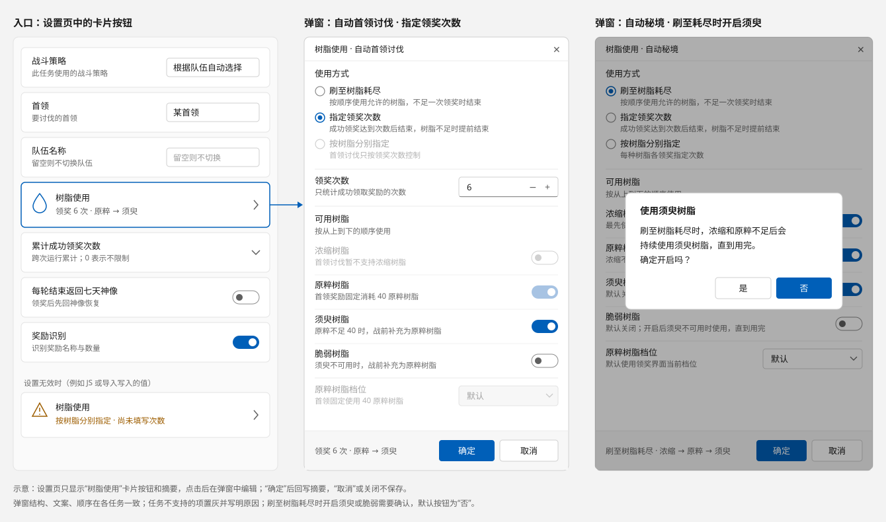

# 树脂使用设置统一：弹窗界面、参数合同与任务适配

状态：第 3 版（2026-10-25），已按第 2 版实施，编译通过，待界面与游戏内验收；实施中的调整与验证情况见[第 12 节](#12-实施记录)。  
相关文档：[独立任务合同](task-contract.md) · [自动战斗策略统一](auto-fight-strategy.md) · [Pulonia 体力计划提案](pulonia/proposals/resin-plan.md)

版本记录：

- 第 1 版：树脂设置为专属设置页中的展开卡片；刷至耗尽时禁止须臾、脆弱；未达目标报部分成功；独立任务页放到二期。
- 第 2 版按评审意见修改：
  - 树脂设置改为**弹窗**，各页面用“树脂使用”卡片按钮作为入口（第 7 节重写）。
  - 须臾、脆弱在三种方式下都可用，默认关闭；刷至耗尽时开启需要确认（4.2、7.4）。
  - 因树脂结束一律按正常完成返回，Message 写明执行情况（6.2）。
  - 独立任务页本期接入，全局配置 `AllConfig` 新增 `ResinUsage` 并迁移旧字段（5.6）。
  - 幽境危战已核实可以切换 20 / 40，三个领奖弹窗任务的档位选项一致（4.4）。
  - 首领讨伐的领奖流程单独说明和适配（8.3）。
  - Pulonia 开发期不考虑旧格式兼容，删除相关迁移内容；调研发现的问题按推荐处理（8.4）。
- 第 3 版（本版）：实施完成后同步实际实现。第 9 节改为实际文件清单，新增第 12 节记录与正文不同的实现细节、验证情况和遗留问题。

## 1. 结论

- **一个弹窗，一个入口**。自动秘境、自动幽境危战、自动首领讨伐、自动地脉花、合成浓缩树脂的树脂设置都在弹窗中编辑。设置页只放一张“树脂使用”卡片按钮，显示当前设置的摘要，点击打开弹窗。任务计划节点设置、新一条龙、独立任务页、旧一条龙页的秘境入口使用同一套卡片和弹窗。
- **三种使用方式**：刷至树脂耗尽、指定领奖次数、按树脂分别指定。四类树脂固定按“浓缩 → 原粹 → 须臾 → 脆弱”的顺序使用；原粹的 20 / 40 由“原粹树脂档位”单独选择。须臾、脆弱默认关闭，刷至耗尽时开启会弹出确认。
- **一个入参**。四个领奖任务的树脂参数合并为一个字段 `resin_usage`（类型 `ResinUsage`）。JS 的旧属性名和用法不变；全局配置的旧字段在读取时迁移一次。
- **一个出参**。四个领奖任务统一返回 `ResinClaimData`：奖励汇总加树脂使用报告（领奖次数、各类树脂用量、结束原因）。因树脂结束都按正常完成返回，执行情况写在 Message 中。
- **差异由能力声明表达**。每个任务声明支持的方式、树脂种类、原粹档位，以及须臾和脆弱是领奖时直接使用还是战前补充为原粹。弹窗据此置灰并写明原因，校验据此拒绝参数。
- **选择规则集中，游戏操作各自实现**。“下一次用哪种树脂、是否达到目标”由纯计算的 `ResinClaimSelector` 决定；识别和点击仍由各任务实现。首领讨伐的领奖流程与其他三个任务不同，单独适配（8.3）。

## 2. 现状与问题

### 2.1 涉及的任务

| 任务 | 现有树脂参数（JSON） | 专属设置界面 | 未指定时的行为 |
| --- | --- | --- | --- |
| 自动秘境 `auto_domain` | `specify_resin_use`；`original/condensed/transient/fragile_resin_use_count`；`original_resin20/40_use_count`；`resin_priority_list`；`domain_round_num` | “领奖树脂设置”开关加 4 个次数框；20 / 40 次数、优先级、轮数只出现在通用卡片 | 先浓缩后原粹，刷至不足 |
| 自动幽境危战 `auto_stygian_onslaught` | 同秘境，没有 20 / 40 和轮数 | 与秘境逐字相同 | 同上 |
| 自动首领讨伐 `auto_boss` | `specify_run_count`、`run_count`、`use_transient_resin`、`use_fragile_resin`；编排层另有 `total_run_count_limit` | “指定成功领奖次数”开关加次数和两个补充开关 | 只用原粹，刷至不足 |
| 自动地脉花 `auto_ley_line_outcrop` | `count`、`is_resin_exhaustion_mode`、`open_mode_count_min`、`use_transient_resin`、`use_fragile_resin`、`is_go_to_synthesizer` | “地脉花刷取次数”卡片（耗尽、取小值、手动次数）；须臾、脆弱只出现在通用卡片 | 固定 6 次 |
| 合成浓缩树脂 `craft_condensed_resin` | `min_resin_to_keep` | “合成后保留原粹树脂”数字框，最小值 -1 | 按默认数量合成 |

其他任务：自动战斗、锄地、路径追踪没有树脂参数；尘歌壶只把须臾树脂当作商品；一条龙汇总通知只识别树脂，不消耗。

除专属设置界面外，还有两处旧界面直接绑定配置：

- 独立任务页 `TaskSettingsPage`：秘境（约 1424–1549 行）、首领（约 1882–1946 行）、幽境（约 2190–2320 行）、地脉花（约 2963–3025 行）各有一套，绑定 `AllConfig` 的 `AutoDomainConfig` 等。
- 旧一条龙页 `OneDragonFlowPage`：秘境的“领奖树脂设定”弹出层（约 952–1110 行）绑定 `AllConfig.AutoDomainConfig`，与独立任务页是同一份配置；首领、地脉花、合成树脂区域绑定 `OneDragonFlowConfig` 自己的字段。

### 2.2 问题

| # | 问题 |
| --- | --- |
| P1 | 同一件事有四种模型：秘境、幽境按每种树脂指定次数；首领指定总次数；地脉花是“耗尽开关 + 取小值 + 手动次数”，开关极性还相反（开启表示自动计算）。 |
| P2 | 文案不一致：“领奖树脂设置 / 指定成功领奖次数 / 地脉花刷取次数 / 树脂耗尽模式”；“次数取小值 / 次数取较小值 / 刷取次数取小值”；“刷取 / 挑战 / 讨伐次数”混用。 |
| P3 | 控件和范围不一致：须臾、脆弱在秘境是次数框，在首领是开关，在地脉花藏在通用卡片里；次数最小值有 0、1、-1 三种。 |
| P4 | 须臾、脆弱的规则不一致：秘境、幽境只在分别指定时使用；首领只在指定次数时使用，否则参数无效；地脉花在耗尽模式下也会计入。 |
| P5 | 参数散落在顶层且各不相同。体力计划提案 3.3 节需要为每个任务改写不同的一组字段。 |
| P6 | 有字段不生效：`resin_priority_list` 两个任务都不读取，`is_go_to_synthesizer` 地脉花不读取；`AutoDomainParam.SetDefault` 还直接共享了全局配置的列表引用。 |
| P7 | 选择逻辑重复：秘境 `GettingTreasure` 与幽境 `UseResinAndCheckLast` 几乎逐行相同；树脂名是散落的中文字面量；领奖弹窗的公共操作 `PressUseResin` 放在 `AutoDomainTask` 里，被其他任务跨类调用。 |
| P8 | 出参不一致：秘境、首领返回 `RewardSummary`，幽境、地脉花、合成返回 `NoData`；没有任务报告用了多少树脂。 |

## 3. 目标与范围

目标：

1. 五个任务的树脂设置在所有入口中外观和操作一致：设置页是同样的卡片按钮，弹窗是同样的结构和文案。
2. 四个领奖任务使用同一个入参 `resin_usage` 和同一个出参结构。
3. 任务之间的差异只通过能力声明表达；弹窗、校验、体力计划读取同一份声明。
4. 选择规则集中为一个可单元测试的纯计算组件。

入口范围：

| 入口 | 编辑的数据 |
| --- | --- |
| 任务计划节点设置、新一条龙（Pulonia 专属设置视图） | 节点参数 `resin_usage`；合成为 `min_resin_to_keep` |
| Pulonia 通用字段（没有专属界面的场景，例如公共参数） | 同上 |
| 独立任务页 `TaskSettingsPage` | `AllConfig` 的四个任务配置的 `ResinUsage` |
| 旧一条龙页的秘境树脂入口 | `AllConfig.AutoDomainConfig.ResinUsage`（与独立任务页同一份） |

兼容要求：

- **JS**：参数类的旧属性名和语义保持可用（5.5）。
- **全局配置 `AllConfig`**：读取时把旧字段迁移为 `ResinUsage`（5.6）。
- **Pulonia**：开发期不兼容旧格式，按[路线图规则 5](pulonia/roadmap.md)，用旧字段保存的计划节点和预设需要重建。

不做：

- 不统一游戏内操作：秘境与幽境的领奖弹窗、首领的战前补充面板、地脉花开始前的次数预计算继续各自实现。
- 不统一树脂识别的实现。现有四套识别保留。
- 不提供自定义使用顺序和保留量。保留与预算由体力计划负责。
- 旧一条龙页的首领、地脉花、合成树脂区域绑定 `OneDragonFlowConfig` 的独立字段，保持原界面，随旧页面由新一条龙替代后下线；运行时通过 JS 兼容属性转换为 `resin_usage`（5.5）。秘境入口因为与独立任务页共用同一份配置，必须替换。

## 4. 统一模型

### 4.1 术语

| 术语 | 含义 |
| --- | --- |
| 领奖 | 在奖励界面消耗树脂领取一次奖励。所有次数只统计成功领奖。 |
| 可用树脂 | 本次允许消耗的树脂种类。 |
| 使用顺序 | 浓缩 → 原粹 → 须臾 → 脆弱，固定不变。 |
| 补充树脂 | 须臾、脆弱。秘境、幽境、地脉花在领奖弹窗中直接用于领奖；首领在战前补充为原粹。 |
| 原粹树脂档位 | 领奖界面可在 20 和 40 之间切换时，本任务使用哪一档。 |
| 能力声明 | 任务声明的支持范围：方式、树脂种类、档位、补充方式、默认值和说明文字。 |

### 4.2 三种使用方式

| 使用方式 | 枚举 | 生效字段 | 结束条件 |
| --- | --- | --- | --- |
| 刷至树脂耗尽 | `Exhaust` | `allowed`、`original_tier` | 允许的树脂都不足一次领奖 |
| 指定领奖次数 | `RunCount` | `run_count`、`allowed`、`original_tier` | 成功领奖达到 `run_count`；允许的树脂都不足时提前结束 |
| 按树脂分别指定 | `PerType` | `counts`、`original_tier` | 各类次数都完成；剩余次数对应的树脂都无法使用时提前结束 |

规则：

- 须臾、脆弱在三种方式下都可以使用，默认关闭。刷至耗尽时开启它们会用完全部库存，因此在弹窗中开启时需要确认（7.4）；参数和配置本身不限制。
- 当前方式不读取的字段保留原值，不参与校验，任务也不读取。用户切回原来的方式时，之前填写的值仍在。

### 4.3 使用顺序

固定为浓缩 → 原粹 → 须臾 → 脆弱：

- 浓缩在前，与秘境、幽境、地脉花现有的默认行为一致。
- 须臾、脆弱在后，作为浓缩和原粹不足时的补充，与秘境指定次数、首领补充的现有顺序一致。
- 地脉花现在是“浓缩 → 须臾 → 原粹 → 脆弱”，统一后须臾移到原粹之后。
- `resin_priority_list` 从未生效，直接删除，不提供自定义顺序。

“按树脂分别指定”也按这个顺序：前一类次数完成，或领奖界面没有这类树脂可用时，使用下一类。

### 4.4 能力声明

能力声明放在任务层，作为任务类的静态属性，例如 `AutoDomainTask.ResinCapability`。弹窗、参数校验、体力计划都读取它。

```csharp
/// <summary>任务对树脂使用设置的支持范围；弹窗据此置灰选项，校验据此拒绝参数。</summary>
public sealed class ResinUsageCapability
{
    /// <summary>支持的使用方式。</summary>
    public required IReadOnlySet<ResinUsageMode> Modes { get; init; }

    /// <summary>每类树脂的支持方式：不支持、领奖时直接使用、战前补充为原粹。</summary>
    public required ResinKindValues<ResinKindSupport> Kinds { get; init; }

    /// <summary>可选的原粹档位；只有 Default 时弹窗中的档位置灰。</summary>
    public required IReadOnlyList<OriginalResinTier> Tiers { get; init; }

    /// <summary>默认设置，必须与参数类无参构造得到的 resin_usage 一致。</summary>
    public required ResinUsage Defaults { get; init; }

    /// <summary>任务专属说明：不支持某项的原因、“默认”档位的含义等；为空的项使用通用文案。</summary>
    public ResinCapabilityHints Hints { get; init; } = new();
}
```

推导规则：只有一种树脂是“直接使用”时，该种类锁定开启（首领的原粹）。

各任务的声明：

| 能力 | 秘境 | 幽境 | 地脉花 | 首领 |
| --- | --- | --- | --- | --- |
| 使用方式 | 三种 | 三种 | 三种 | 刷至耗尽、指定次数 |
| 浓缩 | 直接使用 | 直接使用 | 直接使用 | 不支持（当前领奖流程只点击“使用原粹树脂”） |
| 原粹 | 直接使用 | 直接使用 | 直接使用 | 直接使用，固定 40，锁定开启 |
| 须臾、脆弱 | 直接使用 | 直接使用 | 直接使用 | 战前补充为原粹 |
| 原粹档位 | 默认、优先 40、只用 20 | 同左 | 同左 | 默认（固定 40） |
| “默认”档位含义 | 使用领奖界面当前档位 | 同左 | 双倍活动时切到 40，其余使用界面当前档位 | 固定 40 |
| 默认设置 | 刷至耗尽；浓缩、原粹 | 同左 | 指定 6 次；浓缩、原粹 | 刷至耗尽；原粹 |

- 新增的能力：秘境、幽境的“指定领奖次数”；地脉花的“按树脂分别指定”；幽境和地脉花的档位选择（幽境已核实领奖界面可以切换 20 / 40）。
- 首领不支持“按树脂分别指定”：首领领奖只用原粹，须臾、脆弱只是战前转换为原粹的来源。

## 5. 入参合同

### 5.1 JSON

`resin_usage` 是参数类的顶层字段，由 `SoloTaskJson` 序列化（属性 snake_case，枚举存为名称字符串）：

```json
"resin_usage": {
  "mode": "PerType",
  "run_count": 1,
  "allowed": { "condensed": true, "original": true, "transient": false, "fragile": false },
  "counts": { "condensed": 2, "original": 4, "transient": 0, "fragile": 0 },
  "original_tier": "Prefer40"
}
```

| 字段 | 类型 | 默认 | 范围 | 生效于 | 含义 |
| --- | --- | --- | --- | --- | --- |
| `mode` | `Exhaust` / `RunCount` / `PerType` | 见能力声明 | 能力声明的 `Modes` | 全部 | 使用方式 |
| `run_count` | int | 1（地脉花 6） | 1–999 | `RunCount` | 成功领奖次数 |
| `allowed` | 四类布尔 | 浓缩、原粹开启；须臾、脆弱关闭 | 不支持的种类必须为 false；锁定的种类必须为 true | `Exhaust`、`RunCount` | 可用树脂 |
| `counts` | 四类整数 | 全为 0 | 0–999；不支持的种类必须为 0 | `PerType` | 各类树脂的领奖次数 |
| `original_tier` | `Default` / `Prefer40` / `Only20` | `Default` | 能力声明的 `Tiers` | 全部 | 原粹树脂档位；`Prefer40` 在原粹不足 40 时使用 20 |

### 5.2 C# 类型

全部放在 `GameTask/Common/Resin/`，不依赖界面。

```csharp
/// <summary>树脂使用设置：领奖类独立任务共用的入参，参数 JSON 中的字段名为 resin_usage。按值对象使用，不原地修改共享实例。</summary>
public sealed record ResinUsage
{
    /// <summary>使用方式。</summary>
    public ResinUsageMode Mode { get; set; } = ResinUsageMode.Exhaust;

    /// <summary>指定领奖次数时的成功领奖次数。</summary>
    public int RunCount { get; set; } = 1;

    /// <summary>刷至耗尽、指定次数时允许使用的树脂。</summary>
    public ResinKindValues<bool> Allowed { get; set; } = new() { Condensed = true, Original = true };

    /// <summary>按树脂分别指定时各类树脂的领奖次数。</summary>
    public ResinKindValues<int> Counts { get; set; } = new();

    /// <summary>原粹树脂档位。</summary>
    public OriginalResinTier OriginalTier { get; set; } = OriginalResinTier.Default;

    /// <summary>深拷贝；存入配置、参数或弹窗草稿时使用，避免共享嵌套实例。</summary>
    public ResinUsage Clone();

    /// <summary>按能力声明校验，只校验当前方式生效的字段。</summary>
    /// <param name="capability">任务能力声明。</param>
    /// <returns>错误说明；合法时为 null。</returns>
    public string? Validate(ResinUsageCapability capability);
}

/// <summary>按树脂种类存放的一组值；属性按使用顺序声明，JSON 键为 condensed、original、transient、fragile。</summary>
public sealed record ResinKindValues<T>
{
    /// <summary>浓缩树脂。</summary>
    public T Condensed { get; set; }

    /// <summary>原粹树脂。</summary>
    public T Original { get; set; }

    /// <summary>须臾树脂。</summary>
    public T Transient { get; set; }

    /// <summary>脆弱树脂。</summary>
    public T Fragile { get; set; }

    /// <summary>按种类读写，供按使用顺序遍历；索引器不参与序列化。</summary>
    public T this[ResinKind kind] { get; set; }
}
```

- 使用 `record` 得到结构相等，弹窗和设置 VM 判断“是否修改”时直接比较值。
- 枚举合并放在 `ResinEnums.cs`，类型上标注 `JsonStringEnumConverter`，`SoloTaskJson` 和 `AllConfig` 都按名称字符串保存：

| 枚举 | 成员 |
| --- | --- |
| `ResinKind` | `Condensed`、`Original`、`Transient`、`Fragile`（按使用顺序声明） |
| `ResinUsageMode` | `Exhaust`、`RunCount`、`PerType` |
| `OriginalResinTier` | `Default`、`Prefer40`、`Only20` |
| `ResinKindSupport` | `Unsupported`、`Direct`（领奖时直接使用）、`Replenish`（战前补充为原粹） |
| `ResinStopReason` | `TargetReached`、`ResinExhausted`、`NoUsableOption` |

`PuloniaSoloTaskSchema` 按 System.Text.Json 元数据为 `resin_usage` 生成嵌套对象 Schema（`additionalProperties: false`），生成器不需要改动。

### 5.3 校验

任务的 `ValidateParam` 调用 `ResinUsage.Validate(capability)`，失败时返回 `Failed(invalid_parameter)`：

1. `mode` 在能力声明的 `Modes` 中；`original_tier` 在 `Tiers` 中。
2. `Exhaust`、`RunCount`：`allowed` 至少开启一类；不支持的种类不能开启；锁定的种类不能关闭。`RunCount` 另要求 `run_count` 为 1–999。
3. `PerType`：各类次数为 0–999，至少一类大于 0；不支持的种类必须为 0。

任务计划的 Schema 只约束类型，业务范围由上述校验负责，与现在的分工一致。首领原有的“只有指定讨伐次数模式才能开启须臾或脆弱补充”校验删除。

### 5.4 旧字段映射

映射集中在 `ResinUsageLegacyMapper`，供 JS 兼容属性、`AllConfig` 迁移、旧一条龙运行与导入共用。

**秘境、幽境**

| 旧值 | 新值 |
| --- | --- |
| `SpecifyResinUse = false` | `Exhaust`；`allowed` 浓缩、原粹 |
| `SpecifyResinUse = true` | `PerType`；`counts` 取四个 `*ResinUseCount` |
| 秘境 `OriginalResin40UseCount`、`OriginalResin20UseCount` 非 0 | 计入 `counts.original`。只有 40 时档位为 `Prefer40`，只有 20 时为 `Only20`；与不区分档位的次数或彼此混用时档位为 `Default`，并记录一条警告日志 |
| 秘境 `DomainRoundNum` | 不进入 `resin_usage`，保留为 JS 的额外轮数上限（5.5） |
| `ResinPriorityList` | 丢弃（从未生效） |

**首领**

| 旧值 | 新值 |
| --- | --- |
| `SpecifyRunCount = false` | `Exhaust`；`allowed` 原粹，加上 `UseTransientResin`、`UseFragileResin` |
| `SpecifyRunCount = true` | `RunCount`；`run_count = RunCount`；`allowed` 同上 |

**地脉花**

| 旧值 | 新值 |
| --- | --- |
| `IsResinExhaustionMode = false` | `RunCount`；`run_count = Count`；`allowed` 浓缩、原粹，加上 `UseTransientResin`、`UseFragileResin` |
| 耗尽模式且取小值 | 同上。“自动次数与手动次数取小值”等价于“指定次数，树脂不足时提前结束” |
| 耗尽模式且不取小值 | `Exhaust`；`allowed` 同上 |
| `IsGoToSynthesizer` | 丢弃（从未生效） |

**合成浓缩树脂**：`min_resin_to_keep` 不变，小于等于 0 的值统一视为 0。

除秘境混用 20 / 40 外，以上映射都不丢失行为。

### 5.5 JS 兼容

- `AutoDomainParam`、`AutoStygianOnslaughtParam`、`AutoBossParam`、`AutoLeyLineOutcropParam` 的旧属性名和语义不变，标记 `[JsonIgnore]`，作为兼容属性：
  - 一一对应的属性直接读写 `ResinUsage`：秘境和幽境的 `SpecifyResinUse` 与四个 `*ResinUseCount`；首领的 `SpecifyRunCount`、`RunCount`、`UseTransientResin`、`UseFragileResin`。
  - 有组合语义的属性先存进私有字段，并记录“已被赋值”；任务入口调用 `param.ResolveResinUsage()` 按 5.4 归一化一次。涉及秘境的 `OriginalResin20UseCount`、`OriginalResin40UseCount`，以及地脉花的 `IsResinExhaustionMode`、`OpenModeCountMin`、`Count`、`UseTransientResin`、`UseFragileResin`。脚本按任意顺序赋值，结果相同。
  - 秘境的 `DomainRoundNum` 和构造参数 `domainRoundNum` 保持现有含义：在 `resin_usage` 之外再限制轮数，只对 JS 和旧入口生效。
  - `SetResinPriorityList` 保留为空操作并标记 `[Obsolete]`（现在实际也不生效）；`IsGoToSynthesizer` 同样保留为无效属性。
- 用全局配置构造的入口（`new AutoDomainParam(0, path)`、`SetAutoStygianOnslaughtConfig` 等）改为复制配置的 `ResinUsage`。
- 旧一条龙 `OneDragonTaskItem` 用 `OneDragonFlowConfig` 字段设置首领、地脉花参数，经同一组兼容属性转换，代码可以不改。
- 行为变化：JS 中首领 `SpecifyRunCount = false` 且开启须臾或脆弱，原来返回参数无效，现在按“刷至耗尽并补充”执行。
- `dispatcher.runAutoDomainTask`、`runAutoBossTask` 返回的字典形状不变（6.3）。
- 可选：注册 `ResinUsage`、`ResinUsageMode` 等宿主类型，新脚本可以直接设置 `param.resinUsage`。

### 5.6 全局配置（AllConfig）

| 配置类 | 新字段 | 迁移来源（迁移后不再读取） |
| --- | --- | --- |
| `AutoDomainConfig` | `ResinUsage` | `SpecifyResinUse`、四个 `*ResinUseCount`、`OriginalResin20/40UseCount`；`ResinPriorityList` 丢弃 |
| `AutoStygianOnslaughtConfig` | `ResinUsage` | `SpecifyResinUse`、四个 `*ResinUseCount`；`ResinPriorityList` 丢弃 |
| `AutoBossConfig` | `ResinUsage` | `SpecifyRunCount`、`RunCount`、`UseTransientResin`、`UseFragileResin` |
| `AutoLeyLineOutcropConfig` | `ResinUsage` | `Count`、`IsResinExhaustionMode`、`OpenModeCountMin`、`UseTransientResin`、`UseFragileResin`；`IsGoToSynthesizer` 丢弃 |

- `[ObservableProperty] private ResinUsage? _resinUsage;`，没有初始值。`ConfigService.Read` 反序列化后，与 `AutoPickConfig.MigrateLegacyConfig()` 同处调用各配置的 `MigrateLegacyResinUsage()`：为 null 时用 `ResinUsageLegacyMapper` 从旧字段生成。新建配置也执行这一步，旧字段默认值的映射结果等于能力声明的默认值。
- 旧字段保留在类中，注释标为“仅用于迁移”，界面和任务不再读取；删除时间另定。`AutoBossConfig` 关闭指定次数时清空补充开关的联动一并删除。
- 保存：`ConfigChangeTracker` 只追踪 `INotifyPropertyChanged` 节点，`ResinUsage` 是普通值对象。弹窗确定后**整体替换**属性值，触发配置保存；任何代码都不原地修改配置中的 `ResinUsage`。
- `OneDragonFlowConfig` 不变（3 节“不做”）。

### 5.7 编排层（Pulonia）

| 位置 | 变化 |
| --- | --- |
| `PuloniaSoloTaskExecutor` 每周安排 | `resin_usage` 是顶层字段，某天覆盖时整体替换 |
| `ApplyBossRewardLimit` | `Exhaust` 转为 `RunCount`，`run_count` 取剩余额度，`allowed` 不变（刷至耗尽允许补充后，不再强制关闭）；`RunCount` 取较小值 |
| `PuloniaOneDragonSettingChoices` | 为 `resin_usage` 标记 `x-resin-usage` 形态，通用字段显示同一张入口卡片和弹窗，不出现原始嵌套字段；删除 `resin_priority_list`、`domain_round_num`、`is_resin_exhaustion_mode` 的说明和选项 |
| `PuloniaTaskFieldNames` | 新增 `resin_usage` → “树脂使用”；删除被替换的键 |
| `PuloniaTaskPlanDocumentViewModel.OneDragon` 摘要 | 改用 `ResinUsageText.Summary`，与卡片摘要相同 |
| `PuloniaTaskLegacyImporter` | 秘境、幽境复制 `AllConfig` 已迁移的 `ResinUsage`；首领、地脉花的一条龙字段经 `ResinUsageLegacyMapper` 转换 |
| `PuloniaTaskResultInterpreter` | 奖励条目改从 `Data.rewards.items` 读取（6.3） |
| 体力计划提案 3.3 节 | 树脂来源的改写统一为整体改写 `resin_usage` |

## 6. 出参合同

### 6.1 结果数据

四个领奖任务的 `TData` 统一为 `ResinClaimData`：

```csharp
/// <summary>领奖类独立任务的结果数据：奖励汇总与树脂使用报告。</summary>
public sealed class ResinClaimData
{
    /// <summary>识别到的奖励；未开启奖励识别时为空。</summary>
    public RewardSummary Rewards { get; set; } = new();

    /// <summary>本次树脂使用情况。</summary>
    public ResinUsageReport Resin { get; set; } = new();
}

/// <summary>一次运行的树脂使用报告。</summary>
public sealed class ResinUsageReport
{
    /// <summary>本次使用方式。</summary>
    public ResinUsageMode Mode { get; set; }

    /// <summary>成功领奖次数。</summary>
    public int ClaimCount { get; set; }

    /// <summary>目标次数：RunCount 为 run_count，PerType 为各类之和，Exhaust 为 null。</summary>
    public int? TargetCount { get; set; }

    /// <summary>各类树脂用于领奖的次数；首领只有原粹。</summary>
    public ResinKindValues<int> Claims { get; set; } = new();

    /// <summary>各类树脂的消耗量：原粹为点数，其余为个数；首领战前补充用掉的须臾、脆弱计入这里，不计入 Claims。</summary>
    public ResinKindValues<int> Consumed { get; set; } = new();

    /// <summary>结束原因。</summary>
    public ResinStopReason StopReason { get; set; }
}
```

任务计划节点结果的 `Data` 示例：

```json
{
  "rewards": { "items": [ { "name": "某材料", "count": 3 } ] },
  "resin": {
    "mode": "RunCount",
    "claim_count": 4,
    "target_count": 6,
    "claims": { "condensed": 2, "original": 2, "transient": 0, "fragile": 0 },
    "consumed": { "condensed": 2, "original": 80, "transient": 0, "fragile": 0 },
    "stop_reason": "ResinExhausted"
  }
}
```

合成浓缩树脂不领奖，不使用 `ResinClaimData`；它返回 `CraftCondensedResinData { int? CraftedCount }`（合成份数；按默认数量合成且无法识别时为 null）。

### 6.2 结果种类与 Message

**按树脂设置刷取完成返回 `Succeeded`，提前结束返回 `Unverified`。** 领奖只在使用按钮点击成功后记账，达到指定目标或刷至耗尽即可确认按设置完成；未达设置就因树脂不足或没有可用选项结束时，无法确认完成情况，按“已执行，未核验”返回。启用材料目标且全部达成时同样返回 `Succeeded`，Message 末尾追加“材料目标已全部达成。”。不使用 `Partial`，不设原因码。执行情况写在 Message 中，机器可读的原因在 `Data.resin.stop_reason`。

| 情况 | 结果种类 | `stop_reason` | Message 示例（秘境） |
| --- | --- | --- | --- |
| 达到目标 | `Succeeded` | `TargetReached` | 秘境流程已结束：领奖 6/6 次（浓缩 2、原粹 160）。 |
| 刷至耗尽，至少领奖一次 | `Succeeded` | `ResinExhausted` | 秘境流程已结束：领奖 5 次（浓缩 2、原粹 120），树脂已用完。 |
| 指定次数或分别指定，未达目标即不足 | `Unverified` | `ResinExhausted` | 秘境流程已结束：领奖 4/6 次（浓缩 2、原粹 80），树脂不足，提前结束。 |
| 领奖界面没有可用选项（识别失败、游戏限制等） | `Unverified` | `NoUsableOption` | 秘境流程已结束：领奖 4/6 次（浓缩 2、原粹 80），未找到可用的树脂选项，提前结束。 |
| 开始时允许的树脂都不足一次领奖 | `Skipped`，原因码 `resin_exhausted` | `ResinExhausted` | 树脂不足，未开始领奖。 |

- 首领示例：“首领讨伐流程已结束：领奖 6/6 次（原粹 240，补充须臾 2 个）。”
- 分别指定示例：“……：浓缩 2/2、原粹 3/4，树脂不足，提前结束。”
- Message 由 `ResinUsageText.Report(report)` 生成，接在各任务现有的结束语之后。
- 一次都没有领奖时任务没有执行任何领取，因此保持 `Skipped`。`resin_exhausted` 从地脉花的私有常量提升为 `SoloTaskReasons.ResinExhausted`。秘境进入时识别到“树脂不足”提示，现在抛异常结束，统一后改为这一行。
- 背包已满、界面未到达等非树脂原因，仍使用各任务现有的 `Failed` 原因码，不附报告。

### 6.3 消费方

| 消费方 | 变化 |
| --- | --- |
| JS `Dispatcher.ToRewardDictionary` | 改读 `Data.Rewards`，脚本得到的字典形状不变 |
| JS `runAutoLeyLineOutcropTask`、`runAutoStygianOnslaughtTask` | 仍返回 `Task`，不变 |
| `PuloniaTaskResultInterpreter` | 奖励条目改从 `rewards.items` 读取；新增“树脂使用”条目，用 `ResinUsageText.Report` 展示 |
| 体力计划 `Data.resin.segments` | 每段的 `resin` 报告直接作为段结果 |
| 旧一条龙 `OneDragonTaskItem` | 只看结果种类，不变 |

## 7. UI / UX

### 7.1 入口：树脂使用卡片按钮

设置页不再展开树脂的具体控件，只放一张与其他设置项一致的卡片：

```text
┌──────────────────────────────────────────────────────────┐
│ 树脂使用                                          [设置] │
│ 领奖 6 次 · 原粹 → 须臾                    （摘要，只读） │
└──────────────────────────────────────────────────────────┘
```

- 各宿主分别沿用自己的布局：独立任务页在展开区内使用普通设置行；新一条龙专属设置使用 `ui:CardControl` 和 `SoloCard` 样式；旧一条龙使用原页面的 `ui:CardControl`、间距和按钮对齐方式。左侧显示“树脂使用”和摘要，右侧“设置”按钮打开弹窗，不再用一个入口控件包办三种容器。
- 仅摘要和校验提示共用 `ResinUsageSummaryTemplate`；它直接绑定入口 ViewModel，不跨 `UserControl` 查找名称或祖先，背景、边框和排版由宿主负责。
- 摘要随设置变化，与弹窗底部的摘要和任务计划文档中的摘要是同一段文字。
- 当前值不合法（例如 JS 或导入写入的值）时，摘要显示原因，并显示警告图标，不只靠颜色。
- 键盘：Tab 可聚焦“设置”按钮，Enter 或空格打开弹窗。

位置规则：**卡片位于任务目标设置之后、结束后处理之前。**

| 入口 | 位置 |
| --- | --- |
| 自动秘境（专属） | 战斗策略 → 每日默认配置 → 每周安排 → **树脂使用** → 结束后分解圣遗物 → 奖励识别 |
| 自动幽境危战（专属） | 战斗策略 → 首领序号 → 战斗队伍 → **树脂使用** → 结束后分解圣遗物 |
| 自动首领讨伐（专属） | 战斗策略 → 首领 → 队伍 → **树脂使用** → 累计成功领奖次数 → 每轮结束返回七天神像 → 奖励识别 → 角色死亡后重试次数 |
| 自动地脉花（专属） | 跳过准备流程 → 每周运行安排 → **树脂使用** |
| 合成浓缩树脂（专属） | 合成台所在地区 → **树脂使用** |
| 独立任务页 | 各任务展开区中，替换原来的树脂开关、次数框和取小值等控件，放在原位置 |
| 旧一条龙页 | 秘境卡片中替换“领奖树脂设定”弹出层 |

### 7.2 弹窗结构



```text
┌ 树脂使用 · 自动秘境 ──────────────────────────────── ✕ ┐
│ 使用方式                                               │
│ ◉ 刷至树脂耗尽     按顺序使用允许的树脂，不足一次领奖时结束  │
│ ○ 指定领奖次数     成功领奖达到次数后结束，树脂不足时提前结束│
│ ○ 按树脂分别指定   每种树脂各领奖指定次数                   │
├──────────────────────────────────────────────────────┤
│ 领奖次数                                [   6   − + ]  │ 仅“指定领奖次数”
├──────────────────────────────────────────────────────┤
│ 可用树脂 / 各树脂领奖次数                                │
│ 浓缩树脂   说明                        [开关 或 次数框]   │
│ 原粹树脂   说明                        [开关 或 次数框]   │
│ 须臾树脂   说明                        [开关 或 次数框]   │
│ 脆弱树脂   说明                        [开关 或 次数框]   │
├──────────────────────────────────────────────────────┤
│ 原粹树脂档位   说明（随任务）               [ 默认   ▼ ]  │
├──────────────────────────────────────────────────────┤
│ 刷至树脂耗尽 · 浓缩 → 原粹      （提示）      [确定] [取消] │
└──────────────────────────────────────────────────────┘
```

1. **标题栏**：“树脂使用 · {任务名}”，右上角关闭。
2. **使用方式**：三个单选项，各带一行说明。
3. **领奖次数**：只在“指定领奖次数”时出现。
4. **树脂列表**：固定四行，顺序与使用顺序一致。刷至耗尽、指定次数时每行是开关，分组标题为“可用树脂”；按树脂分别指定时每行是次数框，分组标题为“各树脂领奖次数”。
5. **原粹树脂档位**：下拉框，始终显示。
6. **底部**：左侧是摘要，设置无效时换成提示文字；右侧“确定”“取消”。

### 7.3 交互规则

1. **草稿编辑**。弹窗打开时复制当前值；“确定”返回新值，“取消”、关闭按钮和 Esc 都丢弃修改，不再二次确认。
2. **确定只更新所在页面**。是否立即生效由入口决定：任务计划节点设置仍需点击节点弹窗的“保存”才提交；独立任务页和旧一条龙页立即替换配置值，由配置保存机制写盘。
3. **结构固定**。所有任务显示同样的三种方式、四行树脂和档位行，顺序不变。
4. **与当前方式无关的行隐藏**。“领奖次数”只在指定次数时出现；树脂行在开关和次数框之间切换。
5. **不可用的项置灰并写明原因，不隐藏**。原因写在说明文字里，不只放在提示气泡中。
6. **隐藏和置灰的值保留**，切回后恢复。确定时整体返回 `ResinUsage`，任务只读取当前方式生效的字段。
7. **唯一可用的种类锁定开启**（首领的原粹）。
8. **无效时不能确定**。按树脂分别指定但全部为 0、可用树脂一类都没开时，底部显示提示文字，“确定”不可用。
9. **打开不产生修改**。弹窗只在“确定”且值确实变化时回写；用默认参数打开专属设置再关闭，`CollectChanges` 为空。
10. **键盘**。Enter 等同“确定”（可用时），Esc 等同“取消”；Tab 顺序与视觉顺序一致。

### 7.4 须臾、脆弱的确认提示

须臾、脆弱默认关闭。以下两种操作会让任务在刷至耗尽时用完它们的全部库存，弹出 `ThemedMessageBox` 确认，所有者是树脂弹窗，默认按钮为“否”：

| 触发 | 提示 | 选“是” | 选“否” |
| --- | --- | --- | --- |
| 刷至树脂耗尽时打开须臾或脆弱 | 秘境、幽境、地脉花：“刷至树脂耗尽时，浓缩和原粹不足后会持续使用{须臾树脂}，直到用完。确定开启吗？”<br>首领：“刷至树脂耗尽时，原粹不足 40 会持续用{须臾树脂}补充，直到用完。确定开启吗？” | 保持开启 | 开关恢复关闭 |
| 已开启须臾或脆弱时切换到刷至树脂耗尽 | “已开启{须臾树脂、脆弱树脂}。刷至树脂耗尽会持续使用它们，直到用完。是否继续使用？” | 保持开启 | 关闭这些开关，方式仍切换 |

- 指定领奖次数、按树脂分别指定时，用量有上限，开启不提示。
- 弹窗打开时不提示：已保存的设置是用户之前确认过的。配置迁移、JS、导入写入的值也不提示。
- 提示通过构造编辑器 VM 时传入的确认委托完成，VM 不直接创建窗口，可以在单元测试中替换。

### 7.5 文案

| 位置 | 文案 |
| --- | --- |
| 入口卡片、弹窗标题 | 树脂使用；弹窗标题为“树脂使用 · {任务名}” |
| 使用方式 | 刷至树脂耗尽 / 指定领奖次数 / 按树脂分别指定 |
| 方式说明 | 按顺序使用允许的树脂，不足一次领奖时结束 / 成功领奖达到次数后结束，树脂不足时提前结束 / 每种树脂各领奖指定次数 |
| 次数行 | 领奖次数；说明：只统计成功领取奖励的次数 |
| 分组标题 | 可用树脂（说明：按从上到下的顺序使用）/ 各树脂领奖次数（说明：0 表示不使用此类树脂；某类不足时使用下一类） |
| 开关行，直接使用 | 浓缩：最先使用；原粹：浓缩不足时使用；须臾：默认关闭，开启后浓缩和原粹不足时使用；脆弱：默认关闭，开启后须臾不可用时使用。刷至耗尽时，须臾、脆弱的说明末尾加“直到用完” |
| 开关行，战前补充（首领） | 原粹：首领奖励固定消耗 40 原粹树脂；须臾：原粹不足 40 时，战前补充为原粹树脂；脆弱：须臾不可用时，战前补充为原粹树脂 |
| 次数框行 | 浓缩：最先使用；原粹：浓缩完成后使用；须臾：原粹完成后使用；脆弱：须臾完成后使用 |
| 任务不支持 | 通用：此任务不能使用{树脂名}。能力声明给出专属原因，例如“首领讨伐暂不支持浓缩树脂”“首领讨伐只按领奖次数控制” |
| 档位 | 原粹树脂档位；选项：默认 / 优先 40 / 只用 20；说明取能力声明，例如“默认使用领奖界面当前档位”“首领固定使用 40 原粹树脂” |
| 摘要 | 刷至树脂耗尽 · 浓缩 → 原粹；领奖 6 次 · 浓缩 → 原粹 → 须臾；浓缩 2 次 → 原粹 4 次；档位不是“默认”时追加“· 原粹优先 40”或“· 原粹只用 20” |
| 无效提示 | 尚未填写次数 / 尚未选择可用树脂 |

统一用词：次数一律称“领奖次数”，不再使用“刷取 / 挑战 / 讨伐次数”；树脂写全称；不用“体力”。卡片、弹窗、Pulonia 字段名、计划文档摘要、结果 Message 都使用 `ResinUsageText` 中的同一套文案。

### 7.6 窗口与控件规格

| 项 | 规格 |
| --- | --- |
| 窗口 | `ResinSettingsDialog : FluentWindow`；`WindowBackdropType="Auto"`、`ExtendsContentIntoTitleBar="True"`、`Background="{DynamicResource ApplicationBackgroundBrush}"`；宽 480，`SizeToContent="Height"`，`ResizeMode="NoResize"`，`WindowStartupLocation="CenterOwner"`；所有者为当前活动窗口（节点设置弹窗、主窗口等） |
| 领奖次数 | `ui:NumberBox`，1–999，SmallChange 1、LargeChange 5，宽 150 |
| 各树脂次数 | `ui:NumberBox`，0–999，其余同上 |
| 档位 | `ComboBox`，宽 150 |
| 可用树脂 | `ui:ToggleSwitch` |
| 使用方式 | `RadioButton`，同一 `GroupName` |
| 按钮 | “确定”为 `ui:Button Appearance="Primary"`、`IsDefault`；“取消”`IsCancel` |

`NumberBox` 统一 `SpinButtonPlacementMode=Inline`、`ClearButtonEnabled=False`、`ValidationMode=InvalidInputOverwritten`（超出范围的输入回退）。局部样式通过 `BasedOn` 继承 WPF-UI 默认样式，分组和行的间距沿用 `SoloTaskSettingsResources.xaml` 的 `SoloRow`、`SoloDescription`。

### 7.7 合成浓缩树脂

合成任务消耗原粹树脂生产浓缩树脂，不领奖。入口卡片与其他任务相同，弹窗共用同一个窗口外框，内容单独实现：

```text
┌ 树脂使用 · 合成浓缩树脂 ──────────────────────── ✕ ┐
│ 合成方式                                          │
│ ◉ 按默认数量合成   使用合成台默认数量                 │
│ ○ 保留原粹树脂     合成后至少保留指定数量的原粹树脂      │
├─────────────────────────────────────────────────┤
│ 保留数量                           [  40   − + ]  │ 仅“保留原粹树脂”
├─────────────────────────────────────────────────┤
│ 按默认数量合成                       [确定] [取消]  │
└─────────────────────────────────────────────────┘
```

- 参数不变，仍为 `min_resin_to_keep`：“按默认数量合成”写 0，“保留原粹树脂”写保留数量。
- 保留数量 1–999。切换到“保留原粹树脂”时，若之前没有值则预填 40。
- 旧值 -1 与 0 都视为“按默认数量合成”。
- 摘要：“按默认数量合成”或“合成后保留 40 原粹树脂”。

### 7.8 无障碍

- 卡片按钮、单选项、开关、次数框、下拉框都可以用键盘操作。
- 开关和次数框与名称不在同一列，需设置 `AutomationProperties.Name`（例如“浓缩树脂领奖次数”）；入口卡片的名称包含摘要，例如“树脂使用：领奖 6 次，原粹、须臾”。
- 置灰原因和无效提示写在文字中，读屏可读；状态不只依靠颜色。

完整的 WCAG 符合性需要使用辅助技术进行人工测试和专业评审，本设计只约定上述基础项。

### 7.9 接口

**弹窗服务**：视图模型不直接创建窗口，做法与 `IPuloniaTaskSettingsDialogs` 一致。

```csharp
/// <summary>树脂设置弹窗入口；由视图层实现并注入，视图模型不直接创建窗口。</summary>
public interface IResinSettingsDialogs
{
    /// <summary>打开树脂使用弹窗编辑草稿。</summary>
    /// <param name="taskName">标题中显示的任务名。</param>
    /// <param name="capability">任务能力声明。</param>
    /// <param name="current">当前设置，弹窗内部复制后编辑。</param>
    /// <returns>点击确定时返回新设置；取消时返回 null。</returns>
    ResinUsage? EditResinUsage(string taskName, ResinUsageCapability capability, ResinUsage current);

    /// <summary>打开合成浓缩树脂的树脂设置弹窗。</summary>
    /// <param name="minResinToKeep">当前保留数量；小于等于 0 表示按默认数量合成。</param>
    /// <returns>点击确定时返回新的保留数量（0 表示按默认数量合成）；取消时返回 null。</returns>
    int? EditCraftResin(int minResinToKeep);
}
```

- 实现 `ResinSettingsDialogs` 放在视图层，创建 `ResinSettingsDialog`，并把以 `ThemedMessageBox` 实现的确认委托传给编辑器 VM（7.4）。
- 注册：`App.xaml.cs` 中 `services.AddSingleton<IResinSettingsDialogs, ResinSettingsDialogs>()`。

**入口 VM**：每个入口一个实例，供卡片绑定。

```csharp
/// <summary>树脂使用入口：在设置页显示摘要，点击后打开弹窗，确定后整体替换设置值。</summary>
public partial class ResinUsageEntryViewModel : ObservableObject
{
    /// <summary>创建入口。</summary>
    /// <param name="taskName">任务名。</param>
    /// <param name="capability">任务能力声明。</param>
    /// <param name="value">当前设置。</param>
    /// <param name="dialogs">弹窗服务；为空时（例如测试）入口不可点击。</param>
    public ResinUsageEntryViewModel(string taskName, ResinUsageCapability capability, ResinUsage value,
        IResinSettingsDialogs? dialogs);

    /// <summary>当前设置；只通过弹窗确定或 Reset 整体替换，变化时发出 PropertyChanged。</summary>
    public ResinUsage Value { get; private set; }

    /// <summary>卡片摘要，只读。</summary>
    public string Summary { get; }

    /// <summary>当前设置不合法时的原因；合法时为 null。</summary>
    public string? Problem { get; }

    /// <summary>打开弹窗；未注入弹窗服务时不可执行。</summary>
    [RelayCommand(CanExecute = nameof(CanEdit))]
    private void Edit();

    /// <summary>外部来源变化时同步显示，例如另一页面修改了同一份全局配置。</summary>
    /// <param name="value">新的设置。</param>
    public void Reset(ResinUsage value);
}
```

各入口如何接入：

| 入口 | 值来源 | 确定后 |
| --- | --- | --- |
| 专属设置 VM（四个领奖任务） | 快照 `Original["resin_usage"]`，缺失时用能力默认值 | `TrackEdits` 转发为 `Edited`；`CollectChanges` 中值与快照不同时整体写入 `resin_usage`；`EditedParameterNames` 用 `resin_usage` 替换原来的树脂字段 |
| 合成浓缩树脂专属 VM | 快照 `min_resin_to_keep` | VM 自己提供 `ResinSummary` 和 `EditResinCommand`，调用 `EditCraftResin`，不使用入口 VM |
| Pulonia 通用字段 | 节点参数 `resin_usage` | 同专属设置 |
| `TaskSettingsPageViewModel` | `Config.XxxConfig.ResinUsage` | 整体替换配置属性 |
| `OneDragonFlowViewModel`（秘境） | `Config.AutoDomainConfig.ResinUsage` | 同上；两个页面的入口都订阅该配置的属性变化并调用 `Reset`，保持显示一致 |

- 专属设置 VM 通过 `[ActivatorUtilitiesConstructor]` 标记的构造重载注入 `IResinSettingsDialogs`；保留只接收 `JObject` 的构造（首领为 `JObject, PuloniaTaskStore?`），供 `PuloniaSoloSettingsViewTests` 用 `Activator.CreateInstance` 创建。
- `TaskSettingsPageViewModel`、`OneDragonFlowViewModel` 由容器创建，构造注入即可。

**弹窗内容**：

```csharp
/// <summary>树脂设置弹窗内容的公共部分，窗口外框只依赖它。</summary>
public interface IResinSettingsDialogContent
{
    /// <summary>标题，例如“树脂使用 · 自动秘境”。</summary>
    string Title { get; }

    /// <summary>底部摘要。</summary>
    string Summary { get; }

    /// <summary>无效时的提示；有效时为 null。</summary>
    string? ValidationMessage { get; }

    /// <summary>“确定”是否可用。</summary>
    bool CanConfirm { get; }
}
```

- `ResinUsageEditorViewModel : ObservableObject, IResinSettingsDialogContent`：构造参数为任务名、能力声明、当前设置和确认委托 `Func<ResinConfirmation, Task<bool>>`；属性有 `Mode`、`RunCount`、`Kinds`（固定四行）、`TierChoices`、`SelectedTier`；`BuildValue()` 返回新的 `ResinUsage`。
- `ResinKindRowViewModel` 每行一个：`Kind`、`DisplayName`、`Description`、`IsAllowed`、`Count`、`IsEditable`、`ShowToggle`、`ShowCount`、`AutomationName`。打开须臾、脆弱时由编辑器 VM 按 7.4 询问，选“否”时恢复。
- `CraftResinEditorViewModel : ObservableObject, IResinSettingsDialogContent`：`KeepResin`、`KeepAmount`，`BuildValue()` 返回保留数量。

**视图**：

- `ResinSettingsDialog`：窗口外框，标题栏、`ContentControl`（`HorizontalContentAlignment`、`VerticalContentAlignment` 设为 `Stretch`）和底部按钮；“确定”的 `IsEnabled` 以 `Mode=OneWay` 绑定 `CanConfirm`。两个内容视图的 `DataTemplate` 定义在窗口自身资源中。
- `ResinUsageEditorView`、`CraftResinEditorView`：弹窗内容，各自在 `UserControl.Resources` 中合并 `SoloTaskSettingsResources.xaml`，四行的模板也定义在这里，不依赖父视图资源。
- `ResinSettingsCard`：入口卡片，依赖属性 `Summary`、`Problem`、`Command`，自身合并所需资源。
- 只读属性（`Summary`、`Problem`、`ValidationMessage`、`Description` 等）一律 `Mode=OneWay`；只有单选项、开关、次数框、档位使用 `Mode=TwoWay`。不写代码后置交互。

## 8. 执行层适配

### 8.1 共享选择规则

```csharp
/// <summary>按树脂使用设置给出下一次领奖的候选树脂并累计进度；纯计算，不操作游戏。</summary>
public sealed class ResinClaimSelector
{
    /// <summary>按本次设置和任务能力创建选择器。</summary>
    public ResinClaimSelector(ResinUsage usage, ResinUsageCapability capability);

    /// <summary>是否已达到目标；刷至耗尽时恒为 false。</summary>
    public bool IsTargetReached { get; }

    /// <summary>领奖弹窗类任务：按使用顺序返回候选，即界面当前提供、本次允许、且仍有剩余次数的树脂。任务按顺序尝试点击。</summary>
    /// <param name="offered">任务识别到的领奖界面可用树脂。</param>
    public IReadOnlyList<ResinKind> Candidates(IReadOnlySet<ResinKind> offered);

    /// <summary>首领讨伐：按使用顺序返回允许用于战前补充的树脂。</summary>
    public IReadOnlyList<ResinKind> ReplenishKinds { get; }

    /// <summary>记录一次成功领奖。</summary>
    /// <param name="kind">用于领奖的树脂。</param>
    /// <param name="originalSpent">本次消耗的原粹点数；非原粹为 0。</param>
    public void RecordClaim(ResinKind kind, int originalSpent);

    /// <summary>记录不属于领奖的消耗，例如首领战前补充。</summary>
    public void RecordConsumed(ResinKind kind, int amount);

    /// <summary>生成本次报告。</summary>
    public ResinUsageReport BuildReport(ResinStopReason reason);
}
```

- 替代 `ResinUseRecord`、秘境和幽境中复制的两段选择代码，以及地脉花 `TryUseRewardResinOnce` 的候选排序。
- “本轮之后还够不够下一次”由任务按自己的识别判断；选择器只回答“目标是否达成”和“候选是什么”。
- 档位切换是游戏操作，由任务实现。候选中出现原粹时，任务按 `original_tier` 决定是否先切换。

### 8.2 领奖弹窗类任务：秘境、幽境、地脉花

这三个任务在领奖时弹出树脂选择界面，按行列出可用树脂，各有“使用”按钮。

- 领奖弹窗的公共操作从 `AutoDomainTask` 移到 `GameTask/Common/Resin/ResinRewardPrompt`：按树脂名点击同一行的“使用”（原 `PressUseResin`）、读取原粹消耗（原 `GetResinNum`）、切换 20 / 40（原 `SwitchOriginalResinType`）。树脂名改用 `ResinKind`，本地化匹配串集中在这里。
- 任务识别弹窗中出现且可用的树脂作为 `offered`：原粹那一行显示“补充”而不是“使用”时不计入。

| 任务 | 识别 | 选择与领奖 | 原粹档位 | 是否继续下一轮 | 结束 |
| --- | --- | --- | --- | --- | --- |
| 秘境 | 领奖弹窗顶栏的原粹、浓缩（`ResinStatus`） | 选择器候选 → `ResinRewardPrompt.PressUse` | `SwitchTier` | 目标已达成，或允许的浓缩、原粹按顶栏识别已不足且没有开启须臾、脆弱时退出；否则继续 | 目标达成；没有候选；进入秘境时提示不足返回 `Skipped` |
| 幽境 | 同秘境 | 同秘境（状态机 `ResinSelect`） | 复用 `SwitchTier`，实现时核对模板是否适用于幽境界面 | 同秘境 | 同秘境；同时修正 8.4 第 2、3 项 |
| 地脉花 | 开始前打开大地图识别原粹、浓缩；开启须臾或脆弱时在补充面板识别数量 | 每次领奖弹窗：选择器候选 → `PressUse` | “默认”保持双倍活动时切到 40；“优先 40”“只用 20”主动切换 | 按预计算次数逐朵执行 | `Exhaust`：按允许的树脂预计算次数并复查；`RunCount`：取预计算次数与 `run_count` 的较小值；`PerType`：以次数之和为上限；没有候选时停止 |

- 已知限制（秘境、幽境）：开启须臾或脆弱时，领奖弹窗看不到它们的余量，只能继续下一轮，下一次领奖时没有候选再退出，最后可能多打一轮。现在“指定树脂次数”超出持有量时也是这样。
- 地脉花不再改写参数的 `Count`，预计算结果放在任务内部变量中；预计算只计入 `allowed` 中开启的种类。

### 8.3 首领讨伐

首领讨伐的领奖流程与上面三个任务不同，单独适配，不使用 `Candidates`：

| 方面 | 秘境、幽境、地脉花 | 首领讨伐 |
| --- | --- | --- |
| 领奖界面 | 弹窗列出多种树脂，逐行“使用” | 征讨之花领奖界面固定区域只有“使用原粹树脂”一个按钮 |
| 用于领奖的树脂 | 浓缩、原粹、须臾、脆弱 | 只有原粹，固定 40 |
| 须臾、脆弱 | 在领奖弹窗中直接用于领奖，记为该类的领奖次数 | 战前在大地图“补充原粹树脂”面板转换为原粹，记为消耗；领奖仍算原粹 |
| 何时判断树脂 | 领奖时 | 每轮开战前：打开大地图，按“全部恢复”时间反推当前原粹；识别失败时交给领奖界面兜底 |
| 不足的判定 | 领奖界面没有候选 | 战前原粹不足 40 且无法补充；或领奖界面出现“补充原粹树脂” |
| 补充数量 | — | 每次 ⌊(上限 − 当前) / 60⌋ 个，避免超过上限；为 0 时停止补充 |
| 原粹档位 | 可选 | 固定 40，档位置灰 |
| 使用方式 | 三种 | 刷至耗尽、指定领奖次数 |
| 次数上限 | `run_count` 或 `counts` | 另有编排层累计上限 `total_run_count_limit`，执行前由 `ApplyBossRewardLimit` 截断 |
| 回合之间 | 秘境内继续或退出 | 回七天神像，或就近重新定位到首领 |

流程：

```text
每轮开战前：
  选择器.IsTargetReached → 结束（TargetReached）
  识别原粹（失败 → 继续开战，由领奖界面兜底）
  原粹 ≥ 40 → 开战
  原粹 < 40：
    依次取 选择器.ReplenishKinds（须臾 → 脆弱，只含 allowed 开启的）
    一个都没有或都不可用 → 结束（ResinExhausted）
    补充 → RecordConsumed(种类, 个数) → 重新识别 → ≥ 40 开战；否则尝试下一种
领奖：
  点击“使用原粹树脂”成功 → RecordClaim(Original, 40) → RewardClaimedCallback
  出现“补充原粹树脂” → 关闭提示 → 结束（ResinExhausted）
```

代码改动：

- `ValidateParam`：删除“只有指定讨伐次数模式才能开启须臾或脆弱补充”，改用 `ResinUsage.Validate`。
- `EnsureResinBeforeRound`：删除“非指定次数模式直接结束”的分支，是否补充只看 `allowed`。刷至耗尽且开启补充时，会持续补充直到须臾、脆弱用完（弹窗已确认，7.4）。
- `ShouldContinueBeforeRound` 改用 `IsTargetReached`；`BuildSupplementalResinOptions` 改用 `ReplenishKinds`。
- 报告：`Claims.Original` 为领奖次数，`Consumed.Original` 为 40 × 领奖次数，`Consumed.Transient`、`Consumed.Fragile` 为补充用掉的个数。
- 浓缩树脂：当前流程只点击“使用原粹树脂”，能力声明为不支持。若以后要支持，需要先在游戏中核实首领领奖界面是否提供浓缩选项。

### 8.4 调研中发现的问题

第 1–7 项按推荐处理（已确认）；第 8 项为本版新发现，需要在游戏中核实。

| # | 问题 | 处理 |
| --- | --- | --- |
| 1 | `resin_priority_list`、`is_go_to_synthesizer` 不生效；`AutoDomainParam.SetDefault` 共享全局配置的列表引用（`AutoDomainParam.cs` 约 135 行） | 随合同删除 |
| 2 | 幽境 `HandleContinueOrExitState`（`AutoStygianOnslaughtTask.cs` 约 651–679 行）用“指定次数剩余量”判断最后一轮；非指定模式下列表为空，恒判为最后一轮。是否会进入该处理器尚未运行验证 | 改为询问选择器和本轮识别结果 |
| 3 | 幽境非指定模式忽略 `PressUseResin` 的返回值，没点到也照常扣减；指定模式的日志前缀写成“自动秘境：” | 改用选择器时一并修正 |
| 4 | 地脉花 `HandleResinExhaustionMode` 直接改写参数的 `Count` | 改为内部变量 |
| 5 | `ResinStatus` 的须臾、脆弱属性一访问就抛 `NotImplementedException` | 删除这两个属性 |
| 6 | 合成任务把原粹数量的变量命名为 `fragileResinCount`（`GoToCraftingBenchTask.cs` 约 149–164 行） | 局部变量改名；`ElementRecognition` 的键 `fragileResinCount` 来自资源包，不改 |
| 7 | 秘境在没有树脂选择弹窗时不再识别余量（`AutoDomainTask.cs` 约 1659 行的 TODO） | 不在本设计范围，保留 TODO |
| 8 | 秘境领奖弹窗只要出现“补充原粹树脂”或“数量不足”就直接退出（`AutoDomainTask.cs` 约 1519–1527 行），幽境同样（约 791–796 行）。地脉花则把“补充”视为原粹为空，仍尝试浓缩、须臾、脆弱。若秘境弹窗在原粹用完时也显示“补充原粹树脂”，原粹用完后就无法再用须臾、脆弱 | 待游戏内核实。改为：只有选择器在 `offered` 中给不出候选时才退出 |

## 9. 分层与文件

```text
GameTask/Common/Resin/                 任务层：与界面无关
├─ ResinEnums.cs                       ResinKind、ResinUsageMode、OriginalResinTier、ResinKindSupport、ResinStopReason
├─ ResinKindValues.cs                  按树脂种类存放的值；ResinKinds.InOrder 为固定使用顺序
├─ ResinValueExtensions.cs             ResinUsage、ResinKindValues 的深拷贝 Clone()
├─ ResinUsage.cs                       入参与校验
├─ ResinUsageCapability.cs             能力声明（含 ResinCapabilityHints）
├─ ResinCapabilities.cs                秘境、幽境、地脉花、首领四份能力声明
├─ ResinUsageLegacyMapper.cs           旧字段 → ResinUsage（JS、AllConfig 迁移、旧一条龙共用）
├─ ResinClaimSelector.cs               选择规则
├─ ResinExecutionRules.cs              最后一轮预测、无候选原因、地脉花次数预计算
├─ ResinRewardPrompt.cs                领奖弹窗公共操作（秘境、幽境、地脉花）
├─ ResinClaimResults.cs                正常完成与开始前不足两种结果的统一构造
├─ ResinUsageReport.cs                 出参报告
├─ ResinClaimData.cs                   领奖类任务结果数据
├─ CraftCondensedResinData.cs          合成浓缩树脂结果数据
└─ ResinUsageText.cs                   摘要、报告、说明与确认文案（纯文本，任务 Message、界面、Pulonia 共用）
ViewModel/Resin/
├─ IResinSettingsDialogs.cs            弹窗服务接口
├─ IResinSettingsDialogContent.cs      弹窗内容公共部分
├─ ResinUsageEntryViewModel.cs         入口卡片
├─ ResinUsageConfigBinding.cs          入口与 AllConfig 配置对象的双向同步（独立任务页、旧一条龙页共用）
├─ ResinUsageViewModelSupport.cs       参数快照读取、按任务类型查能力、无 DI 场景获取弹窗服务
├─ ResinUsageEditorViewModel.cs        弹窗内容：领奖任务
├─ ResinKindRowViewModel.cs
├─ ResinTierChoice.cs
├─ ResinConfirmation.cs                确认提示的标题与正文
└─ CraftResinEditorViewModel.cs        弹窗内容：合成浓缩树脂
View/Controls/Resin/
├─ ResinUsageResources.xaml            摘要和校验提示模板；入口容器由各宿主页面定义
├─ ResinUsageEditorView.xaml(.cs)
└─ CraftResinEditorView.xaml(.cs)
View/Windows/
├─ ResinSettingsDialog.xaml(.cs)       弹窗外框
└─ ResinSettingsDialogs.cs             IResinSettingsDialogs 实现
```

各任务类通过静态属性 `ResinCapability` 引用 `ResinCapabilities` 中的声明；四个全局配置类提供 `MigrateLegacyResinUsage()` 与 `EnsureResinUsage()`。

- 依赖方向为 View → ViewModel → GameTask。任务层通过能力声明描述游戏规则，不引用界面；`ResinUsageText` 和 `ResinCapabilityHints` 只提供文字，排版由界面负责。
- Pulonia 依赖 GameTask 和 ViewModel，与现在一致。
- 弹窗只编辑 `resin_usage`（合成为 `min_resin_to_keep`）；首领的累计领奖上限仍是编排层设置，留在首领专属视图中。

## 10. 决策记录

| # | 问题 | 结论 |
| --- | --- | --- |
| D1 | 刷至耗尽时是否使用须臾、脆弱 | 不禁止。默认关闭；刷至耗尽时开启需要确认（7.4） |
| D2 | 用“原粹树脂档位”替代秘境的 20 / 40 分别计数 | 采纳。混用 20、40 次数的旧值迁移为“默认”档位加合计次数，记录警告日志 |
| D3 | 浓缩、原粹可以单独关闭 | 采纳。默认开启，行为与现在一致 |
| D4 | 指定次数未完成时的结果 | 按正常结束返回 `Unverified`，Message 写明执行情况（6.2）；按设置刷取完成为 `Succeeded`；一次都没领奖时为 `Skipped` |
| D5 | 独立任务页是否本期接入 | 本期接入；`AllConfig` 新增 `ResinUsage` 并迁移旧字段（5.6） |
| D6 | 补齐各任务的方式和档位 | 采纳。幽境领奖界面已核实可以切换 20 / 40 |
| D7 | 使用顺序 | 固定，删除 `resin_priority_list` |
| D8 | 合成浓缩树脂的参数 | 保持 `min_resin_to_keep`，不并入 `resin_usage` |
| D9 | 界面形式 | 弹窗编辑，各页面用“树脂使用”卡片按钮作为入口（第 7 节） |
| D10 | 旧格式兼容 | Pulonia 开发期不兼容旧格式；JS 和 `AllConfig` 保持兼容 |
| D11 | 首领讨伐 | 领奖流程不同，单独适配（8.3） |

## 11. 分步实施与验证

| 步骤 | 内容 | 行为变化 |
| --- | --- | --- |
| 1 合同与任务层 | `GameTask/Common/Resin` 全部类型；四个参数类改为 `resin_usage` 加 JS 兼容属性；能力声明；秘境、幽境、地脉花改用选择器和 `ResinRewardPrompt`；首领按 8.3 适配；8.4 第 1–6 项 | 参数 JSON 结构变化；D1、D6、D7 |
| 2 全局配置 | 四个配置类新增 `ResinUsage` 与迁移方法；`ConfigService.Read` 调用迁移；全局配置构造参数的入口改为复制 `ResinUsage` | 配置文件新增字段 |
| 3 出参 | `ResinClaimData`、报告、Message、原因码；秘境进入时不足改为 `Skipped`；JS `Dispatcher`、`PuloniaTaskResultInterpreter` 适配；合成任务出参 | 结果数据结构变化；D4 |
| 4 弹窗与入口 | 弹窗服务、窗口、两个内容视图与 VM、入口卡片与入口 VM；DI 注册 | 新界面 |
| 5 接入各入口 | 五个专属视图按 7.1 替换并调整顺序；Pulonia 通用字段、字段名、摘要、旧配置导入、`ApplyBossRewardLimit`；独立任务页四个任务；旧一条龙页的秘境入口 | 新界面 |

每步验证：

- **编译**：在仓库根目录执行 `dotnet msbuild BetterGenshinImpact.sln -restore -p:Configuration=Debug -nologo -tl:off -clp:ErrorsOnly`。不启动主程序。
- **单元测试**（开发自查，不代替游戏内验收）：
  - 步骤 1：`ResinUsage` 的 JSON 往返与 Schema 生成；`Validate` 对每个能力声明的边界（含首领原粹锁定）；`ResinUsageLegacyMapper` 覆盖 5.4 的每一行；`ResinClaimSelector` 的顺序、`RunCount` 提前结束、`PerType` 跳到下一类、刷至耗尽开启须臾时的候选、首领 `ReplenishKinds`；JS 兼容属性按任意顺序赋值结果相同。
  - 步骤 2：旧配置 JSON 迁移得到的 `ResinUsage`；新建配置等于能力默认值；整体替换后触发保存。
  - 步骤 3：各情况的结果种类、Message 与 `stop_reason`（6.2）；`Dispatcher` 返回的字典不变。
  - 步骤 4：编辑器 VM 打开不产生修改；切换方式保留隐藏值；无效时 `CanConfirm` 为 false；用替身确认委托验证 7.4 的两种触发、选“否”的恢复、其他方式不提示。`ResinUsageEditorView`、`CraftResinEditorView` 按各能力声明 × 三种方式在深浅主题下实例化，480 宽度下 `NumberBox`、`ComboBox` 不溢出，无绑定错误。
  - 步骤 5：`PuloniaSoloSettingsParityTests` 的字段全集与默认无修改；`PuloniaSoloSettingsViewTests` 删除对 `SpecifyResinUse`、`SpecifyRunCount` 等已删除属性的设置，入口卡片实例化无绑定错误；`ApplyBossRewardLimit` 的用例改为新结构（刷至耗尽转换后保留 `allowed`）。
- **游戏内验收**（由用户执行）：
  - 秘境、幽境、地脉花各三种方式的典型组合，包括 20 / 40 档位切换；
  - 刷至耗尽开启须臾、脆弱，以及 8.4 第 8 项；
  - 首领：指定次数、刷至耗尽，各自有无补充；累计上限截断；
  - 地脉花双倍活动；
  - 独立任务页与旧一条龙页修改同一份秘境设置后，两处显示一致；
  - 旧配置升级后各任务行为不变（秘境混用 20 / 40 除外）。

已同步维护：本目录 [README](README.md) 的文档列表、[独立任务合同](task-contract.md)（JS 合同、奖励数据、5.7 节、任务清单）、[体力计划提案](pulonia/proposals/resin-plan.md) 3.3 节的改写字段表。

## 12. 实施记录

### 12.1 与正文不同的实现细节

| 位置 | 实现 | 原因 |
| --- | --- | --- |
| `ResinUsage.Clone()`（5.2） | 改为扩展方法 `ResinValueExtensions.Clone()`，调用方式不变 | C# 不允许 `record` 声明名为 `Clone` 的成员 |
| `ResinUsage.Allowed`、`Counts` | JSON 为 `null` 时回退为默认值（浓缩、原粹开启；次数全 0） | Schema 对引用类型允许 `null`，避免校验和复制时空引用 |
| `ResinUsageReport`（6.1） | 增加 `TargetCounts`，按树脂分别指定时记录各类目标 | 生成“浓缩 2/2、原粹 3/4”需要各类分母 |
| 能力声明（4.4） | 四份声明集中在 `ResinCapabilities`，任务类的 `ResinCapability` 指向它 | 界面层和 Pulonia 按任务类型查找时不必引用任务类的其他成员 |
| 全局配置（5.6） | 除迁移方法外新增 `EnsureResinUsage()` | 未经 `ConfigService.Read` 创建的配置实例（快照复制、测试）也能拿到非空值 |
| 地脉花次数预计算 | 原粹按“40 一次，余数不少于 20 再算一次”估算；“只用 20”按每 20 一次 | 沿用旧公式，避免高估次数导致白跑 |
| 秘境、幽境退出判断（8.4 第 8 项） | 已按推荐实现：弹窗出现“补充原粹树脂”不再直接退出，只有选择器给不出候选时才退出 | 原粹用完后仍能使用浓缩、须臾、脆弱 |
| 秘境进入时树脂不足 | 改为 `Skipped(resin_exhausted)`；已领奖过时按正常完成返回 | 与 6.2 一致 |
| Pulonia 结果展示 | 奖励读取路径改为 `rewards.items`，另显示一条“树脂使用” | 结果数据改为 `ResinClaimData` |
| 通用字段（5.7） | `x-resin-usage` 形态同时用于任务计划通用卡片、任务创建窗口和公共参数模板 | 这些编辑器都会按 Schema 显示 `resin_usage` |
| JS（5.5） | 已注册宿主类型 `ResinUsage`、`ResinUsageMode`、`OriginalResinTier`、`ResinKind` | 正文中的可选项，已实现 |
| `ThemedMessageBox` | 传入 `defaultResult` 时，对应按钮设为默认按钮并在显示后获得焦点；未传时行为不变 | 原实现的 `defaultResult` 只在未点按钮关闭窗口时作为返回值，无法实现 7.4 的“默认按钮为否”。所有传入 `defaultResult` 的调用方都会受影响 |

### 12.2 验证情况

- 编译：`dotnet msbuild BetterGenshinImpact.sln -restore -p:Configuration=Debug -nologo -tl:off -clp:ErrorsOnly` 通过。
- 单元测试：实施期间新增了 `GameTaskTests/ResinTests`（模型、映射、选择器、执行规则、领奖弹窗行匹配、参数类、配置迁移）和 `ViewModelTests/ResinTests`（编辑器、入口、宿主接入），并在 `PuloniaSoloSettingsViewTests` 中增加弹窗内容和入口卡片的离屏布局检查。最后一次完整运行为 904 通过、14 失败：12 个是实施前就失败的用例（OCR、背包识别、钓鱼、Torch、圣遗物识别、`CombatStrategyViewTests`）；另 2 个是 `PuloniaTaskTriggerHostShutdownTests`、`PuloniaTaskHotkeyTests` 中断言 `Application.Current` 为空的用例，单独运行通过（见 12.3）。
- 未验证：独立任务页、旧一条龙页没有做整页离屏实例化，只确认了 XAML 编译与绑定路径；弹窗的键盘操作和所有者窗口、各任务在游戏内的执行均需人工验收（第 11 节）。

### 12.3 遗留问题

| # | 问题 | 现状 |
| --- | --- | --- |
| 1 | 运行单元测试会唤起主程序 | 测试中一旦触发 `App` 的静态初始化，`App._host` 构建链上的 `UseElevated()` 会在未提权时调用 `RuntimeHelper.RestartAsElevated()`，以管理员身份启动测试输出目录里的 `BetterGI.exe`。这条路径是既有代码；尚未定位由哪个测试触发，也未确认实施前的测试是否同样会触发 |
| 2 | 完整测试偶发失败或测试主机崩溃 | `PuloniaSoloSettingsViewTests` 在 STA 线程创建 WPF `Application`，与断言 `Application.Current` 为空的测试并行时会互相影响；本次在该测试中增加了布局检查，运行时间变长后更容易碰上。三次完整运行中有两次测试主机中途崩溃，崩溃时未完成的用例包含该测试，未确认根因。可能的处理是把创建 `Application` 的测试放到禁止并行的集合中，需要运行测试才能验证，暂未修改 |
| 3 | 秘境、幽境开启须臾或脆弱时可能多打一轮 | 领奖弹窗看不到须臾、脆弱余量，见 8.2 已知限制 |
| 4 | 幽境切换 20 / 40 复用秘境模板 | 模板是否匹配幽境界面需游戏内验收 |
| 5 | 旧一条龙页的首领、地脉花、合成树脂区域 | 按第 3 节保持原界面，运行时经 JS 兼容属性转换 |
