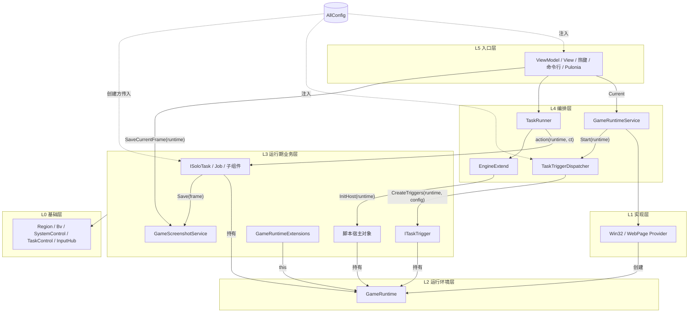

# 移除 TaskContext：按生命周期显式传递 GameRuntime

> 状态：P0~P4 已实施，解决方案编译通过，尚未手动回归（见第 15 节） · 2026-10-18 · 关联：[GameRuntime 设计](game-runtime.md)、[TaskTriggerDispatcher DI 改造](task-trigger-dispatcher-di.md)、[InputHub 设计](input-hub.md)、[实时触发器生命周期](realtime-trigger.md)

第 2 版变更：

- 新增第 7 节：把调度器中的保存截图拆为 `GameScreenshotService`，并合并 AutoFishing 中重复的一份实现。
- 新增第 14 节：整套 DI 的改进讨论，只作讨论，不纳入本次实施。
- 原第 7~12 节顺延为第 8~13 节。

## 1. 结论

`TaskContext` 里放了两种生命周期的东西：进程级的配置转发，以及一次绑定派生出的运行环境信息。按生命周期拆开后，它没有剩下任何职责，可以整体删除。

| 成员 | 引用 | 去向 |
| --- | --- | --- |
| `Config` | ~283 | **不进入 GameRuntime**。DI 创建的类注入 `AllConfig`，new 出来的实例由创建方传入，静态代码暂时读 `ConfigService.Config`（第 5 节） |
| `SystemInfo` | ~116 | `GameRuntime.SystemInfo`：由 Provider 构建，随 runtime 一起创建和结束 |
| `Runtime` | 49 | 运行期对象通过构造函数参数拿到；进程级对象读 `GameRuntimeService.Current` |
| `GameHandle` | 31 | `runtime.Window.Handle` |
| `DpiScale` | 21 | `runtime.SystemInfo.DpiScale`，仍是绑定时的快照，语义不变 |
| `IsInitialized` | 15 | 运行期对象里恒为真，直接删除；进程级对象用 `GameRuntimeService.IsRunning` |

**核心不变量**

- **运行期对象**（任务、触发器、脚本宿主）只使用构造时拿到的那个 `GameRuntime`，从不查询"当前运行环境"。
- **进程级对象**（ViewModel、服务、遮罩）在每次使用时向 `GameRuntimeService` 查询，不缓存结果。

这条规则取代了 `TaskControl.CreateWait` 里 `ReferenceEquals(TaskContext.Instance().Runtime, runtime)` 的全局比对：
- 运行期对象手里只有自己的 runtime，不可能误操作新绑定的环境；
- 自己的 runtime 结束时，由 `GameRuntime.Stopping` 通知。

**截图服务**：调度器中的 `TakeScreenshot()`（截图热键）拆为 `GameScreenshotService`，AutoFishing 中重复的保存逻辑一并合入。调度器从此不做文件 IO（第 7 节）。

**规模**

- 直接引用 523 处，分布在 180 个文件。
- 依赖 TaskControl 运行期静态方法的有 116 个文件。两者合计约 213 个文件。
- 类型变化：新增 2 个（`GameRuntimeExtensions`、`GameScreenshotService`），删除 2 个（`TaskContext`，以及没有子类的 `BaseAssets<T>`）。

第 14 节另外梳理了整套 DI 的改进点，只作讨论，不在本次实施范围内。

## 2. 分层结构



| 层 | 成员 | 生命周期 | 如何拿到 GameRuntime |
| --- | --- | --- | --- |
| L5 入口层 | App（DI 注册）、ViewModel / View、热键、命令行、Pulonia 执行器 | 进程 | 注入 `GameRuntimeService`，用时取 `Current` |
| L4 编排层 | `GameRuntimeService`、`TaskRunner`、`TaskTriggerDispatcher`、`EngineExtend` | 进程 / 一次运行 | 产生或接收 runtime，交付给 L3 |
| L3 运行期业务层 | `ISoloTask`、Job、`ITaskTrigger`、脚本宿主对象、`CombatScenes` / `PathExecutor` / `TpTask` 等子组件、`GameRuntimeExtensions`、`GameScreenshotService`（DI 单例，不持有 runtime） | 一次运行 / 一次会话 | 构造函数参数（扩展方法通过 `this` 参数，截图服务通过方法参数） |
| L2 运行环境层 | `GameRuntime`、`IGameWindow`、`ISystemInfo`、`GameViewport`、`IGameRuntimeProvider` | 一次绑定 | — |
| L1 实现层 | `Win32GameWindow` / `Win32RuntimeProvider`、`WebPageGameWindow` / `WebPageRuntimeProvider` | 进程（Provider）/ 一次绑定（Window） | 由它创建 runtime |
| L0 基础层 | `Region` / `ImageRegion` / `CaptureContent`、`Bv` / `RecognitionObject`、`SystemControl` 的 Win32 函数、`TaskControl` 纯函数、`InputHub` 及后端 | 无状态 / 一帧 | 不接触 runtime，只接收参数 |

依赖规则：

1. 只允许向下依赖。
2. runtime 只通过 4 个交付点从 L4/L5 进入 L3：
   - `TaskRunner` → 任务；
   - `TaskTriggerDispatcher.Start` → 触发器；
   - `EngineExtend.InitHost` → 脚本宿主；
   - 热键入口 → 宏和快捷任务。

   进入 L3 之后，再沿构造函数继续向下传。
3. L3 不依赖 `GameRuntimeService`。
4. L0 不读取任何运行状态。尺度从入参截图推导，或者显式接收 `ISystemInfo`。
5. 本次改造不在 L3 或 L0 中新增 `App.GetService`。

## 3. 每个对象持有什么

| 对象 | 生命周期 | 持有 | 不持有 |
| --- | --- | --- | --- |
| `GameRuntimeService` | 进程 | Provider、`Current`、启动 / 停止编排、`Started` / `Stopped` | 任务、触发器（生命周期不同） |
| `GameRuntime` | 一次绑定 | `Kind`、`Window`、`Capture`、`Input`、`SystemInfo`、借用的 `DrawingBoard` / `MapState`、`Stopping` | `AllConfig`（用户设置属于进程）；"当前是哪个"（这是 Service 的概念） |
| `ISystemInfo` | 一次绑定 | 画面几何、各缩放比、`DpiScale` 快照、区域树根 `DesktopRectArea` | 句柄和进程（属于 Window） |
| `IGameWindow` | 一次绑定 | `Handle`、`ProcessId`、实时 `Viewport`、存活 / 前台 / 最小化状态 | 截图、输入 |
| `TaskTriggerDispatcher` | 进程 | 定时器、本次会话的触发器槽位；`_runtime`（只在 Start 到 Stop 之间） | 截图保存与写盘（第 7 节） |
| `GameScreenshotService` | 进程 | `AllConfig`、`ILogger` | `GameRuntime` / `GameRuntimeService`：截哪个运行环境、保存哪一帧都由调用方传入 |
| `ITaskTrigger` | 一次会话 | `_runtime`、`AllConfig` | `GameRuntimeService` |
| `TaskRunner` | 一次运行 | 锁、停止注册；负责把 runtime 交给 action | 任务内部状态 |
| `ISoloTask` / Job / 子组件 | 一次运行 | `_runtime`，以及需要的配置或 Param | `GameRuntimeService` |
| 脚本宿主对象 | 一次脚本执行 | `_runtime`、`ct` | — |
| `CaptureContent` / `ImageRegion` | 一帧 | Mat、坐标转换链、继承来的 `DrawingBoard` | `GameRuntime`（帧只是数据） |
| `AllConfig` | 进程 | 用户设置 | 运行环境（`OnConfigChanged` 不再访问 Runtime） |

### 3.1 GameRuntime

```csharp
/// <summary>
/// 游戏运行环境：一次绑定的产物，由 IGameRuntimeProvider 创建，GameRuntimeService 负责结束。
/// 只做组合；绑定到它的操作见 GameRuntimeExtensions
/// </summary>
public sealed class GameRuntime(
    GameRuntimeKind kind,
    IGameWindow window,
    IGameCapture capture,
    IInputBackend input,
    ISystemInfo systemInfo,
    IMaskWindowDrawingBoard maskWindowDrawingBoard,
    IMaskWindowMapState maskWindowMapState) : IDisposable
{
    /// <summary>解绑开始时取消。不释放：持有者在 Dispose 之后仍会读取它；CTS 没有使用计时器，不释放也不会泄漏</summary>
    private readonly CancellationTokenSource _stopping = new();

    // Kind / Window / Capture / Input / MaskWindowDrawingBoard / MaskWindowMapState 不变

    /// <summary>绑定时画面区域的快照（含 DpiScale）。窗口移动时由调度器同步 CaptureAreaRect</summary>
    public ISystemInfo SystemInfo { get; } = systemInfo ?? throw new ArgumentNullException(nameof(systemInfo));

    /// <summary>本运行环境开始解绑时取消。运行期对象据此判断"我的运行环境已结束"</summary>
    public CancellationToken Stopping => _stopping.Token;

    /// <summary>由 GameRuntimeService 在解绑第一步调用，可重复调用</summary>
    internal void SignalStopping() => _stopping.Cancel();

    public void Dispose()
    {
        SignalStopping();
        Capture.Dispose();
        Window.Dispose();
    }
}
```

> 注意：`_stopping.Token` 在 CTS 未释放时始终可以读取，所以选择不释放这个 CTS。`Cancel()` 会在 UI 线程上同步执行已注册的回调，注册者只能做轻量操作。

### 3.2 ISystemInfo

- 新增 `float DpiScale { get; }`，取 `viewport.DpiScale`，在绑定时记录快照，与原来的 `TaskContext.DpiScale` 一致。
- 改由 Provider 在启动截图器**之前**构建（`new SystemInfo(window.Viewport, drawingBoard)`）。分辨率小于 800×600 时可以尽早失败，不必启动截图器后再回滚。
- `CaptureAreaRect` 的 setter 保留，仍然只由调度器在窗口移动时同步。写入对象从 `TaskContext.SystemInfo` 换成 `runtime.SystemInfo`。
- 不给 `GameRuntime` 增加 `GameHandle` / `DpiScale` 之类的便捷属性：同一个事实只保留一个入口。

### 3.3 GameRuntimeService

- `StartAsync` 改为返回 `Task<GameRuntime?>`：成功时返回绑定的那个 runtime，失败时返回 null。调用方不必启动后再去查 `Current`。
- `StopCurrent` 在 `Current = null` 之后立刻调用 `runtime.SignalStopping()`，然后按原顺序执行：StopAll → `dispatcher.Stop` → 释放输入 → 清空遮罩 → Dispose。同时删除两处 `TaskContext.Bind`。
- `Current` 改由 volatile 字段支撑，因为任务线程和 Tick 线程都会读它。

## 4. GameRuntime 的交付

### 4.1 独立任务：TaskRunner 把 runtime 交给 action

```csharp
public async Task RunCurrentAsync(Func<GameRuntime, CancellationToken, Task> action,
    bool waitForMainUi = true, CancellationToken requestToken = default)
{
    // …加锁、注册停止回调，与现在一致…
    // 返回本轮使用的运行环境；启动失败时抛 NormalEndException，不再在等待主界面的循环里空转
    var runtime = await ScriptService.StartGameTask(runCancellation.Token, waitForMainUi);
    Init(runtime);                       // 清遮罩、runtime.Window.Activate()
    await action(runtime, runCancellation.Token);
    // finally：End(runtime)；runtime.Stopping 已取消时跳过释放按键
}

/// <summary>拿到运行环境之后再构造任务；是否等待主界面由调用方显式指定</summary>
public Task RunSoloTaskAsync(Func<GameRuntime, ISoloTask> create, bool waitForMainUi = true,
    CancellationToken requestToken = default)
    => RunThreadAsync((runtime, ct) => create(runtime).Start(ct), waitForMainUi, requestToken);
```

```csharp
// 改造前：任务在截图器启动之前就构造好了，构造期读到的是上一次绑定的旧值
await new TaskRunner().RunSoloTaskAsync(new AutoDomainTask(new AutoDomainParam(round, path)));

// 改造后
await new TaskRunner().RunSoloTaskAsync(rt => new AutoDomainTask(rt, _config, new AutoDomainParam(round, path)));
```

- `ISoloTask` 接口不变。
- `RunSoloTaskAsync` 不再按任务名（"自动七圣召唤"、"自动音游"、"幽境危战"）推断 `waitForMainUi`，改由这 3 个任务的调用方传 `false`。
- 任务里在构造时取的快照字段（`_assetScale`、`_dpi`、`_captureRect` 等）可以原样保留。实例的生命周期在 runtime 之内，快照不会过期。
- 任务内部 new 子组件时传入 `_runtime`，例如 `new CombatScenes(_runtime)`、`new PathExecutor(_runtime, ct)`、`new TpTask(_runtime, ct)`、`new ReturnMainUiTask(_runtime)`。原来的字段初始化器 `= new ReturnMainUiTask()` 要挪到构造函数里。

### 4.2 触发器

- `GameTaskManager.CreateTriggers(GameRuntime runtime, AllConfig config)`，每个触发器通过构造函数接收这两个参数。`ITaskTrigger` 接口不变。
- 退役的触发器（上一会话留下的槽位）会在下一会话的第一帧收到 `OnDisabled`，这时它持有的是**旧** runtime。
  - 约束：`OnDisabled` 只能清理借用的进程单例（`DrawingBoard`、`MapState`），不能使用 `Capture`、`Input` 或 `Window`。
  - 现有实现（SkillCd、MapMask）已经满足这个约束。
- `MapMaskTrigger` 的后台定位线程改为用 `_runtime.Stopping` 判断结果是否作废，不再依赖 `Runtime?` 为 null。
- `CaptureContent` 的构造函数增加 `ISystemInfo` 参数，Tick 传入 `runtime.SystemInfo`。

### 4.3 脚本

- `ScriptProject.ExecuteAsync` 和 `EngineExtend.InitHost` 增加 `GameRuntime runtime` 参数。宿主对象（`genshin`、`dispatcher`、`keyMouseScript`、`pathingScript`、`characterDevelopmentTask`）在构造时接收它。
- 宿主对象需要的进程级服务（`AllConfig`、`GameScreenshotService`）同样经 `InitHost` 传入。参数继续增多时的做法见 14.4 第 10 项。
- `GlobalMethod` 由静态类改为每个引擎一个实例，再把实例方法注册为全局函数。这样也顺带去掉了 `_gameWidth` / `_gameHeight` / `_dpi` 在多个脚本之间共享的静态状态。
- 脚本自己 `new` 的宿主类型（`BvPage`、`BvLocator`、`KeyMouseHook`、`CombatScenes`）无法做构造注入。处理方式：
  - 注册一个绑定了 runtime 的工厂对象；
  - 在引擎里定义同名的 JS 构造函数来包装它，脚本的写法不变。

```csharp
engine.AddHostObject("__bvFactory", new BvFactory(runtime));
engine.Execute("globalThis.BvPage = function (...a) { return __bvFactory.CreatePage(...a); };");
```

### 4.4 热键与其他直接入口

- `HotKeyPageViewModel` 注入 `GameRuntimeService`。热键触发时先取 runtime：`if (_runtimeService.Current is not { } runtime) { 提示; return; }`，然后把 `runtime` 传给下游，并用 `runtime.Stopping` 代替原来的 `CancellationToken.None`。
  - 涉及：`TurnAroundMacro`、`QuickEnhanceArtifactMacro`、`QuickBuyTask`、`QuickSereniteaPotTask`、`OneKeyClaimRewardTask`、`OneKeyFightTask`、`TpTask`、`ChooseFOptionTask`、`PathRecorder`。
- 截图热键改为调用 `_screenshots.SaveCurrentFrame(runtime)`，不再经过调度器（第 7 节）。
- `KeyMouseMacroPlayer.PlayMacro`、`GlobalKeyMouseRecord.StartRecord` 增加 runtime 参数，`IsInitialized` 检查移到调用方。
- `GeniusInvokationControl` 不再是缓存素材的单例，改为由 `AutoGeniusInvokationTask` 在每次运行时创建。

### 4.5 Pulonia

- `PuloniaGameTaskCoordinator` 的租约记录 `StartAsync` 返回的 runtime，各执行器把 `lease.Runtime` 传给任务。
- 如果 `lease.Runtime.Stopping` 已经取消，当前节点失败，下一个节点重新获取。这样跨节点复用会话时，不会悄悄换到新的 runtime。
- `BeginTaskState` / `CleanupTaskState` 增加 runtime 参数。

### 4.6 进程级对象

- 注入 `GameRuntimeService`，用的时候取 `Current`。需要跟随绑定变化的（遮罩定位、FPS 进程号）订阅 `Started` / `Stopped`。
- **DI 环**：`GameRuntimeService` 依赖 `TaskTriggerDispatcher`，而 `TaskTriggerDispatcher` 的构造参数里有 `OverlayMetricsService`。因此 `OverlayMetricsService` 不能注入 `GameRuntimeService`。
  - 改为由调度器在 Start / Stop 时调用 `_metricsService.SetGameWindow(runtime.Window / null)` 上报。
  - 这与现有的 `ReportGameWindow`"由调度器上报事实"的做法一致。
  - 推广为规则：`TaskTriggerDispatcher` 和 Provider 的构造参数都不能依赖 `GameRuntimeService`。

## 5. 配置

配置不是运行环境的一部分。如果放进 `GameRuntime`，它就变成了一个服务袋，"运行环境"的含义也被稀释。配置的来源按类的形态区分：

| 形态 | 配置来源 |
| --- | --- |
| DI 创建的类（ViewModel、Service、Dispatcher） | 只读的注入 `AllConfig`；需要保存的继续用已注入的 `IConfigService` |
| 由调用方 new 的实例（任务、Job、触发器、脚本宿主、子组件） | 构造函数接收 `AllConfig`，或更窄的配置段 / Param，由创建方传入 |
| 没有创建方可以传参的代码：静态方法、`Singleton<T>`、脚本可直接 new 的 Param（`BaseTaskParam` 的语言回退） | 暂时读 `ConfigService.Config`（配置根），不新增调用点；等所属模块改为实例后再注入 |

```csharp
// App.xaml.cs：与 IConfigService.Get() 是同一个实例
services.AddSingleton(sp => sp.GetRequiredService<IConfigService>().Get());
```

- 前提：`ConfigService.Read()` 中给静态 `Config` 赋值的副作用要删掉，只保留 `Get()` 里那一次赋值，保证 DI 中的实例和静态根始终是同一个对象。目前 `Read()` 只被 `Get()` 调用。
- 第三行属于配置 DI 化的后续工作，约 40 处，主要在 `Bv`、`SimulateKeyHelper`、`MapManager`、`ItemIconRecognizerFactory`、`SystemControl`、`PictureInPictureService`、`ChatUiHotkeyGuard`、`ScriptRepoUpdater`、`GameRuntimeExtensions` 的焦点恢复开关。
  - 其中 `SimulateKeyHelper` 经 `SimulateAction` 有 343 个间接调用点，适合和 InputHub 一起收敛。

## 6. TaskControl 与 L0 静态方法

### 6.1 拆分 TaskControl

| 留在 `TaskControl`（与运行环境无关） | 迁到 `GameRuntimeExtensions`（`this GameRuntime`） |
| --- | --- |
| `Logger`、`TaskSemaphore`、`CaptureGameImage(IGameCapture)`（重试间隔改用 `Thread.Sleep`）、`CaptureGameImageNoRetry` | `CaptureToRectArea`、`Sleep`、`CheckAndSleep`、`Delay`、`TrySuspend`、`SimulateHold*`、`SimulateMouseLeftClickLoopAsync`；原 `GameCaptureRegion` 的 `GameRegionClick` / `Move` / `MoveBy` / `1080PPosClick` / `1080PPosMove`；原 `SystemControl.IsGenshinImpactActiveByProcess`（改名 `IsOperable`） |

```csharp
/// <summary>
/// 绑定到某个运行环境的任务操作：截图、等待、按 1080P 坐标点击。
/// 只认传入的这个运行环境，不查询"当前"
/// </summary>
public static class GameRuntimeExtensions
{
    /// <summary>截取一帧并派生为 1080P 区域树。运行环境已停止时按正常中断处理</summary>
    public static ImageRegion CaptureToRectArea(this GameRuntime runtime)
    {
        if (runtime.Stopping.IsCancellationRequested)
        {
            throw new NormalEndException("游戏运行环境已停止");
        }

        var image = TaskControl.CaptureGameImage(runtime.Capture);
        return new CaptureContent(image, 0, 0, runtime.SystemInfo).CaptureRectArea;
    }

    /// <summary>等待边界：本运行环境已停止或游戏已退出时中断</summary>
    private static GameTaskWait CreateWait(GameRuntime runtime, CancellationToken ct) =>
        new(() => !runtime.Stopping.IsCancellationRequested && runtime.Window.IsAlive, ct);

    // Sleep / Delay / TrySuspend 的逻辑不变，焦点恢复改用 runtime.Window 和 runtime.Window.Handle
}
```

调用点的替换是机械的，只需要加上 `_runtime.` 前缀：

| 改造前 | 改造后 |
| --- | --- |
| `CaptureToRectArea()` | `_runtime.CaptureToRectArea()` |
| `await Delay(300, ct)` / `Sleep(500)` | `await _runtime.Delay(300, ct)` / `_runtime.Sleep(500)` |
| `GameCaptureRegion.GameRegion1080PPosClick(x, y)` | `_runtime.GameRegion1080PPosClick(x, y)` |
| `SystemControl.ActivateWindow()` | `_runtime.Window.Activate()` |
| `SystemControl.IsGenshinImpactActive()` / `IsGenshinImpactMinimized()` | `_runtime.Window.IsForeground` / `_runtime.Window.IsMinimized` |

### 6.2 其他 L0 静态方法

| 位置 | 改法 |
| --- | --- |
| `Bv.*`、`ResinRecognition`、`ElementRecognition`、`CameraOrientation(.FromGia).DrawDirection`、`BvFlow` | 尺度从入参的整帧截图（已归一到 1080P）推导，与 `CaptureAssetsCache` 一致；入参不是整帧时显式接收 `ISystemInfo` |
| `BvLocator.WithRoi` | 由 `BvPage`（持有 runtime）创建时传入 `ISystemInfo` |
| `GridParams.Templates` | 只保存 1080P 下的 ROI，在使用处按 `runtime.SystemInfo.AssetScale` 缩放。现在的类型初始化器会把首次的 AssetScale 永久固化，首次绑定前访问还会抛 `TypeInitializationException` |
| `GameTaskManager.LoadAssetImage(feat, name)`、`RecognitionAssets` 中读 TaskContext 的重载 | 删除，调用方改用 `ISystemInfo` 或宽高重载 |
| `AvatarRecognition` / `AvatarSpecialActions` 的静态 `AssetScale`、`AutoBossTask.LoadRecognitionObject` | 改为实例成员，或者接收 `ISystemInfo` |
| `SystemControl.GetGenshinGameProcessNameList` | 接收 `IGameWindow?` 参数 |
| 键鼠钩子门控（`KeyboardHook`、`MouseHook`、`MouseKeyMonitor`） | 新增 `SystemControl.IsGameForeground(IGameWindow? window)`：有窗口时看 `IsForeground`，没有时按前台进程名判断 |
| `DpiHelper.ScaleY`、`AssertUtils`、`MaskButton`（已无调用方） | 前两者接收窗口句柄或 runtime 参数；`MaskButton` 直接删除 |
| `Region.DoubleClick` | 两次点击之间改用 `Thread.Sleep(60)`。`Region` 属于 L0，不持有 runtime |
| `AllConfig.OnConfigChanged` | 删除对 Runtime 的访问。改由 `MaskWindowViewModel` 订阅 `MaskWindowConfig` 的变化，并调用 `IMaskWindowDrawingBoard.ClearAll()` |

## 7. 截图服务：从调度器拆出

### 7.1 现状

- `TaskTriggerDispatcher.TakeScreenshot()` 是截图热键的唯一实现。取帧、建目录、UID 遮挡、写 PNG 都由它自己完成。
  - 为此调度器保留了一个只给它用的私有 `GameCapture` 属性，还要读 `TaskContext` 的配置和 `SystemInfo`。
  - 这些都和"每帧调度触发器"无关。
- AutoFishing 的 `ScreenshotVisitor.SaveScreenshot` 复制了同一段遮挡和写盘逻辑，被关键帧截图和出错截图使用。这份副本有两个问题：
  - **遮挡位置偏移**：输入是已归一到 1080P 的区域，比例却用 `SystemInfo.ScaleTo1080PRatio` 计算。游戏分辨率高于 1080P 时遮挡矩形偏左上，UID 会露出一部分。
  - **读到已释放的帧**：`Clone` 和写盘都放在 `new Task(...).Start()` 里执行。`TakeScreenshot` 行为节点在下一轮会 Dispose 上一帧，后台任务可能读到已释放的 Mat；写盘异常也没有人观察。

### 7.2 设计

```csharp
/// <summary>
/// 游戏截图的保存：取帧、按配置遮挡 UID、在后台写入 log\screenshot。
/// 不依赖 GameRuntimeService：截哪个运行环境由调用方传入，因此任何层都可以注入它，不会形成 DI 环
/// </summary>
public sealed class GameScreenshotService(AllConfig config, ILogger<GameScreenshotService> logger)
{
    /// <summary>截取指定运行环境的当前画面（原始分辨率）并保存。截图热键使用</summary>
    public void SaveCurrentFrame(GameRuntime runtime);

    /// <summary>
    /// 保存一帧已有画面。在调用线程上复制后立即返回，写盘在后台进行；
    /// 调用方保留 frame 的所有权，返回后即可释放
    /// </summary>
    public void Save(Mat frame, string? fileName = null);
}
```

- UID 遮挡沿用现有的遮挡矩形，只把比例改为按帧自身尺寸计算：`Math.Min(frame.Width / 1920d, frame.Height / 1080d)`。
  - 原始分辨率帧和归一到 1080P 的帧都适用，不再依赖 `SystemInfo`。
- 复制在调用线程上同步完成，后台任务只负责写盘，并在任务内捕获异常、记录日志。
- 目录 `log\screenshot\`、文件名规则、遮挡开关 `CommonConfig.ScreenshotUidCoverEnabled` 都只在这里出现一次。
- 注册为 DI 单例：`services.AddSingleton<GameScreenshotService>()`。

| 调用方 | 改造前 | 改造后 |
| --- | --- | --- |
| 截图热键（`HotKeyPageViewModel`） | `_taskTriggerDispatcher.TakeScreenshot()` | `if (_runtimeService.Current is { } runtime) _screenshots.SaveCurrentFrame(runtime);`，截图器未启动时提示 |
| AutoFishing 关键帧截图（`ScreenshotVisitor`） | 静态 `ScreenshotVisitor.SaveScreenshot(region, name)` | 构造函数接收 `GameScreenshotService`，调用 `Save(region.SrcMat, name)` |
| AutoFishing 出错截图（`GetFishBoxArea`、`Fishing` 等行为节点） | 同上 | 同上。服务随 `AutoFishingTask` 的构造函数传入，与 runtime 一样由创建方提供 |

- `TaskTriggerDispatcher` 删除 `TakeScreenshot()` 和私有的 `GameCapture` 属性，不再依赖截图相关的配置。
- 每帧采集（Tick 中的 `runtime.Capture.Capture()`）是调度器的本职工作，保留在调度器中。
- 触发器不保存截图：`AutoFishingTrigger` 的参数里 `SaveScreenshotOnKeyTick` 恒为 false。所以调度器和 `CreateTriggers` 都不需要这个服务。
- 层次：服务只依赖 `AllConfig`、日志和 L2 的 `GameRuntime` 参数，归入 L3。L5 的热键和 L3 的任务都可以使用它，依赖方向不变。

## 8. 生命周期

```text
绑定  Provider：new SystemInfo(viewport)（分辨率不合规时在这里失败）→ 启动截图器 → new GameRuntime
      Service ：InputHub.Attach(runtime.Input) → dispatcher.Start(runtime) → Current = runtime → Started
解绑  Service ：Current = null → runtime.SignalStopping() → StopAll(RuntimeStopped) → dispatcher.Stop
              → 释放输入 → 清空遮罩 → runtime.Dispose() → Stopped
```

- 运行期对象在 runtime 结束后的下一次截图或等待时抛 `NormalEndException("游戏运行环境已停止")`，由 TaskRunner 按正常中断收尾。
- "取消信号发出后立即释放截图器"这个既有的释放竞态保持不变，本次不处理，与 task-trigger-dispatcher-di.md 第 5 节的结论一致。

## 9. 迁移步骤

每一步结束时都能通过编译。旧 API 一直保留到 P4 才删除。

**P0 基础（行为不变，可以单独合入）**

1. `ISystemInfo` / `SystemInfo` 增加 `DpiScale`，同步 `FakeSystemInfo`。
2. `GameRuntime` 增加 `SystemInfo` 和 `Stopping`；两个 Provider 改为先构建 `SystemInfo`。
3. `GameRuntimeService`：`StartAsync` 返回 runtime；`StopCurrent` 先调用 `SignalStopping`。过渡期 `TaskContext.Bind` 改为直接引用 `runtime.SystemInfo`，避免同时存在两份。
4. 注册 `AllConfig`；删除 `ConfigService.Read` 中的静态赋值。
5. 新增 `GameRuntimeExtensions`。过渡期 TaskControl 的旧静态方法转发到 `TaskContext.Instance().Runtime!` 上的扩展方法。
6. 给 `TaskContext` 标上 `[Obsolete]`，剩余调用点会以 CS0618 警告的形式全部列出。

**P1 交付点**：
- `TaskRunner` / `StartGameTask` / `RunSoloTaskAsync` 及其调用方（29 处，11 个文件）；
- `TaskTriggerDispatcher` / `CreateTriggers` / `CaptureContent`；
- `ScriptProject` / `EngineExtend` / `ScriptGroupProject`；
- 热键入口；Pulonia 租约；
- 截图服务（第 7 节）：注册 `GameScreenshotService`，截图热键改为调用它，删除调度器的 `TakeScreenshot()`。

**P2 运行期业务**：按目录分批，每批都要编译通过。
- 顺序为 `Common/Job` → `AutoFight` → `AutoPathing` / `AutoTrackPath` → `AutoDomain` / `AutoBoss` / `AutoLeyLineOutcrop` / `AutoStygianOnslaught` → 各触发器 → 其余任务 → 脚本宿主。
- 处理 `AutoFishing` 时，把 `ScreenshotVisitor` 和出错截图一并改用 `GameScreenshotService`，并删除 `ScreenshotVisitor.SaveScreenshot`。

**P3 进程级**：ViewModel、View、Service、Recorder、遮罩。

**P4 收尾**：
- 按 6.2 节处理 L0 静态方法。
- 删除 TaskControl 的旧运行期静态方法、`GameCaptureRegion` 的静态点击方法、`TaskContext`、`BaseAssets<T>`。
- 运行 `dotnet build BetterGenshinImpact.sln -c Debug`。

替换对照：

| 旧写法 | 运行期对象（L3） | 进程级对象（L4/L5） |
| --- | --- | --- |
| `TaskContext.Instance().Runtime` | `_runtime` | `_runtimeService.Current`（需判空） |
| `.IsInitialized` | 删除；收尾代码改用 `!_runtime.Stopping.IsCancellationRequested` | `_runtimeService.IsRunning` |
| `.GameHandle` | `_runtime.Window.Handle` | `_runtimeService.Current?.Window.Handle` |
| `.DpiScale` / `.SystemInfo.X` | `_runtime.SystemInfo.DpiScale` / `.X` | `Current?.SystemInfo…` |
| `.Config.X` | `_config.X`（由创建方传入） | `_config.X`（注入） |

## 10. 行为变化

1. **进程级对象中"未绑定"就等于"没有游戏"**，不再沿用上一次的句柄、DPI 和 SystemInfo。
   - 受影响的地方：HtmlMaskWindow 的定位与还焦点、MaskWindowViewModel 的 1080P 比例和 FPS 进程号、CustomHtmlMaskService。
   - 停止截图器后遮罩本来就会隐藏，用户基本感觉不到。
2. **键鼠钩子类热键**的"游戏在前台"判断：有运行环境时看 `Window.IsForeground`，没有时按前台进程名判断。
   - 原来的行为：首次启动截图器之前恒为 false，停止之后沿用旧句柄。
3. **热键直接触发的 TpTask / ChooseFOptionTask / PathRecorder**：
   - 截图器未启动时给出提示并返回。原来会在字段初始化时抛 NRE。
   - 运行中会随截图器停止而取消。原来用的是 `CancellationToken.None`。
4. **截图器停止后**，任务的下一次截图按正常中断结束。原来抛 `InvalidOperationException("截图器未初始化!")`，被记为任务执行异常。
5. **`StartGameTask` 启动失败**时直接结束任务。原来在 `waitForMainUi` 的循环里一直空转，直到被取消。
6. **`waitForMainUi`** 由调用方显式传入；`Region.DoubleClick` 两次点击之间不再检查暂停和焦点。
7. **AutoFishing 截图的 UID 遮挡**：游戏分辨率高于 1080P 时位置恢复正确。原来遮挡矩形偏移，会露出部分 UID。
8. **截图写盘**：
   - 热键截图改为后台写盘，热键回调不再等待 PNG 编码。
   - 所有截图都在返回前完成复制，不会再读到已释放的帧。
   - 写盘失败会记录日志。

## 11. 风险

| 风险 | 对策 |
| --- | --- |
| 脚本 API 兼容：JS 直接 new 的宿主类型，以及可能被脚本调用的 `GameCaptureRegion.GameRegion*` 静态方法 | 用工厂对象 + 同名 JS 构造函数保持写法不变（4.3）。实施前需要对照脚本仓库，核对这些静态方法的实际用法 |
| 跨运行或跨绑定的静态缓存 | 6.2 节逐项列出。全部改为实例成员或参数之后，才能删除 `TaskContext` |
| 退役触发器持有旧 runtime | 约束 `OnDisabled` 只做清理（4.2）。代码评审时重点检查 |
| DI 环 | 由调度器上报，规则见 4.6。实施时以容器构建是否通过为准 |
| 手动选窗：分辨率校验提前到 `AttachTo` | 需要核对 HomePageViewModel 是否在这里捕获异常并给出提示 |

## 12. 不在本次范围

- **InputHub（642 处）**：运行期代码已经可以直接使用 `_runtime.Input`，但 InputHub 静态入口的收敛另行安排。`SimulateKeyHelper` 的键位读取跟着一起处理。
- **`RunnerContext` 单例**：包括暂停状态、拾取计数、`CombatScenes` 缓存。
- **DI 化**：`TaskRunner` / `TaskSemaphore` 进入 DI，以及配置静态根 `ConfigService.Config` 的最终下线。
- **停止协调**：停止时等待在途任务和 Tick 退出后再释放资源。
- **第 14 节的 DI 改进项**：只作讨论，不排入 P0~P4。

## 13. 决策记录

| 议题 | 决定 | 原因 |
| --- | --- | --- |
| GameRuntime 是否持有配置 | 不持有 | 两者生命周期不同；放进去会让 runtime 变成服务袋 |
| 运行期对象如何拿到运行环境 | 构造函数参数 | 依赖可见；单元测试可以用假的 Window / Capture 构造 runtime |
| 如何判断"我的环境已结束" | `GameRuntime.Stopping` | 只看自己持有的 runtime，取代与全局"当前"做比对 |
| 绑定到 runtime 的操作放在哪里 | 定义为 `GameRuntime` 的扩展方法 | 调用点只需机械替换；`GameRuntime` 本身保持纯组合 |
| DpiScale 放在哪里 | `ISystemInfo` | SystemInfo 本来就是 Viewport 的绑定快照，语义与原来一致 |
| SystemInfo 由谁构建 | Provider，在启动截图器之前 | 分辨率不合规时尽早失败，不需要回滚 |
| 任务何时构造 | 拿到 runtime 之后，通过工厂委托 | 构造期不会再读到上一次绑定的旧值 |
| 是否用 AsyncLocal 等环境上下文 | 不采用 | 本质是隐式单例，依赖仍然看不见 |
| 是否引入 DI Scope / 任务工厂服务 | 不采用 | 任务一直是 new 出来的，显式传参最简单 |
| 截图服务是否依赖 GameRuntimeService | 不依赖，运行环境或帧由调用方传入 | 可以被任何层注入，不会形成 DI 环；也符合"运行期对象不查询当前环境"的不变量 |
| UID 遮挡比例怎么算 | 按帧自身尺寸计算 | 原始帧和 1080P 归一帧都适用，不依赖 `SystemInfo`；顺带修正 AutoFishing 在高分辨率下的偏移 |
| 每帧采集是否一并拆出 | 不拆，留在调度器 | 这是调度器的本职工作；拆出去只会多一层转发 |

## 14. DI 体系改进讨论（不纳入本次实施）

这一节记录梳理整套 DI 时发现的问题，只作讨论和后续排期参考，不排入 P0~P4。编号在各小节之间连续。

### 14.1 容器配置

| # | 问题 | 现状 | 建议 |
| --- | --- | --- | --- |
| 1 | 构建时不做校验 | `Host.CreateDefaultBuilder()` 只在 Development 环境下开启 `ValidateOnBuild` / `ValidateScopes`。仓库没有设置 `DOTNET_ENVIRONMENT`，所以默认是 Production，循环依赖和缺失的注册要到第一次解析时才暴露（例如 4.6 的 `OverlayMetricsService` 环） | Debug 构建中调用 `UseDefaultServiceProvider(o => { o.ValidateOnBuild = true; o.ValidateScopes = true; })`。只能覆盖构造函数注入的部分，lambda 工厂内部的解析仍要靠运行时发现 |
| 2 | 重复注册 | `INavigationService` 在 App.xaml.cs 中注册了两次，后一次覆盖前一次 | 删掉其中一处 |
| 3 | 注册阶段带有副作用 | `ConfigureServices` 里会读写配置、准备推理运行库、切换界面语言，而 `_host` 是静态字段，类型初始化时就会执行这些操作 | 把注册和启动工作分开：注册阶段只登记服务，启动工作放到构建 Host 之前的引导步骤里。注意日志配置依赖配置文件，顺序约束要保留 |
| 4 | 同一类型存在两个实例来源 | `OneDragonFlowViewModel` 由 `AddView` 注册为单例，`TaskSettingsPageViewModel` 又 new 了一份，两份状态互不相通。`NotificationService` 在构造函数里写静态 `_instance`，与调度器已删除的 `_instance` 是同一种写法。`I18nService.Instance` 是静态单例，同时又注册进了 DI | 每个类型只由容器提供实例；保留的静态入口只负责转发 |

### 14.2 服务定位

`App.GetService` 共 49 处，分布在 37 个文件。

| # | 问题 | 现状 | 建议 |
| --- | --- | --- | --- |
| 5 | 业务代码向 ViewModel 取数据 | JS `Dispatcher`、`Genshin`、`FishingHandler`、`OneDragonTaskItem` 共 6 处通过 `App.GetService<TaskSettingsPageViewModel>()` 调用 `GetFightStrategy` 等业务判断，其中 `FishingHandler` 取到后只做了判空。另外，`InstanceService` 会调用 `HomePageViewModel.HandleActivation`，`ApplicationHostService` 会调用 `ScriptControlViewModel`，都是服务反向依赖 ViewModel | 把这些业务逻辑抽成服务（例如战斗策略解析、命令行激活），ViewModel 和业务代码都依赖这个服务，依赖方向回到 View → ViewModel → Service。ViewModel 之间互相获取（3 处）属于同一层内部，优先级低 |
| 6 | 为了延迟解析而注入 `IServiceProvider` | `ChildSessionService` 用它获取 transient 的 `ChildSessionWindow`；`RelativeMouseMessageHandler` 用它获取 `ChildSessionService` | 分别改为 `Func<ChildSessionWindow>`（与 `MaskWindow`、`CloudWebHostWindow` 的做法一致）和 `Lazy<ChildSessionService>`，依赖关系在构造函数上一目了然 |
| 7 | 打破循环依赖的方式不统一 | 目前有四种：可写的委托属性（`WebPageRuntimeProvider.StopCaptureBeforeCloseAsync = StopAsync`）、事件（`UiTaskStopTickEvent`）、lambda 延迟解析（`InferenceBenchmarkCoordinator`）、注入 `IServiceProvider` | 统一为"下层发事件，上层订阅"。例如 Provider 暴露宿主关闭事件，由 `GameRuntimeService` 订阅，做法与 `UiTaskStopTickEvent` 一致，同时去掉可写的委托属性 |

### 14.3 静态入口分级

静态入口不必一律消除，按状态的性质分三类处理。本设计处理的 `TaskContext` 属于第三类。

| 类别 | 例子（引用数） | 建议 |
| --- | --- | --- |
| 环境性横切：没有业务状态，调用方不关心具体实例 | `App.GetLogger`（84）、`Notify.Event`（33）、获取 `IStringLocalizer`、`WeakReferenceMessenger` | 可以继续作为静态入口。DI 创建的类改为构造注入，new 出来的类继续用静态入口 |
| 重资源单例：状态是模型或缓存，与某一次运行无关 | `OcrFactory.Paddle` 等（67）、`YoloManager`、`ScriptRepoUpdater` | 静态入口可以保留；新代码注入接口，方便测试时替换 |
| 生命周期敏感：状态属于某一次绑定或某一次运行 | `InputHub`（642）、`RunnerContext`（66）、`TaskControl.TaskSemaphore`、`ChatUiHotkeyGuard`、`HtmlMaskWindow.CloseAll`、`PictureInPictureService`、`TaskTriggerDispatcher.Instance()` | 需要收敛：要么随 runtime 或运行显式传递，要么收进 DI 单例、由编排层驱动 |

### 14.4 生命周期建模

| # | 问题 | 现状 | 建议 |
| --- | --- | --- | --- |
| 8 | "一次运行"没有对应的对象 | `RunnerContext` 保存暂停状态、拾取暂停计数、`CombatScenes` 缓存、`IsContinuousRunGroup`、当前脚本项目，却是一个进程单例，靠每次运行前后调用 `Clear()` 重置 | `TaskRunner` 每次运行时创建一个运行对象，和 runtime 一起交给 action。做法与本设计显式传递 runtime 一致，适合在本设计落地后进行 |
| 9 | `TaskRunner` 不在 DI 中 | 共 29 处 `new TaskRunner()`。它内部用 `App.GetService` 获取 `TaskStopService`；静态的 `ScriptService.StartGameTask` 也用服务定位获取 `GameRuntimeService`。全局任务锁是静态字段 `TaskControl.TaskSemaphore`，被调度器、Pulonia、推理基准直接引用 | 把 `TaskRunner` 注册为 DI 单例，持有任务锁、`TaskStopService` 和 `GameRuntimeService`，调用方改为注入。任务锁不再是静态字段 |
| 10 | 脚本宿主的创建不在 DI 中 | `EngineExtend.InitHost` 是静态方法，宿主需要的进程级服务（调度器、配置、截图服务）只能靠参数层层传入或服务定位获得 | 改为 DI 单例的宿主工厂：进程级服务通过构造函数注入，`Create(engine, runtime, ct)` 只接收每次执行时才有的参数。"进程级依赖注入、运行期对象传参"这个模式同样适用于 `CreateTriggers`，触发器的依赖继续增多时改为工厂服务 |

不建议用 DI Scope 来表示"一次绑定"或"一次运行"：
- 任务一直是 new 出来的，Scope 不会给它们注入依赖；
- 要用 Scope，就得把任务注册进容器，与现状差距太大。

### 14.5 配置

| # | 问题 | 现状 | 建议 |
| --- | --- | --- | --- |
| 11 | 配置对象反过来调用服务 | `AllConfig.OnNotificationPropertyChanged` 调用 `NotificationService.Instance().RefreshNotifiers()`；`OnConfigChanged` 会清空遮罩（后者本设计已经处理，见 6.2） | 由服务订阅自己关心的配置段，`AllConfig` 只负责"有变更就保存" |
| 12 | 多账号拆分配置的前提 | 所有实例共用一份 `User/config.json`（game-runtime.md 第 15 节） | 等所有配置读取都改为通过 DI 获取 `AllConfig` 后，按实例拆分配置只需要改注册的地方。这也是第 5 节第三行（静态代码读取配置）值得继续收敛的原因 |

### 14.6 建议顺序

- 第 1、2 项成本最低，随时可以做；第 1 项还能在本设计实施期间提前发现 DI 环。
- 第 7、11 项和本设计的边界相邻，适合在 P4 之后接着做。
- 第 8、9、10 项是下一轮"运行对象"建模的主体，三者最好一起设计。
- 第 3、4、5、6 项需要先梳理启动顺序，或者 ViewModel 中的业务逻辑，再单独评估。

## 15. 实施说明

已完成：`TaskContext`、`BaseAssets<T>`、`MaskButton`、`AutoFightContext`（全是注释代码）已删除，代码中不再引用 `TaskContext`。`dotnet build BetterGenshinImpact.sln -c Debug` 通过；单元测试的失败集合与改造前相同，失败的都是依赖环境的用例（键鼠权限、torch、OCR 素材等）。尚未做手动回归。

与设计的出入：

- **Pulonia**：运行环境经 `PuloniaTaskExecutionContext.Runtime` 交给执行器，由 `PuloniaTaskService` 填入节点租约的运行环境。执行器调用 `context.TryGetRuntime(...)`，运行环境为空或已停止时节点失败。
- **战斗指令与连招行为树节点**：解析结果会被跨运行复用，所以不持有运行环境，执行时从 `avatar.Runtime` 取。`CombatScenes.FromAvatars` 接管角色时会重新绑定运行环境。
- **`GlobalMethod`**：只有需要运行环境或游戏尺寸的方法改为实例方法，纯输入方法仍是静态的。
- **`ActionFactory`**：由静态缓存改为 `PathExecutor` 持有的实例，Handler 不再跨运行复用。
- **L5 中的 `App.GetService<GameRuntimeService>()`**：`KeyboardHook`、`MouseHook`、`MouseKeyMonitor` 以及几个由静态服务直接 new 的窗口（`HtmlMaskWindow`、`PictureInPictureWindow`、`AutoComboTreeWindow`、`ArtifactOcrDialog`）没有注入入口，暂时这样获取，代码里加了注释。
- **配置根**：静态方法、参数类、页面直接 new 的 ViewModel 共约 55 处读 `ConfigService.Config!`，代码里加了注释（第 5 节第三行）。
- **`GameTaskWait`**：不需要运行环境，没有改动。

待跟进：

1. 手动回归：截图器启停、任务中停止截图器、热键（截图、一键战斗、快速传送）、JS 脚本（`new BvPage()`、`CombatScenes`、`GameCaptureRegion.GameRegion1080PPosClick`、`setGameMetrics`）、Pulonia 账号切换。
2. JS 包装用 `Proxy` 实现。`new`、静态成员和全局函数已兼容；脚本里对这些类型用 `instanceof` 的写法没有验证。
3. 行为变化：
   - `Avatar.MoveBy` 和自动秘境的点击不再经过 `GlobalMethod`，因此不受脚本 `setGameMetrics` 影响。
   - 地图追踪中的钓鱼没有截图服务，开启关键帧截图时只记一条警告，不再保存截图。
4. `WalkToFTask` 的 finally 中 `_runtime.Sleep(50)` 会在运行环境停止时抛异常，跳过冲刺键的 KeyUp。解绑流程已经释放过全部按键，影响有限，可改为 `Thread.Sleep`。
5. 改造前就存在的泄漏：`CombatScenes.GetCombatScenesWithRetry` 识别失败时创建的场景没有释放；`OneKeyFightTask` 被替换掉的场景也没有释放。
6. 脚本 `Dispatcher` 仍从容器获取 `TaskSettingsPageViewModel`（14.2 第 5 项）。

### 15.1 代码审查后的修复

- **JS 静态 API 兼容**：在 `ScriptHostTypeFactory` 和 Proxy 中补齐 `GameRegionClick`、`GameRegionMove`、`GameRegionMoveBy`，保留五个旧坐标入口及大小写兼容；使用真实 V8、无输入副作用的工厂替身验证入口与参数转发。
- **验证**：解决方案 Debug 编译通过（0 错误）；`RuntimeBoundHostTypesTests` 的 5 个用例通过。未启动 BetterGI 或操作游戏。
