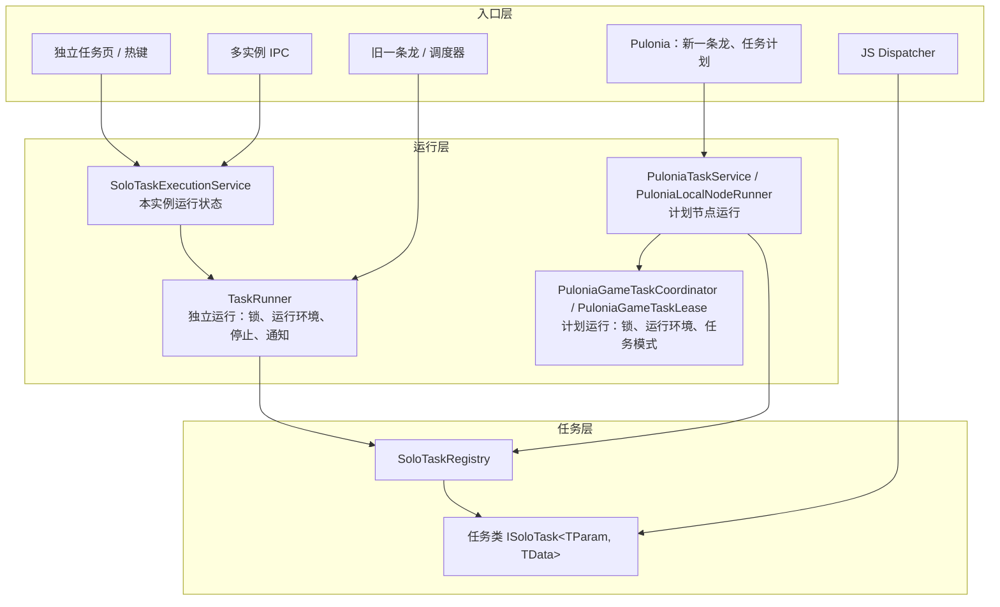

# 独立任务合同重构：ISoloTask 泛型化

状态：第 4 版（2026-10-24，按当前工作区代码核对）。**ISoloTask 泛型化及入口迁移的主体工作（步骤 A—C）已完成**；步骤 D 的统一会话租约仍未实现，步骤 E、F 继续预留。正文已按实际实现修订，代码依据及本次验证结果见第 13 节。

版本记录：

- 第 1 版以 Pulonia 为中心，另建处理类并保留数据兼容。已废弃。
- 第 2 版改为直接替换 `ISoloTask`，命名改用 `BgiTask`。
- 第 3 版（2026-10-22）按评审意见，命名保持以 `SoloTask` 为主题，并记录步骤 A—C 的实施偏差。
- 第 4 版（本版）对照代码更新合同、参数、异常、设置界面、默认清单和会话边界，区分已完成工作与后续事项。

本版遵循的评审意见：

1. 这些任务属于原独立任务（SoloTask）一系。命名不占用 `Pulonia`，保持以 `SoloTask` 为主题。
2. 不考虑 Pulonia 任务计划的历史数据兼容，导入机制可以重写。
3. 直接改造替换 `ISoloTask`，不加处理类、适配层或兼容层；宁可扩大影响面，也要保持逻辑简单；注意 `TaskRunner`。

本文统一把这些功能称为“独立任务”，代码前缀为 `SoloTask`。

## 1. 结论

- **合同**：用泛型接口 `ISoloTask<TParam, TData>` 直接替换现有的 `ISoloTask` / `ISoloTask<T>`。任务类自己实现接口，类上的 `[SoloTaskInfo]` 特性声明身份、菜单位置和设置界面。没有另外的处理类。
- **注册表**：`SoloTaskRegistry` 保留类名，内容从手写 switch 改为启动时扫描特性。它替代三份手写清单：
  - `SoloTaskRegistry` 自己的 switch，以及 `SoloTaskType` 枚举；
  - Pulonia 的两个内置执行器；
  - 一条龙的默认清单和设置界面 switch。
- **JS**：JS `Dispatcher` 是社区脚本在用的对外 API，保留显式方法，只改内部调用。
- **分层**：依赖方向是入口层 → 运行层 → 任务层。
  - 任务层：合同、注册表、任务类；
  - 运行层：`TaskRunner`、`SoloTaskExecutionService`、`PuloniaGameTaskCoordinator` / `PuloniaGameTaskLease`，以及共用的 `GameTaskSessionScope` 嵌套检测；
  - 入口层：独立任务页、热键、多实例、Pulonia、JS、旧一条龙和调度器。
- **TaskRunner**：`RunSoloTaskAsync` 保留方法名，改为两个都返回 `SoloTaskRunResult` 的重载；删除 `RunSoloTaskWithResultAsync`。锁、取消、异常映射的语义保留，第 6.1 节逐条说明。
- **Pulonia**：独立任务统一由 `PuloniaSoloTaskExecutor` 执行，把注册表接入 `PuloniaTaskService`，任务类型写作 `solo.{TaskId}`。执行器还负责星期覆盖和首领累计领奖次数等编排参数。
- **改名面小**：现有的 `SoloTask*` 名称大多保留，包括运行服务、请求与状态模型、按钮、实例窗口和 `ManageSoloTask`。这些地方只把枚举参数换成字符串 Id。

## 2. 命名

| 概念 | 名称 | 与现状的关系 |
| --- | --- | --- |
| 任务接口 | `ISoloTask<TParam, TData>` | 替换 `ISoloTask`、`ISoloTask<T>`，旧接口删除 |
| 声明特性 | `[SoloTaskInfo]`（`SoloTaskInfoAttribute`） | 新增 |
| 设置界面特性 | `[SoloTaskSettingsView]` | 新增 |
| 单次结果 | `SoloTaskResult<TData>`、`SoloTaskResult`、`ISoloTaskResult` | 新增 |
| 结果种类 | `SoloTaskResultKind` | 新增 |
| 通用原因码 | `SoloTaskReasons` | 新增 |
| 参数 JSON 选项 | `SoloTaskJson` | 新增 |
| 运行范围 | `SoloTaskScopes` | 新增 |
| 空参数、空数据 | `NoParam`、`NoData` | 新增 |
| 注册表 | `SoloTaskRegistry` | 保留类名，改为扫描特性 |
| 描述符 | `SoloTaskDescriptor` | 新增 |
| 任务标识 | 各任务类的 `public const string TaskId` | 替代 `SoloTaskType` 枚举，枚举删除 |
| 运行服务 | `SoloTaskExecutionService` | 保留类名 |
| 请求与状态模型 | `SoloTaskStartRequest`、`SoloTaskStatusSnapshot` 等 | 保留类名，`TaskType` 字段改为 `TaskId` |
| 运行结果 | `SoloTaskRunResult`、`SoloTaskRunOutcome` | 保留类名，增加 `TaskResult`；`Failed` 改为 `Faulted` |
| TaskRunner 入口 | `RunSoloTaskAsync` | 保留方法名，签名改变 |
| 设置 VM 基类、工厂 | `SoloTaskSettingsViewModel`、`SoloTaskSettingsFactory` | 新增，使用 `JObject` 参数快照，替代 `PuloniaOneDragonFixedSettingsViewModel` |
| 界面组件 | `SoloTaskButton`、`SoloTaskButtonState`、`SoloTaskInstanceWindow` | 保留类名 |
| Pulonia 执行器 | `PuloniaSoloTaskExecutor` | 替代两个内置执行器 |
| Pulonia 任务类型 | `solo.auto_domain` | 替代 `builtin.auto_domain` |
| 界面用语 | “独立任务” | 与现有独立任务页一致，Pulonia 子菜单也用这个词 |

声明特性不直接叫 `[SoloTask]`，原因是这个名字已经被占用了两次：

- 命名空间 `BetterGenshinImpact.GameTask.SoloTask`；
- JS 宿主类型 `SoloTask`（`Core/Script/Dependence/Model/SoloTask.cs`）。

如果再加一个 `SoloTaskAttribute`，写 `[SoloTask]` 时编译器要在命名空间、普通类和特性类之间消歧，读代码的人也容易混淆，所以用 `[SoloTaskInfo]`。

结果种类叫 `SoloTaskResultKind`，不叫 `SoloTaskOutcome`，是为了和运行层的 `SoloTaskRunOutcome` 拉开距离：

- `SoloTaskResultKind` 回答“任务做得怎么样”；
- `SoloTaskRunOutcome` 回答“这次运行怎么结束的”。

基于同样的理由，运行层的 `Failed` 改为 `Faulted`，表示抛出了异常，与任务的业务失败 `Failed` 区分。

上述合同与运行类型已落地，源码位置见第 13 节。

## 3. 需求对照

| 编号 | 需求 | 实现方式 | 当前状态 |
| --- | --- | --- | --- |
| R1 | 返回值明确成功或失败、失败原因，以及奖励等附加数据 | `SoloTaskResult<TData>` 包含结果种类、文字原因、原因码和强类型数据；秘境、首领返回奖励汇总（5.4） | 已实现 |
| R2 | 用泛型规范出入参 | `ISoloTask<TParam, TData>`，出入参由编译器约束（5.1） | 已实现 |
| R3 | 入参动态生成配置界面 | 参数元数据特性（5.8） | 预留 |
| R4 | 在任务定义上直接看到绑定的 XAML 界面 | `[SoloTaskSettingsView]` 写在任务类上（5.7） | 已实现 |
| R5 | 一条龙和任务计划通过发现获得任务；添加菜单收拢 | 注册表加“独立任务 ▸”子菜单（7.3） | 已实现 |
| R6 | 未来支持外部插件任务 | 注册表按程序集构建，规定插件 Id 命名（第 9 节） | 预留 |

## 4. 分层



| 层 | 职责 | 不做的事 |
| --- | --- | --- |
| 任务层 | 定义合同；任务类完成一件游戏操作并返回结果；注册表描述有哪些任务、参数是什么、绑定什么界面 | 不获取任务锁，不启动截图器，不读取界面状态，不依赖 Pulonia |
| 运行层 | 持有任务锁和运行环境（会话租约）；处理停止、超时、异常到状态的映射和通知 | 不了解具体任务的业务参数 |
| 入口层 | 从各自来源构造参数（页面配置、计划节点 JSON、IPC 载荷、脚本对象），选择运行方式，展示结果 | 不绕过运行层直接获取锁 |

目录与层一一对应：

- `GameTask/SoloTask/`：任务层的合同、特性、结果、注册表、描述符和 JSON 选项，命名空间 `BetterGenshinImpact.GameTask.SoloTask`。这就是现在 `SoloTaskRegistry` 所在的目录。
- `GameTask/SoloTask/Execution/`：运行层的 `SoloTaskExecutionService`、请求与状态模型、`SoloTaskRunResult`。`TaskRunner` 仍在 `GameTask/`。
- 任务层文件不引用 `Execution`，依赖方向从目录上就能看出来。任务类留在各自原来的目录。

调用边界与当前限制：

1. **独立运行和计划运行共用 `TaskControl.TaskSemaphore`，锁的获取与收尾尚未合并。** `TaskRunner` 自行管理独立运行，Pulonia 使用自己的协调器和租约。任务内部组合直接 `new` 子任务并调用 `RunAsync`；需要把提前结束异常转换为结果时使用 `ExecuteAsync`，不再进入 `TaskRunner`。
2. **任务合同显式接收 `TParam`，但尚未完全消除全局配置依赖。** 主实例下发已构造的参数；构造函数中的 `AllConfig` 仍提供运行环境设置，部分参数默认构造和可选配置回退也仍读取全局配置，不能视为完全隔离的参数快照。
   - `GoToCraftingBenchTask` 和 `GoToSereniteaPotTask` 已改为从参数取得保留树脂数量、进壶方式和购买商品，不再读取旧一条龙当前选中的 `User\OneDragon\*.json`。
   - 保留旧 JS 参数构造语义与彻底消除配置回退是两个边界，当前仅完成前者及已迁移的显式业务参数。

## 5. 任务层

### 5.1 任务接口

```csharp
/// <summary>独立任务合同。一个实例绑定一个运行环境，只运行一次。</summary>
/// <typeparam name="TParam">本次运行的全部业务参数，必须能 JSON 往返。</typeparam>
/// <typeparam name="TData">附加结果数据；没有时用 NoData。</typeparam>
public interface ISoloTask<TParam, TData>
    where TParam : class, new()
    where TData : class
{
    /// <summary>运行任务。业务失败返回 Failed；取消时抛出 OperationCanceledException。</summary>
    Task<SoloTaskResult<TData>> RunAsync(TParam param, CancellationToken ct);
}
```

约定：

- 构造函数只接收 `GameRuntime` 和可以从 DI 解析的服务，例如 `AllConfig`、`GameScreenshotService`、`ILogger`。
- 参数从构造函数挪到 `RunAsync`。依赖参数的初始化（例如解析战斗策略、读取路线）也一起挪到 `RunAsync` 开头。
  - 这是迁移中工作量最大的部分。
  - 换来的是编译期确定的出入参：签名就是“`TParam` 进，`SoloTaskResult<TData>` 出”。
- 原来的 `Name` 属性删除，显示名改由特性提供。
- 没有参数的任务用 `NoParam`，没有附加数据的任务用 `NoData`。

参数也可以留在构造函数里，那样改动更小。但“构造函数必须有一个 `TParam`”只能在启动时用反射检查，编译器管不到。把参数放在方法上，由编译器保证类型，所有入口的调用方式也完全一致。

### 5.2 声明特性

`[SoloTaskInfo(id, displayName)]` 只能用在类上：

| 属性 | 说明 |
| --- | --- |
| `Id` | 稳定标识，小写 snake_case，发布后不改 |
| `DisplayName` | 显示名的统一来源；`SoloTaskRegistry.GetDisplayName` 改为查询描述符，不再维护硬编码名称 |
| `Description` | 用途说明 |
| `Group` / `Order` | 在菜单中的分组和组内排序 |
| `Scopes` | `SoloTaskScopes.Standalone`：可以从独立任务页、热键、多实例运行；`SoloTaskScopes.Plan`：出现在任务计划和一条龙中。默认两者都有 |
| `WaitForMainUi` | 新启动截图器时是否先等待进入主界面，默认 `true`。取代 `SoloTaskRegistry.ShouldWaitForMainUi` |
| `OneDragonOrder` | 大于 0 表示新建一条龙配置时默认加入，并按这个值排序 |

- 每个任务类公开 `public const string TaskId`。特性、热键代码和 XAML（`{x:Static}`）都引用这个常量，不再手写字符串。
- 没加特性的类也可以实现接口，但不会被发现，只用于内部组合或特定入口，见第 8 节。

### 5.3 参数

- **结构：** 参数是类，有公共无参构造函数。默认值由属性初始值和构造函数共同决定；JS 已暴露的参数类型保留从全局配置填充默认值的行为，因此 Pulonia 能力定义中的默认参数会包含建立执行器时的配置快照。
- **可序列化：** 参数的 JSON 合同不包含委托、`ScriptObject`、`CancellationToken` 或内存中的会话对象。例如：
  - `AutoBossParam.RewardClaimedCallback` 保留为 `internal`，不参与序列化，由旧一条龙或 Pulonia 执行器在运行前注入，用于每次成功领奖后更新累计次数；
  - `AutoComboRunTask` 的行为树会话从构造函数传入，这个类也不加特性。
- **序列化库：** 统一用 System.Text.Json，选项集中在 `SoloTaskJson`：snake_case、枚举存为字符串、包含公共字段。反序列化沿用忽略未知字段的默认行为；Pulonia 另用生成的 Schema 限制节点参数，不能把它等同于所有入口都严格校验未知字段。
  - 原因是参数类会直接包含或继承 `AllConfig` 下已经用 System.Text.Json 序列化的配置类（`AutoDomainConfig`、`AutoFightConfig` 等），按仓库规则应沿用 System.Text.Json。
  - 改用 Newtonsoft 会忽略这些类上的 System.Text.Json 特性；当前 Schema 也从同一套 System.Text.Json 类型元数据生成。
  - Pulonia 和 IPC 内部使用 Newtonsoft 的 `JObject`，只在边界处按字符串转换。
- **JS 对外合同：** 有 6 个参数类已经作为 JS 宿主类型暴露给社区脚本：`AutoDomainParam`、`AutoBossParam`、`AutoFightParam`、`AutoLeyLineOutcropParam`、`AutoStygianOnslaughtParam`、`CountInventoryItemParam`。
  - 它们直接充当 `TParam`。
  - 现有的构造函数和属性不删、不改名、不改语义，只允许新增无参构造函数和新属性。
  - 秘境、首领、幽境危战、地脉花的旧树脂属性保留为 `[JsonIgnore]` 兼容属性，实际读写新属性 `ResinUsage`；同时注册了宿主类型 `ResinUsage`、`ResinUsageMode`、`OriginalResinTier`、`ResinKind`，新脚本可以直接修改 `param.ResinUsage`。见[树脂使用设置统一](resin-usage-settings.md) 5.5 节。
- **每周安排：** 属于 Pulonia 编排参数，不加入任务的强类型 `TParam`。
  - `PuloniaSoloTaskExecutor` 为所有独立任务的 Schema 添加 `weekday_overrides`，按服务器时间（凌晨 4 点日切）合并当天覆盖，当天禁用则返回 `Skipped(not_scheduled_today)`。
  - 秘境还提供 `weekday_overrides_enabled` 开关；执行器在反序列化为任务参数前移除这些编排字段。
- **战斗策略：** 任务使用共享的 `CombatStrategyResolver` 解析策略名或路径。
  - 参数继续沿用 `CombatStrategyPath` 等已公开的属性名。
  - JS 现有调用传的是路径，所以解析器也接受路径。
  - 独立任务页仍通过 `GetFightStrategy` 校验选择并构造参数；统一战斗入口是 `AutoFightEntryTask`，原 TXT 实现仍叫 `AutoFightTask`。

### 5.4 结果

```csharp
/// <summary>任务结果种类。取消不属于结果，以 OperationCanceledException 表示。</summary>
public enum SoloTaskResultKind { Succeeded, Unverified, Partial, Failed, Skipped }

/// <summary>按 Id 动态调用时使用的无类型结果视图。</summary>
public interface ISoloTaskResult
{
    /// <summary>结果种类。</summary>
    SoloTaskResultKind Kind { get; }
    /// <summary>面向用户的原因或摘要。</summary>
    string Message { get; }
    /// <summary>机器可读的原因码，成功时通常为空。</summary>
    string? ReasonCode { get; }
    /// <summary>附加数据。</summary>
    object? Data { get; }
}

/// <summary>任务返回的强类型结果。</summary>
public sealed record SoloTaskResult<TData>(SoloTaskResultKind Kind, string Message, string? ReasonCode, TData? Data)
    : ISoloTaskResult where TData : class
{
    /// <inheritdoc />
    object? ISoloTaskResult.Data => Data;

    /// <summary>不带数据的结果可以直接作为任意 TData 的结果返回。</summary>
    public static implicit operator SoloTaskResult<TData>(SoloTaskResult result)
        => new(result.Kind, result.Message, result.ReasonCode, null);
}

/// <summary>不带数据的结果，以及创建结果的工厂方法。</summary>
public sealed record SoloTaskResult(SoloTaskResultKind Kind, string Message, string? ReasonCode)
{
    /// <summary>成功且已确认。</summary>
    public static SoloTaskResult Success(string message = "") => new(SoloTaskResultKind.Succeeded, message, null);
    /// <summary>成功并附带数据。</summary>
    public static SoloTaskResult<T> Success<T>(T data, string message = "") where T : class
        => new(SoloTaskResultKind.Succeeded, message, null, data);
    /// <summary>流程正常结束，副作用未确认，并附带数据。</summary>
    public static SoloTaskResult<T> Unverified<T>(T data, string message) where T : class
        => new(SoloTaskResultKind.Unverified, message, null, data);
    /// <summary>业务失败。</summary>
    public static SoloTaskResult Failed(string reasonCode, string message) => new(SoloTaskResultKind.Failed, message, reasonCode);
    /// <summary>条件不满足，未执行。</summary>
    public static SoloTaskResult Skipped(string reasonCode, string message) => new(SoloTaskResultKind.Skipped, message, reasonCode);
    // Unverified(message)、Partial(...) 同理，略
}
```

有了隐式转换，任何任务都可以直接写 `return SoloTaskResult.Failed(...)`，不用写泛型参数。

| 结果种类 | 含义 | 例子 |
| --- | --- | --- |
| `Succeeded` | 完成，且完成情况已确认 | 已返回主界面；七圣召唤对战结束 |
| `Unverified` | 流程正常结束，但没有确认副作用 | 秘境流程结束，没有领取证据 |
| `Partial` | 只确认了部分副作用 | 预留 |
| `Failed` | 业务失败，必须带原因码 | 未选择秘境；未装备王树瑞佑 |
| `Skipped` | 条件不满足，没有执行 | 今天不在运行日期内 |

原因码：

- 使用小写 snake_case，一旦发布就固定不变；`Message` 面向用户，可以随时改措辞。
- 通用原因码放在 `SoloTaskReasons`：`invalid_parameter`、`not_scheduled_today`、`strategy_not_found`、`page_not_reached`、`runtime_stopped`。
- 只属于某个任务的原因码，定义在该任务类旁边。

奖励数据：

- 奖励统一为 `RewardSummary { Items: [{ Name, Count }] }`。
- 秘境、首领、幽境危战、地脉花四个领奖任务的 `TData` 统一为 `ResinClaimData { Rewards, Resin }`：`Rewards` 是奖励汇总，`Resin` 是树脂使用报告（领奖次数、各类用量、结束原因）。Pulonia 结果 `Data` 中对应 `rewards.items` 与 `resin`，JS 入口把 `Rewards` 转换回原来的字典返回形状。合成浓缩树脂返回 `CraftCondensedResinData { CraftedCount }`。详见[树脂使用设置统一](resin-usage-settings.md)第 6 节。
- 奖励是本次观测到的产出，不等于 Pulonia 账本中“已确认的副作用”。首领累计领奖次数由独立的内部回调逐次保存，不能从奖励物品数量推算。
- JS 专用任务 `AutoEatTask`、`CountInventoryItem` 分别返回 `AutoEatData`、`InventoryCountData`；其他任务使用 `NoData`。

### 5.5 异常约定

- 可以预见的业务失败返回 `Failed`，避免仅记录错误日志就返回，使调用方误判为成功。
- 取消时抛出 `OperationCanceledException`。
- 深层业务流程的提前结束使用 `SoloTaskAbortException` 携带结果；它继承 `NormalEndException`，以保留直接调用 `RunAsync` 的旧入口语义。对应结果包括：

  | 任务 | 提前结束的情形 | 结果 |
  | --- | --- | --- |
  | 自动七圣召唤 | 对战已结束；策略中所有指令已经执行完毕 | `Succeeded` |
  | 自动七圣召唤 | 已经没有可切换且存活的角色 | `Failed` |
  | 自动伐木 | 请先装备小道具「王树瑞佑」；首次伐木未识别到木材 | `Failed` |
  | 自动秘境 | 未检测到秘境结束，可能是背包物品已满 | `Failed` |
  | 连招运行 | 战斗结束 | `Succeeded` |

  `SoloTaskExtensions.ExecuteAsync` 捕获 `SoloTaskAbortException` 并返回其结果。`TaskRunner` 的强类型入口和描述符调用都会经过它；直接调用 `RunAsync` 时，异常仍沿旧调用链传播。
- 对其余 `NormalEndException`，`TaskRunner` 保留原来的映射：已请求取消时为 `Cancelled`，否则为 `Completed`，通常没有 `TaskResult`。Pulonia 则在未请求取消时映射为 `Failed(runtime_stopped)`，已请求取消时抛出 `OperationCanceledException`。
- 其他异常直接抛出，由运行层记录。

### 5.6 注册表与描述符

**扫描与校验**

- `SoloTaskRegistry` 是 DI 单例。构造时扫描指定程序集中带 `[SoloTaskInfo]` 的类，本期只扫描主程序集。
- 注册表建立时进行结构校验，任一项失败直接抛异常：
  - Id 格式正确且唯一；
  - 类不是抽象类或开放泛型，恰好实现一个 `ISoloTask<,>`；
  - 恰好有一个公共构造函数，且包含 `GameRuntime` 参数；
  - 声明的设置 VM 类型不被多个任务复用。
- 参数默认构造与 JSON 往返不在注册表结构校验中执行；Pulonia 建立能力定义时才创建默认参数和 Schema。设置 VM 的基类检查发生在 `SoloTaskSettingsFactory.Create`，视图能否实例化和布局需由 WPF 验证覆盖。
- 调用委托在注册时生成，执行期间不再使用反射。

**`SoloTaskDescriptor` 的内容**

- 特性里的全部内容，以及任务类型、`ParamType`、`DataType`、设置视图类型和 VM 类型；
- `CreateDefaultParam()`、`SerializeParam(object)`、`DeserializeParam(string)`；
- `InvokeAsync(IServiceProvider services, GameRuntime runtime, object param, CancellationToken ct, AllConfig? config = null)`：用 `ActivatorUtilities` 创建实例并运行，返回 `ISoloTaskResult`。`config` 用于覆盖 DI 里的配置根，见 6.2。

**注册表查询**

- 按 Id：供动态入口使用；
- 按 CLR 类型：提供 `FindByType` 查询；当前 `TaskRunner` 的强类型重载尚未使用它取得显示名或主界面等待策略。

**两种调用方式**

- 编译期就知道任务类型的调用方（任务内部组合、JS `Dispatcher`、旧一条龙）：直接 `new`，再调用 `RunAsync`，不经过描述符；需要接收提前结束结果时可调用 `ExecuteAsync`。
- 按 Id 动态调用的入口（独立任务页、IPC、Pulonia）：使用 `InvokeAsync`。

### 5.7 设置界面绑定（R4）

```csharp
[SoloTaskSettingsView(typeof(AutoDomainSettingsView), typeof(AutoDomainSettingsViewModel))]
```

**VM**

- VM 继承非泛型的 `SoloTaskSettingsViewModel`，构造时接收当前有效参数 `JObject`，并深拷贝为 `Original` 快照。
- 子类把字段映射到可编辑属性，使用 `CollectChanges(JObject)` 收集相对快照真实变化的顶层字段，继续复用 `ReadString`、`WriteString` 等辅助方法。
- VM 不依赖 Pulonia 节点，宿主负责合并、校验和保存变化；`Edited` 事件供需要即时保存的宿主订阅。
- `EditedParameterNames` 声明专属界面已覆盖的字段，剩余 Schema 参数由宿主补充为通用卡片，避免隐藏可用设置。

**视图**

- 视图绑定各设置 VM 的可编辑属性、选项和每周安排等辅助行；没有泛型的 `Value` 属性。

**模板注册**

- 应用启动时，在 UI 线程为每个声明了界面的任务注册一个隐式 `DataTemplate`，以 VM 类型为键。页面上的 `ContentControl` 会按 VM 类型自动匹配。
- `SoloTaskSettingsTemplates.Register` 在应用资源中注册隐式模板，替代页面内写死的模板。
- 宿主通过 `SoloTaskSettingsFactory` 根据描述符创建 VM，不再按任务类型维护设置界面 switch。

**迁移与边界**

- 当前共有 7 套专属设置界面，位于 `View/Pages/SoloTaskSettings/` 和 `ViewModel/SoloTaskSettings/`：合成浓缩树脂、每日奖励、尘歌壶、秘境、首领、幽境危战、地脉花，例如 `AutoDomainSettingsView`。
- 秘境、首领、幽境危战、地脉花、合成浓缩树脂的树脂设置不在专属界面里展开，统一使用“树脂使用”卡片按钮（`View/Controls/Resin/ResinSettingsCard`）打开公共弹窗编辑；四个领奖任务只编辑一个参数 `resin_usage`。见[树脂使用设置统一](resin-usage-settings.md)第 7 节。
- 这套界面与 Pulonia 无关，以后独立任务页也可以直接复用，但不在本期范围。
- 任务层只通过 `typeof` 引用视图类型，从不创建界面。

### 5.8 预留：参数界面元数据（R3，尚未实现）

- 参数属性上可以加两个特性：
  - `[SoloTaskParam(Title, Description, Order, Group, Minimum, Maximum, Advanced)]`；
  - `[SoloTaskParamChoices(typeof(provider))]`。provider 实现 `ISoloTaskParamChoiceProvider`，在界面打开时提供秘境、首领、战斗策略等动态选项。
- 描述符暴露了 `ParamType`，表单生成器直接反射参数类，不依赖 JSON Schema。
- 以后用它替换两处写死的逻辑：Pulonia 通用卡片里的显示名字典，以及 `PuloniaOneDragonSettingChoices` 按键名补选项的逻辑。
- 配置界面按这个顺序选取：自定义视图 → 元数据生成的表单 → 现有的 Schema 通用卡片。

### 5.9 示例

以下是按当前接口与调用边界整理的流程示意，省略实际识别和操作代码；星期覆盖在 Pulonia 执行器中处理。

```csharp
/// <summary>自动秘境：按参数刷取秘境，返回识别到的掉落。</summary>
[SoloTaskInfo(TaskId, "自动秘境", Group = "树脂与战斗", Order = 210, OneDragonOrder = 3)]
[SoloTaskSettingsView(typeof(AutoDomainSettingsView), typeof(AutoDomainSettingsViewModel))]
public partial class AutoDomainTask : ISoloTask<AutoDomainParam, ResinClaimData>
{
    /// <summary>任务标识，特性、热键和 XAML 都引用它。</summary>
    public const string TaskId = "auto_domain";

    /// <summary>只接收运行环境和全局环境配置，业务参数在 RunAsync 中传入。</summary>
    public AutoDomainTask(GameRuntime runtime, AllConfig config) { /* 保存依赖 */ }

    /// <inheritdoc />
    public async Task<SoloTaskResult<ResinClaimData>> RunAsync(AutoDomainParam param, CancellationToken ct)
    {
        // 按服务器时间合并当天参数已由 Pulonia 完成；任务只处理本次收到的业务参数
        if (string.IsNullOrWhiteSpace(param.DomainName))
            return SoloTaskResult.Failed(SoloTaskReasons.InvalidParameter, "请选择秘境。");
        var strategy = CombatStrategyResolver.Parse(param.CombatStrategyPath);
        if (!strategy.Exists)
            return SoloTaskResult.Failed(SoloTaskReasons.StrategyNotFound, $"战斗策略“{param.CombatStrategyPath}”不存在。");

        // 原 Start 的流程；依赖参数的初始化从构造函数移到这里

        // 现有流程没有领取证据，所以结果是“已执行，未核验”，同时带回掉落汇总和树脂使用报告
        return ResinClaimResults.Complete(_selector, _stopReason, "秘境流程已结束", _hasBattled, RewardSummary.From(_rewardSummary));
    }
}

/// <summary>领取每日奖励：组合历练点、冒险家协会和纪行。</summary>
[SoloTaskInfo(TaskId, "领取每日奖励", Group = "日常奖励", Order = 130, OneDragonOrder = 7)]
[SoloTaskSettingsView(typeof(ClaimDailyRewardsSettingsView), typeof(ClaimDailyRewardsSettingsViewModel))]
public class ClaimDailyRewardsTask(GameRuntime runtime, AllConfig config) : ISoloTask<DailyRewardsParam, NoData>
{
    /// <summary>任务标识。</summary>
    public const string TaskId = "claim_daily_rewards";

    /// <inheritdoc />
    public async Task<SoloTaskResult<NoData>> RunAsync(DailyRewardsParam param, CancellationToken ct)
    {
        // 子任务直接组合调用，不经过 TaskRunner
        var points = await new ClaimEncounterPointsRewardsTask(runtime, config).RunAsync(new NoParam(), ct);
        if (points.Kind == SoloTaskResultKind.Failed) return points;
        await new GoToAdventurersGuildTask(runtime, config).Start(param.Country, ct, param.PartyName, onlyDoOnce: true);
        await new ClaimBattlePassRewardsTask(runtime, config).RunAsync(new NoParam(), ct);
        return SoloTaskResult.Unverified("每日奖励领取流程已结束。");
    }
}
```

## 6. 运行层

### 6.1 TaskRunner

| 原入口或实现 | 当前实现 |
| --- | --- |
| `RunCurrentWithResultAsync(Func<GameRuntime, CancellationToken, Task>)` → `SoloTaskRunResult` | 保留 |
| `RunCurrentAsync`、`RunThreadAsync`、`FireAndForget` | 保留。调度器配置组、旧一条龙、地图追踪、录制回放、JS 列表等组合运行仍然使用它们 |
| `RunSoloTaskAsync(Func<GameRuntime, ISoloTask>)` → `Task` | 保留方法名，改为两个重载，都返回 `SoloTaskRunResult`（见下） |
| `RunSoloTaskWithResultAsync(...)` | 删除，并入上面两个重载 |
| 私有字段 `_name`：从未赋值，日志永远显示“任务启动！” | 已删除。描述符重载使用任务显示名；委托版本接受可选名称；强类型重载目前传入空名称 |

两个重载共用一份私有实现，本身都很薄：

```csharp
/// <summary>编译期已知类型的入口，例如兑换码、连招运行。是否等待主界面由调用方传入，
/// 默认等待；当前不会从注册表推断显示名或等待策略。</summary>
public Task<SoloTaskRunResult> RunSoloTaskAsync<TParam, TData>(
    Func<GameRuntime, ISoloTask<TParam, TData>> create, TParam param,
    bool waitForMainUi = true, CancellationToken requestToken = default)
    where TParam : class, new() where TData : class;

/// <summary>按描述符运行，供 SoloTaskExecutionService 使用。</summary>
public Task<SoloTaskRunResult> RunSoloTaskAsync(
    SoloTaskDescriptor task, object param, Action? onStarted = null,
    AllConfig? config = null, CancellationToken requestToken = default);
```

`SoloTaskRunResult` 保留类名，增加一个属性：

```csharp
/// <summary>一次独立运行的结果。</summary>
public sealed class SoloTaskRunResult
{
    /// <summary>运行层的结束状态：Completed、Cancelled、Faulted、Rejected。</summary>
    public SoloTaskRunOutcome Outcome { get; init; }
    /// <summary>取消、异常或拒绝的原因。</summary>
    public string? ErrorMessage { get; init; }
    /// <summary>任务自己的结果；通过 RunSoloTaskAsync 正常返回时有值。
    /// 旧 NormalEndException 路径可能以 Completed 结束但没有任务结果。</summary>
    public ISoloTaskResult? TaskResult { get; init; }
}
```

需要注意的语义：

1. **锁。** 两种行为都不变：
   - `TaskRunner` 拿不到锁就立即拒绝（`WaitAsync(0)` 失败时返回 `Rejected`）；
   - Pulonia 等待锁。
2. **嵌套。** 已经在会话内的代码不能再调用 `TaskRunner`。“会话内”包括 `TaskRunner` 的委托里、Pulonia 节点里和任务内部。
   - `GameTaskSessionScope` 使用 `AsyncLocal` 标记当前异步流。`TaskRunner` 发现已经处于会话内，会在获取锁前抛出 `InvalidOperationException`。
   - Pulonia 的 `PuloniaLocalNodeRunner` 在游戏节点执行器调用期间进入作用域；`PuloniaGameTaskCoordinator.AcquireAsync` 同样拒绝会话内再次获取租约。
   - 在会话内运行任务，应使用 `InvokeAsync` 或直接 `new`。
3. **构造时机。** 任务在拿到运行环境之后才构造，保留现有的保证：构造期间不会读到上一次绑定的旧运行环境。
   - `onStarted` 在构造之后、调用 `RunAsync` 之前触发，运行服务据此把状态从“启动中”切到“运行中”。
   - 这和现在 `markRunning` 的时机相同。
4. **异常与结果的映射：**

   | 情况 | `Outcome` | 通知 |
   | --- | --- | --- |
   | 任务返回了结果 | `Completed`，`TaskResult` 为任务结果 | 结果为 `Failed` 时发送 `TaskError`，通知包含失败消息，日志记录原因码；其他结果不发送 |
   | 抛出 `OperationCanceledException` | `Cancelled` | 不发送，与现在相同 |
   | 抛出携带业务结果的 `SoloTaskAbortException` | `ExecuteAsync` 转换为任务结果，按上面的返回结果规则处理 | 同返回结果 |
   | 其余 `NormalEndException` | 已请求取消时为 `Cancelled`，否则为 `Completed`；不附带任务结果或错误消息 | 没有请求取消时发送 `TaskCancel`，与旧行为相同 |
   | 抛出其他异常 | `Faulted`（原 `Failed`） | 发送 `TaskError`，与现在相同 |
   | 拿不到锁 | `Rejected` | 不发送，与现在相同 |

   - 未将所有 `NormalEndException` 统一改为 `Cancelled`；旧入口与明确业务结果的差异由 `SoloTaskAbortException` / `ExecuteAsync` 衔接。
   - `Failed` 结果也发送 `TaskError`，原因码写入日志，通知文本包含失败消息。
5. **连续执行。** 共用的 `RunCoreAsync` 在 `RunnerContext.IsContinuousRunGroup` 下重新抛出 `NormalEndException` 和 `OperationCanceledException`，继续终止连续执行链。`RunSoloTaskAsync` 不用于连续执行。
6. **线程。** 两个重载内部都用 `Task.Run`，任务的构造和运行都在线程池上，保留原 `RunSoloTaskWithResultAsync` 的线程行为。任务代码不能访问 WPF 对象。

### 6.2 运行服务

`SoloTaskExecutionService` 保留类名，移到 `GameTask/SoloTask/Execution/`，行为不变：

- 每个实例同一时间只有一个活动运行；
- 按 RunId 保证幂等，停止时只停匹配的那次运行；
- 状态变化和运行完成都有事件。

变化：

- **启动请求：** `SoloTaskStartRequest` 从 `{RunId, TaskType: 枚举, Parameters}` 改为 `{RunId, TaskId: 字符串, Parameters}`。服务按 Id 取得描述符，反序列化参数，再调用描述符版本的 `RunSoloTaskAsync`。
- **其他模型：** `SoloTaskStatusSnapshot`、`SoloTaskStartDefinition`、`SoloTaskRunCompletedEventArgs` 的 `TaskType` 字段同样改为 `TaskId`。
- **最新配置：** 运行服务通过 `IConfigService.Read()` 读取磁盘上的最新 `AllConfig`，再经 `config` 参数传入任务构造。请求携带参数时直接反序列化，未携带时使用默认参数；不能据此认为任务内部已完全消除全局配置回退（见第 4 节）。
- **失败提示：** 任务返回 `Failed` 时，运行服务把原因写入空闲状态的 `ErrorMessage`。界面提示与现在抛异常失败时一致。
- **完成事件：** `RunCompleted` 事件携带的 `SoloTaskRunResult` 包含任务结果。

### 6.3 会话租约合并（步骤 D，尚未实现）

现在有两份几乎相同的“进入任务会话”代码：

- `TaskRunner` 的 `AcquireRuntimeAsync`、`Init`、`End`；
- `PuloniaGameTaskCoordinator`。

两者做的事一样：

- 进入时：获取锁，取得运行环境，`TaskTriggerDispatcher.BeginTask`，清理遮罩，激活窗口，清空 `RunnerContext`；
- 收尾时：释放按键，关闭 HTML 遮罩，释放锁。

当前已补齐两项行为：`PuloniaGameTaskCoordinator` 在游戏节点执行前也等待订阅脚本自动更新结束；两条运行路径使用 `GameTaskSessionScope` 检测嵌套。协调器的嵌套获取已有 `PuloniaGameTaskCoordinatorTests` 覆盖。**这些补充不等于统一租约已经落地**，仓库仍没有 `GameTaskLease`。

剩余合并方案：

- 合并为运行层的 `GameTaskLease`，提供两种获取方式：
  - `TryAcquireAsync`：拿不到锁立即失败，供 `TaskRunner` 使用；
  - `AcquireAsync`：等待锁，供 Pulonia 使用。
- 以下两项做成选项：新启动截图器时等待进入主界面；等待订阅脚本自动更新结束。
  - Pulonia 等待脚本更新已独立实现，合并时保持这项行为；是否等待主界面仍是两条路径的差异。
- 第 6.1 节第 2 条的嵌套检测已通过作用域实现，后续合并时统一作用域的进入和释放边界。
- 删除 `PuloniaGameTaskCoordinator` 和 `PuloniaGameTaskLease`。

这一步与已经完成的任务合同迁移相互独立，仍待单独实施和验收。

## 7. 入口层改动

### 7.1 独立任务页、热键、多实例

- **页面命令：** `ManageSoloTask(SoloTaskType)` 改为 `ManageSoloTask(string taskId)`，方法名不变。
  - 按钮状态字典的键改为 Id；
  - 7 个热键改用 `AutoWoodTask.TaskId` 这类常量；
  - `SoloTaskButton`、`SoloTaskButtonState`、`SoloTaskInstanceWindow` 及其 VM 保留类名，只把枚举参数换成字符串。
- **参数构造：** `BuildSoloTaskDefinitionAsync` 保留方法名，改为构造完整的 `TParam`。
  - 使用参数构造函数及 `SetAutoBossConfig`、`SetAutoStygianOnslaughtConfig` 等配置复制方法，再叠加页面上的临时值，例如所选策略、弹窗里输入的兑换码。
  - 子实例不再按配置文件自己拼参数。
  - 页面布局不变。
- **IPC：** `task.start` 载荷改为 `{runId, taskId, parameters}`，状态快照中的任务字段也改为字符串 Id。
  - 主实例和子实例本来就要求版本相同，所以不做兼容。
  - 已不再按枚举序号传输，避免调整枚举顺序造成任务类型错乱。
- **文档：** 跨实例协议与当前独立任务下发约定见 `multi-instance-ipc.md`。

### 7.2 JS Dispatcher

- **对外 API 不变**，包括 `SoloTask` 宿主类型名、`dispatcher.runTask` 支持的任务名、`runAutoDomainTask` 等方法的签名和返回值。
- **内部调用：** 改为 `new` 任务后调用 `RunAsync`，再把结果转换成原来的返回形状：
  - 秘境和首领返回字典；
  - 背包计数返回对象；
  - 自动吃药返回数字。
- **失败处理：** 常规 `Failed` 结果记日志，再转换为旧返回形状；直接调用 `RunAsync` 仍保留提前结束异常语义。自动战斗的策略不存在时，`RunAutoFightTask` 继续抛出 `FileNotFoundException`，不能概括为所有失败都不抛异常。
- **参数来源：** `runTask` 中原来从 `TaskSettingsPageViewModel` 读取策略路径和伐木次数的分支，改为用 `_allConfig` 构造参数。数据来源仍是同一份全局配置，行为不变。
- **后续（不在本期）：** 可以新增 `dispatcher.runSoloTask(id, params)`，返回结构化结果。

### 7.3 Pulonia（新一条龙、任务计划）

**执行**

- 独立任务统一由 `PuloniaSoloTaskExecutor` 执行；JS、地图追踪等其他任务类型仍有各自执行器。
- `Definitions` 由注册表中带 `Plan` 范围的任务生成：
  - 任务类型为 `solo.{TaskId}`；
  - 默认参数和 Schema 都从参数类生成；
  - `RequiresGameSession` 固定为 `true`；
  - 公共参数为全部顶层字段。
- 执行流程：`JObject` → 合并星期覆盖、处理首领累计次数 → 移除编排字段 → `TParam` → `InvokeAsync` → `PuloniaTaskOutcome`。
  - 结果映射为：`Succeeded` → `Succeeded`、`Unverified` → `ExecutedUnverified`、`Partial` → `PartiallySucceeded`、`Failed` → `Failed`、`Skipped` → `Skipped`；
  - `Data` 存放奖励等数据；
  - `ReasonCode` 原样带出。
- 任务抛出 `NormalEndException`（运行环境停止）时，映射为 `Failure(runtime_stopped)`，下一个节点会重新获取运行环境，符合 Pulonia 现有约定。
- `PuloniaTaskOutcome` 和 `PuloniaTaskNodeResult` 增加 `ReasonCode` 字段。
- 删除 `PuloniaBuiltinTaskExecutor`、`PuloniaCombatTaskExecutor` 和 `PuloniaCombatTaskSettings`。
- Schema 由独立的 `PuloniaSoloTaskSchema` 按 `SoloTaskJson.Options` 的类型元数据生成，支持公共字段、嵌套对象、数组和可空类型，枚举按字符串处理。执行器在此基础上添加星期覆盖、首领累计次数等编排字段。
- 首领累计成功领奖上限和重置批次由编排层维护：执行器读取已完成次数并限制本次运行次数，每次确认领奖后立即持久化；取消不丢失已经记录的次数。

**默认清单**

- 由注册表的 `OneDragonOrder` 生成。
- 保留 `PuloniaOneDragonDefaults` 作为计划数据工厂；删除其中写死的 8 项，改为筛选 `IsSoloTask && OneDragonOrder > 0` 的能力定义并排序。

**添加菜单**

两个页面各自持有 `AddTaskMenu`，均由 `PuloniaTaskMenuBuilder.Build` 生成：资源类固定项，加上一个“独立任务 ▸”子菜单。子菜单来自注册表中带 `Plan` 范围的任务，按 `Order` 排序，并在 `Group` 变化处分段：

```text
添加任务
├─ 独立任务 ▸
│   ├─ 领取邮件 / 合成浓缩树脂 / 领取每日奖励 / 领取尘歌壶奖励 / 领取纪行 / 领取历练点
│   ├─ ─────────
│   ├─ 自动秘境 / 自动首领讨伐 / 自动幽境危战 / 自动地脉花 / 自动战斗
│   ├─ ─────────
│   ├─ 自动伐木 / 自动钓鱼
│   ├─ ─────────
│   └─ 自动分解圣遗物 / 使用兑换码 / 返回主界面
├─ 地图追踪任务… / JS 脚本任务… / 录制回放任务… / Shell 任务… / 进程内 C# 任务…
└─ 插件任务 ▸（预留，没有插件时不显示）
```

- 一条龙页用这个菜单替换原来平铺的 `TaskTypes`。
- 任务计划页只把“添加内置任务”这一项换成“添加独立任务 ▸”子菜单，其余菜单项不变。这样仍然遵守界面设计里 2026-10-04 定下的“保留现有 UI”。

**创建对话框**

- 菜单直接传入具体的任务类型。
- 删除 `"builtin"` 伪类型、`IsBuiltinPicker` 和 `StartsWith("builtin.")` 过滤。
- 无参数的独立任务不弹对话框，直接以显示名插入。

**其他**

- **设置界面：** 见 5.7。`PuloniaOneDragonSettingChoices` 里针对这些任务的选项（秘境、首领、策略、地脉花国家等）移到对应的设置 VM。
- **类型显示：** `TypeDisplayName` 遇到 `solo.` 前缀时显示“独立任务”。这个前缀是 Pulonia 自己的命名规则，常量定义在执行器上。
- **执行记录：** 显示原因码；结果数据中的 `rewards.items` 按“名称 ×数量”逐行展示，`resin` 显示为一条“树脂使用”说明。
- **导入：** `PuloniaTaskLegacyImporter` 转换旧一条龙中文名时，改为先构造强类型参数再序列化，任务类型改为 `solo.*`。d-v3 和配置组的转换不变。
- **开发数据：** 开发阶段已保存的计划中，`builtin.*` 节点会显示为“没有注册执行器”，需要删除后重建，或者重新导入。

### 7.4 旧一条龙与调度器

- **调用点：** `OneDragonTaskItem.InitAction` 和 `ScriptGroupProject.Run`（Shell）只改调用点，改为 `new` 任务后调用 `RunAsync(param, ct)`。它们仍在 `TaskRunner.RunThreadAsync` 的委托里执行，会话语义不变。
- **参数来源：** 旧一条龙把自己配置里的保留树脂数量、进壶方式、购买商品放进参数传给任务。两个任务不再读取一条龙的配置文件。
- **自动地脉花：** 已删除临时改写全局 `AutoLeyLineOutcropConfig` 再还原的逻辑，改为从全局配置构造参数，再用旧一条龙配置覆盖当天类型、地区及运行模式等字段。
- **自动首领讨伐的累计成功次数：** 保留内部 `RewardClaimedCallback`，旧一条龙仍在每次成功领奖后增加配置中的累计次数，取消不会撤销本次已经累计的次数。Pulonia 使用相同回调保存自己的统计，回调不进入参数 JSON。
- **异常吞没：** 原来 `Start` 中会吞掉异常的任务（如领取邮件），由旧一条龙的调用点自己保留 try/catch，行为不变。

### 7.5 其他直接构造点

以下位置随构造函数的变化一起调整：

- `RedeemCodeManager`、`FeedWindowViewModel`（兑换码）和 `TaskSettingsPageViewModel` 的连招运行：改用强类型的 `RunSoloTaskAsync`。
- `ArtifactOcrDialog`：只使用识别方法。
- `AutoAlbumTask`：内部组合了 `AutoMusicGameTask`。
- 需要同步修改的单元测试：
  - `AutoArtifactSalvageTaskTests`；
  - 运行服务状态机测试；
  - Pulonia 一条龙的设置测试和编辑测试。

上述入口已迁移到新合同；后续修改任务构造函数时仍需检索直接构造点，避免遗漏 JS 和内部组合调用。

## 8. 任务迁移清单

当前主程序集共 25 个可发现的任务（加特性），其中 16 个带 `Plan` 范围、7 个声明专属设置界面：

| 任务类 | TaskId | 参数 | 数据 | 范围 | 分组 | 一条龙顺序 | 说明 |
| --- | --- | --- | --- | --- | --- | --- | --- |
| `OneDragonTask` | `one_dragon` | `OneDragonParam` | `NoData` | 独立 | 日常奖励 | — | 旧一条龙入口复用独立运行及跨实例下发，不加入计划清单 |
| `ClaimMailRewardsTask` | `claim_mail` | `NoParam` | `NoData` | 独立、计划 | 日常奖励 | 1 | 原 `DoOnce` 逻辑成为 `RunAsync` |
| `GoToCraftingBenchTask` | `craft_condensed_resin` | `CraftCondensedResinParam` | `CraftCondensedResinData` | 独立、计划 | 日常奖励 | 2 | 国家和保留树脂数由参数传入，不再读旧一条龙配置文件 |
| `AutoDomainTask` | `auto_domain` | `AutoDomainParam` | `ResinClaimData` | 独立、计划 | 树脂与战斗 | 3 | 并入原 `AutoDomainConfig` 业务字段；树脂设置为 `resin_usage`；星期覆盖由 Pulonia 处理 |
| `AutoBossTask` | `auto_boss` | `AutoBossParam` | `ResinClaimData` | 独立、计划 | 树脂与战斗 | 4 | 保留不序列化的内部领奖回调；战斗配置可随参数传入；树脂设置为 `resin_usage` |
| `AutoStygianOnslaughtTask` | `auto_stygian_onslaught` | `AutoStygianOnslaughtParam` | `ResinClaimData` | 独立、计划 | 树脂与战斗 | 5 | 不等待主界面；树脂设置为 `resin_usage` |
| `AutoLeyLineOutcropTask` | `auto_ley_line_outcrop` | `AutoLeyLineOutcropParam` | `ResinClaimData` | 独立、计划 | 树脂与战斗 | 6 | 参数携带本次业务设置；树脂设置为 `resin_usage`；星期覆盖由 Pulonia 处理 |
| `ClaimDailyRewardsTask` | `claim_daily_rewards` | `DailyRewardsParam` | `NoData` | 独立、计划 | 日常奖励 | 7 | 组合历练点、冒险家协会、纪行 |
| `GoToSereniteaPotTask` | `serenitea_pot_rewards` | `SereniteaPotParam` | `NoData` | 独立、计划 | 日常奖励 | 8 | 参数携带进壶方式和购买商品；未完成时返回 `Failed(page_not_reached)` |
| `ClaimBattlePassRewardsTask` | `claim_battle_pass` | `NoParam` | `NoData` | 独立、计划 | 日常奖励 | — | |
| `ClaimEncounterPointsRewardsTask` | `claim_encounter_points` | `NoParam` | `NoData` | 独立、计划 | 日常奖励 | — | 未完成时返回 `Failed(page_not_reached)` |
| `ReturnMainUiTask` | `return_main_ui` | `NoParam` | `NoData` | 计划 | 工具 | — | 返回 `Succeeded` |
| `AutoFightEntryTask` | `auto_fight` | `AutoFightParam` | `NoData` | 独立、计划 | 树脂与战斗 | — | 按策略选择 TXT、JSON、连招或键鼠实现；原 TXT 实现仍叫 `AutoFightTask` |
| `AutoWoodTask` | `auto_wood` | `WoodTaskParam` | `NoData` | 独立、计划 | 采集与生活 | — | |
| `AutoFishingTask` | `auto_fishing` | `AutoFishingTaskParam` | `NoData` | 独立、计划 | 采集与生活 | — | 截图服务从构造函数注入 |
| `AutoArtifactSalvageTask` | `auto_artifact_salvage` | `AutoArtifactSalvageTaskParam` | `NoData` | 独立、计划 | 工具 | — | 语言和本地化器移到构造函数 |
| `UseRedemptionCodeTask` | `redeem_code` | `UseRedemptionCodeParam` | `NoData` | 独立、计划 | 工具 | — | 参数携带兑换码列表 |
| `AutoGeniusInvokationTask` | `auto_genius_invokation` | `GeniusInvokationTaskParam` | `NoData` | 独立 | 小游戏 | — | 不等待主界面 |
| `AutoMusicGameTask` | `auto_music_game` | `AutoMusicGameParam` | `NoData` | 独立 | 小游戏 | — | 不等待主界面 |
| `AutoAlbumTask` | `auto_album` | `AutoMusicGameParam` | `NoData` | 独立 | 小游戏 | — | 不等待主界面 |
| `AutoCookTask` | `auto_cook` | `NoParam` | `NoData` | 独立 | 采集与生活 | — | |
| `AutoComboBuildTask` | `auto_combo_build` | `NoParam` | `NoData` | 独立 | 工具 | — | |
| `GetGridIconsTask` | `get_grid_icons` | 界面、星级后缀、数量 | `NoData` | 独立 | 调试 | — | 参数从构造函数移出 |
| `GridIconsAccuracyTestTask` | `grid_icons_accuracy_test` | 界面、数量 | `NoData` | 独立 | 调试 | — | 参数从构造函数移出 |
| `InventoryCountComparisonTask` | `inventory_count_comparison` | 对比目标 | `NoData` | 独立 | 调试 | — | |

只实现接口、不加特性的任务：

- `AutoFightTask`（TXT）、`AutoFightJsonTask`、`AutoFightKeyMouseTask`：`AutoFightEntryTask` 分派到的具体实现。`ICombatTaskFactory` 返回 `ISoloTask<AutoFightParam, NoData>`。
- `AutoComboRunTask`：构造函数接收行为树会话。
- `AutoEatTask`、`CountInventoryItem`：目前只有 JS 使用，数据分别包装为 `AutoEatData`、`InventoryCountData`。
- `AutoOpenChestTask`、`ShellTask`。

保持普通类、不实现接口的：

- `GoToAdventurersGuildTask` 等只做子步骤的类；
- `CheckRewardsTask`、`WaitForGameReadyTask`、`BlessingOfTheWelkinMoonTask`。

## 9. 插件预留（R6）

本期只做三件事：

- 注册表的构造参数是程序集列表。将来加载插件后，把插件程序集追加进去即可，发现和校验逻辑不用改。
- 插件任务的 Id 必须写成 `{pluginId}.{name}`，内置的独立任务 Id 不含点。Pulonia 的任务类型统一为 `solo.{TaskId}`。
- `GameTask/SoloTask`（不含 `Execution` 子目录）不引用 View、ViewModel 和 Pulonia，将来可以整体拆成供插件引用的抽象程序集。

留到真正实现插件时再解决：

- **加载隔离：** 每个插件使用独立的 `AssemblyLoadContext`，同时共享抽象程序集和 WPF。
- **宿主 API：** 需要一层稳定的宿主 API，插件不应直接依赖 `GameRuntime`、`AllConfig` 的全部成员。
- **安全：** 插件 DLL 与主程序同权限运行，.NET 没有进程内沙箱。因此插件必须默认关闭，由用户逐个启用，并显示来源和哈希。

## 10. 改动清单

| 原实现 | 当前结果 |
| --- | --- |
| `GameTask/ISoloTask.cs`（`ISoloTask`、`ISoloTask<T>`） | 删除，由 `GameTask/SoloTask/ISoloTask.cs`（`ISoloTask<TParam, TData>`）替代 |
| `SoloTaskType` 枚举 | 删除，改用各任务类的 `TaskId` 常量 |
| `SoloTaskRegistry` | 保留类名，手写 switch 改为扫描特性 |
| `SoloTaskExecutionService`、`SoloTaskModels.cs` | 保留类名，移到 `Execution/`；`TaskType` 字段改为字符串 `TaskId` |
| `SoloTaskRunResult`、`SoloTaskRunOutcome` | 保留类名，移到 `Execution/`；增加 `TaskResult`；`Failed` 改为 `Faulted` |
| `TaskRunner.RunSoloTaskAsync` | 保留方法名，改为两个返回 `SoloTaskRunResult` 的重载 |
| `TaskRunner.RunSoloTaskWithResultAsync`、`_name` | 删除 |
| `SoloTaskButton`、`SoloTaskButtonState`、`SoloTaskInstanceWindow` 及其 VM、`ManageSoloTask` | 保留名称，参数从枚举改为字符串 |
| 各任务类的 `Name` 属性 | 删除，显示名由特性提供 |
| 原 TXT 战斗实现 `AutoFightTask` | 保留原名，新增可发现的统一入口 `AutoFightEntryTask` |
| `AutoBossParam.RewardClaimedCallback` | 保留为不序列化的 `internal` 回调，旧一条龙和 Pulonia 分别维护累计次数 |
| 两个 Job 任务中读取旧一条龙配置文件的代码 | 删除，改由参数传入 |
| `PuloniaBuiltinTaskExecutor`、`PuloniaCombatTaskExecutor`、`PuloniaCombatTaskSettings` | 删除，由 `PuloniaSoloTaskExecutor` 替代 |
| `PuloniaOneDragonDefaults` | 保留为数据工厂，按能力定义的 `OneDragonOrder` 生成清单 |
| `PuloniaOneDragonFixedSettingsViewModel` 及原专属设置界面 | 改为非泛型的 `SoloTaskSettingsViewModel` 和 `XxxSettingsView` / `XxxSettingsViewModel`，当前共 7 套，位于 `SoloTaskSettings` 目录 |
| `PuloniaGameTaskCoordinator`、`PuloniaGameTaskLease` | 仍保留；统一为 `GameTaskLease` 的步骤 D 尚未实施 |

保留不动：JS 宿主类型 `SoloTask`（`Core/Script/Dependence/Model/SoloTask.cs`），以及 6 个参数宿主类型的可见成员。

## 11. 实施步骤

以下状态按 2026-10-24 当前工作区核对。“已实现”表示代码已落地，不代表本次重新运行了全部单元测试或完成游戏实机验收。

| 步骤 | 内容 | 当前状态 | 验证范围 |
| --- | --- | --- | --- |
| A. 任务层与独立运行 | 泛型合同、注册表、运行服务、TaskRunner、IPC、页面与热键、JS、旧一条龙和调度器调用点；删除旧接口及 `SoloTaskType` | 已实现 | 代码检索；已有运行服务状态机测试 |
| B. 一条龙任务与 Pulonia 执行 | Job 任务、`PuloniaSoloTaskExecutor`、结构化结果、默认清单和导入 | 已实现 | 代码核对；已有参数 / Schema、导入与默认清单测试 |
| C. 界面 | 设置特性与 7 套专属界面、通用设置 VM、菜单、创建对话框、类型及结果显示 | 已实现 | 已有菜单、参数编辑覆盖和双主题视图实例化 / 布局测试 |
| D. 会话租约合并 | 用 `GameTaskLease` 替代协调器和 `TaskRunner` 的重复会话代码 | 尚未实现；嵌套检测及等待脚本更新已补齐 | 仍需实施；已有协调器拒绝嵌套获取的测试 |
| E. 参数元数据表单（预留） | R3 | 未实现，继续预留 | — |
| F. 插件加载（预留） | R6 | 未实现，继续预留 | — |

步骤 A 已直接替换旧合同，当前仓库没有保留旧 `ISoloTask` / `ISoloTask<T>` 作为过渡兼容层。

## 12. 已落地的选择与后续边界

1. **JS API 保留：** 继续保留 `SoloTask` 宿主类型名、既有任务调用方法、6 个参数宿主类型的公开构造和成员语义；内部改用新任务合同。
2. **参数序列化：** 已使用 System.Text.Json；未知字段严格校验仅由 Pulonia Schema 等具体边界提供，见 5.3。
3. **首领累计次数：** 保留内部领奖回调，取消时不丢失已经累计的次数；原先拟删除回调的方案未采用。
4. **独立任务页参数下发：** 已由主实例构造参数后序列化下发；其他全局配置依赖仍存在，见第 4 节。
5. **无参数任务的添加方式：** 两个页面已跳过创建对话框并直接插入；有参数的任务优先展示专属设置界面。
6. **Pulonia 界面用语：** 菜单和类型显示已使用“独立任务”。
7. **后续边界：** 统一会话租约（D）、参数元数据表单（E）和插件加载（F）均不能标为完成；这三项不影响对步骤 A—C 已落地的判断。

## 13. 代码核对与验证记录

本次以 2026-10-24 当前工作区为准，包含工作区已有的未提交改动；仅更新本文及设计文档索引，不修改业务代码。第 3 版集中列出的实施偏差已合并回正文，避免方案与实施记录相互矛盾。

| 核对项 | 当前代码依据 |
| --- | --- |
| 泛型合同、结构化结果、注册与动态调用 | [`ISoloTask.cs`](../../BetterGenshinImpact/GameTask/SoloTask/ISoloTask.cs)、[`SoloTaskRegistry.cs`](../../BetterGenshinImpact/GameTask/SoloTask/SoloTaskRegistry.cs)、[`SoloTaskDescriptor.cs`](../../BetterGenshinImpact/GameTask/SoloTask/SoloTaskDescriptor.cs) |
| 独立运行、取消及完成事件 | [`TaskRunner.cs`](../../BetterGenshinImpact/GameTask/TaskRunner.cs)、[`SoloTaskExecutionService.cs`](../../BetterGenshinImpact/GameTask/SoloTask/Execution/SoloTaskExecutionService.cs) |
| 提前结束异常转结果 | [`SoloTaskAbortException.cs`](../../BetterGenshinImpact/GameTask/SoloTask/SoloTaskAbortException.cs)、[`SoloTaskExtensions.cs`](../../BetterGenshinImpact/GameTask/SoloTask/SoloTaskExtensions.cs) |
| Pulonia 执行、星期覆盖、首领累计次数及 Schema | [`PuloniaSoloTaskExecutor.cs`](../../BetterGenshinImpact/Pulonia/Executors/PuloniaSoloTaskExecutor.cs)、[`PuloniaSoloTaskSchema.cs`](../../BetterGenshinImpact/Pulonia/Services/PuloniaSoloTaskSchema.cs) |
| 注册表驱动的默认清单与菜单 | [`PuloniaOneDragonDefaults.cs`](../../BetterGenshinImpact/ViewModel/Pages/Pulonia/PuloniaOneDragonDefaults.cs)、[`PuloniaTaskMenuBuilder.cs`](../../BetterGenshinImpact/ViewModel/Pages/Pulonia/PuloniaTaskMenuBuilder.cs) |
| 非泛型设置 VM、工厂与全局模板 | [`SoloTaskSettingsViewModel.cs`](../../BetterGenshinImpact/ViewModel/SoloTaskSettings/SoloTaskSettingsViewModel.cs)、[`SoloTaskSettingsFactory.cs`](../../BetterGenshinImpact/ViewModel/SoloTaskSettings/SoloTaskSettingsFactory.cs)、[`SoloTaskSettingsTemplates.cs`](../../BetterGenshinImpact/ViewModel/SoloTaskSettings/SoloTaskSettingsTemplates.cs) |
| 原 TXT 实现保留，新增统一入口 | [`AutoFightEntryTask.cs`](../../BetterGenshinImpact/GameTask/AutoFight/AutoFightEntryTask.cs) |
| 会话仍由两条路径管理，统一租约未落地 | [`PuloniaGameTaskCoordinator.cs`](../../BetterGenshinImpact/Pulonia/Services/PuloniaGameTaskCoordinator.cs)、[`PuloniaLocalNodeRunner.cs`](../../BetterGenshinImpact/Pulonia/Services/PuloniaLocalNodeRunner.cs)、[`GameTaskSessionScope.cs`](../../BetterGenshinImpact/GameTask/GameTaskSessionScope.cs) |

本次执行仓库约定的编译命令：

```powershell
dotnet msbuild BetterGenshinImpact.sln -restore -p:Configuration=Debug -nologo -tl:off -clp:ErrorsOnly
```

结果：**失败，退出码 1**。WPF 编译报 `BG1002`，缺少中间产物 `BetterGenshinImpact/obj/x64/Debug/net10.0-windows10.0.22621.0/View/Windows/SoloTaskInstanceWindow.baml`。因此本次不能确认当前工作区整个解决方案编译通过；也没有运行单元测试或程序。第 3 版记载的历史构建成功不作为本次验证结论。
