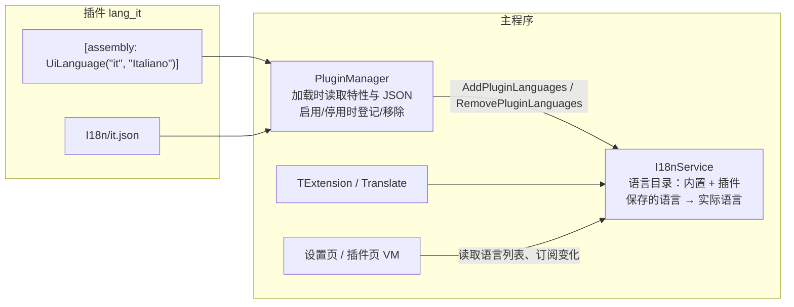

# 界面语言插件化（含意大利语迁移）

状态：第 1 版，已实施（2026-11-17），主程序与插件均已编译通过，待界面验收。实施与设计的差异见 [8.1](#81-实施记录)。  
相关文档：[插件系统](plugin-system.md) · [I18nSync 工具](../../Build/BetterGenshinImpact.I18nSync/README.md)

## 1. 目标

1. 插件可以为软件界面提供语言：插件启用后，设置页“界面语言”下拉框出现该语言，选中即切换；停用后回退，不需要重启。
2. 插件可以覆盖主程序内置语言（如 `en`、`ja`）的翻译，以后更新翻译不必等主程序发版。
3. 意大利语从主程序移出，改为 `bettergi-plugins` 仓库中的插件 `lang_it`。

## 2. 已确认的决定

| 问题 | 决定 |
| --- | --- |
| 插件形式 | 程序集 + 特性声明。插件照常带入口程序集，用程序集特性 `[assembly: UiLanguage("it", "Italiano")]` 声明语言，翻译 JSON 作为插件内容文件放在插件目录。沿用现有的清单、兼容性检查、启用停用和打包流程，不修改清单格式 |
| 已选择意大利语的老用户 | 只回退，不提示。保留 `UiCultureInfoName = "it"`，界面回退为简体中文；安装并启用插件后自动恢复意大利语 |
| 插件能否覆盖内置语言 | 允许。插件提供的语言代码与内置语言相同时，插件的翻译优先，缺少的条目再取内置翻译 |

实施中顺带确定、未单独询问的细节（可在评审时调整）：

| 问题 | 处理 |
| --- | --- |
| 特性标在哪里 | 标在程序集上，不需要为声明语言新建空类 |
| 多个插件提供同一语言代码 | 最后启用的插件生效。启动时按 `EnabledPlugins` 的顺序启用，停用再启用会移到列表末尾，所以结果在重启前后一致 |
| `User/I18n` 下非内置语言的文件 | 不再读取。现在手动放入 `User/I18n/xx.json` 并改配置也能生效，以后统一走插件。老版本残留的 `User/I18n/it.json` 因此被忽略，不会悄悄生效 |
| 设置页的“游戏语言” | 不受影响。它与界面语言共用同一个 `LanguageDict`，拆开后游戏语言仍保留 `it` |

## 3. 范围

包含：

- `UiLanguageAttribute` 特性（插件的稳定接口）；
- `I18nService` 改为“语言目录”：内置语言 + 插件语言，支持热增减和覆盖；
- `PluginManager` 加载、启用、停用插件时处理语言；
- 设置页界面语言下拉框改为从语言目录读取；插件页显示插件提供的语言；
- `I18nSync` 同步插件仓库中的语言文件；
- 新建插件工程 `BetterGI.Plugin.LangIt`，迁移 `it.json`，从主程序删除。

不包含：

- 插件自身界面文本的多语言（[插件系统第 3 节](plugin-system.md#3-范围)已排除，不变）；
- 英语、日语、俄语迁移为插件；
- 插件覆盖简体中文 `zh-Hans`、繁体中文 `zh-Hant`。技术上与其他语言走同一路径（见 5.3），不额外限制，但官方不提供；
- 启动时或设置页中提示“所选语言不可用”；
- 在 C# 代码中一次性算好的文本（如已弹出的 Toast、已生成的摘要字符串）随语言热切换刷新。这一点和现在切换语言时相同。

## 4. 现状

| 位置 | 现状 |
| --- | --- |
| `Service/I18n/I18nService.cs` | 单例。简体中文原文作为 Key 和缺省文案；`zh-Hant` 由 OpenCC 运行时转换；其他语言读取 `User/I18n/<代码>.json`。任意代码只要文件存在就能加载，代码合法时同时设置 `CurrentUICulture` |
| `Service/I18n/TExtension.cs` | `{i18n:T 中文}` 绑定 `I18nService.Revision`，语言变化时 `Revision` 递增，界面自动刷新 |
| `User/I18n/{en,it,ja,ru}.json` | 随主程序复制到输出目录（`BetterGenshinImpact.csproj` 的 `User\I18n\**`） |
| `CommonSettingsPageViewModel.LanguageDict` | 写死 `zh-Hans, zh-Hant, en, ja, ru, it`，**同时**供“界面语言”和“游戏语言”两个下拉框使用 |
| `CultureInfoNameToKVPConverter` | 写死各代码的显示名；两个下拉框的 `SelectedItem` 都通过它在代码和 `KeyValuePair` 之间转换 |
| `App.xaml.cs` `ConfigureServices` | 迁移旧代码（`zh-CN`→`zh-Hans` 等）后调用 `ChangeLanguage`，早于 `OnStartup` 中的 `PluginManager.Initialize()` |
| `PluginManager` | 首次启用时加载程序集并扫描 `[PluggableImpl]`、`[PluginSettingsView]`；插件只能为可插拔能力提供实现。可插拔能力是单选的，而语言是多个并存、用户选一个，不适合做成可插拔能力（每次 `Translate` 经过反射代理也违反“细粒度方法不做可插拔能力”的规则） |
| `Build/BetterGenshinImpact.I18nSync` | 扫描主程序的 XAML 和标记过的 C# 文案，同步 `BetterGenshinImpact/User/I18n/*.json` 的 Key |

## 5. 设计

### 5.1 总体



依赖方向：插件依赖主程序；`PluginManager`（`Core/Plugins/Hosting`）依赖 `I18nService`，把读好的语言交给它，不反过来；`I18nService` 不知道插件系统的存在，只认“来源标识 + 语言”。界面层通过 ViewModel 使用 `I18nService`。

### 5.2 特性 `UiLanguageAttribute`

放在 `Core/Plugins/`（命名空间 `BetterGenshinImpact.Core.Plugins`，对插件的稳定接口，与 `PluggableImplAttribute` 并列）：

```csharp
/// <summary>
/// 声明插件提供的一种界面语言。标在插件入口程序集上，一个插件可以声明多个。
/// 语言代码与主程序内置语言相同时，覆盖内置翻译。
/// </summary>
[AttributeUsage(AttributeTargets.Assembly, AllowMultiple = true)]
public sealed class UiLanguageAttribute(string code, string displayName) : Attribute
{
    /// <summary>语言代码，保存在 OtherConfig.UiCultureInfoName 中，如 it、pt-BR。</summary>
    public string Code { get; } = code;

    /// <summary>下拉框中显示的名称，使用该语言的自称，如 Italiano。</summary>
    public string DisplayName { get; } = displayName;

    /// <summary>语言文件相对插件目录的路径，为空时为 I18n/&lt;语言代码&gt;.json。</summary>
    public string? File { get; init; }
}
```

插件中的写法：

```csharp
[assembly: UiLanguage("it", "Italiano")]
```

语言文件格式与现在的 `User/I18n/*.json` 完全相同：Key 为简体中文原文，值为翻译，空字符串表示未翻译。

### 5.3 `I18nService`：语言目录

#### 内置语言

内置语言改为固定列表，显示名从 `CultureInfoNameToKVPConverter` 移过来：

| 代码 | 显示名 | 翻译来源 |
| --- | --- | --- |
| `zh-Hans` | 简体中文 | 无，Key 即文案 |
| `zh-Hant` | 繁體中文 | OpenCC 转换 |
| `en` | English | `User/I18n/en.json` |
| `ja` | 日本語 | `User/I18n/ja.json` |
| `ru` | Русский | `User/I18n/ru.json` |

#### 插件语言

```csharp
/// <summary>插件提供的一种界面语言，翻译已读入内存。</summary>
public sealed record UiLanguagePack(string Code, string DisplayName, IReadOnlyDictionary<string, string> Translations);
```

新增成员：

| 成员 | 说明 |
| --- | --- |
| `Languages` | 当前可选的语言：内置在前（按上表顺序），插件语言按显示名排序；被插件覆盖的内置语言仍在原位置，显示名不变 |
| `AddPluginLanguages(sourceId, packs)` | 登记某个插件的语言，同一来源重复登记时先移除旧的 |
| `RemovePluginLanguages(sourceId)` | 移除某个插件的全部语言 |
| `CurrentLanguage` | 保存的选择（即 `UiCultureInfoName`），不因回退而改变 |
| `EffectiveLanguage` | 实际使用的语言；保存的选择不可用时为 `zh-Hans` |
| `IsFallback` | 保存的选择是否不可用 |
| `LanguagesChanged` 事件 | 语言列表变化时触发，设置页据此刷新下拉框 |

每个语言代码对应一个“提供者栈”：内置语言在栈底，插件按登记顺序压栈，栈顶生效。语言代码比较不区分大小写（与现在判断 `zh-Hant` 的方式一致）。

#### 翻译查找

实际语言为 L 时，`Translate(key)` 依次取第一个非空值：

1. L 的生效插件翻译中的值；
2. L 是内置语言时，内置文件中的值（`zh-Hans` 没有文件，跳过）；
3. 回退：L 为 `zh-Hant` 时用 OpenCC 转换 Key，其他情况返回 Key。

插件语言只叠加栈顶一层，不把多个插件的翻译逐层合并，规则保持简单。插件版本落后于主程序时，新文案先取内置翻译（覆盖内置语言时），否则显示中文，与现在“翻译值为空时显示中文”的行为一致。

#### 切换与刷新

- `ChangeLanguage(code)`：记录 `CurrentLanguage`，计算 `EffectiveLanguage`，按实际语言设置 `CurrentUICulture`（代码不是合法文化名时跳过，与现在相同），`Revision` 递增。
- `AddPluginLanguages` / `RemovePluginLanguages`：更新目录，触发 `LanguagesChanged`；当前语言的生效提供者或 `EffectiveLanguage` 因此变化时，重新应用一次（`Revision` 递增，界面刷新）。
- 线程安全：`Translate` 会在后台线程调用（如 ViewModel 中拼接 Toast 文本）。目录和当前翻译表做成不可变快照，变化时整体替换引用，读取方不加锁。登记和移除只在界面线程发生（`PluginManager` 的启用、停用都在界面线程）。

#### 启动顺序

`ConfigureServices` 中照常调用 `ChangeLanguage(UiCultureInfoName)`。此时插件尚未加载，保存的选择是插件语言时先回退为简体中文。`OnStartup` 中 `PluginManager.Initialize()` 启用插件、登记语言后自动重新应用，此后才在 `_host.StartAsync()` 中创建主窗口，因此用户看到的第一屏已经是所选语言。

`PluginManager.Initialize()` 末尾若 `IsFallback` 仍为真，记录一条信息日志（“界面语言 it 不可用，使用简体中文”），不弹提示。

### 5.4 `PluginManager`

| 时机 | 处理 |
| --- | --- |
| 首次加载程序集（`Load`） | 在 `RegisterSettingsView` 之后读取程序集上的 `UiLanguageAttribute`，校验并读入 JSON，结果存入 `PluginRuntime.Languages`。校验失败抛异常，插件进入“加载失败”，与实现校验失败相同 |
| 启用（`Enable`） | 实现交给注册表成功后，调用 `I18nService.AddPluginLanguages(id, runtime.Languages)`，并写入 `PluginEntry.Languages` 供插件页显示 |
| 停用（`DisableAsync`） | 先 `RemovePluginLanguages(id)`，再移除实现。运行时二进制不兼容导致的自动停用走同一路径 |
| 再次启用 | 复用已读入的翻译，不重新读文件。升级已加载的插件本来就需要重启（文件放到 `.pending`） |

校验规则：

| 校验项 | 失败时 |
| --- | --- |
| 语言代码符合 `^[a-z]{2,3}(-[A-Za-z0-9]{2,8})*$` | 加载失败 |
| 显示名不为空 | 加载失败 |
| 同一插件内语言代码不重复 | 加载失败 |
| 文件路径是相对路径、不含 `..`，且文件存在 | 加载失败 |
| 文件能解析为 `Dictionary<string, string>`（Newtonsoft.Json，与 `I18nService` 一致） | 加载失败 |

只提供语言、不提供实现的插件是合法的：注册表收到零个实现时不做任何事。

`PluginManager` 在构造函数中注入 `I18nService`（已注册为单例）。

### 5.5 界面

#### 设置页

- `LanguageDict` 拆为两个：
  - `GameLanguageDict`：游戏语言，保持现在的 6 个代码（含 `it`），“游戏语言”下拉框和 `CultureInfoNameToKVPConverter` 不变；
  - `UiLanguageOptions`：界面语言，`ObservableCollection<UiLanguageOption>`（`Code`、`DisplayName`），从 `I18nService.Languages` 生成，收到 `LanguagesChanged` 后重建。
- 保存的界面语言不在列表中时（插件未安装或未启用），列表末尾加一项“`<名称>`（不可用）”，名称取 `CultureInfo.GetCultureInfo(code).NativeName`，取不到时用代码本身。否则下拉框会显示空白。这一项只是展示，不是提示。
- 下拉框的 `SelectedItem` 双向绑定 VM 属性 `SelectedUiLanguage`，不再直接绑定配置，也不再使用转换器和 `UiLanguageSelectionChangedCommand`。属性变化时（`OnSelectedUiLanguageChanged`）保存配置并调用 `ChangeLanguage`。
- 重建列表（构造时、`LanguagesChanged`、进入设置页时）期间置标志位：清空列表时下拉框写回的 null、重建后重新选中保存的语言，都不会写配置。重建前先把 `SelectedUiLanguage` 置为 null，因为选项是值相等的记录，重新赋同一个值不会触发变化通知。选中值为 null 或与配置相同时同样不处理。
- 进入设置页时重建一次，用户改选其他语言后，之前的“（不可用）”项随之消失。
- `CultureInfoNameToKVPConverter.GetDisplayName` 中的 `it` 保留，供游戏语言使用。

#### 插件页

`InstalledPluginItemViewModel.ImplementationsText` 增加语言部分，例如“界面语言（Italiano）”；与实现同时存在时用“；”分隔。既没有实现也没有语言时仍显示“启用后显示”。语言变化时与实现一起通知刷新。

### 5.6 `I18nSync`

意大利语文件移到插件仓库后，仍需要随主程序文案同步 Key：

- `I18nSync` 新增可重复的参数 `--extra-i18n-dir <目录>`：扫描结果（主程序的 Key 集合）同样同步到这些目录下的 `*.json`，规则与主程序语言文件相同（含 `--add-only`、`--check`）。
- `Build/Scripts/i18n-sync.ps1`：同级的 `bettergi-plugins` 仓库存在时，把 `src/BetterGI.Plugin.*/I18n` 中存在的目录逐个加入 `--extra-i18n-dir`，并输出加入了哪些目录；不存在时只同步主程序，行为与现在相同。

## 6. 意大利语插件

### 6.1 插件工程

```text
bettergi-plugins/src/BetterGI.Plugin.LangIt/
├─ BetterGI.Plugin.LangIt.csproj
├─ PluginInfo.cs            [assembly: UiLanguage("it", "Italiano")]
└─ I18n/it.json             从主程序迁移
```

```xml
<Project Sdk="Microsoft.NET.Sdk">

	<PropertyGroup>
		<!-- 插件标识与名称，写入 plugin.json -->
		<BgiPluginId>lang_it</BgiPluginId>
		<BgiPluginName>界面语言：意大利语</BgiPluginName>
		<Version>1.0.0</Version>
		<Description>为 BetterGI 界面提供意大利语（Italiano）。</Description>
		<!-- 不使用 OCR 共享源码 -->
		<BgiIncludeSharedSource>false</BgiIncludeSharedSource>
	</PropertyGroup>

	<!-- 语言文件按相同的相对路径放进插件目录 -->
	<ItemGroup>
		<BgiPluginContent Include="I18n\it.json" />
	</ItemGroup>

</Project>
```

- 插件标识约定：`lang_<语言代码>`，代码转小写、`-` 换成 `_`（如 `pt-BR` → `lang_pt_br`）。覆盖内置语言的插件同样按此命名。
- `PackageId` 按默认的工程名 `BetterGI.Plugin.LangIt`，以 `BetterGI.Plugin.` 开头，符合官方插件约定。
- `sdk_version` 由构建取主程序版本，即包含 `UiLanguageAttribute` 的版本。更早的 BetterGI 安装此插件时显示“不兼容”，不需要额外处理。
- 构建产物：`artifacts/plugins/lang_it/`（`plugin.json`、`BetterGI.Plugin.LangIt.dll`、`I18n/it.json`）和 `artifacts/lang_it-1.0.0.zip`。
- `dotnet sln bettergi-plugins.sln add src/BetterGI.Plugin.LangIt/BetterGI.Plugin.LangIt.csproj --solution-folder src --include-references false`。

### 6.2 插件仓库 README

- “插件列表”新增“界面语言”一节：

  | 插件标识 | 名称 | 语言 |
  | --- | --- | --- |
  | `lang_it` | 界面语言：意大利语 | Italiano（`it`） |

  说明：在插件页启用后，到“设置 → 界面语言”中选择。
- 新增“新增一个语言插件”步骤：复制 `BetterGI.Plugin.LangIt`；修改 `BgiPluginId`、`BgiPluginName`、`Description` 和 `BgiPluginContent`；修改程序集特性；在主程序仓库运行 `i18n-sync.ps1` 补齐 Key；加入解决方案。
- 目录结构中 `src/Shared` 的说明不变。

### 6.3 主程序侧的迁移

- 删除 `BetterGenshinImpact/User/I18n/it.json`（内容原样移到插件，保留 Git 历史说明：在两个仓库的提交信息中互相注明）。
- 内置语言列表不含 `it`。
- 已选择 `it` 的用户：配置不改；未安装插件时界面为简体中文，下拉框显示“italiano（不可用）”；安装并启用 `lang_it` 后立即恢复意大利语。
- 老版本残留的 `User/I18n/it.json` 不再读取，也不清理（`LegacyDataCleaner` 只处理目录，单个文件不值得为此扩展）。

## 7. 改动文件

主程序仓库：

| 文件 | 改动 |
| --- | --- |
| `Core/Plugins/UiLanguageAttribute.cs` | 新增 |
| `Service/I18n/UiLanguagePack.cs` | 新增：插件语言记录，以及设置页使用的 `UiLanguageOption` |
| `Service/I18n/I18nService.cs` | 内置语言列表、提供者栈、`CurrentLanguage`/`EffectiveLanguage`、`AddPluginLanguages`/`RemovePluginLanguages`、`LanguagesChanged`、不可变快照；更新类注释 |
| `Core/Plugins/Hosting/PluginManager.cs` | 注入 `I18nService`；`Load` 读取语言；`Enable`/`DisableAsync` 登记与移除 |
| `Core/Plugins/Hosting/PluginRuntime.cs` | 新增 `Languages` |
| `Core/Plugins/Hosting/PluginEntry.cs` | 新增 `Languages`（显示用） |
| `ViewModel/Pages/Plugins/InstalledPluginItemViewModel.cs` | `ImplementationsText` 包含语言 |
| `Core/Plugins/Hosting/PluginLanguageReader.cs` | 新增：读取并校验 `[UiLanguage]`，读入语言文件 |
| `ViewModel/Pages/CommonSettingsPageViewModel.cs` | 拆分 `GameLanguageDict`、`UiLanguageOptions`、`SelectedUiLanguage`；订阅 `LanguagesChanged`；删除 `UiLanguageSelectionChangedCommand` |
| `View/Pages/CommonSettingsPage.xaml` | 游戏语言下拉框改绑 `GameLanguageDict`；界面语言下拉框改绑 `UiLanguageOptions`、`SelectedUiLanguage` |
| `User/I18n/it.json` | 删除 |
| `Build/BetterGenshinImpact.I18nSync/*`、`README.md` | `--extra-i18n-dir` |
| `Build/Scripts/i18n-sync.ps1` | 自动加入插件仓库的语言目录 |
| `Docs/design/plugin-system.md` | 第 3 节“不包含”中注明界面语言已支持并链接本文；10.1、11.2 补充语言的扫描、登记与移除 |
| `Docs/design/README.md` | 文档列表加入本文 |
| `CONTEXT.md` | 新增术语“界面语言”“语言插件” |

`bettergi-plugins` 仓库：

| 文件 | 改动 |
| --- | --- |
| `src/BetterGI.Plugin.LangIt/*` | 新增工程（6.1） |
| `bettergi-plugins.sln` | 加入工程 |
| `README.md` | 6.2 |
| `Directory.Build.props` | `BgiAssetsModelVersion` 由 1.0.39 改为 1.0.41，与主程序一致（见 8.1） |

## 8. 实施步骤

1. 主程序：`UiLanguageAttribute`、`I18nService` 改造，内置列表去掉 `it`，删除 `it.json`；编译通过。
2. 主程序：`PluginManager` 登记语言，插件页显示；设置页下拉框拆分与改绑定；编译通过。
3. `I18nSync` 与脚本支持插件语言目录。
4. 插件仓库：新建 `BetterGI.Plugin.LangIt`，迁移 `it.json`，更新 README；`dotnet build bettergi-plugins.sln -c Debug` 生成插件并复制到主程序 Debug 输出。
5. 运行 `i18n-sync.ps1 -Check`，确认主程序和插件的语言文件都是最新。
6. 界面验收（由用户执行，按项目约定不由 harness 启动主程序）：
   - 未安装插件、配置为 `it`：界面为简体中文，下拉框显示“italiano（不可用）”，无弹窗；
   - 安装并启用 `lang_it`：界面立即变为意大利语，下拉框出现 Italiano；
   - 停用：立即回退简体中文，配置仍为 `it`；再次启用恢复；
   - 重启后保持；
   - 游戏语言下拉框仍有 Italiano，选择不受影响；
   - 覆盖内置语言：临时做一个 `[assembly: UiLanguage("en", "English")]` 的测试插件，只翻译少量条目，确认这些条目生效、其余条目仍为内置英文，停用后恢复。

### 8.1 实施记录

2026-11-17 实施，步骤 1～5 已完成，步骤 6 待用户验收。与设计的差异：

- 设置页界面语言下拉框没有采用“`SelectedValue` 单向绑定 + 命令”，改为 `SelectedItem` 双向绑定 VM 属性 `SelectedUiLanguage`，由 VM 在重建列表后显式重新选中（5.5）。原方案依赖 ComboBox 在列表重置后按 `SelectedValue` 自动找回选中项，行为不可靠。
- 回退日志写在 `PluginManager.Initialize()` 末尾，`App.xaml.cs` 不改。
- 校验与读取语言文件放在单独的 `PluginLanguageReader`，在注册设置界面之前执行：语言声明不合法时插件加载失败，不留下已注册的设置模板。
- `bettergi-plugins` 的 `BgiAssetsModelVersion` 仍是 1.0.39，而主程序已引用 1.0.41，任何插件构建都会报 NU1605 包降级错误。已改为 1.0.41（核对过 1.0.41 包含 OCR 插件需要的全部模型目录）。

验证结果：

- 主程序 `dotnet msbuild BetterGenshinImpact.sln -restore -p:Configuration=Debug` 通过；
- `BetterGI.Plugin.LangIt` 构建通过，产物 `artifacts/plugins/lang_it/` 含 `plugin.json`、DLL（包含 `UiLanguageAttribute("it", "Italiano")`）和 `I18n/it.json`，安装包 `artifacts/lang_it-1.0.0.zip`；
- `i18n-sync.ps1 -Check` 已识别插件目录。实施前 `en`、`ja`、`ru`、`it` 四个文件就已与主程序不同步（缺 250 个 Key、有 77 个废弃 Key），本次只新增了 `{0}（不可用）` 一个 Key。尚未执行同步写入，由维护者决定是否删除废弃 Key。

## 9. 风险

| 风险 | 处理 |
| --- | --- |
| 插件语言在启动早期不可用，主窗口创建前的文本显示中文 | 主窗口在插件启用之后才创建；更早的只有控制台和启动失败提示，可接受 |
| `Translate` 跨线程读取时目录正在变化 | 不可变快照整体替换 |
| 第三方插件覆盖内置语言，显示误导性文本 | 与插件整体的信任模型一致（插件系统第 15 节：不做沙箱），用户自行选择启用的插件 |
| 插件翻译落后于主程序 | 缺少的条目回退到内置翻译或中文，不会显示空白；`i18n-sync.ps1` 同步插件仓库后发布新版插件 |
| 重建下拉框列表时把 null 写回配置 | 下拉框只绑定 VM 属性，重建期间的选中变化不写配置（5.5） |

## 10. 待确认问题

无。第 2 节“顺带确定的细节”如需调整，在评审时提出。
