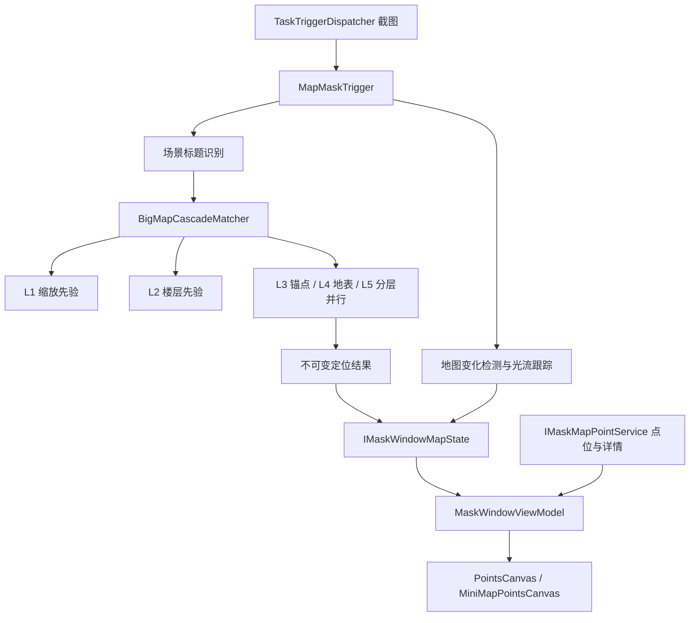

# 地图遮罩模块

地图遮罩将原神地图截图定位到当前场景的地图坐标，并让遮罩窗口显示用户选中的点位。它负责大地图定位、小地图视口更新、独立地图识别和定位诊断；点位查询、点位详情和窗口渲染分别沿用服务层与 UI 层。

核心代码位于 [`GameTask/MapMask`](../../BetterGenshinImpact/GameTask/MapMask)，点位模型位于 [`Model/MaskMap`](../../BetterGenshinImpact/Model/MaskMap)。窗口与状态接口的整体设计见 [MaskWindow 设计](../design/mask-window.md)。

## 职责与入口

| 组件 | 职责与边界 |
| --- | --- |
| `MapMaskTrigger` | 接收截图，管理地图会话、截图修订、取消、后台任务和结果发布；借用 `GameRuntime` 的地图状态接口 |
| `BigMapCascadeMatcher` | 大地图匹配入口；读取 L1/L2 先验，编排 L3/L4/L5，协调共享截图特征，并在分支退出后更新成功位置和锚点学习 |
| `BigMapZoom` | L1：读取缩放滑块，根据成功视口校准和预测比例；`BigMapZoomSignal`、`BigMapScalePrior` 与组件放在一起 |
| `LayerButtonGeometry` | L2：读取当前蓝色楼层按钮；`LayerButtonSignal` 与按钮识别放在一起 |
| `BigMapAnchorMatcher` | L3：检测传送锚点，对照离线点表和已学习锚点定位；使用 `BigMapAnchorGeometry` 验证多点一致性，使用 `BigMapAnchorAtlas` 保存已确认参考 |
| `BigMapLayerMatcher` | L5：统一管理层清单、候选排序、搜索游标、上一层及有界特征缓存；`LayerInfo` 和 `CandidateIndex` 是其嵌套实现 |
| `BigMapImageFeatures`、`BigMapFeatureGeometry` | 共享的图像特征生命周期、等比缩放与平移验证、分层外观核验；供 L4、L5 及光流几何校验复用 |
| `BigMapFrameTracker`、`BigMapMotionTracker` | 前者判断地图是否变化，后者根据已定位视口进行相邻帧光流跟踪；分别维护变化基准与跟踪参考 |
| `BigMapSceneReader`、`BigMapUiLayout` | 后台识别场景标题，以及检测右侧详情或标记面板，统一可见地图区域 |
| 公共地图层 `MapMatchResult` | 大小地图共用的不可变定位结果，统一校验视口、取整和场景坐标转换；不持有截图或原生资源 |
| `MapMaskConfig`、`MapMaskStateStorage` | 功能配置，以及按点位数据源隔离的选中类别、隐藏点位状态 |

L4 地表匹配保留在 `BigMapCascadeMatcher.MatchSurface`，优先搜索上一视口附近的特征块，再回退全图。当前没有再为该流程引入独立服务或通用阶段接口。

## 数据流



### 大地图

1. 捕获线程约每 50 ms 处理一次输入。地图移动、缩放、面板变化会增加修订号并取消旧帧；开关地图还会更换会话号。
2. 有可信参考时立即用光流更新视口；约稳定 120 ms 后提交绝对定位。只保留一个执行任务和最新待处理截图，失败的稳定视口间隔至少 150 ms 重试。
3. 后台读取右下角标题，选取 `MapTypes` 和 `SceneBaseMap`。切换场景时清理旧坐标系的视口与跟踪参考。
4. 读取缩放、选中楼层和可见地图区域；L3/L4/L5 通过共享线程池同时启动。L4/L5 使用同一份截图特征，由先进入的 SIFT 分支提取一次，另一个异步等待。
5. 地表优先采用已完成的 L3/L4 有效结果。地下可以先发布平面坐标，再由 L5 确认楼层；结果回调先于慢分支回收。所有发布都重新检查会话、修订和运行环境，丢弃迟到结果。
6. 所有分支退出后提交位置先验、缩放校准和高置信度地形结果产生的锚点参考，再处理下一帧。

L5 优先验证上一成功层，其次使用粗检索、按钮层序和最近成功位置排序。每帧最多探索 12 个层候选，探索软预算为 600 ms；该预算只约束探索循环，不包含首次粗索引构建、共享截图特征提取和后台收尾。一轮较小层图未命中后回退到更高分辨率。候选排序不能直接产出楼层，仍需独立的几何和外观核验。

### 小地图

主界面启用小地图遮罩时，触发器调用 `NavigationInstance.GetPositionStable`，根据当前场景生成视口并发布到同一个状态接口。它复用自动寻路的小地图定位流程，不经过大地图 L1～L5。切换场景后会重置小地图位置先验。

大小地图共用公共地图层的 `MapMatchResult`（由原 L1～L5 的 `BigMapMatchResult` 下移并改名），没有单独的小地图 Info 类型。`ISceneMap.GetMiniMapPosition` 各重载返回 `MapMatchResult?`，失败为 null；结果中的 `ImagePosition` 保留原生图像坐标的亚像素精度，`GenshinPosition` 为游戏坐标，`LayerScale` 为同一次成功匹配的层图标定值。模板匹配同时返回层名、楼层及归一化得分，SIFT 未使用层图标定时 `LayerScale` 为 null。大地图 L5 也在同一结果字段中提供层比例。导航保留原有只返回点的调用方式，通过 `GetPositionStable` 的 `out MapMatchResult?` 重载向遮罩透传结果；全图重试后整体替换，调用方无需读取匹配器内部状态。

## 复用的其他模块

| 上游能力 | 本模块的使用位置与用途 | 依赖方向 |
| --- | --- | --- |
| 实时触发器与运行环境：`ITaskTrigger`、`TaskTriggerDispatcher`、`GameRuntime` | 提供截图、UI 分类、功能启停、停止状态和地图状态接口；本模块不创建截图器或游戏会话 | 地图遮罩接入任务框架 |
| 界面识别：`Bv`、`CaptureContent`、`ImageRegion` | 判断大地图或主界面，借用捕获帧和灰度缓存；后台计算使用独立克隆 | 地图遮罩 → 通用识别 |
| 地图基础：`MapManager`、`SceneBaseMap`、`MapTypes` | 场景选择、资源原点和游戏坐标/地图图像坐标换算 | 匹配器、点位服务 → 通用地图 |
| 地表特征：`BigMapTeyvat256Layer`、场景地表层、`KeyPointFeatureBlockHelper` | L4 复用现有地表特征和特征分块，支持局部搜索与全图回退；不释放共享地表资源 | L4 → 通用地图与特征匹配 |
| 识别素材：`RecognitionAssets`、`GameTaskManager.LoadAssetImage`、`MapLazyAssets` | 复用 QuickTeleport 的缩放滑块、楼层按钮、传送锚点模板，以及场景离线传送点表 | L1/L2/L3 → 通用素材加载 |
| OCR：`OcrFactory.Paddle` | 后台读取场景标题，沿用当前配置的 OCR 实例；缓存标题字形以减少重复识别 | 场景识别 → OCR |
| 自动寻路：`NavigationInstance`、`MapAssets` | 小地图稳定定位及小地图显示范围 | 小地图遮罩 → 自动寻路定位能力 |
| 遮罩状态基础设施：`IMaskWindowMapState`、`MaskWindowMapState` | 跨线程合并发布视口、场景、诊断和时间戳；匹配器不直接操作 View 或 Dispatcher | 触发器 → Core/Mask 状态接口 |
| 点位服务与网络：`IMaskMapPointService`、米游社/HoYoLAB API、空荧酒馆服务 | UI 请求类别、当前场景点位和详情；点位服务复用 `IAppCache`，API 使用现有 `IHttpClientFactory` | UI → 点位服务 → API/缓存 |

运行时地图和识别素材来自 `BetterGI.Assets.*` 外部包。`QuickTeleport` 是复用的素材类别；地图遮罩识别只读图片，不调用自动传送的点击、拖动或传送操作。

## 依赖本模块的功能

| 消费方 | 依赖内容 | 接口或入口 |
| --- | --- | --- |
| 实时功能装配 | 创建并调度地图遮罩触发器 | `GameTaskManager` 创建 `MapMaskTrigger`，调度器通过 `ITaskTrigger` 调用 |
| 大地图点位遮罩 | 需要当前地图场景和视口，把点位投影到游戏画面 | `MaskWindowViewModel.ApplyMapSnapshot` 读取状态，`PointsCanvas` 消费绑定后的视口与点位 |
| 小地图点位遮罩 | 需要当前小地图视口 | 同一状态快照，经 `MaskWindowViewModel` 绑定到 `MiniMapPointsCanvas` |
| 定位诊断显示 | 显示分支、楼层、排队/执行时间及截图到 UI 的延迟 | 地图快照中的诊断和单调时间戳，经 VM 更新到 `MaskWindow` |
| 点位选择器与隐藏状态 | 持久化不同数据源下的选中类别、隐藏点位 | `MaskWindowViewModel` 使用 `MapMaskStateStorage` |
| 触发器设置和快捷键 | 启停功能，配置小地图、诊断、点位源和语言 | 设置页、`HotKeyPageViewModel` 与 `AllConfig.MapMaskConfig` |
| 地图点位 API 适配 | 根据数据源、语言和地图种类请求点位，转换网页坐标 | `MaskMapPointService` 使用 `MapPointApiProvider`、`MapMaskConfig`、`GameWebMapCoordinateConverter`；`HoYoLabMapApiService` 使用语言配置 |

当前生产代码中，`BigMapCascadeMatcher` 的直接调用方是 `MapMaskTrigger`。自动寻路、自动传送等任务继续使用既有地图定位入口，没有改成依赖此大地图匹配器。`TaskRunner` 与 `GameRuntimeService` 会重置共享地图状态，但不调用大地图匹配算法。

## 坐标与结果约定

- `MapMatchResult.Viewport2048` 名称沿用提瓦特历史约定；提瓦特结果使用 2048 级图像坐标，独立地图使用自身原生图像尺度。所有结果、点位和视口必须属于同一个 `MapTypes`。
- 提瓦特 L4 使用 256 级地表特征，输出前乘以 8；独立地图地表使用原生特征坐标。
- 层图先补偿特征提取时的缩小比例，再除以层元数据 `Scale` 得到游戏单位，最后通过 `SceneBaseMap` 转回场景图像坐标。
- `GameWebMapCoordinateConverter` 只负责各网页地图到游戏坐标的转换，点位服务再调用场景地图转换到图像坐标；独立地图不能套用提瓦特比例与原点。
- `Floor == null` 表示未确认楼层。UI 按钮列序号与素材楼层号不保证一致；地下的地表背景匹配不能直接报告地表，公共背景也不能冒认其他层。
- 右侧弹框只缩小参与识别的区域，输出仍对应完整截图视口；不能把裁剪后的局部尺寸当成全屏尺寸。

## 点位命中与重叠选择

`PointsCanvas` 在 UI 层统一完成绘制和命中的地图到屏幕坐标投影。图标固定为 32 DIP，点击区域为半径 15 DIP 的圆，比图标直径缩小 2 DIP，不随地图缩放放大；悬停、左键和右键使用同一点击范围。边缘部分可见的图标仍可选中，尚未定位或无效视口不参与命中。

隐藏图标统一绘制在未隐藏图标下方，同一隐藏状态沿用来源顺序。命中和重叠候选菜单按绘制反序遍历，优先选中并列出未隐藏点位；隐藏点仍可在菜单中选中，以便恢复显示。

点击按绘制顺序先找到最上层命中的图标，再收集与该图标点击圆交叠面积超过单圆面积 50% 的可见点位。判定采用屏幕坐标中的等半径两圆交叠面积，不用包围矩形或地图坐标距离代替；候选只比较被点击图标，不沿相邻点链式扩展。

单点直接执行既有命令，多点在图标旁展开选择菜单，显示类别图标、名称、点位 ID 和隐藏状态。选择后，左键继续调用 `PointClickCommand` 打开该点详情，右键继续调用 `PointRightClickCommand` 切换该点隐藏状态；详情锚点保持为最终选中的图标中心。菜单只处理输入消歧，点位查询与隐藏状态仍由 ViewModel 负责。

菜单沿用 WPF-UI 默认样式和 WPF 的键盘导航、菜单外点击关闭及长列表滚动。视口、点位、标签、控件尺寸或显示状态变化时关闭菜单，防止旧候选跨地图保留。`PointsCanvasTests` 在独立 STA 线程实际创建画布并布局菜单，覆盖不同缩放、圆形边界、50% 面积临界值、底层点位选择及左右键命令，不启动主程序或显示窗口。

二级菜单选定后，必须等原生菜单关闭及输入焦点恢复完成，再激活遮罩窗口并执行点位命令。直接点击图标时，遮罩取得前台，调度器按既有游戏前台判断暂停地图截图投递；如果菜单关闭时恢复到游戏前台，定位更新就会继续并触发原有的弹窗关闭规则。因此菜单路径显式把焦点交回遮罩，不修改详情生命周期或视口更新规则。测试覆盖原生菜单输入恢复、遮罩激活、点位命令执行的先后顺序；实际系统焦点交接由用户运行程序验证。

## 线程、取消与资源生命周期

大地图 worker 串行处理各帧，帧内 L3/L4/L5 并行，使用的是 .NET 共享线程池。地图变化会立即请求取消；OpenCV 单次原生调用需要返回后才能响应，不能从捕获线程强行释放其 `Mat`。

`BigMapParallelStages` 区分结果发布和分支回收：有效坐标可先回调，匹配任务返回前仍等待所有分支结束。调用方必须等待 `MatchAsync` 完成后，才能 `Reset`、`InvalidateView`、`Dispose` 或启动下一帧。发布回调只消费不可变结果与诊断，不读取正在修改的匹配缓存。

| 资源 | 所有者与释放时机 |
| --- | --- |
| 后台输入截图克隆 | `MapMaskTrigger.ComputeWorkItem`；替换待处理帧或该帧全部处理结束后释放 |
| 单帧缩小图、描述子 | `BigMapImageFeatures`；L3/L4/L5 全部退出后释放 |
| SIFT 与地表检索器 | `BigMapCascadeMatcher`；实例释放时回收。L5 借用同一 SIFT，始终在共享截图特征提取完成后使用 |
| L5 层特征 | `BigMapLayerMatcher` 的最多 12 项 LRU 缓存；淘汰或实例释放时回收，`Reset` 保留可复用特征 |
| L5 粗检索索引 | 按场景素材目录在进程内复用，锁保护构建和原生检索；保留到进程退出，不写入外部资源目录 |
| 地表训练特征、通用模板 | 由通用地图/素材模块共享，本模块只借用，不负责释放 |
| 光流参考与变化基准 | 相应 tracker 持有并加锁保护，关图和停用时重置 |

切场景时重建匹配器，关闭地图时清除会话先验，移动视口时只重置候选搜索。锚点学习只接收高置信度的 L4/L5 已确认结果，保留在 `User/MapCache/big-map-anchors-*.json`（提瓦特为 `big-map-anchors-v1.json`）；不向外部地图包写入数据。选中类别和隐藏状态由 `MapMaskStateStorage` 保存到 `User/MapMask`。

诊断中的分支执行时间不包含全部用户等待时间。结果就绪、后台收尾、截图到 UI 的延迟、本次重定位总耗时分别统计；最后两项还可能包含稳定等待、排队、初始化及重试。

## 回归测试与资源

测试代码位于 [`MapMaskTests`](../../Test/BetterGenshinImpact.UnitTest/GameTaskTests/MapMaskTests)，35 张截图、12 份坐标 JSON 及来源说明统一保存在资源子模块 [`Assets/MapMask`](../../Test/BetterGenshinImpact.UnitTest/Assets/MapMask)。资源仓库为 [BetterGI.UnitTest.Assets](https://github.com/huiyadanli/BetterGI.UnitTest.Assets)。

在主仓库根目录初始化指定版本的子模块，再编译与测试：

```powershell
git submodule update --init -- Test/BetterGenshinImpact.UnitTest/Assets
dotnet msbuild BetterGenshinImpact.sln -restore -p:Configuration=Debug -nologo -tl:off -clp:ErrorsOnly
dotnet test Test/BetterGenshinImpact.UnitTest/BetterGenshinImpact.UnitTest.csproj --no-build --no-restore --filter 'FullyQualifiedName~MapMaskTests'
```

编译时资源统一复制到测试输出 `TestData/MapMask`，测试从 `AppContext.BaseDirectory` 读取；缺失样本必须失败。更新资源先提交、发布子模块，再更新主仓库指针，不使用 `--remote` 自动漂移资源版本。

现有回归覆盖真实截图的全屏坐标、楼层、独立地图 OCR、缩放、弹框和日志遮挡，以及几何负例、拖动跟踪、取消、提前发布、图像生命周期和长时间静止后的截图调度。单元测试无需游戏运行。当前测试初始化日志会涉及程序单实例初始化，运行中的 BetterGI 可能导致测试宿主退出，执行测试前需关闭对应实例。
